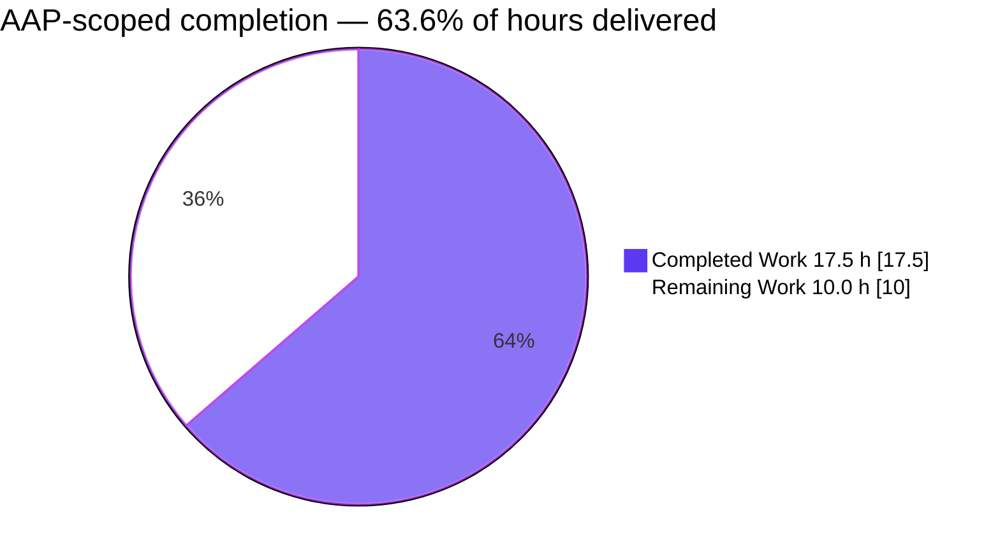
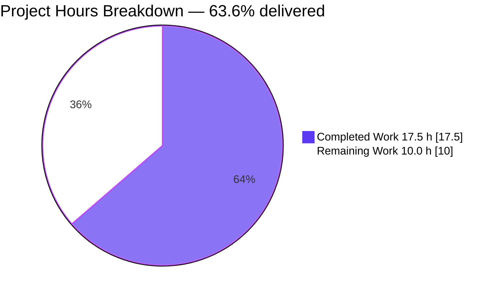

# 1. Executive Summary

## 1.1 Project Overview

The warehouse catalogue API is a small Express service that receives stock, creates shipments that reserve it, dispatches them and reports what remains, keeping all state in process memory across five routes and a health check. This release gives it its first end-to-end test: one scenario that starts the service through its own entry point on a reserved port and drives an operator's journey — intake, reservation, dispatch, two read-backs — over real loopback HTTP, asserting each step's status and body. Its audience is the team that now owns the service and its coverage. Production code is untouched and no dependency was added.

## 1.2 Completion Status

**63.6% complete** — 17.5 hours delivered of 27.5 scoped, leaving 10.0 hours of path-to-production work.



| Metric | Value |
|---|---|
| Total Hours | 27.5 |
| Completed Hours (Baseline: Human with agentic-assist) | 17.5 |
| Remaining Hours | 10.0 |
| Completion | 63.6% |

Completed Work = Dark Blue (#5B39F3); Remaining Work = White (#FFFFFF), outlined in Violet-Black (#B23AF2). Every plan requirement is met; the remaining hours are the service's path to production.

## 1.3 Key Accomplishments

- End-to-end operator journey asserted at every step against a spawned process.
- The service starts through `src/index.js` on a harness-reserved port, never in-process.
- Readiness is bounded (100 ms poll, 10 s deadline) and fails fast with the port and the child's output.
- Teardown ends the child with `SIGTERM`, escalating to `SIGKILL` after 5 s.
- Every request carries an abort bound; a stalled endpoint fails in about five seconds by name.
- Suite green in 240 ms — 2 tests, 2 passed, 0 failed — discovered by the existing `npm test` with no manifest change.
- Production code byte-identical to the base; no dependency, lockfile or install artefact added.

## 1.4 Critical Unresolved Issues

Seven open items. The scope was one high-priority behaviour, and it is covered (1 of 1), so none is unfinished test work: 2 release-blocking, 1 coverage gap, 1 decision, 1 documentation item, 2 accepted residuals.

| Issue | Impact | Owner | ETA |
|---|---|---|---|
| Unparseable or oversized JSON bodies return express's default HTML page with a framework stack and absolute `node_modules` paths (`src/server.js:3`, no error middleware, `NODE_ENV` unset) | Internal detail disclosed to any caller; blocks exposure beyond loopback | Backend owner | 1 sprint (3.0 h) |
| The documented start command `npm start` runs `src/server.js`, which never binds a port and exits 0 | A deployment following the README serves no traffic | Service owner | 1 sprint (1.5 h) |
| Seven rejection contracts (400/409/404 across four routes) have no automated test | A guard-clause regression would ship undetected | QA owner | 1 sprint (4.5 h) |
| Code coverage of `src/server.js` stays at 45.28% of lines; the 90% figure is met only in behaviours | A coverage dashboard reads no improvement; needs a metric decision | Engineering lead | 1 sprint (1.0 h) |
| `README.md:13` still says only the health route is tested | A reader is told the journey is untested when it now is | Service owner | With the start-command fix |
| The readiness deadline can overrun by up to one 100 ms poll | None: the wait is bounded and ends on the deadline | Accepted | — |
| A body-stream abort after response headers is not re-prefixed with the step name | None: bounded by the request timeout and attributable from the stack | Accepted | — |

## 1.5 Access Issues

No access issues identified: no credentials, secrets, API keys or external services are needed, and `PORT` is the only variable the service reads.

## 1.6 Recommended Next Steps

1. **[High]** Answer malformed and oversized bodies with the service's existing `{"error": …}` contract, and run with `NODE_ENV=production`.
2. **[High]** Add contract tests for the seven rejection responses.
3. **[Medium]** Repoint the `start` script at `src/index.js` and correct the README.
4. **[Medium]** Decide whether release is gated on behaviours or on lines.
5. **[Low]** Run the suite and a dependency audit in a pipeline.

# 2. Project Hours Breakdown

## 2.1 Completed Work Detail

| Component | Hours | Description |
|---|---|---|
| End-to-end harness lifecycle | 5.0 | Reserves an ephemeral loopback port in the parent, spawns `src/index.js` with that port, polls `/health` every 100 ms to a 10 s deadline, fails fast on a dead or unstartable child, and tears down with `SIGTERM` → `SIGKILL` after 5 s inside a `finally`. Covers AAP 0.5.4, 0.11.4 and 0.9.1 (`test/e2e/shipment-flow.test.js:23-131`). |
| Five-step operator journey and assertions | 3.0 | Intake, reservation, bodyless dispatch, shipment read-back and stock read-back, each asserting its status plus body fields with the intake body compared in full — the behaviour that moves end-to-end coverage from 0 of 1 to 1 of 1 (AAP 0.2.5, 0.5.3, 0.8.4). |
| Bounded waits and failure diagnostics | 3.0 | Per-attempt readiness slices combined with a spawn-failure abort, a 5 s abort on each scenario request and a 60 s backstop, plus diagnostics that name the failing step and quote the service's body. Exercised with six failure probes: signal death, unspawnable executable, non-200 readiness, silent readiness, stalled request and a SIGTERM-ignoring child (AAP 0.8.4, 0.10). |
| Suite integration, stability and concurrency validation | 2.5 | Whole-package and single-file runs, spec-reporter output, repeated and simultaneous suite runs, working-directory independence, and process/port hygiene sweeps confirming no orphan child or listener survives (AAP 0.5.5, 0.6.3, 0.11.2, 0.12.3). |
| Live route-surface and process-bootstrap verification | 3.0 | Five routes plus `/health` replayed over loopback, guard responses observed, `PORT` honoured with its 3000 fallback and the `PORT=0` constraint confirmed, startup line on stdout, `EADDRINUSE` failure in about 80 ms, `SIGTERM` exit and port release (AAP 0.4.1, 0.11.3, 0.12.1). |
| Structure, naming and comment conformance | 1.0 | Two module-scope helpers, flat structure with no `describe` nesting, the specified plain-English test name, inline literals and a header that states why the file must cross a process boundary (AAP 0.6.2, 0.1.2). |
| **Total** | **17.5** | |

## 2.2 Remaining Work Detail

| Category | Hours | Priority |
|---|---|---|
| Error-response hygiene: a 4-arity error handler answering malformed (400) and oversized (413) bodies with the existing `{"error": …}` contract, plus tests for both triggers | 3.0 | High |
| Automated protection for the seven rejection contracts (400 invalid inventory payload, 409 duplicate sku, 404 sku not found, 400 quantity must be positive, 409 insufficient inventory, 404 shipment not found on read and on dispatch, 409 shipment cannot be dispatched) — also the only realistic route to raising `src/server.js` line coverage above 45.28% | 4.5 | High |
| A start command that serves traffic (`start` repointed at `src/index.js`) and run/test documentation that matches the code | 1.5 | Medium |
| Coverage-metric decision: whether release is gated on behaviours (1 of 1 today) or on lines, and the in-process or instrumented work that the second choice implies | 1.0 | Medium |
| **Total** | **10.0** | |

## 2.3 Hours Methodology and Validation

Hours are estimated per deliverable, not per file: a spawn-and-teardown harness with five ordered HTTP steps and six failure probes is sized at 17.5 hours of senior engineering, with testing and diagnostics at roughly 35% of that total. The remaining items are the service's own path to production and are sized the same way.

Completion is calculated as completed hours divided by total scoped hours: **17.5 ÷ (17.5 + 10.0) = 63.6%**. The two tables above are the calculation — 17.5 completed plus 10.0 remaining equals the 27.5 total hours reported in Section 1.2, and the 10.0 hours appear again as the "Remaining Work" value in Section 7. Confidence is high for the delivered work, whose scope is pinned by a single file and a measured suite; it is medium for the two error-path items, whose size depends on how much of the rejection surface the owning team decides to protect in one change.

# 3. Test Results

Every figure below was produced by running the suite in this repository during this assessment on Node.js v22.23.5 with `express` 4.21.2.

| Area / Category | Framework | Tests | Passed | Failed | Coverage | What This Proves |
|---|---|---|---|---|---|---|
| End-to-end operator journey (intake → reservation → dispatch → shipment and stock read-back) | `node:test` with `node:assert/strict` and global `fetch`, under the TAP and spec reporters | 1 | 1 | 0 | 86.38% lines / 70.00% branches / 55.56% functions over the scenario file itself | A caller can take stock in, reserve it in a shipment, dispatch it and read both the dispatched status and the remaining quantity back across a real process boundary. |
| Integration health contract (`test/routes.test.js`) | `node:test`, in-process `app.listen(0)` | 1 | 1 | 0 | 100.00% lines / 100.00% branches / 100.00% functions | `GET /health` answers 200 with exactly `{"status":"ok"}` and the pre-existing contract still holds. |
| Whole-package gate (`npm test`, pathless `node --test`) | `node:test` | 2 | 2 | 0 | `src/server.js` 45.28% lines / 100.00% branches / 16.67% functions (uncovered 11-18 24-35 39-41 45-50); all files 80.00 / 75.00 / 48.00 | The runner discovers both suites without a manifest change and they pass together in 240 ms, with 0 skipped and 0 todo. |

Suite totals observed: 2 tests, 2 passed, 0 failed, exit 0. No coverage threshold and no security scanner are configured anywhere in the package, so a green suite is the whole gate; the coverage table above is the runtime's own `--experimental-test-coverage` output and is recorded, not enforced.

**Not Covered** — capabilities that exist in the service but are exercised by no test, and what a human should exercise before release:

- **The seven rejection contracts** — `400 invalid inventory payload`, `409 duplicate sku`, `404 sku not found`, `400 quantity must be positive`, `409 insufficient inventory`, `404 shipment not found` on both read and dispatch, and `409 shipment cannot be dispatched` (`src/server.js:12-15`, `26-30`, `40`, `46-47`). No assertion anywhere in the repository reaches them; a regression in any guard clause would pass the suite.
- **The explicit-carrier dispatch branch** — a dispatch that supplies its own carrier instead of relying on the `'standard'` default (`src/server.js:49`) is never exercised.
- **Standalone stock-review and shipment-status journeys** — reading inventory and reading a shipment are covered only as the terminal steps of the operator journey, never as their own scenarios.
- **Liveness as a behaviour** — the default port fallback to 3000 and the startup path are used as a readiness signal, never asserted.
- **Concurrency, load and performance** — no parallel-write, throughput or latency test exists; the service keeps state in process-private maps with no locking.
- **Handler coverage attribution** — because the service runs as a spawned child, the coverage reporter cannot credit the handler lines the journey genuinely executes; lines 11-18, 24-35, 39-41 and 45-50 of `src/server.js` stay unmeasured.
- **Browser or UI surface** — none exists; the service speaks JSON over HTTP only, so no rendering, console or visual check applies.

Before release, a human should exercise the rejection contracts above by hand or with new tests, confirm a dispatch supplying an explicit carrier, and check the malformed-body and oversized-body responses against the error-response work in Section 2.2.

# 4. Runtime Validation & UI Verification

Every flow below was driven against a running service; the status reflects what was observed, not what the tests assert.

- ✅ **Service start-up** — `node src/index.js` on a reserved port logs `warehouse API listening on <port>` and answers `GET /health` with `200 {"status":"ok"}` within about two 100 ms polls.
- ⚠ **Documented start command** — `npm start` exits 0 having printed only the npm banner; nothing binds port 3000 or any other port.
- ✅ **Operator journey over live HTTP** — the five requests returned `201/201/200/200/200` with the exact bodies the suite asserts: `reorderLevel` 5, `SHP-1` in status `created`, `dispatched` with carrier `standard`, the same object on re-read, and `quantity` 6 after the reservation.
- ✅ **Dispatch persistence** — `GET /shipments/SHP-1` after dispatch returns the stored object rather than an echo of the response.
- ✅ **Stock reservation** — the post-reservation listing reports 6 (10 − 4), and dispatching afterwards does not decrement the stock a second time.
- ✅ **Rejection responses** — `404 {"error":"shipment not found"}` and `409 {"error":"shipment cannot be dispatched"}` return as clean `application/json` with no stack and no path.
- ❌ **Malformed and oversized JSON bodies** — a malformed body returns a 400 HTML page carrying a `SyntaxError` stack and absolute `node_modules` paths (1693 bytes observed; a 2538-byte page for an oversized body); the service's own JSON error contract is bypassed entirely on this path.
- ✅ **Harness failure paths** — a signalled child fails in about 400 ms naming the signal, an unspawnable executable in about 200 ms naming `ENOENT`, a `/health` answering 500 at the 10 s deadline quoting its body, a silent `/health` at the deadline quoting the timeout, a stalled `POST /inventory` in about 5 s naming the step, and a SIGTERM-ignoring child is ended by the escalation with the run still green.
- ✅ **Teardown and port hygiene** — `SIGTERM` ends the child, the port refuses connections afterwards, and no orphan process or listener survives any run, including simultaneous suite runs.
- ✅ **Suite execution** — green under both reporters: 2 of 2 pass through `npm test` (240 ms) and the scenario alone passes in 159.5 ms with its name printed by the spec reporter.

There is no browser, screen or rendering surface: the service exposes JSON over HTTP only, so no UI verification applies and no visual evidence is meaningful for it.

Never exercised at runtime: the seven rejection contracts were probed by hand but are driven by no automated test; the explicit-carrier dispatch branch was never sent; standalone stock-review and shipment-status journeys were never run as their own scenarios; the service was never started on its default port 3000 in this assessment; the in-process inventory and shipment maps were never exercised under concurrent writes or load; and the sibling `customer-orders-api` service was neither started nor tested.

# 5. Compliance & Quality Review

## 5.1 Compliance Matrix

| Deliverable | Quality / compliance benchmark | Status | Progress |
|---|---|---|---|
| End-to-end behaviour coverage | The one high-priority end-to-end behaviour the coverage target names is covered | ✅ Pass | 100% (1 of 1) |
| Process-boundary discipline | The service is started through its own entry point and addressed over TCP; no in-process binding | ✅ Pass | 100% |
| Readiness and failure diagnostics | Every wait is bounded, and a failed start reports its cause, the port and the child's output | ✅ Pass | 100% |
| Teardown and process hygiene | No child process, socket or port survives a run, including concurrent runs | ✅ Pass | 100% |
| Isolation and determinism | Own process, own port, own records; no dependence on another test; nothing asserted that the code generates without a seam | ✅ Pass | 100% |
| Repository test conventions | Same runner, assertion module, HTTP client, naming style, inline literals and `finally` teardown as the existing test | ✅ Pass | 100% |
| Suite integration and discovery | The pathless `npm test` discovers and runs both test files with no manifest or configuration change | ✅ Pass | 100% |
| Production-code integrity | `src/server.js` and `src/index.js` byte-identical to the base; no expected value relaxed | ✅ Pass | 100% |
| Dependency and artefact hygiene | One pinned dependency, empty `devDependencies`, no lockfile, no committed install artefact | ✅ Pass | 100% |
| Error-response hygiene | No framework stack, exception type or filesystem path reaches a client | ❌ Fail | 0% (400 and 413 HTML pages disclose both) |
| Rejection-contract protection | Every documented rejection response is protected by an automated test | ❌ Fail | 0% (none of the seven is tested) |
| Operability | The documented run command starts the service and the documentation matches the code | ❌ Fail | 0% (`npm start` binds nothing; README stale) |

## 5.2 AAP & Rule Divergences and Gaps

No project-specific coding rules were supplied for this work, so no Rule departure is possible; every row below is a departure from the request's or the plan's own wording, or a known issue accepted rather than fixed.

| # | What the AAP/Rule Required | What Was Delivered Instead | Why It Diverged | Impact | Remediation |
|---|---|---|---|---|---|
| D1 | The request's "reach 90% coverage" | 90% met on the behaviour metric (1 of 1 = 100.0%); `src/server.js` code coverage stays at 45.28% of lines before and after | The service runs as a spawned child, outside the runner's instrumented process tree, so an out-of-process test cannot enter its handlers — the plan adopts the behaviour figure as the target for exactly this reason | A coverage dashboard still reads 45.28%; a reader comparing the two numbers may read a delivered requirement as a shortfall | Decide which metric gates release; if lines are required, add in-process integration tests or an instrumented harness (1.0 h to decide, larger to build) |
| D2 | "Fourteen assertions across five requests" (quality criteria) | 15 assertions; the extra is `items.length === 1` at `test/e2e/shipment-flow.test.js:229`, from the step-5 wording "array of one item" | Removing an assertion to match a count would weaken the test, which the plan forbids; the descriptive count is not the normative clause | None — every step still asserts a status and at least one body field, and the intake body is compared in full | None |
| D3 | The delivered file "should land near" the ~107-line prototype | 235 lines | Per-request and per-attempt abort bounds, a retained last failure reason, per-assertion messages quoting the service's body, and the comments that explain them need the room; the plan states the exact count is not a requirement | None — structure, imports, test name and every expected value match the plan | None |
| D4 | Production behaviour is fixed; a defect found while testing is recorded, not repaired (the request's "do not change production behaviour") | The body-parser error path still answers a malformed or oversized body with express's default HTML page: a `SyntaxError`/`PayloadTooLargeError` stack and absolute `node_modules` paths (`src/server.js:3` mounts `express.json()` with no error-handling middleware; `NODE_ENV` is unset) | The only repairs are a `src/**` change or a deployment setting, both outside this release's scope by the same directive | Internal detail disclosed to any caller; acceptable for a loopback-only, authentication-free fixture, not for an exposed service | **Sanctioned** by the request's own prohibition. Follow up with an error handler returning `{"error": …}` (3.0 h), or run with `NODE_ENV=production` |
| D5 | One high-priority behaviour covered at the end-to-end level, with the rejection behaviours outside the counted set | The seven rejection contracts (400/409/404 across four routes) remain without any automated test | The request scoped coverage to the single counted behaviour, and the rejection contracts are the behaviours the scope analysis leaves out of the count | A regression in any guard clause would ship undetected; the service's error contract is unprotected | **Sanctioned** by the request's one-behaviour scope. Add contract tests in the same style (4.5 h) |
| D6 | The service is started through its own entry point, never through the broken documented command | The test spawns `src/index.js` correctly, but `package.json:5` still sets `start` to `node src/server.js`, which exports the app and never binds | `package.json` is outside the deliverable's diff, so the script was left exactly as found | An operator following `README.md:7` gets exit 0 and no listener; a deployment that relies on it serves no traffic | Repoint `start` at `src/index.js` and add a startup smoke check (1.5 h, shared with D7) |
| D7 | Documentation of the project's test coverage | `README.md:13` still states that only the health route is tested, and lists the shipment journey among the missing tests | The README is excluded from the deliverable's diff | A reader is told the journey is untested when it is now covered end-to-end | Rewrite that section alongside the start-command fix (included in the 1.5 h above) |

**D4 — internal detail on the body-parser error path.** `src/server.js:3` mounts `express.json()` and registers no error-handling middleware, and nothing sets `NODE_ENV`, so express's default error handler chooses its development rendering. A malformed body returns `400 text/html` with a `SyntaxError` message, a parse stack and absolute paths under `node_modules`; an oversized body returns `413 text/html` with `PayloadTooLargeError` and eight such paths. Running the same service with `NODE_ENV=production` returns a bare 138-byte page, which settles the cause. The service's own contract stays clean on every route — `404 {"error":"shipment not found"}` is 30 bytes of `application/json` — so the exposure is confined to this one path. A human must decide whether a loopback fixture needs it fixed now; the fix is a four-argument error handler returning the existing JSON contract.

**D5 — the rejection contracts are unprotected.** Four of the six routes carry guard clauses: `400 invalid inventory payload` and `409 duplicate sku` at `src/server.js:12-15`, `404 sku not found`, `400 quantity must be positive` and `409 insufficient inventory` at `:26-30`, `404 shipment not found` at `:40` and again at `:46`, and `409 shipment cannot be dispatched` at `:47`. None is asserted anywhere in the repository, and the coverage table agrees: lines 11-18, 24-35, 39-41 and 45-50 are unmeasured. The absence is deliberate — the request scoped the work to the one counted behaviour — but it means the service's error contract has no regression protection at all. A human should decide whether that is acceptable for the next release and, if not, add the tests before shipping.

**D6 — the documented run command serves nothing.** `package.json:5` sets `start` to `node src/server.js`, and `src/server.js` ends at `module.exports = app` with no `listen` call, so `npm start` prints the npm banner and exits 0 with nothing bound; the repository's README tells a reader to run exactly that. The end-to-end harness sidesteps it by spawning `src/index.js`, which is correct for the test but leaves the operational path broken. Anyone deploying this service for the first time hits the trap. The fix is a one-line script change plus a startup assertion in the release checklist, and it should land with the README correction in D7.

**D1 — two units of coverage.** The request asked for 90% coverage; the delivery meets that figure in behaviours (1 of 1 = 100.0%) and not in lines (`src/server.js` 45.28%, functions 16.67%). The gap is structural rather than a shortfall: `node --test --experimental-test-coverage` instruments the runner's own process tree, and the service deliberately runs as a spawned child so the journey crosses a real process boundary. Raising the line figure requires in-process tests, which is the integration level the plan explicitly steers away from, or an instrumented spawn harness. A human must decide which metric the release gate should read; without that decision the improvement is invisible to any dashboard.

# 6. Risk Assessment

Risks below are forward-looking: what could still go wrong once this service is exposed beyond a loopback interface.

| Risk | Category | Severity | Probability | Mitigation | Status |
|---|---|---|---|---|---|
| Malformed or oversized JSON bodies return a framework stack and absolute filesystem paths to the caller | Security | High | Medium | Register a four-argument error handler returning the existing `{"error": …}` JSON contract, and run with `NODE_ENV=production` as a second line of defence | Open |
| The documented start command binds no port, so a deployment that follows the README serves no traffic | Operational | High | High | Repoint `start` at `src/index.js`, correct the README, and add a startup smoke assertion to the release checklist | Open |
| The seven rejection contracts have no automated protection, so a guard-clause regression would ship silently | Technical | Medium | Medium | Add contract tests for all seven 400/409/404 responses in the same node:test style as the end-to-end suite | Open |
| Inventory and shipment state lives in process-private maps with no persistence and no reset route, so a restart loses everything and two instances diverge | Operational | Medium | High (by design of the fixture) | Document single-process semantics before any real use; introduce a shared store if state must survive a restart | Accepted |
| Line coverage of `src/server.js` cannot move while the journey runs out of process (45.28%), so a coverage gate would read the release as unimproved | Operational (quality gate) | Medium | Medium | Choose the gating metric deliberately — behaviours now, lines once in-process or instrumented tests exist — and record the choice | Open |
| No pipeline, coverage threshold or dependency scanner is configured, so nothing enforces the suite on a change | Operational | Medium | Medium | Add a pipeline that runs `npm test` and a dependency audit on every change | Open |
| The parent reserves a port, releases it and hands it to the child, so a heavily loaded host could lose that race | Technical | Low | Low | The harness already fails fast naming the port and quoting the child's output; a bounded reserve-retry loop would close the window entirely | Accepted |

No integration risk was identified: the service makes no outbound call, opens no database, queue or webhook connection, holds no credential, API key or secret, and its only external surface is the loopback socket the test opens for itself. Performance risk is likewise bounded rather than absent by neglect — readiness is capped at 10 s, each request at 5 s and teardown at 5 s, so a slow or stalled service fails the run in seconds instead of hanging a pipeline.

# 7. Visual Project Status



Completed Work = Dark Blue (#5B39F3); Remaining Work = White (#FFFFFF), outlined in Violet-Black (#B23AF2). The two values are the Section 2.1 total (17.5 hours) and the Section 2.2 total (10.0 hours), and they sum to the 27.5 total hours in Section 1.2.

Remaining hours by category, matching Section 2.2:

| Category | Hours | Priority |
|---|---|---|
| Error-response hygiene for malformed and oversized bodies | 3.0 | High |
| Automated protection for the seven rejection contracts | 4.5 | High |
| Start command and run/test documentation | 1.5 | Medium |
| Coverage-metric decision | 1.0 | Medium |
| **Total** | **10.0** | |

Progress by requirement, at the grain the work was scoped to: **1 of 1 high-priority end-to-end behaviours covered (100.0%)**, **19 of 19 Agent Action Plan requirements met**, **2 of 2 tests passing**, and **3 of 12 compliance benchmarks failing** — the three that describe the service's path to production rather than the delivered test.

# 8. Summary & Recommendations

The warehouse catalogue API now has an automated end-to-end test where it previously had none. One scenario starts the service through `src/index.js` on a port the harness reserves for itself, waits for readiness with a bounded poll, and drives an operator's full journey — intake, reservation, dispatch, shipment read-back, stock read-back — over real loopback HTTP, asserting a status and at least one body field at every step. The suite runs green (2 tests, 2 passed, 0 failed, 240 ms), the service is torn down after every run with no surviving process or port, and the scenario alone passes in 159.5 ms, cheap enough to run on every change. Production code is byte-identical to the base and no dependency was added.

Against the Agent Action Plan the work is complete: all 19 of its requirements are met, the single high-priority behaviour moves from 0 of 1 to 1 of 1 (100.0%), and the code-level coverage figures the plan fixes as must-hold are exactly what the runtime reports. Measured in hours, the delivery is **63.6% complete** — 17.5 of 27.5 — because the remaining 10.0 hours are the service's own path to production rather than unfinished test work: an error path that discloses framework internals, seven documented rejection responses with no automated protection, and a start command that binds nothing.

The critical path to production is short and ordered. First, repoint the `start` script at `src/index.js` and correct the README, so the documented way to run the service actually serves traffic (1.5 h). Second, register an error handler that answers malformed and oversized bodies with the service's existing `{"error": …}` contract, so no framework stack or filesystem path reaches a caller (3.0 h). Third, add contract tests for the seven rejection responses, which is also the only realistic route to raising `src/server.js` line coverage beyond 45.28% (4.5 h). Fourth, decide which coverage metric gates release (1.0 h) — until that decision is written down, the improvement this work delivers is invisible to any dashboard that reads lines rather than behaviours.

Success looks like this: a suite that stays green without a manifest change and fails, in seconds and by name, when the service breaks; a journey that is proven against a real process rather than a mocked one; no orphaned child or leaked port after repeated and simultaneous runs; and a production diff that is empty. All four hold today, and each is cheap to keep holding because every wait in the harness is bounded and every failure names its cause.

**Production readiness: the test work is ready to live in the codebase; the service itself is not yet production-ready.** The release-blocking items are the error-path disclosure and the non-binding start command; the coverage gap and the metric decision follow. Nothing in the delivered work obstructs any of them — the harness deliberately leaves production behaviour untouched so those fixes can land as their own change.

# 9. Development Guide

## 9.1 System Prerequisites

- **Node.js 22.x** on `PATH` (this repository is exercised on v22.23.5). The tests rely on `node:test`, `node:assert/strict`, the global `fetch`, `AbortSignal.timeout`/`AbortSignal.any` and `--experimental-test-coverage`, all of which are runtime built-ins from Node 21 onward.
- **npm 11.x** (v11.21.3 here) for dependency installation and the `test` script.
- No database, message queue, container runtime, browser or external service is required. No credentials, secrets or API keys are read; `PORT` is the only environment variable the service consults.
- Python 3.13 is needed only by the sibling `services/customer-orders-api`, which is outside this work.

## 9.2 Environment Setup

All commands run from the repository root unless stated otherwise. The warehouse service directory is `services/warehouse-catalogue-api`.

```bash
cd services/warehouse-catalogue-api
```

No `.env` file, configuration file or secret store is involved. Ports are supplied per run, so nothing needs to be prepared in advance.

## 9.3 Dependency Installation

```bash
cd services/warehouse-catalogue-api
CI=true npm install --no-package-lock --no-audit --no-fund
```

Expected: the install completes in about a second, `express` resolves to `4.21.2`, and no `package-lock.json` appears. The `--no-package-lock` flag is required: the service tracks no lockfile and has no `.gitignore`, so a plain install would leave an untracked lockfile beside `node_modules/`. `node_modules/` is never committed.

```bash
node -e "console.log(require('express/package.json').version)"   # -> 4.21.2
git status --porcelain                                            # -> ?? node_modules/  (and nothing else)
```

## 9.4 Starting the Service

The service must be started through its entry point, **not** through `npm start`.

```bash
cd services/warehouse-catalogue-api
PORT=3099 node src/index.js
```

Expected output on stdout, exactly once:

```
warehouse API listening on 3099
```

To avoid picking a port that is already taken, reserve one first:

```bash
PORT=$(node -e "const n=require('net');const s=n.createServer();s.listen(0,'127.0.0.1',()=>{const p=s.address().port;s.close(()=>console.log(p));})")
echo "$PORT"
PORT=$PORT node src/index.js
```

`npm start` is retained for compatibility but is not a working start command in this repository: it runs `node src/server.js`, which exports the app and never binds a port, so the process exits 0 with nothing listening. `PORT=0` is also unusable — the entry point logs the value it read (`0`) rather than the ephemeral port it bound — which is why the test reserves a port in the parent process and hands it to the child.

## 9.5 Verification

With the service running in one shell, verify it from another:

```bash
PORT=<the port you started it on>

curl -s -w ' [%{http_code}]\n' http://127.0.0.1:$PORT/health
# {"status":"ok"} [200]
```

The full operator journey, in order:

```bash
curl -s -w ' [%{http_code}]\n' -X POST -H 'content-type: application/json' \
  -d '{"sku":"SKU-1","name":"Widget","quantity":10}' http://127.0.0.1:$PORT/inventory
# {"sku":"SKU-1","name":"Widget","quantity":10,"reorderLevel":5} [201]

curl -s -w ' [%{http_code}]\n' -X POST -H 'content-type: application/json' \
  -d '{"sku":"SKU-1","quantity":4,"destination":"Berlin"}' http://127.0.0.1:$PORT/shipments
# {"id":"SHP-1","sku":"SKU-1","quantity":4,"destination":"Berlin","status":"created"} [201]

curl -s -w ' [%{http_code}]\n' -X POST http://127.0.0.1:$PORT/shipments/SHP-1/dispatch
# {"id":"SHP-1",...,"status":"dispatched","carrier":"standard"} [200]

curl -s -w ' [%{http_code}]\n' http://127.0.0.1:$PORT/shipments/SHP-1
# the same object, proving the state was stored [200]

curl -s -w ' [%{http_code}]\n' http://127.0.0.1:$PORT/inventory
# [{"sku":"SKU-1","name":"Widget","quantity":6,"reorderLevel":5}] [200]
```

Rejection responses behave as documented:

```bash
curl -s -w ' [%{http_code}]\n' http://127.0.0.1:$PORT/shipments/SHP-9
# {"error":"shipment not found"} [404]

curl -s -w ' [%{http_code}]\n' -X POST http://127.0.0.1:$PORT/shipments/SHP-1/dispatch
# {"error":"shipment cannot be dispatched"} [409]
```

Stop the service with `SIGTERM`; it installs no signal handler, so the default action ends the process and releases the port. All state lives in process-private maps, so a restart is the only reset and the store begins empty.

## 9.6 Running the Tests

```bash
cd services/warehouse-catalogue-api

npm test                                    # whole package: 2 tests, 2 pass, ~240 ms, exit 0
node --test test/e2e/shipment-flow.test.js  # the end-to-end scenario alone: 1 pass, ~230 ms
node --test --test-reporter=spec test/e2e/shipment-flow.test.js
node --test --experimental-test-coverage    # the coverage table
node --check src/server.js                  # the only static gate that exists
```

`npm test` invokes `node --test` with no path argument, so the runner discovers every `*.test.js` under `test/` at any depth and runs each file in its own child process. The coverage table reports `src/server.js` at 45.28% lines / 100.00% branches / 16.67% functions and `test/e2e/shipment-flow.test.js` at 86.38 / 70.00 / 55.56; no threshold is configured, so a green suite is the gate. There is no lint, type-check, formatter or build step anywhere in the package.

## 9.7 Example Usage

A minimal client session against a running service:

```bash
PORT=<port>
BASE="http://127.0.0.1:$PORT"

# 1. Take stock in
curl -s -X POST -H 'content-type: application/json' \
  -d '{"sku":"SKU-2","name":"Bolt","quantity":5,"reorderLevel":2}' $BASE/inventory

# 2. Reserve part of it — the response carries the deterministic identifier SHP-2
#    because SHP-1 was already used in this process
curl -s -X POST -H 'content-type: application/json' \
  -d '{"sku":"SKU-2","quantity":2,"destination":"Lisbon"}' $BASE/shipments

# 3. Dispatch it; with no body the carrier defaults to "standard"
curl -s -X POST $BASE/shipments/SHP-2/dispatch

# 4. Read the store back
curl -s $BASE/shipments/SHP-2
curl -s $BASE/inventory
```

Identifiers are `SHP-<n>` for the nth shipment in a process, so a fresh process always starts at `SHP-1`. The stock decrement happens when the shipment is created, not when it is dispatched, and dispatching a second time answers `409 {"error":"shipment cannot be dispatched"}`. A dispatch that supplies its own carrier in a JSON body is also accepted by the handler, but that branch is covered by no test — see Section 3.

## 9.8 Troubleshooting

| Symptom | Cause | Resolution |
|---|---|---|
| `npm start` prints the npm banner and exits 0 with nothing listening | The `start` script runs `src/server.js`, which exports the app and never binds | Start with `node src/index.js`, or repoint the script as recommended in Section 2.2 |
| A second instance exits 1 within about 80 ms with `EADDRINUSE` | The port is already bound by another process | Choose another port; the error carries the port and the process does not log a startup line |
| The startup line reports `0` but the service cannot be reached on port 0 | `PORT=0` binds an ephemeral port while the log echoes the value read | Reserve a concrete free port in the caller and pass it as `PORT` |
| A test run hangs or reports `service did not become ready` | The spawned entry point failed to start or bound another port | The message quotes the port, the child's exit code or signal, its captured output and the last readiness attempt |
| `curl` connects but the request never answers | The route is unreachable or something upstream is stalling | The suite bounds every request at 5 s and fails naming the step; expect a clear failure rather than a hang |
| `node: not found` or an unsupported flag such as `AbortSignal.any` | Node older than 22 is on `PATH` | Use Node 22.x; no nvm or alternative runtime is configured here |
| An untracked `package-lock.json` appears after installing | The install omitted `--no-package-lock` | Delete it and reinstall with the flag above; the repository tracks no lockfile |

# 10. Appendices

## A. Command Reference

| Purpose | Command | Working directory |
|---|---|---|
| Install dependencies | `CI=true npm install --no-package-lock --no-audit --no-fund` | `services/warehouse-catalogue-api` |
| Start the service | `PORT=<port> node src/index.js` | `services/warehouse-catalogue-api` |
| Run the whole suite | `npm test` | `services/warehouse-catalogue-api` |
| Run the end-to-end scenario alone | `node --test test/e2e/shipment-flow.test.js` | `services/warehouse-catalogue-api` |
| Print per-test names and timings | `node --test --test-reporter=spec test/e2e/shipment-flow.test.js` | `services/warehouse-catalogue-api` |
| Produce the coverage table | `node --test --experimental-test-coverage` | `services/warehouse-catalogue-api` |
| Syntax-check a file (the only static gate) | `node --check <file>` | `services/warehouse-catalogue-api` |
| Confirm the pinned dependency | `node -e "console.log(require('express/package.json').version)"` | `services/warehouse-catalogue-api` |
| Reserve a free loopback port | `node -e "const n=require('net');const s=n.createServer();s.listen(0,'127.0.0.1',()=>{const p=s.address().port;s.close(()=>console.log(p));})"` | `services/warehouse-catalogue-api` |

## B. Port Reference

| Port | Used by | Notes |
|---|---|---|
| `PORT` as supplied | The service started by hand or by the test | The only value the entry point reads; any free TCP port works |
| 3000 | The service's default | Used only when `PORT` is unset or empty |
| 0 | Never used as a hand-over value | Binds an ephemeral port but logs `0`, so the bound port is unknowable to a caller |
| One ephemeral port per run | The end-to-end test | Reserved in the parent by binding port 0, read back, closed, then handed to the child |

## C. Key File Locations

| Path | Role |
|---|---|
| `services/warehouse-catalogue-api/test/e2e/shipment-flow.test.js` | The end-to-end scenario and its spawn/readiness/teardown harness (235 lines) |
| `services/warehouse-catalogue-api/test/routes.test.js` | Pre-existing in-process integration test for `GET /health` |
| `services/warehouse-catalogue-api/src/server.js` | The Express app: five routes plus `/health`, in-memory stores, all guard clauses |
| `services/warehouse-catalogue-api/src/index.js` | The entry point: reads `PORT`, binds it, logs the startup line — the only `app.listen` in the service |
| `services/warehouse-catalogue-api/package.json` | `start` and `test` scripts, `express` pinned at 4.21.2, empty `devDependencies` |
| `services/warehouse-catalogue-api/README.md` | Install, run and test instructions (the run command and the coverage note are stale — see Section 5.2) |
| `services/customer-orders-api/` | Sibling Python service, outside this work |

## D. Technology Versions

| Layer | Name | Version |
|---|---|---|
| Runtime | Node.js | v22.23.5 |
| Package manager | npm | 11.21.3 |
| HTTP framework | `express` | 4.21.2 (the sole runtime dependency) |
| Body parsing | `body-parser` (via express 4.21.2) | Ships `req.body` as `{}` for a bodyless POST, which is what makes the `'standard'` carrier default observable |
| Test runner | `node --test` | Built into the runtime; no third-party runner |
| Assertions | `node:assert/strict` | Built in; `deepEqual` behaves strictly |
| HTTP client | global `fetch` | Built in |
| Coverage | `--experimental-test-coverage` | Built-in flag; experimental in v22, used to report and never to gate |

## E. Environment Variable Reference

| Variable | Read by | Default | Purpose |
|---|---|---|---|
| `PORT` | `src/index.js:2` | `3000` | The TCP port the service binds. The only variable the service reads; set per run by whoever starts it, including the test's spawned child |
| `NODE_ENV` | Not read by the service | unset | Express's error renderer consults it indirectly; with it unset, malformed-body failures render a stack (see Section 5.2, D4). Setting it to `production` in a deployment suppresses that rendering |

No secrets, tokens, credentials or connection strings are required by either service, and no environment file is read.

## F. Developer Tools Guide

- **Runner** — `node --test` with no path argument discovers `*.test.js` anywhere under `test/`, runs each file in its own child process and may run files concurrently. Use `--test-concurrency=1` to serialise when diagnosing port contention.
- **Reporters** — TAP output is the default; `--test-reporter=spec` prints one line per test with its duration, which is the fastest way to see which step of a scenario failed.
- **Coverage** — `--experimental-test-coverage` prints a per-file line/branch/function table. It instruments the runner's own process tree, so a service running as a spawned child contributes none of its handler lines; read the behaviour result instead.
- **Syntax check** — `node --check <file>` is the only static gate in the package. There is no linter, type checker or formatter configured, and adding one is out of scope for this work.
- **HTTP probing** — `curl -s -w ' [%{http_code}]\n'` puts the status on the same line as the body, which is the quickest way to compare a live response with what the test expects.
- **Process inspection** — this host ships no `lsof`, `ss` or `netstat`, so a listener cannot be attributed with those tools. Read each process's command line and working directory from the process table, match them against the service directory, and cross-check the listening socket in the kernel's TCP tables (state `0A`) to tell your service apart from another checkout's.
- **Port selection** — reserve a port by binding an ephemeral listener, reading the assigned port and closing it before handing the number to the service; never assume a fixed port is free.

## G. Glossary

| Term | Meaning |
|---|---|
| End-to-end behaviour | One caller outcome tracked as ordered steps, exercised across a process boundary over a real socket |
| Process boundary | The service runs as a separate OS process, spawned from its own entry point, rather than imported and bound in-process |
| Readiness gate | The polled `GET /health` request that decides when the spawned service can be addressed; it asserts nothing about behaviour |
| Reserved port | A free loopback port that the parent binds to confirm it is free, closes, and then hands to the child as `PORT` |
| Fail fast | Ending the readiness wait immediately when the child exits or cannot be spawned, instead of burning the full deadline |
| Abort bound | A per-request or per-attempt timeout signal that guarantees no single wait can outlive the run |
| Rejection contract | One of the documented 400/409/404 responses a guard clause returns for an invalid, conflicting or missing record |
| Behaviour coverage | The count of high-priority end-to-end behaviours covered by a test — 1 of 1 for this service |
| Line coverage | The share of production source lines executed inside the instrumented process — 45.28% for `src/server.js` here |
| Sanctioned absence | A behaviour deliberately left untested because the request scoped it out, recorded rather than treated as a defect |
