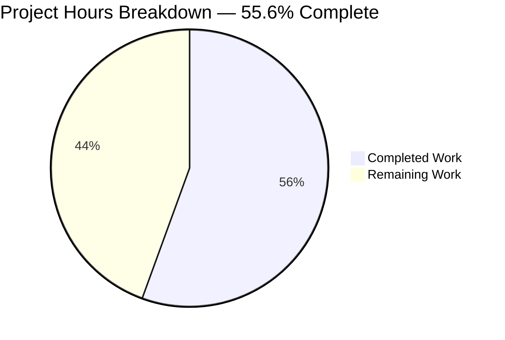
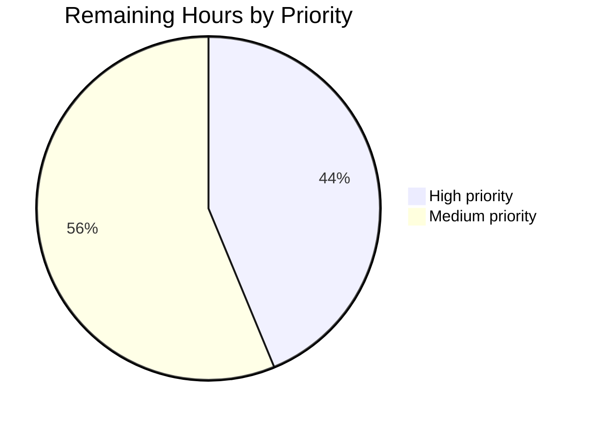

# 1. Executive Summary

## 1.1 Project Overview

The warehouse catalogue service is an Express/Node HTTP API for inventory and shipments, carried as one of two submodules of a metadata-only parent repository. This work documented it: a single-line summary above the service's first request handler in `services/warehouse-catalogue-api/src/server.js`, and a package README reduced to the project name, the install command and the run command. Scope was two files: one added comment line and a five-line README.

## 1.2 Completion Status

Both requested deliverables are present verbatim and both documented commands execute; the hours below span delivery plus the release-readiness work the package still needs.



Completed — Dark Blue (#5B39F3) · Remaining — White (#FFFFFF)

| Metric | Hours |
|---|---|
| Total Hours | 18.0 |
| Completed Hours (Baseline: Human with agentic-assist) | 10.0 |
| Remaining Hours | 8.0 |

Completion = 10.0 / (10.0 + 8.0) = **55.6%**, measured on plan-scoped and release-readiness work only.

## 1.3 Key Accomplishments

- One single-line summary documents the health route (`src/server.js:8`), the file's only comment.
- The package README is five lines: name, install command, run command.
- `node src/index.js` was started and served a live request on the port it logged.
- `GET /health` measured 200 with a 15-byte body `{"status":"ok"}`, identical on HEAD.
- The documented install resolves `express` 4.21.2 from a clean tree with no lockfile.
- Inventory, shipment and dispatch flows ran end to end, stock moving 12 → 8.
- The package gate is green: 1 test, 1 pass, 0 fail, 46.30% lines / 100.00% branches on `src/server.js`.
- The change surface is two files plus the parent's submodule pointer.

## 1.4 Critical Unresolved Issues

Seven open items; none is among the two requested deliverables, which are complete (2 of 2).

| Issue | Impact | Owner | ETA |
|---|---|---|---|
| `npm start` runs `node src/server.js`, which never calls `listen`, so the manifest path exits 0 with nothing listening | An operator who launches from the manifest instead of the README gets a silent no-op | Service owner | Next release |
| No error-handling or 404 middleware: a malformed or oversized JSON body returns Express's development HTML page with a stack trace and absolute `node_modules` paths | Server internals are disclosed to any client that sends a bad body; requires fixing before internet exposure | Backend | Before production |
| `express` 4.21.2 carries 4 published advisories (1 moderate, 3 high) | Denial-of-service exposure through `body-parser`, `path-to-regexp` and `qs` | Backend | Next release |
| No lockfile and no `.gitignore` in the child repository, so the documented install leaves an untracked `package-lock.json` and installs are not reproducible | Transitive versions float; the worktree is permanently dirty after a plain install | Service owner | Next sprint |
| The suite asserts 1 of 6 handlers, and nothing guards the README's claims or the handler comment | A rename or handler edit silently falsifies the delivered documentation | Backend | Next sprint |
| `PORT` and the default 3000 are undocumented in the package README | An operator cannot learn from the README how to move the service off 3000 | Service owner | Next sprint |
| No CI pipeline exists; nothing runs the suite or the syntax check on push | Regressions and documentation drift are only caught by hand | Platform | Next sprint |

## 1.5 Access Issues

No access issues identified. Both services run without credentials, environment variables or secrets; the only variable either reads is `PORT`. Repository reads, commits and submodule pointer updates succeed from the checkout, and only the public npm registry is needed to resolve `express`.

## 1.6 Recommended Next Steps

1. [High] Point `scripts.start` at `node src/index.js`; add JSON error and 404 handling (2.5h).
2. [High] Upgrade `express` to 4.22.3 and re-run the suite (1.0h).
3. [Medium] Commit a lockfile and a `.gitignore` to the child repository (1.0h).
4. [Medium] Guard the documented claims and test the five unasserted handlers (2.0h).
5. [Medium] Document `PORT`, and add CI running `node --check` and `npm test` (1.5h).

# 2. Project Hours Breakdown

## 2.1 Completed Work Detail

| Component | Hours | Description |
|---|---|---|
| Handler summary in `src/server.js` (plan 0.1/R1, 0.4) | 1.5 | One `/** ... */` line placed immediately above `app.get('/health', ...)`, single line, no `@param`, `@returns` or example, handler body untouched |
| Five-line package README (plan 0.1/R2, 0.5) | 1.5 | Body reduced to the project name, `npm install` and `node src/index.js`; description and the three sectioned blocks removed; name and commands sourced from the manifest and the binding module |
| Scope-boundary enforcement and untouched-file verification (plan 0.1, 0.6, 0.7) | 1.5 | Two-file change set proven; `package.json`, `src/index.js` and `test/routes.test.js` confirmed identical; no lockfile, dependency, test or extra documentation produced |
| Executable verification of both documented commands (plan 0.8) | 2.5 | Clean install resolving `express` 4.21.2; run command binding a port; `/health` on GET and HEAD; `PORT` override; clean shutdown with the port released |
| Test gate and static checks (plan 0.1, 0.4) | 1.0 | Package suite, coverage run, and `node --check` on every package JavaScript file |
| Discovery and exclusion analysis (plan 0.2, 0.3, 0.9, 0.10) | 1.0 | Established that only `GET /health` is documented, that no design system, project rule or attachment constrains the edits, and that no further documentation is implied |
| Submodule pointer advance for the delivered package commit (plan 0.6) | 1.0 | Child commit published and the parent's gitlink moved to it, with nothing else in the parent touched |
| **Total** | **10.0** | |

## 2.2 Remaining Work Detail

| Category | Hours | Priority |
|---|---|---|
| Manifest `start` script correction — point it at `node src/index.js` (plan 0.8 follow-up) | 0.5 | High |
| Dependency advisory removal — upgrade `express` 4.21.2 to 4.22.3, the non-major fix for all four advisories (plan 0.7) | 1.0 | High |
| JSON error-handling and 404 middleware, so framework failures stop returning an HTML page with a stack trace and absolute paths (release readiness) | 2.0 | High |
| Lockfile and child-repository `.gitignore` policy, so the documented install is reproducible and leaves a clean tree (plan 0.7, 0.8) | 1.0 | Medium |
| Documentation guards plus tests for the five unasserted handlers (plan 0.1, 0.4) | 2.0 | Medium |
| Operator port guidance for `PORT` and the default 3000, outside the three-fact README (plan 0.8) | 0.5 | Medium |
| CI job running `node --check` and `npm test` on push and pull request (release readiness) | 1.0 | Medium |
| **Total** | **8.0** | |

Completed 10.0h + Remaining 8.0h = **18.0h** total, which gives 10.0 / 18.0 = **55.6%** complete. Every remaining row traces to a plan requirement, a recorded follow-up, or a release-readiness need of the package the documentation describes.

# 3. Test Results

Every row below was executed against the delivered tree as part of this verification: 21 checks run, 21 passed, 0 failed.

| Area / Category | Framework | Tests | Passed | Failed | Coverage | What This Proves |
|---|---|---|---|---|---|---|
| Health route contract (package suite) | `node:test` via `npm test` | 1 | 1 | 0 | `src/server.js` 46.30% lines / 100.00% branches / 16.67% functions; `test/routes.test.js` 100/100/100; all files 59.15 / 100.00 / 28.57 | `GET /health` answers 200 with exactly `{"status":"ok"}` on the exported app |
| Static syntax gate | `node --check` | 3 | 3 | 0 | not applicable | All three package JavaScript files parse on Node v22.23.5 |
| Documented install command | `npm install` from a clean tree | 1 | 1 | 0 | not applicable | The single dependency resolves to `express` 4.21.2 (69 packages) and no lockfile is written when the install runs without one |
| Documented run command and health endpoint | `curl` against a live instance | 6 | 6 | 0 | not applicable | `node src/index.js` binds a port, logs it, honours `PORT`, answers GET and HEAD on `/health`, and releases the port on SIGTERM |
| Inventory and shipment workflow | `curl` against a live instance | 6 | 6 | 0 | not applicable | Inventory create/read with `reorderLevel` defaulted to 5, shipment creation, dispatch, and stock decrement 12 → 8 |
| Sibling service regression | `pytest` (`services/customer-orders-api`) | 4 | 4 | 0 | not configured | The untouched Python service still passes its own suite after the documentation change |

The repository configures no coverage threshold and no security scanner, so coverage is stated here, not enforced, and no automated scan exists to run. The `express` dependency tree was additionally scanned and returns 4 advisories (1 moderate, 3 high, 0 critical), recorded as a risk in Section 6.

**Not Covered**

- Five of the six route handlers — `POST /inventory`, `GET /inventory`, `POST /shipments`, `GET /shipments/:id`, `POST /shipments/:id/dispatch` — have no assertion in the suite; their validation and business rules were exercised only by hand and only on their happy path. The test file's own header records that full workflow coverage is intentionally absent.
- The README's three claims and the handler comment have no automated guard: nothing fails if the package name, the documented run target, or the `/health` status and body change.
- The manifest `start` script has no test; whether it binds a port is observable only by running it.
- No test covers concurrent writes against one SKU beyond a single hand-run duplicate check.
- The Python service's browser/storefront journey is untested, as its own README states; it is outside this change but part of the repository.
- Nothing tests the documentation against the code it describes, so documentation drift is silent by construction.

# 4. Runtime Validation & UI Verification

- ✅ Start-up — `node src/index.js` logged `warehouse API listening on 44999` and answered on the first probe.
- ✅ Health endpoint — `GET /health` returned HTTP 200, `application/json; charset=utf-8`, `Content-Length: 15`, body `{"status":"ok"}`; `HEAD /health` returned the same headers with no body.
- ✅ Inventory write and read — `POST /inventory` returned 201 with `reorderLevel` defaulted to 5; `GET /inventory` returned the stored record unchanged.
- ✅ Shipment lifecycle — `POST /shipments` created `SHP-1` (201), `POST /shipments/SHP-1/dispatch` returned 200, and inventory quantity moved 12 → 8 across the two handlers.
- ✅ Port configuration — `PORT` is honoured by the documented run command; with `PORT` absent the service binds the declared default 3000.
- ✅ Shutdown — SIGTERM ended the process, released the listening port, and the next connection was refused; no orphan process remained.
- ⚠ Manifest launch path — `npm start` printed the npm banner, exited 0 and bound nothing, so the manifest path is not runnable as delivered; the README's `node src/index.js` is the path that serves traffic.
- ⚠ Framework failure paths — a malformed JSON body is answered by Express's development error page (`text/html`, `SyntaxError`, stack frames, absolute `node_modules` paths) rather than the JSON error envelope the handlers themselves use, and unknown routes return an HTML `Cannot GET` page.

**Never exercised at runtime.** The package exposes no HTML surface — no static assets, view engine or template — so there is no screen or user interface to verify and no browser journey was possible. There is no authentication or authorization surface, so no login, session or token flow exists to drive. The service makes no outbound call, so no external integration was exercised. The five handlers beyond `/health` were driven only along their successful path; their rejection paths, concurrency and boundary inputs were not run in this verification. The sibling Python service was verified through its own suite rather than as a running server.

# 5. Compliance & Quality Review

## 5.1 Compliance Matrix

| Deliverable | Benchmark It Was Held To | Status | Progress |
|---|---|---|---|
| Handler summary exists and is well-formed (plan 0.1/R1, 0.4) | One `/** ... */` line, immediately above the first handler, no tags, no second line, no example | ✅ Pass | Complete |
| Handler summary is true (plan 0.4) | States the method, path, status and body the handler actually emits | ✅ Pass | Complete |
| README carries the three facts (plan 0.1/R2, 0.5) | Project name, install command, run command, nothing else | ✅ Pass | Complete |
| README length (plan 0.1/R2) | Under 15 lines; 5 delivered | ✅ Pass | Complete |
| Removed README content (plan 0.1/R2, 0.5) | Description sentence and the `## Run`, `## Existing tests`, `## Deliberate analysis gaps` blocks absent | ✅ Pass | Complete |
| Scope boundary (plan 0.1) | Exactly two files changed; no test, lockfile, dependency, manifest edit, 404 handler, error handler, environment configuration or hardening | ✅ Pass | Complete |
| Transformation map (plan 0.6) | Both targets updated in place, nothing created, deleted or renamed | ✅ Pass | Complete |
| Dependency inventory (plan 0.7) | `express` 4.21.2 the sole runtime dependency, `devDependencies` empty, no lockfile, no tooling added | ✅ Pass | Complete |
| Documented commands execute (plan 0.8) | `npm install` and `node src/index.js` both run as written from the package directory | ✅ Pass | Complete |
| Manifest `start` script (plan 0.8) | Left unchanged, mismatch recorded rather than corrected | ✅ Pass | Complete for scope; open as a release item |
| Project rules (plan 0.9) | No user-specified rules exist to violate | ✅ Pass (not applicable) | Complete |
| Discovery and exclusions (plan 0.2, 0.3, 0.10) | No inventory artefact produced, no design system to map, no attachment to honour | ✅ Pass | Complete |

## 5.2 AAP & Rule Divergences and Gaps

| What the Plan or Rule Required | What Was Delivered Instead | Why It Diverged | Impact | Remediation |
|---|---|---|---|---|
| The manifest `start` script should be left running `node src/server.js`, with the mismatch recorded for follow-up (plan 0.8) | `package.json:5` still runs `node src/server.js`, which never calls `listen`; the README names `node src/index.js` | Sanctioned — the plan fixed this as follow-up and its scope boundary forbids any manifest or code edit | An operator who launches from the manifest gets exit 0 with nothing listening; the documentation itself is accurate | Point `scripts.start` at `node src/index.js` (0.5h) |
| Document every configuration key the code reads | `src/index.js:2` reads `PORT` (default 3000) and the README documents no configuration at all | Sanctioned — the plan fixes the README to exactly three facts | An operator cannot learn the port from the package README and may collide with the default on a shared host | State `PORT` and the default in operator-facing notes outside the three-fact README (0.5h) |
| The package README should keep the repository's sectioned README convention, as the sibling service does | This README carries no `##` sections: a heading and two commands only | Sanctioned — the three-facts requirement leaves no place for sections | Stylistic inconsistency between the two services' READMEs; no functional effect | None required |
| The package README should state that only the health route is tested | The section that said so was removed with the rest of the body; the fact survives only in a comment header inside `test/routes.test.js` | Sanctioned — the three-facts requirement removed every section | A reader of the README alone will not learn that five of six handlers are unasserted | Covered by the guard-and-test work in Section 2.2 (2.0h) |

The manifest `start` script is the divergence most likely to cost someone time. `services/warehouse-catalogue-api/package.json:5` declares `"start": "node src/server.js"`, but `src/server.js` ends at `module.exports = app;` and the only `app.listen` call in the package is `src/index.js:3`. Running `npm start` therefore prints the npm banner, exits 0 and binds nothing — the failure is silent, because nothing reports an error. The README avoids the trap by documenting `node src/index.js`, which was started and served `/health` on the port it logged. The plan fixed this trade deliberately, forbidding a manifest edit while requiring the mismatch to be recorded for follow-up; the follow-up is the one-line change, and until it lands the manifest and the README disagree about how the service starts.

The undocumented `PORT` variable is a smaller but real gap. `src/index.js:2` is `const port = process.env.PORT || 3000;`, so the service is configurable by one variable and defaults to 3000 when it is absent. The README's three facts have no room for it, and that was the plan's choice, not an oversight — but the consequence is an operator who reads only the README and finds the service either on a port they did not expect or failing with `EADDRINUSE` when 3000 is already held. Recording `PORT` and the default in deployment notes outside the README closes the gap without breaking the three-fact constraint, and is the smallest of the remaining items.

The removal of the note that only the health route is tested deserves a mention because it moved information rather than deleting it. Before the change, the README's `## Deliberate analysis gaps` block told a newcomer that one of six handlers was asserted; the three-facts requirement removed that block, and the same fact now lives only in the header comment of `services/warehouse-catalogue-api/test/routes.test.js`, which a README reader never opens. The gap itself is unchanged and the suite still asserts the health contract alone, so the practical remedy is the guard-and-test work in Section 2.2 rather than any change to the README's fixed content.

# 6. Risk Assessment

| Risk | Category | Severity | Probability | Mitigation | Status |
|---|---|---|---|---|---|
| Malformed or oversized request bodies and unknown routes are answered by Express's development HTML page, which carries a `SyntaxError`, stack frames and absolute `node_modules` paths | Security | High | High | Add JSON error-handling and 404 middleware and run with `NODE_ENV=production` so failures return the API's own JSON envelope | Open |
| Inventory and shipment writes have no authentication or authorization; any client that can reach the port can create and dispatch stock | Security | High | Medium | Design authentication before any internet-facing deployment; restrict the service to a trusted network until then | Accepted — design decision for the owning work |
| `express` 4.21.2 resolves a tree with 4 published advisories (1 moderate, 3 high: `body-parser` DoS twice, `path-to-regexp` ReDoS, `qs` arrayLimit) | Technical | High | Medium | Upgrade to `express` 4.22.3, the non-major fix, and re-run the suite and coverage | Open |
| `npm start` runs a module that never calls `listen`, so a deployment that launches from the manifest serves no traffic while reporting success | Operational | High | Medium | Repoint the script at `src/index.js` and add a boot smoke check to CI | Open |
| Inventory and shipments live in two process-local `Map`s: a restart loses all records and a second instance sees a separate copy | Operational | High | Certain on restart or scale-out | Document the single-instance constraint explicitly, or move state to a durable store before scaling | Accepted — design decision for the owning work |
| The suite asserts 1 of 6 handlers, and nothing binds the README's three claims or the handler comment to the code | Technical | Medium | Medium | Add contract tests for the five handlers and assertions that the README name, run target and documented status/body still hold | Open |
| The child repository tracks no lockfile and has no `.gitignore`, so installs are not reproducible and a plain `npm install` leaves an untracked `package-lock.json` | Operational | Medium | High | Commit a lockfile and a `.gitignore`, then settle the documented install command | Open |
| `/health` reports liveness only — a constant `ok` with no dependency or readiness signal — and the default port 3000 is undocumented | Integration | Medium | Medium | Add readiness or dependency detail where an orchestrator needs it, and document `PORT` with its default | Open |

# 7. Visual Project Status


Completed — Dark Blue (#5B39F3) · Remaining — White (#FFFFFF). Completed 10.0h of 18.0h total; remaining 8.0h, matching Sections 1.2 and 2.2.



Priority split of the 8.0h remaining: 3.5h High (`start` script 0.5h, dependency upgrade 1.0h, JSON error and 404 handling 2.0h) and 4.5h Medium (lockfile and `.gitignore` 1.0h, guards and tests 2.0h, port guidance 0.5h, CI 1.0h). No Low-priority work is outstanding: the documentation itself and the code it describes are complete, so everything left either unblocks a deployment or keeps the delivered claims true.

# 8. Summary & Recommendations

The documented package is delivered and it is accurate. `services/warehouse-catalogue-api/src/server.js:8` carries one line — `/** Health check: answers GET /health with 200 and { status: 'ok' } while the service is up. */` — directly above the handler it describes, with no tags, no second line and no example, and the handler beneath it is unchanged. `services/warehouse-catalogue-api/README.md` is five lines: the project name, ``Install: `npm install` `` and ``Run: `node src/index.js` ``. The change surface is exactly those two files plus the parent repository's submodule pointer; the manifest, the entry point and the test file are byte-identical to their previous state, and nothing was created, deleted or added as a dependency.

Both commands the README states were executed as written. The install resolved `express` 4.21.2 as the sole dependency from a clean tree; the run command bound a port, logged it, honoured `PORT`, and served `GET /health` with HTTP 200 and the 15-byte body `{"status":"ok"}` — exactly what the comment claims — on both GET and HEAD. The inventory, shipment and dispatch flows were driven end to end against the same process, with stock moving 12 → 8, and a SIGTERM released the port cleanly. The package suite is green (1 test, 1 pass, 0 fail; 46.30% line and 100.00% branch coverage on `src/server.js`), the static gate passes on all three JavaScript files, and the untouched Python service still passes its own four tests.

| Measure | Value |
|---|---|
| Plan requirements delivered | 24 of 24 |
| Completion (hours-based) | 55.6% — 10.0h of 18.0h |
| Remaining release-readiness work | 8.0h across 7 items (3.5h High, 4.5h Medium) |
| Divergences from the plan or the project's rules | 4, all sanctioned by the plan; 0 unsanctioned |
| Test checks executed | 21 run, 21 passed, 0 failed |
| Handlers asserted by the suite | 1 of 6 |

The critical path to production is short and concrete. First, make the manifest agree with the documentation by pointing `scripts.start` at `node src/index.js`, and add JSON error-handling plus a 404 handler so a malformed body stops returning an HTML page with a stack trace and absolute server paths — those two items, 2.5h together, remove the behaviours most likely to embarrass a deployment. Second, upgrade `express` to 4.22.3, the non-major fix that clears all four advisories, and re-run the suite. The remaining 4.5h — a lockfile and `.gitignore`, guards that keep the documented claims true, port guidance for operators, and a CI job — are what stop the delivery from silently decaying afterwards.

Production readiness, then, splits cleanly. The documentation is ready to ship as it stands: it is minimal, truthful, and every claim in it was executed. The service it documents is not production-ready, and this work did not change that — a write API with no authentication, framework failures that disclose stack traces and absolute paths, and inventory held in two process-local `Map`s are properties of the package the plan deliberately left untouched. The 55.6% figure measures the whole release scope, not the documentation alone: all 24 plan requirements are met, and the remaining 8.0h is the work that turns a correctly documented package into one that can safely face traffic.

# 9. Development Guide

## Prerequisites

- **Node.js 22.12.0 or newer** — verified on v22.23.5 with npm 11.21.3.
- **Git with submodule support**, and the LFS hooks the parent repository already carries; without `git-lfs` on `PATH`, commits and pushes in this checkout fail.
- **Python 3.13** only if you work on the sibling service; `python3` on `PATH` resolves to 3.13.18.
- No database, cache, message broker, container runtime or build step is involved, and no environment variable, secret or credential is required. The only variable either service reads is `PORT`.
- The repository has no lint, format or type-check configuration, so `node --check` is the only static gate.

## Repository layout

The checkout root is a metadata-only parent: `README.md`, `.gitignore`, `.gitmodules` and two submodule pointers. All application code lives in the children — `services/warehouse-catalogue-api` (JavaScript/Express, the package these commands are for) and `services/customer-orders-api` (Python/FastAPI). Make a change inside the owning child, commit it there, then advance the parent's pointer to the new child commit.

## Install

```bash
cd services/warehouse-catalogue-api
CI=true npm install --no-package-lock --no-audit --no-fund
node -e "console.log(require('express/package.json').version)"
```

Expected: `added 69 packages in ~600ms`, then `4.21.2`. The child repository tracks no lockfile and has no `.gitignore`, so `--no-package-lock` is what keeps the tree clean; a plain `npm install` also works but leaves an untracked `package-lock.json`.

## Run the service

```bash
cd services/warehouse-catalogue-api
PORT=8080 node src/index.js
```

Expected: exactly one line, `warehouse API listening on 8080`. With `PORT` unset the service binds 3000 (`src/index.js:2`). Do **not** use `npm start`: it runs `node src/server.js`, which only exports the app, so it exits 0 with nothing listening.

## Verify it is up

```bash
curl -sS -i http://127.0.0.1:8080/health
```

Expected:

```
HTTP/1.1 200 OK
Content-Type: application/json; charset=utf-8
Content-Length: 15

{"status":"ok"}
```

`curl -sS -I http://127.0.0.1:8080/health` returns the same headers with no body.

## Example usage

```bash
# create an inventory record (reorderLevel defaults to 5)
curl -sS -X POST http://127.0.0.1:8080/inventory -H 'Content-Type: application/json' \
  -d '{"sku":"SMOKE-1","name":"Smoke Widget","quantity":12}'
# -> {"sku":"SMOKE-1","name":"Smoke Widget","quantity":12,"reorderLevel":5}

curl -sS http://127.0.0.1:8080/inventory

# ship 4 units, then dispatch the shipment
curl -sS -X POST http://127.0.0.1:8080/shipments -H 'Content-Type: application/json' \
  -d '{"sku":"SMOKE-1","quantity":4,"destination":"Berlin"}'
# -> {"id":"SHP-1","sku":"SMOKE-1","quantity":4,"destination":"Berlin","status":"created"}

curl -sS -X POST http://127.0.0.1:8080/shipments/SHP-1/dispatch \
  -H 'Content-Type: application/json' -d '{"carrier":"dhl"}'
# -> {"id":"SHP-1",...,"status":"dispatched","carrier":"dhl"}

curl -sS http://127.0.0.1:8080/inventory   # quantity is now 8
```

Routes: `GET /health`, `POST /inventory`, `GET /inventory`, `POST /shipments`, `GET /shipments/:id`, `POST /shipments/:id/dispatch`. State is process-local, so restarting the service empties both stores. Stop the service with `Ctrl-C` or SIGTERM; the port is released and no orphan process remains.

## Tests and static checks

```bash
cd services/warehouse-catalogue-api
npm test                                  # node --test, discovers test/**/*.test.js
node --test test/routes.test.js           # one file
node --test --experimental-test-coverage  # coverage table
node --check src/server.js src/index.js test/routes.test.js
```

Expected: `# tests 1 / # suites 0 / # pass 1 / # fail 0 / # cancelled 0 / # skipped 0 / # todo 0`, exit 0. The coverage run reports `src/server.js` 46.30% lines / 100.00% branches / 16.67% functions, `test/routes.test.js` 100/100/100 and 59.15 / 100.00 / 28.57 across all files. No coverage threshold and no security scanner is configured, so a green suite is the whole gate; `node --check` exits 0 for all three files.

## Change workflow with submodules

```bash
# step one: change and commit inside the owning child repository
git -C services/warehouse-catalogue-api status
git -C services/warehouse-catalogue-api commit -am "Describe the change"

# step two: advance the parent's pointer to that child commit
git add services/warehouse-catalogue-api
git commit -m "Update the warehouse catalogue API submodule"

# step three: read the parent's own state, ignoring the child's untracked files
git status --ignore-submodules=all
```

After any install, `git status` in the parent shows ` M services/warehouse-catalogue-api` purely because of the child's untracked `node_modules/`. That marker is expected: never commit `node_modules/` or a `package-lock.json` produced this way, and use `--ignore-submodules=all` when you want to see whether the parent itself changed.

## Sibling service

```bash
cd services/customer-orders-api
python3 -m venv .venv
./.venv/bin/python -m pip install -r requirements.txt
./.venv/bin/python -m pytest -q          # 4 passed
./.venv/bin/python -m uvicorn app.main:app --host 127.0.0.1 --port 8081
```

A virtual environment is mandatory there: the global interpreter carries newer Starlette and pytest builds than the pinned `fastapi==0.115.6` and `pytest==8.3.4`, and installing into it breaks those pins. Never commit `.venv/`.

## Troubleshooting

| Symptom | Cause | Resolution |
|---|---|---|
| `Error: listen EADDRINUSE: address already in use :::3000` and exit 1 | Another process (often a second checkout) holds the port | Start with an explicit `PORT=<free port>` |
| `npm start` prints the banner, exits 0, nothing listens | `scripts.start` runs `src/server.js`, which never calls `listen` | Use `node src/index.js` |
| `Error: Cannot find module 'express'` | Dependencies were never installed | Run the install step first |
| Untracked `package-lock.json` appears after install | The child tracks no lockfile and has no `.gitignore` | Install with `--no-package-lock`, or commit a lockfile policy |
| Parent shows ` M services/warehouse-catalogue-api` with an empty `git diff` | The child's untracked `node_modules/` | Expected; inspect with `git status --ignore-submodules=all` |
| Inventory and shipments are empty after a restart | State lives in two process-local `Map`s | Expected; re-create the data or add a durable store |
| A malformed JSON body returns an HTML page with a stack trace | No error-handling or 404 middleware exists | Expected until hardening lands; do not send bad bodies to a shared deployment |
| Coverage percentages look low | Only the health route is asserted | Expected; the suite covers 1 of 6 handlers |

# 10. Appendices

## A. Command Reference

| Purpose | Command | Run from |
|---|---|---|
| Install dependencies | `CI=true npm install --no-package-lock --no-audit --no-fund` | `services/warehouse-catalogue-api` |
| Check the resolved dependency | `node -e "console.log(require('express/package.json').version)"` | `services/warehouse-catalogue-api` |
| Start the service | `PORT=8080 node src/index.js` | `services/warehouse-catalogue-api` |
| Health check | `curl -sS -i http://127.0.0.1:8080/health` | anywhere |
| Run the suite | `npm test` | `services/warehouse-catalogue-api` |
| Run one test file | `node --test test/routes.test.js` | `services/warehouse-catalogue-api` |
| Coverage report | `node --test --experimental-test-coverage` | `services/warehouse-catalogue-api` |
| Static syntax check | `node --check src/server.js` | `services/warehouse-catalogue-api` |
| Sibling service tests | `./.venv/bin/python -m pytest -q` | `services/customer-orders-api` |
| Parent state, ignoring children | `git status --ignore-submodules=all` | repository root |

## B. Port Reference

| Port | Used by | Notes |
|---|---|---|
| 3000 | Warehouse API default | Applied when `PORT` is unset (`src/index.js:2`); collides on a shared host |
| `PORT` (any free port) | Warehouse API | The documented run command honours it and logs the value it bound |
| 8080 / 8081 | Examples in this guide | Arbitrary; choose any free port |
| `--port 8081` | Sibling FastAPI service | `uvicorn app.main:app --host 127.0.0.1 --port 8081` |

## C. Key File Locations

| Path | What it holds |
|---|---|
| `services/warehouse-catalogue-api/src/server.js` | The Express app: six routes, two in-memory stores, the exported app, and the single-line handler summary at line 8 |
| `services/warehouse-catalogue-api/src/index.js` | Bootstrap: requires the app and calls `app.listen(process.env.PORT \|\| 3000)` |
| `services/warehouse-catalogue-api/test/routes.test.js` | The package's only test, asserting the `/health` status and body |
| `services/warehouse-catalogue-api/README.md` | Project name, install command, run command — five lines |
| `services/warehouse-catalogue-api/package.json` | `start` (`node src/server.js`, which does not bind), `test` (`node --test`), `express` 4.21.2 |
| `services/customer-orders-api/` | The Python/FastAPI service, its `requirements.txt`, `app/main.py` and `tests/` |
| `.gitmodules`, parent `README.md` | Submodule definitions and the parent repository's description |

## D. Technology Versions

| Component | Version |
|---|---|
| Node.js | v22.23.5 (floor 22.12.0) |
| npm | 11.21.3 |
| express | 4.21.2 (sole runtime dependency; 4.22.3 clears the current advisories) |
| Test runner | Node's built-in `node:test` and `node:assert/strict` |
| Python | 3.13.18 (sibling service only) |
| fastapi / uvicorn / pytest / httpx | 0.115.6 / 0.34.0 / 8.3.4 / 0.28.1 (sibling service only) |

## E. Environment Variable Reference

| Variable | Read by | Default | Required |
|---|---|---|---|
| `PORT` | `services/warehouse-catalogue-api/src/index.js:2` | 3000 | No |
| `CI` | npm (install behaviour) | unset | No — set to `true` for non-interactive installs |

No secret, token, connection string or service URL is read by either service.

## F. Developer Tools Guide

| Tool | Use in this repository |
|---|---|
| `node --test` | The only automated gate; discovers every `test/**/*.test.js` |
| `node --test --experimental-test-coverage` | Coverage reporting, since no coverage tool is installed |
| `node --check` | The only static analysis available — no lint, format or type-check configuration exists |
| `curl` | The practical way to exercise the API; the package serves JSON only |
| `git status --ignore-submodules=all` | Separates the parent's own changes from the children's untracked files |
| `git submodule status` | Shows the exact commit each child is pinned to |

## G. Glossary

| Term | Meaning here |
|---|---|
| AAP / plan | The technical specification this delivery was measured against; sections cited as 0.1–0.10 |
| R1 / R2 | The two requested deliverables: the handler summary line, and the minimal package README |
| Handler | An Express route callback in `src/server.js`; the service declares six |
| Submodule pointer (gitlink) | The parent repository's recorded commit for a child repository |
| Process-local store | The two `Map` instances holding inventory and shipments for the lifetime of one process |
| Coverage | The percentages `node --test --experimental-test-coverage` reports; nothing enforces a threshold here |
| Sanctioned divergence | A departure from the plan that the plan itself required or permitted, recorded in Section 5.2 |
