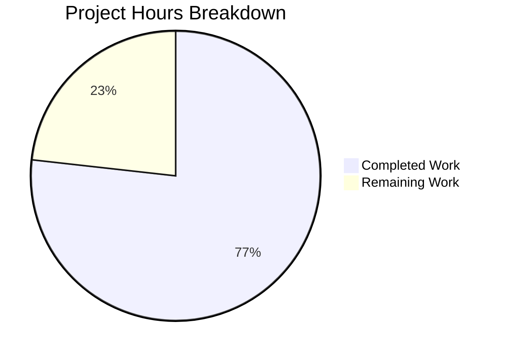

# 1. Executive Summary

## 1.1 Project Overview

The warehouse catalogue API is the Express 4.21.2 service in `services/warehouse-catalogue-api`, a submodule of the parent repository. It exposes six handlers over two process-local maps: liveness, inventory intake and listing, shipment creation, shipment retrieval and dispatch. Coverage stood at one of thirteen behaviours — only `GET /health` was asserted — leaving the guards, the stock decrement, the dispatch state machine and the process entry point unproven. This delivery closes all thirteen, adding four test files and 601 lines of test code, and commits the evidence and one frozen production defect in the service README. Its users are the teams operating inventory and shipment flows through this HTTP surface.

## 1.2 Completion Status

**77% complete — 38 of 49.5 hours.**



| Metric | Hours |
| --- | --- |
| Total Hours | 49.5 |
| Completed Hours (Baseline: Human with agentic-assist) | 38 |
| Remaining Hours | 11.5 |

Completion is `38 / (38 + 11.5) = 76.8%`, reported as 77%. All thirteen scoped deliverables are complete and verified; the remaining hours are path-to-production work (Section 2.2).

## 1.3 Key Accomplishments

- ✅ Fifteen integration cases drive the real app over loopback sockets: 14 pass, 0 fail, 1 expected failure, exit 0.
- ✅ Inventory intake proven: `reorderLevel` default 5, every payload-guard clause, duplicate-SKU refusal leaving the stored item intact.
- ✅ Inventory listing proven in Map insertion order with live quantities, discriminating against a sorted serialisation.
- ✅ Shipment creation proven: in-place decrement, `created` status, over-stock 409 reserving nothing, quantity 400, unknown-SKU 404.
- ✅ Dispatch proven both ways: default and supplied carrier, live read-back, second-dispatch 409, unknown-id 404.
- ✅ Entry point proven by spawning it: `PORT` binding with its startup log, and the 3000 fallback.
- ✅ Route module at 100.00% lines, branches and functions, from 45.28% / 100.00% / 16.67%.

## 1.4 Critical Unresolved Issues

**0 of 13** scoped deliverables are open — all twelve behaviours and the one test-file rewrite are delivered and verified. **4 of 4** release-readiness items remain open:

| Issue | Impact | Owner | ETA |
| --- | --- | --- | --- |
| Documented run command serves nothing (`npm start` exits 0, nothing listening; `package.json:5` starts a module that only exports the app) | Anyone following `README.md:5-7` gets a process that answers no request | Backend owner | 2 business days |
| No pipeline runs the suite — the package has no CI workflow or hook | A regression merged after this delivery is invisible until someone runs `npm test` by hand | Platform owner | 1 week |
| Fallback case binds host-global port 3000, so on a busy host it can only skip | The `process.env.PORT || 3000` default goes unproven in that run | Test owner | 3 business days |
| Dependency tree is unpinned — no lockfile is committed | Installs are not reproducible and `npm audit` cannot run at all | Backend owner | 1 business day |

## 1.5 Access Issues

| System/Resource | Type of Access | Issue Description | Resolution Status | Owner |
| --- | --- | --- | --- | --- |
| Host-global TCP port 3000 | Local socket binding | One unpartitioned host port decides whether the fallback case runs or skips | Open — the case skips by design when the port is held | Test owner |
| Warehouse service repository | Push and pipeline identity | No CI workflow or pipeline identity exists for the service repository | Open | Platform owner |
| npm registry advisory data | Dependency vulnerability feed | `npm audit` requires a lockfile; none is committed, so no advisory scan can run | Open | Backend owner |

Nothing blocked this delivery: dependencies installed from the public registry and the service ran on a private port.

## 1.6 Recommended Next Steps

1. **[High]** Add a CI job that runs `npm test` and the coverage command from the service directory, failing on any `# fail`.
2. **[High]** Point `package.json` `start` at `src/index.js` and convert the expected-failure case into a passing regression.
3. **[Medium]** Commit a lockfile, switch installs to `npm ci`, and clear any advisory `npm audit` reports.
4. **[Medium]** Remove the fixed-port dependency from the 3000-fallback case.

# 2. Project Hours Breakdown

## 2.1 Completed Work Detail

| Component | Hours | Description |
| --- | --- | --- |
| Inventory route tests (4 cases) | 5 | `test/inventory.test.js` — intake with the `reorderLevel` default, the four payload-guard clauses and the duplicate-SKU refusal; listing in insertion order with live quantities |
| Shipment-creation tests (4 cases) | 6 | `test/shipments.test.js` — in-place reservation with `created` status, over-stock refusal reserving nothing, quantity refusal leaving stock untouched, unknown-SKU refusal with no id allocated |
| Shipment read and dispatch tests (3 cases) | 6 | `test/shipment-lifecycle.test.js` — retrieval with its 404, carrier resolution in both forms, repeated-dispatch conflict and unknown-id refusal |
| Process entry-point harness (3 cases) | 8 | `test/entrypoint.test.js` — child-process spawn, free-port allocation, the startup log awaited inside a deadline-bounded health poll, the 3000 fallback with its skip path, and the one recorded expected failure |
| Health-test header correction | 1 | `test/routes.test.js:5-6` rewritten to state only the route the file exercises; requires and test body preserved |
| Committed test record | 6 | `README.md:13-69` — restated analysis gaps, the expected-failure record with reason, reproducer and observed TAP line, six evidence levels including 14 per-case commands, and the coverage statement |
| Suite verification | 5 | Full-suite, per-file, per-case and coverage runs, plus order-independence, repeat-run and port-contention checks |
| Static and production-freeze checks | 1 | `node --check` over all seven JavaScript files and an empty diff for `src/` and `package.json` |
| **Total** | **38** | |

## 2.2 Remaining Work Detail

| Category | Hours | Priority |
| --- | --- | --- |
| Continuous-integration gate running the suite and its coverage | 6 | High |
| Repair of the documented run command, and conversion of the expected-failure case into a passing regression | 1.5 | High |
| Removal of the fixed-port dependency from the 3000-fallback case | 3 | Medium |
| Dependency pinning with a committed lockfile and a completed advisory audit | 1 | Medium |
| **Total** | **11.5** | |

The 38 completed hours plus the 11.5 remaining hours equal the 49.5 total hours reported in Section 1.2.

## 2.3 Estimation Basis and Confidence

Completed hours are sized from the delivered artefacts rather than from effort logs: 601 lines of test code across five files, a 210-line child-process harness that owns port allocation and stream ordering, and a 57-line README record whose every figure was re-derived by running the commands it quotes. Remaining hours are sized from the four open items in Section 1.4, using the same basis.

| Remaining item | Confidence | Basis |
| --- | --- | --- |
| CI gate | High | One workflow file plus a service-directory working path; the suite is a single command and already exits 0 |
| Start-command repair | High | One line in `package.json`, then removing a `{todo}` marker and updating two README sections |
| Fixed-port removal | Medium | Touches the harness's port strategy and the skip contract; needs the fallback leg re-verified on a contended host |
| Dependency pinning | High | Generate the lockfile from the existing pin, switch the install command, clear advisories |

# 3. Test Results

Every figure below was produced by running the suite in this checkout (`cd services/warehouse-catalogue-api`, Node.js v22.23.5, express 4.21.2, port 3000 free).

| Area / Category | Framework | Tests | Passed | Failed | Coverage | What This Proves |
| --- | --- | --- | --- | --- | --- | --- |
| Health route (`test/routes.test.js`) | `node:test` | 1 | 1 | 0 | `src/server.js` 100.00% lines | `GET /health` answers `200 {"status":"ok"}`, and the pre-existing test still holds the behaviour |
| Inventory routes (`test/inventory.test.js`) | `node:test` | 4 | 4 | 0 | `src/server.js` 100.00% lines | Intake stores with `reorderLevel` 5 and refuses four invalid payloads and a duplicate SKU; listing returns insertion order with live quantities |
| Shipment creation (`test/shipments.test.js`) | `node:test` | 4 | 4 | 0 | `src/server.js` 100.00% lines | A reservation decrements stock in place and reports `created`; over-stock, quantity and unknown-SKU refusals leave stock and ids untouched |
| Shipment read and dispatch (`test/shipment-lifecycle.test.js`) | `node:test` | 3 | 3 | 0 | `src/server.js` 100.00% lines | Retrieval returns the stored record and 404s an unknown id; dispatch moves state once with the given or default carrier and refuses a second attempt |
| Process entry point (`test/entrypoint.test.js`) | `node:test` | 3 | 2 | 0 | not measured — the module is exercised through spawned children | The service binds `PORT`, logs the port it bound and falls back to 3000; the manifest start-script defect is a recorded expected failure (`# todo 1`) |
| Whole package (`npm test`) | `node:test` | 15 | 14 | 0 | `src/server.js` 100.00 / 100.00 / 100.00; all files 95.87 / 91.09 / 94.74 | The whole route surface plus the entry point are green in one command, with the single expected failure counted under `# todo`, exit 0 |

Per-file runs reproduce the same results in isolation (1/1, 4/4, 4/4, 3/3, and 3 tests with 2 passing). A reverse-order serial run and three further full runs each reported 15 tests, 14 passing, 0 failing, 0 skipped, 1 todo, exit 0, and single-case selection with `--test-name-pattern` returns exactly the selected case. The full suite finishes in roughly half a second; the one long case is the expected failure, which is bounded by its own poll deadline. No coverage threshold and no security scanner is configured in this package, so the gate is a fully green suite and the coverage figures above are the runtime's own report.

**Not Covered**

- Concurrent requests, and the non-transactional decrement-then-insert inside `POST /shipments`: no test issues overlapping requests; the suite drives one request at a time.
- The `start` script's exit code, stderr and documentation: the manifest case asserts only whether the app answers on the port it started.
- An explicit `reorderLevel` intake beyond the round trip, an accepted `quantity: 0` intake, a non-integer positive quantity, an empty-string sku, and any whole-list or list-length assertion on `GET /inventory`.
- Express's own `400` for a malformed JSON body — excluded because it tests the framework rather than the service.
- The sibling `services/customer-orders-api` (Python/FastAPI) and any cross-service flow: untouched and unexercised by this delivery.
- Unit-level, end-to-end, browser, load and performance tests: none exist and none were added.
- The default-3000 fallback leg on a host where port 3000 is held — the case skips with `port 3000 is occupied in this environment`.
- Any documentation assertion: no test checks the README's prose or figures, so a drift between the record and the code would not fail the suite.

A human should run the suite on a contended host and inside the target pipeline before release, exercise concurrent reservations against a disposable instance, and confirm the documented run command once the start script is repaired.

# 4. Runtime Validation & UI Verification

The service was started as its own process on a private port and driven over real HTTP; every line below is an observation from that run or from a suite execution in this checkout.

- ✅ **Start-up** — `PORT=41990 node src/index.js` printed `warehouse API listening on 41990` on the first line, and `GET /health` returned `200 {"status":"ok"}`.
- ✅ **Inventory intake** — `201` with `reorderLevel: 5` when the field is omitted; `400 {"error":"invalid inventory payload"}` for a payload missing fields; `409 {"error":"duplicate sku"}` for a repeated SKU.
- ✅ **Inventory listing** — entries came back in the order they were stored (the first item created was listed first, ahead of an alphabetically earlier SKU) with the live quantity dropping from 8 to 5 after a 3-unit reservation.
- ✅ **Shipment creation** — `201 {"id":"SHP-1",…,"status":"created"}`; `409 {"error":"insufficient inventory"}` beyond stock; `400 {"error":"quantity must be positive"}` for zero; `404 {"error":"sku not found"}` for an unknown SKU.
- ✅ **Shipment retrieval** — `200` with the stored record in full; `404 {"error":"shipment not found"}` for `SHP-999`.
- ✅ **Dispatch** — `200` with `status":"dispatched"` and `carrier":"standard"` for an empty body, the same state on read-back, `409 {"error":"shipment cannot be dispatched"}` on a second attempt, and `404` for an unknown id on both the read and the dispatch path.
- ✅ **Process lifecycle** — the running child released its port when stopped, and a freshly started process began with empty maps.
- ❌ **Documented run command** — `PORT=41991 npm start` exits 0 with nothing listening on that port, because `package.json:5` starts a module that only exports the app (`README.md:5-7`).
- ⚠ **Sibling customer-orders API** — `services/customer-orders-api` was neither started nor exercised; it is outside this delivery's scope.
- ⚠ **Port-3000 held variant** — port 3000 was free in this environment, so the fallback case ran rather than skipped; the skip path was not forced here.

**Never exercised at runtime:** there is no browser or rendered screen in this service — every surface is JSON over HTTP — so no user interface flow was driven. No runtime check exercised concurrent requests against one process, a restart with a client mid-request, the start script's stderr or exit-code behaviour beyond its failure to answer, the sibling Python service, a deployment behind a reverse proxy, or the port-3000 contention path in this checkout.

# 5. Compliance & Quality Review

## 5.1 Compliance Matrix

| # | Deliverable / Benchmark | Status | Progress |
| --- | --- | --- | --- |
| 1 | Integration-level test design — every case reaches the app over a real loopback socket or a spawned child, with no handler called directly and no transport substituted | ✅ Pass | █████ 100% |
| 2 | Behaviour coverage target — 90% expressed as 12 of 13 behaviours | ✅ Pass — 13 of 13 covered | █████ 100% |
| 3 | Assertion density — status plus exact body plus a post-condition read-back wherever state changes | ✅ Pass — all 15 cases | █████ 100% |
| 4 | Isolation and order independence — unique SKUs per case, response-derived ids, no list-length or absolute-id assertion | ✅ Pass — verified by reverse-order and repeat runs | █████ 100% |
| 5 | Change hygiene on the pre-existing test — header rewrite only, test body byte-identical | ✅ Pass | █████ 100% |
| 6 | Production freeze — nothing changed under `src/`, nothing in `package.json`, no new route | ✅ Pass — diff is empty | █████ 100% |
| 7 | Repository conventions and dependency hygiene — flat files, `node:test` + `node:assert/strict`, no new package, no runner or coverage configuration, no committed lockfile | ✅ Pass | █████ 100% |
| 8 | Defect handling — the exposed defect kept in the suite as an expected failure with its reason, green suite, record committed | ✅ Pass | █████ 100% |
| 9 | Committed evidence — per-file summaries, 14 per-case commands, expected-failure record, coverage statement | ✅ Pass | █████ 100% |
| 10 | Static integrity — `node --check` on all seven JavaScript files | ✅ Pass — exit 0 on every file | █████ 100% |
| 11 | User rule compliance | ✅ Pass — no user rules were supplied for this project | █████ 100% |
| 12 | Dependency vulnerability scanning | ⚠ Not available — `npm audit` needs a lockfile and none is committed | ░░░░░ 0% |

## 5.2 AAP & Rule Divergences and Gaps

Five departures were established against the AAP. No user-specified rules exist for this project, so no rule departure is possible, and none of the five blocks release.

| # | What the AAP/Rule Required | What Was Delivered Instead | Why It Diverged | Impact | Remediation |
| --- | --- | --- | --- | --- | --- |
| D1 | §0.3.1 row 6: "Store A then B … the `GET /inventory` list filtered to A and B comes back in the order A, B with quantities 5 and 5" | `test/inventory.test.js:77-88` stores `SKU-INV-ORDER-B` (8) before `SKU-INV-ORDER-A` (5) and expects `[ORDER-B(5), ORDER-A(5)]` | The literal A-then-B order coincides with ascending SKU order, so a `GET /inventory` that sorts before sending would pass every assertion — contradicting §0.2.2 (a behaviour counts as covered only once a test asserts its outcome) and §0.8.2 (assertion density), which outrank an illustrative example | None on coverage or production behaviour; the case now rejects a sorted serialisation, which is the point of the behaviour | None required. Read the plan's "A then B" as illustrative and the test at `test/inventory.test.js:85-88` as the expectation |
| D2 | §0.5.5 names `waitForHealth(baseUrl, timeoutMs)` and three helpers in the entry-point file | `test/entrypoint.test.js:53` defines `waitForHealth(service, baseUrl, timeoutMs, expectedLog = null)`, and the file also defines `pause`, `startService`, `childStatus` and `stopChild` | §0.5.5's own clause that a failing poll carry the child's captured output cannot be met with two parameters, and a child that exits silently needs a status-bearing diagnostic; every helper stays inside the one file and adds no dependency | None functional; three call sites updated | None |
| D3 | §0.5.5/§0.10 name the `portHeld(3000)` probe alone as what makes the fallback case skip | The probe and its skip string are kept, and a second route to the identical skip was added: a child that exits with `EADDRINUSE` reports the same skip (`test/entrypoint.test.js:161`, `:178`) | The probe closes its socket before the child binds, so a binder arriving in that window turned the designed skip into a hard failure; the requirement's intent — contention skips, never fails — is met exactly | None — the case still runs whenever 3000 is free, and no assertion was weakened | None |
| D4 | §0.7.2 records that the entry-point file adds `node:child_process` and `node:net` and reads the manifest in process | `test/entrypoint.test.js:1-4` requires exactly `node:test`, `node:assert/strict`, `node:child_process`, `node:net`; the manifest is exercised by spawning `npm run start` with an argument array (`:197-201`), not by importing `../package.json` | §0.5.3/§0.6.2 require the case to run the package's own start script so it flips green the day `package.json:5` is fixed, and an argument array keeps a shell out of the path; with no manifest import the file's import set then matches §0.7.2 exactly | None | None |
| D5 | Repository hygiene: the `node_modules/` directory the dependency install creates | Left untracked and uncommitted; no `.gitignore` was added, so the parent repository reports ` M services/warehouse-catalogue-api` | Committing install artefacts is forbidden, and adding a configuration file is outside §0.6.4/§0.9.2's scope | Cosmetic — a dirty submodule marker in `git status`, no content risk | A human may add a `.gitignore` for `node_modules/`, and a lockfile policy, once the production freeze is lifted |

**D1 — the listing case proves a stronger property than the plan's illustration.** The behaviour under test is that `GET /inventory` serialises the map in insertion order with live quantities (`src/server.js:21`). Seeding in ascending SKU order would have made the expected array identical to a sorted one, so the case would have reported the behaviour covered while a sort-before-send implementation passed it. Reversing the seeds keeps every value the plan fixed — the same two SKUs, the same 8 → 3 → 5 arithmetic, the same filtered read-back — and makes the ascending-sort implementation fail. No decision is needed beyond knowing that `test/inventory.test.js:85-88` is the authoritative expectation and the plan's "A then B" is illustrative.

**D2 and D3 — the harness contract differs from the plan's helper sketch.** `waitForHealth` takes the captured child as well as the address and deadline, because a poll that reports only a deadline hides the child's own output when it dies before binding, and `childStatus` appends the exit code or signal for the manifest child, which prints nothing. The second route to the port-3000 skip closes the window between the availability probe and the child's bind, which the probe alone cannot cover: where two suites overlap, the losing run now skips with `port 3000 is occupied in this environment` instead of failing after its poll expires. Both stay inside one file, add no dependency and weaken no assertion.

**D5 — the dirty submodule marker is a decision to make, not a defect.** `services/warehouse-catalogue-api` tracks no ignore file, and this delivery was forbidden from adding configuration, so the installed `node_modules/` remains untracked and the parent repository reports the submodule as modified. Nothing about the service's content is affected: `git ls-files` still lists the same nine files and every commit is clean. A human should decide the ignore and lockfile policy once the production freeze is lifted; until then, a dirty `git status` on that path is expected and should not be read as an uncommitted change.

# 6. Risk Assessment

| Risk | Category | Severity | Probability | Mitigation | Status |
| --- | --- | --- | --- | --- | --- |
| The documented run command starts a process that serves nothing: `package.json:5` runs `src/server.js`, which ends at `module.exports = app`, so `npm start` exits 0 with nothing listening | Operational | High | High | Start the service with `node src/index.js`; point `start` at that file and the expected-failure case becomes a passing regression | Open — accepted under the production freeze |
| Nothing runs the suite automatically: the package has no CI workflow, no hook and no script beyond `test` | Operational | High | High | Add a pipeline job on `npm test` plus `node --test --experimental-test-coverage`, failing on any `# fail` and logging the `# todo` | Open |
| The fallback case binds host-global port 3000, so on a contended host it can only skip and the `process.env.PORT || 3000` default goes unproven | Technical | Medium | Medium | Run the default-port leg only in a dedicated uncontended job, or let the harness observe the default without a fixed public port | Open |
| Dependency resolution is unpinned: no lockfile, so every install re-resolves express 4.21.2 plus 68 transitive packages and `npm audit` cannot run at all | Integration | Medium | Medium | Commit a lockfile, install with `npm ci` in the pipeline, and clear advisories | Open |
| No route authenticates and `app.listen(port)` binds every interface, so any host that can reach the process can read and mutate the catalogue | Security | High | Low | Keep the service on a private network or front it with an authenticating proxy until an auth layer is authorised | Accepted — the service has no authentication surface by design |
| Framework error handling is unconfigured: with no `NODE_ENV` and no error handler in `src/`, a malformed JSON body reaches Express's default handler, which returns a stack trace and absolute paths | Security | Medium | Medium | Run with `NODE_ENV=production` and add a JSON error handler when production changes are authorised | Open |
| All state is process-local: the two module-level maps are never exported or reset, so a restart loses the whole catalogue and no two instances share data | Operational | Medium | High | Documented as a deliberate gap; an external store is required before scale-out or restart resilience | Accepted — recorded in `README.md:13` |
| The expected failure is green: `# todo 1` with exit 0 means an exit-code-only gate cannot see the non-serving start script | Operational | Low | High | Gate on the absence of `# fail` plus the recorded TAP line, and keep the defect in the release notes | Accepted |

# 7. Visual Project Status

Project hours, completed against remaining. Completed work is shown in Blitzy dark blue (`#5B39F3`); remaining work is left white (`#FFFFFF`) at 11.5 of 49.5 hours.


**77% of the project's hours are complete (38 of 49.5).**

Remaining hours by category, as itemised in Section 2.2:

| Remaining category | Hours | Priority |
| --- | --- | --- |
| Continuous-integration gate running the suite and its coverage | 6 | High |
| Documented run command repaired, expected-failure case converted to passing | 1.5 | High |
| Fixed-port dependency removed from the 3000-fallback case | 3 | Medium |
| Dependency pinning with lockfile and advisory audit | 1 | Medium |
| **Total** | **11.5** | |

Scoped deliverables are fully delivered: 13 of 13 behaviours covered, 15 test cases executed with 14 passing and 0 failing, and the one expected failure recorded rather than fixed.

# 8. Summary & Recommendations

The warehouse catalogue API now carries integration proof for every behaviour it exposes. Fifteen cases across five files drive the real Express app over loopback sockets — or, for the entry point, a spawned child process — and assert each handler's status, its exact JSON body and the state change a second request reads back. Fourteen pass, none fail, and the single expected failure is the deliberate record of a manifest defect. The route module moved from 45.28% line, 100.00% branch and 16.67% function coverage to 100.00% on all three measures, and the behaviour denominator the work was measured against closed at thirteen of thirteen against a twelve-of-thirteen target.

**77% of the project's 49.5 hours are complete** — 38 hours of delivered and verified test work, 11.5 hours of path-to-production work outstanding. Every scoped deliverable is finished: the four test files, the corrected header on the pre-existing file, the record committed in the service README, and the verification runs that back it. What remains is what turns a green suite into an operated one: a pipeline that runs it on every change, a documented run command that actually serves, a fallback case that does not depend on a host-global port, and a pinned dependency tree.

| Measure | Result |
| --- | --- |
| Behaviour coverage | 13 of 13 (target 12 of 13 = 92.3%) |
| Test cases | 15 executed, 14 passing, 0 failing, 1 recorded expected failure |
| Line / branch / function coverage of `src/server.js` | 100.00% / 100.00% / 100.00% |
| Production code changed | None — `src/` and `package.json` byte-identical to the pre-work tree |
| Hours complete | 38 of 49.5 (77%) |

The critical path to production is short and specific. First, the documented `npm start` must serve: pointing `package.json:5` at `src/index.js` makes the expected-failure case pass and turns a silent trap for operators into a working entry point. Second, the suite must run without a human remembering it — a pipeline job on `npm test` plus the coverage run, failing on any `# fail` and surfacing the `# todo`. Third and fourth, the fixed-port dependency and the unpinned dependency tree should be closed so the suite is deterministic on a shared host and installs are reproducible.

Production readiness is otherwise good for a service of this shape. The delivery is honest about what it does not cover — concurrent requests, the non-transactional decrement-then-insert, the framework's own malformed-body response, and the deliberate absence of an external store — and it records those gaps in the repository rather than leaving them to be discovered. The two risks that outrank the rest are not test gaps: the service authenticates nothing and binds every interface, and its state dies with the process. Both are properties of the service rather than of this work, and both belong in the deployment notes before the service is exposed beyond a trusted network.

# 9. Development Guide

## 9.1 System Prerequisites

| Requirement | Version used for this delivery | Notes |
| --- | --- | --- |
| Node.js | v22.23.5 | Node 18 or newer is the real floor: the suite uses `node --test` and the global `fetch` API |
| npm | 11.21.3 | Used only to install dependencies and to reach the `test` script |
| git | any current release | The service is a submodule of the parent repository and must be cloned with its contents |
| Network | npm registry and loopback | Dependencies come from the public registry; every test binds a local socket |
| Operating system | Linux | Nothing in the service is platform-specific |

No build toolchain, compiler, linter or formatter is configured or needed: `node --check` is the whole static surface.

## 9.2 Repository Setup

```bash
git clone <parent-repository-url> && cd <parent-repository>
git submodule update --init --recursive
cd services/warehouse-catalogue-api
```

All commands below run from `services/warehouse-catalogue-api`, which owns the only `package.json` involved. npm cannot run from the repository root — it fails with `ENOENT` and exit code 254 — because the root tracks no manifest.

## 9.3 Dependency Installation

```bash
cd services/warehouse-catalogue-api
CI=true npm install --no-package-lock --no-audit --no-fund
node -e "console.log(require('express/package.json').version)"   # must print 4.21.2
```

The install resolves 69 packages. `--no-package-lock` keeps the untracked `package-lock.json` out of the tree, because the service commits no lockfile; never commit `node_modules/` or a lockfile. `MODULE_NOT_FOUND: express` means the install has not been run.

## 9.4 Starting the Service

```bash
cd services/warehouse-catalogue-api
PORT=<your-port> node src/index.js
```

A successful start prints exactly one line — `warehouse API listening on <your-port>` — and binds the port. Omitting `PORT` binds 3000. Stop it with Ctrl-C or `SIGTERM`; the port is released on exit. If you started it in the background and need to stop it by port, `kill $(lsof -ti tcp:<your-port> -sTCP:LISTEN)` where `lsof` exists.

**Do not use `npm start` as delivered.** `package.json:5` sets `start` to `node src/server.js`, which only exports the app; the process exits 0 with nothing listening. The defect is recorded in `README.md:19-31` and exposed by the suite's single expected failure.

## 9.5 Verifying the Service

```bash
curl -s -w ' [%{http_code}]\n' http://127.0.0.1:<your-port>/health
# {"status":"ok"} [200]

curl -s -w ' [%{http_code}]\n' -H 'Content-Type: application/json' \
  -d '{"sku":"SMOKE-1","name":"Washer","quantity":8}' http://127.0.0.1:<your-port>/inventory
# {"sku":"SMOKE-1","name":"Washer","quantity":8,"reorderLevel":5} [201]

curl -s -w ' [%{http_code}]\n' -H 'Content-Type: application/json' \
  -d '{"sku":"SMOKE-1","quantity":3,"destination":"Berlin"}' http://127.0.0.1:<your-port>/shipments
# {"id":"SHP-1","sku":"SMOKE-1","quantity":3,"destination":"Berlin","status":"created"} [201]

curl -s http://127.0.0.1:<your-port>/inventory      # quantity is now 5
curl -s -w ' [%{http_code}]\n' -H 'Content-Type: application/json' \
  -d '{}' http://127.0.0.1:<your-port>/shipments/SHP-1/dispatch
# {"id":"SHP-1",…,"status":"dispatched","carrier":"standard"} [200]

curl -s -w ' [%{http_code}]\n' -X POST http://127.0.0.1:<your-port>/shipments/SHP-999/dispatch
# {"error":"shipment not found"} [404]
```

State lives in process-local maps, so a fresh process is the only reset available: restarting empties `GET /inventory` and makes every previously created shipment id answer 404.

## 9.6 Running the Tests

```bash
cd services/warehouse-catalogue-api
npm test                                  # 15 tests, 14 pass, 0 fail, 1 todo, exit 0
node --test test/inventory.test.js        # one file: 4 tests, 4 pass
node --test --test-name-pattern="creating a shipment rejects a quantity above the available stock" test/shipments.test.js
node --test --test-reporter=spec test/routes.test.js          # readable output
node --test --experimental-test-coverage                      # secondary coverage measure
node --test --test-name-pattern="manifest start script" test/entrypoint.test.js   # the recorded expected failure
```

Expected results: the full suite reports `# tests 15`, `# pass 14`, `# fail 0`, `# todo 1` and exit code 0 in roughly half a second. The single `not ok … # TODO` line naming `package.json:5` and `src/server.js:53` is the recorded defect, not a regression. The coverage run reports `src/server.js` at 100.00% lines, branches and functions, `all files` at 95.87 / 91.09 / 94.74, and does not list `src/index.js` at all — that module is exercised through spawned children, which are stopped with `SIGTERM` and therefore flush no coverage.

## 9.7 Troubleshooting

| Symptom | Cause | Resolution |
| --- | --- | --- |
| `npm error enoent … package.json`, exit 254 | `npm test` was run from the repository root | `cd services/warehouse-catalogue-api` first |
| `Cannot find module 'express'` | Dependencies not installed in this checkout | Run the install command in 9.3 |
| `npm start` exits 0, port never answers | The manifest starts a module that only exports the app | Use `PORT=<port> node src/index.js` |
| `# SKIP port 3000 is occupied in this environment`; counts read 13 pass / 1 skipped / 1 todo | Another process holds port 3000, so the fallback case skips | Nothing to fix — free port 3000 and re-run to exercise that leg |
| `EADDRINUSE` when starting the service | The port is already in use | Choose another `PORT` |
| A test fails after editing a seed | The maps outlive a single test inside one file | Use a SKU no other case in the file writes, and read back only keys the case wrote |
| Untracked `package-lock.json` or `node_modules/` appears | The install created it | Neither is committed in this service; leave both out of the change |

# 10. Appendices

## A. Command Reference

| Purpose | Command (from `services/warehouse-catalogue-api`) |
| --- | --- |
| Install dependencies | `CI=true npm install --no-package-lock --no-audit --no-fund` |
| Confirm the pinned framework | `node -e "console.log(require('express/package.json').version)"` |
| Start the service | `PORT=<port> node src/index.js` |
| Full test suite | `npm test` |
| One test file | `node --test test/<file>.test.js` |
| One test case | `node --test --test-name-pattern="<exact case name>" test/<file>.test.js` |
| Readable reporter | `node --test --test-reporter=spec test/<file>.test.js` |
| Secondary coverage measure | `node --test --experimental-test-coverage` |
| The recorded expected failure | `node --test --test-name-pattern="manifest start script" test/entrypoint.test.js` |
| Static check of every JavaScript file | `for f in src/*.js test/*.test.js; do node --check "$f"; done` |

## B. Port Reference

| Port | Used by | Notes |
| --- | --- | --- |
| `PORT` from the environment | The service entry point (`src/index.js:2`) | Any free port; the startup log names the value it bound |
| 3000 | The default when `PORT` is unset | Host-global; if another process holds it, the fallback case skips rather than fails |
| Ephemeral (port 0) | Every route test and the free-port probe | Assigned by the operating system, so files cannot collide |

## C. Key File Locations

| Path | Contents |
| --- | --- |
| `services/warehouse-catalogue-api/src/server.js` | The Express app: six handlers over two module-level maps, exported as the module itself (53 lines) |
| `services/warehouse-catalogue-api/src/index.js` | The entry point: reads `PORT`, binds the app, logs the bound port (3 lines) |
| `services/warehouse-catalogue-api/package.json` | `start` and `test` scripts, the single dependency, empty `devDependencies` |
| `services/warehouse-catalogue-api/test/routes.test.js` | The pre-existing health test (header corrected, body unchanged) |
| `services/warehouse-catalogue-api/test/inventory.test.js` | Inventory intake and listing behaviours (4 cases) |
| `services/warehouse-catalogue-api/test/shipments.test.js` | Shipment creation and its three refusals (4 cases) |
| `services/warehouse-catalogue-api/test/shipment-lifecycle.test.js` | Retrieval and dispatch (3 cases) |
| `services/warehouse-catalogue-api/test/entrypoint.test.js` | Process entry point, the 3000 fallback and the recorded expected failure (3 cases) |
| `services/warehouse-catalogue-api/README.md` | Run and test commands, the analysis gaps, and the integration test results record (`:13-69`) |
| `services/customer-orders-api/` | Sibling Python/FastAPI service, untouched by this delivery |

## D. Technology Versions

| Component | Version |
| --- | --- |
| Node.js | v22.23.5 |
| npm | 11.21.3 |
| express | 4.21.2 (pinned; sole runtime dependency) |
| Test runner and assertions | `node:test` and `node:assert/strict`, built into the runtime |
| HTTP client used by tests | Global `fetch`, built into the runtime |
| Installed package tree | 69 packages, no lockfile committed |
| Declared Node engine | None — the manifest declares no `engines` field |

## E. Environment Variable Reference

| Variable | Read by | Required | Effect |
| --- | --- | --- | --- |
| `PORT` | `src/index.js:2` — `process.env.PORT \|\| 3000` | No | The port the service binds and logs; absent, empty or falsy binds 3000 |

No secret, credential or other environment variable is read anywhere in the service, and none is needed to run the tests. `PORT` is set only inside the environment of the child processes the entry-point tests spawn; the route tests bind port 0.

## F. Developer Tools Guide

| Tool | Use |
| --- | --- |
| `node --check <file>` | The only static check available — parsing only, no type checking; run it over the seven JavaScript files after an edit |
| `node --test --test-reporter=spec` | Turns TAP into a readable pass/fail list; formatting only, no change to what runs |
| `node --test --test-name-pattern="<name>"` | Runs exactly one case, which is how each case is verified on its own |
| `node --test --experimental-test-coverage` | The runtime's own coverage table; secondary here, since the repository configures no threshold |
| `node:net` probes | The harness's way of finding a free port and of detecting a held port 3000 |
| `node:child_process` | Used by the entry-point tests to spawn the real process; no process manager or tooling is required |
| Absent, by design | No linter, formatter, type checker, coverage threshold, CI workflow, container file or lockfile exists in the package |

## G. Glossary

| Term | Meaning |
| --- | --- |
| Behaviour | One enumerated thing the service does (for example: an over-stock reservation is refused with 409 and reserves nothing), counted against a fixed denominator of thirteen |
| Integration test | A test that reaches the app the way a client does — over a real loopback socket — rather than calling a handler or stubbing the transport |
| Expected failure | A test that fails on purpose because the defect it exposes may not be fixed; written with the runner's `{ todo: reason }` option so it counts under `# todo`, never `# fail`, and leaves exit code 0 |
| `# todo` | The TAP summary counter for expected failures; the suite reports `# todo 1` and `# fail 0` |
| Map insertion order | The order in which keys were first added to a `Map`, which `GET /inventory` preserves when it serialises the catalogue |
| In-place decrement | `POST /shipments` mutating the stored inventory entry (`item.quantity -= quantity`) rather than replacing it |
| Live quantity | A quantity read from the stored object at request time, so a later reservation is visible through `GET /inventory` |
| Process-local state | The two module-level maps that hold all inventory and shipments for the life of a process and are lost on restart |
| Skip | A case that cannot run in the current environment (port 3000 held) and reports `# SKIP` with its reason instead of failing |
