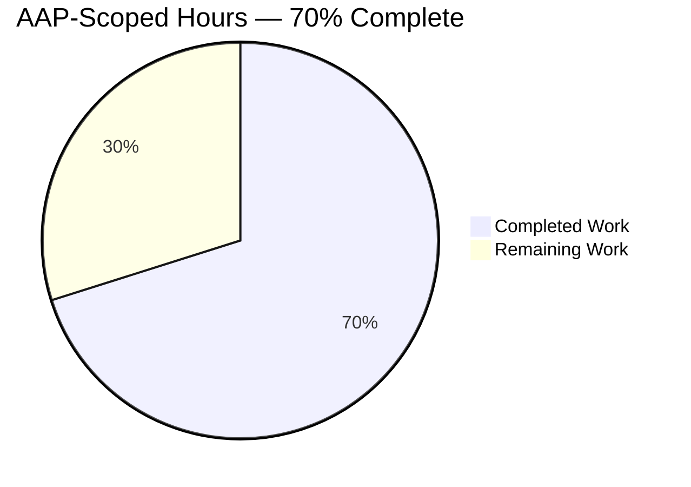
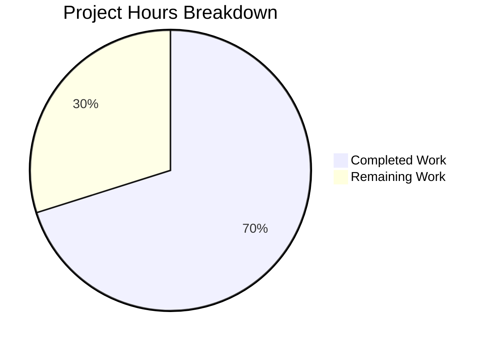

# 1. Executive Summary

This project gives the `customer-orders-api` service its first unit test suite and the tooling that measures it. The sections below report what was delivered, what was exercised to prove it works, what remains open, and the path to production.

## 1.1 Project Overview

`services/customer-orders-api` is a small FastAPI service: seven route handlers in one module, three pydantic request models and three in-memory stores let a customer register, log in, browse a product catalogue and place orders. This release gives it its first unit test suite: sixteen tests drive every handler in process, assert all six error paths on their status and exact message, and prove the stock decrement, the computed order total and the stored record shapes. It adds the coverage tooling and the single command that reports line coverage, so the 57 executable statements are measured rather than assumed. The beneficiary is the team that inherits a regression net where there was none.

## 1.2 Completion Status

Every requirement this work was scoped against is delivered and verified: 27.0 hours complete out of 38.5 total, **70% complete**, with 11.5 hours remaining. The remaining hours are path-to-production work rather than unfinished delivery — enforcement of the suite in a pipeline, the interpreter floor the coverage pin introduces, the root-level form of the documented command, repository hygiene for run artifacts, separation of test tooling from runtime pins, and two small assertion gaps.

Completed work is shown in Dark Blue (#5B39F3); remaining work in White (#FFFFFF).



| Metric | Value |
|---|---|
| Total Hours | 38.5 |
| Completed Hours (Baseline: Human with agentic-assist) | 27 |
| Remaining Hours | 11.5 |
| Completion | 70% |

## 1.3 Key Accomplishments

- Sixteen unit tests drive all seven handlers in process, one behaviour per test (`tests/unit/test_main.py`)
- All six error paths asserted on status and exact message: 404 product, 400 quantity, 409 stock, 409 duplicate email, 401 credentials, 404 order
- Order total proven as `round(price * quantity, 2)`, including the half-cent case 10.005 x 1 = 10.01, so removing or loosening the rounding fails the suite
- Guard precedence proven: an unknown product with quantity 0 returns 404, not 400
- Every mutating handler additionally asserted through the store it wrote — stock decrement, depletion to zero, unchanged stock on rejection, stored order shape
- Line coverage measured at 57 of 57 statements (100%) against the 50% floor carried inside the command's own exit status
- Coverage tooling declared as two exact pins, so one install and one command run and measure the suite
- The four pre-existing HTTP tests still pass and production code is byte-identical to its baseline

## 1.4 Critical Unresolved Issues

**10 of 27** requirement and path-to-production items audited remain open (21 AAP requirements, 6 path-to-production needs). They divide into five path-to-production gaps, three capabilities no automated test exercises, and two accepted caveats.

| Issue | Impact | Owner | ETA |
|---|---|---|---|
| Path-to-production (5) — no pipeline runs the suite or its 50% floor | A red suite or sub-floor coverage can merge; the floor only fires when a human runs the command | Service owner | 6 h, next iteration |
| Path-to-production (5) — the coverage pin requires Python 3.11+ and no `.python-version` or README statement says so | An older interpreter fails at install with a pip resolution error instead of a clear requirement | Service owner | 1.5 h |
| Path-to-production (5) — the README publishes only the service-directory form of the command | A reader at the checkout root sees `file or directory not found: tests/unit` (exit 4) | Service owner | 0.5 h |
| Path-to-production (5) — `.coverage`, `coverage.xml` and `__pycache__/` land in the tracked tree with no ignore rule | A careless `git add -A` commits generated files and machine-specific paths | Service owner | 1 h |
| Path-to-production (5) — test tooling shares the runtime manifest | Any image built from `requirements.txt` installs pytest, pytest-cov, coverage and httpx | Service owner | 2 h |
| Never exercised (3) — no automated test covers a live purchase journey against a separately running service | Cross-boundary regressions rest on the four route tests alone | QA owner | Pre-release |
| Never exercised (3) — no test covers the framework's 422 envelope, concurrent orders, negative price/stock, or route authentication | Those failure modes are unproven; a negative price is accepted today (201) and yields a negative total | QA owner | Pre-release |
| Never exercised (3) — no browser or storefront journey exists to test | Client-side integration is unverified | Product owner | Not scheduled |
| Accepted caveat (2) — `create_product`'s returned key set and product-id uniqueness are unpinned | A constant id or an extra response key would pass every assertion | Service owner | 0.5 h |
| Accepted caveat (2) — `EmailStr` is imported at `app/main.py:2` while `email-validator` is undeclared, and the test file's import block is not isort-ordered | A future field adopting `EmailStr` fails at import; import order is inconsistent if a linter is adopted | Service owner | Before the first `EmailStr` field |

## 1.5 Access Issues

No access issues identified. The service needs no credential, secret, database, broker, external endpoint, licence or seeded data: its entire state is three in-process dictionaries, it listens on loopback for manual runs only, and the suite runs offline against the declared pins. Nothing in the build, the tests or the runtime checks was blocked by a permission or a missing credential.

## 1.6 Recommended Next Steps

1. [High] Wire the documented unit command, with `--cov-fail-under=50`, into a pipeline so the suite and its floor run on every change and a red or sub-floor run blocks it.
2. [High] Declare the interpreter floor the coverage pin introduces: a `.python-version` of 3.11 or later plus a README sentence stating the requirement and the install command.
3. [Medium] Publish the checkout-root form of the suite command (`cd services/customer-orders-api && ...`) beside the service-directory form, and add ignore rules for `.coverage`, `coverage.xml`, `__pycache__/` and `.pytest_cache/`.
4. [Medium] Extend the coverage the suite does not have: a purchase journey against a separately running service, and cases for the framework's 422 envelope, negative price/stock and concurrent orders.
5. [Low] Separate test tooling from the runtime manifest, and pin `create_product`'s returned key set and product-id uniqueness.

# 2. Project Hours Breakdown

Hours are estimated bottom-up from the delivered artefacts and the verification each required, and are scoped to the work this project was defined against plus the path to production. Completed work is 27.0 hours; remaining work is 11.5 hours; the project total is 38.5 hours.

## 2.1 Completed Work Detail

| Component | Hours | Description |
|---|---|---|
| Order-creation unit tests (5 tests) | 8 | Money path with a rounding-sensitive case (10.005 x 1 = 10.01) beside the blueprint's 51.0 and 100.0 totals; three guards with their precedence proven (404 before 400 before 409); full-depletion boundary with stock at 0; rejected orders leave stock unchanged and the store empty (`tests/unit/test_main.py:19-62`) |
| Registration and login unit tests (5 tests) | 4.5 | Returned id equals the id held in the store, no password field in the response, duplicate email rejected with 409, login returns exactly `user_id` and `token-<id>`, and both 401 paths asserted separately from the shared raise site (`tests/unit/test_main.py:64-97`) |
| Order lookup, product creation, catalogue listing and health tests (6 tests) | 5 | Order record compared against a literal of exactly its four keys, unknown order 404, product persistence asserted against `model_dump()`, catalogue compared against both entries field for field in insertion order, empty store returns `[]`, health returns exactly `{"status": "ok"}` (`tests/unit/test_main.py:99-135`) |
| Coverage capability in the manifest | 2 | `pytest-cov==7.1.0` and `coverage==7.17.5` appended to the flat manifest after `httpx==0.28.1`, resolved and compatibility-checked against pytest 8.3.4 and starlette 0.41.3 (`requirements.txt:5-6`) |
| Suite command and refreshed gap list in the README | 1.5 | The unit command with its coverage flags and the whole-suite command published in the "Existing tests" section; the four now-tested behaviours removed from the analysis-gap list and the two real gaps kept (`README.md:9-17`) |
| Coverage and suite verification | 6 | The unit command with the 50% floor, the statement map to 57 of 57, the whole suite with the four pre-existing route tests, and a live-HTTP cross-check of every value the suite pins |
| **Total** | **27** | |

## 2.2 Remaining Work Detail

| Category | Hours | Priority |
|---|---|---|
| CI enforcement of the suite and its 50% floor (path-to-production) | 6 | High |
| Interpreter floor declared and provisioning documented (path-to-production) | 1.5 | High |
| Checkout-root form of the suite command published in the README (closes divergence D2) | 0.5 | Medium |
| Run artifacts kept out of version control (path-to-production) | 1 | Medium |
| Test tooling separated from the runtime manifest (path-to-production) | 2 | Low |
| Supplementary assertion hardening — returned key set, product-id uniqueness (accepted caveat, Section 1.4) | 0.5 | Low |
| **Total** | **11.5** | |

## 2.3 Hours Reconciliation

**Completed 27.0 h + Remaining 11.5 h = Total 38.5 h**, and **27.0 / 38.5 = 70.1%**, reported as 70% throughout this document.

The same three figures are used everywhere they appear: Section 1.2's metrics table, Section 1.2's chart, the totals of Sections 2.1 and 2.2, the chart in Section 7, and the narrative in Section 8. All 11.5 hours of remaining work trace to the path-to-production needs in Section 2.2; no AAP requirement is outstanding, and no hour in either table covers work outside the delivered scope.

# 3. Test Results

Run on the delivered tree with Python 3.13.18: `python -m pytest tests/unit --cov=app --cov-report=term-missing --cov-report=xml:coverage.xml --cov-fail-under=50` reported `16 passed`, `TOTAL 57 statements, 0 missed, 100%` and "Required test coverage of 50% reached. Total coverage: 100.00%" with exit status 0; `python -m pytest` then reported `20 passed` with one third-party `DeprecationWarning` from `starlette/testclient.py`. Nothing is skipped or marked as an expected failure.

| Area / Category | Framework | Tests | Passed | Failed | Coverage | What This Proves |
|---|---|---|---|---|---|---|
| Order creation — money path, guard order, stock mutation | pytest 8.3.4 | 5 | 5 | 0 | whole unit run: 57/57 (100%) | The stored total is exactly `round(price * quantity, 2)`, an unknown product returns 404 before the quantity check can return 400, and stock is decremented, depleted to 0 or left untouched on rejection |
| Registration and login | pytest 8.3.4 | 5 | 5 | 0 | included in the 57/57 | An account is keyed on email with a generated id and its password never echoed; the token is `token-<id>`; duplicate email, wrong password and unknown email each fail with their exact status and message |
| Order lookup, product creation, catalogue listing, health | pytest 8.3.4 | 6 | 6 | 0 | included in the 57/57 | An order is served with exactly its four keys, an unknown id returns 404, a product persists exactly as submitted, the catalogue projects both entries in insertion order, and health returns its exact body |
| Pre-existing HTTP-envelope tests | pytest 8.3.4 + fastapi TestClient | 4 | 4 | 0 | not measured (outside the unit suite's scope) | Status codes and response serialisation produced through the real ASGI envelope still hold for health, registration, product creation and an unknown-product order |
| **Total** | | **20** | **20** | **0** | | |

**Not Covered** — delivered capability that no test exercises, and what a human should test before release:

- **Framework request validation (422).** Pydantic rejects a malformed body before a handler runs; no test asserts it. Observed once during runtime validation (`POST /orders` with `quantity: "abc"` returns 422 with an `int_parsing` detail) but not pinned by any test.
- **Concurrency and oversell.** The stock check and decrement are not atomic, so two simultaneous orders for the last unit could both pass the `stock < quantity` check. No test runs concurrent requests.
- **Input validation of price, stock and email.** A product at price -5.0 is accepted with 201 and yields a negative order total; empty-string credentials and differently-cased duplicates are accepted; `EmailStr` is imported but no field applies it. Nothing asserts or prevents this.
- **Authentication and authorisation.** No route requires the token `POST /login` issues, and passwords are stored and compared verbatim. No test covers this, and asserting it today would describe behaviour the service does not have.
- **A live purchase journey against a separately running service, and a browser or storefront journey.** No automated test covers either, and the project contains no UI. Both are recorded in the README as deliberate analysis gaps (`README.md:17`).
- Everything else delivered — all seven handlers, all six error paths, the money path, the stock mutation, the stored record shapes and the catalogue projection — is asserted by a test listed above, and the 57-statement set carries no unexecuted line.

# 4. Runtime Validation & UI Verification

The service was started with `python -m uvicorn app.main:app --host 127.0.0.1 --port 20711` on Python 3.13.18 and driven end to end over HTTP.

- ✅ Start-up and shutdown — uvicorn logged "Application startup complete" with no error in its log, served every request below, and shut down cleanly with "Application shutdown complete".
- ✅ Health — `GET /health` returned 200 `{"status":"ok"}`.
- ✅ Registration — `POST /users` returned 201 with a generated uuid and the email, and no password field; the same body again returned 409 `{"detail":"email already registered"}`.
- ✅ Login — correct credentials returned 200 `{"user_id":"<uuid>","token":"token-<uuid>"}`; a wrong password and an unknown email each returned 401 `{"detail":"invalid credentials"}`.
- ✅ Catalogue — `GET /products` returned `[]` on the freshly started process; `POST /products` at price 10.005 with stock 1 returned 201 echoing id, name, price and stock; the listing returned the same entry, and stock was 0 after the order.
- ✅ Order money path — `POST /orders` for quantity 1 returned 201 with `total: 10.01`, the half-cent rounding the suite pins, across the real JSON boundary.
- ✅ Order guard precedence — an unknown product with quantity 0 returned 404 `{"detail":"product not found"}` (404 beats 400); an existing product with quantity 0 returned 400 `{"detail":"quantity must be positive"}`; quantity 2 against stock 1 returned 409 `{"detail":"insufficient stock"}`.
- ✅ Order lookup — `GET /orders/{id}` returned exactly `id`, `product_id`, `quantity`, `total`; an unknown id returned 404 `{"detail":"order not found"}`.
- ⚠ Framework validation — `POST /orders` with a non-numeric quantity returned 422 with pydantic's `int_parsing` detail; observed in this session, asserted by no test.
- ⚠ External integrations — none exist: the module imports only fastapi, pydantic and uuid, opens no socket or file and calls no service, so there is nothing to integrate or stub.

**Never exercised at runtime:** any browser or storefront journey (the project ships no UI), concurrent order submission or more than one worker process, and any run against a persistent datastore. State is the three module-level dictionaries in `app/main.py:6` and nothing survives the process that holds it.

# 5. Compliance & Quality Review

The matrix shows where each deliverable stands now, against the quality and compliance benchmarks this work was held to.

## 5.1 Compliance Matrix

| Deliverable | Benchmark | Status | Progress |
|---|---|---|---|
| `tests/unit/test_main.py` — 16 unit tests over 7 handlers | Blueprint fidelity: 5 order, 2 register, 3 login, 2 lookup, 1 product, 2 catalogue, 1 health (`tests/unit/test_main.py`) | ✅ Pass | 100% |
| Unit level by construction | Handlers called in process; no `TestClient`, ASGI transport, socket or subprocess in the unit file | ✅ Pass | 100% |
| Error-path coverage | All six `HTTPException` raise sites asserted on status and exact `detail` (`app/main.py:28,37,54,56,58,72`) | ✅ Pass | 100% |
| Assertion strength | Returned value or status plus message, and every mutating handler asserted through the store it wrote | ✅ Pass | 100% |
| Conventions and isolation | Bare `test_*` functions, plain asserts, no docstrings, no classes, no fixtures, no mocks; `setup_function` clears all three stores (`tests/unit/test_main.py:8-11`) | ✅ Pass | 100% |
| Line-coverage bar | 50% floor carried by `--cov-fail-under=50`; measured 57 of 57 statements, 100% | ✅ Pass | 100% |
| Coverage capability declared | `pytest-cov==7.1.0` and `coverage==7.17.5` exact-pinned in the manifest that already holds pytest (`requirements.txt:5-6`) | ✅ Pass | 100% |
| Suite command published | Unit command and whole-suite command in the README, verbatim; working directory implied by the section above it (`README.md:9-14`) | ⚠ Partial | 90% |
| Analysis-gap list refreshed | Four now-tested behaviours removed; live-HTTP and browser journeys kept as real gaps (`README.md:17`) | ✅ Pass | 100% |
| Production integrity | `app/main.py` and `app/__init__.py` byte-identical to their baseline; the four pre-existing route tests unmodified and passing | ✅ Pass | 100% |
| Defect discipline and repository hygiene | No `xfail`, `skip` or marker anywhere; no run artifact in any commit; no configuration file, lock file or CI workflow added | ✅ Pass | 100% |

## 5.2 AAP & Rule Divergences and Gaps

Three divergences were established from the 21 requirements audited; none is a departure from a user rule, because no user rules were supplied for this project. Each is listed separately below.

| # | What the AAP/Rule Required | What Was Delivered Instead | Why It Diverged | Impact | Remediation |
|---|---|---|---|---|---|
| D1 | §0.5.2's `create_order` happy-path blueprint describes one scenario: stock 3, price 25.5, quantity 2, total 51.0 | The same test also places a second order — price 10.005, quantity 1, total 10.01 (`tests/unit/test_main.py:27-29`) | §0.1.4 and §0.8.4 require `round(price * quantity, 2)` be asserted, and both blueprint values (25.5 x 2 and 25.0 x 4) are exactly representable at two decimals, so removing or loosening the rounding would leave every assertion green; folding the case into the existing function preserves the fixed 16-test count | None on production behaviour, coverage (still 57/57) or the blueprint's own values; the function carries two scenarios instead of one | None required. Literal case-per-function fidelity needs a 17th test, which changes the stated suite profile of 16 unit + 4 integration tests |
| D2 | User directive: "Give it one command that runs the whole unit suite from the repository root and writes a line coverage report" | `README.md:11` publishes only the de-prefixed form; run from the checkout root it exits 4 until prefixed with `cd services/customer-orders-api &&` | The checkout root is a metadata-only parent with the code in a submodule, and the plan settled the README's form as the service-directory one, keeping the prefixed form for its own text | A reader at the root gets `file or directory not found: tests/unit` instead of a coverage run, and must infer the directory | Publish the prefixed form beside the existing command (0.5 h, Section 2.2) |
| D3 | No AAP or user requirement governs import ordering; the repository's only other test file uses its own ordering | `import pytest` precedes `from fastapi import HTTPException` (`tests/unit/test_main.py:1-2`), which a default isort profile would reorder | The service ships no linter and no lint configuration; the AAP fixes this import block verbatim and requires the idiom of `tests/test_routes.py`, which orders imports the same way | Cosmetic: nothing in the repository enforces ordering, and no tool reports it | None unless the project adopts a linter, at which point both test files should be ordered together |

**D2 — the suite runs from the service directory only.** The command in `README.md:11` is byte-for-byte the one the requirement specifies, and it works exactly as published from `services/customer-orders-api`: 16 tests pass, the coverage output shows 57 of 57 statements, and the 50% floor is reached. From the checkout root the same string collects nothing, because the checkout root is a metadata-only parent whose code arrives as a submodule and `python -m pytest` resolves `app` only when the service directory is current. The gap is documentation, not function: one prefixed line — `cd services/customer-orders-api && python -m pytest tests/unit --cov=app --cov-report=term-missing --cov-report=xml:coverage.xml --cov-fail-under=50` — costs half an hour and removes the only way a newcomer can misread the README.

**D1 — the order test carries a second scenario.** The requirement fixed one `create_order` happy path and, in the same document, required that `round(price * quantity, 2)` be proven. Those two pull in opposite directions: 25.5 x 2 = 51.0 and 25.0 x 4 = 100.0 are exact at two decimals, so both survive a removed `round()`, a one-decimal rounding or an integer cast. The delivered test keeps the blueprint's values and adds a half-cent order — 10.005 x 1, stored as 10.01 — inside the same function (`tests/unit/test_main.py:27-29`), which makes all three mutations fail while holding the suite at sixteen tests. Nothing needs doing unless per-function case purity matters more than the count, in which case a seventeenth test is the alternative.

**D3 — the import block is not isort-ordered.** The unit file opens with `import pytest` and then `from fastapi import HTTPException` before the `app.main` imports, which a default isort profile would reorder. Nothing in this repository objects: there is no `ruff.toml`, `setup.cfg`, `tox.ini` or `pyproject.toml` anywhere in the service, no pipeline runs a linter, and `tests/test_routes.py` — the file whose conventions the new suite follows — orders its imports the same way. It is a real inconsistency only against a tool the project does not use; if one is adopted, ordering both test files together is the right single change.

# 6. Risk Assessment

| Risk | Category | Severity | Probability | Mitigation | Status |
|---|---|---|---|---|---|
| Passwords are stored and compared verbatim, and no route requires the token `POST /login` issues, so anyone who reaches the service can read and modify every order | Security | High | High | Hash passwords with a per-user salt, enforce the bearer token on catalogue and order routes, and keep the service on loopback until then | Open — production code intentionally unchanged here |
| Nothing enforces the suite: there is no pipeline, hook or gate, so a regression can merge with the suite red and the 50% floor is only checked when a human runs the command | Operational | High | Medium | Run the documented command, floor included, in CI on every change | Open — 6 h (Section 2.2) |
| State lives in three module-level dictionaries: a restart, a crash or a second worker discards every user, product and order, and the non-atomic stock check-then-decrement lets concurrent orders oversell the last unit | Technical | High | Low at single-worker use | Move the stores behind a persistent, lock-protected store and add a concurrency test once scope allows | Open — recorded, untested |
| No input validation: `EmailStr` is imported but unused and `email-validator` undeclared, so a future field adopting it fails at import; a negative price is accepted and yields a negative order total | Technical | Medium | Medium | Declare `email-validator`, add field constraints for price, stock and email, and cover each rule with a unit case | Open |
| The coverage figure is collection-scoped: editing the documented command to drop `tests/unit` would report about 70% from the four route tests alone while proving nothing new | Technical | Medium | Medium | Enforce the command verbatim in CI and review any edit to it together with the README line | Open |
| The coverage pin raises the manifest's effective interpreter floor to Python 3.11 while the repository declares no Python version, so an older interpreter fails at install with a pip resolution error instead of a clear requirement | Operational | Medium | Medium | Declare the floor — a `.python-version` of 3.11 or later plus a README statement — and document the install command | Open — 1.5 h (Section 2.2) |
| The flat manifest installs test tooling — pytest, pytest-cov, coverage, httpx — into any image built from it, widening the deployed surface | Security | Medium | High | Split a dev/test requirements file and install runtime pins only in production images | Open — 2 h (Section 2.2) |
| Run artifacts (`.coverage`, `coverage.xml`, `__pycache__/`) land in the tracked service tree with no ignore rule, so a careless `git add -A` would commit generated files and machine-specific paths | Integration | Low | Medium | Add ignore entries for the four artifact names | Open — 1 h (Section 2.2) |

# 7. Visual Project Status



Completed work is shown in Dark Blue (#5B39F3) and remaining work in White (#FFFFFF).

| Status | Hours | Share |
|---|---|---|
| Completed Work | 27 | 70% |
| Remaining Work | 11.5 | 30% |
| **Total** | **38.5** | 100% |

Remaining hours by priority, matching Section 2.2:

| Priority | Hours | Items |
|---|---|---|
| High | 7.5 | CI enforcement of the suite and its floor (6 h); the interpreter floor (1.5 h) |
| Medium | 1.5 | Checkout-root command in the README (0.5 h); artifact ignore rules (1 h) |
| Low | 2.5 | Test tooling split from the runtime manifest (2 h); assertion hardening (0.5 h) |
| **Total** | **11.5** | |

# 8. Summary & Recommendations

The `customer-orders-api` service now has a unit suite where it had none: sixteen tests call every one of its seven handlers in process, exercise all six `HTTPException` raise sites on status and exact message, and assert the state each mutating handler leaves behind. The money path is proven rather than assumed — the stored total is `round(price * quantity, 2)`, demonstrated by a half-cent order that a removed, loosened or integer-truncated rounding could not survive; the guard order returns 404 for an unknown product before it can return 400 for a bad quantity; stock is decremented, depleted to zero and left untouched on rejection. The suite is measured by one command that carries the 50% floor in its own exit status, and it reports 57 of 57 statements covered. The four pre-existing route tests still pass, and production code is byte-identical to its baseline.

This project is **70% complete**: 27.0 hours delivered of 38.5 total, with 11.5 hours remaining. No requirement is outstanding — the remaining hours are the path to production, not unfinished delivery. In dependency order: enforce the documented command and its floor in a pipeline (6 h), declare the Python 3.11 floor the coverage pin introduces and document the install (1.5 h), publish the checkout-root form of the command and ignore the run artifacts it writes (1.5 h), split test tooling out of the runtime manifest (2 h), and close the two remaining assertion gaps (0.5 h).

| Success metric | Target | Delivered |
|---|---|---|
| Unit tests over the seven handlers | 16 | 16 passing |
| Error paths asserted on status and message | 6 of 6 | 6 of 6 |
| Line coverage of `app/main.py` | at least 50% (29 of 57) | 100% (57 of 57) |
| Pre-existing route tests preserved | 4 passing | 4 passing |
| Production files changed | 0 | 0 |

**Production readiness: ready as a tested codebase, not yet ready as a service to expose.** The suite, its coverage gate and its documentation are complete and repeatable, but three things must be settled before this service faces a network: passwords are stored and compared in plaintext and no route requires the token login issues; a negative price is accepted and produces a negative order total; and the state that every handler mutates is process-local, so a restart or a second worker loses it. Those are pre-existing characteristics of the service this work was explicitly not allowed to change, and they belong to the release that puts it behind a real store. The correct next step is the pipeline, so the regression net built here starts doing its job on the first change that follows.

# 9. Development Guide

All commands below were run on this project and are copy-pasteable. `services/customer-orders-api` is the service directory; commands must run from it (or be prefixed with it), because `python -m pytest` resolves the `app` package from the current directory and the service has no `conftest.py`.

**System prerequisites**

| Requirement | Version verified | Notes |
|---|---|---|
| Python | 3.13.18 (3.11 or later required) | `coverage==7.17.5` declares `Requires-Python >=3.11`; nothing older can install the manifest |
| pip | 25.x | Comes with the interpreter; used only to install the manifest |
| Git | any recent | Needed to clone; the suite itself needs nothing else |
| Database, cache, broker, Docker, Node.js | not required | The service holds all state in three in-process dictionaries |
| Environment variables or secrets | none | `PORT` is passed on the uvicorn command line only |

**Environment setup**

Create the virtual environment **outside** the checkout. An environment placed inside `services/customer-orders-api` is collected as tests by the whole-suite command and inflates the test count.

```bash
python3 -m venv "$HOME/.venvs/customer-orders"
"$HOME/.venvs/customer-orders/bin/python" -m pip install --upgrade pip
"$HOME/.venvs/customer-orders/bin/python" -m pip install -r services/customer-orders-api/requirements.txt
"$HOME/.venvs/customer-orders/bin/python" -m pip check
```

Expected: six pins install in one pass — fastapi 0.115.6, uvicorn 0.34.0, pytest 8.3.4, httpx 0.28.1, pytest-cov 7.1.0, coverage 7.17.5 — and `pip check` prints `No broken requirements found.`

Do not run this suite against a global interpreter: a global environment carrying pytest 9.x and starlette 1.x cannot satisfy fastapi 0.115.6, which requires `starlette >=0.40, <0.42`.

**Syntax check**

```bash
cd services/customer-orders-api && "$HOME/.venvs/customer-orders/bin/python" -m compileall -q app tests
```

Exit status 0 means both packages compile. There is no build step, no lock file and no lint or type-check configuration.

**Run the unit suite with line coverage**

```bash
cd services/customer-orders-api
"$HOME/.venvs/customer-orders/bin/python" -m pytest tests/unit --cov=app --cov-report=term-missing --cov-report=xml:coverage.xml --cov-fail-under=50
```

Expected output (observed):

```text
................                                                         [100%]
Name              Stmts   Miss  Cover   Missing
app/__init__.py       0      0   100%
app/main.py          57      0   100%
TOTAL                57      0   100%
Required test coverage of 50% reached. Total coverage: 100.00%
16 passed
```

`--cov=app` restricts measurement to production code, `--cov-report=term-missing` prints uncovered line numbers, and `--cov-fail-under=50` makes a sub-50% run exit non-zero. `coverage.xml` is written into the service directory and is a run artifact: do not commit it.

The same command from the checkout root, prefixed:

```bash
cd services/customer-orders-api && "$HOME/.venvs/customer-orders/bin/python" -m pytest tests/unit --cov=app --cov-report=term-missing --cov-report=xml:coverage.xml --cov-fail-under=50
```

**Run the whole suite**

```bash
cd services/customer-orders-api && "$HOME/.venvs/customer-orders/bin/python" -m pytest
```

Expected: `20 passed` — 16 unit tests plus the 4 pre-existing route tests — with one third-party `DeprecationWarning` from `starlette/testclient.py` about `anyio.abc.BlockingPortal`. The warning comes from an installed dependency, not from this project, and nothing escalates warnings to errors.

Single test, or a named subset:

```bash
cd services/customer-orders-api
"$HOME/.venvs/customer-orders/bin/python" -m pytest tests/unit/test_main.py::test_create_order_decrements_stock_and_computes_total -q
"$HOME/.venvs/customer-orders/bin/python" -m pytest tests/unit -q -k "login or register"
```

**Start the service and exercise it**

```bash
cd services/customer-orders-api
"$HOME/.venvs/customer-orders/bin/python" -m uvicorn app.main:app --host 127.0.0.1 --port 8000
```

Wait for `Application startup complete`, then in another shell:

```bash
curl -s http://127.0.0.1:8000/health
# {"status":"ok"}

curl -s -X POST http://127.0.0.1:8000/users -H 'content-type: application/json' \
  -d '{"email":"a@example.com","password":"pw"}'
# {"id":"<uuid>","email":"a@example.com"}         (201, no password field)

curl -s -X POST http://127.0.0.1:8000/login -H 'content-type: application/json' \
  -d '{"email":"a@example.com","password":"pw"}'
# {"user_id":"<uuid>","token":"token-<uuid>"}

curl -s -X POST http://127.0.0.1:8000/products -H 'content-type: application/json' \
  -d '{"name":"Keyboard","price":10.005,"stock":1}'
curl -s http://127.0.0.1:8000/products
curl -s -X POST http://127.0.0.1:8000/orders -H 'content-type: application/json' \
  -d '{"product_id":"<product-id>","quantity":1}'
# {"id":"<uuid>","product_id":"<product-id>","quantity":1,"total":10.01}

curl -s -X POST http://127.0.0.1:8000/orders -H 'content-type: application/json' \
  -d '{"product_id":"missing","quantity":0}'
# {"detail":"product not found"}                   (404, before the 400 for quantity)
```

Expected statuses: 200 health and login, 201 registration, product and order, 400 for a non-positive quantity, 401 for either login failure, 404 for an unknown product or order, 409 for a duplicate email or insufficient stock. Stop the server with Ctrl-C; state is discarded with the process.

**Troubleshooting**

| Symptom | Cause | Resolution |
|---|---|---|
| `file or directory not found: tests/unit` (exit 4) | Command run from the checkout root | `cd services/customer-orders-api` first |
| `ModuleNotFoundError: No module named 'app'` with bare `pytest` | The console script does not put the current directory on `sys.path` | Use `python -m pytest` |
| `unrecognized arguments: --cov=app` | The active interpreter lacks pytest-cov | Install the manifest into that environment |
| `ImportError: email-validator is not installed` | A model field was given `EmailStr`, which no field uses today | Add `email-validator` to the manifest at the same time as the field |
| Test count higher than 20 | A virtual environment was created inside the service directory and is being collected | Recreate it outside the checkout |
| `ModuleNotFoundError: No module named 'fastapi'` | Global interpreter used instead of the provisioned environment | Invoke `"$HOME/.venvs/customer-orders/bin/python" -m pytest` explicitly |
| `DeprecationWarning: The anyio.abc.BlockingPortal alias is deprecated` | Emitted by `starlette/testclient.py`, used by the four route tests | Expected; do not add `-W error`, which would turn it into a failure |
| `.coverage`, `coverage.xml`, `__pycache__/` appear as untracked | The documented command writes them into the service directory | Delete after a run, or add ignore rules (Section 2.2); never commit them |
| A run below 50% exits non-zero | `--cov-fail-under=50` is the floor | Add tests until the TOTAL row clears it; do not lower the flag |

# 10. Appendices

Reference material for building on, running and troubleshooting this project. Every path is relative to the repository root.

## A. Command Reference

| Purpose | Command | Notes |
|---|---|---|
| Provision the environment | `python3 -m venv "$HOME/.venvs/customer-orders"` | Outside the checkout, always |
| Install dependencies | `"$HOME/.venvs/customer-orders/bin/python" -m pip install -r services/customer-orders-api/requirements.txt` | Six exact pins |
| Verify the environment | `"$HOME/.venvs/customer-orders/bin/python" -m pip check` | Expect `No broken requirements found.` |
| Compile check | `cd services/customer-orders-api && "$HOME/.venvs/customer-orders/bin/python" -m compileall -q app tests` | Exit 0 |
| Unit suite with coverage | `cd services/customer-orders-api && "$HOME/.venvs/customer-orders/bin/python" -m pytest tests/unit --cov=app --cov-report=term-missing --cov-report=xml:coverage.xml --cov-fail-under=50` | 16 passed, TOTAL 57/57, floor reached |
| Whole suite | `cd services/customer-orders-api && "$HOME/.venvs/customer-orders/bin/python" -m pytest` | 20 passed |
| Route tests only | `cd services/customer-orders-api && "$HOME/.venvs/customer-orders/bin/python" -m pytest tests/test_routes.py -q` | 4 passed |
| One test | `cd services/customer-orders-api && "$HOME/.venvs/customer-orders/bin/python" -m pytest tests/unit/test_main.py::test_health_returns_ok -q` | 1 passed |
| Start the service | `cd services/customer-orders-api && "$HOME/.venvs/customer-orders/bin/python" -m uvicorn app.main:app --host 127.0.0.1 --port 8000` | Wait for `Application startup complete` |
| Health probe | `curl -s http://127.0.0.1:8000/health` | `{"status":"ok"}` |
| Changed files on this branch | `git -C services/customer-orders-api diff --stat 04259f8..HEAD` | `README.md`, `requirements.txt`, `tests/unit/test_main.py` |

## B. Port Reference

| Service | Port | Binding | Notes |
|---|---|---|---|
| `customer-orders-api` (uvicorn) | 8000 | 127.0.0.1 | The port the README documents; any free port works — the live validation for this project used 20711 |
| `customer-orders-api` tests | none | — | The 16 unit tests call handlers in process and the 4 route tests use an in-process TestClient; no socket is opened |
| `warehouse-catalogue-api` (Node sibling, outside this project's scope) | 3000 via `PORT` | 127.0.0.1 | Not started, changed or tested here |

## C. Key File Locations

| Path | Role |
|---|---|
| `services/customer-orders-api/app/main.py` | The entire production surface: FastAPI app, three request models, three stores, seven route handlers (73 lines). Read-only for this project |
| `services/customer-orders-api/app/__init__.py` | Empty package marker so `app` imports |
| `services/customer-orders-api/tests/unit/test_main.py` | The new unit suite: 16 tests, the `setup_function` store reset and two seeding helpers (135 lines) |
| `services/customer-orders-api/tests/test_routes.py` | The four pre-existing route tests; the convention reference the unit suite follows |
| `services/customer-orders-api/requirements.txt` | Six exact pins, including the two coverage pins on lines 5-6 |
| `services/customer-orders-api/README.md` | Run instructions, the unit and whole-suite commands, and the analysis-gap list |
| `services/warehouse-catalogue-api/` | Node/Express sibling service; not part of this project and unmodified |
| `.gitmodules`, `README.md` (root) | Submodule declarations and the note that the parent holds no application source |

## D. Technology Versions

| Component | Version | Source | Note |
|---|---|---|---|
| Python | 3.13.18 | Host interpreter | 3.11 or later required by the coverage pin; the repository declares no version of its own |
| fastapi | 0.115.6 | `requirements.txt` | Requires starlette `>=0.40, <0.42` |
| starlette | 0.41.3 | Transitive beneath fastapi | Resolved by the manifest; not pinned directly |
| pydantic | 2.14.4 | Transitive beneath fastapi | Supplies the three request models |
| uvicorn | 0.34.0 | `requirements.txt` | Runtime server only; no test uses it |
| pytest | 8.3.4 | `requirements.txt` | Test framework and runner |
| httpx | 0.28.1 | `requirements.txt` | Used by the pre-existing route tests' TestClient |
| pytest-cov | 7.1.0 | `requirements.txt` | Produces the line-coverage report; no upper pytest bound |
| coverage | 7.17.5 | `requirements.txt` | Measurement engine; requires Python 3.11 or later |
| Node.js / Express | 22.x / 4.21.2 | Sibling service | Outside this project's scope |

## E. Environment Variable Reference

| Variable | Required by | Default | Purpose |
|---|---|---|---|
| — | `customer-orders-api` service and its tests | — | None required: `app/main.py` imports no `os` module and reads no environment variable, and the suite needs none |
| `PORT` | `warehouse-catalogue-api` (sibling service, outside this project) | 3000 | Not read by anything in this project |
| `PYTHONDONTWRITEBYTECODE`, `PYTHONPYCACHEPREFIX` | Optional developer hygiene | unset | Keep `__pycache__/` out of the tracked tree during a run |

## F. Developer Tools Guide

| Tool / flag | What it does here | When to use it |
|---|---|---|
| `python -m pytest tests/unit` | Runs the 16 unit tests only | After any change to a handler or a test |
| `python -m pytest` | Runs unit and route tests in one process; both files reset the stores themselves | Before committing |
| `--cov=app` | Restricts measurement to production code, keeping framework and test packages out of the percentages | Whenever coverage is read; without it the TOTAL covers test code as well |
| `--cov-report=term-missing` | Prints uncovered line numbers beside the table | Locating the statement no test reaches |
| `--cov-report=xml:coverage.xml` | Writes a machine-readable report beside the source | Consumed by coverage tooling; never commit it |
| `--cov-fail-under=50` | Turns the 50% bar into the command's exit status | In any gate, and locally before a push |
| `-k "<expression>"`, `tests/unit/test_main.py::<test>` | Narrows collection to matching tests or one test | Working on a single behaviour |
| `-q`, `-vv --tb=long`, `-x` | Quiet output, verbose failures, stop at first failure | Fast loops; debugging a red run |
| `--pdb` | Drops into the debugger on failure | Interactive terminal only, never in an unattended run |
| `python -m compileall -q app tests` | Syntax check without executing anything | First check after an edit; there is no build step |
| `pip check` | Confirms the installed set has no broken requirements | After provisioning, and when a version error appears |
| `uvicorn app.main:app --port <n>` | Serves the app for manual checks | Runtime validation of a change |
| `git -C services/customer-orders-api diff --stat 04259f8..HEAD` | Shows everything this branch changed in the service | Reviewing scope before a commit |

## G. Glossary

| Term | Meaning in this project |
|---|---|
| Handler | One of the seven functions in `app/main.py` that a route calls: `health`, `register`, `login`, `create_product`, `list_products`, `create_order`, `get_order` |
| Unit test | A test that imports a handler and calls it directly in process, with no HTTP layer, socket or subprocess in between |
| Integration (route) test | A test that drives the app through `TestClient`, exercising the framework's request validation, routing and response serialisation |
| Store | One of the three module-level dictionaries in `app/main.py:6` — `users`, `products`, `orders` — that hold all state for the life of the process |
| Seeding helper | A small function inside the test file (`_register_user`, `_create_product`) that creates data through the public handler and returns its result |
| Guard precedence | The order in which `create_order` applies its checks: product existence (404), then quantity (400), then stock (409) |
| Line coverage | The share of executable statements a test run executed, read from the coverage report's `TOTAL` row; here 57 statements in `app/main.py` and none in `app/__init__.py` |
| Coverage floor | The minimum coverage at which the command exits successfully — `--cov-fail-under=50`, so the bar is the exit status rather than a number a reader must inspect |
| Collection scope | Which tests a run picks up; the unit command scopes to `tests/unit` so the figure describes the unit suite alone |
| HTTP envelope | Everything the framework does around a handler: request parsing, `422` validation responses, routing, status codes and JSON serialisation |
| `TestClient` | FastAPI's in-process HTTP client, used only by `tests/test_routes.py` |
| Run artifact | A file a run writes rather than a deliverable: `.coverage`, `coverage.xml`, `__pycache__/`, `.pytest_cache/` |
| `xfail` / `skip` | Test markers that record an expected failure or skip a test; neither appears in this suite, because it exposes no production defect and skips nothing |
