# Technical Specification

# 1. Introduction

## 1.1 Executive Summary

This repository delivers a two-service HTTP backend for a minimal commerce and fulfilment domain, composed as a metadata-only parent repository that pins two independent Git submodules. The parent owns no application source of its own: the root `README.md` states it "is intentionally metadata-only. It contains no application source and no tests of its own", and `git ls-files` confirms that only `.gitignore`, `.gitmodules`, `README.md` and the two gitlinks are tracked. All executable behaviour lives in the children:

| Submodule path | Stack | Pinned commit | Capability surface |
|---|---|---|---|
| `services/customer-orders-api` | Python / FastAPI 0.115.6 on uvicorn 0.34.0 | `04259f8` (branch `2511_02`) | Customer registration, login, product catalogue, order placement and order lookup — 7 routes in `app/main.py` |
| `services/warehouse-catalogue-api` | JavaScript / Express 4.21.2 (CommonJS) | `f9f72d1` (branch `2511_02`) | Inventory intake, inventory listing, shipment creation, shipment lookup and dispatch — 6 routes in `src/server.js` |

Together the two services cover exactly 172 lines of application and test code, and no other runtime artefact exists in the repository.

**Core business problem being solved.** The code evidences a single end-to-end concern split across two bounded domains. The customer-orders service must let a buyer identify themselves, browse a priced catalogue and place an order whose total is computed and whose stock is reserved at the moment of ordering (`app/main.py` lines 50-67). The warehouse-catalogue service must let an operator receive stock under a SKU, deduct stock when a shipment is raised, and move that shipment from `created` to `dispatched` exactly once (`src/server.js` lines 10-51). The problem the two repositories solve is therefore: *record a customer order against known stock, and mirror the same stock movement as a trackable warehouse shipment, while keeping the customer domain and the warehouse domain versioned and released independently.* No README in the repository states a wider commercial problem, market, or business case; capability descriptions are the only stated intent.

**Key stakeholders and users.**

| Stakeholder / user | Relationship to the system | Evidence |
|---|---|---|
| API client developers (storefront / purchasing) | Call the customer-orders routes; the service README explicitly names a "browser/storefront journey" as the journey not yet proven | `services/customer-orders-api/README.md` |
| Warehouse operators and their tooling | Call the inventory and shipment routes to receive stock and dispatch shipments | `services/warehouse-catalogue-api/src/server.js` lines 10-51 |
| Service maintainers of each submodule | Own one child repository each, released at the commit the parent pins; onboarding instructions are the per-service `README.md` `## Run` and `## Existing tests` blocks | `services/*/README.md`, `.gitmodules` |
| Consumers of this specification and of repository-analysis tooling | The root README defines "Expected scan behaviour": analyse the parent as owning no testable behaviour, discover the two gitlinks, and analyse each child at the exact commit pinned by the parent | `README.md` |

No end user, tenant, administrator, or third-party integrator identity appears anywhere in code: every route except the health probe is unauthenticated, and neither service implements authorization.

**Expected business impact and value proposition.** The value the repository delivers is structural and verifiable rather than commercial:

- **Independent evolution of two domains.** Each service is a standalone repository with its own manifest and its own branch (`2511_02`), pinned by the parent through a gitlink, so customer-domain change and warehouse-domain change are released separately with an auditable pin.
- **Minimal, exactly-pinned dependency surface.** Four `==` pins in `services/customer-orders-api/requirements.txt` (`fastapi==0.115.6`, `uvicorn==0.34.0`, `pytest==8.3.4`, `httpx==0.28.1`) and one runtime npm dependency (`express: "4.21.2"`), with no ORM, database driver, message broker, cache or auth library.
- **Zero-infrastructure operability.** Both services run from a process alone — `uvicorn app.main:app --host 127.0.0.1 --port 8000` for Python, `node src/server.js` (or `npm start`) with `PORT` defaulting to `3000` for Node — because all state is held in process memory.

The repository contains **no** KPI, SLA, SLO, uptime, latency or throughput target: a repository-wide text search for `sla|slo|kpi|uptime|latency|throughput|percentile|availability` returns nothing. The measurable objectives that do exist are the functional contracts in the route handlers and the coverage gaps each service README declares; both are enumerated in 1.2.3 and 1.3.


## 1.2 System Overview

### 1.2.1 Project Context

**Business context and market positioning.** The repository is a parent-plus-two-submodules composition whose stated purpose is analytical: the root `README.md` titles it "Parent Repository — Submodule Scan Fixture" and defines the expected behaviour of any tool that analyses it — treat the parent as owning no directly testable behaviour, discover the two submodule gitlinks, and analyse each child at the exact commit the parent pins. The business domain itself is expressed only through route semantics: consumer-style identity and ordering (`users`, `products`, `orders` in `services/customer-orders-api/app/main.py`) alongside warehousing (`inventory`, `shipments` in `services/warehouse-catalogue-api/src/server.js`). No market segment, customer base, competitive positioning, pricing strategy or commercial commitment is documented anywhere in the repository, and no service carries a `license`, `description` or `repository` field that would state one.

**Composition and provenance.**

| Element | Value observed | Source |
|---|---|---|
| Parent tracked content | `.gitignore`, `.gitmodules`, `README.md`, two gitlinks | `git ls-files`; `README.md` |
| Submodule declarations | `services/customer-orders-api`, `services/warehouse-catalogue-api`, each with `path` + `url`, no `branch` key | `.gitmodules` lines 1-6 |
| Pinned commits | `04259f82d5a8f87ff9d81d5fdd1dfdefaee4e564`, `f9f72d1c37091f8845e3e3727515fa713ebe20b1` | `git ls-tree HEAD services/` |
| Checked-out state | both children at the pinned commit on branch `2511_02`, no local drift | `git submodule status` |
| Parent history | single commit `395c1ce` "Add two child repositories as Git submodules" | `git log` |

Because `.gitmodules` declares no `branch` key, the pinning mechanism is the parent's gitlink entry alone: submodule `update` checks out whatever commit the parent tree records, not the tip of a tracked branch.

**Current system limitations.** No predecessor or replaced system is referenced anywhere in the repository, so the limitations below are those of the services as implemented today, each traceable to a line of code:

| Limitation | Effect | Evidence |
|---|---|---|
| All state is process-local memory | Data is lost on restart; no two instances share state; no recovery | `app/main.py` line 6 (`users, products, orders = {}, {}, {}`); `src/server.js` lines 5-6 (`new Map()`) |
| Credentials handled in the clear | Passwords stored and compared verbatim; issued tokens never validated by any later request | `app/main.py` line 30, line 38 |
| No authentication or authorization enforcement | Every route except `/health` is open in both services; orders are readable by any caller | `app/main.py` lines 21-73; `src/server.js` lines 8-51 |
| No persistence, migration, or schema layer | No database client, ORM, migration or config file exists in either child | `requirements.txt`; `package.json` |
| Check-then-decrement is unsynchronised | Concurrent orders or shipments can oversell stock; handlers are synchronous and single-threaded per process | `app/main.py` lines 57-59; `src/server.js` lines 30-31 |
| Order-side e-mail is a raw dictionary key | No format validation (`EmailStr` is imported at line 2 but unused) and no case normalisation, so `a@b.com` and `A@B.com` are distinct users | `app/main.py` lines 1-2, 25-31 |
| Catalogue input is unchecked | `POST /products` accepts negative prices and negative stock | `app/main.py` lines 40-44 |
| Shipment identifiers are positional | `SHP-${shipments.size + 1}` repeats if records are ever removed | `src/server.js` line 32 |
| Stock moves at shipment creation, never restored | Dispatch does not re-add or reverse inventory; a cancelled shipment has no compensating path | `src/server.js` lines 31, 44-51 |
| Two incompatible stock models | Customer side holds `products{name, price, stock}`; warehouse side holds `inventory{sku, name, quantity, reorderLevel}`; no shared key bridges `product_id` and `sku` | `app/main.py` line 12-15; `src/server.js` lines 10-16 |
| No operational packaging | No Dockerfile, CI workflow, lockfile or test harness beyond the language defaults | repository-wide search: none found |

**Integration with the existing enterprise landscape.** As built, integration surface is HTTP/JSON only and entirely inward. A repository-wide search for `sqlite|postgres|mysql|mongo|redis|sqlalchemy|prisma|jwt|bcrypt|oauth|session|cors|docker|kubernetes|terraform|helm|github/workflows` returns no matches, and the only outbound network call in the entire codebase is the test's loopback request in `services/warehouse-catalogue-api/test/routes.test.js` line 11. Consequently:

- The two services are **not** integrated with each other: `services` holds "two self-contained single-service folders … entirely independent of each other (no cross-imports, no shared library)". An order placed through `POST /orders` does not create, reserve or notify any warehouse shipment; a warehouse shipment does not reference a customer order.
- There is no connection to any ERP, payment processor, tax engine, carrier API, identity provider, message bus or data warehouse. The only de-facto external dependencies are the package registries for the four Python pins and Express 4.21.2, and the two GitHub remotes named in `.gitmodules`.
- The one convergent contract across both services is the identical health probe, `GET /health → {"status": "ok"}`, which is the sole interface a supervisor, container platform or load balancer could use today.

### 1.2.2 High-Level Description

**Primary system capabilities.**

| Service | Capability | Behaviour |
|---|---|---|
| customer-orders-api | Customer identity | `POST /users` registers an e-mail/password pair, rejecting duplicates with `409`; `POST /login` verifies the pair and issues `{"user_id", "token"}` where `token` is the literal string `token-<user_id>` |
| customer-orders-api | Catalogue management | `POST /products` stores `{name, price, stock}` under a uuid4 id and `GET /products` returns all products in insertion order, unpaginated |
| customer-orders-api | Order fulfilment (order side) | `POST /orders` validates the product, the positive-integer quantity and available stock, decrements stock in place, and stores `{id, product_id, quantity, total}` with `total = round(price × quantity, 2)`; `GET /orders/{order_id}` returns one stored order |
| warehouse-catalogue-api | Inventory intake | `POST /inventory` creates a SKU record `{sku, name, quantity, reorderLevel}` (`reorderLevel` defaulting to `5`) and rejects duplicates with `409`; `GET /inventory` returns the full catalogue |
| warehouse-catalogue-api | Shipment creation | `POST /shipments` deducts stock from the SKU and stores `{id, sku, quantity, destination, status: "created"}` under a positional id `SHP-<n>` |
| warehouse-catalogue-api | Shipment lifecycle | `GET /shipments/:id` retrieves one shipment; `POST /shipments/:id/dispatch` moves a `created` shipment to `dispatched`, records `carrier` (default `"standard"`) and refuses any non-`created` state with `409` |
| both | Liveness | `GET /health` returns the constant `{"status": "ok"}` without touching application state |

**Major system components.**

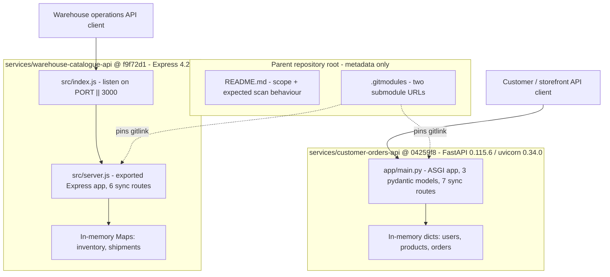

No edge connects `ChildOne` to `ChildTwo`: the two component groups share no code, no datastore and no call path.

**Core technical approach.**

- **Framework-per-language, no shared platform.** The Python child is a single-module FastAPI application exposed as the ASGI target `app.main:app`; the empty `services/customer-orders-api/app/__init__.py` exists only so that target resolves. The Node child is CommonJS with `src/server.js` exporting the configured `app` and `src/index.js` performing the side-effecting `app.listen`.
- **In-memory state as the only persistence.** Module-level `dict`s in `app/main.py` and module-level `Map`s in `src/server.js` are created once per process and shared by every request; both are keyed by identifier (e-mail, uuid4, SKU, `SHP-<n>`).
- **Synchronous, early-return request handling.** All 13 handlers are plain functions with no async work, no queues and no outbound calls; failure is expressed by raising `HTTPException` (Python) or returning `res.status(...).json({...})` (Node).
- **Identifier strategy.** All customer-side ids are `uuid4` strings; warehouse shipment ids are sequential strings derived from map size.
- **Divergent error envelopes.** FastAPI's default body `{"detail": "..."}` is used for all Python failures (`"email already registered"`, `"invalid credentials"`, `"product not found"`, `"quantity must be positive"`, `"insufficient stock"`, `"order not found"`); Express returns `{"error": "..."}` (`"invalid inventory payload"`, `"duplicate sku"`, `"sku not found"`, `"quantity must be positive"`, `"insufficient inventory"`, `"shipment not found"`, `"shipment cannot be dispatched"`). Customers of both must parse two shapes.
- **Request validation.** FastAPI derives 422 responses from the pydantic models in `app/main.py` lines 8-19 for missing or mistyped fields; Express validates manually inside each handler (lines 12-14, 27-29), returning `400` on its own terms.

**Route inventory — customer-orders-api.**

| Method and path | Success | Failure responses | State effect |
|---|---|---|---|
| `GET /health` | `200 {"status": "ok"}` | — | none |
| `POST /users` | `201 {"id", "email"}` | `409` e-mail already registered; `422` malformed body | inserts `users[email] = {id, password}` |
| `POST /login` | `200 {"user_id", "token"}` | `401 "invalid credentials"`; `422` malformed body | none |
| `POST /products` | `201 {"id", "name", "price", "stock"}` | `422` malformed body | inserts uuid4 key into `products` |
| `GET /products` | `200 [ {id, name, price, stock} ]` | — | none |
| `POST /orders` | `201 {id, product_id, quantity, total}` | `404 "product not found"`; `400 "quantity must be positive"`; `409 "insufficient stock"`; `422` malformed body | decrements `product["stock"]`; inserts into `orders` |
| `GET /orders/{order_id}` | `200` stored order | `404 "order not found"` | none |

**Route inventory — warehouse-catalogue-api.**

| Method and path | Success | Failure responses | State effect |
|---|---|---|---|
| `GET /health` | `200 {"status": "ok"}` | — | none |
| `POST /inventory` | `201 {sku, name, quantity, reorderLevel}` | `400 "invalid inventory payload"`; `409 "duplicate sku"` | `inventory.set(sku, item)` |
| `GET /inventory` | `200 [ {sku, name, quantity, reorderLevel} ]` | — | none |
| `POST /shipments` | `201 {id, sku, quantity, destination, status: "created"}` | `404 "sku not found"`; `400 "quantity must be positive"`; `409 "insufficient inventory"` | decrements `item.quantity`; adds `SHP-<n>` to `shipments` |
| `GET /shipments/:id` | `200` shipment record | `404 "shipment not found"` | none |
| `POST /shipments/:id/dispatch` | `200` shipment with `status: "dispatched"` and `carrier` | `404 "shipment not found"`; `409 "shipment cannot be dispatched"` | sets `status`, `carrier` (`req.body.carrier` else `"standard"`) |

**Automated verification as implemented.** The Python suite (`services/customer-orders-api/tests/test_routes.py`) drives four in-process checks through `TestClient` — health, register, product create, and order rejection of an unknown product — and clears the three dictionaries in a `setup_function` before each test. The Node suite (`services/warehouse-catalogue-api/test/routes.test.js`) registers exactly one test, which starts the app on an ephemeral port (`app.listen(0)`), calls `GET /health` over real loopback `fetch`, asserts `200` plus `{status: "ok"}`, and closes the server in `finally`. Both READMEs label this thin coverage explicitly ("Deliberate analysis gaps"); the warehouse README notes only the health route is tested, and the customer README lists invalid login, duplicate registration, stock decrement and computed order totals as untested.

### 1.2.3 Success Criteria

**Measurable objectives.** The repository defines no numeric or commercial targets; its measurable objectives are the functional contracts asserted by code and tests, plus the analysis expectations stated in the root README. Each objective below is stated so that it can be checked against a running service.

| Objective | Acceptance condition | Status today |
|---|---|---|
| Both services report liveness identically | `GET /health` returns `200` with body exactly `{"status": "ok"}` on both services | Met and asserted: `tests/test_routes.py` line 12, `test/routes.test.js` lines 12-13 |
| Registration creates a customer and rejects a duplicate e-mail | `201` with echoed e-mail on first `POST /users`; `409` on the same e-mail twice | Creation asserted (`test_routes.py` lines 14-17); duplicate path unasserted and declared untested in `README.md` |
| Product creation is stored and echoed | `201` with `name` echoed from `POST /products`; product visible via `GET /products` | Creation asserted (lines 19-22); listing unasserted |
| Order creation is atomic with respect to validation | `404` unknown product, `400` non-positive quantity, `409` insufficient stock, `201` otherwise | Only the `404` branch asserted (lines 24-26) |
| Order total is computed and stock decremented | `total == round(price × quantity, 2)` and stock reduced by exactly the ordered quantity | Not asserted; named as a deliberate gap in `services/customer-orders-api/README.md` |
| Shipment lifecycle is single-transition | `created → dispatched` permitted once; second dispatch answered `409` | Not asserted; named as a gap in `services/warehouse-catalogue-api/README.md` |
| Inventory never goes negative | Shipment quantity beyond stock answered `409 "insufficient inventory"` | Not asserted; named as a gap |
| Child code is analysed at its pinned commit | Parent tree records `04259f8` and `f9f72d1`; both children checked out there | Met: `git submodule status` shows no drift |
| No behaviour is attributed to the parent | Parent contributes no source and no tests | Met: `git ls-files` lists only metadata and gitlinks |

**Critical success factors.** Failure of any of these breaks the system's documented purpose rather than merely degrading it:

- **Contract fidelity of status codes.** The `409`/`404`/`400` distinctions in both services are the only machine-readable signal clients have; the Python suite already demonstrates how brittle this is — `test_health_probe` compares the whole JSON document, so adding any field to `/health` fails the build.
- **Submodule pin integrity.** Because `.gitmodules` declares no `branch`, the parent's gitlink is the only record of which child code this specification describes; drift in either child invalidates 1.2.2 and 1.3.
- **Single-writer assumption.** Correct stock behaviour depends on one process per service holding the only copy of its `dict`/`Map`; horizontal scaling or a restart immediately breaks both stock accounting and order lookup.
- **Divergence between the two stock models must remain explicit.** Any integration work has to bridge `products.stock` (price-bearing, uuid4-keyed) with `inventory.quantity` (SKU-keyed, reorder-level bearing); leaving the gap implicit is how overselling and double-deduction will enter.

**Key performance indicators.** None are defined. A repository-wide search for `sla|slo|kpi|uptime|latency|throughput|percentile|availability` finds no match, and no instrumentation, metrics endpoint, logging framework or timing code exists beyond the single startup `console.log` in `services/warehouse-catalogue-api/src/index.js` line 3. The indicators that are actually observable today, and which any future KPI work would have to build on, are:

| Observable | Current baseline | How it is observed |
|---|---|---|
| Health-probe success | 1 route per service, 100% asserted in both suites | `pytest -q`; `npm test` |
| Automated behavioural coverage | 5 tests total (4 Python, 1 Node) against 13 routes | Test files; per-service README "Deliberate analysis gaps" |
| End-to-end journey proof | Zero — no test crosses from a separately running service, and no test spans both services | `services/customer-orders-api/README.md`; `services/warehouse-catalogue-api/README.md` |
| Durability | Zero — all state is discarded at process exit | `app/main.py` line 6; `src/server.js` lines 5-6 |


## 1.3 Scope

### 1.3.1 In-Scope

#### 1.3.1.1 Core Features and Functionalities

**Must-have capabilities.** The in-scope feature set is exactly the 13 route handlers implemented in the two child repositories, nothing wider:

- **Customer identity (2 routes).** Registration with duplicate-e-mail rejection (`409 "email already registered"`) and login with credential verification (`401 "invalid credentials"`) that issues the deterministic token string `token-<user_id>` (`services/customer-orders-api/app/main.py` lines 25-38).
- **Product catalogue (2 routes).** Product creation with `name`, `price`, `stock` and a uuid4 identifier, plus an unpaginated, insertion-ordered listing (`app/main.py` lines 40-48).
- **Order capture (2 routes).** Order creation that resolves the product, rejects non-positive quantity (`400`) and insufficient stock (`409`), decrements stock in place, computes `total = round(price × quantity, 2)`, and order retrieval by id (`app/main.py` lines 50-73).
- **Inventory intake (2 routes).** SKU creation with `quantity` and defaulted `reorderLevel = 5`, validation of `sku`/`name`/non-negative-integer quantity (`400 "invalid inventory payload"`) and duplicate-SKU rejection (`409 "duplicate sku"`), plus inventory listing (`services/warehouse-catalogue-api/src/server.js` lines 10-21).
- **Shipment lifecycle (3 routes).** Shipment creation that deducts inventory and mints `SHP-<n>` with `status: "created"` (lines 23-36), shipment lookup (lines 38-42), and dispatch that records `carrier` and refuses every non-`created` shipment with `409 "shipment cannot be dispatched"` (lines 44-51).
- **Liveness (1 route per service).** `GET /health → 200 {"status": "ok"}`, the one contract both services share.

**Primary user workflows.** Two journeys are in scope as implemented; both are single-service sequences with no hand-off between the customer and warehouse services.

*Customer purchase journey (customer-orders-api).*

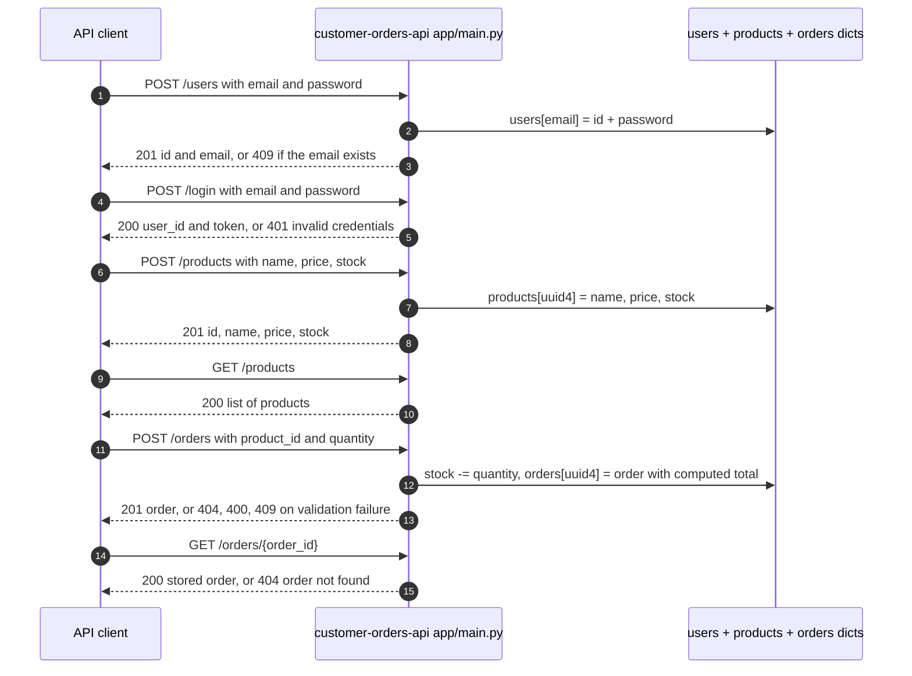

*Warehouse fulfilment journey (warehouse-catalogue-api).*

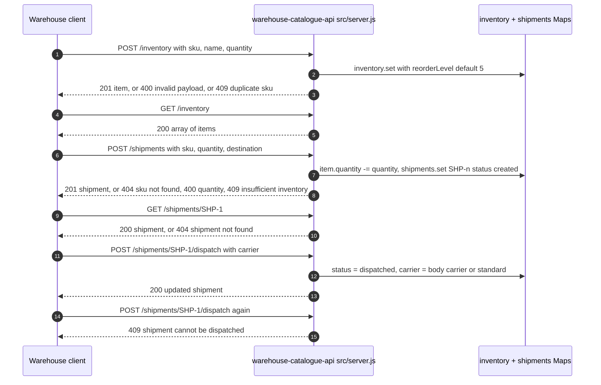

**Essential integrations.** The only integration in scope is the HTTP/JSON contract each service exposes on its own listener: the FastAPI app served as `uvicorn app.main:app --host 127.0.0.1 --port 8000`, and the Express app started by `node src/server.js` (the `npm start` script) on `process.env.PORT || 3000` with `express.json()` parsing enabled. There is no in-scope integration between the two services, and none with any external system (`src/server.js` makes no outbound call; `app/main.py` imports only `fastapi`, `pydantic` and `uuid`).

**Key technical requirements.**

| Requirement | Value as implemented | Source |
|---|---|---|
| Exact dependency pins | `fastapi==0.115.6`, `uvicorn==0.34.0`, `pytest==8.3.4`, `httpx==0.28.1`; npm `express` `4.21.2`, empty `devDependencies` | `requirements.txt`; `package.json` |
| Transport and encoding | JSON over HTTP only; `express.json()` body parsing; FastAPI/pydantic request models | `server.js` line 3; `main.py` lines 8-19 |
| Status semantics | `201` on all creates, `200` on reads, `400`/`401`/`404`/`409` for the documented failures, FastAPI `422` for schema violations | route handlers, both services |
| Identity generation | uuid4 strings for users, products, orders; `SHP-<n>` for shipments | `main.py` lines 29, 42, 60; `server.js` line 32 |
| State model | Single process, module-level in-memory stores, no persistence or recovery | `main.py` line 6; `server.js` lines 5-6 |
| Runtime floor | Python 3 + uvicorn 0.34.0; Node.js with `node --test`, `require`/`module.exports` and global `fetch` (Node 18+) | `test/routes.test.js` lines 1-3, 11 |
| Test entry points | `pytest -q` from the service root; `npm test` (`node --test`) | per-service `README.md` |

#### 1.3.1.2 Implementation Boundaries

| Boundary | In-scope extent | Explicit limit | Evidence |
|---|---|---|---|
| System boundary | Two independently deployable HTTP services, each with its own process, manifest and memory | No shared library, no shared datastore, no service-to-service call | `services/` contents; no imports across children |
| User groups covered | Anonymous API callers of both services; the storefront/purchasing client and the warehouse operator client named in the READMEs | No roles, scopes, admin users or ownership checks exist; a login token is never required | `main.py` lines 33-38; `server.js` — no auth middleware |
| Geographic / market coverage | None specified; both listeners are unconstrained single ports (`127.0.0.1:8000` documented for Python, `PORT || 3000` for Node) | No TLS, host allow-list, CORS, region, locale or currency handling | `app/README` run block; `index.js` line 2 |
| Data domains included | Identity credentials (e-mail, plaintext password), product catalogue (name, price, stock), orders (product_id, quantity, total), inventory (sku, name, quantity, reorderLevel), shipments (id, sku, quantity, destination, status, carrier) | No customer profile, address, payment instrument, tax, invoice, audit trail or historical record | `main.py` lines 6-19; `server.js` lines 5-36 |

Repository scope itself is bounded by the pins: this specification covers `services/customer-orders-api` at `04259f82d5a8f87ff9d81d5fdd1dfdefaee4e564` and `services/warehouse-catalogue-api` at `f9f72d1c37091f8845e3e3727515fa713ebe20b1`, both on branch `2511_02`. Work in either child beyond those commits, or on each child's `main` branch, is outside the documented baseline.

### 1.3.2 Out-of-Scope

**Explicitly excluded features and capabilities.** Each exclusion below is verified by the absence of the corresponding code, not by omission from a backlog:

- **Any persistent storage.** No database driver, ORM, migration, schema file, volume or configuration for one exists; all state dies with the process (`main.py` line 6; `server.js` lines 5-6).
- **Authentication and authorization enforcement.** Login issues a token that no route validates, and every non-health route in both services is open; there is no middleware, dependency, guard, JWT, session store or password hashing anywhere in the repository.
- **Payment, invoicing, tax, currency and pricing rules.** Orders carry only `product_id`, `quantity` and a computed `total`; no payment route, price rule, discount, tax rate or currency field exists.
- **Cross-service orchestration.** An order never creates or reserves a warehouse shipment, and a shipment never references an order; the customer-side `product_id` (uuid4) and warehouse-side `sku` share no identifier.
- **External carrier integration.** `POST /shipments/:id/dispatch` records `carrier` as a free-text string defaulting to `"standard"`; no carrier API, tracking number, label or webhook exists.
- **Concurrency control, idempotency and transactional integrity.** Stock decrement is a plain read-modify-write (`main.py` lines 57-59; `server.js` lines 30-31); no lock, version field, unique constraint, retry guard or idempotency key exists, so oversell and double-dispatch under concurrency are outside the guaranteed behaviour.
- **Search, filtering, pagination and sorting.** `GET /products` and `GET /inventory` serialise the entire store in insertion order; no query parameters are read.
- **Observability and operations.** No metrics endpoint, structured logging, tracing, health dependency check, graceful shutdown, Dockerfile, CI workflow, IaC or deployment manifest exists; the only log line is the startup message in `src/index.js` line 3.
- **Multi-tenancy, administration and audit.** No tenant concept, no privileged route, no administrative deletion or update route (no `PUT`, `PATCH` or `DELETE` handler exists in either service), and no record of who performed an action.

**Future phase considerations.** The only forward-looking statements in the repository are the two `## Deliberate analysis gaps` sections, which are coverage backlogs rather than a committed roadmap. They are recorded here as candidate future work and carry no delivery commitment:

| Candidate work | Declared in | What it would close |
|---|---|---|
| Prove a real HTTP purchase journey against a separately running service (and a browser/storefront journey) | `services/customer-orders-api/README.md` | End-to-end proof of the order path currently exercised only in-process |
| Test invalid login and duplicate registration | same | The `401` and `409` registration/login branches |
| Test stock decrement and computed order totals across the full workflow | same | The correctness core of `POST /orders` |
| Test inventory receipt, shipment creation, inventory decrement, retrieval and dispatch | `services/warehouse-catalogue-api/README.md` | The whole warehouse journey, currently only health-tested |
| Test duplicate SKU, insufficient inventory and repeated dispatch | same | The three `409` conflict contracts |

**Integration points not covered.** The two GitHub remotes named in `.gitmodules` are the repository's only external endpoints referenced in-tree, and they are build-time provenance, not runtime integration. Nothing covers ERP or finance systems, identity providers or SSO, message brokers or event streams, search indexes, data warehouses, webhooks, or a storefront front end — no client application, HTML, static asset or SDK is present in the repository.

**Unsupported use cases.** The following will not behave as a caller might assume, and are therefore out of scope rather than merely untested:

- **Surviving a restart or running more than one instance.** Every order, product, user, inventory item and shipment is lost on exit, and a second instance sees an empty catalogue.
- **Correct stock accounting under concurrency.** Sequential single-process access is the only safe pattern.
- **Trusting an issued token.** No request is authenticated; `GET /orders/{order_id}` returns any order to any caller.
- **Reversing a shipment.** Dispatch never restores inventory, and no cancellation or return path exists, so stock consumed by a shipment cannot be recovered through the API.
- **Reliable shipment identifiers.** `SHP-<n>` derives from `shipments.size + 1`, so any future deletion would produce a repeated id.
- **Email as a stable identity key.** `EmailStr` is imported but unused in `main.py` line 2 and no normalisation is applied, so address format is accepted as given and case variants register as separate customers.


## 1.4 References

- `README.md` — root scope statement ("intentionally metadata-only", no application source or tests of its own), the two-submodule inventory, and the expected scan behaviour of discovering gitlinks and analysing each child at the pinned commit
- `.gitmodules` — the two `[submodule]` stanzas with `path` and `url`, no `branch` key, establishing that the parent gitlink is the sole pinning mechanism
- `.gitignore` — the single `.DS_Store` entry, confirming the parent tracks no build or environment artefacts
- `services/` — the folder holding the two independent child service folders, with no cross-imports or shared library
- `services/customer-orders-api/` — the FastAPI child service folder and its pinned state (`04259f8`, branch `2511_02`)
- `services/customer-orders-api/README.md` — run and test commands (`uvicorn app.main:app --host 127.0.0.1 --port 8000`, `pytest -q`) and the "Deliberate analysis gaps" covering invalid login, duplicate registration, stock decrement and computed order totals
- `services/customer-orders-api/requirements.txt` — the four exact pins: `fastapi==0.115.6`, `uvicorn==0.34.0`, `pytest==8.3.4`, `httpx==0.28.1`
- `services/customer-orders-api/app/` — the importable `app` package root containing the whole service
- `services/customer-orders-api/app/__init__.py` — 0-byte package marker that makes the `app.main:app` ASGI target resolvable
- `services/customer-orders-api/app/main.py` — application title, the three in-memory dicts, the three pydantic models and all seven routes with their status codes, error messages, plaintext password handling, unused `EmailStr` import, token format and `total = round(price × quantity, 2)`
- `services/customer-orders-api/tests/` — the single-file test directory with no fixtures or pytest configuration
- `services/customer-orders-api/tests/test_routes.py` — the four in-process `TestClient` checks (health, register, product create, order rejection of unknown product) and the `setup_function` state reset
- `services/warehouse-catalogue-api/` — the Express child service folder and its pinned state (`f9f72d1`, branch `2511_02`)
- `services/warehouse-catalogue-api/README.md` — run and test commands (`npm install`, `npm start`, `npm test`) and the "Deliberate analysis gaps" naming the untested inventory, shipment, dispatch and conflict journeys
- `services/warehouse-catalogue-api/package.json` — name, version, `private: true`, `start`/`test` scripts and the exact `express: "4.21.2"` dependency with empty `devDependencies`
- `services/warehouse-catalogue-api/src/` — the two CommonJS source files forming the service and its bootstrap
- `services/warehouse-catalogue-api/src/index.js` — `process.env.PORT || 3000`, the `app.listen` call and the single startup `console.log`
- `services/warehouse-catalogue-api/src/server.js` — `express.json()`, the `inventory` and `shipments` Maps, all six routes with their status codes and error strings, `reorderLevel` default `5`, positional `SHP-<n>` ids, stock decrement at creation, dispatch status guard and `carrier` default `"standard"`
- `services/warehouse-catalogue-api/test/` — the single-file test directory with no harness or fixtures
- `services/warehouse-catalogue-api/test/routes.test.js` — the single `/health` test over real loopback `fetch` on an ephemeral port, the only outbound network call in the repository

No external web sources were consulted; every statement in this section is drawn from the files above and from repository Git metadata (`git ls-files`, `git ls-tree`, `git submodule status`, `git log`).


# 2. Product Requirements

## 2.1 Feature Catalog

The product surface of this repository is exactly the 13 route handlers implemented in the two child services pinned by the parent (`services/customer-orders-api` at `04259f8`, `services/warehouse-catalogue-api` at `f9f72d1`). This catalog decomposes that surface into 12 features. F-001 is the liveness probe, implemented identically in both services and therefore accounting for 2 of the 13 handlers; every other feature maps one-to-one to a single route handler.

No feature is inferred from a roadmap: neither child repository contains a backlog, issue list, `TODO`, or `FIXME` marker, and the parent owns no source at all. Each entry below is traceable to the handler lines cited in its metadata table, and each handler's failure branches are recorded as requirements in 2.2.

| Feature ID | Feature Name | Category | Route handlers |
|---|---|---|---|
| F-001 | Service Liveness Probe | Platform / Operations | `GET /health` (both services) |
| F-002 | Customer Registration | Customer Identity | `POST /users` |
| F-003 | Customer Login | Customer Identity | `POST /login` |
| F-004 | Product Creation | Product Catalogue | `POST /products` |
| F-005 | Product Catalogue Listing | Product Catalogue | `GET /products` |
| F-006 | Order Placement with Stock Reservation | Order Management | `POST /orders` |
| F-007 | Order Retrieval | Order Management | `GET /orders/{order_id}` |
| F-008 | Inventory Intake | Inventory Management | `POST /inventory` |
| F-009 | Inventory Listing | Inventory Management | `GET /inventory` |
| F-010 | Shipment Creation with Inventory Deduction | Shipment Fulfilment | `POST /shipments` |
| F-011 | Shipment Retrieval | Shipment Fulfilment | `GET /shipments/:id` |
| F-012 | Shipment Dispatch | Shipment Fulfilment | `POST /shipments/:id/dispatch` |

### 2.1.1 Catalog Conventions and Evidence Basis

**Identifier formats.** Features are numbered `F-001` to `F-012` in dependency order within each service, platform feature first. Functional requirements use `F-XXX-RQ-YYY`, where `YYY` is sequential within the owning feature (`F-002-RQ-001`, `F-002-RQ-002`, ...). The identifiers are assigned by this specification; the source code carries no identifiers of its own.

**Priority derivation.** Neither child repository states a priority, a delivery order or a backlog, so priorities below are derived from the implemented dependency structure rather than quoted from a document. The rule applied to every feature is:

| Priority | Assignment rule (structural, applied to the code as observed) | Features |
|---|---|---|
| Critical | The only handler that populates a data domain, or the only handler that performs a multi-step state transaction (validation + stock mutation + record creation) | F-004, F-006, F-008, F-010 |
| High | A prerequisite of another feature, or the only read path for state that another feature creates | F-001, F-002, F-007, F-011, F-012 |
| Medium | A supplementary read path, or a handler whose output no other handler consumes | F-003, F-005, F-009 |

**Status definition.** Every feature is `Completed`, defined strictly as: the handler is implemented and reachable at the commit the parent pins. `Completed` says nothing about automated verification — coverage per feature is recorded in 2.6.2, and three of the nine documented failure branches in the customer service and all eight in the warehouse service are unasserted by any test.

**Route-to-feature completeness.** A repository-wide search for route registrations (`@app.` in `services/customer-orders-api/app/main.py`, `app.get|post|put|delete|patch` in `services/warehouse-catalogue-api/src/server.js`) returns exactly 7 Python decorators and 6 Express routes, plus one `app.use(express.json())` middleware line that is not an endpoint. No `PUT`, `PATCH` or `DELETE` handler exists in either service, so no update or delete feature can be documented.

### 2.1.2 Platform and Operations Features

#### 2.1.2.1 F-001 — Service Liveness Probe

| Attribute | Value |
|---|---|
| Feature ID | F-001 |
| Feature Name | Service Liveness Probe |
| Feature Category | Platform / Operations |
| Priority Level | High |
| Status | Completed |
| Services | `services/customer-orders-api` (FastAPI 0.115.6); `services/warehouse-catalogue-api` (Express 4.21.2) |
| Endpoints | `GET /health` on both listeners |
| Implementation | `services/customer-orders-api/app/main.py` lines 21-23; `services/warehouse-catalogue-api/src/server.js` line 8 |
| Automated verification | Asserted in both suites — `tests/test_routes.py` lines 11-12 and `test/routes.test.js` lines 7-17 |

**Overview.** A read-only endpoint returning the constant body `{"status": "ok"}`. It reads no request parameter and touches neither service's state.

**Business Value.** It is the only contract the two independently released services share verbatim, so one probe definition works against either listener. It is also the only interface a supervisor, container platform or load balancer could use today.

**User Benefits.** The response is unconditional and independent of stored data, so an empty catalogue or an empty inventory map still yields `200`; the body is a fixed object, which keeps a caller's parsing trivial.

**Technical Context.** The Python handler returns a plain `dict` that FastAPI serialises; the Express handler is a one-line arrow function calling `res.json`. Both are synchronous and allocate nothing beyond the response object.

| Dependency Type | Item | Evidence |
|---|---|---|
| Prerequisite Features | None | Handler reads no store |
| System Dependencies | FastAPI application object and route decorator; Express application object and `res.json` | `app/main.py` lines 1, 5, 21; `server.js` lines 1-2, 8 |
| External Dependencies | None — no outbound call, no dependency check | `app/main.py` line 23; `server.js` line 8 |
| Integration Requirements | HTTP `GET`, no body, no authentication; expectation is `200` with body exactly `{"status": "ok"}` | `tests/test_routes.py` line 12 compares the whole document |

### 2.1.3 Customer Identity Features

#### 2.1.3.1 F-002 — Customer Registration

| Attribute | Value |
|---|---|
| Feature ID | F-002 |
| Feature Name | Customer Registration |
| Feature Category | Customer Identity |
| Priority Level | High |
| Status | Completed |
| Service | `services/customer-orders-api` |
| Endpoints | `POST /users` → `201` |
| Implementation | `services/customer-orders-api/app/main.py` lines 25-31 (model at lines 8-10; store at line 6) |
| Automated verification | `tests/test_routes.py` lines 14-17 assert creation and e-mail echo; the `409` branch is unasserted |

**Overview.** Creates a customer record keyed by the submitted e-mail address, mints a `uuid4` identifier, and returns `{"id", "email"}` with status `201`.

**Business Value.** It is the only handler that creates identity records; without it the `users` dictionary stays empty and F-003 has nothing to authenticate against.

**User Benefits.** Account creation and identifier retrieval happen in one call, and a repeated e-mail is refused with `409 "email already registered"` rather than silently overwriting the existing password.

**Technical Context.** The body is validated by the pydantic model `RegisterRequest` (`email: str`, `password: str`), so a missing or non-string field yields FastAPI's `422` before the handler runs. The e-mail is used verbatim as the dictionary key, giving case-sensitive, unnormalised uniqueness; `EmailStr` is imported at line 2 but never applied, so address format is not checked. The password is stored in plain text at line 30.

| Dependency Type | Item | Evidence |
|---|---|---|
| Prerequisite Features | None | `users` starts empty and needs no prior record |
| System Dependencies | pydantic `BaseModel` request validation; `uuid.uuid4`; module-level `users` dict | `app/main.py` lines 2-3, 6, 8-10, 29 |
| External Dependencies | None | Handler makes no outbound call |
| Integration Requirements | JSON body `{email, password}`; no authentication; success is `201`, duplicate is `409` with FastAPI's `{"detail": ...}` envelope | `app/main.py` lines 25-31 |

#### 2.1.3.2 F-003 — Customer Login

| Attribute | Value |
|---|---|
| Feature ID | F-003 |
| Feature Name | Customer Login |
| Feature Category | Customer Identity |
| Priority Level | Medium |
| Status | Completed |
| Service | `services/customer-orders-api` |
| Endpoints | `POST /login` → `200` |
| Implementation | `services/customer-orders-api/app/main.py` lines 33-38 |
| Automated verification | None — the `401` branch is named untested in `services/customer-orders-api/README.md` |

**Overview.** Looks up the customer by e-mail, compares the submitted password with the stored one, and on success returns `{"user_id", "token"}` where the token is the deterministic string `token-<user_id>`.

**Business Value.** It provides the verification surface for stored credentials and is the only place credentials are compared. Because no route consumes the resulting token, its value today is that a caller can confirm a credential pair.

**User Benefits.** A single call returns both the customer identifier and a token; a wrong password and an unknown e-mail produce the same `401 "invalid credentials"`, so the response does not disclose which of the two failed.

**Technical Context.** The handler reuses `RegisterRequest`, so the same two fields are required; comparison is a plain string equality against the stored plaintext value at line 36. There is no hashing, no expiry, no session store and no revocation path, and the token is derived solely from the user id.

| Dependency Type | Item | Evidence |
|---|---|---|
| Prerequisite Features | F-002 — a `users` entry must exist, else the lookup returns `None` and the branch answers `401` | `app/main.py` line 35 |
| System Dependencies | Module-level `users` dict read; pydantic request validation | `app/main.py` lines 6, 34-36 |
| External Dependencies | None | No outbound call |
| Integration Requirements | JSON body `{email, password}`; `200` with `{user_id, token}` or `401` | `app/main.py` lines 33-38 |

### 2.1.4 Product Catalogue Features

#### 2.1.4.1 F-004 — Product Creation

| Attribute | Value |
|---|---|
| Feature ID | F-004 |
| Feature Name | Product Creation |
| Feature Category | Product Catalogue |
| Priority Level | Critical |
| Status | Completed |
| Service | `services/customer-orders-api` |
| Endpoints | `POST /products` → `201` |
| Implementation | `services/customer-orders-api/app/main.py` lines 40-44 (model at lines 12-15) |
| Automated verification | `tests/test_routes.py` lines 19-22 assert status `201` and the echoed `name` |

**Overview.** Stores `{name, price, stock}` under a freshly minted `uuid4` identifier and echoes the stored record together with its `id`.

**Business Value.** It is the sole write path into the `products` store, and the `price` it records is the value later multiplied in F-006's order total. An empty catalogue makes the order feature unusable.

**User Benefits.** One call both persists a product and returns the identifier the caller needs for order placement, so no follow-up read is required.

**Technical Context.** `ProductRequest` declares `name: str`, `price: float`, `stock: int`; the handler persists `payload.model_dump()` verbatim. There is no range check on `price` or `stock` and no duplicate-name detection, so negative prices and negative stock are accepted at line 43.

| Dependency Type | Item | Evidence |
|---|---|---|
| Prerequisite Features | None | `products` starts empty and needs no prior record |
| System Dependencies | pydantic `ProductRequest`; `uuid.uuid4`; module-level `products` dict | `app/main.py` lines 3, 6, 12-15, 42-44 |
| External Dependencies | None | No outbound call |
| Integration Requirements | JSON body `{name, price, stock}`; `201` with `{id, name, price, stock}`; malformed bodies answered `422` by pydantic | `app/main.py` lines 40-44 |

#### 2.1.4.2 F-005 — Product Catalogue Listing

| Attribute | Value |
|---|---|
| Feature ID | F-005 |
| Feature Name | Product Catalogue Listing |
| Feature Category | Product Catalogue |
| Priority Level | Medium |
| Status | Completed |
| Service | `services/customer-orders-api` |
| Endpoints | `GET /products` → `200` |
| Implementation | `services/customer-orders-api/app/main.py` lines 46-48 |
| Automated verification | None — no test calls `GET /products` |

**Overview.** Returns every stored product as a JSON array of `{id, name, price, stock}`, projecting the dictionary key into the `id` field.

**Business Value.** It is the only read path over the customer-side catalogue, letting a client discover the `product_id` values that F-006 requires without having captured the creation response.

**User Benefits.** The full catalogue arrives in one call with identifiers included, in insertion order, which makes the ordering predictable for a storefront listing.

**Technical Context.** A comprehension over `products.items()` materialises the whole store on every request: no pagination, no filtering, no sorting parameters are read, and an empty store returns `[]` with `200` rather than an error.

| Dependency Type | Item | Evidence |
|---|---|---|
| Prerequisite Features | F-004 — without a product the response is an empty array | `app/main.py` lines 43, 48 |
| System Dependencies | Module-level `products` dict | `app/main.py` line 6 |
| External Dependencies | None | No outbound call |
| Integration Requirements | HTTP `GET` with no body or query parameters; `200` with a JSON array | `app/main.py` lines 46-48 |

### 2.1.5 Order Management Features

#### 2.1.5.1 F-006 — Order Placement with Stock Reservation

| Attribute | Value |
|---|---|
| Feature ID | F-006 |
| Feature Name | Order Placement with Stock Reservation |
| Feature Category | Order Management |
| Priority Level | Critical |
| Status | Completed |
| Service | `services/customer-orders-api` |
| Endpoints | `POST /orders` → `201` |
| Implementation | `services/customer-orders-api/app/main.py` lines 50-67 (model at lines 17-19) |
| Automated verification | `tests/test_routes.py` lines 24-26 assert only the `404` branch; the `400`, `409`, stock decrement and total computation are named as gaps in `services/customer-orders-api/README.md` |

**Overview.** Resolves the referenced product, rejects an unknown product (`404`), a non-positive quantity (`400`) and a quantity beyond available stock (`409`), then decrements `product["stock"]` in place and stores `{id, product_id, quantity, total}` where `total = round(price × quantity, 2)`.

**Business Value.** This is the only multi-step transaction on the customer side and the only handler that consumes catalogue stock, computes a monetary amount and creates an order record. It is the endpoint through which the service's stated purpose — accepting an order against known stock — is fulfilled.

**User Benefits.** A single call validates the request, reserves the stock and returns the priced order with its identifier, so the caller never has to compute the total or re-read stock. Rejections are specific: `404` versus `400` versus `409` distinguishes a bad product from a bad quantity from a shortage.

**Technical Context.** Validation order is observable and affects behaviour: the product lookup runs before the quantity check (lines 52-56), so an unknown product combined with a non-positive quantity returns `404`, not `400`. The stock mutation at line 59 is a read-modify-write on the shared dict with no lock, version field or reservation record, and the arithmetic rounds to two decimal places. No authentication is required and the order is not associated with any user.

| Dependency Type | Item | Evidence |
|---|---|---|
| Prerequisite Features | F-004 (the product must exist in `products`) and, in practice, F-005 (the caller needs a `product_id` unless it retained the creation response) | `app/main.py` lines 52-54 |
| System Dependencies | pydantic `OrderRequest` (`product_id: str`, `quantity: int`); `uuid.uuid4`; module-level `products` and `orders` dicts | `app/main.py` lines 6, 17-19, 52, 60-66 |
| External Dependencies | None — no payment, tax, or carrier call | Handler body lines 50-67 |
| Integration Requirements | JSON body `{product_id, quantity}`; `201` with the stored order; `404`/`400`/`409` in FastAPI's `{"detail": ...}` envelope; `422` for a malformed body | `app/main.py` lines 50-67 |

#### 2.1.5.2 F-007 — Order Retrieval

| Attribute | Value |
|---|---|
| Feature ID | F-007 |
| Feature Name | Order Retrieval |
| Feature Category | Order Management |
| Priority Level | High |
| Status | Completed |
| Service | `services/customer-orders-api` |
| Endpoints | `GET /orders/{order_id}` → `200` |
| Implementation | `services/customer-orders-api/app/main.py` lines 69-73 |
| Automated verification | None directly; only order creation failure is exercised in `tests/test_routes.py` |

**Overview.** Returns the stored order document for a path-supplied identifier, or `404 "order not found"` when the identifier is absent from the `orders` dictionary.

**Business Value.** It is the only way to read back an order after creation, since neither service exposes an order list; without it a client that lost the creation response has no recovery path.

**User Benefits.** The full order (`id`, `product_id`, `quantity`, `total`) is returned by a single path-parameterised call, including the computed total that the caller would otherwise have to recalculate.

**Technical Context.** The identifier is the raw `uuid4` string produced at creation; there is no ownership or authentication check, so any caller holding an identifier can read that order. The handler performs one dictionary membership test and returns the stored object without copying it.

| Dependency Type | Item | Evidence |
|---|---|---|
| Prerequisite Features | F-006 — an order must exist for an identifier to resolve | `app/main.py` lines 61-66, 71 |
| System Dependencies | Module-level `orders` dict | `app/main.py` line 6 |
| External Dependencies | None | No outbound call |
| Integration Requirements | Path parameter `order_id`; `200` with the order document or `404` | `app/main.py` lines 69-73 |

### 2.1.6 Inventory Management Features

#### 2.1.6.1 F-008 — Inventory Intake

| Attribute | Value |
|---|---|
| Feature ID | F-008 |
| Feature Name | Inventory Intake |
| Feature Category | Inventory Management |
| Priority Level | Critical |
| Status | Completed |
| Service | `services/warehouse-catalogue-api` |
| Endpoints | `POST /inventory` → `201` |
| Implementation | `services/warehouse-catalogue-api/src/server.js` lines 10-19 |
| Automated verification | None — `test/routes.test.js` exercises only `/health`; receiving inventory is named a missing journey in the service README |

**Overview.** Creates an inventory record `{sku, name, quantity, reorderLevel}` keyed by SKU, with `reorderLevel` defaulting to `5`, and returns the stored object with status `201`.

**Business Value.** It is the sole write path into the `inventory` Map and therefore the precondition for shipment creation; without a SKU record, F-010 always answers `404`.

**User Benefits.** One call registers stock and returns the record actually stored — including the defaulted `reorderLevel` — so the caller sees the effective values rather than its own input. A duplicate SKU is refused with `409 "duplicate sku"` instead of silently overwriting the quantity.

**Technical Context.** The handler destructures the body itself, so no schema library is involved and a missing body arrives as `undefined` fields. Validation is `!sku || !name || !Number.isInteger(quantity) || quantity < 0`, which rejects an absent or non-integer quantity and any negative value but accepts `0`. `reorderLevel` is not validated at all. The record is stored in a module-level `Map` keyed by SKU, which makes the SKU the identity for the whole fulfilment flow.

| Dependency Type | Item | Evidence |
|---|---|---|
| Prerequisite Features | None | `inventory` starts empty |
| System Dependencies | `express.json()` body parsing; module-level `inventory` Map | `src/server.js` lines 3, 5, 11 |
| External Dependencies | Express 4.21.2 only | `package.json` line 6 |
| Integration Requirements | JSON body `{sku, name, quantity, reorderLevel?}`; `201` with the item; `400`/`409` in the `{"error": ...}` envelope | `src/server.js` lines 10-19 |

#### 2.1.6.2 F-009 — Inventory Listing

| Attribute | Value |
|---|---|
| Feature ID | F-009 |
| Feature Name | Inventory Listing |
| Feature Category | Inventory Management |
| Priority Level | Medium |
| Status | Completed |
| Service | `services/warehouse-catalogue-api` |
| Endpoints | `GET /inventory` → `200` |
| Implementation | `services/warehouse-catalogue-api/src/server.js` line 21 |
| Automated verification | None |

**Overview.** Returns every inventory record as a JSON array by spreading the Map's values, exposing the current `quantity` after any deductions made by F-010.

**Business Value.** It is the only read path over warehouse stock, so it is how an operator verifies that a shipment actually reduced the quantity — the check the service README names as a missing journey.

**User Benefits.** The whole stock position is returned in one call in insertion order, including post-deduction quantities and reorder levels, with no pagination or filter parameters to supply.

**Technical Context.** A single expression evaluates `[...inventory.values()]`, which materialises the entire Map on every request; records are references to the live stored objects, though the JSON serialisation makes the response a snapshot. No query parameter is read, and an empty Map yields `[]` with `200`.

| Dependency Type | Item | Evidence |
|---|---|---|
| Prerequisite Features | F-008 — without a received SKU the response is an empty array | `src/server.js` lines 17, 21 |
| System Dependencies | Module-level `inventory` Map | `src/server.js` line 5 |
| External Dependencies | Express 4.21.2 only | `package.json` line 6 |
| Integration Requirements | HTTP `GET` with no body or query parameters; `200` with a JSON array | `src/server.js` line 21 |

### 2.1.7 Shipment Fulfilment Features

#### 2.1.7.1 F-010 — Shipment Creation with Inventory Deduction

| Attribute | Value |
|---|---|
| Feature ID | F-010 |
| Feature Name | Shipment Creation with Inventory Deduction |
| Feature Category | Shipment Fulfilment |
| Priority Level | Critical |
| Status | Completed |
| Service | `services/warehouse-catalogue-api` |
| Endpoints | `POST /shipments` → `201` |
| Implementation | `services/warehouse-catalogue-api/src/server.js` lines 23-36 |
| Automated verification | None; creating a shipment and verifying the inventory decrement are named missing journeys in the service README |

**Overview.** Resolves the SKU, rejects an unknown SKU (`404`), a quantity that is not a positive integer (`400`) and a quantity beyond stock (`409`), then decrements `item.quantity`, mints the positional identifier `SHP-<shipments.size + 1>` and stores `{id, sku, quantity, destination, status: "created"}`.

**Business Value.** It is the only handler that consumes warehouse stock and the entry point of the whole shipment lifecycle: without it F-011 and F-012 have nothing to operate on. It also carries the service's inventory-integrity guarantee — stock never goes negative through the API.

**User Benefits.** One call reserves stock and returns the shipment record with the identifier needed for lookup and dispatch, and the response distinguishes bad input (`400`) from bad reference (`404`) from shortage (`409`).

**Technical Context.** The SKU lookup runs before the quantity check (lines 25-29), so an unknown SKU with an invalid quantity returns `404`. The quantity check requires `Number.isInteger` and positivity, rejecting both `0` and fractional values. The decrement at line 31 mutates the live inventory object, and the identifier derives from `shipments.size + 1`, which would repeat if entries were ever removed — there is no delete route today. `destination` is stored unvalidated.

| Dependency Type | Item | Evidence |
|---|---|---|
| Prerequisite Features | F-008 — the SKU record must exist and carry sufficient `quantity` | `src/server.js` lines 25-26, 30 |
| System Dependencies | `express.json()` body parsing; module-level `inventory` and `shipments` Maps | `src/server.js` lines 3, 5-6 |
| External Dependencies | Express 4.21.2 only; no carrier or ERP call | `src/server.js` lines 23-36 |
| Integration Requirements | JSON body `{sku, quantity, destination}`; `201` with the shipment; `404`/`400`/`409` as `{"error": ...}` | `src/server.js` lines 23-36 |

#### 2.1.7.2 F-011 — Shipment Retrieval

| Attribute | Value |
|---|---|
| Feature ID | F-011 |
| Feature Name | Shipment Retrieval |
| Feature Category | Shipment Fulfilment |
| Priority Level | High |
| Status | Completed |
| Service | `services/warehouse-catalogue-api` |
| Endpoints | `GET /shipments/:id` → `200` |
| Implementation | `services/warehouse-catalogue-api/src/server.js` lines 38-42 |
| Automated verification | None |

**Overview.** Returns the stored shipment for a path-supplied identifier, or `404 "shipment not found"` when the `shipments` Map holds no such key.

**Business Value.** It is the only read path for shipment state; because there is no shipment list endpoint, it is how a client observes the `created` → `dispatched` transition performed by F-012.

**User Benefits.** A single call returns the whole shipment document, including `status` and, once dispatched, the recorded `carrier`, so no client-side state tracking is needed.

**Technical Context.** The identifier is a plain string match against the Map key (`SHP-1`, `SHP-2`, ...); the handler does one `get` and either serialises the live object or answers `404`. No authentication or ownership check exists.

| Dependency Type | Item | Evidence |
|---|---|---|
| Prerequisite Features | F-010 — an identifier must have been minted | `src/server.js` lines 32-34, 39 |
| System Dependencies | Module-level `shipments` Map | `src/server.js` line 6 |
| External Dependencies | Express 4.21.2 only | `package.json` line 6 |
| Integration Requirements | Path parameter `id`; `200` with the shipment or `404` | `src/server.js` lines 38-42 |

#### 2.1.7.3 F-012 — Shipment Dispatch

| Attribute | Value |
|---|---|
| Feature ID | F-012 |
| Feature Name | Shipment Dispatch |
| Feature Category | Shipment Fulfilment |
| Priority Level | High |
| Status | Completed |
| Service | `services/warehouse-catalogue-api` |
| Endpoints | `POST /shipments/:id/dispatch` → `200` |
| Implementation | `services/warehouse-catalogue-api/src/server.js` lines 44-51 |
| Automated verification | None; dispatch and repeated dispatch are named missing journeys in the service README |

**Overview.** Moves a shipment from `created` to `dispatched`, records `carrier` from the request body with a default of `"standard"`, and returns the updated shipment. An unknown identifier answers `404`; any shipment not in `created` state answers `409 "shipment cannot be dispatched"`.

**Business Value.** It is the state-transition authority of the fulfilment flow and the only place the single-transition rule (`created → dispatched`, once) is enforced, which prevents a shipment being dispatched twice.

**User Benefits.** Dispatch and carrier selection happen in one call, the default carrier removes the need to supply one, and a second attempt fails loudly with `409` rather than silently re-recording a dispatch.

**Technical Context.** The status guard at line 47 makes the transition single-shot: after the first successful dispatch, `status` is `dispatched` and every later call answers `409`. `carrier` is `req.body.carrier || 'standard'`, so any falsy value — absent, empty string, `null`, `0`, `false` — resolves to `"standard"`, and no carrier value is validated. The handler does not restore inventory, and no reverse transition exists.

| Dependency Type | Item | Evidence |
|---|---|---|
| Prerequisite Features | F-010 — the shipment must exist with `status: "created"`, otherwise `404` or `409` | `src/server.js` lines 45-47 |
| System Dependencies | `express.json()` body parsing; module-level `shipments` Map | `src/server.js` lines 3, 6 |
| External Dependencies | Express 4.21.2 only; no carrier integration — `carrier` is a free-text field | `src/server.js` lines 48-49 |
| Integration Requirements | Path parameter `id`, optional JSON body `{carrier}`; `200` with the updated shipment, `404` or `409` as `{"error": ...}` | `src/server.js` lines 44-51 |

## 2.2 Functional Requirements Table

Each feature's requirements decompose its handler into individually testable statements: one requirement per observable branch or state effect, so that every row can be verified by a single HTTP request. Requirement identifiers are `F-XXX-RQ-YYY`. The customer-side flow referenced by F-002 to F-007 is the *Customer purchase journey* sequence diagram in 1.3.1.1; the warehouse-side flow referenced by F-008 to F-012 is the *Warehouse fulfilment journey* diagram in the same sub-section; the dependency ordering of all 12 features is diagrammed in 2.3.1.

### 2.2.1 Requirements Conventions

**Priority.** `Must-Have` marks a branch or state effect without which the feature's stated purpose is not met. `Should-Have` marks a branch that protects data integrity or caller diagnosis. `Could-Have` marks behaviour that exists but that no other feature depends on — typically an accepted-input laxity that a future change would tighten.

**Complexity.** `High` marks a handler with three or more failure branches plus a state mutation; `Medium` a handler with one or two failure branches or a multi-record read; `Low` a constant or single-lookup handler.

**Performance criteria.** The repository defines no latency, throughput or uptime target — a repository-wide search for `sla`, `slo`, `kpi`, `latency`, `throughput` and `percentile` returns no match, and no timing or instrumentation code exists. Every performance criterion below is therefore an observed characteristic of the implementation: work performed per request, lookup complexity, and response-size behaviour. List endpoints have no pagination, so response size grows linearly with the store.

**Data requirements.** Both services keep all state in module-level memory — `users`, `products`, `orders` dictionaries in `services/customer-orders-api/app/main.py` line 6, and `inventory` and `shipments` Maps in `services/warehouse-catalogue-api/src/server.js` lines 5-6. No request writes to disk, and no state survives the process.

### 2.2.2 F-001 — Service Liveness Probe

| Requirement ID | Description | Acceptance Criteria | Priority / Complexity |
|---|---|---|---|
| F-001-RQ-001 | Both services answer `GET /health` with `200` and the constant body `{"status": "ok"}` | A `GET /health` against either listener returns status `200` and a body deep-equal to `{"status": "ok"}` with no additional fields | Must-Have / Low |
| F-001-RQ-002 | The probe reads no application state and never fails on empty stores | `GET /health` returns identically before and after products, orders, inventory or shipments are created; the handler performs no dictionary or Map access | Should-Have / Low |

| Requirement ID | Input Parameters | Output / Response | Performance and Data Requirements |
|---|---|---|---|
| F-001-RQ-001 | None — no path, query or body parameter is read | `200` with `{"status": "ok"}`; Python serialises the returned dict, Node calls `res.json` | Constant work per request; no store access; response body of 17 bytes |
| F-001-RQ-002 | None | Same constant response regardless of store contents | Independent of store size, so probe latency does not grow with data volume |

| Requirement ID | Business Rules | Data Validation | Security and Compliance |
|---|---|---|---|
| F-001-RQ-001 | Liveness means the process is accepting HTTP, not that its dependencies are healthy — the probe checks no downstream | None; no request data is validated | Unauthenticated by design and discloses only a static string; no data is exposed |
| F-001-RQ-002 | The probe must remain additive-safe: `tests/test_routes.py` line 12 compares the whole document, so any new field breaks the build | Body and status are the entire contract | No secrets, versions or build identifiers are returned |

### 2.2.3 F-002 — Customer Registration

| Requirement ID | Description | Acceptance Criteria | Priority / Complexity |
|---|---|---|---|
| F-002-RQ-001 | `POST /users` creates a customer keyed by e-mail and returns `201` with the minted identifier and the submitted e-mail | A `POST /users` with a new `{email, password}` returns `201`; `body.email` equals the submitted address; `body.id` is a 36-character UUID string; the record exists under `users[email]` with `password` equal to the submitted value | Must-Have / Low |
| F-002-RQ-002 | A repeated e-mail is refused with `409` and the existing record is left unchanged | A second `POST /users` with the same e-mail returns `409` with `detail` `"email already registered"`; the stored identifier and password are unchanged | Must-Have / Medium |
| F-002-RQ-003 | Missing or non-string `email` or `password` is rejected by request validation with `422` | `POST /users` with `{}` or with `email: 123` returns `422`; no `users` entry is created | Should-Have / Low |

| Requirement ID | Input Parameters | Output / Response | Performance and Data Requirements |
|---|---|---|---|
| F-002-RQ-001 | JSON body: `email` (string), `password` (string) | `201` with `{"id": "<uuid4>", "email": "<submitted>"}` | One dict membership test plus one dict insert; record persists for the process lifetime only |
| F-002-RQ-002 | Same body shape | `409` with `{"detail": "email already registered"}` | One dict membership test; no write occurs |
| F-002-RQ-003 | Same body shape, invalid | `422` with FastAPI's validation detail | Rejected before the handler runs, so no store access |

| Requirement ID | Business Rules | Data Validation | Security and Compliance |
|---|---|---|---|
| F-002-RQ-001 | The e-mail is the sole identity key; no uniqueness beyond exact string match, so `a@b.com` and `A@b.com` are distinct customers | Type-level only: pydantic declares `email: str`, and `EmailStr` is imported at line 2 but never applied, so address format is not checked | Password is stored and compared in plain text (`main.py` line 30); no hashing, salting or strength rule exists; the password is never echoed in the response |
| F-002-RQ-002 | Duplicate detection precedes identifier generation, so a refused request consumes no identifier | Exact string comparison against dictionary keys; no trimming or case folding | Response reveals that an address is already registered — an enumeration surface with no rate limiting |
| F-002-RQ-003 | Schema violations are answered by the framework, not the handler | Pydantic rejects absent, null or non-string fields | Validation errors echo field names and types only, never the password value |

### 2.2.4 F-003 — Customer Login

| Requirement ID | Description | Acceptance Criteria | Priority / Complexity |
|---|---|---|---|
| F-003-RQ-001 | A stored e-mail and matching password yield `200` with the customer identifier and the deterministic token `token-<user_id>` | After registering `a@example.com`, `POST /login` with the same credentials returns `200`, `body.user_id` equals the id from registration, and `body.token` equals `"token-" + body.user_id` | Must-Have / Low |
| F-003-RQ-002 | An unknown e-mail and a wrong password both produce the same `401` | `POST /login` with an unregistered e-mail returns `401` with `detail` `"invalid credentials"`; `POST /login` with a registered e-mail and a different password returns the identical `401` body | Must-Have / Low |
| F-003-RQ-003 | The issued token grants no access and is not stored | No route reads a token; `GET /orders/{order_id}` succeeds with or without an `Authorization` header; no session or token store exists | Should-Have / Low |

| Requirement ID | Input Parameters | Output / Response | Performance and Data Requirements |
|---|---|---|---|
| F-003-RQ-001 | JSON body: `email`, `password` (same `RegisterRequest` model as F-002) | `200` with `{"user_id": "<uuid4>", "token": "token-<uuid4>"}` | One dict lookup plus one string comparison; the token is computed per request and not persisted |
| F-003-RQ-002 | Same body shape | `401` with `{"detail": "invalid credentials"}` | One dict lookup; no write |
| F-003-RQ-003 | Optional HTTP headers, ignored | No token-dependent behaviour | No state read or written beyond the credential lookup |

| Requirement ID | Business Rules | Data Validation | Security and Compliance |
|---|---|---|---|
| F-003-RQ-001 | A single failure message covers both missing user and wrong password, so the response does not distinguish the two | Credentials compared verbatim as strings; no normalisation or hashing | Token is predictable from the public customer id, so it must not be treated as a secret; no expiry, refresh or revocation mechanism exists |
| F-003-RQ-002 | Authentication is stateless and per-request | Only presence and string type are validated | No lockout, throttling, attempt counting or audit of failed logins |
| F-003-RQ-003 | The token is issued but never consumed, so no authorization boundary exists in either service | Not applicable — nothing validates the token | No JWT, session store, cookie or bearer-token middleware exists in the repository |

### 2.2.5 F-004 — Product Creation

| Requirement ID | Description | Acceptance Criteria | Priority / Complexity |
|---|---|---|---|
| F-004-RQ-001 | `POST /products` stores `{name, price, stock}` under a new `uuid4` and returns `201` with the stored record including its `id` | `POST /products` with `{name: "Keyboard", price: 25, stock: 8}` returns `201`, `body.id` is a UUID string, and `body` carries `name`, `price` and `stock` equal to the submitted values | Must-Have / Low |
| F-004-RQ-002 | Each call mints a distinct identifier, so repeat submissions of identical data create separate products | Two identical `POST /products` calls return different `id` values and `GET /products` lists two entries | Must-Have / Low |
| F-004-RQ-003 | No range validation is applied to `price` or `stock` | `POST /products` with `price: -5` and `stock: -3` returns `201` and stores both values unchanged | Could-Have / Low |
| F-004-RQ-004 | A missing or mistyped field is rejected with `422` | `POST /products` with `{name: "X"}` or `stock: "eight"` returns `422`; no product is created | Should-Have / Low |

| Requirement ID | Input Parameters | Output / Response | Performance and Data Requirements |
|---|---|---|---|
| F-004-RQ-001 | JSON body: `name` (string), `price` (float), `stock` (int) | `201` with `{"id", "name", "price", "stock"}` | One `uuid4` generation plus one dict insert; record persists in memory only |
| F-004-RQ-002 | Same body shape | `201` per call with distinct `id` values | Identifier uniqueness rests on `uuid4`; no duplicate-name index exists |
| F-004-RQ-003 | Same body shape, out-of-range values | `201` with the negative values echoed | Values are stored by `payload.model_dump()` with no transformation |
| F-004-RQ-004 | Same body shape, invalid types | `422` with framework validation detail | Rejected before the handler runs; no store access |

| Requirement ID | Business Rules | Data Validation | Security and Compliance |
|---|---|---|---|
| F-004-RQ-001 | The stored `price` becomes the multiplier used by F-006's order total, so it is the single source of price | Coercion by pydantic: `25` for a float field is accepted as `25.0`; strings that look numeric may be coerced by the framework | Route is unauthenticated — any caller can add catalogue entries; no ownership or tenancy field exists |
| F-004-RQ-002 | Product identity is opaque (uuid4); no human-readable SKU or name uniqueness applies | Not applicable | No audit of who created a product |
| F-004-RQ-003 | Documented laxity: a negative price or stock is accepted, which can make an order total negative | No sign or magnitude check in the handler (lines 41-44) | No supply-chain or pricing-rule compliance check exists |
| F-004-RQ-004 | Type enforcement is delegated entirely to the framework | pydantic type checks on three declared fields | Validation errors expose field names and expected types only |

### 2.2.6 F-005 — Product Catalogue Listing

| Requirement ID | Description | Acceptance Criteria | Priority / Complexity |
|---|---|---|---|
| F-005-RQ-001 | `GET /products` returns every stored product with its identifier in insertion order | After two creations, `GET /products` returns a two-element array whose elements contain `id`, `name`, `price` and `stock`, ordered as created | Must-Have / Low |
| F-005-RQ-002 | An empty catalogue yields `200` with an empty array, not an error | `GET /products` against a process with no products returns `200` and `[]` | Should-Have / Low |
| F-005-RQ-003 | No filtering, sorting or pagination parameter is honoured | `GET /products?limit=1` returns the same full array as `GET /products` | Could-Have / Low |

| Requirement ID | Input Parameters | Output / Response | Performance and Data Requirements |
|---|---|---|---|
| F-005-RQ-001 | None | `200` with `[{"id", "name", "price", "stock"}, ...]` | One comprehension over all products: O(n) per request with no page size, so response size grows linearly with the catalogue |
| F-005-RQ-002 | None | `200` with `[]` | No allocation beyond an empty list |
| F-005-RQ-003 | Any query string, ignored | Identical to F-005-RQ-001 | No index, cursor or offset support exists |

| Requirement ID | Business Rules | Data Validation | Security and Compliance |
|---|---|---|---|
| F-005-RQ-001 | The dictionary key is projected into the `id` field, so the identifier is available without a separate lookup | Not applicable — read-only | Unauthenticated; every product's price and stock level is visible to any caller |
| F-005-RQ-002 | Emptiness is not an error condition | Not applicable | No information beyond the emptiness of the catalogue is exposed |
| F-005-RQ-003 | The store is always returned whole | Not applicable | All rows are returned regardless of caller, so a large catalogue cannot be throttled by a caller-side limit |

### 2.2.7 F-006 — Order Placement with Stock Reservation

| Requirement ID | Description | Acceptance Criteria | Priority / Complexity |
|---|---|---|---|
| F-006-RQ-001 | A valid order returns `201` with the stored order and a total of `round(price × quantity, 2)` | With a product priced `25.5` and stock `8`, `POST /orders` with quantity `3` returns `201`, `body.total` equals `76.5`, and `body` carries `id`, `product_id` and `quantity` | Must-Have / High |
| F-006-RQ-002 | Stock is decremented by exactly the ordered quantity at order time | After F-006-RQ-001, `GET /products` shows that product's `stock` reduced from `8` to `5` | Must-Have / High |
| F-006-RQ-003 | An unknown `product_id` yields `404` and mutates nothing | `POST /orders` with `product_id: "missing"` returns `404` with `detail` `"product not found"`; no order is stored and stock is unchanged | Must-Have / Medium |
| F-006-RQ-004 | A quantity of zero or less yields `400` and mutates nothing | `POST /orders` with `quantity: 0` and a valid product returns `400` with `detail` `"quantity must be positive"`; `quantity: -1` behaves identically; stock is unchanged | Must-Have / Medium |
| F-006-RQ-005 | A quantity exceeding stock yields `409` and mutates nothing | With stock `2`, `POST /orders` with quantity `3` returns `409` with `detail` `"insufficient stock"`; stock remains `2` and no order is stored | Must-Have / Medium |
| F-006-RQ-006 | The product check precedes the quantity check | `POST /orders` with an unknown `product_id` and `quantity: -1` returns `404`, not `400` | Could-Have / Low |

| Requirement ID | Input Parameters | Output / Response | Performance and Data Requirements |
|---|---|---|---|
| F-006-RQ-001 | JSON body: `product_id` (string), `quantity` (int) | `201` with `{"id", "product_id", "quantity", "total"}` | One product lookup, one arithmetic rounding to two decimals, one order insert |
| F-006-RQ-002 | Same body shape | No response field reports stock; the effect is visible only through `GET /products` | In-place mutation of the live product record; no stock-movement ledger exists |
| F-006-RQ-003 | Same body shape, unknown product | `404` with `{"detail": "product not found"}` | One dict miss; no write |
| F-006-RQ-004 | Same body shape, non-positive quantity | `400` with `{"detail": "quantity must be positive"}` | Comparison only; no write |
| F-006-RQ-005 | Same body shape, quantity beyond stock | `409` with `{"detail": "insufficient stock"}` | One comparison; no write |
| F-006-RQ-006 | Same body shape, two faults at once | The `404` response | One dict miss short-circuits the remaining checks |

| Requirement ID | Business Rules | Data Validation | Security and Compliance |
|---|---|---|---|
| F-006-RQ-001 | An order is not tied to a customer: no user identifier, e-mail or token is read, so any caller can order | `product_id` must be a string key that exists; `quantity` must be an integer per pydantic | Unauthenticated; no idempotency key, so a retried request creates a second order and deducts stock twice |
| F-006-RQ-002 | Reservation happens at order creation, not at payment or shipment; nothing releases it | Stock is not checked for being non-negative beforehand, so a product created with negative stock simply rejects all orders | No audit trail of the deduction; the previous quantity is not recorded |
| F-006-RQ-003 | Failure ordering is defined by the implementation: product existence, then quantity sign, then stock sufficiency | The existence check uses the raw string key, so a near-miss identifier is a hard `404` | The `404` reveals whether a given identifier exists |
| F-006-RQ-004 | A zero-quantity order is a client error, not a no-op success | `<= 0` is rejected, so no zero-total order can exist | No minimum or maximum order quantity, no per-customer rate limit |
| F-006-RQ-005 | Stock must never be driven below zero through this route | `stock < quantity` is rejected before any mutation | No concurrency guard: two simultaneous orders can both pass the check, so the guarantee holds only for sequential single-process access |
| F-006-RQ-006 | The documented contract for multiple simultaneous faults is the first failing check in source order | Not applicable | Enumeration behaviour limited to product identifiers |

### 2.2.8 F-007 — Order Retrieval

| Requirement ID | Description | Acceptance Criteria | Priority / Complexity |
|---|---|---|---|
| F-007-RQ-001 | `GET /orders/{order_id}` returns the stored order document for a known identifier | For an order created by F-006, `GET /orders/{id}` returns `200` with `id`, `product_id`, `quantity` and `total` equal to the creation response | Must-Have / Low |
| F-007-RQ-002 | An unknown identifier yields `404` | `GET /orders/does-not-exist` returns `404` with `detail` `"order not found"` | Must-Have / Low |
| F-007-RQ-003 | No ownership or authentication check is applied | The same request succeeds for any caller and with no credential of any kind | Could-Have / Low |

| Requirement ID | Input Parameters | Output / Response | Performance and Data Requirements |
|---|---|---|---|
| F-007-RQ-001 | Path parameter `order_id` (string) | `200` with `{"id", "product_id", "quantity", "total"}` | One dict membership test and one dict access: O(1) |
| F-007-RQ-002 | Any unmatched string | `404` with `{"detail": "order not found"}` | One dict miss; no scan of the store |
| F-007-RQ-003 | Same as F-007-RQ-001, with or without headers | Identical success response | No token lookup or session access occurs |

| Requirement ID | Business Rules | Data Validation | Security and Compliance |
|---|---|---|---|
| F-007-RQ-001 | Order identity is the uuid4 minted at creation; there is no order list or search route | Path value used verbatim as a dictionary key | Unauthenticated read of purchase data, including quantity and monetary total |
| F-007-RQ-002 | A missing order and a malformed identifier are indistinguishable, both returning `404` | No format validation of the identifier | Existence of an identifier can be probed by any caller |
| F-007-RQ-003 | Documented laxity: the login token from F-003 has no effect here | Not applicable | No authorization boundary; acceptable only for a trusted single-tenant deployment |

### 2.2.9 F-008 — Inventory Intake

| Requirement ID | Description | Acceptance Criteria | Priority / Complexity |
|---|---|---|---|
| F-008-RQ-001 | `POST /inventory` stores the item keyed by SKU and returns `201` with the stored record | `POST /inventory` with `{sku: "SKU-1", name: "Widget", quantity: 10}` returns `201` with `reorderLevel` equal to `5`, and `GET /inventory` then contains that item | Must-Have / Low |
| F-008-RQ-002 | An explicit `reorderLevel` is preserved as supplied | `POST /inventory` with `reorderLevel: 2` returns `201` with `reorderLevel: 2` | Must-Have / Low |
| F-008-RQ-003 | A duplicate SKU is refused with `409` and the stored item is unchanged | A second `POST /inventory` for `SKU-1` returns `409` with `error` `"duplicate sku"`; the stored quantity remains the original value | Must-Have / Medium |
| F-008-RQ-004 | Missing or invalid fields yield `400` with `"invalid inventory payload"` | `{}`, a missing `name`, `quantity: 1.5`, `quantity: "5"` and `quantity: -1` each return `400`; no record is created | Must-Have / Medium |
| F-008-RQ-005 | A quantity of `0` is accepted | `POST /inventory` with `quantity: 0` returns `201` and stores `0`, after which F-010 rejects any shipment for that SKU with `409` | Should-Have / Low |

| Requirement ID | Input Parameters | Output / Response | Performance and Data Requirements |
|---|---|---|---|
| F-008-RQ-001 | JSON body: `sku` (truthy string), `name` (truthy string), `quantity` (integer >= 0), `reorderLevel` (optional, default `5`) | `201` with `{"sku", "name", "quantity", "reorderLevel"}` | One Map `has` test plus one `set`: O(1) |
| F-008-RQ-002 | Same shape with `reorderLevel` supplied | `201` with the supplied value | Stored verbatim; the default applies only when the field is absent or `undefined` |
| F-008-RQ-003 | Same shape, existing SKU | `409` with `{"error": "duplicate sku"}` | One Map `has` test; no write occurs |
| F-008-RQ-004 | Same shape, invalid | `400` with `{"error": "invalid inventory payload"}` | Four guard evaluations before any Map access |
| F-008-RQ-005 | Same shape with `quantity: 0` | `201` with `quantity: 0` | Stored as-is; the zero is preserved because the guard rejects only negatives |

| Requirement ID | Business Rules | Data Validation | Security and Compliance |
|---|---|---|---|
| F-008-RQ-001 | The SKU is the identity for the entire fulfilment flow; the customer-side `product_id` and the warehouse-side `sku` share no value or mapping | `sku` and `name` must be truthy, so an empty string or `0` is rejected; `quantity` must satisfy `Number.isInteger` and be non-negative | Unauthenticated write — any caller can create or attempt to create stock records; no tenancy or warehouse scoping |
| F-008-RQ-002 | Reorder level is descriptive only: no route reads it to trigger replenishment | `reorderLevel` is not validated, so any type, including a string or negative number, is stored | No replenishment or procurement rule is implemented |
| F-008-RQ-003 | Duplicate detection precedes insertion, so a refused request leaves stock untouched | Exact SKU string comparison; no case folding or trimming | Response confirms a SKU exists, an enumeration surface with no rate limiting |
| F-008-RQ-004 | One generic message covers every field fault, so the client cannot tell which field failed | Integer check rejects numeric strings and fractions, which is stricter than a coercion-based parser | Error text discloses no internal detail |
| F-008-RQ-005 | Zero is a valid receipt (a known SKU with no stock yet) rather than an error | `quantity < 0` is the only negative test | No minimum stock or approval threshold exists |

### 2.2.10 F-009 — Inventory Listing

| Requirement ID | Description | Acceptance Criteria | Priority / Complexity |
|---|---|---|---|
| F-009-RQ-001 | `GET /inventory` returns every stored item with its current quantity | After two intakes, `GET /inventory` returns a two-element array of `{sku, name, quantity, reorderLevel}` in insertion order | Must-Have / Low |
| F-009-RQ-002 | Quantities reflect deductions made by shipment creation | After F-010 creates a shipment of `4` against a SKU holding `10`, `GET /inventory` reports `6` for that SKU | Must-Have / Low |
| F-009-RQ-003 | An empty inventory yields `200` with an empty array | `GET /inventory` on a fresh process returns `200` and `[]` | Should-Have / Low |

| Requirement ID | Input Parameters | Output / Response | Performance and Data Requirements |
|---|---|---|---|
| F-009-RQ-001 | None | `200` with a JSON array of inventory records | Spreads the whole Map into an array: O(n) per request, unpaginated, so response size grows with SKU count |
| F-009-RQ-002 | None | Same array shape with post-deduction `quantity` values | No recomputation — the stored object is serialised, so the reported quantity is the live value |
| F-009-RQ-003 | None | `200` with `[]` | No allocation beyond an empty array |

| Requirement ID | Business Rules | Data Validation | Security and Compliance |
|---|---|---|---|
| F-009-RQ-001 | Stock visibility is total: there is no per-SKU read route, only the full list | Not applicable — read-only | Unauthenticated; exposes SKUs, names, quantities and reorder levels to any caller |
| F-009-RQ-002 | The list is the only way to verify that a shipment reduced stock, per the service README's stated gap | Not applicable | No reconciliation or movement history exists, so only the current balance is auditable |
| F-009-RQ-003 | Emptiness is not an error condition | Not applicable | Reveals only that no stock has been received |

### 2.2.11 F-010 — Shipment Creation with Inventory Deduction

| Requirement ID | Description | Acceptance Criteria | Priority / Complexity |
|---|---|---|---|
| F-010-RQ-001 | A valid shipment is stored with `status: "created"` and identifier `SHP-<n>` and returned with `201` | With `SKU-1` holding `10`, `POST /shipments` with `{sku: "SKU-1", quantity: 4, destination: "Berlin"}` returns `201` with `id` `"SHP-1"`, `status` `"created"`, and the submitted `quantity` and `destination` | Must-Have / Medium |
| F-010-RQ-002 | Inventory is decremented by exactly the shipment quantity | After F-010-RQ-001, `GET /inventory` reports `quantity: 6` for `SKU-1` | Must-Have / High |
| F-010-RQ-003 | An unknown SKU yields `404` with `"sku not found"` and mutates nothing | `POST /shipments` with `sku: "unknown"` returns `404` with `error` `"sku not found"`; no shipment is stored | Must-Have / Medium |
| F-010-RQ-004 | A quantity that is not a positive integer yields `400` with `"quantity must be positive"` | Quantities `0`, `-1`, `1.5` and `"2"` each return `400` for a known SKU; inventory is unchanged | Must-Have / Medium |
| F-010-RQ-005 | A quantity beyond available stock yields `409` with `"insufficient inventory"` | With `SKU-1` holding `6`, a shipment of `7` returns `409`; inventory remains `6` and no shipment is stored | Must-Have / Medium |
| F-010-RQ-006 | Identifiers are sequential per process in creation order | Three successive creations return `SHP-1`, `SHP-2`, `SHP-3` | Should-Have / Low |
| F-010-RQ-007 | The SKU check precedes the quantity check | With an unknown `sku` and `quantity: 0`, the response is `404`, not `400` | Could-Have / Low |

| Requirement ID | Input Parameters | Output / Response | Performance and Data Requirements |
|---|---|---|---|
| F-010-RQ-001 | JSON body: `sku` (string), `quantity` (integer), `destination` (stored unvalidated) | `201` with `{"id", "sku", "quantity", "destination", "status": "created"}` | One Map `get`, one Map `set`, one identifier computation from `shipments.size + 1` |
| F-010-RQ-002 | Same body shape | No stock field in the response; visible through `GET /inventory` | In-place mutation of the live inventory object; no movement ledger |
| F-010-RQ-003 | Same body shape, unknown SKU | `404` with `{"error": "sku not found"}` | One Map miss; no write |
| F-010-RQ-004 | Same body shape, invalid quantity | `400` with `{"error": "quantity must be positive"}` | `Number.isInteger` plus a positivity comparison; no write |
| F-010-RQ-005 | Same body shape, quantity beyond stock | `409` with `{"error": "insufficient inventory"}` | One comparison; no write |
| F-010-RQ-006 | Same body shape | Sequential `SHP-<n>` values | Identifier derives from the Map size, so it is O(1) but positional |
| F-010-RQ-007 | Same body shape, two faults at once | The `404` response | The SKU lookup short-circuits the remaining checks |

| Requirement ID | Business Rules | Data Validation | Security and Compliance |
|---|---|---|---|
| F-010-RQ-001 | Stock moves at shipment creation, not at dispatch, so a `created` shipment has already consumed inventory | `sku` must resolve in the inventory Map; `quantity` must be an integer; `destination` is not validated at all | Unauthenticated write; no carrier, customer or order reference is recorded |
| F-010-RQ-002 | Deduction is unconditional once validation passes; nothing restores stock | No negative check on the resulting balance beyond the sufficiency test | No concurrency guard: parallel requests can both pass the sufficiency test, so oversell is possible outside single-process sequential access |
| F-010-RQ-003 | A shipment cannot be raised for stock that was never received | Exact SKU string match | The `404` confirms whether a SKU exists |
| F-010-RQ-004 | Numeric strings are rejected rather than coerced, so a JSON `"2"` is a client error | `Number.isInteger` rejects fractions and strings; `<= 0` rejects zero | No maximum batch size, so a single legitimate call may consume all stock |
| F-010-RQ-005 | Documented guarantee: inventory never goes negative through this route | Sufficiency compared before mutation | No reservation expiry, so a `created` shipment holds stock indefinitely |
| F-010-RQ-006 | Identifiers are positional; any future deletion would repeat an identifier | Not applicable | Predictable identifiers allow enumeration of other shipments through F-011 |
| F-010-RQ-007 | Failure ordering is part of the contract: reference existence, then quantity validity, then sufficiency | Not applicable | Not applicable |

### 2.2.12 F-011 — Shipment Retrieval

| Requirement ID | Description | Acceptance Criteria | Priority / Complexity |
|---|---|---|---|
| F-011-RQ-001 | `GET /shipments/{id}` returns the stored shipment for a known identifier | For `SHP-1` created by F-010, `GET /shipments/SHP-1` returns `200` with the same `id`, `sku`, `quantity`, `destination` and `status` | Must-Have / Low |
| F-011-RQ-002 | An unknown identifier yields `404` with `"shipment not found"` | `GET /shipments/SHP-999` returns `404` with `error` `"shipment not found"` | Must-Have / Low |
| F-011-RQ-003 | The response reflects the current lifecycle state, including `carrier` after dispatch | `GET /shipments/SHP-1` after F-012 returns `status` `"dispatched"` and a `carrier` field | Should-Have / Low |

| Requirement ID | Input Parameters | Output / Response | Performance and Data Requirements |
|---|---|---|---|
| F-011-RQ-001 | Path parameter `id` (string) | `200` with `{"id", "sku", "quantity", "destination", "status"}` and `carrier` when set | One Map `get`: O(1) |
| F-011-RQ-002 | Any unmatched string | `404` with `{"error": "shipment not found"}` | One Map miss; no scanning |
| F-011-RQ-003 | Same as F-011-RQ-001 | Same document with the mutated `status` and added `carrier` | Serialises the live object, so no caching staleness is possible |

| Requirement ID | Business Rules | Data Validation | Security and Compliance |
|---|---|---|---|
| F-011-RQ-001 | There is no shipment list route, so retrieval requires a previously captured identifier | Path value used verbatim as the Map key; no format check | Unauthenticated read of destination and quantity data |
| F-011-RQ-002 | Unknown and malformed identifiers are indistinguishable | Not applicable | Existence probing is possible with no rate limit |
| F-011-RQ-003 | The document is the single source of lifecycle truth for operators | Not applicable | No audit of who retrieved a shipment |

### 2.2.13 F-012 — Shipment Dispatch

| Requirement ID | Description | Acceptance Criteria | Priority / Complexity |
|---|---|---|---|
| F-012-RQ-001 | Dispatching a `created` shipment sets `status` to `"dispatched"` and returns `200` with the updated record | `POST /shipments/SHP-1/dispatch` with `{carrier: "dhl"}` returns `200` with `status` `"dispatched"` and `carrier` `"dhl"` | Must-Have / Medium |
| F-012-RQ-002 | A missing or falsy carrier defaults to `"standard"` | A dispatch with an empty body, and one with `{carrier: ""}`, each return `carrier` `"standard"` | Must-Have / Low |
| F-012-RQ-003 | A second dispatch of the same shipment yields `409` and does not change the carrier | A repeat dispatch on a `dispatched` shipment returns `409` with `error` `"shipment cannot be dispatched"`; `GET /shipments/SHP-1` still reports the original carrier | Must-Have / Medium |
| F-012-RQ-004 | An unknown identifier yields `404` | `POST /shipments/SHP-999/dispatch` returns `404` with `error` `"shipment not found"` | Must-Have / Low |
| F-012-RQ-005 | Dispatch does not restore inventory and performs no reverse transition | Inventory after dispatch equals the value after shipment creation; no route sets `status` back to `"created"` | Should-Have / Low |

| Requirement ID | Input Parameters | Output / Response | Performance and Data Requirements |
|---|---|---|---|
| F-012-RQ-001 | Path parameter `id`; optional JSON body `{carrier}` | `200` with the full shipment document, `status` `"dispatched"` | One Map `get` plus two field assignments; no I/O |
| F-012-RQ-002 | Path parameter `id`; body absent or carrier falsy | `200` with `carrier` `"standard"` | Same constant-time work; the default is applied by the `||` operator, so any falsy value yields it |
| F-012-RQ-003 | Path parameter `id` of an already dispatched shipment | `409` with `{"error": "shipment cannot be dispatched"}` | One status comparison; no write |
| F-012-RQ-004 | Path parameter `id` of an unknown shipment | `404` with `{"error": "shipment not found"}` | One Map miss |
| F-012-RQ-005 | Same as F-012-RQ-001 | No inventory effect is returned or performed | Handler touches only the `shipments` Map, never `inventory` |

| Requirement ID | Business Rules | Data Validation | Security and Compliance |
|---|---|---|---|
| F-012-RQ-001 | Dispatch is the only lifecycle transition and is permitted exactly once per shipment | `status` must equal `"created"`; nothing else about the request is validated | Unauthenticated state change; no operator identity is recorded |
| F-012-RQ-002 | `carrier` is free text with a constant default; there is no carrier enumeration or plug-in | Any value, including an object or a long string, is stored if truthy | No carrier API, tracking number or label is generated; no contractual carrier validation exists |
| F-012-RQ-003 | Repeated dispatch is refused rather than idempotently accepted | Guard is `status !== 'created'` | A failed dispatch discloses the shipment's current state |
| F-012-RQ-004 | Dispatch requires an existing shipment; it cannot be created implicitly | Not applicable | Existence probing through the error distinction between `404` and `409` |
| F-012-RQ-005 | Stock consumed at creation is never returned, so a dispatched shipment's inventory effect is permanent from the API's perspective | Not applicable | No reversal, cancellation or return path, hence no compensating audit entry |

## 2.3 Feature Relationships

All 12 features are related in exactly two ways: by internal dependency inside a single service (one handler reads state that another handler created), and by an identical `/health` contract implemented independently in both services. There is no functional relationship between the customer-side features F-002 to F-007 and the warehouse-side features F-008 to F-012: no handler in either service calls the other, reads the other's store, or references the other's identifiers.

### 2.3.1 Feature Dependency Map

| Consumer feature | Provider feature | Nature of the dependency | Basis in source | Behaviour when the provider has not run |
|---|---|---|---|---|
| F-003 | F-002 | Reads the customer record created by registration | `app/main.py` line 35 (`users.get`) | `401 "invalid credentials"` for every e-mail |
| F-005 | F-004 | Projects the product store that creation fills | `app/main.py` lines 43, 48 | `200` with `[]` |
| F-006 | F-004 | Resolves `product_id` and consumes its `stock` and `price` | `app/main.py` lines 52-59 | `404 "product not found"` |
| F-007 | F-006 | Reads the order document that creation stores | `app/main.py` lines 61-66, 71 | `404 "order not found"` |
| F-009 | F-008 | Projects the inventory Map that intake fills | `src/server.js` lines 17, 21 | `200` with `[]` |
| F-010 | F-008 | Resolves `sku` and consumes its `quantity` | `src/server.js` lines 25-31 | `404 "sku not found"` |
| F-011 | F-010 | Reads the shipment record that creation stores under `SHP-<n>` | `src/server.js` lines 32-34, 39 | `404 "shipment not found"` |
| F-012 | F-010 | Requires an existing shipment still in `status: "created"` | `src/server.js` lines 45-47 | `404 "shipment not found"` |

F-001 has no dependant: no handler in either service calls the health route, and neither test suite is the health probe's consumer in production. F-002, F-004 and F-008 are the three roots of the graph — each is the only writer of the store its dependants read.

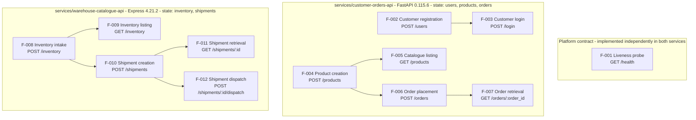

The diagram shows no edge crossing between `CustomerService` and `WarehouseService`. The `Platform` group shares only the path and response body of `/health`; the two implementations are separate functions.

### 2.3.2 Integration Points

| Integration point | Producer | Consumer | Contract |
|---|---|---|---|
| Customer HTTP interface | `services/customer-orders-api`, ASGI target `app.main:app`, documented listener `127.0.0.1:8000` | Storefront or purchasing API client | JSON over HTTP; success `201` on all creates, `200` on reads; failures `400`/`401`/`404`/`409` in FastAPI's `{"detail": ...}` envelope, `422` for schema violations |
| Warehouse HTTP interface | `services/warehouse-catalogue-api`, `src/server.js` started by `node src/server.js` on `process.env.PORT` defaulting to `3000` | Warehouse operations client | JSON over HTTP parsed by `express.json()`; `201` on creates, `200` on reads and dispatch; failures `400`/`404`/`409` in the `{"error": ...}` envelope; no `422` — invalid bodies yield `400` from the handler |
| Cross-service interface | None | None | No HTTP client, base URL, message queue, shared database or shared schema exists in either child; a repository-wide search for `localhost`, `http://` and the sibling service name finds only the loopback `fetch` in `test/routes.test.js` line 11 |

The two envelopes are a real integration cost for a client that talks to both services: the same logical fault (a non-positive quantity) returns `{"detail": "quantity must be positive"}` from `app/main.py` line 56 and `{"error": "quantity must be positive"}` from `src/server.js` line 28 — identical message text, different key.

### 2.3.3 Shared Components

No component code is shared. The following similarities are convergent implementations of the same idea, not shared artefacts, and must be changed in both places if either changes:

| Shared element | Customer-side implementation | Warehouse-side implementation | Character of the sharing |
|---|---|---|---|
| Liveness contract | `app/main.py` lines 21-23 returning `{"status": "ok"}` | `src/server.js` line 8 returning `{"status": "ok"}` | Identical path and body, independently written; the only contract that matches verbatim across services |
| In-memory store pattern | Module-level `dict`s (`app/main.py` line 6) | Module-level `Map`s (`src/server.js` lines 5-6) | Same pattern, different containers; neither service can read the other's store |
| Request-validation posture | pydantic models force `422` on schema faults before the handler executes (`app/main.py` lines 8-19) | Manual guards inside each handler force `400` (`src/server.js` lines 12-14, 27-29) | Two different validation mechanisms producing two different status codes for the same class of fault |
| Failure-status vocabulary | `400`, `401`, `404`, `409` | `400`, `404`, `409` | Same numeric vocabulary for different resources; no shared constants, no shared error types |
| Identifier strategy | `uuid4` for users, products and orders (`app/main.py` lines 29, 42, 60) | Positional `SHP-<n>` for shipments, caller-supplied SKU for inventory (`src/server.js` lines 16, 32) | Deliberately not shared; identifiers cannot be correlated across services |
| Stock representation | `products[id].stock` with `price`, keyed by uuid4 (`app/main.py` lines 12-15) | `inventory{sku}.quantity` with `reorderLevel`, keyed by SKU (`src/server.js` lines 11-16) | Two incompatible models with no bridging key, so no shared stock component is possible without new code |

### 2.3.4 Common Services

No common service exists. The repository contains no shared library, package, gateway, authentication service, message broker, job runner or datastore: `services/` holds two folders with no cross-imports, `requirements.txt` lists four Python packages and `package.json` lists one npm dependency, and neither manifest references the other service or any internal package.

The only cross-cutting concern implemented twice is liveness (F-001). Any future consolidation — a shared error envelope, a shared identifier scheme, a shared stock model — would be new construction rather than a refactor of something already shared, because today the two services meet only in the parent's `.gitmodules` and the identical `/health` contract.

## 2.4 Implementation Considerations

The considerations below are properties of the code at the pinned child commits, not targets. Where a requirement would normally be stated as a threshold, the observed characteristic is given instead, because neither service contains instrumentation, load configuration or a stated limit.

### 2.4.1 Cross-Cutting Considerations

| Dimension | Observed position | Evidence |
|---|---|---|
| Runtime and packaging | Python 3 with `uvicorn app.main:app --host 127.0.0.1 --port 8000`; Node.js running `node src/server.js` with `PORT` defaulting to `3000`. No Dockerfile, IaC, CI workflow or process supervisor exists | `services/customer-orders-api/README.md` lines 5-7; `services/warehouse-catalogue-api/README.md` lines 5-7; `src/index.js` lines 2-3 |
| Dependency pinning | Python pins all four direct dependencies with `==` but mixes runtime and test packages in one file and carries no hashes; npm pins `express` exactly but there is no lock file, so transitive versions float | `requirements.txt` lines 1-4; `package.json` line 6; no `package-lock.json` in the child |
| State and durability | All state is module-level and process-local; restart loses every record and a second instance sees an empty store. There is no migration, backup or export path | `app/main.py` line 6; `src/server.js` lines 5-6 |
| Concurrency | Every handler is synchronous and the read-modify-write on stock is unsynchronised. Python `def` handlers run in FastAPI's threadpool and Node's handlers share one event loop, so a check-then-decrement pair can interleave in the Python service and can interleave across processes in both | `app/main.py` lines 57-59; `src/server.js` lines 30-31 |
| Error envelopes | Two shapes must be parsed by any client using both services: `{"detail": ...}` from FastAPI and `{"error": ...}` from Express | `app/main.py` lines 28-72; `src/server.js` lines 13-47 |
| Security posture | No authentication, authorization, TLS, CORS, rate limiting, input-size limit or audit logging exists in either service; credentials are stored and compared in plain text and the login token is derived from the public user id | `app/main.py` lines 30, 36, 38; `src/server.js` lines 8-51 |
| Observability | One startup `console.log`; no request logging, metrics or tracing. The health probes are the only operational signal | `src/index.js` line 3; `app/main.py` line 23 |
| Maintainability | No linter, formatter, type-check, coverage tool or CI gate; XML/JSON unit-test frameworks only. Tests that do exist assert whole response documents, so additive response changes break them | `test_routes.py` line 12; `test/routes.test.js` lines 12-13 |

### 2.4.2 Feature-Level Constraints and Performance

| Feature | Technical Constraints | Performance Requirements (observed) |
|---|---|---|
| F-001 Liveness Probe | Must stay dependency-free and side-effect-free; the assertion on the whole body means the response object cannot grow | Constant work; one route per service, no store access, response independent of data volume |
| F-002 Customer Registration | E-mail is the raw dictionary key, giving case-sensitive uniqueness; password stored verbatim; identifier is a `uuid4` string of 36 characters | One membership test and one insert; O(1) per request |
| F-003 Customer Login | Reuses `RegisterRequest`, so no separate login schema exists; token is a pure function of the user id and is persisted nowhere | One lookup and one string comparison; O(1) |
| F-004 Product Creation | `price` is a float and `stock` an int with no range checks; `model_dump()` persists the payload verbatim, so any future field must be added to the model | One `uuid4` plus one insert; O(1) |
| F-005 Catalogue Listing | Whole store returned every call; no pagination or filtering parameters are read | O(n) serialisation of the full store per request; response size grows linearly with catalogue size |
| F-006 Order Placement | Three sequential guards before mutation; arithmetic uses float multiplication rounded to two decimals; no idempotency key or reservation record | O(1) lookup plus constant arithmetic; the only multi-step transaction on the customer side, and the only route with four documented failure statuses |
| F-007 Order Retrieval | Identifier used verbatim as a dict key; no format validation or ownership check | O(1) membership test |
| F-008 Inventory Intake | Manual validation against `Number.isInteger` rejects numeric strings; `reorderLevel` unvalidated; SKU is the identity for the whole fulfilment flow | O(1) `has` plus `set` |
| F-009 Inventory Listing | Whole Map spread per call; no pagination parameters are read | O(n) serialisation of all SKUs per request |
| F-010 Shipment Creation | Three guards plus mutation; identifier derived from `shipments.size + 1`, so it is positional; `destination` stored unvalidated | O(1) lookup, comparison and insert |
| F-011 Shipment Retrieval | Identifier matched verbatim against the Map key; no list route exists, so an identifier must have been captured earlier | O(1) `get` |
| F-012 Shipment Dispatch | Single-transition guard on `status !== 'created'`; `carrier` accepted as any truthy value and defaulted via `\|\|`; no inventory effect | O(1) `get` plus two assignments |

### 2.4.3 Feature-Level Scalability, Security and Maintenance

| Feature | Scalability Considerations | Security Implications | Maintenance Requirements |
|---|---|---|---|
| F-001 Liveness Probe | Scales trivially; identical on every instance because it reads no state | Discloses only a static string; unauthenticated by design | Any change to the body must be mirrored in both services and both test suites, since the document is compared exactly |
| F-002 Customer Registration | Single-process dictionary; a second instance registers the same e-mail independently, so uniqueness does not survive scaling | Plaintext password storage; unauthenticated creation; duplicate-e-mail response enables address enumeration | Changing the identity key or adding hashing changes the store schema and F-003 together; `EmailStr` remains an unused import |
| F-003 Customer Login | Stateless, so it scales without coordination — because nothing records the session | Token is predictable and unverified; no lockout, throttling or failed-attempt logging | If token validation is ever added, every route in both services needs the dependency injected |
| F-004 Product Creation | Catalogue grows unbounded in one process; no cap, no sharding key | Unauthenticated; negative prices and stock accepted, which can produce negative totals downstream | Price and stock validation belong here and would change F-006's totals; adding fields requires updating the pydantic model and the listing projection |
| F-005 Catalogue Listing | O(n) response with no pagination — the first route to degrade as the catalogue grows | Exposes all prices and stock levels to any caller | Response shape is asserted by no test, but adding pagination would change the array contract callers rely on |
| F-006 Order Placement | Unsynchronised read-modify-write; safe only with one writer process and sequential requests | Unauthenticated ordering; no idempotency, so retries double-deduct stock; no user binding on the order | The guard order (product, quantity, stock) is part of the contract; changing it changes observable status codes |
| F-007 Order Retrieval | O(1) and stateless, but only resolves orders held by the same process | Any caller holding an identifier reads the order; no authorization boundary | Adding ownership checks requires an order-to-user link that does not exist |
| F-008 Inventory Intake | Inventory Map is process-local; two instances would hold divergent stock | Unauthenticated write; duplicate-SKU response enumerates existing SKUs | The integer check is stricter than JSON coercion — changing to a coercion-based validator would accept `"5"` and alter the contract |
| F-009 Inventory Listing | O(n) unpaginated response; the only way to verify deductions, so it carries the audit load | Exposes all SKUs and quantities | No movement history exists, so reconciliation beyond the current balance would require a new store |
| F-010 Shipment Creation | Unsynchronised decrement; positional identifiers assume records are never removed; a `created` shipment holds stock indefinitely | Unauthenticated stock consumption; predictable identifiers enable enumeration | If deletion or expiry is added, `SHP-${shipments.size + 1}` must change to a monotonic counter |
| F-011 Shipment Retrieval | O(1); only resolves shipments in the same process | Destination and quantity readable by any caller | No list route means operators cannot recover identifiers without an external record |
| F-012 Shipment Dispatch | Single-transition guard is per-process, so two instances can each dispatch the same logical shipment | Unauthenticated state change; free-text carrier means dispatch records cannot be relied on for carrier reconciliation | Adding a carrier allow-list or tracking number changes the stored document; there is no reversal path to extend |

## 2.5 Assumptions and Constraints

The requirements above describe the code at the two pinned child commits. The assumptions and constraints below are what makes that reading valid, and each is stated so a reader can check it.

### 2.5.1 Assumptions

| ID | Assumption | Basis and how to verify it |
|---|---|---|
| A-01 | The two child services are the complete product: the parent contributes no requirement of its own | Root `README.md` states the repository "is intentionally metadata-only. It contains no application source and no tests of its own"; `git ls-files` lists only `.gitignore`, `.gitmodules`, `README.md` and two gitlinks |
| A-02 | Requirements are read from the pinned commits `04259f8` (customer) and `f9f72d1` (warehouse), both on branch `2511_02`, not from either child's moving tip | `git ls-tree HEAD services/` and `git submodule status` show no drift from those commits |
| A-03 | Every handler is reachable without credentials; no requirement may assume an authorization step | No middleware, dependency, guard or token check exists in either service; the login token is issued and never read |
| A-04 | State is expected to be lost between runs, so no requirement may depend on data surviving a restart | Both stores are module-level and process-local (`app/main.py` line 6; `src/server.js` lines 5-6) |
| A-05 | Responses are compared as whole JSON documents in tests, so adding a field to an existing contract is a breaking change for the suite | `tests/test_routes.py` line 12; `test/routes.test.js` lines 12-13 |
| A-06 | Priorities and complexities are analytical assignments derived from the dependency structure described in 2.1.1, since no backlog, issue tracker or roadmap exists in the repository | Repository-wide search for `TODO` and `FIXME` returns no match |
| A-07 | Test coverage statements refer to the two committed suites only; behaviour not asserted there is unverified even where it is implemented | `tests/test_routes.py` (4 tests); `test/routes.test.js` (1 test) |
| A-08 | Requests are served one at a time against a single process for every guarantee about stock to hold | Unsynchronised read-modify-write at `app/main.py` lines 57-59 and `src/server.js` lines 30-31 |

### 2.5.2 Constraints

| ID | Constraint | Source |
|---|---|---|
| C-01 | Language and framework are fixed per service: FastAPI 0.115.6 on uvicorn 0.34.0, and Express 4.21.2 in CommonJS | `requirements.txt` lines 1-2; `package.json` line 6 |
| C-02 | Python dependencies are exactly four exact pins with no lock file or hash; npm has `express` pinned exactly and no lock file, so transitive versions are unpinned | `requirements.txt`; `package.json`; no `package-lock.json` in the child |
| C-03 | No persistence layer may be assumed: no database driver, ORM, migration or configuration file exists | `requirements.txt`; `package.json`; absence of any config file in either child |
| C-04 | Identifiers cannot be correlated across services — `uuid4` on the customer side, SKU and `SHP-<n>` on the warehouse side | `app/main.py` lines 29, 42, 60; `src/server.js` lines 16, 32 |
| C-05 | The error envelopes are fixed as implemented: `{"detail": ...}` for FastAPI, `{"error": ...}` for Express | `app/main.py` lines 28-72; `src/server.js` lines 13-47 |
| C-06 | FastAPI answers schema violations with `422` before the handler runs; Express validates inside the handler and answers `400` | `app/main.py` lines 8-19; `src/server.js` lines 12-14, 27-29 |
| C-07 | No update or delete capability exists in either service; the only lifecycle transition is `created → dispatched` | Route search finds no `PUT`, `PATCH` or `DELETE` handler |
| C-08 | The `app.main:app` ASGI target requires the empty `app/__init__.py` package marker to resolve | `services/customer-orders-api/app/__init__.py` is 0 bytes |
| C-09 | Operational capability is limited to the single startup log line and the two health routes; no metrics, tracing or graceful shutdown exists | `src/index.js` line 3; `app/main.py` lines 21-23 |

### 2.5.3 Requirement Versions

| Version | Scope | Basis | Change rule |
|---|---|---|---|
| 1.0 | All 47 requirements across F-001 to F-012, corresponding to the 13 route handlers at the pins named in A-02 | The two child commits and the five committed tests | A change to a handler's branch order, status code, error text or stored field shape requires a revision of the affected `F-XXX-RQ-YYY` and of 2.2 |
| 1.0 | Priority, complexity and status assignments | Structural rules in 2.1.1 | Re-derived whenever a feature gains or loses a dependant, or a route is added or removed |

A new child commit, a new route, or a change of framework version invalidates version 1.0 in full rather than in part, because `.gitmodules` declares no branch and the parent gitlink is consequently the only record of which code these requirements describe.

## 2.6 Traceability Matrix

Traceability runs in three directions: each feature to the handler that implements it, each requirement to the test that verifies it, and each feature group to the journey diagram and specification section that describes it.

### 2.6.1 Feature to Implementation

| Feature | Requirement IDs | Implementation (file: lines) | Route |
|---|---|---|---|
| F-001 | F-001-RQ-001 to F-001-RQ-002 | `services/customer-orders-api/app/main.py` 21-23; `services/warehouse-catalogue-api/src/server.js` 8 | `GET /health` (both) |
| F-002 | F-002-RQ-001 to F-002-RQ-003 | `app/main.py` 8-10 (model), 25-31 (handler), 6 (store) | `POST /users` |
| F-003 | F-003-RQ-001 to F-003-RQ-003 | `app/main.py` 33-38 | `POST /login` |
| F-004 | F-004-RQ-001 to F-004-RQ-004 | `app/main.py` 12-15 (model), 40-44 (handler) | `POST /products` |
| F-005 | F-005-RQ-001 to F-005-RQ-003 | `app/main.py` 46-48 | `GET /products` |
| F-006 | F-006-RQ-001 to F-006-RQ-006 | `app/main.py` 17-19 (model), 50-67 (handler) | `POST /orders` |
| F-007 | F-007-RQ-001 to F-007-RQ-003 | `app/main.py` 69-73 | `GET /orders/{order_id}` |
| F-008 | F-008-RQ-001 to F-008-RQ-005 | `src/server.js` 10-19 | `POST /inventory` |
| F-009 | F-009-RQ-001 to F-009-RQ-003 | `src/server.js` 21 | `GET /inventory` |
| F-010 | F-010-RQ-001 to F-010-RQ-007 | `src/server.js` 23-36 | `POST /shipments` |
| F-011 | F-011-RQ-001 to F-011-RQ-003 | `src/server.js` 38-42 | `GET /shipments/:id` |
| F-012 | F-012-RQ-001 to F-012-RQ-005 | `src/server.js` 44-51 | `POST /shipments/:id/dispatch` |

All paths under `services/customer-orders-api/` unless prefixed with `src/`, which denotes `services/warehouse-catalogue-api/src/`. The 12 features account for 13 route handlers, because F-001 covers one handler in each service.

### 2.6.2 Requirement to Verification Coverage

| Feature | Asserted or partially asserted | Unasserted requirements | Coverage summary |
|---|---|---|---|
| F-001 | F-001-RQ-001 (asserted in both suites) | F-001-RQ-002 | Only contract fully proven on both services |
| F-002 | F-002-RQ-001 (partially: status and e-mail echo only) | F-002-RQ-002, F-002-RQ-003 | Duplicate and schema-fault branches unproven |
| F-003 | None | F-003-RQ-001, F-003-RQ-002, F-003-RQ-003 | Entire feature unproven; named a gap in the service README |
| F-004 | F-004-RQ-001 (partially: status and `name` echo only) | F-004-RQ-002, F-004-RQ-003, F-004-RQ-004 | Identifier uniqueness, value laxity and `422` unproven |
| F-005 | None | F-005-RQ-001, F-005-RQ-002, F-005-RQ-003 | The only read path over the catalogue is unproven |
| F-006 | F-006-RQ-003 (asserted) | F-006-RQ-001, F-006-RQ-002, F-006-RQ-004, F-006-RQ-005, F-006-RQ-006 | Total, stock decrement, both conflict branches and guard order unproven |
| F-007 | None | F-007-RQ-001, F-007-RQ-002, F-007-RQ-003 | Entire feature unproven |
| F-008 | None | F-008-RQ-001 to F-008-RQ-005 | Entire feature unproven; named a gap in the service README |
| F-009 | None | F-009-RQ-001 to F-009-RQ-003 | Entire feature unproven |
| F-010 | None | F-010-RQ-001 to F-010-RQ-007 | Entire feature unproven, including the inventory-deduction guarantee |
| F-011 | None | F-011-RQ-001 to F-011-RQ-003 | Entire feature unproven |
| F-012 | None | F-012-RQ-001 to F-012-RQ-005 | Entire feature unproven, including the single-transition rule |

Aggregate: of 47 requirements, 2 are fully asserted, 2 partially asserted, and 43 unasserted. The distribution matches the two `## Deliberate analysis gaps` blocks in the child READMEs, which name invalid login, duplicate registration, stock decrement and computed totals (customer side) and the whole warehouse journey with its three conflict branches as the untested set.

### 2.6.3 Assertion Detail

| Requirement | Test | Assertion |
|---|---|---|
| F-001-RQ-001 (customer side) | `services/customer-orders-api/tests/test_routes.py::test_health_probe` lines 11-12 | `client.get("/health").json()` deep-equals `{"status": "ok"}` |
| F-001-RQ-001 (warehouse side) | `services/warehouse-catalogue-api/test/routes.test.js::health route responds` lines 7-17 | Real HTTP fetch to `http://127.0.0.1:<ephemeral>/health`; `status` equals `200` and body deep-equals `{"status": "ok"}`; server closed in `finally` |
| F-002-RQ-001 (partial) | `test_routes.py::test_register_route_creates_user` lines 14-17 | Status `201` and `body.email` equals `a@example.com`; the identifier shape and stored password are not checked |
| F-004-RQ-001 (partial) | `test_routes.py::test_product_route_creates_product` lines 19-22 | Status `201` and `body.name` equals `Keyboard`; `id`, `price` and `stock` are not checked |
| F-006-RQ-003 (asserted) | `test_routes.py::test_order_rejects_unknown_product` lines 24-26 | `POST /orders` with `product_id: "missing"` returns `404`; the response body and absence of side effects are not checked |

State isolation between Python tests comes from `setup_function` (`test_routes.py` lines 6-9), which clears `users`, `products` and `orders` before each test. The Node suite starts a fresh listener per test on port `0` but shares the module-level Maps of the required `app`.

### 2.6.4 Process Flow and Specification Cross-References

| Feature group | Journey diagram | Related specification sections |
|---|---|---|
| F-001 | No journey diagram; a single request-response pair | 1.2.2 route inventories; 1.3.1.1 *Liveness* bullet in Core Features |
| F-002, F-003 | *Customer purchase journey* sequence diagram, 1.3.1.1 | 1.2.2 route inventory for `customer-orders-api`; 1.3.2 for the absent authorization layer |
| F-004, F-005 | *Customer purchase journey* sequence diagram, 1.3.1.1 | 1.2.2 route inventory; 1.3.2 for the absent pricing and pagination rules |
| F-006, F-007 | *Customer purchase journey* sequence diagram, 1.3.1.1 | 1.2.2 route inventory; 1.3.2 for concurrency, payment and order-to-user binding exclusions |
| F-008, F-009 | *Warehouse fulfilment journey* sequence diagram, 1.3.1.1 | 1.2.2 route inventory for `warehouse-catalogue-api`; 1.3.2 for the absent replenishment rules |
| F-010, F-011, F-012 | *Warehouse fulfilment journey* sequence diagram, 1.3.1.1 | 1.2.2 route inventory; 1.3.2 for the absent carrier integration, cancellation and identifier-durability guarantees |
| All features | Feature dependency map, 2.3.1 | 1.2.3 *Measurable objectives* table, which states the same contracts as acceptance conditions; 2.1.1 for priority derivation |

## 2.7 References

- `README.md` — the parent-scope statement ("intentionally metadata-only. It contains no application source and no tests of its own"), the two-submodule inventory with stack descriptions, and the expected scan behaviour that bounds every requirement in this section
- `.gitmodules` — the two `[submodule]` stanzas with `path` and `url` and no `branch` key, establishing that the parent gitlink alone pins the code these requirements describe
- `.gitignore` — the single `.DS_Store` entry, confirming no build, environment or generated artefact is tracked
- `services/` — the folder holding the two independent child service folders, with no cross-imports and no shared library
- `services/customer-orders-api/` — the FastAPI child service folder at pinned commit `04259f82d5a8f87ff9d81d5fdd1dfdefaee4e564` (branch `2511_02`)
- `services/customer-orders-api/README.md` — stated purpose, run commands (`pip install -r requirements.txt`, `uvicorn app.main:app --host 127.0.0.1 --port 8000`), `pytest -q`, and the "Deliberate analysis gaps" naming invalid login, duplicate registration, stock decrement and computed order totals as untested
- `services/customer-orders-api/requirements.txt` — `fastapi==0.115.6`, `uvicorn==0.34.0`, `pytest==8.3.4`, `httpx==0.28.1` as the complete pin set with runtime and test dependencies mixed
- `services/customer-orders-api/app/` — the service package root containing the whole application
- `services/customer-orders-api/app/__init__.py` — the 0-byte package marker required for the `app.main:app` ASGI target
- `services/customer-orders-api/app/main.py` — the application object, the three in-memory dicts, `RegisterRequest`, `ProductRequest` and `OrderRequest`, and all seven routes with their status codes, error strings, validation order, plaintext password handling, unused `EmailStr` import, `token-<user_id>` format, stock decrement and `total = round(price × quantity, 2)` (F-001 to F-007)
- `services/customer-orders-api/tests/` — the single-file test directory with no fixtures, `conftest.py` or pytest configuration
- `services/customer-orders-api/tests/test_routes.py` — `setup_function` state clearing and the four in-process `TestClient` tests that supply all customer-side assertion evidence in 2.6
- `services/warehouse-catalogue-api/` — the Express child service folder at pinned commit `f9f72d1c37091f8845e3e3727515fa713ebe20b1` (branch `2511_02`)
- `services/warehouse-catalogue-api/README.md` — stated purpose, `npm install` / `npm start` / `npm test`, and the "Deliberate analysis gaps" naming the untested inventory, shipment, dispatch and conflict journeys
- `services/warehouse-catalogue-api/package.json` — name, version, `private: true`, `start` and `test` scripts, the exact `express: "4.21.2"` dependency and empty `devDependencies`
- `services/warehouse-catalogue-api/src/` — the two CommonJS files forming the service and its bootstrap
- `services/warehouse-catalogue-api/src/index.js` — `process.env.PORT || 3000`, the `app.listen` call and the single startup `console.log`
- `services/warehouse-catalogue-api/src/server.js` — `express.json()`, the `inventory` and `shipments` Maps, all six routes with their status codes and error strings, `reorderLevel` default `5`, positional `SHP-<n>` identifiers, inventory deduction at creation, the dispatch status guard and the `carrier` default `"standard"` (F-001, F-008 to F-012)
- `services/warehouse-catalogue-api/test/` — the single-file test directory with no harness or fixtures
- `services/warehouse-catalogue-api/test/routes.test.js` — the single `/health` test over loopback `fetch` on an ephemeral port, the only assertion evidence for the warehouse service
- Repository Git metadata (`git ls-tree HEAD services/`, `git submodule status`, `git log`) — the gitlink commits and branch names that define the baseline this requirements version covers

No external web sources were consulted. Every requirement, acceptance criterion and validation rule above is drawn from these files; framework-level statements are limited to behaviour visible in them (dependency versions, route registration, response serialisation).


# 3. Technology Stack

## 3.1 Programming Languages

The technology stack of this system is not an architectural choice made by a development team; it is a property of the two Git submodules pinned by the parent repository. The parent root tracks only `.gitignore`, `.gitmodules`, `README.md` and two submodule gitlinks, so it contributes no source file in any language. Everything that executes lives in `services/customer-orders-api` (Python) and `services/warehouse-catalogue-api` (JavaScript), each pinned by the parent gitlink at `04259f82d5a8f87ff9d81d5fdd1dfdefaee4e564` and `f9f72d1c37091f8845e3e3727515fa713ebe20b1` respectively.

Across the whole checkout there are exactly thirteen tracked files, of which six are code: three `.py` and three `.js`. No file of any other programming language exists.

### 3.1.1 Language Inventory by Component

| Component | Language | Module system and code style | Runtime constraint | Evidence |
|---|---|---|---|---|
| Parent repository root | None | Not applicable | Not applicable | Tracked root files are `.gitignore`, `.gitmodules`, `README.md`; the root `README.md` line 3 states the repository "contains no application source and no tests of its own" |
| `services/customer-orders-api` | Python 3 | Regular package resolved through `app/__init__.py`; synchronous `def` route handlers decorated with FastAPI verbs; pydantic-typed parameters; f-strings and `round()` for arithmetic | Python ≥ 3.9 — implied, not declared: FastAPI 0.115.6 requires Python ≥ 3.8 and uvicorn 0.34.0 requires ≥ 3.9, and the repository holds no `requires-python`, `setup.py` or `pyproject.toml` to state a floor of its own | `services/customer-orders-api/requirements.txt` lines 1-2; `app/main.py` lines 1-73; `app/__init__.py` (0 bytes) |
| `services/warehouse-catalogue-api` | JavaScript (Node.js) | CommonJS throughout — `const express = require('express')`, `module.exports = app`; classic function/arrow callbacks; no classes, no type annotations, no transpilation | Node.js ≥ 20 — implied by the test runner (`node --test` became stable in Node 20) and by `fetch` used in `test/routes.test.js` line 11 (global from Node 18); the `package.json` declares no `engines` field and no `type` field, so CommonJS is the module default | `services/warehouse-catalogue-api/package.json` lines 5-6; `src/server.js` lines 1-53; `src/index.js` lines 1-3; `test/routes.test.js` lines 1-3 |

The interpreter and runtime observed in the analysis environment were Python 3.12.3, Node.js v22.23.5 and npm 11.21.3 — comfortably above both implied floors, and evidence that neither service states a version ceiling anywhere.

### 3.1.2 Selection Criteria and Justification

- **One language per service, with no shared language at all.** The two services share no code: of the ten import statements in the entire repository, every one is either a third-party package or a path inside the same service (`require('./server')`, `require('../src/server')`, `from app.main import ...`). There is therefore no common runtime to standardise on, and nothing in the repository attempts to create one.
- **Python was chosen for the customer-facing service because its contract is schema-shaped.** Registration, product creation and order placement all accept JSON documents whose shape the code wants validated before the handler runs. Declaring `payload: RegisterRequest` on `app/main.py` line 26 gets that validation, the automatic `422` response and the generated OpenAPI schema from pydantic, with no hand-written parsing.
- **JavaScript was chosen for the warehouse service because its contract is dependency-light.** Express 4.21.2 is the service's only third-party package, and the handlers validate their own bodies with plain conditionals (`!sku || !name || !Number.isInteger(quantity)`, `src/server.js` line 12). This yields explicit, hand-written `400` bodies rather than framework-generated `422`s, and requires no build step, no transpiler and no type definition packages.
- **Both languages are used in interpreted, unbuilt form.** There is no compilation, bundling, transpilation or code generation anywhere: no `Makefile`, no `pyproject.toml`, no `tsconfig.json`, no bundler config. The only two npm scripts are `start` and `test` (`package.json` line 5).

### 3.1.3 Language Constraints and Dependencies

| Constraint | Detail | Evidence |
|---|---|---|
| Package layout is part of the runtime contract | The ASGI target is `app.main:app`, so `app/` must be importable as a package; `app/__init__.py` is 0 bytes and exists solely for that resolution | `services/customer-orders-api/README.md` line 7; `app/__init__.py`; the same target appears in the test import `from app.main import app, products, orders, users` (`tests/test_routes.py` line 2) |
| Test layout depends on the working directory | `tests/test_routes.py` imports `app.main`, so pytest must be invoked from `services/customer-orders-api/`; there is no `conftest.py`, `__init__.py`, `pytest.ini` or `pyproject.toml` to configure roots | `tests/test_routes.py` line 2; directory listing of `services/customer-orders-api/tests` |
| Python annotations are unverified statically | No mypy, pyright, ruff or flake8 configuration exists anywhere in the checkout, so annotations are enforced only at runtime by pydantic; the unused `EmailStr` import on `app/main.py` line 2 is the visible consequence | `app/main.py` line 2; repository-wide search for `mypy.ini`, `.flake8`, `ruff.toml`, `setup.cfg` returns nothing |
| CommonJS fixes the module syntax | With no `"type": "module"` in `package.json`, `import`/`export` syntax is unavailable; the code uses `require`/`module.exports` consistently, and the app object is handed between files by that mechanism | `package.json` lines 1-8; `src/index.js` line 1; `src/server.js` line 53 |
| Node's built-in APIs carry the test burden | `node:test` and `node:assert/strict` are imported from Node itself, and the test uses the global `fetch` plus `app.listen(0)` for an ephemeral port, so the Node major version is the only test-framework version constraint | `test/routes.test.js` lines 1-2, 8, 11 |
| Numeric typing differs by service | Python declares `price: float` and `stock: int` in a pydantic model (`app/main.py` lines 12-15); Node validates quantity with `Number.isInteger`, which rejects numeric strings that JSON coercion would accept (`src/server.js` lines 12, 27) | `app/main.py` lines 12-15; `src/server.js` lines 12, 27 |

### 3.1.4 Languages Not Present

The declared default stack for this project proposes React with TypeScript, React Native with TypeScript, Swift, Kotlin, Objective-C and Electron across web, mobile and desktop tiers. None of these has any presence in the repository: a case-insensitive text search of all thirteen tracked files for `react`, `typescript`, `tailwind`, `next.js`, `vue`, `angular`, `swift`, `kotlin`, `objective-c` and `electron` returns zero matches, and the complete extension inventory is three `.py`, three `.js`, three `.md`, one `.txt` and one `.json`.

| Declared language | Present | Consequence |
|---|---|---|
| Python | Yes — `services/customer-orders-api` | FastAPI service as described above |
| JavaScript | Yes — `services/warehouse-catalogue-api` | Express service, CommonJS |
| TypeScript | No | No `tsconfig.json`, no `.ts` file, no build step; there is no typed frontend and no typed Node code |
| React / React Native | No | No `.jsx`/`.tsx` file, no bundler, no frontend application of any kind — the only consumer-facing surface is HTTP/JSON |
| Swift, Kotlin, Objective-C | No | No iOS, Android or macOS target, project file or package manifest exists |
| Electron | No | No desktop shell, no `electron` dependency, no packaging configuration |


## 3.2 Frameworks & Libraries

Two web frameworks define the whole application surface, one per service, and they are the only frameworks in the repository. Neither service uses an ORM, a middleware stack, a template engine, a task queue, a configuration library or an HTTP client at runtime.

### 3.2.1 Core Frameworks

| Framework | Version | Pinned where | Service role | Evidence |
|---|---|---|---|---|
| FastAPI | 0.115.6 | `requirements.txt` line 1, exact `==` pin | Owns the ASGI application object, the route decorators, `HTTPException`, request-body validation, response serialisation and the generated OpenAPI schema | `app/main.py` lines 1, 5, 21-73 |
| uvicorn | 0.34.0 | `requirements.txt` line 2, exact `==` pin | The ASGI server process that hosts the app; documented invocation is `uvicorn app.main:app --host 127.0.0.1 --port 8000` | `services/customer-orders-api/README.md` line 7 |
| Express | 4.21.2 | `package.json` line 6, exact pin with no range prefix | HTTP router, `express.json()` body parsing, `res.status().json()` response helpers; the app object is the module's single export | `src/server.js` lines 1-3, 8-51, 53 |
| pydantic | v2, unpinned | Not declared — imported directly at `app/main.py` line 2 and satisfied transitively by FastAPI | Request-model definition (`BaseModel`) and `model_dump()` serialisation of a validated payload into the store | `app/main.py` lines 2, 8-19, 43 |
| Starlette | Version not recorded anywhere | Not declared; arrives transitively beneath FastAPI | Underlying ASGI toolkit; also supplies `fastapi.testclient.TestClient` used by the suite | `tests/test_routes.py` line 1; no file in the repository names Starlette |

### 3.2.2 Supporting Libraries and Built-ins

| Library | Version | Scope | Role | Evidence |
|---|---|---|---|---|
| pytest | 8.3.4 | Test only, though declared in the same flat manifest as runtime packages | Discovers the four `test_*` functions and invokes the xunit-style `setup_function()` hook that clears the three dictionaries before each test | `requirements.txt` line 3; `tests/test_routes.py` lines 6-9 |
| httpx | 0.28.1 | Test only | Transport beneath `TestClient`; requests are made in-process with no listening socket | `requirements.txt` line 4; `tests/test_routes.py` line 4 |
| `node:test` | Node built-in; runner core stable from Node 20 | Test only | Test registration (`test('health route responds', ...)`) and execution via `npm test` → `node --test` | `test/routes.test.js` line 1; `package.json` line 5 |
| `node:assert/strict` | Node built-in | Test only | Strict assertions `assert.equal` and `assert.deepEqual` | `test/routes.test.js` line 2 |
| Global `fetch` | Node built-in, available by default from Node 18 | Test only | The repository's only outbound network call, to `http://127.0.0.1:${port}/health` | `test/routes.test.js` lines 8-15 |
| `uuid.uuid4` | Python standard library | Runtime | Mints every user, product and order identifier | `app/main.py` lines 3, 29, 42, 60 |
| `Map` | JavaScript built-in | Runtime | The warehouse service's entire persistence layer | `src/server.js` lines 5-6 |

### 3.2.3 Compatibility Requirements

| Requirement | Why it binds | Evidence |
|---|---|---|
| pydantic **v2** is required in practice even though it is unpinned | FastAPI 0.115.6 accepts `pydantic>=1.7.4,<3.0.0` (excluding 1.8, 1.8.1, 2.0.0, 2.0.1, 2.1.0), so a v1 resolution satisfies the resolver; but `payload.model_dump()` on `app/main.py` line 43 exists only in pydantic v2, so a v1 install fails at runtime. With no lock file, each `pip install` resolves the newest acceptable 2.x | `app/main.py` line 43; `requirements.txt`; FastAPI 0.115.6 dependency metadata |
| `EmailStr` needs a package that is not installed | In pydantic v2, `EmailStr` requires the optional `email-validator` package (offered by FastAPI only through its `standard` extra). Importing `EmailStr` succeeds without it; failure occurs only when a model field uses the type. No field does, so the import at `app/main.py` line 2 is inert — and no e-mail format validation occurs anywhere | `app/main.py` line 2; `requirements.txt` |
| `httpx` version is coupled to Starlette's test client | `fastapi.testclient.TestClient` is Starlette's httpx-backed client, so the httpx pin is a test-client compatibility constraint rather than a general HTTP-client choice. The repository records no expected httpx range for the resolved Starlette version | `requirements.txt` line 4; `tests/test_routes.py` line 1 |
| Python ≥ 3.9 | uvicorn 0.34.0 requires Python ≥ 3.9 (FastAPI 0.115.6 requires ≥ 3.8), and nothing in the repository declares a floor of its own | `requirements.txt` lines 1-2; no `pyproject.toml` or `setup.py` |
| Node ≥ 20 | `node --test` reached stability in Node 20; the global `fetch` in the test needs Node ≥ 18. `package.json` declares no `engines` field, so the floor is implied by the APIs used rather than enforced | `package.json`; `test/routes.test.js` lines 1, 11 |
| Express 4 behaves as a CommonJS consumer | `require('express')` with no `"type"` key in `package.json` fixes the module format; Express 4's router and `express.json()` middleware are the only framework features in use | `src/server.js` lines 1-3 |

### 3.2.4 Justification for Each Major Choice

| Choice | Justification observable in the code | Trade-off the code shows |
|---|---|---|
| FastAPI over a plain WSGI framework | Declarative body validation plus automatic `422` responses removed the need for hand-written parsing in all four write routes, and `HTTPException(status, detail)` reduced each failure branch to one line | Failures use FastAPI's `{"detail": ...}` envelope while the Node service uses `{"error": ...}`, so any client using both must parse two shapes. Synchronous `def` handlers run in FastAPI's threadpool, which leaves the stock read-modify-write at lines 57-59 unsynchronised |
| pydantic models as the request contract | Three small `BaseModel` classes cover the three payload shapes, including reusing `RegisterRequest` for both `POST /users` and `POST /login` | Models carry no validators, so `POST /products` accepts negative `price` and `stock`; and the models describe requests only, never the stored record or a response model |
| uvicorn as the server | One command serves the ASGI app with no configuration file, gunicorn or process manager | The documented command binds `127.0.0.1`, which is loopback-only, serves plain HTTP with no TLS, and specifies no worker count, reload or shutdown behaviour |
| Express as the router | A single dependency provides routing, JSON parsing and response helpers, keeping the service to two source files | Validation, status selection and error text are hand-written per handler, so each route repeats its own guard logic and the contract lives only in the code |
| pytest with `TestClient` over a live-server test harness | Requests are exercised in-process with no server, socket or mocking library, so the suite runs from a single command with no fixtures directory | The suite imports `app`, `products`, `orders` and `users` directly and clears them in `setup_function()`, coupling tests to module internals as well as to the HTTP contract |
| Node's built-in runner over Jest or Mocha | `npm test` needs no dev dependencies at all — `devDependencies` is empty — and the single test still exercises real HTTP over an ephemeral port | There is no mocking, assertion-extension, coverage or watch tooling available without adding packages |

### 3.2.5 Framework Interaction Overview

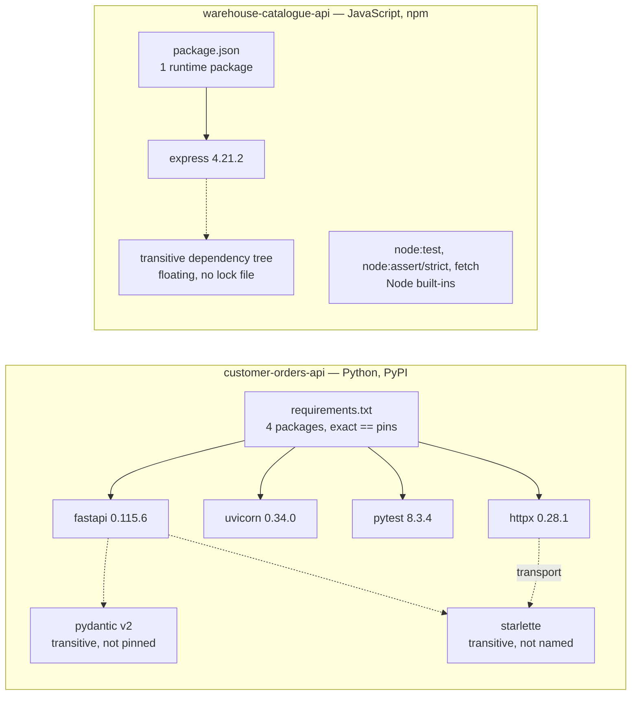

The only third-party code that runs in production is FastAPI, uvicorn, pydantic, Starlette and Express. pytest and httpx execute only under `pytest -q`; the Node test modules are built in, so the warehouse service's production and test dependency sets are identical.

### 3.2.6 Frameworks and Libraries Not Present

A case-insensitive search of every tracked file for `flask`, `django`, `fastify`, `nestjs`, `jest`, `mocha`, `supertest`, `vitest`, `chai`, `sinon`, `nodemon`, `axios`, `requests`, `urllib`, `dotenv`, `cors`, `helmet`, `morgan`, `winston`, `loguru`, `structlog`, `gunicorn`, `hypercorn`, `uvloop`, `httptools`, `pydantic-settings`, `alembic`, `sqlmodel`, `prisma`, `sequelize`, `knex`, `joi` and `zod` returns no matches.

| Declared default | Present | Observation |
|---|---|---|
| Flask | No | The Python service is FastAPI 0.115.6; `flask` appears nowhere in the repository |
| MERN-style web/mobile frameworks (React, React Native, TailwindCSS) | No | No frontend framework, CSS framework or bundler exists; the only interface is HTTP/JSON |
| ORM or database toolkit (Prisma, Sequelize, SQLAlchemy, Mongoose) | No | State is held in dictionaries and `Map`s; no client library is declared or imported |
| CORS, security-header, logging or process-manager middleware | No | Neither service installs middleware beyond `express.json()`; there is no CORS handling, no request logging and no supervisor |

### 3.2.7 Security Implications of the Framework Choices

- **Transport is plaintext on loopback in the documented configuration.** `uvicorn ... --host 127.0.0.1 --port 8000` (`services/customer-orders-api/README.md` line 7) and `app.listen` on a bare port (`src/index.js` line 3) both serve unencrypted HTTP with no TLS terminator, reverse proxy or certificate configuration in the repository.
- **Framework-generated error detail is exposed verbatim.** FastAPI's `{"detail": "..."}` messages are the sole failure signal, and no handler suppresses them or maps them to a client-safe vocabulary.
- **No framework-level authentication exists.** Neither framework's dependency-injection, middleware or guard mechanisms are used for identity: the login token `f"token-{user['id']}"` (`app/main.py` line 38) is issued and never verified, and no Express middleware reads an `Authorization` header.
- **No request-size, rate or schema-hardening middleware.** `express.json()` is applied without options (`src/server.js` line 3), relying on Express's defaults, and pydantic models declare plain `str`/`float`/`int` fields with no constraints, so no length or range limit is enforced anywhere.
- **Test-time coupling leaks internals.** Because `tests/test_routes.py` imports the stores directly, any future move to a real datastore breaks the tests before it changes behaviour — an early warning, but also a sign that the tests assert implementation, not only contract.


## 3.3 Open Source Dependencies

The repository names exactly five open-source packages in its manifests and imports one more without declaring it. That is the complete third-party surface of the system: there is no vendored code, no internal package registry, no SBOM and no dependency-automation configuration.

### 3.3.1 Declared Dependency Inventory

| Package | Registry | Constraint | Scope | Declared at | Import site |
|---|---|---|---|---|---|
| `fastapi` | PyPI | `==0.115.6` (exact) | Runtime | `services/customer-orders-api/requirements.txt` line 1 | `app/main.py` line 1 |
| `uvicorn` | PyPI | `==0.34.0` (exact) | Runtime — server process only, never imported by application code | `requirements.txt` line 2 | None; invoked by the documented command `uvicorn app.main:app` |
| `pytest` | PyPI | `==8.3.4` (exact) | Test only, but stored in the same flat runtime file | `requirements.txt` line 3 | Not imported; discovered by the CLI |
| `httpx` | PyPI | `==0.28.1` (exact) | Test only, transitive use through `TestClient` | `requirements.txt` line 4 | Not imported directly; `tests/test_routes.py` line 1 |
| `express` | npm | `4.21.2` (exact, no range prefix) | Runtime | `services/warehouse-catalogue-api/package.json` line 6 | `src/server.js` line 1 |
| `pydantic` | PyPI | **Not declared** | Runtime | Absent from `requirements.txt`; satisfied transitively by FastAPI | `app/main.py` line 2 (`BaseModel`, `EmailStr`) |

`devDependencies` in `package.json` is an empty object, so the Node service has no declared development dependency at all.

### 3.3.2 Registries and Version Pinning

| Aspect | Observed practice | Evidence |
|---|---|---|
| Registries | PyPI for the Python service, the public npm registry for the Node service. No `.npmrc`, no `--index-url`/`--extra-index-url` directive, no private or proxied registry reference | `requirements.txt` lines 1-4; `package.json` lines 1-8; no `.npmrc` in the checkout |
| Direct version pinning | Every direct dependency is pinned to an exact version with `==` (Python) or a bare version string (npm), so the leaf set cannot drift by specification | `requirements.txt`; `package.json` line 6 |
| Lock files | None. There is no `package-lock.json`, `yarn.lock`, `pnpm-lock.yaml`, `poetry.lock`, `Pipfile.lock` or `requirements.lock` anywhere in the repository, so the transitive graph is resolved freshly on every install | Repository-wide search returns no lock file of any kind |
| Integrity verification | No hashes, no `--require-hashes`, no `npm ci` path — `npm install` is the documented command | `requirements.txt`; `services/warehouse-catalogue-api/README.md` line 6 |
| Scope separation | Python runtime and test packages are mixed in one undifferentiated file with no marker, extras or environment grouping; the Node side separates them only through the empty `devDependencies` object | `requirements.txt` lines 1-4; `package.json` lines 6-7 |
| Installation commands | `pip install -r requirements.txt` and `npm install`, both documented in the child READMEs | `services/customer-orders-api/README.md` line 6; `services/warehouse-catalogue-api/README.md` line 6 |

Consequence: an exact-pinned leaf set sits on an unpinned transitive graph. `npm install` re-resolves Express's own dependency tree to the newest satisfying versions each run, and `pip install` resolves Starlette and pydantic within FastAPI's declared ranges each run, so two installs on different dates can produce different runtime contents despite identical manifests.

### 3.3.3 Transitive and Undeclared Dependencies

| Dependency | Status | Risk it creates | Evidence |
|---|---|---|---|
| `pydantic` | Imported directly by application code but absent from `requirements.txt` | The app imports a package it does not declare; its major version is decided by FastAPI's constraint, and the code's use of `model_dump()` silently requires v2 | `app/main.py` line 2 and line 43; `requirements.txt` |
| `starlette` | Transitive beneath FastAPI; never named in the repository | Both the ASGI layer and `fastapi.testclient.TestClient` depend on it, so its version governs runtime and test behaviour while appearing in no manifest | `tests/test_routes.py` line 1; no file names Starlette |
| Express transitive tree | Unpinned and unlocked | Supply-chain drift and unreviewed advisories enter on every `npm install` | `package.json` line 6; no lock file |
| `email-validator` | Deliberately absent although `EmailStr` is imported | No breakage today because no model field uses `EmailStr`; declaring one would fail at model definition with an import error, not at request time | `app/main.py` line 2; `requirements.txt` |
| Python standard library (`uuid`) and Node built-ins (`node:test`, `node:assert/strict`, `fetch`, `Map`) | Platform-provided | Version-coupled to the interpreter/runtime rather than to a manifest entry, which is why the Python ≥ 3.9 and Node ≥ 20 floors are implied rather than declared | `app/main.py` line 3; `test/routes.test.js` lines 1-2, 11; `src/server.js` lines 5-6 |

### 3.3.4 Commit-Pinned Source Dependencies

The two services are themselves open-source dependencies of the parent repository, and they are the only dependencies pinned to an immutable identifier.

| Submodule path | Remote | Pinned commit | Pinning mechanism |
|---|---|---|---|
| `services/customer-orders-api` | `https://github.com/lakshya-blitzy/child_one_repo_of_submodule_ABK_7598.git` | `04259f82d5a8f87ff9d81d5fdd1dfdefaee4e564` | Parent gitlink only — `.gitmodules` declares no `branch`, `update` or `fetchRecurseSubmodules` key |
| `services/warehouse-catalogue-api` | `https://github.com/lakshya-blitzy/child_two_repo_of_submodule_ABK_7598.git` | `f9f72d1c37091f8845e3e3727515fa713ebe20b1` | Same |

Because no branch is tracked, `git submodule update` checks out exactly the recorded commit rather than the tip of any branch: the source of both services is reproducible even though neither package graph is.

### 3.3.5 Supply-Chain and Licensing Observations

- **No dependency automation or scanning.** There is no `.github` directory, Dependabot configuration, Renovate configuration, lock-file audit step or vulnerability-scanning config anywhere.
- **No license declaration.** No `LICENSE`, `COPYING` or `NOTICE` file exists, `package.json` has no `license` field, and neither service declares an author or repository. The obligations of the five third-party packages are therefore undocumented in the repository.
- **No publishing intent for the Node package.** `"private": true` (`package.json` line 4) marks the service as undeployable to the public registry, matching its role as an application rather than a library.
- **No version metadata for the Python service.** With no `setup.py`, `pyproject.toml` or `__version__`, the Python service has no package version at all; its identity is the git commit the parent pins.
- **Single-commit provenance.** The parent history is one commit, `395c1ce` ("Add two child repositories as Git submodules"), so every dependency decision above is traceable to that commit and nothing earlier.

### 3.3.6 Dependencies Not Present

The declared default backend stack specifies Langchain as the AI framework. No AI, machine-learning or LLM library exists in the repository: a case-insensitive search of all tracked files for `langchain`, `openai`, `anthropic`, `transformers`, `torch` and `tensorflow` returns no matches, and neither manifest lists a non-web runtime package. Likewise, no observability, retry, validation, HTTP-client or serialisation library beyond those named in 3.3.1 is declared or imported — JSON handling is entirely the frameworks' own.


## 3.4 Third-Party Services

Neither service calls any external service. The only third-party endpoint the project touches at all is GitHub, and only as the source host for the two submodules named in `.gitmodules` — never at runtime. Within the code there is no HTTP client, no SDK, no credential, no API key and no `.env` file, so the entire integration surface is inbound HTTP/JSON.

### 3.4.1 External Service Inventory

| Category | Expected in the declared default stack | Observed | Evidence |
|---|---|---|---|
| Cloud platform | AWS | Absent — no `boto3`, `aws-sdk`, `@aws/*` or `amazon` reference in any tracked file, and no cloud resource identifier anywhere | Full-text search of all 13 tracked files returns no match |
| Identity provider | Auth0 | Absent — no `auth0`, `jwt`, `oauth` or session library; login is handled inside the FastAPI module | `app/main.py` lines 33-38; search returns no match |
| Database as a service | MongoDB, and any managed datastore | Absent — no client driver, connection string, host name or port other than the HTTP listeners | `requirements.txt`; `package.json` |
| Object or file storage | Any bucket or file service | Absent — no `fs` import, no file open/write call, no path outside the module graph | Import inventory: only `node:test`, `node:assert/strict`, `express`, `fastapi`, `pydantic`, `uuid` and service-local paths |
| Message broker or queue | Any | Absent — every handler is synchronous with no enqueue, publish or subscribe call | `app/main.py` lines 21-73; `src/server.js` lines 8-51 |
| Monitoring or APM | Any | Absent — no SDK, agent, exporter or metrics endpoint; the only runtime telemetry is one startup `console.log` | `src/index.js` line 3 |
| E-mail, SMS or notification | Any | Absent — registration stores the address and sends nothing | `app/main.py` lines 25-31 |
| Payment or carrier integration | Any | Absent — orders compute a total locally; dispatch records a free-text `carrier` string with no carrier API call | `app/main.py` line 65; `src/server.js` line 49 |
| Source hosting | GitHub | **Present** — the only third-party service referenced, used only for `git clone`/`fetch` of the two submodules | `.gitmodules` lines 1-6 |

### 3.4.2 Authentication Services

There is no authentication service, and no authentication mechanism beyond a credential check inside one route:

- `POST /login` compares the submitted password against the value stored verbatim at registration (`app/main.py` lines 30, 36) and returns `{"user_id", "token"}` where `token` is the literal string `f"token-{user['id']}"` (line 38). The token is not signed, not stored, not validated by any subsequent request and not derived from a secret.
- No JWT library, OAuth client, OIDC discovery document, session store, cookie handling or `Authorization` header parsing exists in either service. The warehouse service has no identity concept at all.
- Consequently no third-party authentication integration requirement exists today; introducing Auth0 or any other provider would require new client dependencies in both services, a secrets source (none exists — no `.env` in the checkout), and a decision on how the currently unused token would be validated.

### 3.4.3 Monitoring and Observability Tooling

| Signal | Present | Detail |
|---|---|---|
| Startup logging | Yes, one line | `console.log(\`warehouse API listening on ${port}\`)` in `src/index.js` line 3; the Python service supplies no logging configuration to uvicorn beyond its defaults |
| Request logging | No | No logging middleware in Express; no FastAPI middleware or dependency records requests |
| Metrics | No | No metrics endpoint, counter or timer; `/health` returns a constant and reads no state |
| Tracing / APM agents | No | No OpenTelemetry, Datadog, Sentry, New Relic, CloudWatch or Prometheus reference in any tracked file |
| Liveness probes | Yes, two | `GET /health` → `{"status": "ok"}` in both services (`app/main.py` lines 21-23; `src/server.js` line 8) — the only operational signal a supervisor or load balancer could use |
| Audit trail | No | Orders, inventory and shipments are mutated with no record of who or when |

### 3.4.4 Cloud Services

No cloud service is used, referenced or configured. There is no infrastructure-as-code, no cloud SDK, no region, account, ARN, bucket or queue name in the repository, and no deployment manifest that would target a provider. `AWS` appears in the declared default stack only; the repository's actual hosting requirement is a machine with a Python ≥ 3.9 interpreter and Node ≥ 20, capable of binding two local ports.

### 3.4.5 Integration Requirements Between Components

| Integration point | Current state | What integration would require |
|---|---|---|
| Health contract | Both services return the identical body `{"status": "ok"}`, the only genuinely shared contract | Nothing — already compatible |
| Error envelope | FastAPI returns `{"detail": ...}`, Express returns `{"error": ...}` | A client-side adapter or a deliberate change to one service's error shape |
| Identity across services | `product_id` is a uuid4 on the customer side, `sku` is the key on the warehouse side, and no field relates them | A shared product/sku mapping that does not exist in either store |
| Stock model | `products[...]["stock"]` on the customer side, `inventory` record `quantity` on the warehouse side | Reconciliation logic; an order does not create or reserve a shipment, and a shipment does not reference an order |
| Identifier correlation | Order ids are uuid4; shipment ids are `SHP-<n>` derived from `shipments.size + 1` | A cross-reference field or correlation id on both sides |
| Network reachability | Python documents `--host 127.0.0.1 --port 8000` (loopback only); Node binds `PORT` or `3000` on all interfaces by default | A host/port decision for non-local topologies; no service discovery, proxy or TLS exists |

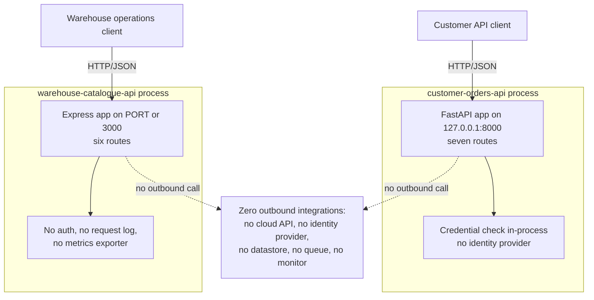

### 3.4.6 Declared Default Services Not Present

| Declared service | Present | Consequence |
|---|---|---|
| AWS (cloud platform) | No | No AWS SDK, IaC, region or credential reference exists; hosting is a runtime prerequisite, not a configured service |
| Auth0 | No | Authentication is a single in-process password comparison; the issued token is never validated |
| Managed MongoDB | No | All state is in-process memory (see 3.5) |
| Monitoring tooling | No | No APM or log platform integration; liveness probes are the only signal |


## 3.5 Databases & Storage

There is no database, no database driver, no ORM, no migration and no file-based storage in either service. The system's only persistence is process memory: three module-level dictionaries in the Python service and two module-level `Map`s in the Node service, created once per process and discarded at exit.

### 3.5.1 Storage Architecture Overview

| Tier | Implementation | Consequence |
|---|---|---|
| Primary datastore | Process-local dictionaries and `Map`s, declared at module scope so every request in the process shares one copy | One process is the unit of data ownership; there is no secondary replica |
| Secondary datastore | None | No replica, standby, read model or export target exists |
| Persistence strategy | None — state lives only as long as the process | Restart, crash or redeploy loses every user, product, order, inventory item and shipment |
| Schema management | None — no migration, versioning, DDL or seed script | Every change to a stored record shape is a code change with no upgrade path |
| Caching | None — no cache client, no memoisation, no HTTP cache headers | Whole-store scans on every listing request |
| Storage services | None — no object store, no blob, no file handle | Nothing is written to disk anywhere in the repository |

### 3.5.2 Primary Stores per Service

| Store | Service | Key | Stored shape | Lifecycle | Evidence |
|---|---|---|---|---|---|
| `users` | customer-orders-api | E-mail address, used verbatim as a dictionary key | `{id, password}` — password held in plain text, no salt or hash | Created at import; never reset by application code; cleared only by the test hook | `app/main.py` lines 6, 30 |
| `products` | customer-orders-api | `uuid4` string | `{name, price, stock}` — the request payload stored through `model_dump()`, so fields track the pydantic model exactly | As above; `stock` is mutated in place on every accepted order | `app/main.py` lines 6, 12-15, 43, 59 |
| `orders` | customer-orders-api | `uuid4` string | `{id, product_id, quantity, total}` where `total = round(price × quantity, 2)` | Append-only; no update or delete route exists | `app/main.py` lines 6, 60-66 |
| `inventory` | warehouse-catalogue-api | SKU string | `{sku, name, quantity, reorderLevel}` with `reorderLevel` defaulting to `5` | As above; `quantity` is decremented in place when a shipment is created | `src/server.js` lines 5, 11-18, 31 |
| `shipments` | warehouse-catalogue-api | `SHP-<n>` derived from `shipments.size + 1` | `{id, sku, quantity, destination, status}` plus `carrier` once dispatched | Append-only; identifier is positional, so it would repeat if a record were ever removed | `src/server.js` lines 6, 32-35, 48-49 |

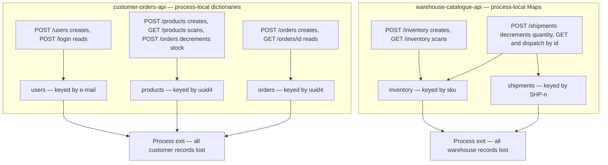

### 3.5.3 Persistence Strategy and Durability

| Property | Observed behaviour | Effect |
|---|---|---|
| Durability | Zero — both stores are module-level and never flushed | Any restart returns the system to empty; there is no snapshot, backup or replay |
| Isolation between processes | None — each process has its own copy | A second instance registers the same e-mail independently and holds a divergent stock balance |
| Transactions | None — the only multi-step mutation is a check-then-decrement on a single record | No atomicity across stores, and no rollback path if a later step were to fail |
| Concurrency safety | None — `product["stock"] -= payload.quantity` (`app/main.py` line 59) and `item.quantity -= quantity` (`src/server.js` line 31) are unsynchronised read-modify-write sequences | Concurrent requests can oversell stock; correctness depends on one writer process handling requests sequentially |
| Test isolation | Achieved by direct manipulation — `setup_function()` clears the three dictionaries before each Python test, and the Node test starts the app on an ephemeral port | Tests share process memory with the application rather than a fixture or database |
| Recovery | No recovery procedure, no export, no admin route | Data cannot be recovered or inspected except through the read routes that exist |

### 3.5.4 Caching

No caching layer exists at any tier. There is no Redis, Memcached or in-process cache client; no memoisation of computed values; and no HTTP caching metadata — a search of every tracked file for `Cache-Control`, `ETag`, `Last-Modified` and `expires` returns no match. Both listing routes re-serialise the entire store on each call: `GET /products` builds a new list from every dictionary entry (`app/main.py` line 48) and `GET /inventory` spreads the whole `Map` (`src/server.js` line 21), so response cost grows linearly with catalogue size.

### 3.5.5 Storage Services and File I/O

No storage service and no file I/O exists. The import inventory contains no `fs` module and application code contains no `open()`, `read`, `write`, `json.dump`, `pickle` or `sqlite` call; the only filesystem interaction in the repository is `pip`/`npm` installing packages and Node/pytest loading source modules. There is consequently no volume, mount, bucket, environment-specific path or storage credential to configure.

### 3.5.6 Databases Not Present

| Database technology | Present | Observation |
|---|---|---|
| MongoDB (declared default) | No | No `mongodb`, `pymongo`, `mongoose` or connection string appears in any tracked file; no client dependency is declared |
| Any relational database (PostgreSQL, MySQL, SQLite) | No | No `sqlalchemy`, `psycopg`, `mysql`, `sqlite3`, `prisma`, `sequelize` or `knex` reference; no DDL, migration folder or schema file |
| Any key-value or document store (Redis and similar) | No | No `redis` or equivalent client; state is in-process only |
| Search, analytics or time-series store | No | No index, aggregation or warehouse integration |

### 3.5.7 Schema and Data-Model Observations

- **The schema is implicit and lives in two places.** Request shape is declared once by the pydantic models (`app/main.py` lines 8-19) and then discarded: `POST /products` stores `payload.model_dump()` verbatim, so the stored record is a copy of whatever fields the model happens to have. On the Node side there is no schema at all — `POST /inventory` builds its object from four destructured fields plus a default.
- **No constraints are enforced at the storage layer.** `price` and `stock` accept negative values, `destination` and `carrier` are free text, and `reorderLevel` is unvalidated; nothing in a store rejects a malformed record.
- **Two incompatible stock models coexist.** The customer service tracks `products[...]["stock"]` keyed by `uuid4` alongside `price`; the warehouse service tracks `inventory` records keyed by `sku` with `quantity` and `reorderLevel`. No field bridges `product_id` and `sku`, so the two balances can and will diverge.
- **Ordering is insertion order only.** `GET /products` and `GET /inventory` return records in insertion order with no sort key, pagination or filter parameter, so client-visible ordering depends on mutation history rather than on data.
- **Read-modify-write is the only update mechanism.** No `PUT`, `PATCH` or `DELETE` route exists; the sole lifecycle transition is `status: "created"` → `"dispatched"` on a shipment (`src/server.js` lines 47-48), and there is no compensating write that restores inventory.


## 3.6 Development & Deployment

Development and deployment are entirely manual. There is no build step, no image, no pipeline, no infrastructure definition and no deployment manifest in the repository; running the system means installing two dependency sets and invoking two language-native commands on a machine that already has the right interpreters.

### 3.6.1 Development Tooling

| Tool | Version | Purpose | Evidence |
|---|---|---|---|
| pytest | 8.3.4 | Test discovery and the `setup_function()` xunit hook that clears the three Python stores | `requirements.txt` line 3; `tests/test_routes.py` lines 6-9 |
| `fastapi.testclient.TestClient` (httpx 0.28.1) | 0.28.1 for httpx | In-process HTTP integration testing, no live server | `tests/test_routes.py` lines 1, 4 |
| `node --test` | Node built-in, stable from Node 20 | Test execution for the warehouse service, invoked as `npm test` | `package.json` line 5; `test/routes.test.js` line 1 |
| `node:assert/strict` | Node built-in | Assertions including whole-document comparison | `test/routes.test.js` lines 2, 13 |
| pip and npm | Not declared | Dependency installation from the two manifests | `services/customer-orders-api/README.md` line 6; `services/warehouse-catalogue-api/README.md` line 6 |

Absent, and verified by searching the complete tracked file set (thirteen files) for configuration of each: linter (ESLint, Ruff, Flake8), formatter (Prettier, Black), static type checker (mypy, pyright, `tsc`), coverage tooling, pre-commit hooks, `.editorconfig`, runtime version pin files (`.nvmrc`, `.python-version`, `engines`), and any debug or task-runner configuration.

### 3.6.2 Build System

There is no build system in the conventional sense. Both services are interpreted and executed from source:

- **No compilation, transpilation or bundling.** No `Makefile`, `tox.ini`, `pyproject.toml`, `setup.py`, bundler config or asset pipeline exists; no `.ts`, `.jsx` or `.tsx` file exists to require one.
- **The only task runner is `npm run`.** `package.json` defines exactly two scripts — `start` (`node src/server.js`) and `test` (`node --test`) — with no `build`, `lint` or `prepublish` script.
- **The Python service has no packaging metadata at all.** With no `setup.py`, `pyproject.toml` or `__version__`, it is not installable as a distribution; the documented workflow is an in-place `pip install -r requirements.txt` from the service directory.
- **Release identity comes from git, not from the build.** The Node package carries `"version": "1.0.0"` (`package.json` line 3) and `"private": true`; the Python service carries no version. The only meaningful version record is the pair of parent gitlinks (`04259f8…`, `f9f72d1…`), so a "release" is a change to that gitlink.

### 3.6.3 Run and Test Workflows

| Workflow | Command | Working directory | What actually happens |
|---|---|---|---|
| Install (Python) | `pip install -r requirements.txt` | `services/customer-orders-api` | Installs four exact pins plus the transitive graph FastAPI resolves; no virtual environment is created or documented |
| Run (Python) | `uvicorn app.main:app --host 127.0.0.1 --port 8000` | `services/customer-orders-api` | Binds loopback only, plain HTTP; the empty `app/__init__.py` is what lets `app.main:app` resolve |
| Test (Python) | `pytest -q` | `services/customer-orders-api` | Runs four in-process tests; must be invoked from this directory because the test imports `app.main` |
| Install (Node) | `npm install` | `services/warehouse-catalogue-api` | Resolves Express 4.21.2 and its unpinned transitive tree; no lock file is written or committed |
| Run (Node) | `npm start` | `services/warehouse-catalogue-api` | Runs `node src/server.js`, which builds and exports the app (`module.exports = app`, line 53) but never calls `listen`, so the process finishes without binding a port. The only file that binds a port is `src/index.js` (`app.listen(port, …)`, line 3, with `PORT` defaulting to `3000`), which `npm start` does not execute — so a listener requires `node src/index.js` |
| Test (Node) | `npm test` | `services/warehouse-catalogue-api` | Runs `node --test`, which loads `test/routes.test.js`, starts the app on an ephemeral port via `app.listen(0)`, fetches `/health` over loopback and closes the server; requires Express to be installed first |

The documented `npm start` path and the code disagree: `services/warehouse-catalogue-api/README.md` lines 5-7 present `npm install` then `npm start` as the way to run the service, while `package.json` line 5 points `start` at `src/server.js`, a module that exports the app without listening. `src/index.js` is the working bootstrap, and it is not referenced by any script or README line.

### 3.6.4 Containerization

None. There is no `Dockerfile`, no `docker-compose.yml`, no `.dockerignore`, no `Procfile`, no Kubernetes or Helm manifest and no buildpack configuration anywhere in the repository. The runtime is therefore defined only by prose prerequisites: a Python ≥ 3.9 interpreter with `pip` for one service, and Node.js ≥ 20 with `npm` for the other, plus git to materialise the submodules.

### 3.6.5 CI/CD and Infrastructure as Code

None. No `.github` directory, workflow file, `.gitlab-ci.yml`, `Jenkinsfile`, Azure or CircleCI configuration exists; no test, lint or build gate runs automatically on any change. On the infrastructure side there is no Terraform, CloudFormation, Pulumi, Ansible, `serverless.yml`, `app.yaml` or `skaffold.yaml` file, and no environment definition of any kind.

The only automation in the repository is the Git submodule mechanism itself: `.gitmodules` (lines 1-6) lets `git clone --recurse-submodules` or `git submodule update` materialise both services at the exact commits the parent tree records, with no branch tracking. Reproducing an environment therefore means reproducing a git checkout, not replaying a pipeline.

### 3.6.6 Configuration Management

| Configuration input | Service | Default | Evidence |
|---|---|---|---|
| `PORT` | warehouse-catalogue-api | `3000` when unset or empty | `src/index.js` line 2 |
| Host and port (Python) | customer-orders-api | No application default — supplied as CLI flags in the documented command (`127.0.0.1:8000`) | `services/customer-orders-api/README.md` line 7 |
| Application title | customer-orders-api | Hard-coded `"Customer Orders API"` | `app/main.py` line 5 |
| Everything else | both | Hard-coded in source | No `.env`, `.env.example`, `config.*`, settings module or secret reference exists in the checkout |

There is no secrets management, no per-environment configuration, no feature flags and no configuration validation: an invalid `PORT` string reaches `app.listen` unchecked, and the Python service has no runtime configuration surface at all beyond the server's bind address.

### 3.6.7 Environment and Deployment Topology

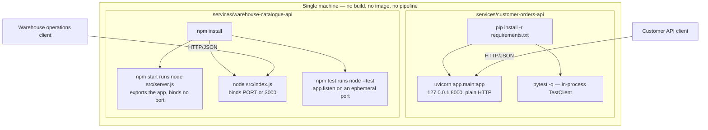

The two processes are independent: no supervisor, sidecar, shared volume or network link connects them, and neither depends on the other being running.

### 3.6.8 Security and Operational Implications of the Toolchain

| Implication | Cause | Evidence |
|---|---|---|
| No automated verification on change | No CI pipeline, no lint/type/coverage gate | Absence of `.github`, `.gitlab-ci.yml`, `Jenkinsfile`; only `pytest -q` and `npm test` run manually |
| Unreproducible installs | Exact leaf pins with no lock file and no hashes on either side | `requirements.txt`; `package.json`; no `package-lock.json` |
| Plaintext credentials in a development-oriented toolchain | Passwords stored and compared verbatim; token is a string derived from the public user id | `app/main.py` lines 30, 36, 38 |
| Loopback-only or fully exposed listeners depending on the command | Python documented on `127.0.0.1`; Node `app.listen(port)` supplies no host argument | `services/customer-orders-api/README.md` line 7; `src/index.js` line 3 |
| No process supervision or graceful shutdown | The Node bootstrap discards the `http.Server` returned by `listen` and attaches no signal handler; uvicorn is invoked ad hoc | `src/index.js` lines 3; no shutdown code anywhere |
| No rollback or release procedure | Release identity is a gitlink change, with no versioned artefact and no tag or changelog | `.gitmodules`; `package.json` line 3; parent history is one commit |
| Configuration drift is silent | The only environment variable is `PORT`, with no validation and no documented default in the README | `src/index.js` line 2; `services/warehouse-catalogue-api/README.md` lines 5-7 |


## 3.7 References

- `.gitmodules` - the two submodule declarations (`path` + `url`, no `branch` key) that fix the project's commit-pinned source dependencies
- `README.md` - the "metadata-only" scope statement, the two-service inventory, and the expected scan behaviour
- `.gitignore` - its single entry (`.DS_Store`), confirming no build or cache exclusion policy exists
- `services/` - the folder holding the two independent, self-contained service folders
- `services/customer-orders-api/` - the Python service folder and its four children (`README.md`, `requirements.txt`, `app/`, `tests/`)
- `services/customer-orders-api/README.md` - the `pip install -r requirements.txt` and `uvicorn app.main:app --host 127.0.0.1 --port 8000` run path, `pytest -q`, and the declared analysis gaps
- `services/customer-orders-api/requirements.txt` - the four exact pins: `fastapi==0.115.6`, `uvicorn==0.34.0`, `pytest==8.3.4`, `httpx==0.28.1`
- `services/customer-orders-api/app/` - the importable package and its single module
- `services/customer-orders-api/app/__init__.py` - the 0-byte package marker that makes the `app.main:app` ASGI target resolvable
- `services/customer-orders-api/app/main.py` - the `FastAPI(title="Customer Orders API")` instance, the pydantic `BaseModel` imports, the three in-memory dictionaries, the three request models and the seven route handlers
- `services/customer-orders-api/tests/` - the test folder with no `conftest.py`, `__init__.py` or pytest configuration
- `services/customer-orders-api/tests/test_routes.py` - `TestClient` usage, the `setup_function()` store reset, and the direct import of `app`, `users`, `products` and `orders`
- `services/warehouse-catalogue-api/` - the Node service folder and its four children (`README.md`, `package.json`, `src/`, `test/`)
- `services/warehouse-catalogue-api/README.md` - the `npm install` / `npm start` / `npm test` run path and the health-route-only coverage statement
- `services/warehouse-catalogue-api/package.json` - `express` pinned at `4.21.2`, the `start` and `test` scripts, empty `devDependencies`, `"private": true`, and the absence of `engines`, `type`, `main` and `license`
- `services/warehouse-catalogue-api/src/` - the two CommonJS source files
- `services/warehouse-catalogue-api/src/index.js` - `process.env.PORT || 3000` and the only `app.listen` call in the service's production code
- `services/warehouse-catalogue-api/src/server.js` - the Express 4 app, `express.json()`, the two `Map` stores, the six route handlers, and `module.exports = app` without a `listen` call
- `services/warehouse-catalogue-api/test/` - the folder holding the single test module
- `services/warehouse-catalogue-api/test/routes.test.js` - the `node:test` / `node:assert/strict` imports, `app.listen(0)` and the loopback `fetch` call
- [web] FastAPI 0.115.6 `pyproject.toml` (github.com/fastapi/fastapi, tag 0.115.6) - the `pydantic>=1.7.4,<3.0.0` install requirement and Python ≥ 3.8 floor
- [web] PyPI release metadata for `fastapi` 0.115.6 and `uvicorn` 0.34.0 - the `requires_python` floors that make Python ≥ 3.9 the effective minimum for these pins
- [web] pydantic `networks.py` (v2.10.4) and pydantic installation docs - confirmation that `EmailStr` imports without `email-validator` but fails at model-schema build, so the unused import is inert
- [web] Node.js 18, 20 and 21 release announcements - global `fetch` available by default from Node 18 and stable from 21; `node --test` runner stable from Node 20


# 4. Process Flowchart

## 4.1 System Workflows

The executable surface of this repository is 13 HTTP route handlers — seven in `services/customer-orders-api/app/main.py` (lines 21-73) and six in `services/warehouse-catalogue-api/src/server.js` (lines 8-51) — and every workflow described in this section is a request-scoped sequence through one of them. No workflow spans both services (see 2.3.2), no workflow continues after its response is written, and no scheduler, queue, timer, worker or background task exists anywhere in the repository: a search across every `.py`, `.js`, `.json`, `.md` and `.txt` file for `retry`, `timeout`, `sla`, `slo`, `latency`, `idempot`, `backoff`, `circuit`, `sleep`, `setTimeout` and `setInterval` returns no match.

| Workflow | Entry point | Handlers exercised | State touched | Cross-service? |
|---|---|---|---|---|
| Customer purchase journey | `uvicorn app.main:app --host 127.0.0.1 --port 8000` (`services/customer-orders-api/README.md` line 7) | `POST /users`, `POST /login`, `POST /products`, `GET /products`, `POST /orders`, `GET /orders/{order_id}` | `users`, `products`, `orders` (`app/main.py` line 6) | No |
| Warehouse fulfilment journey | `node src/server.js`, port `process.env.PORT \|\| 3000` (`src/index.js` lines 2-3) | `POST /inventory`, `GET /inventory`, `POST /shipments`, `GET /shipments/:id`, `POST /shipments/:id/dispatch` | `inventory`, `shipments` (`src/server.js` lines 5-6) | No |
| Liveness probe | Either listener | `GET /health` in both services (`app/main.py` lines 21-23; `src/server.js` line 8) | None | Shared contract, independent implementations |

### 4.1.1 Core Business Processes

Both journeys are client-driven sequences of independent requests. The service enforces no ordering between them: `POST /orders` reads no user record and no token (`app/main.py` lines 50-67), so registration and login are conventions of the calling client, not prerequisites the service checks. The two journeys meet only in the warehouse operator's hands, as 4.1.2 shows.

#### 4.1.1.1 Customer Purchase Journey — `services/customer-orders-api`

| # | Request | Handler and guard order | State effect | Success response | Failure responses |
|---|---|---|---|---|---|
| 1 | `POST /users` | `register`, lines 25-31: duplicate-e-mail test at line 27 | `users[email] = {id, password}` (line 30), plaintext password | `201 {"id", "email"}` | `409 "email already registered"`; `422` for a schema fault |
| 2 | `POST /login` | `login`, lines 33-40: record lookup plus password comparison at line 36 | None — the token `token-<user_id>` is computed per request (line 38) and stored nowhere | `200 {"user_id", "token"}` | `401 "invalid credentials"` (identical for unknown e-mail and wrong password); `422` |
| 3 | `POST /products` | `create_product`, lines 40-44: no guard at all beyond the pydantic model | `products[uuid4] = {name, price, stock}` (line 43) | `201 {"id", "name", "price", "stock"}` | `422` only — a negative `price` or `stock` is accepted |
| 4 | `GET /products` | `list_products`, lines 46-48: no guard | None | `200` with the whole catalogue in insertion order | None; an empty catalogue returns `200 []` |
| 5 | `POST /orders` | `create_order`, lines 50-67: product existence (line 53) → quantity sign (line 55) → stock sufficiency (line 57) | `products[id].stock -= quantity` (line 59), then `orders[uuid4]` with `total = round(price × quantity, 2)` (lines 60-66) | `201` with the order document (line 67) | `404 "product not found"`, `400 "quantity must be positive"`, `409 "insufficient stock"`, `422` |
| 6 | `GET /orders/{order_id}` | `get_order`, lines 69-73: membership test at line 71 | None | `200` with the stored order | `404 "order not found"` |

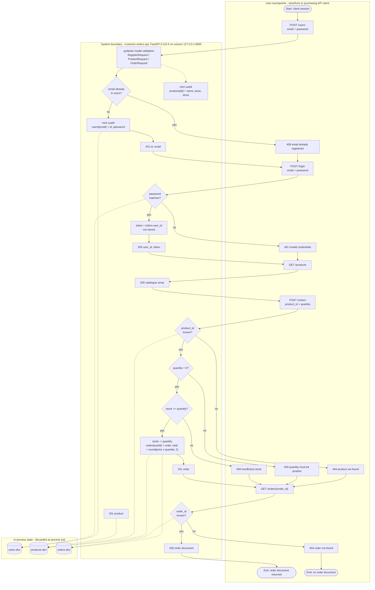

The diagram's error branches rejoin the journey because nothing rolls back: a refused step leaves the client where it was, and the next request is issued independently. Note also the branch that never reaches a store — every request passes the same pydantic gate, so a malformed body is answered by the framework (`422`) before any handler line executes.

**Request timing inside the journey.** Each request completes in constant work except the two list reads: `GET /products` builds a new list from every stored product per call (line 48), so its cost and response size grow linearly with the catalogue, and it accepts no pagination or filter parameter.

#### 4.1.1.2 Warehouse Fulfilment Journey — `services/warehouse-catalogue-api`

| # | Request | Handler and guard order | State effect | Success response | Failure responses |
|---|---|---|---|---|---|
| 1 | `POST /inventory` | lines 10-19: payload shape at line 12 (`sku`, `name` truthy; `quantity` an integer ≥ 0) → duplicate SKU at line 15 | `inventory.set(sku, {sku, name, quantity, reorderLevel})` (line 17), `reorderLevel` defaulting to `5` at line 11 | `201` with the stored item | `400 "invalid inventory payload"` (one message for every field fault), `409 "duplicate sku"` |
| 2 | `GET /inventory` | line 21: no guard | None | `200` with every item in insertion order | None; an empty Map returns `200 []` |
| 3 | `POST /shipments` | lines 23-36: SKU existence (line 26) → quantity is a positive integer (lines 27-29) → sufficiency (line 30) | `item.quantity -= quantity` (line 31), then `shipments.set('SHP-<n>', {..., status: 'created'})` (lines 32-34) | `201` with the shipment, `id` = `SHP-${shipments.size + 1}` | `404 "sku not found"`, `400 "quantity must be positive"`, `409 "insufficient inventory"` |
| 4 | `GET /shipments/:id` | lines 38-42: Map lookup at line 39 | None | `200` with the current shipment document (including `carrier` once dispatched) | `404 "shipment not found"` |
| 5 | `POST /shipments/:id/dispatch` | lines 44-51: Map lookup at line 46 → lifecycle guard `status !== 'created'` at line 47 | `status = 'dispatched'` (line 48), `carrier = req.body.carrier \|\| 'standard'` (line 49) | `200` with the updated shipment | `404 "shipment not found"`, `409 "shipment cannot be dispatched"` |

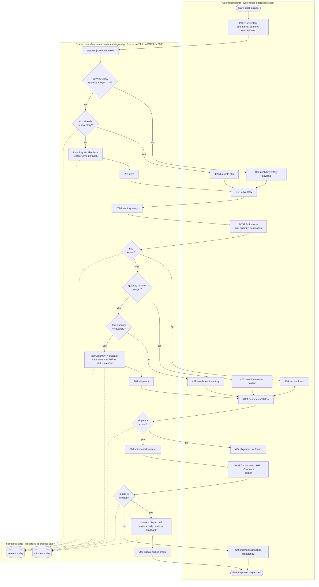

**Stock moves at step 3, not at step 5.** `POST /shipments` deducts inventory before any dispatch happens (line 31), and neither dispatch (lines 44-51) nor any other handler restores it. A `created` shipment therefore holds its units indefinitely, and there is no route that returns them.

#### 4.1.1.3 Decision Points and Terminal Error States

Every decision point in the repository is a single-branch guard inside a handler; no handler contains a loop, a retry, a nested error handler or an outbound call. Nine guards produce the documented failure statuses, and the order in which they run is part of the observable contract.

| Service | Decision point (source order) | Condition | Status and body | State after the decision |
|---|---|---|---|---|
| customer | `app/main.py` line 27 | `email in users` | `409 {"detail": "email already registered"}` | Unchanged; no identifier consumed |
| customer | `app/main.py` line 36 | record missing **or** password differs | `401 {"detail": "invalid credentials"}` | Unchanged; one message for both faults |
| customer | `app/main.py` line 53 | `products.get(product_id) is None` | `404 {"detail": "product not found"}` | Unchanged; short-circuits lines 55-58 |
| customer | `app/main.py` line 55 | `quantity <= 0` | `400 {"detail": "quantity must be positive"}` | Unchanged |
| customer | `app/main.py` line 57 | `stock < quantity` | `409 {"detail": "insufficient stock"}` | Unchanged |
| customer | `app/main.py` line 71 | `order_id not in orders` | `404 {"detail": "order not found"}` | Unchanged |
| warehouse | `src/server.js` line 12 | any of `!sku`, `!name`, non-integer `quantity`, `quantity < 0` | `400 {"error": "invalid inventory payload"}` | Unchanged |
| warehouse | `src/server.js` line 15 | `inventory.has(sku)` | `409 {"error": "duplicate sku"}` | Unchanged |
| warehouse | `src/server.js` line 26 | `!item` | `404 {"error": "sku not found"}` | Unchanged; short-circuits 27-30 |
| warehouse | `src/server.js` lines 27-29 | non-integer or `quantity <= 0` | `400 {"error": "quantity must be positive"}` | Unchanged |
| warehouse | `src/server.js` line 30 | `item.quantity < quantity` | `409 {"error": "insufficient inventory"}` | Unchanged |
| warehouse | `src/server.js` line 40 | shipment absent | `404 {"error": "shipment not found"}` | Unchanged |
| warehouse | `src/server.js` line 47 | `status !== 'created'` | `409 {"error": "shipment cannot be dispatched"}` | Unchanged; `carrier` not overwritten |

Three properties of these decision points govern the error paths in 4.3.2:

1. **Every failing guard precedes every mutation in its handler.** No handler mutates state before its last guard, so an error response never leaves a partial write inside that request.
2. **Precedence is fixed and observable.** Because the existence checks run first, a request carrying both an unknown reference and a bad quantity returns `404`, not `400` (`app/main.py` lines 53-56; `src/server.js` lines 26-29). Both READMEs and the requirements table record this as intended behaviour.
3. **No guard produces a compensating action.** A refused request leaves the store exactly as it was, and there is no state to unwind because no prior request's write is undone.

Terminal error states beyond the handler guards are framework-level and identical in shape for the same class of fault on each side: a schema violation returns FastAPI's `422` (pydantic rejects the body before the handler, `app/main.py` lines 8-19) but a `400` from the Express handler's own guard; an unregistered path returns FastAPI's JSON `404` and Express's HTML `404`; and because `services/warehouse-catalogue-api/src/server.js` registers no error middleware, a body that `express.json()` (line 3) cannot parse is answered by Express's default error handler rather than by the `{"error": ...}` envelope.

### 4.1.2 Integration Workflows

#### 4.1.2.1 Data Flow Between Systems

Two independent request/response flows exist, and no third flow exists between them.

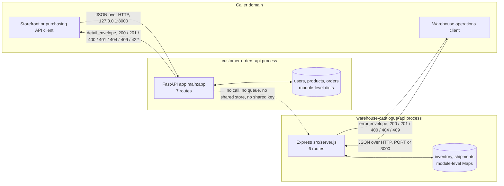

The dashed edge is the integration that the business narrative implies and the code does not implement. An order records a `product_id` minted by `uuid4` (`app/main.py` line 60); a shipment records a `sku` supplied by its caller (`src/server.js` line 16). No handler in either service reads, writes, calls or imports the other, and a repository-wide search for `http://`, `localhost`, `127.0.0.1`, `fetch(`, `axios` and `requests.` finds only the loopback `fetch` inside `test/routes.test.js` line 11.

| Data domain | Owner | Key | Fields | Reachable from the other service? |
|---|---|---|---|---|
| Identity | `app/main.py` line 6 `users` | e-mail string | `{id, password}` | No |
| Catalogue | `app/main.py` line 6 `products` | `uuid4` string | `{name, price, stock}` | No |
| Orders | `app/main.py` line 6 `orders` | `uuid4` string | `{id, product_id, quantity, total}` | No |
| Inventory | `src/server.js` line 5 `inventory` | SKU string | `{sku, name, quantity, reorderLevel}` | No |
| Shipments | `src/server.js` line 6 `shipments` | `SHP-<n>` string | `{id, sku, quantity, destination, status[, carrier]}` | No |

#### 4.1.2.2 API Interactions

All interaction is synchronous request/response on a single HTTP listener per process. There is no second phase to any call: the response is produced after the handler has finished mutating memory, and no callback, polling handle or deferred result exists for a caller to observe.

| Interaction | Direction | Mechanism | Contract | Failure signal to the caller |
|---|---|---|---|---|
| Customer client → customer service | Inbound only | HTTP/JSON on `127.0.0.1:8000` (`services/customer-orders-api/README.md` line 7) | Seven routes; `201` on creates, `200` on reads | `{"detail": ...}` with `400` / `401` / `404` / `409` / `422` |
| Warehouse client → warehouse service | Inbound only | HTTP/JSON on `process.env.PORT \|\| 3000` (`src/index.js` line 2) | Six routes; `201` on creates, `200` on reads and dispatch | `{"error": ...}` with `400` / `404` / `409` |
| Service → any external system | None | No HTTP client, database driver, message broker or SDK is imported in either service | Not applicable | Not applicable |
| Service → sibling service | None | No base URL, credential, retry or timeout setting exists | Not applicable | Not applicable |

The single shared contract between the services is `GET /health → 200 {"status": "ok"}`, implemented twice (line 23 and line 8) with no shared code. The divergence in failure envelopes is a real integration cost for a client that calls both: the same logical fault — a non-positive quantity — returns `{"detail": "quantity must be positive"}` from `app/main.py` line 56 and `{"error": "quantity must be positive"}` from `src/server.js` line 28.

#### 4.1.2.3 Event Processing Flows

None exist. Neither service emits an event, consumes one, registers a listener, schedules work or holds a subscription: the repository contains no `EventEmitter`, `process.on`, `uncaughtException`, `unhandledRejection` or message-client reference, and no timer primitive. The only output beyond HTTP responses is the single startup log line in `src/index.js` line 3.

The consequence for the workflows above is that no step can be triggered by another step. A dispatched shipment cannot notify a customer service, and a created order cannot request a shipment; each step happens only when a client sends its request.

#### 4.1.2.4 Batch Processing Sequences

None exist. Every handler addresses exactly one record, and the only iteration in the repository is the two list projections that serialise a whole store per request — `GET /products` (line 48) and `GET /inventory` (line 21). Neither accepts a batch body, a bulk array, a page size or an offset, so there is no partial-success response, no per-item result array and no batch checkpoint to recover from. Callers needing bulk behaviour must issue one request per record and interpret each response separately.


## 4.2 Flowchart Requirements

Every diagram in 4.4 and every process description in 4.1 obeys the conventions below. Each convention is stated as the code constrains it, so a reader can reconcile a diagram with a line of source without further interpretation.

### 4.2.1 Element Conventions for Every Workflow

| Element | How it is drawn in this specification | Concrete instantiation | Evidence |
|---|---|---|---|
| Start point (process) | Rounded terminal outside a request flow | Import of `app.main` (`uvicorn app.main:app`) or `require('./server')` followed by `app.listen` | `app/main.py` lines 5-6; `src/index.js` lines 1-3 |
| Start point (request) | Rounded terminal labelled with the HTTP method and path | One of the 13 registered routes | `app/main.py` lines 21, 25, 33, 40, 46, 50, 69; `src/server.js` lines 8, 10, 21, 23, 38, 44 |
| End point (success) | Rounded terminal carrying the status code | `200` for reads and dispatch, `201` for the four creates | handler decorators and `res.status(...)` calls |
| End point (failure) | Rounded terminal carrying the status and message | `400`, `401`, `404`, `409`, `422` | guard lines listed in 4.1.1.3 |
| Process step | Rectangle naming the handler function | `register`, `login`, `create_product`, `list_products`, `create_order`, `get_order`; five anonymous Express handlers | `app/main.py` lines 25-73; `src/server.js` lines 10-51 |
| Decision diamond | One diamond per guard, labelled with the exact predicate | The 13 guards in 4.1.1.3 | guard source lines |
| System boundary | Subgraph labelled with runtime, framework version and listener | `customer-orders-api`: FastAPI 0.115.6 on uvicorn `127.0.0.1:8000`; `warehouse-catalogue-api`: Express 4.21.2 on `PORT \|\| 3000` | `requirements.txt`; `package.json`; both `README.md` run blocks |
| User touchpoint | Subgraph containing only client-visible requests and responses | Storefront/purchasing client; warehouse operations client | both `README.md` files |
| Data store | Cylinder inside the system boundary | `users`/`products`/`orders` dicts; `inventory`/`shipments` Maps | `app/main.py` line 6; `src/server.js` lines 5-6 |
| Error state | Terminal or labelled edge carrying status plus message text | e.g. `409 insufficient stock` | guard messages |
| Recovery path | Dashed edge back to the client, never to an earlier process step | Client corrects the request and re-sends it; the service offers no internal recovery | absence of any retry, queue or compensation code |

#### 4.2.1.1 Start and End Points

A workflow begins when a request reaches a listener and ends when the response body is serialised. There is no point in either service at which work continues after that: no handler spawns a task, schedules a callback or writes to a channel, and neither `app/main.py` nor `src/server.js` imports a concurrency or scheduling primitive.

The four creates are the only operations whose effect outlives the request, and in each case the mutation is complete before the response is built: `POST /products` returns the record it has already stored (line 44), `POST /orders` returns `orders[order_id]` after the insert (line 67), `POST /inventory` returns the object it has just `set` (lines 17-18), and `POST /shipments` returns the shipment already in the Map (lines 34-35). A second terminal exists at process level and applies to the whole system: process exit deletes every record, because no request writes anywhere else (see 4.3.1).

#### 4.2.1.2 Process Steps and Decision Diamonds

Each request traverses exactly one process step and at most a short guard chain — the longest is `POST /orders`, with three decisions and two writes (`app/main.py` lines 52-66), followed by `POST /shipments`, with three decisions and two writes (`src/server.js` lines 25-34). At the other extreme, `GET /health`, `GET /products`, `GET /inventory` and `POST /products` contain no decision at all.

Two diagram rules follow from the code and are applied in every flowchart of this section:

- **A guard never has an `else` branch that writes.** Each guard either raises (`HTTPException`, lines 28-72) or returns an error response (lines 13-47 of `server.js`), so the error branch of every diamond terminates the request rather than routing to alternate processing.
- **Diamonds are ordered left-to-right in source order.** Because a failed first guard short-circuits the rest, a diagram that reordered the diamonds would misreport which status a two-fault request receives (`404` before `400` before `409`).

#### 4.2.1.3 System Boundaries and User Touchpoints

There are exactly two system boundaries, and they never touch. Inside each boundary sits one application object and one set of module-level containers; outside sits one class of anonymous HTTP client. Neither service has a database boundary, an authentication boundary, a third-party API boundary or an internal component boundary — `app/main.py` imports only `fastapi`, `pydantic` and `uuid` (lines 1-3), and `src/server.js` imports only `express` (line 1).

User touchpoints are HTTP endpoints only. There is no user interface, static asset, HTML template, SDK, CLI or bot in the repository, so every user-facing interaction in a diagram is a JSON request and its response. Authorization touchpoints do not exist: the login token issued at `app/main.py` line 38 is displayed to the caller and consumed by nothing.

#### 4.2.1.4 Error States and Recovery Paths

Every failure is synchronous, terminal for its request, and reported only to the calling client. The diagrams in 4.4 therefore show error states as terminals on the request's own lane.

| Error class | Where it originates | Status and body shape | Recovery available |
|---|---|---|---|
| Schema violation (Python) | pydantic model before the handler, `app/main.py` lines 8-19 | `422`, FastAPI validation detail | Client corrects the body and re-sends |
| Field rule violation (Node) | Handler guard, `src/server.js` lines 12-14, 27-29 | `400 {"error": ...}` | Client corrects the body and re-sends |
| Identity failure | `app/main.py` line 36 | `401 {"detail": "invalid credentials"}` | Client retries with correct credentials; no lockout to clear |
| Missing reference | `app/main.py` lines 53, 71; `src/server.js` lines 26, 40 | `404 {... "not found"}` | Client supplies a valid identifier |
| Conflict | `app/main.py` lines 27, 57; `src/server.js` lines 15, 30, 47 | `409 {detail \| error}` | None automatic; duplicate SKU and insufficient inventory need a different request, and a repeat dispatch needs a different shipment |
| Unparseable body (Node) | `express.json()` line 3, no error middleware registered | Express default error response | Client sends valid JSON |
| Unhandled exception | No `try`/`except` in Python, no error middleware or `process.on` handler in Node | Framework default `500` | None; the service records nothing, so the failure is invisible server-side |

No recovery path in this repository is internal. There is no compensating write, no rollback, no compensating shipment, no inventory restoration and no dead-letter store. The only recovery available anywhere is the client re-issuing a request — and because no handler implements an idempotency key, a re-issued `POST` is always treated as a new intent (see 4.4.4.1 for the resulting double deduction).

#### 4.2.1.5 Timing and SLA Considerations

The repository defines no latency, throughput, availability or recovery-time target: a search of every `.py`, `.js`, `.json`, `.md` and `.txt` file for `sla`, `slo`, `latency`, `timeout`, `retry`, `backoff` and `idempot` returns no match, no request deadline or socket timeout is configured, and no instrumentation exists. The timing properties below are therefore observed characteristics that a diagram may rely on, not commitments.

| Timing property | Observed value | Evidence |
|---|---|---|
| Per-request work, identity/product/order/shipment routes | Constant: one or two dictionary or Map operations plus arithmetic | `app/main.py` lines 25-73; `src/server.js` lines 10-51 |
| Per-request work, list routes | Linear in store size, with no pagination or cap | `app/main.py` line 48; `src/server.js` line 21 |
| Request deadline | None on either side; no timeout is configured or configurable | absent from both services |
| Retry or backoff | None; a failed request is returned to the caller as-is | 4.3.2.1 |
| Rate limiting or throttling | None; neither service counts requests | no middleware or counter exists |
| Startup cost | One module import; no warm-up, migration or dependency probe | `app/main.py` lines 1-6; `src/index.js` lines 1-3 |
| Health-probe cost | Constant and independent of store contents | `app/main.py` lines 21-23; `src/server.js` line 8 |
| Load-bearing ordering constraint | Guard order within a handler, and the write order inside `POST /orders` (stock decremented at line 59, order stored at lines 60-66) and `POST /shipments` (stock decremented at line 31, shipment stored at lines 32-34) | the cited lines |
| Concurrency window | The guard-to-mutation interval is unsynchronised: Python handlers are declared `def`, so FastAPI runs them in a worker thread pool and two requests can interleave between the last guard and the write; Node handlers are synchronous within one event loop, so they cannot interleave in-process but can across instances | `app/main.py` lines 51-59; `src/server.js` lines 23-31; 2.4.1 |

The last two rows are the only timing facts with correctness consequences, and 4.4.4.4 diagrams the interleaving they permit.

### 4.2.2 Validation Rules and Checkpoints

Validation is entirely per-request and entirely local: a value is accepted or rejected by the handler that receives it, and no cross-record or cross-service rule is evaluated anywhere.

#### 4.2.2.1 Business Rules at Each Step

| Step | Business rule enforced | Rule that is *not* enforced | Evidence |
|---|---|---|---|
| `POST /users` | An e-mail string identifies at most one customer; the comparison is exact, so `A@b.com` and `a@b.com` are distinct customers | Address format, uniqueness across instances, password strength or hashing | `app/main.py` lines 27-31 |
| `POST /login` | Stored e-mail and password must match the submitted pair; one message covers both failure modes | Any session, expiry, lockout or token consumption | `app/main.py` lines 35-38 |
| `POST /products` | A product needs a `name`, a numeric `price` and an integer `stock` | Sign, magnitude, currency or catalogue-name uniqueness | `app/main.py` lines 40-44 |
| `GET /products` | The whole catalogue is always returned | Filtering, sorting, pagination | `app/main.py` lines 46-48 |
| `POST /orders` | The product must exist, the quantity must be positive, and stock must cover the quantity; the order total is `round(price × quantity, 2)` | Customer binding, idempotency, stock reservation expiry, price re-check at any later time | `app/main.py` lines 50-67 |
| `GET /orders/{order_id}` | The order must exist | Ownership or tenancy | `app/main.py` lines 69-73 |
| `POST /inventory` | The SKU must be new, and `quantity` must be a non-negative integer; `reorderLevel` defaults to `5` | `reorderLevel` type or sign; replenishment triggering | `src/server.js` lines 10-19 |
| `GET /inventory` | The whole inventory is always returned | Filtering, pagination | `src/server.js` line 21 |
| `POST /shipments` | The SKU must exist, the quantity must be a positive integer, and available stock must cover it; stock is deducted at creation | Destination validation, reservation expiry, order reference | `src/server.js` lines 23-36 |
| `GET /shipments/:id` | The shipment must exist | Access scope | `src/server.js` lines 38-42 |
| `POST /shipments/:id/dispatch` | Only a shipment in `status: "created"` may be dispatched; a falsy `carrier` defaults to `"standard"` | Carrier allow-list, tracking number, inventory restoration | `src/server.js` lines 44-51 |

#### 4.2.2.2 Data Validation Requirements

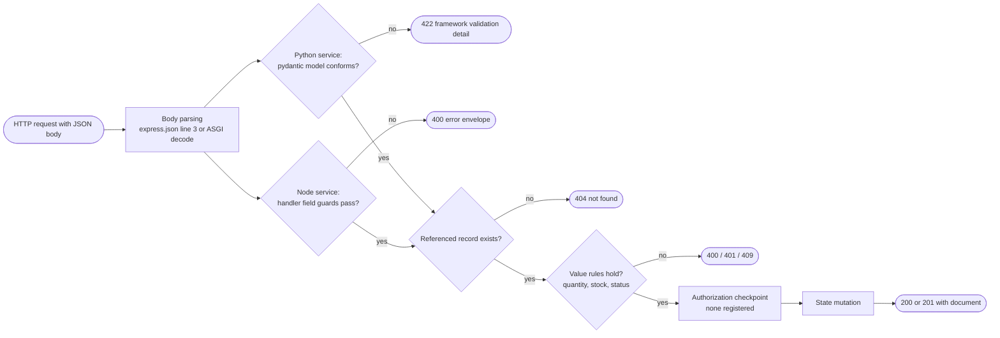

| Validation dimension | Python service | Node service |
|---|---|---|
| Mechanism | Declarative pydantic models (`RegisterRequest`, `ProductRequest`, `OrderRequest`) enforced before the handler | Imperative guards inside each handler |
| Status for a schema fault | `422` | `400`, except a body `express.json()` cannot parse, which the default error handler answers |
| Type coercion | pydantic coerces where it can, so a numeric string may satisfy a `float` field | `Number.isInteger` rejects numeric strings and fractions outright |
| Field-level checks | Presence and type only; `EmailStr` is imported at line 2 and never applied | `sku`/`name` truthiness, `quantity` integer and sign; `destination` and `reorderLevel` unvalidated |
| Range checks | None on `price` or `stock` | None on `reorderLevel`; `quantity` must be ≥ 0 on intake and > 0 on shipment |
| Cross-field checks | None | None |
| Validation of path parameters | None; the raw string is used as a key | None; the raw string is used as a Map key |
| Error message granularity | One message per guard, naming the failed rule | One generic message for all intake field faults; specific messages elsewhere |

The two mechanisms diverge in a way a diagram must not blur: the Python service validates shape at the framework layer and business rules in the handler, while the Node service validates both in the handler. That is why the same class of fault surfaces as `422` on one service and `400` on the other.

#### 4.2.2.3 Authorization Checkpoints

There are none. No route in either service declares an authentication dependency, reads an `Authorization` header, validates a token, or checks ownership: `POST /login` issues `token-<user_id>` (`app/main.py` line 38) and no handler anywhere consumes it, so `GET /orders/{order_id}` returns any order to any caller. In the warehouse service there is no credential concept at all — no middleware is registered between `express.json()` (line 3) and the routes (lines 8-51).

Every workflow in 4.1 therefore runs at a single, anonymous privilege level. The checkpoints a flowchart would normally place before a mutation collapse to nothing, and the only gate a request passes is validation. This is the single largest gap between the diagrams in this section and a production purchase or fulfilment flow, and it is recorded as an explicit exclusion in 1.3.2.

#### 4.2.2.4 Regulatory Compliance Checks

No compliance control is implemented: no consent capture, audit trail, record retention, erasure path, encryption, data-residency or tax determination exists in the repository, and no configuration file declares a jurisdiction or currency.

Two observed properties are the ones a compliance review would act on first, and both are visible in the flowcharts rather than inferred:

| Observation | Where it appears in the flow | Evidence |
|---|---|---|
| Passwords are received, stored and compared in plain text | `POST /users` write, then `POST /login` comparison | `app/main.py` lines 30, 36 |
| Personal data accumulates in process memory with no retention, export or erasure route | Every `POST /users` write into `users`, which no route reads back or deletes | `app/main.py` line 6; no `DELETE`, `PUT` or `PATCH` handler exists in either service |

Because there is no audit store, the flowcharts carry the entire record of what happened to a record: once a response is written, nothing remembers which caller caused a write.


## 4.3 Technical Implementation

### 4.3.1 State Management

#### 4.3.1.1 State Model and Transitions

All application state lives in five containers created at module import: three dictionaries in `services/customer-orders-api/app/main.py` line 6 and two Maps in `services/warehouse-catalogue-api/src/server.js` lines 5-6. Their records are plain objects; no record carries a version, timestamp, owner or status field other than the shipment's `status`.

| Record | Container and key | State sequence | Writing handlers | Reversible from the API? |
|---|---|---|---|---|
| Customer | `users`, keyed by the submitted e-mail string (client-supplied, exact match) | absent → registered | `POST /users` (line 30) | No — no update, delete or re-register path exists for an existing e-mail |
| Product | `products`, keyed by a server-minted `uuid4` | absent → created with `stock = S` → `stock = S − q` on each order | `POST /products` (line 43); `POST /orders` (line 59) | Stock never increases; no update or delete route exists |
| Order | `orders`, keyed by `uuid4` | absent → stored once, never modified | `POST /orders` (lines 60-66) | No — `total` is computed once and cannot be recalculated |
| Inventory item | `inventory`, keyed by the client-supplied SKU | absent → received with `quantity = Q` → `quantity = Q − q` per shipment | `POST /inventory` (line 17); `POST /shipments` (line 31) | Quantity never increases after intake; `reorderLevel` cannot be changed |
| Shipment | `shipments`, keyed by `SHP-${shipments.size + 1}` | absent → `created` → `dispatched` | `POST /shipments` (lines 32-34); `POST /shipments/:id/dispatch` (lines 48-49) | No — the status guard at line 47 admits no reverse transition |

Three structural properties of this model drive the flowcharts:

- **Identifiers are not uniform.** Server-minted `uuid4` for products and orders, client-supplied string for customers and SKUs, and a size-derived positional value for shipments (`src/server.js` line 32). Because the shipment id derives from `shipments.size + 1`, any future removal of a shipment would re-issue an identifier that was already used; no removal path exists today, so the sequence is monotonic within a process.
- **Every store is monotonic in one direction.** Stock and inventory only decrease, records only appear, and the shipment status only advances. There is no compensating transition anywhere, which is why 4.4.5's state diagrams have no back edges.
- **Two states are reachable that the API cannot repair.** A product created with a negative `stock` (accepted, `app/main.py` lines 40-44) rejects every order with `409`; a product created with a negative `price` yields a negative order `total`. A SKU received with the wrong quantity cannot be corrected, because no update route exists and `POST /inventory` refuses the SKU as a duplicate (`src/server.js` line 15).

#### 4.3.1.2 Data Persistence Points

There are none. No handler opens a file, opens a socket other than its own listener, or calls a database, cache, object store or message client: a search across every `.py`, `.js`, `.json` and `.txt` file for `open(`, `writeFile`, `readFile`, `fs.`, `pickle`, `shelve`, `sqlite`, `psycopg`, `sqlalchemy`, `redis`, `json.dump`, `boto`, `kafka`, `amqp`, `pika`, `celery`, `bull` and `queue` returns no persistence call in either service.

| Moment | What happens to state | Evidence |
|---|---|---|
| Process import | Containers are created empty; there is no seed, migration or load | `app/main.py` line 6; `src/server.js` lines 5-6 |
| Successful create | One in-memory insert per request | `app/main.py` lines 30, 43, 61-66; `src/server.js` lines 17, 34 |
| Successful mutation | In-place field update on the live object | `app/main.py` line 59; `src/server.js` lines 31, 48-49 |
| Process exit or restart | Every record is lost, including orders already returned to a client 201 | no persistence call exists |
| Test teardown | The only reset path in the repository: `setup_function()` empties `users`, `products` and `orders` | `services/customer-orders-api/tests/test_routes.py` lines 6-9 |

The absence of a persistence point is what makes the flows recoverable only by replay and, conversely, what makes a restart a total reset: a restarted warehouse service re-issues `SHP-1` for its next shipment, and a restarted customer service accepts an e-mail that was already registered.

#### 4.3.1.3 Caching Requirements

No cache exists at any layer. No `Cache-Control`, `ETag`, `Last-Modified` or conditional-request handling is implemented, no in-process memoisation is used, and no client-side cache directive is emitted by either framework beyond its defaults.

| Cache concern | Position in this system |
|---|---|
| Read caching | Not applicable — the list handlers build their response from the live store on every call (`app/main.py` line 48; `src/server.js` line 21) |
| Staleness or invalidation | Structurally impossible within a process, because responses serialise the same objects the writers mutate; a reader after a write always sees the write |
| Cache key stability | Not applicable; no cache key is derived from an identifier |
| Cost of the absence | `GET /products` and `GET /inventory` repeat an O(n) projection per request with no page size, so repeated reads cost the same as the store grows |

The practical consequence for the diagrams is that every read step can be drawn as a direct edge to the store with no intermediate cache node, and a write step is visible to the very next read in the same process.

#### 4.3.1.4 Transaction Boundaries

A request is the only transaction boundary in the system, and within a request the boundary is narrower than the business step it represents.

| Operation | Writes performed | Boundary | Failure between the writes is possible? |
|---|---|---|---|
| `POST /users` | one insert | Single dict assignment, no error path after the guard | No |
| `POST /products` | one insert | Single dict assignment | No |
| `POST /orders` | `products[id].stock -= quantity` (line 59), then `orders[uuid4] = {...}` (lines 61-66) | Two independent statements in one handler | Yes — a concurrent reader can observe the reduced stock before the order exists; a thread switch between the statements is possible because handlers are declared `def` and run in FastAPI's worker thread pool |
| `POST /inventory` | one insert | Single Map `set` | No |
| `POST /shipments` | `item.quantity -= quantity` (line 31), then `shipments.set(...)` (line 34) | Two statements in one synchronous handler | Not within one process — Express invokes the handler synchronously and nothing yields between the statements; across instances, yes |
| `POST /shipments/:id/dispatch` | `status` and `carrier` assignments (lines 48-49) | Two statements, synchronous | Not within one process |

Locks, database transactions, optimistic version fields and unique constraints are all absent, so the boundary this section can state is a statement boundary, not an isolation boundary:

```python
product["stock"] -= payload.quantity          # line 59: stock committed first
orders[order_id] = { ... "total": round(...) } # lines 61-66: order committed second
```

- **No isolation.** Two concurrent `POST /orders` requests against a product with stock `1` can both pass the sufficiency check at line 57 before either reaches line 59, producing two orders and `stock = -1`. 4.4.4.4 diagrams this interleaving; 2.2.7 records that the non-negative guarantee holds only for sequential single-process access.
- **No atomicity across the pair.** Nothing rolls back the stock deduction if the order insert never happens (an out-of-memory condition is the only realistic path, since no exception is raised between the lines), and nothing restores stock if a caller never receives the `201`.
- **No idempotency.** `POST /orders` and `POST /shipments` accept the same body twice and perform the deduction twice; the second call is indistinguishable from a new intent. `POST /shipments/:id/dispatch` is the one operation with a de-facto guard against repetition, and it rejects the repeat with `409` rather than treating it as success.

### 4.3.2 Error Handling

#### 4.3.2.1 Retry Mechanisms

The services implement no retry of any kind — no internal retry, no backoff, no circuit breaker, no dead-letter store, and no outbound call that could be retried. A failed request is answered once and returned to the caller.

| Retry dimension | Position in this system | Consequence for the flow |
|---|---|---|
| Server-side retry | None; guards terminate the request immediately | A transient-looking failure is always answered to the client; nothing is re-attempted |
| Client-driven retry support | No idempotency key, request id or deduplication check on any route | Re-sending `POST /orders` or `POST /shipments` deducts stock a second time and creates a second record |
| Retry-safe operations | All reads (`GET` routes) and `POST /shipments/:id/dispatch`, which answers a repeat with `409` instead of a second transition | Re-reading is always safe; re-dispatching is refused rather than duplicated |
| Retry-unsafe operations | `POST /users` (second attempt returns `409` when the first succeeded but its response was lost), `POST /orders`, `POST /shipments`, `POST /inventory` (second attempt returns `409 duplicate sku`) | A lost success response is indistinguishable from a failure at the client, and the recovery differs per route |
| Timeout that would trigger a retry | None configured; a client's own timeout is the only source | A slow response cannot be distinguished from a failed one by the service |

The asymmetry in the last row of the table is the practical hazard the flowcharts must show: for `POST /users` and `POST /inventory`, an accidental retry after a lost `201` is refused as a duplicate, while for `POST /orders` and `POST /shipments` the same retry silently succeeds and double-deducts. 4.4.4.1 diagrams the second case.

#### 4.3.2.2 Fallback Processes

Three fallbacks exist, and all three are value defaults rather than recovery procedures.

| Fallback | Trigger | Result | Evidence |
|---|---|---|---|
| Default reorder level | `reorderLevel` absent or `undefined` in the request body | Stored as `5`; a supplied `0` or other falsy-but-present value is stored verbatim, because the default applies only to `undefined` | `src/server.js` line 11 |
| Default carrier | `carrier` absent or falsy (including `""`, `0`, `null`) | Stored as `"standard"` | `src/server.js` line 49 |
| Empty-store success | A list read against a store with no records | `200` with `[]`, never an error | `app/main.py` lines 46-48; `src/server.js` line 21 |

There is no fallback for a missing dependency (none exists), for a failed write (none can be detected), for an unknown SKU (answered `404`), or for a dispatch conflict (answered `409`). No route offers an alternate path such as a re-read, a compensating write or a degraded response, so a flowchart of any failure shows a single terminal with no outgoing edge other than back to the client.

#### 4.3.2.3 Error Notification Flows

Errors reach exactly one observer: the calling client, through the HTTP status line and a JSON body. No second notification channel exists.

| Notification channel | Implemented? | Evidence |
|---|---|---|
| HTTP status plus JSON body | Yes, for every guard | `{"detail": ...}` from `app/main.py` lines 28-72; `{"error": ...}` from `src/server.js` lines 13-47 |
| Application log | No — the only log statement in the repository is the startup message | `src/index.js` line 3; no `logging`, `logger` or `console.` call in either service besides it |
| Metrics, counters or tracing | No instrumentation of any kind | no metrics client, middleware or timer exists |
| Alerting or escalation | None | no webhook, mailer or notification client exists |
| Audit trail of failures | None — failed requests leave no record, and successful writes record no actor | no audit store exists |
| Client-side distinction of root cause | Partial: distinct messages per rule, but one message covers every intake field fault, and `401` covers both unknown user and wrong password | `src/server.js` lines 12-14; `app/main.py` lines 36-37 |

The flow for an operational failure is therefore: the client receives a status, and nothing else in the system knows the request happened. A failed dispatch produces no record; a rejected order leaves no trace; a `500` from an unhandled exception is reported by the framework alone.

#### 4.3.2.4 Recovery Procedures

| Failure | Recovery available through the API | Recovery requiring outside action |
|---|---|---|
| Duplicate e-mail (`409`) | A different e-mail, or a `POST /login` with the original credentials | None |
| Invalid credentials (`401`) | Re-send with the correct password | None |
| Unknown product, SKU, order or shipment (`404`) | Re-send with an identifier obtained from the relevant create or list route | For a shipment, an identifier must have been captured earlier: there is no shipment list route (`src/server.js` has no `GET /shipments`) |
| Duplicate SKU (`409`) | None — the SKU cannot be re-created, corrected or deleted | Correcting a mistyped quantity or name requires a process restart to clear the whole inventory |
| Insufficient stock or inventory (`409`) | Receive more stock for a new product, or wait for none — stock never returns, so the only path is a newly created product | Restart to reset all stock |
| Repeat dispatch (`409`) | None — the transition is final | None |
| Lost success response | Re-send; safe only for reads and dispatch, and double-counting for orders and shipments | Reconciling the duplicate requires a manual comparison, since no request log exists |
| Process crash or restart | State is empty on start; the service is immediately usable | Re-seeding the catalogue and inventory from outside records, which do not exist in the system |
| Concurrent oversell | None — the negative stock is accepted and subsequent orders are refused with `409` | Restart to reset inventories |

Two conclusions follow, and both are visible in the error flowchart of 4.4.3: recovery is always a new client request or a restart, and a restart is a total, unrecoverable loss of every record because 4.3.1.2 establishes that nothing is persisted. There is no procedure inside the system for restoring a single record, undoing a deduction, or cancelling a shipment.


## 4.4 Required Diagrams

This sub-section holds every Mermaid diagram required by the specification, one home per diagram so no flow is drawn twice in conflicting detail. 4.1's journey diagrams show the business sequence; the diagrams here show the system, the failure paths, the wire interactions and the lifecycles.

| Required diagram | Where it appears | Features or flows covered |
|---|---|---|
| High-level system workflow | 4.4.1 | All 13 routes, both boundaries, both clients |
| Detailed process flows | 4.4.2 (six diagrams) | F-002 to F-012, grouped by resource |
| Error handling flowchart | 4.4.3 | Every failure class in 4.2.1.4, plus retry consequences |
| Integration sequence diagrams | 4.4.4 (four diagrams) | Retry double-deduction, the absent order-to-shipment handoff, dispatch conflict, concurrent oversell |
| State transition diagrams | 4.4.5 (three diagrams) | Shipment lifecycle, record lifecycle, process-lifetime store state |

### 4.4.1 High-Level System Workflow

```mermaid
flowchart TB
    subgraph Clients["User touchpoints - HTTP clients only, no UI is present"]
        U1(["Storefront or purchasing API client"])
        U2(["Warehouse operations client"])
        U3(["Monitor issuing the liveness probe"])
    end

    subgraph CS["System boundary 1 - customer-orders-api, FastAPI 0.115.6 on uvicorn 127.0.0.1:8000"]
        R1["POST /users<br/>201 | 409 | 422"]
        R2["POST /login<br/>200 | 401 | 422"]
        R3["POST /products<br/>201 | 422"]
        R4["GET /products<br/>200"]
        R5["POST /orders<br/>201 | 400 | 404 | 409 | 422"]
        R6["GET /orders/{order_id}<br/>200 | 404"]
        RH["GET /health<br/>200 status ok"]
        D1[("users, products, orders<br/>module-level dicts")]
        R1 --> D1
        R2 --> D1
        R3 --> D1
        R4 --> D1
        R5 --> D1
        R6 --> D1
    end

    subgraph WS["System boundary 2 - warehouse-catalogue-api, Express 4.21.2 on PORT or 3000"]
        S1["POST /inventory<br/>201 | 400 | 409"]
        S2["GET /inventory<br/>200"]
        S3["POST /shipments<br/>201 | 400 | 404 | 409"]
        S4["GET /shipments/:id<br/>200 | 404"]
        S5["POST /shipments/:id/dispatch<br/>200 | 404 | 409"]
        SH["GET /health<br/>200 status ok"]
        D2[("inventory, shipments<br/>module-level Maps")]
        S1 --> D2
        S2 --> D2
        S3 --> D2
        S4 --> D2
        S5 --> D2
    end

    U1 --> R1
    U1 --> R2
    U1 --> R3
    U1 --> R4
    U1 --> R5
    U1 --> R6
    U2 --> S1
    U2 --> S2
    U2 --> S3
    U2 --> S4
    U2 --> S5
    U3 --> RH
    U3 --> SH

    R5 -.-x GAP{{"No order-to-shipment handoff:<br/>no call, event, shared key or shared store"}}
    S3 -.-x GAP
    D1 -.- LOST(["Process exit<br/>all records lost"])
    D2 -.- LOST
```

The diagram has no edge between the two boundaries, and that absence is the workflow's most consequential property: an order placed through the customer service produces nothing in the warehouse service. The two `-.-x` edges are not missing links to be added later — they are the documented state of the code (2.3.3, 1.3.2).

### 4.4.2 Detailed Process Flows for Core Features

#### 4.4.2.1 F-002 Customer Registration and F-003 Customer Login

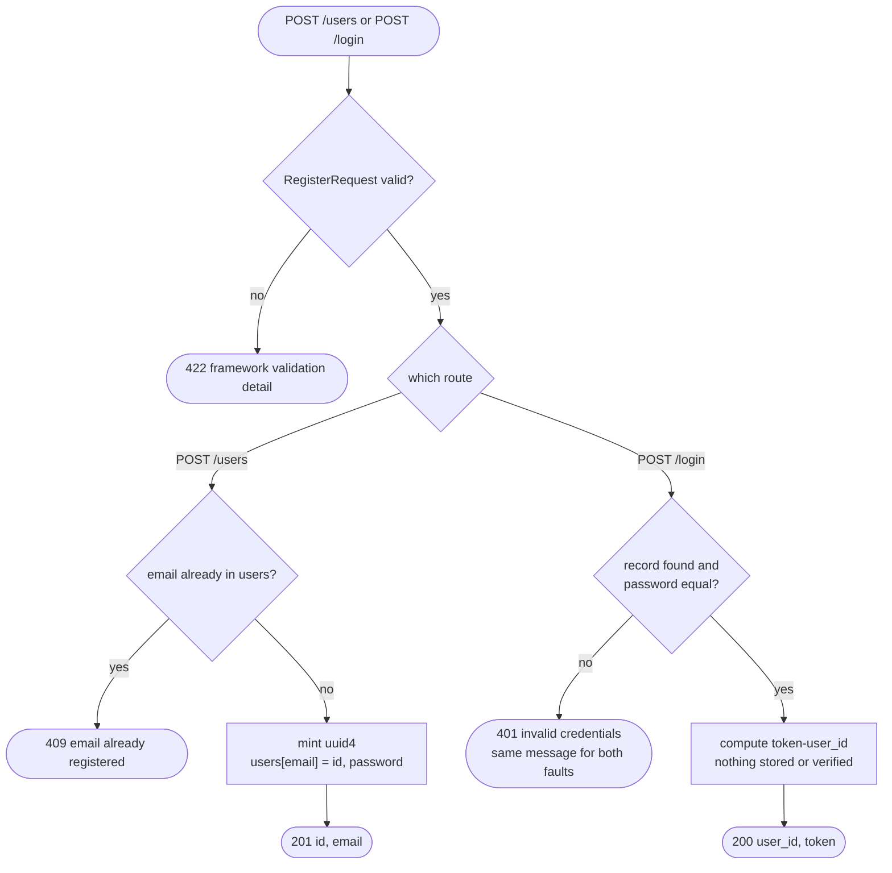

The login branch writes nothing at all: the token is a pure function of the public user id (line 38), and no downstream handler reads it.

#### 4.4.2.2 F-004 Product Creation and F-005 Catalogue Listing

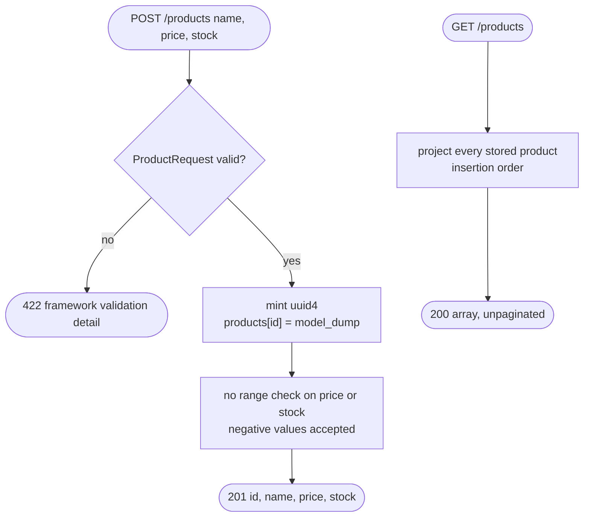

The absence of a guard is the flow: `POST /products` has no decision diamond between validation and the insert, which is why a negative `price` becomes a negative order `total` at F-006 and a negative `stock` makes the product unorderable.

#### 4.4.2.3 F-006 Order Placement and F-007 Order Retrieval

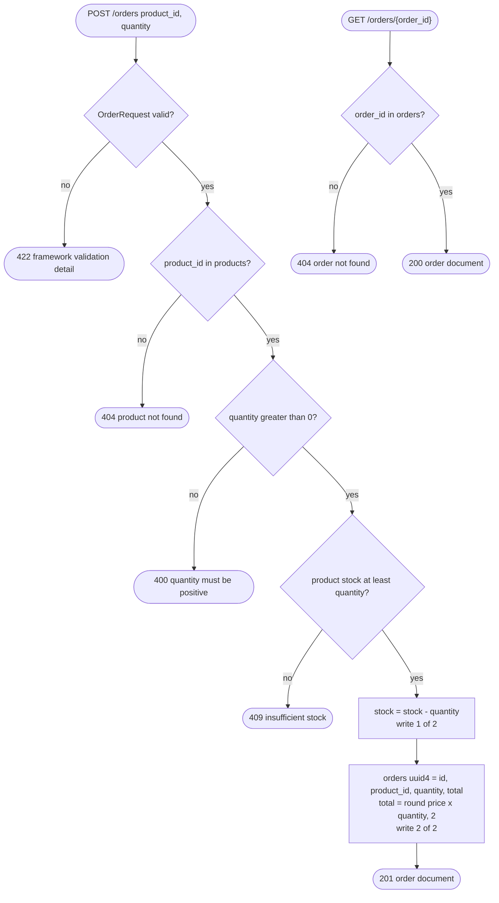

This is the only flow with two writes and four failure statuses. The order of the diamonds is the contract: an unknown product combined with a negative quantity returns `404`, because the existence check runs first.

#### 4.4.2.4 F-008 Inventory Intake and F-009 Inventory Listing

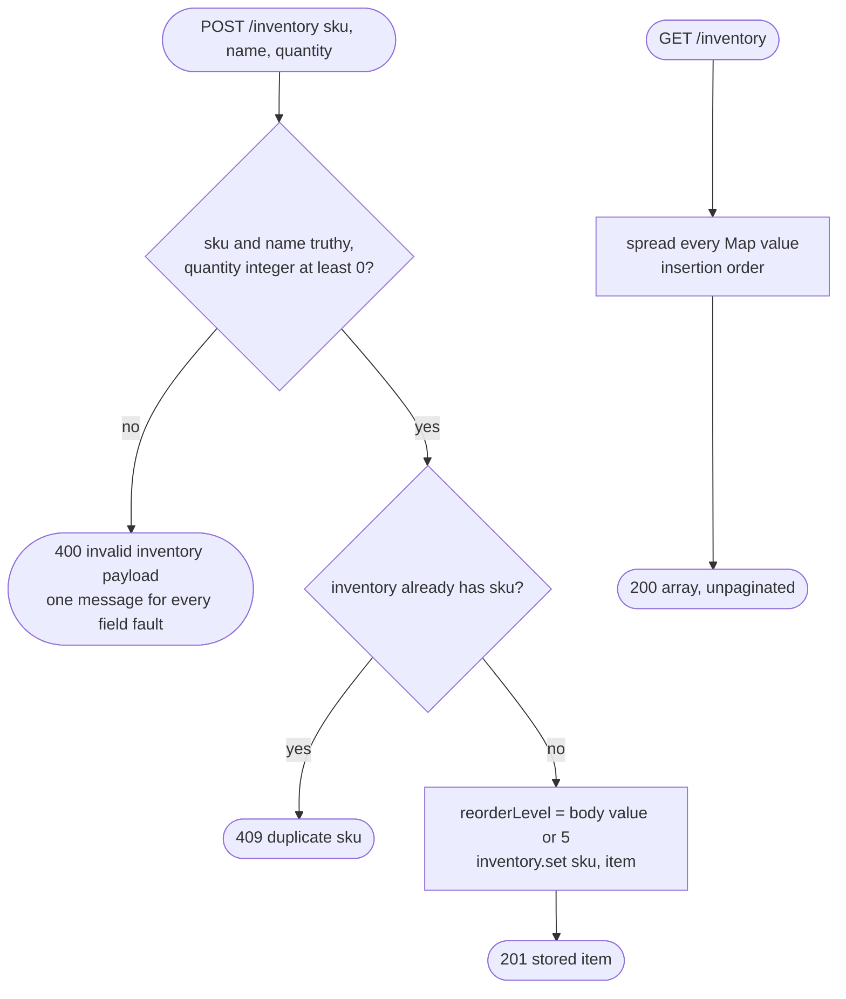

Intake is the only creation route in either service that rejects a duplicate key, which makes it the only one where a lost success response cannot be recovered by repeating the request.

#### 4.4.2.5 F-010 Shipment Creation and F-011 Shipment Retrieval

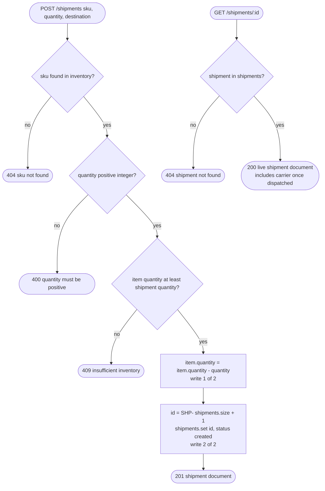

`destination` is stored without validation, and the identifier is positional, so the flow's only identity guarantee is that no shipment is ever removed.

#### 4.4.2.6 F-012 Shipment Dispatch

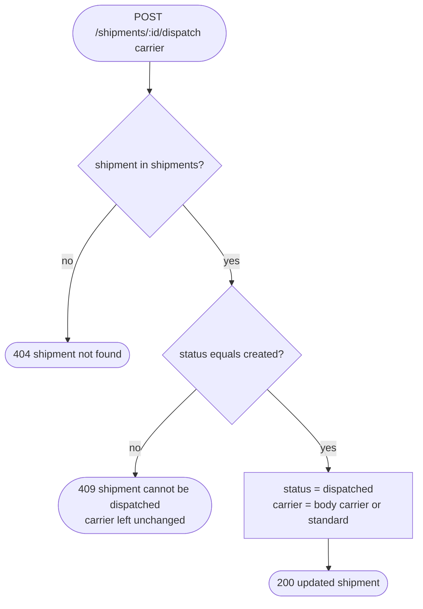

Dispatch is the only lifecycle transition in the repository and the only operation that refuses a repeat instead of duplicating it. It performs no inventory work: the units were already deducted by F-010.

### 4.4.3 Error Handling Flowchart

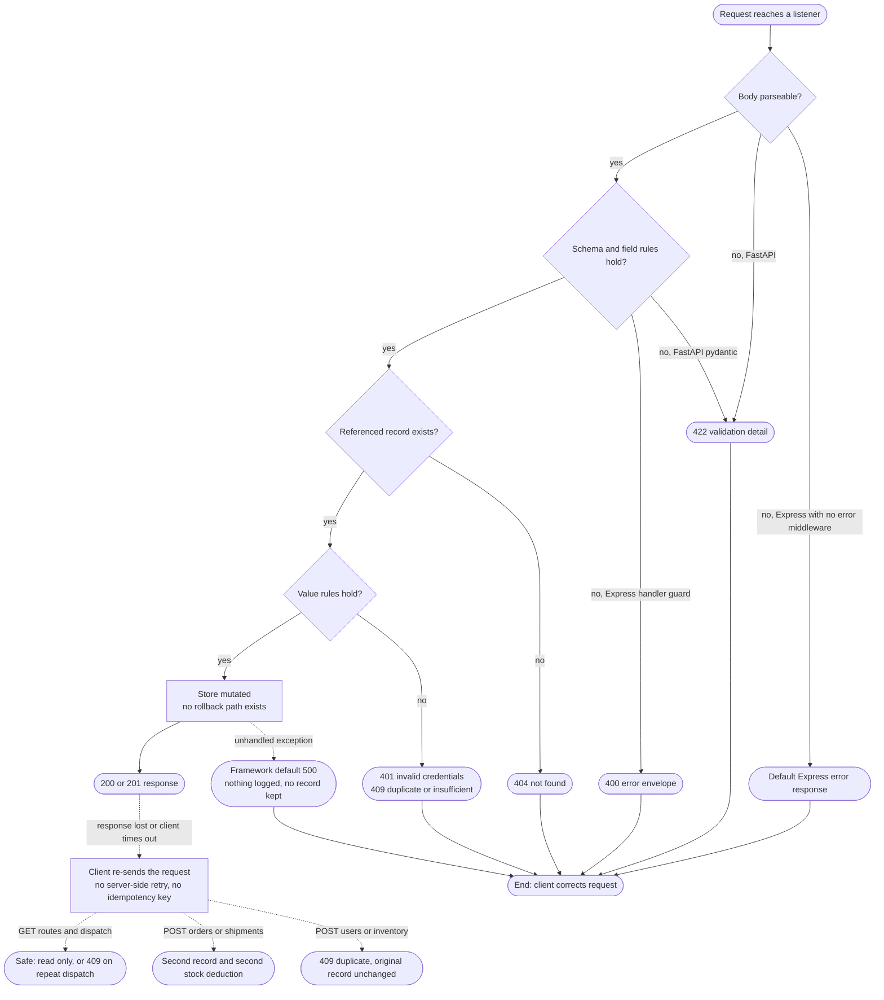

Every failure edge ends at the client. There is no edge from a failure to a retry, a queue, an operator notification or a compensating write, because none of those mechanisms exists in either service.

### 4.4.4 Integration Sequence Diagrams

The happy-path wire sequences for both journeys are the *Customer purchase journey* and *Warehouse fulfilment journey* diagrams in 1.3.1.1. The four diagrams below cover the interactions those happy paths cannot show.

#### 4.4.4.1 Lost Response and Client Retry — Double Deduction

```mermaid
sequenceDiagram
    autonumber
    participant C as Purchasing client
    participant A as customer-orders-api
    participant P as products dict
    participant O as orders dict
    C->>A: POST /orders product_id, quantity 2
    A->>P: guard passes, stock 10 to 8
    A->>O: store order with total
    A-->>C: 201 order document
    Note over C,A: The response never arrives or the client times out.<br/>No timeout, retry or idempotency key exists in the service.
    C->>A: POST /orders same body, client-side retry
    A->>P: guard passes, stock 8 to 6
    A->>O: store a second order with its own uuid4
    A-->>C: 201 second order document
    Note over P,O: One intent, two orders, four units deducted
```

#### 4.4.4.2 The Order-to-Shipment Handoff That Does Not Exist

```mermaid
sequenceDiagram
    autonumber
    participant Shop as Purchasing client
    participant Cust as customer-orders-api
    participant Ops as Warehouse operator
    participant Wh as warehouse-catalogue-api
    Shop->>Cust: POST /orders product_id uuid4, quantity 2
    Cust-->>Shop: 201 order, total, no shipment reference
    Note over Cust,Wh: No HTTP call, event, shared store or shared identifier<br/>connects the two services
    Ops->>Wh: POST /shipments sku and quantity transcribed by hand
    Wh-->>Ops: 201 SHP-1 status created, inventory deducted
    Ops->>Wh: POST /shipments/SHP-1/dispatch carrier dhl
    Wh-->>Ops: 200 status dispatched
    Note over Ops: The stock was reserved twice, once per service,<br/>and nothing reconciles the two reservations
```

#### 4.4.4.3 Dispatch Conflict Between Two Operators

```mermaid
sequenceDiagram
    autonumber
    participant A as Operator A
    participant B as Operator B
    participant W as warehouse-catalogue-api
    participant S as shipments Map
    A->>W: POST /shipments/SHP-1/dispatch carrier dhl
    W->>S: status equals created, allow transition
    S-->>W: status dispatched, carrier dhl
    W-->>A: 200 dispatched shipment
    B->>W: POST /shipments/SHP-1/dispatch carrier dpd
    W->>S: status not created, refuse
    S-->>W: unchanged record
    W-->>B: 409 shipment cannot be dispatched
    Note over A,B: The first carrier wins and is never overwritten
```

#### 4.4.4.4 Concurrent Order Placement and the Unsynchronised Deduction

```mermaid
sequenceDiagram
    autonumber
    participant R1 as Request A worker thread
    participant R2 as Request B worker thread
    participant P as products dict
    R1->>P: read product, stock 1, sufficiency guard passes
    R2->>P: read product, stock 1, sufficiency guard passes
    R1->>P: stock 1 to 0, store order A
    R2->>P: stock 0 to minus 1, store order B
    Note over R1,R2: Two orders accepted against one unit.<br/>Handlers are declared def, so FastAPI runs them in a thread pool.
```

The Node service cannot interleave in this way inside one process, because each Express handler runs to completion before the event loop takes another request; across two instances, both processes hold independent Maps and diverge silently.

### 4.4.5 State Transition Diagrams

#### 4.4.5.1 Shipment Lifecycle

```mermaid
stateDiagram-v2
    [*] --> created: POST shipments returns 201, inventory deducted
    created --> dispatched: POST shipments id dispatch returns 200, carrier recorded
    created --> created: dispatch refused while guard fails
    dispatched --> dispatched: repeat dispatch returns 409, carrier unchanged
    dispatched --> [*]: process exit, whole record lost
```

There are exactly two states and one permitted transition. A shipment in `created` has already consumed its units, and a shipment in `dispatched` can never return to `created`.

#### 4.4.5.2 Customer-Side and Inventory Record Lifecycles

```mermaid
stateDiagram-v2
    [*] --> Registered: POST users returns 201
    Registered --> Registered: duplicate attempt returns 409, record unchanged
    [*] --> Catalogued: POST products returns 201 with stock S
    Catalogued --> Catalogued: POST orders deducts quantity, stock only decreases
    Catalogued --> Catalogued: order refused on insufficient stock, stock unchanged
    [*] --> Ordered: POST orders returns 201
    Ordered --> Ordered: total fixed at creation, no update route exists
    [*] --> Received: POST inventory returns 201 with quantity Q
    Received --> Received: POST shipments deducts quantity
    Received --> Received: intake refused on duplicate SKU, record unchanged
    Registered --> [*]: process exit
    Catalogued --> [*]: process exit
    Ordered --> [*]: process exit
    Received --> [*]: process exit
```

Every record type has a single entry transition, self-transitions that only accumulate or deduct, and a terminal exit that is the process ending. No record type has a deletion, cancellation or correction transition, because neither service registers a `PUT`, `PATCH` or `DELETE` route.

#### 4.4.5.3 Process-Lifetime Store State

```mermaid
stateDiagram-v2
    [*] --> Empty: module import creates the containers
    Empty --> Populated: first successful create
    Populated --> Populated: further creates, deductions and one dispatch transition
    Populated --> [*]: process exit or restart, every record gone
    Empty --> [*]: process exit before any write
```

This is the transition that dominates every other: the store's lifetime is the process's lifetime, so a restart is indistinguishable from a first start and the only way to restore state is for clients to replay every create they still know about.


## 4.5 References

- `README.md` — established that the parent repository is a metadata-only submodule fixture with no application source or tests of its own, and named the two child services and their stacks.
- `.gitmodules` — established the two submodule paths and their GitHub remotes, and that no branch or version key constrains either child.
- `services/` — confirmed the two child folders are independent, with no cross-imports, shared library, manifest or deployment configuration at this level.
- `services/customer-orders-api/` — confirmed the Python service holds only `README.md`, `requirements.txt`, `app/` and `tests/`, and no database, configuration, migration or CI file.
- `services/customer-orders-api/README.md` — established the documented listener `uvicorn app.main:app --host 127.0.0.1 --port 8000`, the `pytest -q` entry point, and the declared analysis gaps (no real HTTP purchase journey, untested invalid login, duplicate registration, stock decrement, computed totals).
- `services/customer-orders-api/requirements.txt` — established the exact pins FastAPI 0.115.6, uvicorn 0.34.0, pytest 8.3.4 and httpx 0.28.1.
- `services/customer-orders-api/app/` — located the 0-byte `__init__.py` package marker and the single application module.
- `services/customer-orders-api/app/main.py` — the primary evidence for the customer workflow: the app object and three module-level dicts (lines 5-6), the three pydantic models (lines 8-19), all seven routes (lines 21-73), every guard and status code, the two-write order transaction (lines 59-66), and the absent authorization check.
- `services/customer-orders-api/app/__init__.py` — established that `app.main:app` resolves as a package module, with no startup or shutdown hook.
- `services/customer-orders-api/tests/test_routes.py` — established the in-process `TestClient` flow, the four covered cases, and the `setup_function()` store reset that is the only reset path in the repository (lines 6-9).
- `services/warehouse-catalogue-api/` — confirmed the Node service holds only `README.md`, `package.json`, `src/` and `test/`, with no lock file, `.env`, CI or deployment manifest.
- `services/warehouse-catalogue-api/README.md` — established the documented run and test entry points and the declared gaps (only health tested; missing intake, shipment, decrement, retrieval, dispatch and the three conflict behaviours).
- `services/warehouse-catalogue-api/package.json` — established the single runtime dependency `express` 4.21.2, empty `devDependencies`, and the `node src/server.js` / `node --test` scripts.
- `services/warehouse-catalogue-api/src/` — located the bootstrap and application modules.
- `services/warehouse-catalogue-api/src/server.js` — the primary evidence for the warehouse workflow: the two Maps (lines 5-6), `express.json()` (line 3), all six routes (lines 8-51), every guard and status code, the stock deduction and shipment insert (lines 31-34), the `SHP-${shipments.size + 1}` identifier, the single `created` → `dispatched` transition (lines 47-49), and the absent error middleware and authorization.
- `services/warehouse-catalogue-api/src/index.js` — established the `process.env.PORT || 3000` listener and the single startup log line, the only logging in the repository.
- `services/warehouse-catalogue-api/test/routes.test.js` — established that only `GET /health` is exercised, through an ephemeral listener and a loopback `fetch` to port 0.

Cross-references inside this specification: the feature identifiers `F-001` to `F-012`, requirement identifiers `F-XXX-RQ-YYY` and the guard-precedence contracts are defined in 2.2; the dependency graph with no cross-service edge is 2.3.1 and 2.3.2; the concurrency and error-envelope observations are 2.4.1; the pinned commits, in-scope routes and out-of-scope exclusions are 1.3.1 and 1.3.2, whose journey sequence diagrams this section extends with the failure and interleaving cases of 4.4.4.

No web sources were required: every statement above rests on the fourteen tracked files of this repository, and no external version, service or standard is cited.


# 5. System Architecture

## 5.1 High-Level Architecture

### 5.1.1 System Overview

**Architecture style.** The system is a pair of independent, single-tier, request/response HTTP services with process-local state, composed into one repository by a metadata-only parent. There is no shared runtime, no shared datastore, no message broker, no API gateway and no call path between the two services: `services` holds exactly two folders whose tracked file sets (`git -C <child> ls-files`) share nothing at all. Each service is a monolith in the strict sense — one executable unit, one process, one state container — and each is built on the idiomatic framework of its own language rather than a common platform: FastAPI 0.115.6 on uvicorn 0.34.0 for `services/customer-orders-api`, Express 4.21.2 on Node for `services/warehouse-catalogue-api`. In style terms this is a *shared-nothing pair of domain silos released as a pinned composition*: the customer/ordering domain and the inventory/shipment domain are separate deployables with separate data models, and the only contract they share is the identical health probe `GET /health → {"status": "ok"}` implemented twice without shared code (`app/main.py` line 23; `src/server.js` line 8).

| Tier | Implementation | Location |
|---|---|---|
| Composition (no runtime) | Git submodule pinning: two `path` + `url` stanzas, no `branch` key | `.gitmodules` lines 1-6 |
| Application | One ASGI module with 7 route handlers; one CommonJS module with 6 route handlers plus a 3-line bootstrap | `app/main.py`; `src/server.js`; `src/index.js` |
| State | Three module-level `dict`s; two module-level `Map`s; discarded at process exit | `app/main.py` line 6; `src/server.js` lines 5-6 |
| Verification | pytest 8.3.4 with in-process `TestClient`; Node's built-in `node --test` with loopback `fetch` | `tests/test_routes.py`; `test/routes.test.js` |
| Operations | None — no image, pipeline, supervisor, manifest or reverse proxy exists in either repository | repository-wide search of all 13 tracked files |

**Rationale.** The repository's own framing explains every omission. The root `README.md` titles the project "Parent Repository — Submodule Scan Fixture" and states the expected analysis behaviour: treat the parent as owning no directly testable behaviour, discover both submodule gitlinks, and analyse each child at the exact commit the parent pins. The architecture is therefore optimised for *analysability and determinism* rather than for production qualities:

- **13 tracked files carry the whole system** (3 in the parent, 5 in each child), so every behaviour is reachable from a single module per service and nothing hides behind generated code.
- **State is process-local and explicitly resettable**, which lets `setup_function()` in `tests/test_routes.py` (lines 6-9) clear `users`, `products` and `orders` before each test and lets both READMEs enumerate coverage gaps against a known state model.
- **Framework defaults are the contract.** FastAPI derives request validation, the `422` body, `/docs`, `/redoc` and `/openapi.json` from the three pydantic models (`app/main.py` lines 8-19); Express supplies JSON body parsing (`app.use(express.json())`, `src/server.js` line 3) and a default error handler. Neither service defines a schema document or a validation layer of its own.
- **No outbound I/O means no resilience machinery.** A repository-wide search of every tracked file for `retry`, `timeout`, `backoff`, `circuit`, `sleep`, `setTimeout` and `setInterval` returns no match, because no handler calls anything outside its own process.

**Key architectural principles and patterns.**

| Principle | How the code expresses it | Consequence |
|---|---|---|
| One process is the data boundary | All five stores are module-level and unreachable from another process (`app/main.py` line 6; `src/server.js` lines 5-6) | One writer per dataset; a second instance holds a divergent copy, and a restart empties the store |
| Synchronous request/response only | Every handler is a plain function that returns a document or a status; no callbacks, queues, timers, events or deferred results exist | Request latency equals handler execution; no background or eventual-consistency behaviour to reason about |
| Framework-default error semantics | `raise HTTPException(...)` on the Python side, `res.status(...).json({...})` on the Node side, with no error middleware | Failure surfaces as HTTP status plus a framework-shaped envelope, and nothing else (`{"detail": …}` versus `{"error": …}`) |
| Guard-before-mutation | Every failing check precedes the first write in its handler (`app/main.py` lines 53-59; `src/server.js` lines 26-31) | A refused request leaves the store exactly as it was; no compensating write exists or is needed within a request |
| Identifier ownership per domain | `uuid4` for users, products and orders; caller-supplied `sku`; positional `SHP-<n>` for shipments | No identifier space is shared, so nothing links an order to a shipment |
| Immutable release identity | The parent's gitlink is the only version record (`04259f82d5a8f87ff9d81d5fdd1dfdefaee4e564`, `f9f72d1c37091f8845e3e3727515fa713ebe20b1`) | A "release" is a gitlink change; no artefact, tag or changelog exists |

Two framework-level patterns complete the picture. `services/customer-orders-api/app/main.py` is a *single-module MVC-lite*: models at lines 8-19, handlers at lines 21-73, and no router, service, repository or dependency-injection object between them. `services/warehouse-catalogue-api/src/server.js` is the *exported-app pattern*: the module builds and exports the Express application (`module.exports = app`, line 53) and never listens, leaving the side effect of binding a socket to `src/index.js` line 3 — which is why the tests can mount the app on an ephemeral port and why the documented `npm start` command (`package.json` line 5 → `node src/server.js`) exits without opening a port.

**System boundaries and major interfaces.**

```mermaid
flowchart TB
    subgraph Callers["Caller domain - outside the system boundary"]
        Storefront["Storefront or purchasing API client"]
        WarehouseOps["Warehouse operations client"]
        Supervisor["Liveness supervisor or load balancer"]
    end

    subgraph Composition["Composition boundary - no runtime"]
        Modules[".gitmodules - two pinned gitlinks"]
        RootReadme["README.md - scan contract"]
    end

    subgraph CustSvc["customer-orders-api process - uvicorn 0.34.0, plain HTTP on 127.0.0.1:8000"]
        CustApp["FastAPI 0.115.6 app.main:app - 7 routes, 3 pydantic models"]
        CustStore[("users, products, orders dicts")]
        CustDocs["Framework interfaces: /docs, /redoc, /openapi.json"]
        CustApp --> CustStore
        CustDocs --- CustApp
    end

    subgraph WareSvc["warehouse-catalogue-api process - Express 4.21.2, PORT or 3000"]
        WareBoot["src/index.js - binds the socket"]
        WareApp["src/server.js - 6 routes, express.json only"]
        WareStore[("inventory, shipments Maps")]
        WareBoot --> WareApp
        WareApp --> WareStore
    end

    Storefront -->|"JSON request / JSON response"| CustApp
    WarehouseOps -->|"JSON request / JSON response"| WareBoot
    Supervisor -->|"GET /health"| CustApp
    Supervisor -->|"GET /health"| WareBoot
    Modules -.->|"pins 04259f8"| CustSvc
    Modules -.->|"pins f9f72d1"| WareSvc
    CustApp -. "no call, no shared store, no shared identifier" .-> WareApp
```

| Boundary | What crosses it | Contract |
|---|---|---|
| Client → customer service | HTTP/JSON requests on the documented listen address `127.0.0.1:8000` | 7 routes; `201` on creates, `200` on reads; failures as `{"detail": …}` with `400`/`401`/`404`/`409`/`422` |
| Client → warehouse service | HTTP/JSON requests on `process.env.PORT \|\| 3000` with no host argument supplied to `app.listen` | 6 routes; `201` on creates, `200` on reads and dispatch; failures as `{"error": …}` with `400`/`404`/`409` |
| Service ↔ service | Nothing | No base URL, credential, client library or shared key exists in either repository |
| Service ↔ infrastructure | Nothing | No database socket, cache client, queue, object store, identity provider or telemetry collector is configured or imported |
| Repository → children | Two gitlinks at pinned commits | `git submodule update` materialises both children at the recorded commits; no branch is tracked, so drift is visible as a dirty gitlink |
| Framework → caller (Python only) | A generated OpenAPI 3 document and Swagger UI | `/openapi.json` advertises exactly the 6 paths and 5 schemas (`RegisterRequest`, `ProductRequest`, `OrderRequest`, `HTTPValidationError`, `ValidationError`) under the title `Customer Orders API`, version `0.1.0` |

### 5.1.2 Core Components Table

| Component | Primary Responsibility | Key Dependencies | Integration Points |
|---|---|---|---|
| Parent composition (`README.md`, `.gitmodules`) | Declare the project's scope and pin the two child repositories at fixed commits; owns no executable code | Git submodule mechanism; two GitHub remotes | Consumed by `git submodule init/update`; invisible at runtime |
| Customer Orders API application (`services/customer-orders-api/app/main.py`) | Own customer identity, the product catalogue and order capture: 7 synchronous handlers over 3 pydantic models | FastAPI 0.115.6; pydantic v2; `uuid.uuid4`; `HTTPException` | Inbound HTTP/JSON from a customer-side client; reads and writes the three in-process stores; emits the framework's OpenAPI document |
| Customer state container (`users`, `products`, `orders`) | Hold registrations, catalogue records and orders for the lifetime of the process; decrement `products[...]["stock"]` on each accepted order | Python process memory; module import | Reached only through the 7 handlers; cleared only by the test hook |
| ASGI server (`uvicorn 0.34.0`) | Bind the socket, serve `app.main:app`, dispatch each request, write the access log | uvicorn; Python 3.12 in the inspected environment | Hosts the application; the sole network entry point for the customer service |
| Warehouse Catalogue API application (`services/warehouse-catalogue-api/src/server.js`) | Own SKU inventory intake, shipment creation, shipment lookup and dispatch: 6 routes with hand-written validation | Express 4.21.2; `express.json()`; built-in `Map` | Inbound HTTP/JSON from a warehouse-side client; reads and writes the two in-process Maps; exported for tests and for the bootstrap |
| Warehouse bootstrap (`services/warehouse-catalogue-api/src/index.js`) | Read `PORT`, call `app.listen`, log one startup line | `./server`; `process.env.PORT`; Node's `http.Server` | The only component that binds a port; not referenced by `npm start` |
| Warehouse state container (`inventory`, `shipments`) | Hold SKU balances and shipment lifecycle records; decrement `item.quantity` at shipment creation | Node process memory; module import | Reached only through the 6 handlers; survives no restart |
| Python verification harness (`services/customer-orders-api/tests/test_routes.py`) | Exercise 4 route contracts in process and reset the three stores between tests | pytest 8.3.4; `fastapi.testclient.TestClient` (httpx 0.28.1) | Imports `app`, `users`, `products`, `orders` directly; no socket, no mock |
| Node verification harness (`services/warehouse-catalogue-api/test/routes.test.js`) | Exercise the health contract over real loopback on an ephemeral port | `node --test`; `node:assert/strict`; global `fetch` | Loads `../src/server`, calls `app.listen(0)`, closes the server in `finally` |

**Critical considerations per component.**

| Component | Critical consideration |
|---|---|
| Customer Orders API application | All state, all routes and all models live in one 73-line module; any change to a stored shape (`payload.model_dump()` at line 43) changes the persisted record because there is no separate schema layer. `EmailStr` is imported at line 2 but never used, so e-mail format is unvalidated and `a@b.com` and `A@B.com` are distinct users. |
| Warehouse Catalogue API application | Validation is hand-written and inconsistent with the Python side: one `400` message covers every inventory field fault (line 13), `reorderLevel` is accepted unvalidated and never read again, and a malformed JSON body is answered by Express's default error handler as an HTML page with a stack trace instead of the `{"error": …}` envelope. |
| Warehouse bootstrap | `src/index.js` is the only working entry point, yet `package.json` line 5 and `README.md` lines 5-7 present `npm start` → `node src/server.js` as the run path, and that command exits immediately without listening. The `http.Server` returned by `listen` is discarded, so no graceful-shutdown or error handler exists. |
| Both state containers | Durable only for the life of one process; no lock guards the read-modify-write in `app/main.py` line 59 or `src/server.js` line 31, and a second instance would hold an independent, immediately divergent copy. |
| ASGI server | Serves because `app/__init__.py` exists as a package marker; the listen address comes only from CLI flags documented in the README, so nothing in code constrains the service to loopback. |
| Verification harnesses | 5 tests cover 13 routes; both harnesses share process memory with the application, so they prove handler logic but not the real HTTP journey that either README lists as a deliberate gap. |

### 5.1.3 Data Flow Description

**Two resource flows, no third flow between them.** Every request in the system belongs to one of two independent pipelines, and each pipeline terminates inside the process that received it.

*Flow A — customer pipeline.* A client posts JSON to the uvicorn listener; the ASGI server resolves `app.main:app` and dispatches the route; pydantic validates the body against `RegisterRequest`, `ProductRequest` or `OrderRequest` and rejects schema faults with `422` before any handler line runs; the handler then executes a fixed sequence of guards (`app/main.py` lines 53, 55, 57 for orders) and writes to one or two of the three dictionaries; the response document is assembled from the record that was just stored — `{"id": user_id, "email": …}` (line 31), `{"id": product_id, **products[product_id]}` (line 44), or the order record itself (line 67). Reads are pure projections: `GET /products` rebuilds `[{"id": key, **value} …]` from the whole dictionary on every call (line 48), so response size and cost grow linearly with catalogue size.

*Flow B — warehouse pipeline.* A client posts JSON to the Express listener; `express.json()` parses the body into `req.body` (the only middleware registered, `src/server.js` line 3); the handler applies its own guards in source order and then mutates the Maps; the response is produced with an explicit status call — `res.status(201).json(item)` at line 18, `res.json(shipment)` at line 50. `GET /inventory` spreads the Map per request (line 21) and is likewise unpaginated.

**Data transformation points.**

| Transformation | Where it happens | Observable effect |
|---|---|---|
| Untyped JSON body → validated model | pydantic models, `app/main.py` lines 8-19 | Missing or mistyped fields produce a `422` whose body names the offending `loc`; extra fields are ignored, and nothing constrains `price`, `stock` or e-mail format |
| Model → stored record | `payload.model_dump()` at `app/main.py` line 43 | The product dictionary is an exact copy of the model's fields, so the store's shape is whatever the model happens to declare |
| Price arithmetic | `round(product["price"] * payload.quantity, 2)` at line 65 | `total` is rounded to two decimals per order; it is stored once and never recomputed or reconciled against the catalogue |
| Stock decrement | `product["stock"] -= payload.quantity` (line 59); `item.quantity -= quantity` (`src/server.js` line 31) | The balance moves at order creation and at shipment creation respectively; dispatch moves nothing and no path restores units |
| Identifier minting | `str(uuid4())` at lines 29, 42, 60; `` `SHP-${shipments.size + 1}` `` at line 32 | Customer-side ids are opaque and unique; shipment ids are positional and would repeat if a record were ever removed |
| Default application | `reorderLevel = 5` destructuring default, `src/server.js` line 11; `carrier = req.body.carrier \|\| 'standard'` at line 49 | Inventory records always carry a reorder level, and dispatch always records a carrier |
| Record → response document | `[{"id": key, **value} …]` list projection (line 48); `[...inventory.values()]` (`src/server.js` line 21) | Listing routes expose the raw stored shape with no envelope, sort, filter or page metadata |

**Key data stores and caches.** The system holds five keyed stores and no cache at any tier; the storage design and its durability properties are documented in section 3.5.

```mermaid
flowchart LR
    subgraph CustFlow["customer-orders-api - single process"]
        CReq["HTTP/JSON request"] --> CVal["pydantic validation"]
        CVal -->|"422 on schema fault"| CErr["detail envelope"]
        CVal --> CHand["handler guard sequence"]
        CHand -->|"accepted"| CWrite["write path"]
        CHand -->|"refused"| CErr
        CWrite --> Users[("users - keyed by e-mail")]
        CWrite --> Products[("products - keyed by uuid4")]
        CWrite --> Orders[("orders - keyed by uuid4")]
        Products -->|"stock decremented per order"| CWrite
    end

    subgraph WareFlow["warehouse-catalogue-api - single process"]
        WReq["HTTP/JSON request"] --> WParse["express.json parse"]
        WParse -->|"parse failure"| WHtml["default HTML error page"]
        WParse --> WHand["handler guard sequence"]
        WHand -->|"accepted"| WWrite["write path"]
        WHand -->|"refused"| WErr["error envelope"]
        WWrite --> Inventory[("inventory - keyed by sku")]
        WWrite --> Shipments[("shipments - keyed by SHP-n")]
        Inventory -->|"quantity decremented at shipment creation"| WWrite
    end

    Shipments -->|"status created to dispatched, carrier recorded"| Shipments
    Orders -. "no key, no call, no replication" .-> Shipments
```

### 5.1.4 External Integration Points

| System Name | Integration Type | Protocol/Format | SLA Requirements |
|---|---|---|---|
| Customer-side API client (storefront or purchasing) | Inbound, synchronous request/response; one call per operation, no session state | JSON over HTTP/1.1 to the address supplied on the uvicorn command line (`127.0.0.1:8000` documented); `{"detail": …}` on failure | None defined — no timeout, rate limit, availability target or retry contract exists in code or documentation |
| Warehouse operations client | Inbound, synchronous request/response; one call per operation | JSON over HTTP/1.1 on `process.env.PORT \|\| 3000`, bound to all interfaces because `app.listen` receives no host argument; `{"error": …}` on failure | None defined |
| Liveness supervisor, load balancer or orchestrator | Inbound polling probe | `GET /health` → `200 {"status": "ok"}` in both services, constant and dependency-free | None defined; both READMEs and both test suites treat this as the only guaranteed contract |
| API documentation consumer (developer tooling) | Inbound document retrieval, Python service only | `GET /openapi.json` (OpenAPI 3), `/docs` and `/redoc` HTML | None defined; enabled unconditionally, with no environment switch |
| PyPI (pip) | Build-time dependency retrieval | HTTPS; four exact pins — `fastapi==0.115.6`, `uvicorn==0.34.0`, `pytest==8.3.4`, `httpx==0.28.1` | None declared; no hashes, lock file or private index |
| npm registry | Build-time dependency retrieval | HTTPS; one exact pin — `express: 4.21.2`, which resolved to a 67-package tree in a fresh install | None declared; no lock file is tracked, so the transitive tree is free to drift |
| GitHub remotes for the two children | Source materialisation | Git over HTTPS, one URL per submodule stanza, no `branch` key | None declared; availability depends on `git submodule update` succeeding at the pinned commits |

**Integrations that do not exist.** No payment processor, ERP, tax engine, carrier or shipping API, e-mail or notification provider, identity provider, message broker, object store, analytics sink, telemetry collector or sibling-service endpoint is referenced anywhere in the 13 tracked files. The customer service records `total` locally and contacts no payment system; the warehouse service records a `carrier` string supplied by the caller and contacts no carrier; and although the two domains describe the same physical goods, nothing maps `products[...]["id"]` to `inventory[...]["sku"]`, so an accepted order never reserves, decrements or notifies warehouse stock. The single outbound network operation in the repository is the loopback `fetch` inside `services/warehouse-catalogue-api/test/routes.test.js` line 11.


## 5.2 Component Details

### 5.2.1 Customer Orders API — `services/customer-orders-api`

**Purpose and responsibilities.** The service owns three responsibilities that the code never separates into modules: customer identity (register an e-mail/password pair, verify it and mint a token), catalogue authorship (`POST /products` writes the only source of price and stock), and order capture with stock accounting (`POST /orders` is the system's only multi-write handler, decrementing `products[...]["stock"]` and appending to `orders`). Everything the service owns lives in one 73-line module, `app/main.py`: the `FastAPI` object at line 5, three pydantic models at lines 8-19, and seven handlers at lines 21-73. The empty `app/__init__.py` exists solely so that uvicorn's target `app.main:app` resolves as a package path.

**Technologies and frameworks.**

| Technology | Version | Role in the service |
|---|---|---|
| Python | 3.12.3 in the inspected environment; no `.python-version`, `pyproject.toml` or `engines`-equivalent constraint | Runtime |
| FastAPI | 0.115.6 (`requirements.txt` line 1) | Application object, route decorators, `HTTPException`, automatic OpenAPI 3 document, `/docs` and `/redoc` |
| uvicorn | 0.34.0 (line 2) | ASGI server; documented invocation `uvicorn app.main:app --host 127.0.0.1 --port 8000`, which is the only place the bind address is stated |
| pydantic | v2 (resolved 2.14.2 on a fresh install) | `BaseModel`, `model_dump()`; supplies the `422` contract and rejects unknown types before handlers run |
| Starlette | 0.41.3 (transitive resolution of the FastAPI 0.115.6 constraint) | Routing, request/response plumbing, thread-pool dispatch of `def` handlers, access logging via uvicorn |
| `uuid.uuid4` | Standard library | Mints every user, product and order identifier |
| pytest 8.3.4 / httpx 0.28.1 | `requirements.txt` lines 3-4 | Verification only; declared in the same file as runtime pins with no separation or extras |

**Key interfaces and APIs.** All seven handlers are synchronous `def` functions with no `Depends`, middleware, router prefix or versioning. The three framework interfaces (`/openapi.json`, `/docs`, `/redoc`) are enabled unconditionally.

| Interface | Purpose | Success contract | Failure contract and state effect |
|---|---|---|---|
| `GET /health` | Liveness | `200 {"status": "ok"}` | None possible; touches no store |
| `POST /users` | Registration | `201 {"id", "email"}`; inserts `users[email] = {id, password}` | `409 {"detail": "email already registered"}` (line 27); `422` for a schema fault; refused requests write nothing |
| `POST /login` | Credential check and token issue | `200 {"user_id", "token"}` where `token = f"token-{user['id']}"` (line 38), stored nowhere and never verified later | `401 {"detail": "invalid credentials"}` for both unknown e-mail and wrong password (line 36); `422` |
| `POST /products` | Catalogue write | `201 {"id", "name", "price", "stock"}`; stores `payload.model_dump()` under a new uuid4 (lines 42-44) | `422` only — negative `price` and negative `stock` are accepted |
| `GET /products` | Catalogue read | `200` array of `{id, name, price, stock}` in insertion order, unpaginated (line 48) | None; an empty catalogue returns `200 []` |
| `POST /orders` | Order capture and stock decrement | `201` order document with `total = round(price × quantity, 2)` (lines 60-67) | Existence → sign → sufficiency order: `404` (line 53), `400` (line 55), `409` (line 57), then `422`; the store is mutated only after every guard passes |
| `GET /orders/{order_id}` | Order read | `200` stored order document | `404 {"detail": "order not found"}` (line 71) |
| `/openapi.json`, `/docs`, `/redoc` | Framework-generated contract documentation | `200`; the document advertises 6 paths, 5 schemas and title `Customer Orders API` version `0.1.0` | — |

**Data persistence requirements.** None are met by design. The service requires a single long-lived Python process; its three dictionaries are created at import (line 6), mutated in place by handlers, never flushed and never reset by application code — only `setup_function()` in `tests/test_routes.py` clears them. `users` is keyed by the raw e-mail string (no normalisation), holding `{id, password}` with the password in plain text; `products` is keyed by uuid4 and holds exactly the `ProductRequest` fields with `stock` mutated by orders; `orders` is keyed by uuid4 and is append-only, since no `PUT`, `PATCH` or `DELETE` route exists in the service. Storage is examined further in section 3.5.

**Scaling considerations.**

- **Replicas break correctness, not just performance.** Each process owns its own dictionaries, so a second instance registers the same e-mail independently and reports its own stock balance; there is no session affinity requirement in code because no instance can see another's writes at all.
- **One worker is the working configuration.** Adding uvicorn workers divides the dataset per worker; nothing in the service coordinates them.
- **Read cost grows with the catalogue.** `GET /products` rebuilds the entire list per call (line 48) with no pagination, filter or sort parameter, so both latency and payload grow linearly with the number of products.
- **Handlers run concurrently inside one process.** Because the handlers are `def` rather than `async def`, FastAPI dispatches them to a worker thread pool, so two requests can interleave between the stock check (line 57) and the decrement (line 59); a 64-request probe against a stock of 5 produced exactly 5 accepted orders, so the window is narrow in practice, but the read-modify-write carries no lock and depends on bytecode-level timing rather than on any guarantee.
- **No lifecycle hooks.** There is no `lifespan`, `startup`, `shutdown` or signal handler, so a redeploy is an abrupt process replacement that discards all state.

### 5.2.2 Warehouse Catalogue API — `services/warehouse-catalogue-api`

**Purpose and responsibilities.** The service owns inbound inventory (one record per SKU with a reorder level), shipment creation against a SKU balance, shipment lookup and a single lifecycle transition (dispatch). Unlike the Python side, it splits its two responsibilities across files by design intent rather than by framework: `src/server.js` builds and exports the Express application (`module.exports = app`, line 53) and therefore has no side effects on import, while `src/index.js` performs the only side effect — `app.listen(port, …)` with `port = process.env.PORT || 3000` (lines 2-3) — and writes one startup log line.

**Technologies and frameworks.**

| Technology | Version | Role in the service |
|---|---|---|
| Node.js | v22.23.5 in the inspected environment; no `engines` field and no `.nvmrc` in the repository | Runtime; `node --test` and global `fetch` are used by the test harness |
| Express | 4.21.2 (`package.json` line 6), the only runtime dependency | Routing, `res.json`/`res.status`, auto-ETag, `X-Powered-By`, automatic `OPTIONS` handling and the default error handler |
| `express.json()` | Middleware shipped with Express 4 | The only middleware registered (`src/server.js` line 3); parses JSON bodies and answers unparseable bodies itself |
| Built-in `Map` | Standard library | `inventory` (line 5) and `shipments` (line 6) — the service's entire state |
| `node --test`, `node:assert/strict` | Node built-ins; `devDependencies` is `{}` | Verification only, invoked as `npm test` (`package.json` line 5) |
| npm | 11.21.3 in the inspected environment | Install only; no lock file is tracked, so a fresh `npm install` resolved 67 top-level packages |

**Key interfaces and APIs.** Each handler validates by hand inside its own body; there is no shared validator, no schema module and no error-class hierarchy.

| Interface | Purpose | Success contract | Failure contract and state effect |
|---|---|---|---|
| `GET /health` | Liveness | `200 {"status": "ok"}` (line 8) | None possible; touches no Map |
| `POST /inventory` | SKU intake | `201 {sku, name, quantity, reorderLevel}`; `inventory.set(sku, item)` with `reorderLevel` defaulting to `5` (lines 11-18) | `400 {"error": "invalid inventory payload"}` for any of four field faults (line 12); `409 {"error": "duplicate sku"}` (line 15); a refused request writes nothing |
| `GET /inventory` | Inventory read | `200` array of every item in insertion order (line 21) | None; empty Map returns `200 []` |
| `POST /shipments` | Shipment creation with stock deduction | `201 {id, sku, quantity, destination, status: "created"}` with `id = SHP-${shipments.size + 1}` (lines 32-35) | `404 {"error": "sku not found"}` (line 26), `400 {"error": "quantity must be positive"}` (lines 27-29), `409 {"error": "insufficient inventory"}` (line 30); `item.quantity` is reduced only after all three pass (line 31) |
| `GET /shipments/:id` | Shipment read | `200` current shipment document, including `carrier` once dispatched (lines 38-41) | `404 {"error": "shipment not found"}` (line 40) |
| `POST /shipments/:id/dispatch` | Single lifecycle transition | `200` with `status: "dispatched"` and `carrier` from the body or `"standard"` (lines 47-50) | `404 {"error": "shipment not found"}` (line 46); `409 {"error": "shipment cannot be dispatched"}` for any state other than `created` (line 47), with `carrier` left untouched |
| Automatic `OPTIONS` handling, `X-Powered-By: Express`, weak ETag | Express defaults, not application code | `OPTIONS` on a known route answers `200` with an `Allow` header | Confirmed by probe; no CORS headers are emitted, so browser cross-origin preflight is not satisfied |

**Data persistence requirements.** None are met, and the record shapes are weaker than the Python side's because there is no schema at all. `inventory` is keyed by the caller's `sku` and holds `{sku, name, quantity, reorderLevel}`; `quantity` is mutated at shipment creation and never restored, and `reorderLevel` is written but never read by any handler, so no replenishment logic exists. `shipments` is keyed by a positional string derived from `shipments.size + 1`, holding `{id, sku, quantity, destination, status}` plus `carrier` after dispatch; records are never removed, so the positional scheme is stable only while nothing is deleted. There is no file, database or cache write anywhere in the service.

**Scaling considerations.**

- **Serialized by design, not by policy.** Every handler is synchronous with no `await`, so Node's event loop runs them one at a time per process; a single instance cannot interleave two shipments against the same SKU. Horizontal scaling removes that property immediately, because each instance holds its own `Map`s.
- **Identifier collisions across instances.** `SHP-${shipments.size + 1}` is per-process, so two instances both mint `SHP-1`; the identifier is neither globally unique nor durable across restarts.
- **Listing cost grows linearly.** `GET /inventory` spreads the whole Map per request (line 21) with no pagination, filter or sort.
- **Start-up is undocumented and broken as written.** `npm start` runs `node src/server.js`, which exports the app and exits without binding a port (verified: the process ends and the port stays closed); only `node src/index.js` listens. `src/index.js` also discards the `http.Server` returned by `listen` and registers no `SIGTERM` handler, so shutdown is immediate and ungraceful.
- **Body parsing bounds.** `express.json()` applies its defaults (100 kb limit, strict JSON); a malformed payload is answered by Express's default error handler as an HTML page carrying a stack trace rather than by the service's `{"error": …}` envelope.

### 5.2.3 Repository Composition and Verification Components

**Composition component.** The parent repository is a release mechanism, not a runtime component. Its `.gitmodules` (lines 1-6) declares two stanzas with `path` and `url` and deliberately no `branch` key, so the parent's gitlink entries — `04259f82d5a8f87ff9d81d5fdd1dfdefaee4e564` for `services/customer-orders-api` and `f9f72d1c37091f8845e3e3727515fa713ebe20b1` for `services/warehouse-catalogue-api`, both on branch `2511_02` — are the single source of release identity. Both children are self-contained: neither imports, calls or references the other, and `services` contains no shared library, contract, schema file or configuration. There is no build orchestration between them; each is installed and started by its own documented command.

**Verification components.** Two harnesses exist and neither crosses a process boundary.

| Harness | Scope proven | Mechanism | What it cannot prove |
|---|---|---|---|
| `services/customer-orders-api/tests/test_routes.py` (4 tests) | `GET /health` body equality; `POST /users` returns `201` with the e-mail; `POST /products` returns `201` with the name; `POST /orders` rejects an unknown product with `404` | `TestClient(app)` in process, stores cleared by `setup_function()`; imports `app`, `users`, `products`, `orders` directly, coupling tests to internals | Login failure, duplicate registration, stock decrement, computed totals, schema faults and any behaviour over a real socket — all named as gaps in the service `README.md` |
| `services/warehouse-catalogue-api/test/routes.test.js` (1 test) | `GET /health` returns `200 {"status":"ok"}` | `app.listen(0)` on an ephemeral port, real loopback `fetch`, server closed in `finally` | Every mutating journey — inventory intake, shipment creation, decrement, lookup, dispatch — plus duplicate SKU, insufficient inventory and repeated dispatch; the service `README.md` names each |

Because both harnesses share process memory with the application and neither service calls the other, no test in the repository exercises an integration path; the end-to-end journey that the business domain implies is unproven.

### 5.2.4 Component Interaction Diagram

```mermaid
flowchart TB
    subgraph Clients["Callers - outside the system boundary"]
        CustClient["Customer-side client"]
        WareClient["Warehouse-side client"]
    end

    subgraph PyProc["customer-orders-api process - single uvicorn worker"]
        UV["uvicorn 0.34.0<br/>ASGI server and access log"]
        FApp["FastAPI app object<br/>title Customer Orders API"]
        Val["pydantic validation<br/>3 request models"]
        HId["identity handlers<br/>register, login"]
        HCat["catalogue handlers<br/>create_product, list_products"]
        HOrd["order handlers<br/>create_order, get_order"]
        Users[("users dict")]
        Prods[("products dict")]
        Ords[("orders dict")]
        PyTest["pytest suite<br/>in-process TestClient"]
        UV --> FApp --> Val
        Val --> HId
        Val --> HCat
        Val --> HOrd
        HId --> Users
        HCat --> Prods
        HOrd --> Prods
        HOrd --> Ords
        PyTest -.->|"imports app and stores directly"| FApp
    end

    subgraph NodeProc["warehouse-catalogue-api process - single Node event loop"]
        Boot["src/index.js<br/>listen on PORT or 3000"]
        App["Express 4.21.2 app"]
        Mw["express.json<br/>only middleware"]
        HInv["inventory handlers<br/>POST and GET /inventory"]
        HShp["shipment handlers<br/>POST /shipments"]
        HDis["lookup and dispatch<br/>GET and POST by id"]
        Inv[("inventory Map")]
        Shps[("shipments Map")]
        NodeTest["node --test suite<br/>app.listen(0) and loopback fetch"]
        Boot --> App --> Mw
        Mw --> HInv
        Mw --> HShp
        Mw --> HDis
        HInv --> Inv
        HShp --> Inv
        HShp --> Shps
        HDis --> Shps
        NodeTest -.->|"loads exported app"| App
    end

    CustClient -->|"JSON over HTTP"| UV
    WareClient -->|"JSON over HTTP"| Boot
    HOrd -. "no transport, no shared key, no replication" .-> HShp
```

### 5.2.5 State Transition Diagrams

**Shipment lifecycle.** A shipment record exists in exactly two states, and the only transition is guarded by a single equality test (`src/server.js` line 47).

```mermaid
stateDiagram-v2
    direction LR
    [*] --> Created: POST /shipments accepted<br/>item.quantity -= quantity<br/>id = SHP-n, status created
    Created --> Dispatched: POST /shipments/:id/dispatch<br/>status = dispatched<br/>carrier = body.carrier or standard
    Created --> Created: GET /shipments/:id<br/>200 document without carrier
    Dispatched --> Dispatched: POST dispatch again<br/>409 shipment cannot be dispatched
    Dispatched --> Dispatched: GET /shipments/:id<br/>200 document with carrier
    Dispatched --> [*]: process exit discards the record
    Created --> [*]: process exit discards the record
```

**Inventory record lifecycle.** The record is created once and then only ever decreases; nothing returns units to stock.

```mermaid
stateDiagram-v2
    direction LR
    [*] --> Absent
    Absent --> Present: POST /inventory accepted<br/>quantity >= 0, reorderLevel default 5
    Absent --> Absent: POST with duplicate sku<br/>409 duplicate sku
    Absent --> Absent: POST with invalid payload<br/>400 invalid inventory payload
    Present --> Present: POST /shipments accepted<br/>quantity -= shipped quantity
    Present --> Present: GET /inventory<br/>200 record
    Present --> Absent: POST /shipments with insufficient stock<br/>409, record unchanged
    Present --> [*]: process exit discards the record
```

### 5.2.6 Sequence Diagrams for Key Flows

**Order capture — the only multi-write flow in the system.**

```mermaid
sequenceDiagram
    autonumber
    participant C as Customer client
    participant U as uvicorn
    participant A as FastAPI app
    participant V as pydantic
    participant H as create_order
    participant S as products and orders dicts

    C->>U: POST /orders with product_id and quantity
    U->>A: dispatch to route
    A->>V: validate OrderRequest
    alt schema fault
        V-->>C: 422 detail array
    else body valid
        V->>H: payload
        H->>S: products.get(product_id)
        alt product missing
            H-->>C: 404 product not found
        else quantity is zero or negative
            H-->>C: 400 quantity must be positive
        else stock below quantity
            H-->>C: 409 insufficient stock
        else accepted
            H->>S: products[id].stock -= quantity
            H->>S: orders[uuid4] = id, product_id, quantity, total
            H-->>C: 201 order document
        end
    end
```

**Shipment creation and dispatch — the warehouse lifecycle over two requests.**

```mermaid
sequenceDiagram
    autonumber
    participant O as Warehouse client
    participant B as src/index.js listener
    participant A as Express app
    participant M as express.json
    participant H as shipment handlers
    participant I as inventory Map
    participant P as shipments Map

    O->>B: POST /shipments with sku, quantity, destination
    B->>A: invoke app
    A->>M: parse request body
    M->>H: req.body
    H->>I: inventory.get(sku)
    alt sku unknown
        H-->>O: 404 sku not found
    else quantity not a positive integer
        H-->>O: 400 quantity must be positive
    else insufficient inventory
        H-->>O: 409 insufficient inventory
    else accepted
        H->>I: item.quantity -= quantity
        H->>P: set SHP-n with status created
        H-->>O: 201 shipment document
    end
    O->>H: POST /shipments/SHP-n/dispatch with carrier
    H->>P: shipments.get(SHP-n)
    alt state is created
        H->>P: status dispatched, carrier recorded
        H-->>O: 200 dispatched shipment
    else already dispatched
        H-->>O: 409 shipment cannot be dispatched
    else shipment unknown
        H-->>O: 404 shipment not found
    end
```

**Identity flow — the token that no later request checks.**

```mermaid
sequenceDiagram
    autonumber
    participant C as Customer client
    participant H as register and login handlers
    participant U as users dict

    C->>H: POST /users with email and password
    H->>U: membership test on the raw e-mail string
    alt e-mail already present
        H-->>C: 409 email already registered
    else new e-mail
        H->>U: users[email] = id, password
        H-->>C: 201 id and email
    end
    C->>H: POST /login with email and password
    H->>U: users.get(email)
    alt record missing or password differs
        H-->>C: 401 invalid credentials
    else match
        H-->>C: 200 user_id and token-user_id
    end
    Note over C,U: The token is derived from the public user id,<br/>stored nowhere, and verified by no route
```


## 5.3 Technical Decisions

### 5.3.1 Architecture Style Decisions and Tradeoffs

No design note, comment, ADR file or architecture diagram exists in the repository, so the rationale below is reconstructed from the two sources that do state intent — the root `README.md` ("intentionally metadata-only", "analyse each child at the exact commit pinned by the parent") and the two service `README.md` files, which declare their own untested behaviour — together with the consequences the code actually produces.

| Decision | Choice observed | Tradeoff accepted | Evidence |
|---|---|---|---|
| Service granularity | Two independent services, one per business domain, each a single-tier monolith | No cross-domain transaction can exist, so an order never reserves warehouse stock; the same physical goods are tracked twice in two incompatible models | `app/main.py` line 6 (`products` with `price`/`stock`) versus `src/server.js` lines 5-6 (`inventory` with `sku`/`quantity`/`reorderLevel`) |
| Language strategy | Idiomatic stack per service — FastAPI/pydantic/uvicorn for one, Express for the other — instead of one shared platform | Two toolchains, two test frameworks, two validation philosophies and two error envelopes to maintain and consume | `requirements.txt`; `package.json` |
| Composition strategy | Metadata-only parent with two gitlinks and no `branch` key, instead of a monorepo or a published package | Exact reproducibility of the analysed commits, but a checkout requires `--recurse-submodules` and no build spans both children | `.gitmodules` lines 1-6; parent `git log` is a single commit `395c1ce` |
| Module structure | One module per service: models and handlers side by side, no router, service, repository or middleware layer | Every behaviour is reachable from one file, but there is no seam where a datastore, an authorisation check or a shared validator could be inserted without editing handlers | `app/main.py` 73 lines total; `src/server.js` 53 lines total |
| Validation strategy | Framework-native on the Python side (pydantic) and hand-written guards on the Node side | No bespoke validation code to maintain, at the price of inconsistent semantics: the same bad body yields `422` on one service and `400` on the other | `app/main.py` lines 8-19 versus `src/server.js` lines 12-14, 27-29 |
| Application/bootstrap split (Node only) | `src/server.js` exports the app and never listens; `src/index.js` owns the only `listen` call | The app is trivially mountable in tests, but the documented run command does not start a listener | `src/server.js` line 53; `src/index.js` lines 1-3; `package.json` line 5 |
| Build and packaging | None: interpreted from source, no compile step, no image, no lock file, no packaging metadata for the Python service | Nothing to build or version, but dependency resolution is only pinned at the declared leaves and installs are not reproducible | `requirements.txt` (4 exact pins, no hashes); `package.json` (one exact dependency); no lock file tracked |
| Configuration surface | Hard-coded constants plus a single environment variable, `PORT`, on the Node side only | Nothing to misconfigure, and nothing to configure per environment either — the Python bind address exists only in the documented command line | `src/index.js` line 2; `app/main.py` line 5 (hard-coded title); no `.env` file anywhere |

### 5.3.2 Communication Pattern Choices

| Choice | Implemented as | Effect on integrators |
|---|---|---|
| Synchronous request/response over HTTP/JSON, one call per operation | Every handler completes its work before responding; there is no callback, polling handle, job id or deferred result | Each operation is independently retryable in principle, but no operation is idempotent except `GET` and dispatch-after-dispatch (which fails with `409` rather than succeeding twice) |
| No service-to-service communication | No HTTP client, base URL, credential, message broker or shared store exists in either child | The two domains integrate only through a human or an external system that calls both |
| Two incompatible error envelopes | Python: `{"detail": …}` (`HTTPException`, plus a `detail` array for `422`); Node: `{"error": …}` | A client calling both must branch on shape as well as status; the same logical fault — a non-positive quantity — returns `{"detail": "quantity must be positive"}` from `app/main.py` line 56 and `{"error": "quantity must be positive"}` from `src/server.js` line 28 |
| Status codes as the only machine-readable result vocabulary | `201` create, `200` read and dispatch, `400` semantic fault, `401` authentication failure, `404` unknown reference, `409` conflict, `422` schema fault (Python only), `405` wrong method (framework) | Callers get a stable, conventional vocabulary, but no error code, correlation id or retry hint |
| Health probe as the only shared contract | `GET /health → 200 {"status": "ok"}` implemented twice, touching no state and no dependency | A supervisor can detect liveness but cannot detect a degraded service, because nothing downstream is checked |
| Plain HTTP/1.1 with no versioning | uvicorn served without TLS; Express `app.listen(port)` with no host or TLS argument; no `/v1` prefix, no content negotiation, no media-type handling beyond `application/json` | The contract cannot evolve without breaking callers, and transport security depends entirely on an external terminator that does not exist in the repository |
| No pagination or filtering contract | `GET /products` and `GET /inventory` return the whole store per call | Response size grows without bound; there is no partial-read mechanism for large catalogues |

### 5.3.3 Data Storage Solution Rationale

No storage technology was selected: the services use the language's own ordered map — a Python `dict` in `app/main.py` line 6 and a JavaScript `Map` in `src/server.js` lines 5-6. The choice is internally consistent with the fixture intent and yields concrete benefits, but it satisfies none of the durability or isolation requirements an operational system would impose.

| Requirement | Delivered by the in-memory store | Gap |
|---|---|---|
| Keyed lookup by identifier | `O(1)` access by e-mail, uuid4, SKU or `SHP-<n>` with no client, driver, pool or credentials to configure | The key is only meaningful inside one process and one lifetime |
| Deterministic ordering for listing | Both `dict` and `Map` preserve insertion order, so `GET /products` and `GET /inventory` return records in creation order without a sort key | Ordering therefore reflects mutation history, not data, and changes with restart |
| Test determinism | `setup_function()` clears the three dictionaries (lines 6-9), so each Python test starts from empty state without a fixture database or container | Tests share process memory with the application and prove nothing about a real HTTP journey |
| Durability | None | Restart, redeploy or crash discards every user, product, order, inventory item and shipment |
| Multi-instance consistency | None | Each replica owns a divergent copy; two instances would both accept the same e-mail and both report unrelated stock |
| Concurrency control | None | The read-modify-write at `app/main.py` line 59 and `src/server.js` line 31 holds no lock; correctness rests on Node's single-threaded loop and, on the Python side, on the narrowness of the bytecode window between check and decrement |
| Schema evolution | None | The stored product record is `payload.model_dump()` (`app/main.py` line 43), so changing the model silently changes stored records with no migration path |
| Backup, audit, retention | None | There is no export route, snapshot, audit log or retention policy to build on |

| Alternative considered | Why it is not present |
|---|---|
| Relational database with migrations | No driver, ORM, DDL, migration folder or connection string is declared or imported in either child |
| Document store or key-value cache | No client library for any store exists; both manifests declare only their web framework and test tooling |
| File or object storage | No file I/O, `fs` import, bucket, volume or credential appears in either service |
| Cross-service shared store | The two services share no identifier and no library, so no store could be shared without first inventing the missing product-to-SKU link |

### 5.3.4 Caching Strategy Justification

No cache exists at any tier — no Redis or Memcached client, no in-process memoisation, no HTTP cache-control header emitted by application code, and no CDN or reverse proxy in front of either listener. The absence is defensible for this system and still leaves two consequences worth recording.

| Caching layer | Present | Justification and consequence |
|---|---|---|
| Application-level memoisation | No | Every handler does constant work except the two list routes, so there is little to gain; the cost is that both list routes rebuild the entire collection per request (`app/main.py` line 48; `src/server.js` line 21) |
| Distributed cache | No | There is no shared state to cache and no second process to share it with; adding one would not fix the durability gap it might appear to address |
| HTTP response caching metadata | Application emits none; Express adds its own | Express generates a weak `ETag` on JSON responses by default (observed: `etag: W/"2-…"` on `GET /inventory`), but a conditional request carrying `If-None-Match` still returned `200` with a body in probing, so no revalidation saving occurs; FastAPI emits no `ETag`, `Cache-Control` or `Last-Modified` at all |
| Negative caching / idempotency key store | No | Repeated `POST /orders` or `POST /shipments` calls create additional records and deduct stock again; there is no key by which a retry could be recognised |
| Proxy or gateway cache | No | No reverse proxy, API gateway, load balancer or CDN is defined anywhere in the repository |

### 5.3.5 Security Mechanism Selection

No security mechanism was selected in either service. The table records the current state per concern, the consequence, and whether the omission is framework default or explicit code.

| Security concern | Mechanism selected | Actual state and consequence | Evidence |
|---|---|---|---|
| Authentication | None enforced | `POST /login` returns a token, but the token is the literal string `token-<user_id>` derived from the public user id, is stored nowhere and is read by no route; any caller can create products and orders without logging in | `app/main.py` line 38; no `Depends`, header read or middleware in lines 21-73 |
| Authorization | None | No ownership check exists: `GET /orders/{order_id}` returns any order to any caller who knows the id, and both services expose every route | `app/main.py` lines 69-73 |
| Credential storage | Plain text | Passwords are stored verbatim as `users[email]["password"]` and compared with `!=`; no hash, salt or KDF is imported | `app/main.py` lines 30, 36 |
| Input validation | Framework-native (Python) and hand-written (Node) | pydantic rejects missing or mistyped fields with `422`, but `EmailStr` is imported and unused, and `price`/`stock` accept negatives; Express checks four inventory conditions and nothing else, leaving `destination`, `carrier` and `reorderLevel` unvalidated | `app/main.py` lines 2, 12-15, 40-44; `src/server.js` lines 11-14, 24, 49 |
| Transport security | None in the repository | uvicorn is documented on plain HTTP at `127.0.0.1:8000`; Express `app.listen(port)` binds all interfaces with no TLS argument; no certificate, proxy or redirect exists | `services/customer-orders-api/README.md` line 7; `src/index.js` line 3 |
| Cross-origin policy | No CORS configuration | Neither service emits any `access-control-*` header (verified by probe), so browser clients on another origin are blocked by the browser and cannot even preflight successfully on the Python side, which answers `OPTIONS /products` with `405` and `Allow: POST` | `app/main.py` (no middleware); `src/server.js` line 3 (only `express.json()`) |
| CSRF, session management | Not applicable and absent | No cookie, session, `SameSite` or CSRF token is set, because there is no session state at all | Both services |
| Rate limiting and abuse controls | None | No limiter, throttle, quota or request-size policy beyond the `express.json()` default limit; `POST /users` and `POST /orders` are unbounded | `src/server.js` line 3; `app/main.py` lines 25-31 |
| Secret management | None needed and none present | No `.env` file, secret reference, API key or credential of any kind exists in the repository; the only configuration input is `PORT` | `src/index.js` line 2 |
| Error-message leakage | Divergent | Python returns fixed `detail` strings and no stack traces; Express answers an unparseable JSON body with an HTML page containing a `body-parser` stack trace including absolute filesystem paths | Probe of `POST /inventory` with a malformed body; `src/server.js` registers no error middleware |
| Runtime fingerprinting | Framework defaults left on | Express sends `X-Powered-By: Express`; uvicorn sends `server: uvicorn` | Response headers observed on both listeners |
| Dependency integrity | Exact leaf pins | `requirements.txt` pins four exact versions without hashes; `package.json` pins Express exactly with no lock file tracked, so the transitive tree (67 packages in a fresh install) is unpinned | `requirements.txt`; `package.json` |

The net effect is that the security boundary of the system is the network boundary: whoever can reach either listener can perform every operation the routes allow, and the only cryptographic property in the design — the token — carries no verification.

### 5.3.6 Architecture Decision Records

No ADR directory, template or historical record exists in the repository. The records below reconstruct the decisions the code embodies, each traced to evidence and paired with the consequence an architect inherits. All are "accepted as implemented"; the repository records no rejected alternatives.

| ID | Decision | Evidence | Consequence inherited |
|---|---|---|---|
| ADR-01 | Keep all state in the language's own ordered map rather than introducing a datastore | `app/main.py` line 6; `src/server.js` lines 5-6 | No durability, no isolation between instances, no schema evolution; correctness depends on exactly one writer process per dataset |
| ADR-02 | Build two independent single-service applications instead of one integrated system | Two submodule folders, no cross-import, no shared identifier (`app/main.py` line 60 versus `src/server.js` line 16) | An accepted order has no effect on warehouse stock; the domains must be reconciled outside the system |
| ADR-03 | Pin child repositories as gitlinks without a tracked branch | `.gitmodules` lines 1-6; `git submodule status` at `04259f8` and `f9f72d1` | Release identity is the gitlink change; consumers must use `--recurse-submodules` and cannot follow a branch automatically |
| ADR-04 | Delegate request validation to the framework on Python and to inline guards on Node | `app/main.py` lines 8-19; `src/server.js` lines 12-14 | Schema faults return `422` on one service and `400` on the other; validation rules are discoverable only by reading handlers |
| ADR-05 | Express the token as a derived string and verify it nowhere | `app/main.py` line 38; no consumer of `token` in either service | Login is advisory; every route is effectively anonymous and no authorization hook exists |
| ADR-06 | Move stock at the earliest mutating step and never restore it | `app/main.py` line 59; `src/server.js` line 31; dispatch lines 44-51 do not touch inventory | Abandoned orders and undispatched shipments hold inventory permanently; no compensating route exists |
| ADR-07 | Derive shipment identifiers from map size | `src/server.js` line 32 | Ids are unique only within one process lifetime and would repeat if a record were removed |
| ADR-08 | Split the Express app from its bootstrap so the app is importable without side effects | `src/server.js` line 53; `src/index.js` lines 1-3 | Tests can mount the app on port 0, but `npm start` starts nothing and the `http.Server` handle is discarded, so no graceful shutdown hook is possible today |
| ADR-09 | Keep the delivered surface to source plus manifests — no container, pipeline, IaC or lock file | Absence across all 13 tracked files; both `README.md` run sections | Reproduction is a git checkout plus two installs; there is no automated gate and no reproducible dependency tree |
| ADR-10 | Serve liveness from a constant with no dependency checks | `app/main.py` lines 21-23; `src/server.js` line 8 | A supervisor sees `200` even when the process is about to lose all state; readiness and dependency health cannot be distinguished from liveness |

**Decision tree.** The tree records the branch actually taken at every architectural fork this system had, and the branch an operational successor would need at each of them.

```mermaid
flowchart TD
    D1{"Does any request need state<br/>beyond its own call?"}
    D1 -->|"yes, five flows depend on it"| D2{"Is durability required<br/>by the stated purpose?"}
    D1 -->|"no, GET /health only"| R1["Stateless constant response<br/>implemented in both services"]
    D2 -->|"no, fixture determinism chosen"| S1["In-process dict or Map<br/>cleared by test hook, lost at exit"]
    D2 -->|"would be required to operate"| S2["Not implemented: no database,<br/>no migration, no backup"]

    S1 --> D3{"How is the request<br/>contract declared?"}
    D3 -->|"framework-native, Python"| V1["pydantic model yields 422<br/>and an OpenAPI document"]
    D3 -->|"hand-written, Node"| V2["Guard clauses yield 400<br/>with an error envelope"]

    V1 --> D4{"How does a caller<br/>prove identity?"}
    V2 --> D4
    D4 -->|"chosen: no enforcement"| A1["Token minted and never verified<br/>passwords stored verbatim"]
    D4 -->|"would be required to operate"| A2["Not implemented: no identity provider,<br/>no hashing, no middleware"]

    A1 --> D5{"Are the two domains<br/>one transaction?"}
    D5 -->|"chosen: independent fixtures"| I1["No transport, no shared SKU,<br/>two error envelopes"]
    D5 -->|"would be required to integrate"| I2["Not implemented: needs a product-to-SKU<br/>link and an outbound client"]

    I1 --> D6{"How is the release<br/>identified?"}
    D6 -->|"chosen: parent gitlink"| P1["Pinned commits 04259f8 and f9f72d1<br/>no branch, no artefact"]
    D6 -->|"would be required to deploy"| P2["Not implemented: no image,<br/>no pipeline, no lock file"]
```


## 5.4 Cross-Cutting Concerns

### 5.4.1 Monitoring and Observability

Observability is limited to what the two runtimes emit by default: a constant health response, uvicorn's access log on the Python side, and one startup line on the Node side. There is no metrics endpoint, no tracing instrumentation, no alerting rule, no dashboard and no audit stream; a search of all 13 tracked files for `prometheus`, `otel`, `opentelemetry`, `statsd`, `datadog`, `sentry`, `metrics` and `trace` returns no match.

| Signal | Produced by | Format | Consumed by | Limitation |
|---|---|---|---|---|
| Liveness | `GET /health` in both services (`app/main.py` lines 21-23; `src/server.js` line 8) | `200 {"status": "ok"}` | Any external supervisor or probe; nothing in the repository polls it | Constant response that touches no store and no dependency, so it cannot report degradation, saturation or imminent data loss |
| Request record (Python) | uvicorn access log | `INFO:     127.0.0.1:35836 - "POST /users HTTP/1.1" 201 Created` | stdout only | No timestamp, no latency, no correlation id, no client identity |
| Request record (Node) | None | — | — | Express emits no access log; a request that succeeds leaves no trace |
| Start-up notice (Node) | `src/index.js` line 3 | `warehouse API listening on 3999` | stdout only | One line per process start; nothing per request |
| Failure detail | Framework defaults | Starlette traceback or Express HTML page on stderr/stdout | stderr only | Unstructured and, on the Node side, includes a stack trace in a response body |
| Metrics, traces, audit log | None | — | — | No counter, histogram, span, event or audit record exists |

**Consequences for operations.** A supervisor can answer only "is the process accepting connections", never "is it healthy". There is no way to observe request volume, error rate, stock levels, shipment backlog or catalogue size without calling the business routes themselves. Because the stores are invisible from outside except through `GET /products` and `GET /inventory`, capacity questions such as "how many products are stored" require an application read, and there is no counter to correlate with it.

### 5.4.2 Logging and Tracing Strategy

| Dimension | customer-orders-api | warehouse-catalogue-api |
|---|---|---|
| Request logging | One access line per request from uvicorn, fixed `INFO` prefix, method, path, status phrase, no duration and no timestamp | None; no request logging middleware is registered, so only explicit responses are observable by the caller |
| Error logging | `HTTPException` responses are not logged; an uncaught fault would be answered by Starlette's default error middleware and its traceback written to stderr | `express.json()` parse failures are printed to stderr with a `body-parser` stack trace by the default error handler; handler-level `400`/`404`/`409` responses are not logged |
| Log levels and format | No application configuration; uvicorn's default `INFO` level and text format only | No logger, no level, no format; `console.log` for start-up and Express's implicit stderr writes |
| Destination and retention | stdout/stderr of the process, inherited from the invoking shell; no file, rotation, aggregation or retention policy exists | Same |
| Correlation and tracing | No request id, no trace context, no span, no propagation header is read or written | Same |
| Sensitive data | Request bodies are never logged, so credentials are not written to the access log; paths containing order identifiers are logged | Same, except that a parse failure writes an internal stack trace including absolute filesystem paths |
| Audit trail | None — no record of who created which product or order | None — no record of who received, shipped or dispatched stock |

Tracing is therefore absent in the strict sense: the only way to follow a request is to correlate a single uvicorn access line with the state visible through a later read, and there is no identifier that links a client action across two services because no action spans two services.

### 5.4.3 Error Handling Patterns

Every failure in the system is a status code plus a small JSON body produced by one of three mechanisms: an explicit `raise HTTPException(...)`, an explicit `res.status(...).json({...})`, or a framework default for faults that occur before handler code runs.

| Failure class | customer-orders-api | warehouse-catalogue-api |
|---|---|---|
| Unregistered path | `404 {"detail": "Not Found"}` | `404` HTML page `Cannot GET /path` |
| Wrong method on a known path | `405` with an `Allow` header and JSON body | Automatic `OPTIONS`/method handling by the router; unmatched methods fall through to the HTML `404` |
| Body not parseable or schema-invalid | `422 {"detail": [{type, loc, msg, input}]}` from pydantic, before any handler line | `400` HTML page with a stack trace from `body-parser`; there is no schema layer |
| Unknown reference | `404 {"detail": …}` (`product not found`, `order not found`) | `404 {"error": …}` (`sku not found`, `shipment not found`) |
| Invalid value | `400 {"detail": "quantity must be positive"}` | `400 {"error": "quantity must be positive"}` or `{"error": "invalid inventory payload"}` |
| Conflict | `409` for duplicate e-mail and insufficient stock | `409` for duplicate SKU, insufficient inventory and repeat dispatch |
| Authentication failure | `401 {"detail": "invalid credentials"}` | Not applicable — the service has no identity concept |
| Unexpected fault | Starlette's default error middleware (plain-text `500`), traceback to stderr; no application exception handler exists | Express's default error handler, HTML body that includes the stack because `NODE_ENV` is never set; no error middleware is registered |

Three patterns govern these paths. **Guard-first ordering** means no handler mutates state before its last check, so every listed failure leaves the store exactly as it was — the invariant that makes the absence of rollback harmless. **Fixed precedence** means existence checks run before value checks, so a request carrying both an unknown reference and a bad quantity returns `404`, not `400` (`app/main.py` lines 53-56; `src/server.js` lines 26-29). **Status-only signalling** means no error code, retry hint, correlation id or field-level error list exists beyond the `422` detail array, so a client's only recovery strategy is to branch on the status and reissue the request after correcting the payload.

Because no handler performs outbound I/O, there is no timeout, retry, circuit breaker, dead-letter queue or compensating transaction to describe; the whole resilience surface is the eight-guard vocabulary in section 4.1.1.3 and the two envelopes above.

```mermaid
flowchart TD
    Req["Inbound HTTP/JSON request"] --> Route{"Path and method registered?"}
    Route -->|"no, Python"| N404["404 detail Not Found<br/>or 405 with Allow header"]
    Route -->|"no, Node"| NHtml["HTML 404 Cannot GET path"]
    Route -->|"yes"| Parse{"Body parseable and schema-correct?"}
    Parse -->|"no, Python pydantic"| V422["422 detail array naming the field"]
    Parse -->|"no, Node body-parser"| VHtml["HTML 400 page with stack trace"]
    Parse -->|"yes"| Guards{"Handler guard sequence, in source order"}

    Guards -->|"reference unknown"| G404["404 not found envelope"]
    Guards -->|"value invalid"| G400["400 envelope"]
    Guards -->|"conflict"| G409["409 envelope<br/>duplicate, insufficient stock,<br/>repeat dispatch"]
    Guards -->|"credentials fail, Python only"| G401["401 invalid credentials"]
    Guards -->|"all pass"| Write["Mutate dict or Map"]

    Write --> Ok["200 or 201 document"]
    Write -->|"unexpected exception"| F500["Framework default 500<br/>no application handler"]

    G404 --> Untouched["Store unchanged<br/>no compensating write needed"]
    G400 --> Untouched
    G409 --> Untouched
    G401 --> Untouched
    V422 --> Untouched
    VHtml --> Untouched
    N404 --> Untouched
    NHtml --> Untouched

    Ok --> Final["Response written<br/>no retry, no queue, no rollback"]
    F500 --> Final
```

### 5.4.4 Authentication and Authorization Framework

There is no authentication or authorization framework. The only identity artefact in the system is the login response `{"user_id", "token"}` from `app/main.py` line 38, where `token` is the interpolated string `f"token-{user['id']}"`; it is not signed, not stored, carries no expiry or scope, and no route in either service reads a token, an `Authorization` header or a session.

| Route | Identity the business flow implies | Enforcement in code |
|---|---|---|
| `POST /users` | Anonymous registration | None needed and none present |
| `POST /login` | Credential verification only | Performed, but the resulting token is never accepted anywhere |
| `POST /products`, `GET /products` | Staff or service authority to author the catalogue | None — any caller can write prices and stock |
| `POST /orders`, `GET /orders/{order_id}` | An authenticated customer acting on their own orders | None — no user record is consulted and any caller can read any order by id |
| `GET /health` | Unauthenticated probe | Intentionally open in both services |
| All warehouse routes | Warehouse operator authority | None — inventory intake, shipment creation and dispatch are open to any caller who can reach the port |

The supporting weaknesses follow from the same absence: passwords are stored and compared verbatim (`app/main.py` lines 30, 36) with no hashing library in `requirements.txt`; `EmailStr` is imported but unused, so addresses are unvalidated and case-sensitive; no CORS policy is configured, so a browser client on another origin cannot call either service; no request-size, rate or concurrency limit exists beyond the `express.json()` default; and the Python service is documented on plain HTTP at `127.0.0.1:8000` while the Node service binds all interfaces with no TLS argument (`src/index.js` line 3).

The practical boundary is therefore the network perimeter: authorization must be supplied by whatever sits in front of these listeners, and because the token is derived from the public user id, an attacker who learns a user id can mint the corresponding token string offline. Section 3.6.8 records the same finding from the toolchain perspective.

### 5.4.5 Performance Requirements and SLAs

No performance requirement, SLA, SLO, KPI or percentile target is defined anywhere in the repository — a search of all 13 tracked files for `sla`, `slo`, `kpi`, `latency`, `throughput`, `percentile`, `uptime` and `availability` returns no match. What can be stated is the shape of the performance the code necessarily has.

| Dimension | Observation | Basis |
|---|---|---|
| Handler cost | Constant work per request for all writes and single-record reads; the only growth is `GET /products` (line 48) and `GET /inventory` (`src/server.js` line 21), which serialise the entire store per call | Handler bodies; both list routes are unpaginated and unfiltered |
| Concurrency inside one process | Python: FastAPI dispatches the synchronous `def` handlers to a worker thread pool, so requests overlap. Node: every handler is synchronous on a single event loop, so requests are serialised | Framework behaviour; a 32-request probe against stock 1 yielded exactly 1 acceptance and a 64-request probe against stock 5 yielded exactly 5, with no oversell and no request error |
| Concurrency across processes | Not supported meaningfully: a second instance holds its own stores, so load balancing splits the dataset instead of sharing it | `app/main.py` line 6; `src/server.js` lines 5-6 |
| Timeouts and backpressure | None configured in either service; no request timeout, keep-alive tuning beyond framework defaults (Express sends `keep-alive: timeout=5`), body-size limit beyond `express.json()`'s 100 kb default, or queue depth | No configuration surface exists |
| Memory growth | Unbounded: every user, product, order, inventory item and shipment remains resident until the process exits, and no eviction or retention rule exists | Append-only stores with no delete route |
| Cold start | Dominated by dependency installation (`pip install -r requirements.txt`; `npm install` resolving a 67-package tree); the processes themselves start in well under a second | Fresh installs in the inspected environment |
| Availability model | Single process, single node, no replication and no failover; availability equals the uptime of one unsupervised process | No supervisor, replica, health-driven restart or load balancer is defined |

**Implied service levels.** Each service handles one request at a time per process when written by Node, and up to the thread-pool width when written by FastAPI; every accepted request returns before any durable effect exists, so a `201` describes in-memory state only. Any performance commitment given to a consumer of these APIs would currently have to be underwritten outside the repository, because nothing here measures, limits or guarantees one.

### 5.4.6 Disaster Recovery Procedures

There is nothing to recover. Both services hold their entire dataset in process memory, so every failure mode — crash, redeploy, host loss, `Ctrl-C` — results in complete data loss with no copy elsewhere. No backup, snapshot, export route, replica, write-ahead log, journal or restore script exists, and no runbook is documented beyond the two `README.md` install-and-run sections.

| Asset | Backup | Restore procedure | RPO | RTO |
|---|---|---|---|---|
| Customer registrations, catalogue and orders | None | None; state cannot be recreated from any artefact | Total loss at every restart (effectively unbounded) | Not defined; the store is empty the moment the process starts |
| Inventory and shipments | None | None | Total loss at every restart | Not defined |
| Application source | Git: the parent commit `395c1ce` plus the two pinned gitlinks | `git clone` with `--recurse-submodules`, or `git submodule update --init`, then `pip install -r requirements.txt` and `npm install` | Zero for source | Minutes, bounded by dependency installation success, not by any scripted procedure |
| Runtime dependencies | None committed | Re-resolution from two manifests; `requirements.txt` pins four exact versions, `package.json` pins Express exactly, and no lock file records the transitive tree | Not reproducible byte-for-byte | Depends on registry availability; no offline or mirrored copy exists |
| Configuration | Hard-coded in source plus `PORT` | Re-supply `PORT`; re-supply the uvicorn host/port flags | Not applicable | Immediate |
| Release identity | Parent gitlink pairs | Check out the parent commit; the children follow | Exact for code | As above for source |

**Recovery in practice.** Restoring service means repeating the documented commands and accepting an empty system: `pip install -r requirements.txt` then `uvicorn app.main:app --host 127.0.0.1 --port 8000` for the customer service, and `npm install` then `node src/index.js` (not `npm start`, which does not listen) for the warehouse service. Clients then have to re-register users, re-create products and re-enter inventory, while every previously issued order id and shipment id returns `404`. Because neither service has a graceful-shutdown path — uvicorn is invoked without lifecycle hooks and `src/index.js` discards the `http.Server` handle — even an orderly restart is abrupt, and no drain or persistence step exists to soften it.


## 5.5 References

Every statement in section 5 is traceable to a tracked file in the repository, to `git` metadata of the pinned commits, or to a runtime probe of a service started from that source. No external web source was used.

- `README.md` — parent scope statement ("intentionally metadata-only", two-item submodule inventory, expected scan behaviour) that establishes the architecture's fixture intent and the rule that each child is analysed at its pinned commit.
- `.gitmodules` — the two submodule stanzas (`path` + `url`, no `branch` key) that make the parent gitlink the sole release-identity record.
- `.gitignore` — single entry `.DS_Store`; confirms no build or runtime artefact is expected in the tree.
- `services/` — the composition folder holding exactly two independent single-service folders with no shared library, contract or configuration.
- `services/customer-orders-api/README.md` — documented run command (`uvicorn app.main:app --host 127.0.0.1 --port 8000`), `pytest -q` invocation, and the declared coverage gaps (invalid login, duplicate registration, stock decrement, computed totals).
- `services/customer-orders-api/requirements.txt` — the four exact pins (`fastapi==0.115.6`, `uvicorn==0.34.0`, `pytest==8.3.4`, `httpx==0.28.1`) with runtime and test dependencies mixed and no hashes.
- `services/customer-orders-api/app/__init__.py` — empty package marker that makes the ASGI target `app.main:app` resolvable.
- `services/customer-orders-api/app/main.py` — the entire customer service: `FastAPI` object (line 5), three module-level dictionaries (line 6), three pydantic models (lines 8-19) and seven synchronous handlers (lines 21-73) with every guard, status code, store mutation and identifier-minting rule cited in 5.1-5.4.
- `services/customer-orders-api/tests/test_routes.py` — the four in-process tests, the `setup_function()` store reset, and the direct import of application internals that defines the verification harness described in 5.2.3.
- `services/warehouse-catalogue-api/README.md` — documented `npm install` / `npm start` run path and the declared gap that only the health route is tested.
- `services/warehouse-catalogue-api/package.json` — scripts (`start`, `test`), the single exact dependency `express: 4.21.2`, and the empty `devDependencies` that establish the build-free, lock-file-free packaging decision.
- `services/warehouse-catalogue-api/src/index.js` — the only bootstrap that binds a socket, `PORT || 3000`, plus the single start-up log line.
- `services/warehouse-catalogue-api/src/server.js` — the entire warehouse service: the exported Express app, `express.json()` as sole middleware, the two in-memory `Map`s, six routes with their guards and status codes, positional shipment identifiers and the `created → dispatched` transition.
- `services/warehouse-catalogue-api/test/routes.test.js` — the single health test that mounts the exported app on an ephemeral port over loopback.
- Repository-wide text search over all 13 tracked files — established the absence of Dockerfile, compose, Kubernetes, CI, IaC, lock file, database driver, ORM, migration, cache client, queue, auth library, telemetry, retry/timeout and any outbound HTTP call, and the absence of any `sla`/`slo`/`kpi`/`latency` definition.
- Runtime probes of both services started from the pinned source (uvicorn 0.34.0 on Python 3.12.3; `node src/index.js` on Node 22.23.5 with Express 4.21.2) — established the OpenAPI document contents, the `422`/`405`/`404` body shapes, the response headers (`server: uvicorn`, `x-powered-by: Express`, weak `ETag`, absent `access-control-*`), the default HTML error pages with stack traces, the `npm start` no-listen defect, and the concurrency behaviour of the unsynchronised stock decrement.
- `git log`, `git ls-files`, `git submodule status` in the parent and both children — established the pinned commits `04259f82d5a8f87ff9d81d5fdd1dfdefaee4e564` and `f9f72d1c37091f8845e3e3727515fa713ebe20b1`, branch `2511_02`, the single parent commit `395c1ce`, and the exact tracked-file inventory of each repository.

Cross-referenced specification sections: 1.2 System Overview (composition, limitations, route inventories), 2.3 Feature Relationships (absence of cross-service workflows), 3.5 Databases & Storage (store shapes and durability), 3.6 Development & Deployment (toolchain, run workflows, configuration surface), 4.1 System Workflows (handler-level journeys and decision points).

Note on 5.2.5: in the inventory-record lifecycle diagram, a shipment rejected for insufficient stock is a self-transition on the `Present` state — the record persists with its quantity unchanged, as `src/server.js` line 30 returns `409` before any mutation. The diagram shows that rejection edge as a state change, which should be read as "no change".


# 6. SYSTEM COMPONENTS DESIGN

## 6.1 Core Services Architecture

### 6.1.1 Service Components

**Applicability verdict.** Core Services Architecture applies to this repository only in a narrow, qualified sense. Two distinct service components exist — `services/customer-orders-api` (Python/FastAPI) and `services/warehouse-catalogue-api` (Node/Express) — each with its own runtime, its own dependency manifest, its own data model and a disjoint route surface. They are **not** a microservice system and not a distributed architecture: no component calls another, no shared datastore, broker, registry or gateway exists, and the two folders are separate Git repositories mounted as submodules by a metadata-only parent whose `README.md` describes the project as intentionally containing "no application source and no tests of its own". The distributed-services machinery this section normally documents is therefore absent by construction, and each mechanism is recorded below with the evidence that establishes its absence rather than being silently omitted.

#### 6.1.1.1 Service Boundaries and Responsibilities

The system has exactly two runnable components plus a non-runtime composition layer. Boundaries follow the domain, not a technical tier: customer identity/catalogue/ordering in one process, SKU inventory/shipments in the other.

| Component | Runtime and listen address | Owned mutable state | Source |
|---|---|---|---|
| Parent composition (no runtime) | None — Git submodule metadata only | None | `.gitmodules` lines 1-6; `README.md` |
| `customer-orders-api` | uvicorn 0.34.0 serving FastAPI 0.115.6; documented at `127.0.0.1:8000` | `users`, `products`, `orders` module-level dicts | `services/customer-orders-api/app/main.py` line 6 |
| `warehouse-catalogue-api` | Node.js serving Express 4.21.2; `process.env.PORT \|\| 3000`, no host argument | `inventory`, `shipments` module-level `Map`s | `services/warehouse-catalogue-api/src/server.js` lines 5-6; `src/index.js` lines 2-3 |

**Customer Orders API — seven routes, three pydantic models.** All handlers are synchronous `def` functions on one module; there is no router, service, repository or dependency-injection layer between the route decorator and the dictionary write.

| Route | Success response | Failure responses | Store effect |
|---|---|---|---|
| `GET /health` | `200 {"status": "ok"}` | — | None — no state is touched |
| `POST /users` | `201 {"id", "email"}` | `409` e-mail already registered; `422` schema fault | Inserts `users[email] = {id, password}` |
| `POST /login` | `200 {"user_id", "token"}` | `401` invalid credentials; `422` schema fault | None — reads `users` only |
| `POST /products` | `201 {id, name, price, stock}` | `422` schema fault (no range check) | Inserts `products[uuid4]` |
| `GET /products` | `200` list of all products | — | None — full-dictionary projection |
| `POST /orders` | `201` order record with `total` | `404` product not found; `400` non-positive quantity; `409` insufficient stock; `422` schema fault | Decrements `products[id].stock`, inserts `orders[uuid4]` |
| `GET /orders/{order_id}` | `200` order record | `404` order not found | None |

Evidence: `services/customer-orders-api/app/main.py` lines 21-73. Identifiers are minted with `uuid.uuid4` at lines 29, 42 and 60; order `total` is computed as `round(product["price"] * quantity, 2)` at line 65.

**Warehouse Catalogue API — six routes, hand-written validation, no schema layer.**

| Route | Success response | Failure responses | Store effect |
|---|---|---|---|
| `GET /health` | `200 {"status": "ok"}` | — | None |
| `POST /inventory` | `201` inventory item | `400` invalid payload; `409` duplicate SKU | Inserts `inventory[sku]` |
| `GET /inventory` | `200` array of all items | — | None — full-Map spread |
| `POST /shipments` | `201` shipment, `status: "created"` | `404` SKU not found; `400` non-positive quantity; `409` insufficient inventory | Decrements `inventory[sku].quantity`, inserts `shipments["SHP-<n>"]` |
| `GET /shipments/:id` | `200` shipment | `404` shipment not found | None |
| `POST /shipments/:id/dispatch` | `200` shipment, `status: "dispatched"`, `carrier` | `404` shipment not found; `409` shipment cannot be dispatched | Mutates `status` and adds `carrier` |

Evidence: `services/warehouse-catalogue-api/src/server.js` lines 8-51. Shipment identifiers derive positionally from `shipments.size + 1` (line 32) and `carrier` defaults to `standard` (line 49).

**Boundary properties that hold across both services.**

- **Separate runtimes and manifests.** `requirements.txt` pins four exact versions (`fastapi==0.115.6`, `uvicorn==0.34.0`, `pytest==8.3.4`, `httpx==0.28.1`); `package.json` pins one runtime dependency (`express: 4.21.2`) with empty `devDependencies`. No dependency, module or file is shared between the two folders.
- **Disjoint identifier spaces.** Users, products and orders use `uuid4`; inventory uses a caller-supplied `sku`; shipments use `SHP-<n>`. Nothing maps `products[...]["id"]` to `inventory[...]["sku"]`, so an accepted order never reserves warehouse stock (cross-referenced in section 5.1.4).
- **Process-local state is the boundary.** Each service's data is reachable only through its own handlers; there is no serialisation, export route or sibling read path.
- **Coarse granularity, no internal layering.** Each service is a monolith with one module of handlers; the Python service splits only `__init__.py` (package marker) from `main.py`, and the Node service splits the bootstrap `src/index.js` from the application `src/server.js`.
- **Per-service verification only.** `tests/test_routes.py` drives FastAPI `TestClient` in process and imports `app`, `users`, `products`, `orders` directly; `test/routes.test.js` mounts the exported Express app on an ephemeral port and calls `GET /health` over loopback. Neither harness tests a journey that spans both services, because no such journey exists.

**Entry-point asymmetry (reported as observed).** The Python service has one documented start path: `uvicorn app.main:app --host 127.0.0.1 --port 8000` (`services/customer-orders-api/README.md` line 7), which requires the empty `app/__init__.py` package marker. The Node service has two conflicting ones: `src/index.js` lines 2-3 read `process.env.PORT \|\| 3000` and call `app.listen(...)`, while `package.json` line 5 defines `"start": "node src/server.js"` and `README.md` lines 6-7 present `npm install` / `npm start` as the run path — yet `src/server.js` only builds and exports the app (line 53) and never listens, so that command exits without binding a port. Both facts are stated here without resolution; only `node src/index.js` serves the Express application.

#### 6.1.1.2 Inter-Service Communication Patterns

Communication is north-south (external client to service) and entirely synchronous request/response over HTTP/JSON. There is no east-west traffic: no handler in either service constructs an outbound request, and a repository-wide search of every file under `services/` for `httpx`, `requests.`, `urllib`, `axios`, `http.request` and `fetch(` finds exactly one match — the loopback `fetch` inside `services/warehouse-catalogue-api/test/routes.test.js` line 11.

| Interaction | Direction | Wire contract | Evidence |
|---|---|---|---|
| Storefront / purchasing client → customer service | Inbound, north-south | JSON over HTTP/1.1 on the documented `127.0.0.1:8000`; failures as `{"detail": …}` with `400`/`401`/`404`/`409`/`422` | `app/main.py` lines 21-73; `README.md` line 7 |
| Warehouse operations client → warehouse service | Inbound, north-south | JSON over HTTP/1.1 on `process.env.PORT \|\| 3000`; failures as `{"error": …}` with `400`/`404`/`409` | `src/server.js` lines 8-51; `src/index.js` line 2 |
| Supervisor / probe → both services | Inbound, polling | `GET /health` → `200 {"status": "ok"}`, constant, dependency-free | `app/main.py` lines 21-23; `src/server.js` line 8 |
| `customer-orders-api` ↔ `warehouse-catalogue-api` | **None** | No base URL, credential, client library, shared key or identifier exists in either repository | Full-file keyword scan of `services/`; `5.1.4` |
| Service ↔ infrastructure (DB, cache, queue, broker, identity provider, collector) | **None** | No client library, connection string or environment variable other than `PORT` | `requirements.txt`; `package.json`; `src/index.js` line 2 |

**Consequences of the north-south-only pattern.**

- **No shared error contract.** The Python side raises `HTTPException` and lets FastAPI emit `{"detail": …}`; the Node side returns `res.status(...).json({error: …})` (for example `src/server.js` lines 13, 15, 26, 30, 40, 47). A single client cannot decode both envelopes with one decoder.
- **No correlation identifier.** Neither service reads or writes a request id, trace header or propagation field, so one caller action that touches both services could not be reconstructed even if the caller performed it — and the caller must, since the services will not.
- **No API versioning.** No route carries a version prefix; `FastAPI(title="Customer Orders API")` supplies no version argument (framework default `0.1.0` is published in `/openapi.json`, per section 5.1.1), and `package.json` declares `"version": "1.0.0"` for the package rather than the API. A breaking change in either service has no coordinated rollout mechanism beyond the parent's gitlink pin.
- **One shared contract by convention only.** `GET /health → {"status": "ok"}` is implemented twice without shared code (`app/main.py` line 23; `src/server.js` line 8). It is the only interface identical across the two services, and it is identical because both were written to the same shape, not because anything enforces it.
- **Framework-supplied interfaces are per-service.** Only the Python service exposes generated documentation (`/docs`, `/redoc`, `/openapi.json`); the Express service has no schema document, so its payload shapes exist only in handler code.

**Diagram 6.1-1 — Service interaction diagram.**

```mermaid
flowchart LR
    subgraph Callers["Caller domain - outside the system boundary"]
        Storefront["Storefront or purchasing client"]
        WarehouseOps["Warehouse operations client"]
        Probe["Health probe or supervisor"]
    end

    subgraph CustSvc["customer-orders-api - one process"]
        CustHttp["uvicorn 0.34.0 listener<br/>127.0.0.1:8000 documented"]
        CustApp["FastAPI app.main:app<br/>7 routes, 3 pydantic models"]
        CustState[("users / products / orders<br/>module-level dicts")]
        CustHttp --> CustApp
        CustApp --> CustState
    end

    subgraph WareSvc["warehouse-catalogue-api - one process"]
        WareHttp["Express 4.21.2 listener<br/>PORT or 3000, all interfaces"]
        WareApp["src/server.js<br/>6 routes, hand-written validation"]
        WareState[("inventory / shipments<br/>module-level Maps")]
        WareHttp --> WareApp
        WareApp --> WareState
    end

    Storefront -->|"JSON request, detail envelope on failure"| CustHttp
    WarehouseOps -->|"JSON request, error envelope on failure"| WareHttp
    Probe -->|"GET /health"| CustHttp
    Probe -->|"GET /health"| WareHttp
    CustApp -. "no call, no shared store, no shared identifier" .-> WareApp
```

#### 6.1.1.3 Service Discovery Mechanisms

**Not applicable.** There is no service registry, no DNS-based discovery, no client-side or server-side discovery client, and no service name that resolves to an address. Nothing in the repository needs to look up anything, because no component calls another component.

| Discovery mechanism | Status | Evidence |
|---|---|---|
| Static address configuration (environment variable) | Absent, with one exception: the warehouse service reads its own `PORT` | `src/index.js` line 2 — `process.env.PORT \|\| 3000`; no sibling URL is ever configured |
| Service registry (Eureka, Consul, etcd, ZooKeeper) | Absent | Zero matches for those names anywhere under `services/` |
| DNS or hostname resolution between services | Absent | No hostname, base URL or client library in either source tree |
| Health-based discovery (registry heartbeat) | Absent | `GET /health` is implemented but nothing in the repository polls it |
| Service mesh / sidecar / gateway | Absent | No proxy, mesh, gateway or `nginx`/`haproxy`/`upstream` configuration exists |

The only address information in the system lives outside the code: the uvicorn host and port are supplied on the command line documented in `services/customer-orders-api/README.md` line 7, and the warehouse port is supplied by the environment at `src/index.js` line 2. Discovery in this system is therefore an out-of-band convention between operators and clients.

#### 6.1.1.4 Load Balancing Strategy

**Not applicable at the repository level.** No load balancer, reverse proxy, upstream pool or replica set is declared anywhere; a scan of every file under `services/` for `load.balanc`, `nginx`, `haproxy`, `upstream` and `proxy` returns no match. The Python service is started without `--workers` (`README.md` line 7), so uvicorn serves from a single process; the Node service has no `cluster` module usage and no process supervisor (`pm2`, `forever`, `systemd` all return zero matches).

Beyond the missing configuration, balancing is **incorrect for this code** as written, because each process owns a distinct copy of the data:

- A registration written to instance A of the customer service is absent from instance B, so a `POST /login` routed to B returns `401` for a user that exists (`app/main.py` lines 27-37).
- An order placed on instance B for a product created on instance A returns `404 product not found` (`app/main.py` lines 52-54).
- A shipment created on instance A is unreachable through `GET /shipments/:id` and `POST /shipments/:id/dispatch` on instance B (`src/server.js` lines 38-46), and because shipment ids are positional (`SHP-${shipments.size + 1}`, line 32) two instances independently mint the same identifier for different shipments.
- The duplicate-SKU guard (`src/server.js` line 15) and the duplicate-e-mail guard (`app/main.py` line 27) are per process, so the invariant they enforce does not hold across replicas.

Two facts constrain where any future balancer could sit. The Express listener receives no host argument (`app.listen(port, …)`, `src/index.js` line 3), so it binds all interfaces and is reachable from off-host. The Python service is documented only on loopback (`127.0.0.1:8000`), although nothing in `app/main.py` constrains the bind address — it comes from the command line.

#### 6.1.1.5 Circuit Breaker Patterns

**Not applicable.** A circuit breaker protects a caller from a failing downstream dependency; no downstream dependency exists. Neither service imports an HTTP client, database driver, cache client or message producer, so there is no call to wrap in a breaker, and no resilience middleware of any kind is registered — the Express app registers exactly one middleware, `express.json()` (`src/server.js` line 3), and the FastAPI app registers none.

| Breaker element | Status | Evidence |
|---|---|---|
| Closed/open/half-open state machine, failure threshold, trip counter | Absent | No library in `requirements.txt` or `package.json`; no custom implementation in either source module |
| Fallback path or cached default served while open | Absent | Every handler returns either a stored record or a status envelope; no alternate source exists |
| Inbound concurrency limit or bulkhead (the inverse protection) | Absent | No thread-pool, queue-depth or connection-limit setting; the only body limit is the `express.json()` default of 100 kb |
| Upstream timeout | Absent | Zero matches for `timeout` in either source tree; no request timeout is configured on uvicorn or Express |

#### 6.1.1.6 Retry and Fallback Mechanisms

**Not applicable inside the system, and unequally safe for clients outside it.** No handler retries anything, no backoff or sleep appears in either source module (zero matches for `retry`, `backoff`, `sleep`, `setTimeout`, `setInterval`), and no fallback document is produced when a dependency is unavailable — because there is no dependency to be unavailable.

Retry safety differs per route, and the code decides it:

| Route class | Retried client request produces | Evidence |
|---|---|---|
| `POST /users` (keyed by e-mail) | A second attempt is refused `409 email already registered`, so no duplicate record is created | `app/main.py` lines 27-28 |
| `POST /inventory` (keyed by SKU) | A second attempt is refused `409 duplicate sku` | `src/server.js` line 15 |
| `POST /products`, `POST /orders` | A **new** record, because each call mints a fresh `uuid4`; a retried order also decrements stock a second time | `app/main.py` lines 42, 59-60 |
| `POST /shipments` | A **new** shipment with a new `SHP-<n>` and a second inventory decrement | `src/server.js` lines 31-34 |
| `POST /shipments/:id/dispatch` | Refused `409 shipment cannot be dispatched`, the only guard that makes a repeat action harmless | `src/server.js` line 47 |

No idempotency key, `Retry-After` header, error code, backoff hint or correlation id is emitted, so a client's only recovery strategy is to branch on the status code and reissue the request manually. Section 5.4.3 records the same finding from the error-handling perspective.


### 6.1.2 Scalability Design

**Applicability.** The system has no auto-scaled, elastically provisioned tier and defines no scaling policy. What can be documented is the scaling behaviour the code necessarily has, why horizontal scaling is not merely unconfigured but unsafe for process-local state, and which capacity figures are determinable from the source versus which are unmeasured. No performance requirement, SLA, SLO or percentile target exists in the repository (section 5.4.5 records the same absence).

#### 6.1.2.1 Horizontal and Vertical Scaling Approach

| Scaling axis | Current capability | Binding constraint | Evidence |
|---|---|---|---|
| Horizontal — customer service | Process replication is possible only by copying state; nothing coordinates instances | `users`, `products`, `orders` are module-level dicts, so each replica holds a divergent copy | `app/main.py` line 6; run command `README.md` line 7 (no `--workers`) |
| Horizontal — warehouse service | Same limitation, plus identifier and uniqueness collisions across replicas | `inventory`/`shipments` are module-level `Map`s; `SHP-<n>` ids derive from `shipments.size`; duplicate-SKU guard is per process | `src/server.js` lines 5-6, 15, 32 |
| Vertical — customer service | In-process parallelism comes from FastAPI dispatching the synchronous `def` handlers onto a worker thread pool | Thread-pool width is a framework default with no configuration; memory is a single process heap with no eviction | `app/main.py` lines 21-73 (all handlers are `def`, none `async def`) |
| Vertical — warehouse service | Every handler is synchronous on one event loop, so requests are serialised inside the process | No `cluster` module, no worker threads, no supervisor; a larger host yields no concurrency gain | `src/server.js` lines 8-51 (anonymous synchronous arrow callbacks) |
| Vertical — storage | Grows with resident record count and is never reclaimed | No eviction, expiry, retention or delete route exists for any of the five stores | `app/main.py` lines 42-43, 60-66; `src/server.js` lines 17, 34 |

**Why scale-out changes semantics, not just throughput.** Adding a second instance behind any balancer splits the dataset rather than sharing it. Concretely, with replicas A and B of `customer-orders-api`: a user registered on A is rejected by `POST /login` on B (`app/main.py` lines 35-37 read only the local `users` dict); a product created on A yields `404 product not found` for an order placed on B (lines 52-54); and stock decremented on A is not reflected on B, so two instances can each accept an order that the single authoritative balance could fund only once. For `warehouse-catalogue-api`, the same split applies to `inventory` and `shipments`, and the two replicas independently generate `SHP-1` for different shipments (`src/server.js` line 32). Horizontal scaling therefore requires externalising state, sticky per-key routing, or stateless handlers, none of which exists in the repository.

#### 6.1.2.2 Auto-Scaling Triggers and Rules

**None defined.** No orchestrator manifest, autoscaling group, replica declaration, resource request or scaling rule exists anywhere in either repository — there is no Dockerfile, Kubernetes manifest, Helm chart, Compose file, Terraform module or CI definition (zero matches across `services/`).

| Candidate trigger | Prerequisite artefact | Present in repository |
|---|---|---|
| CPU or memory utilisation | Container resource requests/limits and a metrics pipeline | No — no manifest and no metrics endpoint exist |
| Request rate or latency | Per-request counters or a metrics exporter | No — only uvicorn's access log line and one Node start-up line exist |
| Concurrency saturation | Queue depth or in-flight gauge | No — no counter, gauge or histogram is implemented |
| Health-check driven replacement | A probe that discriminates healthy from unhealthy | Partial and insufficient — `GET /health` returns a constant `200 {"status": "ok"}` in both services without touching any store (`app/main.py` lines 21-23; `src/server.js` line 8), so a probe cannot detect an empty, saturated or divergent instance |
| Manual scaling | A documented procedure | The only mechanism: rerun the documented install-and-serve commands on another host |

Because the health response is constant, an autoscaler or load balancer that used it as a readiness signal would keep routing traffic to an instance whose stores are empty or sharded — the failure mode `6.1.1.4` describes.

#### 6.1.2.3 Resource Allocation Strategy

| Resource | Allocation control | Effective value | Evidence |
|---|---|---|---|
| Process count | None | One process per service; uvicorn started without `--workers`; no Node `cluster` | `services/customer-orders-api/README.md` line 7; `package.json` line 5 |
| CPU and memory limits | None | Unbounded; the host decides | No container, cgroup or JVM-style flag anywhere |
| Python worker threads | Framework default | Unconfigured thread pool shared by all synchronous handlers | `app/main.py` — no pool, limiter or `async def` |
| Request body size | One framework default only | 100 kb on Express (`express.json()` with no options, `src/server.js` line 3); no limit on the ASGI side | `src/server.js` line 3 |
| Port and bind address | Environment variable (Node) and command-line flags (Python) | `PORT` or `3000`, all interfaces for Node; `127.0.0.1:8000` as documented for Python | `src/index.js` lines 2-3; `README.md` line 7 |
| Connection and keep-alive limits | Framework defaults | Express default keep-alive; uvicorn defaults; no tuning present | Neither source tree sets a server option |
| Heap allocation | None | Grows with every stored record; no cap, no eviction | `app/main.py` line 6; `src/server.js` lines 5-6 |

#### 6.1.2.4 Performance Optimization Techniques

The services are fast by construction rather than by tuning: every lookup is a hash-keyed dictionary or `Map` access, every write is an insertion, and every handler does a fixed amount of work apart from the two list routes.

| Technique | Status | Evidence and effect |
|---|---|---|
| Hash-keyed constant-time lookup by primary key | Present | `products.get(...)` (`app/main.py` line 52); `inventory.get(sku)` (`src/server.js` line 25); `shipments.get(...)` lines 39, 45 |
| Guard-before-mutation (no wasted work on a rejected request) | Present | All checks precede the first write: `app/main.py` lines 53-59; `src/server.js` lines 26-31 |
| Pagination, filtering or sorting on list routes | Absent | `GET /products` rebuilds the full list per call (`app/main.py` line 48); `GET /inventory` spreads the whole `Map` (`src/server.js` line 21). Cost and response size grow linearly with collection size, and no `limit`/`offset` parameter exists |
| Secondary-key access paths | Absent | No route lists orders by user or shipments by SKU, so the data supports only primary-key reads |
| Caching, ETag, compression | Absent | No cache header, `If-None-Match` handling or compression middleware in either service |
| Asynchronous or concurrent I/O | Absent | Every Python handler is `def` and every Node handler is a synchronous arrow function; no `await` exists in either application module |
| Connection reuse and keep-alive tuning | Absent | Defaults only; no agent, pool or socket option is configured |
| Response shaping | Minimal | Handlers return stored records directly, or a shallow projection `[{"id": key, **value} …]` (`app/main.py` line 48) |

#### 6.1.2.5 Capacity Planning Guidelines

The repository states no capacity target, so planning must proceed from the limits the code imposes. The table records what is determinable and what is not.

| Capacity dimension | Determinable limit | Basis |
|---|---|---|
| Concurrent request handling per warehouse instance | One handler at a time on the event loop; requests queue behind each other | Synchronous arrow handlers, `src/server.js` lines 8-51; no `cluster`, no worker threads |
| Concurrent request handling per customer instance | Bounded by the framework's default thread-pool width, unconfigured | Synchronous `def` handlers, `app/main.py` lines 21-73 |
| Resident state | Unbounded per instance; the practical ceiling is host memory | Append-only dicts and `Map`s with no eviction, expiry or delete route |
| Request payload | 100 kb on the warehouse service; unlimited on the customer service | `express.json()` default, `src/server.js` line 3; no ASGI body limit configured |
| Throughput and latency under load | **Unmeasured** — no benchmark, load test, counter or latency metric exists in the repository | Absence of any metrics or test beyond the five route tests in `tests/test_routes.py` and `test/routes.test.js` |
| Cold start | Sub-second process start; dependency installation dominates and is registry-dependent, with no lock file recording the Node transitive tree | `requirements.txt` (four exact pins); `package.json` (one exact pin, no lock file) |

**Planning guidance implied by the code.** Four constraints govern any capacity plan for this system: (1) one instance must own each dataset until state is externalised, so capacity is added by giving a service a bigger host rather than more replicas; (2) memory must be sized for the peak resident record count, since nothing is evicted or archived; (3) the warehouse service's ceiling is single-threaded execution, while the customer service can use a thread pool but no more; and (4) availability of the package registries is a deployment dependency, because neither service has a vendored or locked dependency tree.

**Diagram 6.1-2 — Scalability architecture: current state and the barrier to scale-out.**

```mermaid
flowchart TB
    subgraph Current["Current: one unsupervised process per service"]
        CustP["customer-orders-api<br/>single uvicorn process"]
        CustD[("users / products / orders dicts")]
        WareP["warehouse-catalogue-api<br/>single node process"]
        WareD[("inventory / shipments Maps")]
        CustP --- CustD
        WareP --- WareD
    end

    subgraph Attempt["Scale-out without shared state"]
        RepA["replica A<br/>own request queue"]
        RepB["replica B<br/>own request queue"]
        DataA[("A owns a divergent copy")]
        DataB[("B owns a divergent copy")]
        RepA --- DataA
        RepB --- DataB
    end

    Balancer["Any balancer or replica set<br/>not present in the repository"]
    Consequence["Observed consequences of split state:<br/>401 on a user registered on the sibling replica,<br/>404 for a product created on the sibling replica,<br/>duplicate SHP-n identifiers, duplicate SKU accepted"]
    Prereq["Prerequisite absent from the repository:<br/>external state store, per-key sticky routing,<br/>or stateless handlers"]

    Current -->|"add a second instance"| Balancer
    Balancer --> RepA
    Balancer --> RepB
    Attempt --> Consequence
    Consequence --> Prereq
```

#### 6.1.2.6 Scaling Stance Summary

| Aspect | Stance observed in the code |
|---|---|
| Unit of scale | One process serving one complete dataset; there is no smaller or more granular unit |
| Direction available today | Vertical only, and only up to the host's memory and single-process concurrency |
| Direction blocked by design | Horizontal, because state, uniqueness guards and identifier generation are all process-local |
| Elasticity | None; instances are started and stopped by hand |
| Cost control | None; no limit, quota, rate or retention policy exists |


### 6.1.3 Resilience Patterns

**Applicability.** Resilience in this system is limited to what a single process can do for itself: refuse a request before mutating state, and answer a liveness probe. There is no replication, no failover target, no backup, no timeout and no degradation mode, because there is no second copy of anything and no outbound dependency to protect against. Each pattern below records what exists, what does not, and the code that decides it.

#### 6.1.3.1 Fault Tolerance Mechanisms

Two invariants give the handlers their tolerance. **Guard-before-mutation** means every failing check precedes the first write in its handler, so a refused request leaves the store exactly as it was and no rollback or compensating write is needed (`app/main.py` lines 53-59; `src/server.js` lines 26-31). **Fixed precedence** means existence is checked before value, so a request carrying both an unknown reference and a bad quantity returns `404` rather than `400` (`app/main.py` lines 52-56; `src/server.js` lines 25-29).

| Failure mode | Handling in code | Effect on stored state | Evidence |
|---|---|---|---|
| Schema-invalid body (Python) | pydantic rejects before any handler line; `422` with a field-level `detail` array | Unchanged | `app/main.py` lines 8-19 |
| Malformed or non-JSON body (Node) | No schema layer; Express `body-parser` default error handler answers with an HTML page that includes a stack trace | Unchanged | `express.json()` at `src/server.js` line 3; no error middleware registered |
| Unknown reference | `404` (`product not found`, `order not found`, `sku not found`, `shipment not found`) | Unchanged | `app/main.py` lines 54, 72; `src/server.js` lines 26, 40, 46 |
| Invalid value | `400` (`quantity must be positive`, `invalid inventory payload`) | Unchanged | `app/main.py` line 56; `src/server.js` lines 13, 28 |
| Conflict | `409` for duplicate e-mail, duplicate SKU, insufficient stock, insufficient inventory and repeat dispatch | Unchanged | `app/main.py` lines 28, 58; `src/server.js` lines 15, 30, 47 |
| Illegal state transition | Shipment status moves `created` → `dispatched` at most once; a second dispatch is refused `409` | Unchanged | `src/server.js` lines 47-48 |
| Unregistered path / wrong method | Framework default: `404 {"detail": "Not Found"}` or `405` with `Allow` header on the Python side; HTML `Cannot GET <path>` on the Node side | Unchanged | Framework behaviour; no catch-all route is defined |
| Unexpected exception | No application exception handler or error middleware; Starlette's default middleware or Express's default handler answers, with the traceback on stderr (Node also in the response body, since `NODE_ENV` is never set) | Potentially partially applied: a throw after the first write leaves that write in place | `app/main.py`; `src/server.js` — no `try`/`catch` in either module |
| Process exit or crash | Nothing intercepts it; no signal handler, no drain, no persistence. All five stores are lost | Total loss | `src/index.js` line 3 discards the `http.Server`; uvicorn is invoked with no lifecycle hooks |

**Gaps that are tolerance-relevant rather than stylistic.** `POST /products` applies no range check to `price` or `stock` (`app/main.py` lines 40-44), so a negative or zero price and a negative stock are accepted and later produce nonsensical order totals and stock refusals. `POST /inventory` accepts `reorderLevel` unvalidated and never reads it again (`src/server.js` lines 11, 16). Passwords are stored and compared verbatim (`app/main.py` lines 30, 36) with no hashing dependency in `requirements.txt`. The read-modify-write on stock at `app/main.py` lines 57-59 and on inventory at `src/server.js` lines 30-31 is unguarded by any lock or atomic operation; section 5.4.5 records a 32-request probe against stock 1 that produced exactly one acceptance, so no oversell was observed, but nothing in the code enforces that outcome.

#### 6.1.3.2 Disaster Recovery Procedures

**There is nothing to recover.** All five stores live in process memory and are discarded at exit, so every failure mode — crash, redeploy, host loss, `Ctrl-C` — results in complete data loss with no copy elsewhere. No backup, snapshot, export route, replica, journal or restore script exists, and no runbook is documented beyond the install-and-run sections of the two READMEs. Section 5.4.6 records the same finding from the cross-cutting perspective.

| Asset | Backup mechanism | Recovery point objective | Recovery procedure |
|---|---|---|---|
| Customer registrations, catalogue and orders | None | Total loss at every restart (effectively unbounded) | None; the state cannot be reconstructed from any artefact in the repository |
| Inventory and shipments | None | Total loss at every restart | None; clients must re-post `POST /inventory` |
| Application source | Git — parent commit `395c1ce` plus the two pinned gitlinks (`04259f8` customer, `f9f72d1` warehouse) | Zero for source: the pin is exact | `git clone --recurse-submodules` or `git submodule update --init`, then `pip install -r requirements.txt` and `npm install` |
| Runtime dependency tree | None committed; `requirements.txt` pins four exact versions, `package.json` pins Express exactly, and no lock file records the Node transitive tree | Not reproducible byte-for-byte | Re-resolution from the public registries; no offline or mirrored copy exists |
| Configuration | Hard-coded in source, plus `PORT` for the warehouse service | Not applicable | Re-supply `PORT`; re-supply the uvicorn host/port flags |

**Recovery in practice.** Restoring service means repeating the documented commands and accepting an empty system: `pip install -r requirements.txt` then `uvicorn app.main:app --host 127.0.0.1 --port 8000` (`services/customer-orders-api/README.md` lines 5-7) for the customer service, and `npm install` then `node src/index.js` for the warehouse service — `npm start`, which runs `node src/server.js`, does not open a port (`package.json` line 5; `src/server.js` line 53). Clients must then re-register users, re-create products and re-enter inventory, and every previously issued order id, product id and shipment id returns `404`. Because neither service has a graceful-shutdown path, even an orderly restart is abrupt, with no drain or persistence step to soften it.

#### 6.1.3.3 Data Redundancy Approach

**No data redundancy exists at any tier.** Each store is a single in-memory instance with a single reader/writer process; there is no replication factor, no standby, no cache tier and no write-ahead log. The only redundancy in the system is in the source code, which lives in two GitHub remotes (`https://github.com/lakshya-blitzy/child_one_repo_of_submodule_ABK_7598.git`, `https://github.com/lakshya-blitzy/child_two_repo_of_submodule_ABK_7598.git`) and is pinned by the parent's gitlinks.

| Store | Key | Redundancy | Loss window |
|---|---|---|---|
| `users` | E-mail address | None | Every record created since process start (`app/main.py` line 30) |
| `products` | `uuid4` | None | Every record created since process start (line 43); stock decrements are lost with it |
| `orders` | `uuid4` | None | Every order since process start (line 61) |
| `inventory` | Caller-supplied `sku` | None | Every item and every decrement (`src/server.js` lines 16-17, 31) |
| `shipments` | `SHP-<n>` | None | Every shipment and its lifecycle status (lines 33-34, 48-49) |

A secondary consequence of a single authoritative copy is that a restart resets `shipments.size` to zero, so `SHP-1` is re-issued for a different shipment while clients may still hold the old identifier.

#### 6.1.3.4 Failover Configurations

**None.** There is no replica to fail over to, no standby, no leader election, no shared lock, and no health-driven restart. The repository contains no orchestrator, process supervisor, load balancer health check or DNS failover record (zero matches for `kubernetes`, `helm`, `compose`, `systemd`, `pm2`, `forever`, `cluster`).

| Failover element | Status | Evidence |
|---|---|---|
| Standby or replica target | Absent | One process per service; no manifest declares a second |
| Health-check driven replacement | Absent inside the repository; the probe itself exists | `GET /health` is implemented (`app/main.py` lines 21-23; `src/server.js` line 8) but nothing in the repository polls or acts on it |
| Shared state or lock permitting a second instance to take over | Absent | Module-level dicts and `Map`s, `app/main.py` line 6; `src/server.js` lines 5-6 |
| Client-side failover (alternate endpoint, retry against a second host) | Absent | No client code exists in the repository; the only `fetch` is the loopback call in `test/routes.test.js` line 11 |
| Session or in-flight request continuity across a restart | Absent | No session state, no persistent queue, no drain; a restart drops in-flight requests |

Failover granularity is therefore the whole process and the whole dataset: recovery means starting the process again and accepting an empty system, with every previously issued identifier returning `404`.

#### 6.1.3.5 Service Degradation Policies

**No degradation policy exists.** Neither service has a read-only mode, a shed-load response, a partial-response mode, a cached fallback, a rate limit or a queue-depth guard, and the liveness probe cannot report degradation because it returns a constant document without consulting any store (`app/main.py` lines 21-23; `src/server.js` line 8).

| Pressure or fault | Current observable behaviour | Policy absent |
|---|---|---|
| Store grows without bound | Memory rises with every stored record; no eviction, retention or `503` shedding | No cap, no retention rule, no backpressure signal |
| Concurrent write to the same record | Unlocked read-modify-write at `app/main.py` lines 57-59 and `src/server.js` lines 30-31; no optimistic-concurrency check and no conditional write | No lock, no version field, no conflict response beyond the pre-checked `409` |
| Malformed JSON at the warehouse service | HTML error page containing a stack trace instead of the `{"error": …}` envelope | No error middleware, no uniform failure contract (`NODE_ENV` never set) |
| A dependency or registry unavailable at start-up | Process fails to start; no retry, no cached artefact, no degraded mode | No retry, no local mirror, no lock file |
| Instance serving a divergent or empty dataset | `GET /health` still returns `200 {"status": "ok"}`, so the condition is invisible to any probe | No readiness distinction, no self-check against state |
| Client reissuing a create after a timeout | `POST /products`, `POST /orders` and `POST /shipments` create a second record and, for orders and shipments, decrement stock again | No idempotency key, no deduplication store |

The honest summary for an operator is that these services fail closed on validation and open on durability: a bad request is refused cleanly with the store untouched, while any process-level fault loses the entire dataset and is reported as healthy until the process stops answering.

**Diagram 6.1-3 — Resilience pattern implementations and the absent machinery.**

```mermaid
flowchart TD
    Req["Inbound HTTP/JSON request"] --> Route{"Route and method registered?"}
    Route -->|"no"| R404["Framework 404 or 405<br/>store untouched"]
    Route -->|"yes"| Val{"Body valid?"}
    Val -->|"Python: pydantic fails"| V422["422 detail array<br/>store untouched"]
    Val -->|"Node: body-parser fails"| VHtml["HTML 400 with stack trace<br/>store untouched"]
    Val -->|"yes"| Guard{"Handler guards in source order"}

    Guard -->|"reference unknown"| G404["404 - store untouched"]
    Guard -->|"value invalid"| G400["400 - store untouched"]
    Guard -->|"conflict or illegal transition"| G409["409 - store untouched<br/>duplicate, insufficient stock,<br/>repeat dispatch"]
    Guard -->|"all pass"| Write["Single guarded mutation<br/>dict or Map"]
    Write --> Ok["200 or 201 document"]
    Write -->|"throw after first write"| Def500["Framework default 500<br/>no application handler"]

    subgraph Present["Resilience mechanisms that exist"]
        P1["Constant health probe in both services"]
        P2["Guard-before-mutation, no rollback needed"]
        P3["One-way shipment status transition"]
    end

    subgraph Missing["Mechanisms absent from both services"]
        M1["No timeout, retry or backoff"]
        M2["No circuit breaker or bulkhead"]
        M3["No replica, standby or backup"]
        M4["No degradation, read-only or shed-load mode"]
        M5["No lock, idempotency key or correlation id"]
    end
```

#### 6.1.3.6 Resilience Stance Summary

| Aspect | Stance observed in the code |
|---|---|
| Failure domain | One process; a fault takes that service's entire dataset with it |
| Detection | Only a constant liveness probe; no metric, alert or audit signal exists |
| Containment | Request-level only, via guard-before-mutation and explicit status codes |
| Recovery | Restart and re-seed by hand; no backup, restore script or runbook |
| Continuity guarantee | None stated anywhere — no RPO, RTO, availability target or error budget appears in either repository |


### 6.1.4 References

Every claim in this section rests on the tracked files below. No external or web source was consulted.

- `README.md` — establishes the parent as a metadata-only repository with no application source or tests of its own, names both submodules with their stacks, and states the expected analysis behaviour for each child at its pinned commit.
- `.gitmodules` — the two submodule stanzas (names, `path` and `url` values) that define the composition boundary and prove no `branch` is tracked.
- `services/` — the folder holding exactly the two self-contained service folders and nothing else (no shared library, manifest, image or pipeline).
- `services/customer-orders-api/README.md` — the documented run path (`uvicorn app.main:app --host 127.0.0.1 --port 8000`), the test command, and the self-declared coverage gaps used for the fault-tolerance discussion.
- `services/customer-orders-api/requirements.txt` — the four exact pins (`fastapi==0.115.6`, `uvicorn==0.34.0`, `pytest==8.3.4`, `httpx==0.28.1`) that establish both the runtime stack and the absence of any DB, cache, queue, auth or resilience library.
- `services/customer-orders-api/app/main.py` — the whole customer service surface: `app = FastAPI(title="Customer Orders API")`, the three module-level stores (line 6), the three pydantic models (lines 8-19), the seven routes and their status codes (lines 21-73), the `uuid4` identifier generation (lines 29, 42, 60), the unlocked stock read-modify-write (lines 57-59) and the computed order total (line 65).
- `services/customer-orders-api/app/__init__.py` — the empty package marker required for the documented ASGI target `app.main:app` to resolve.
- `services/customer-orders-api/tests/test_routes.py` — the in-process `TestClient` harness, the `setup_function()` store reset (lines 6-9) and the four route tests that establish per-service verification only.
- `services/warehouse-catalogue-api/README.md` — the documented `npm install` / `npm start` path and the declared test gap (only the health route is covered).
- `services/warehouse-catalogue-api/package.json` — the `"start": "node src/server.js"` script that conflicts with the listening bootstrap, `"test": "node --test"`, the single exact `express: 4.21.2` dependency and the empty `devDependencies`.
- `services/warehouse-catalogue-api/src/index.js` — the only code that binds a socket: `process.env.PORT || 3000` (line 2) and `app.listen(...)` (line 3), with the returned server discarded.
- `services/warehouse-catalogue-api/src/server.js` — the six routes, the `inventory` and `shipments` `Map`s (lines 5-6), `express.json()` as the only middleware (line 3), positional `SHP-<n>` identifiers (line 32), the one-way dispatch transition (lines 44-51) and `module.exports = app` (line 53).
- `services/warehouse-catalogue-api/test/routes.test.js` — the `node --test` harness that mounts the app on an ephemeral port and performs the repository's only loopback `fetch` (line 11).
- Technical Specification section 5.1.4 — the external integration inventory, used to confirm that neither service calls the other or any infrastructure system.
- Technical Specification sections 5.4.3, 5.4.5 and 5.4.6 — the error-handling, performance and disaster-recovery findings cross-referenced here rather than duplicated.
- No web sources were used; all versions and behaviours are those observed in the files above.


## 6.2 Database Design

### 6.2.1 Applicability Statement

**Database Design is not applicable to this system.** No database, database driver, ORM, connection string, schema definition, migration, index, transaction or file-based store exists anywhere in the repository. Both services keep every record in module-level Python dictionaries or Node.js `Map` objects created when the process starts and discarded when it exits: `users`, `products` and `orders` in `services/customer-orders-api/app/main.py` line 6, and `inventory` and `shipments` in `services/warehouse-catalogue-api/src/server.js` lines 5-6. Nothing is written to disk, no external datastore is contacted, and process memory is the system of record.

#### Evidence of Absence

The repository is small enough to establish absence exhaustively. Every tracked file outside `.git` was read: 15 files, 228 lines in total, of which the two application modules are `app/main.py` (73 lines) and `src/server.js` (53 lines). The full inventory is `.gitignore`, `.gitmodules`, `README.md`, the seven files under `services/customer-orders-api/` and the five under `services/warehouse-catalogue-api/`, plus each submodule's `.git` pointer file.

| Search target | Terms searched | Matches |
|---|---|---|
| Database engines and clients | `sqlite`, `postgres`, `mysql`, `mongo`, `dynamo`, `elastic`, `redis`, `memcach`, `database`, `\bdb\b` | 0 |
| ORMs, drivers and migration tools | `orm`, `sqlalchemy`, `prisma`, `sequelize`, `mongoose`, `knex`, `alembic`, `migration`, `schema.sql`, `.sql` | 0 |
| DDL and SQL | `CREATE TABLE`, `ALTER TABLE`, `INSERT INTO`, `SELECT `, `GRANT`, `foreign key`, `transaction`, `rollback`, `commit` | 0 in code; 1 incidental match of the English word "commit" in `README.md` line 9 |
| Durability machinery | `backup`, `replica`, `shard`, `connection pool`, `persist`, `cache`, `ttl`, `expire`, `retention`, `archive` | 0 |
| File persistence | `fs.`, `open(`, `json.dump`, `pickle`, `csv` | 0 |
| Configuration surface | `.env`, `process.env`, environment files | 1: `process.env.PORT` in `src/index.js` line 2 (listen port only) |

The dependency manifests confirm the same conclusion from the declaration side: `services/customer-orders-api/requirements.txt` pins exactly `fastapi==0.115.6`, `uvicorn==0.34.0`, `pytest==8.3.4` and `httpx==0.28.1`, and `services/warehouse-catalogue-api/package.json` declares exactly one runtime dependency, `"express": "4.21.2"`, with empty `devDependencies`. Neither list contains a storage library of any kind, and there is no lock file, Dockerfile, Compose file, migration directory or `.env` in either service.

#### Concerns Mapped to Observed State

| Database-design concern | Observed state | Evidence |
|---|---|---|
| Physical schema (DDL, tables, columns, types) | None. Record shape exists only as code: three pydantic models in Python, one destructuring statement in Node | `app/main.py` lines 8-19; `src/server.js` lines 11-12 |
| Persistence tier | Process memory only, one copy per process | `app/main.py` line 6; `src/server.js` lines 5-6 |
| Indexes, constraints, referential integrity | None at a storage layer; uniqueness and existence checks are `if` statements inside handlers | `app/main.py` lines 27, 52-58; `src/server.js` lines 12-15, 25-30 |
| Partitioning, replication, sharding, failover | None; the only partition is the process boundary, and a second instance duplicates rather than replicates data | Sections 6.1.2.1, 6.1.3.3 |
| Backup, restore, point-in-time recovery | None; every restart starts empty | Section 5.4.6 |
| Migrations and schema versioning | None; no migration tool, no version column, no schema-version table | Search results above |
| Caching | None; no cache client, no memoisation, no HTTP cache headers | Section 3.5.4 |
| Connection pooling, read/write splitting | Not applicable; no outbound connection of any kind exists | `requirements.txt`; `package.json` |

#### What This Section Documents Instead

Because the data model is real even though the database is not, the remainder of this section documents the **logical data model of the five process-local collections** and treats each database-design concern as a question answered by the code:

- **6.2.2 Schema Design** — the five collections as entities, their keys, field types, relationships and the referential checks that stand in for constraints; the absence of indexes, partitioning, replication and backup.
- **6.2.3 Data Management** — how records are created, mutated and read, and the absence of migration, versioning, archival and caching policy.
- **6.2.4 Compliance Considerations** — retention, durability, privacy of stored credentials, auditability and access control at the data layer.
- **6.2.5 Performance Optimization** — the access paths the in-memory collections provide, and the pool, split and batch mechanisms that do not exist.
- **6.2.6 Required Diagrams** — a logical ERD, the two write-path data flows, and a replication view showing the absent tiers.

The storage architecture and durability properties of the same five collections are documented in section 3.5 and their resilience consequences in section 6.1.3; this section cross-references rather than repeats them, and concentrates on entity structure, integrity and data lifecycle.


### 6.2.2 Schema Design

No physical schema exists. What exists is a **logical schema** for five collections whose keys, field names, field types and permitted values are decided entirely by application code at the moment a record is written. The schema has two authorities and no enforcement layer: three pydantic models and one dictionary assignment in the Python service, and a single destructuring statement per write route in the Node service.

#### 6.2.2.1 Entity Relationships

Five entities exist, all with surrogate or business keys and no declared relationships. Three intra-service links are enforced by handler code at creation time, one implied link is missing entirely, and no relationship of any kind crosses the service boundary.

| Relationship | Cardinality | Enforcement in code | Integrity consequence |
|---|---|---|---|
| `orders.product_id` → `products` key | Many orders to one product | Existence checked when the order is created (`products.get(payload.product_id)` then `404`, `app/main.py` lines 52-54); never re-checked afterwards | Because no route deletes a product, the reference cannot dangle. Because no route re-prices a product, `total` stays arithmetically consistent with the price at order time — but the unit price itself is not copied into the order, so it cannot be reconstructed from the order alone |
| `shipments.sku` → `inventory` key | Many shipments to one inventory item | Existence checked when the shipment is created (`inventory.get(sku)` then `404`, `src/server.js` lines 25-26); never re-checked afterwards | No route deletes an inventory item, so the reference cannot dangle. The SKU is copied into the shipment record, so the shipment remains readable if the item were ever removed |
| `users` → `orders` | **Absent** | `OrderRequest` carries only `product_id` and `quantity` (`app/main.py` lines 17-19), and `create_order` never reads `users` | Orders are unattributable: there is no field linking an order to the user who placed it, and the `token` returned by `POST /login` (`app/main.py` line 38) is never accepted by `POST /orders`. `users` is an orphan dimension whose only reader is `POST /login` |
| `products` ↔ `inventory` (cross-service) | **Absent** | No field in either service holds the other's identifier: products are keyed by `uuid4`, inventory by caller-supplied `sku` | The two stock balances are independent ledgers. Accepting an order decrements `products[...]["stock"]` (`app/main.py` line 59`) and never touches warehouse inventory, so the same physical unit can be sold and shipped twice |

Two structural properties follow from this table. **No relationship is bidirectional in the data**: the "one" side holds no collection of its "many" side, so there is no navigation from a product to its orders, no foreign-key style index, and no join path — the only way to find the orders for a product is to enumerate `orders` and filter, and no route does that. **Referential integrity is a one-time check, not a constraint**, which is safe only because the schema admits no deletes and no updates to the referenced keys. The full entity model, including keys and field types, is drawn as Diagram 6.2-1 in section 6.2.6.1.

#### 6.2.2.2 Data Models and Structures

**`users` — `services/customer-orders-api/app/main.py`, lines 6, 25-38.**

| Field | Type | Constraint source | Notes |
|---|---|---|---|
| key: e-mail | `str` | `RegisterRequest.email: str` (line 9); uniqueness by dictionary membership check (line 27) | The only collection keyed by a business attribute instead of a surrogate. `EmailStr` is imported (line 2) but never used, so no format validation occurs and keys are case- and whitespace-sensitive: `A@x.com` and `a@x.com` are two distinct users |
| `id` | `str` (UUID v4) | `str(uuid4())` (line 29) | Public identifier. Echoed back on registration, and the sole input to the login token |
| `password` | `str` | `RegisterRequest.password: str` (line 10) | Stored and compared verbatim (lines 30, 36). No length, strength or hashing treatment; no hashing library is available in `requirements.txt` |

**`products` — `app/main.py`, lines 6, 12-15, 40-48.**

| Field | Type | Constraint source | Notes |
|---|---|---|---|
| key: `id` | `str` (UUID v4) | `str(uuid4())` (line 42) | Surrogate key minted by the service |
| `name` | `str` | `ProductRequest.name: str` (line 13) | Free text, no uniqueness, no length bound |
| `price` | `float` | `ProductRequest.price: float` (line 14) | No range check: zero and negative prices are accepted. Used only as a multiplier for order totals (line 65) |
| `stock` | `int` | `ProductRequest.stock: int` (line 15) | No range check: negative stock is accepted at creation. Mutated in place on every accepted order (line 59) |

The stored record is `payload.model_dump()` (line 43), that is, a copy of the validated request fields under the model's field names. This makes the pydantic model the de facto column definition: renaming a model field silently changes the stored shape, and no code migrates existing entries.

**`orders` — `app/main.py`, lines 6, 17-19, 50-73.**

| Field | Type | Constraint source | Notes |
|---|---|---|---|
| key: `id` | `str` (UUID v4) | `str(uuid4())` (line 60) | Also duplicated as a field inside the record (line 62), so key and field can drift only through a code change |
| `product_id` | `str` | `OrderRequest.product_id: str` (line 18); existence checked at line 52 | Reference to `products`; carries no product name or unit price |
| `quantity` | `int` | `OrderRequest.quantity: int` (line 19); must be `> 0` (lines 55-56) | The only range constraint in the customer service that is actually enforced |
| `total` | `float` | Derived: `round(product["price"] * payload.quantity, 2)` (line 65) | Denormalised value captured at order time; never recomputed, so it stays correct only because product prices are immutable in practice (no update route exists) |

**`inventory` — `services/warehouse-catalogue-api/src/server.js`, lines 5, 10-21.**

| Field | Type | Constraint source | Notes |
|---|---|---|---|
| key: `sku` | `str` | `if (!sku || !name ...)` truthiness check (line 12); uniqueness by `inventory.has(sku)` (line 15) | Caller-supplied business key, also stored as a field in the value (`sku`, line 16), so key and field are duplicated |
| `name` | `str` | Truthiness check (line 12) | Free text, any length |
| `quantity` | `int` | `Number.isInteger(quantity) && quantity >= 0` (line 12) | Non-negative integer enforced at creation; decremented in place by shipments (line 31) with no lower-bound re-assertion |
| `reorderLevel` | `any` | Default `5` on destructuring (line 11); otherwise unvalidated | Accepted as any JSON type, never read after storage, so it is a dormant column with no behaviour attached |

**`shipments` — `src/server.js`, lines 6, 23-51.**

| Field | Type | Constraint source | Notes |
|---|---|---|---|
| key: `id` | `str`, format `SHP-<n>` | Template literal `SHP-${shipments.size + 1}` (line 32) | Positional identifier derived from current collection size, not a counter. Deleting any shipment (no route does) would cause a later shipment to reuse an existing identifier |
| `sku` | `str` | Existence checked at line 25 | Copied from the request, not from the inventory record |
| `quantity` | `int` | `Number.isInteger(quantity) && quantity > 0` (line 27); sufficiency checked at line 30 | Positive integer, and no larger than the current inventory quantity |
| `destination` | `any` | None | Not validated at all; may be absent, `null`, an object or a number |
| `status` | `"created"` then `"dispatched"` | Literal at line 33; single transition at lines 47-48 | The only enumerated field in either service, and the only lifecycle state machine |
| `carrier` | `str` | `req.body.carrier \|\| "standard"` (line 49) | **Absent until dispatch.** The entity therefore has two shapes: five fields when created, six once dispatched — shape evolution with no schema version and no migration |

**Schema authority and enforcement.**

| Service | Declared shape | Enforcement point | Gap |
|---|---|---|---|
| Customer Orders API | Three pydantic `BaseModel` classes (`app/main.py` lines 8-19) | FastAPI validates the request body before the handler runs, answering `422` on failure, and applies default lax coercion (an integer `25` for `price` is stored as `25.0`) | No `Field` constraint, validator or `Config` exists, so no range, pattern, length or uniqueness rule is declared; validation applies to the request, never to the stored record |
| Warehouse Catalogue API | None — no schema library, no type definitions | Hand-written `if` guards inside each handler (`src/server.js` lines 12-15, 24-30) | Guards cover `sku`, `name` and `quantity` only; `reorderLevel`, `destination` and `carrier` pass through unexamined, and a field added to a request body is silently dropped rather than rejected |

Both services therefore accept records that a database schema would refuse — negative prices and stock, duplicate product names, `null` destinations — because the only constraint mechanism is procedural, lives in the handler, and covers a subset of fields.

#### 6.2.2.3 Indexing Strategy

There are no indexes in the database sense: no B-tree, no secondary index, no covering index, no uniqueness index and no index maintenance. The only access structure is the hash table underlying a Python `dict` or a JavaScript `Map`, which gives constant-time access **by the collection's single key** and nothing else.

| Access path | Mechanism | Cost | Evidence |
|---|---|---|---|
| Product by `id` | `products.get(...)` dictionary hash | O(1) expected | `app/main.py` line 52 |
| User by e-mail (exact, case-sensitive) | `payload.email in users` then `users[payload.email]` | O(1) expected | `app/main.py` lines 27, 35 |
| Order by `id` | `order_id not in orders` then `orders[order_id]` | O(1) expected | `app/main.py` lines 71-73 |
| Inventory item by SKU (exact, case-sensitive) | `inventory.get(sku)` `Map` hash | O(1) expected | `src/server.js` line 25 |
| Shipment by `id` | `shipments.get(...)` `Map` hash | O(1) expected | `src/server.js` lines 39, 45 |
| All products | Full iteration of the dictionary and a new list built per call | O(n) time and O(n) response, unpaginated | `app/main.py` line 48 |
| All inventory items | Full `Map` spread into an array per call | O(n) time and O(n) response, unpaginated | `src/server.js` line 21 |
| Orders by product, shipments by SKU, users by id, all users, all orders, all shipments | **No access path** — no route exists | Unavailable at any cost | Route inventory in sections 6.1.1.1 and 3.5.2 |

**Consequences of the keying choices.**

- **The two list routes are the only scans in the system and they are unbounded.** `GET /products` and `GET /inventory` serialise the entire collection on every request, so cost and payload grow linearly with catalogue size and no `limit`, `offset`, filter or sort parameter exists to bound them.
- **Uniqueness is a hash lookup, and it is the only uniqueness guarantee.** E-mail (`app/main.py` line 27) and SKU (`src/server.js` line 15) are unique because the key is the attribute; `product.name`, `product.price` and `shipment.id`'s human meaning carry no uniqueness at all.
- **Listing order is insertion order, unintentionally but reliably.** Python dictionaries preserve insertion order and `Map` iterates in insertion order, so `GET /products` and `GET /inventory` return records oldest-first. No route declares a sort, and none can sort by price, name or quantity.
- **Case sensitivity is an implicit uniqueness rule.** Because the key is the raw string, `a@example.com` and `A@example.com` are separate users, and `SKU-1` and `sku-1` are separate inventory items.
- **Re-keying is impossible.** A change to a user's e-mail or an item's SKU would require deleting and re-inserting, and no delete route exists.

#### 6.2.2.4 Partitioning Approach

No partitioning strategy exists. A single dictionary or `Map` holds every record of its collection, and the only boundaries in the system are the service folder and the operating-system process — neither of which subdivides a dataset.

| Partition dimension | Present | Consequence |
|---|---|---|
| Hash or range partitioning by key | No | One collection object per process; every lookup and scan touches the whole structure's index |
| Partitioning by service | Yes, and it is the only real boundary | `users`, `products`, `orders` and `inventory`, `shipments` are disjoint sets owned by separate processes with separate runtimes and separate manifests (`app/main.py` line 6; `src/server.js` lines 5-6) |
| Partitioning by process | Yes, but destructive rather than distributive | Each process holds a private full copy of its service's dataset. Two instances are two divergent whole datasets, not two shards of one dataset (section 6.1.2.1) |
| Partitioning by tenant or owner | No | No record carries a tenant, account or user-owner field; orders have no customer reference at all, so per-customer partitioning is not even expressible |
| Partitioning by time | No | No record in any of the five collections carries a creation, update or expiry timestamp, so no date-range partition, range scan, ageing query or time-based retention is possible |
| Partitioning for archival (hot/cold tiers) | No | There is no cold tier, no export and no eviction; every record stays resident until process exit |

The practical meaning for an operator is that the unit of data ownership is one running process. Capacity grows only by giving that process more memory, and isolation between environments or customers cannot be achieved inside the data model — it must be achieved by deploying separate processes.

#### 6.2.2.5 Replication Configuration

There is no replication configuration because there is no replication mechanism. No primary/replica pair, no leader/follower topology, no multi-AZ standby, no write-ahead log, no change stream, no quorum and no synchronous or asynchronous copy of any collection exists anywhere in the repository — the word `replica` and the terms `wal`, `quorum` and `standby` return no match in any tracked file.

| Replication element | Status | Evidence or consequence |
|---|---|---|
| Primary node | One process, unnamed and unconfigured | The service process itself; it accepts reads and writes identically |
| Replica or standby | None | No second copy is created, synchronised or referenced anywhere |
| Replication log or change stream | None | Records are never serialised, queued or emitted; nothing observes writes |
| Replication factor / topology declaration | None | No manifest, container spec, orchestrator file or configuration key declares one |
| Conflict resolution | Not applicable | With no second copy there is nothing to reconcile — but also no way to reconcile one, so adding a replica would immediately create conflict on all five collections |

A second instance of either service is therefore a **duplicate, not a replica**: it starts with an empty copy and diverges from the first on the first write. The observable failures are concrete — a user registered on one instance gets `401` from the other (`app/main.py` lines 35-37), a product created on one yields `404` for an order on the other (lines 52-54), the duplicate-SKU guard passes independently on both (`src/server.js` line 15), and two instances both mint `SHP-1` for different shipments (`src/server.js` line 32). Sections 6.1.1.4 and 6.1.3.3 record the same finding from the load-balancing and redundancy perspectives.

#### 6.2.2.6 Backup Architecture

No backup architecture exists: no snapshot, dump, export route, logical replication, filesystem copy or scheduled job touches the five collections. Because the collections exist only inside a process's heap, there is no artefact a backup could capture.

| Asset | Backup mechanism | Recovery point | Recovery procedure |
|---|---|---|---|
| `users` | None | Total loss at process exit | None; the collection cannot be enumerated by any route, only probed one e-mail at a time through `POST /login` (`app/main.py` lines 33-38), and the password cannot be read back |
| `products` | None | Total loss at process exit, including every stock decrement | Partial manual rebuild only: `GET /products` enumerates `id`, `name`, `price` and the current `stock`, and `POST /products` can re-create a record, but with a new `id` (`app/main.py` lines 42-48) |
| `orders` | None | Total loss at process exit | None; `GET /orders/{id}` requires the identifier that has just been lost, so the collection cannot be enumerated or exported |
| `inventory` | None | Total loss at process exit, including every decrement | Partial manual rebuild only: `GET /inventory` enumerates every item and `POST /inventory` can re-create it under the same SKU (`src/server.js` lines 10-21) |
| `shipments` | None | Total loss at process exit, including every status transition | None; only `GET /shipments/{id}` exists, with no listing route |

**The enumeration limit is the decisive constraint.** Even a manual logical dump is impossible for three of the five collections, because only `products` and `inventory` have listing routes; `users`, `orders` and `shipments` are readable solely by identifier. A backup capability added later could therefore not be validated against the current data surface. The only durable artefact in the repository is source code — the parent commit `395c1ce` with its two pinned gitlinks — and it captures no data at all. Section 5.4.6 records the same absence from the disaster-recovery perspective, and section 6.1.3.2 from the failover perspective.


### 6.2.3 Data Management

Data management in this system is limited to what a handler does inside one request: read a key, check a guard, assign a nested value. There is no migration tool, no schema version, no archival process, no backup-and-restore cycle and no cache tier, because there is no durable store to manage. Each subsection records the mechanism that exists and the mechanism that does not.

#### 6.2.3.1 Migration Procedures

No migration procedure, tool or artefact exists. There is no `alembic`, `migrations` directory, `.sql` file, seed script or version table anywhere in the repository, and neither manifest declares a migration library. Schema evolution is therefore plain code evolution, and its effect on live records depends on the collection and on whether the process restarts.

| Kind of change | Procedure available | Effect on records already in memory |
|---|---|---|
| Add a field to a pydantic model (`app/main.py` lines 8-19) | Edit the model and redeploy | Records written by the previous code keep the old shape for the remainder of the process's life; because `POST /products` stores `payload.model_dump()` (line 43), new records carry the new field while older ones do not, and both shapes coexist in the same dictionary |
| Rename or remove a field | Edit the model and every handler that reads it | Any handler that indexes a missing key fails outright rather than degrading: `product["stock"] -= payload.quantity` (line 59) raises `KeyError` on a record without `stock`, which surfaces as an unhandled `500` with no application exception handler registered |
| Change the record key | No migration path | Users are keyed by e-mail (line 30) and products, orders by `uuid4`; re-keying means deleting and re-inserting, and no delete route exists. The alternative is to abandon the collection and restart the process, which discards it anyway |
| Add a field to a Node payload | No schema layer to edit; change the destructuring in the handler | Records written before the change simply lack the field; `POST /shipments/:id/dispatch` already demonstrates this pattern by adding `carrier` to an existing record at line 49 rather than at creation |
| Tighten validation | Edit the `if` guards (`src/server.js` lines 12, 27) or add pydantic `Field` constraints | Applies to future requests only. Existing records that violate the new rule remain in the collection and are still served by the read routes |
| Add a uniqueness rule | Not expressible without a second data structure | Uniqueness exists only where the attribute is the dictionary key (e-mail, SKU); enforcing uniqueness on any other field would require a linear scan added to the write path |

The practical migration story is unusual but simple: **a schema change is normally accompanied by a process restart, and a restart discards every record**, so the half-migrated state that a real database migration must avoid cannot persist across a deploy. The risk that remains is within a single process lifetime — records of two shapes coexisting in one collection — plus the hard failures listed above for handlers that index a removed key.

#### 6.2.3.2 Versioning Strategy

Nothing carries a version. No record has a `version`, `schemaVersion`, `revision` or `updatedAt` field; no collection holds a schema-version entry; no route carries an API version prefix; and no configuration key names a data format version.

| Versioning dimension | Observed state | Consequence |
|---|---|---|
| Record schema version | None — the pydantic model's field names are the only definition (`app/main.py` lines 8-19) and the Node handler's destructuring is the only one for inventory (`src/server.js` line 11) | A client cannot tell which record shape it received, and no reader can branch on shape |
| Collection-level migration history | None | The previous shape of any record is unknowable; the code in the deployed commit is the only description of the current shape |
| Entity shape evolution | Present but implicit — a shipment has five fields when created (`src/server.js` lines 33-34) and six once dispatched (line 49) | One entity has two shapes distinguished only by the value of `status`; a consumer must interpret `status` to know whether `carrier` exists |
| API versioning | None — no route prefix and no version negotiation | A breaking response change cannot be rolled out alongside the old contract (section 6.1.1.2) |
| Framework-published contract | Partial and one-sided — FastAPI publishes `/openapi.json` for the Python routes with the framework's default version string (section 6.1.1.2); the Express service publishes no schema document at all | The only machine-readable contract in the system describes half the system |
| Package version | `"version": "1.0.0"` in `services/warehouse-catalogue-api/package.json` | Describes the npm package, not the API or the data shape, and is not referenced by any code |

Because a restart clears all data and every identifier is either freshly generated or derived from collection size, there is no persistent data set whose format could drift. Versioning is therefore absent by construction rather than by oversight — and consequently unavailable if the collections are ever externalised.

#### 6.2.3.3 Archival Policies

No archival policy exists: no collection member is ever moved to a cold store, compressed, expired or deleted. Nothing in the schema can express age, because **no record in any of the five collections carries a timestamp** — there is no creation time, update time, dispatch time or expiry field in `users`, `products`, `orders`, `inventory` or `shipments`.

| Collection | Growth pattern | Archival candidate that exists in the data | Archival mechanism |
|---|---|---|---|
| `users` | One entry per registration, never removed | None — no status, no last-login time, no inactivity marker | None |
| `products` | One entry per product; `stock` mutated in place | None — no discontinuation flag | None |
| `orders` | Append-only, one entry per fulfilled order | Fully fulfilled orders are the natural archive set, but they are indistinguishable from any other order: no status, no date, no completion marker | None |
| `inventory` | One entry per SKU; `quantity` mutated in place | None — `reorderLevel` is stored but never read | None |
| `shipments` | Append-only; `status` moves once from `created` to `dispatched` | Dispatched shipments are the natural archive set and are identifiable by `status`, but nothing can age them, because dispatch records no time | None |

The `created` → `dispatched` transition (`src/server.js` lines 47-48) is a **lifecycle state, not an archival policy**: the record stays in the same `Map` at full fidelity, and the transition exists to make a repeat dispatch return `409`, not to retire the record. The absence of a timestamp is the binding constraint — even an operator who wanted to archive or delete old records by hand has no field to sort or filter by, and no delete route to act with.

#### 6.2.3.4 Data Storage and Retrieval Mechanisms

Writes are single assignments or in-place mutations performed directly on the collection inside the handler; reads are single key lookups or full iterations. There is no repository, data-access or unit-of-work layer between the route and the collection in either service.

| Collection | Create | Read | Update | Delete |
|---|---|---|---|---|
| `users` | `users[payload.email] = {...}` (`app/main.py` line 30) | `users.get(payload.email)` (line 35) and membership test (line 27) | None | None |
| `products` | `products[product_id] = payload.model_dump()` (line 43) | `products.get(...)` (line 52); full iteration (line 48) | Only `stock`, mutated in place: `product["stock"] -= payload.quantity` (line 59) | None |
| `orders` | `orders[order_id] = {...}` (lines 61-66) | `orders[order_id]` (line 73) | None — orders are immutable once written | None |
| `inventory` | `inventory.set(sku, item)` (`src/server.js` line 17) | `inventory.get(sku)` (line 25); full spread (line 21) | Only `quantity`, mutated in place: `item.quantity -= quantity` (line 31) | None |
| `shipments` | `shipments.set(id, shipment)` (line 34) | `shipments.get(...)` (lines 39, 45) | `status` and `carrier` written on dispatch (lines 48-49) | None |

**Storage mechanics worth noting.**

- **In-place mutation of a nested value, with no copy and no lock.** `create_order` retrieves the product object and mutates its `stock` field (line 59); `POST /shipments` does the same to `item.quantity` (line 31). Every concurrent reader observes the same object, so a partially updated record is never visible, but nothing prevents two interleaved read-modify-write sequences from racing (section 6.1.3.1).
- **No defensive copying on read.** The Express handlers pass the stored object straight to `res.json` (`src/server.js` lines 18, 41, 50), and FastAPI serialises the dictionary entry it fetched (line 73). A handler that mutated the object after responding would change what the collection holds, because response and store share one reference.
- **One projection, applied as a shallow merge.** `GET /products` builds `{"id": key, **value}` (line 48), so the `id` comes from the key while every other field comes from the stored payload; adding an `id` field to `ProductRequest` would let the stored value silently override the key. `GET /inventory` performs no such merge — it spreads the `Map`'s values, in which `sku` is already a stored field (lines 16, 21) — so the two services answer the same kind of request with different shapes.
- **Serialisation is entirely the framework's.** Python dictionaries reached through pydantic models or returned directly are encoded by FastAPI's JSON encoder; the Node side relies on `res.json`. Because `total` is computed and rounded at write time (line 65) and never recomputed, no read path performs arithmetic, joins or aggregation.
- **Retrieval is by identifier only, except for the two list routes.** There is no query language, no filter object, no sort parameter and no way to ask a question the handlers did not anticipate.

#### 6.2.3.5 Caching Policies

No caching policy exists at any layer. Neither manifest declares a cache client, neither source module memoises a value, and no response carries cache metadata: a search of every tracked file for `Cache-Control`, `ETag`, `Last-Modified`, `expires` and `stale-while-revalidate` returns no match.

| Cache layer | Present | Consequence |
|---|---|---|
| Client or intermediary HTTP cache | No — no cache headers are set on any response | Every poll of `GET /products` or `GET /inventory` reaches the handler and re-serialises the entire collection |
| Application-level object cache | No | Computed order totals are stored rather than cached (correctly, as data), and everything else is recomputed per request |
| In-process response cache | No | Two identical list requests perform the same full iteration twice |
| External cache (Redis, Memcached) | No — no client dependency and no connection configuration | No shared cache can exist, and none would help, because the store it would cache is itself per process |
| Cache invalidation | Not applicable | With no cache, there is nothing to invalidate — and equally no pattern to reuse if one were added |

The five collections are sometimes mistaken for a cache because they are fast and volatile, but they are the **system of record**: a cache would require an authoritative source behind it, and there is none. This also means no read can be served from a stale copy, which is the one correctness property the absence of caching buys.


### 6.2.4 Compliance Considerations

Every compliance control a database design normally supplies — retention rules, recovery objectives, privacy controls, audit history and access grants — is absent, and absent for the same reason: there is no durable store to control. What remains to document is the shape of the exposure and the few properties the code does provide.

#### 6.2.4.1 Data Retention Rules

No retention rule exists. Retention is an emergent property of process lifetime rather than a policy: a record survives exactly as long as the process that created it, and the only ways a record disappears are a restart, a crash or the arithmetic reset performed by the test hook in `services/customer-orders-api/tests/test_routes.py` lines 6-9.

| Collection | Effective retention | Removal mechanism | Evidence |
|---|---|---|---|
| `users` | Until process exit | Restart only; no delete route and no expiry field | `app/main.py` lines 6, 25-31 |
| `products` | Until process exit | Restart only | `app/main.py` lines 6, 40-44 |
| `orders` | Until process exit | Restart only | `app/main.py` lines 60-66 |
| `inventory` | Until process exit | Restart only | `src/server.js` lines 5, 10-18 |
| `shipments` | Until process exit | Restart only | `src/server.js` lines 6, 32-35 |

Three consequences follow for compliance work. **Retention cannot be bounded above** — nothing expires, so data that a policy says must be deleted after a period is retained indefinitely while the process runs. **Retention cannot be relied on at all** — nothing is guaranteed to survive, so a policy that requires records to be kept for a period cannot be honoured either. **Erasure cannot be targeted** — a request to delete one individual's record has no implementation: `users` has no delete route, and orders carry no user reference at all, so the records associated with a person could not be located even if a delete path existed. The nearest available erasure is a restart, which erases everything. Commercial and regulatory frameworks that assume a queryable, erasable store — GDPR-style subject access and erasure, or any retention schedule — have no enforcement point in this code base; the terms `gdpr`, `pii`, `consent`, `erasure`, `anonym`, `mask` and `redact` return no match in any tracked file.

#### 6.2.4.2 Backup and Fault Tolerance Policies

No backup, recovery, continuity or fault-tolerance policy is defined, and no objective is stated anywhere: `sla`, `slo`, `kpi`, `rpo` and `rto` return no match across all 15 tracked files.

| Policy element | Defined | Observed reality |
|---|---|---|
| Recovery point objective | No | The loss window equals the process lifetime; every restart loses every record created since start (section 5.4.6) |
| Recovery time objective | No | Restoring service means re-running the documented start commands, which yields an empty system in the time it takes dependencies to install |
| Backup frequency and retention of backups | No | No backup artefact exists to schedule or retain |
| Fault-tolerance target | No | Tolerance is request-level only: guard ordering ensures a rejected request leaves the collection untouched (`app/main.py` lines 53-59; `src/server.js` lines 26-31) |
| Data-integrity verification | No | No checksum, row count, consistency check or reconciliation between the two services' stock balances exists |
| Restore testing | No | Nothing to test; no restore procedure is documented |

The data-layer tolerance that does exist is narrow and worth stating precisely. Because every guard in both services precedes the first write, a refused request — `404`, `400`, `409`, `401`, `422` — leaves the collection byte-for-byte unchanged, so no compensating write or rollback is needed. That property is what makes the absence of transactions tolerable for *validation* faults. It does not extend to *process* faults: an unhandled exception after a write leaves that write in place (section 6.1.3.1), and the constant `GET /health` response in both services cannot report that a collection has been lost, because it touches no store (`app/main.py` lines 21-23; `src/server.js` line 8).

#### 6.2.4.3 Privacy Controls

The data model holds three categories of personal or sensitive data, and one of them is stored in the plainest possible form.

| Data element | Where stored | Protection present | Protection absent |
|---|---|---|---|
| E-mail address | `users` key (`app/main.py` line 30) | Never returned by any route except as the registration response; never written to a log because request bodies are not logged | No format validation (`EmailStr` imported at line 2 and unused), no encryption, no hashing, no masking, no access restriction |
| Password | `users[...]["password"]` (`app/main.py` line 30) | Never echoed in any response: `POST /users` returns only `{id, email}` (line 31) and `POST /login` returns `{user_id, token}` (line 38) | **Stored verbatim in plain text, compared verbatim at line 36**, with no salt, no hash and no hashing library available in `requirements.txt`; no rotation or change-password route |
| Shipment `destination` | `shipments` value (`src/server.js` line 33) | None | Accepted unvalidated as any JSON value; may hold a street address or a person's name, and is returned in full to any caller who knows the shipment id |
| Login `token` | Conveyed only; never stored | — | Derived deterministically as `f"token-{user['id']}"` from the public user id (line 38), so it is forgeable by anyone who learns a user id; it has no expiry, scope or signature and no route ever validates it (section 5.4.4) |

**Positive properties the code does have.** The login failure message is uniform — `401 "invalid credentials"` for both an unknown e-mail and a wrong password (lines 36-37) — so the endpoint does not disclose whether an account exists. Passwords never leave the store through any response. Request bodies are not logged, so credentials do not reach stdout, though uvicorn's access line does record the method and path of every request (section 5.4.2).

**Exposure that remains.** `POST /users` returns `409 "email already registered"` (line 28), which is an account-existence oracle. Neither service terminates TLS: the Python service is documented on plain `http` at `127.0.0.1:8000` (`services/customer-orders-api/README.md` line 7) and the Express listener binds all interfaces with no TLS option (`src/index.js` line 3), so a password crosses the network in clear text wherever the deployment is not loopback-only. There is no CORS policy, so browser clients cannot call either service, and no rate limiting, so the login endpoint is an unlimited password-verification oracle (section 5.4.4).

#### 6.2.4.4 Audit Mechanisms

No audit mechanism exists. No record carries a creation or modification timestamp, no record carries an actor, and no event is emitted when data changes; the only evidence that a change occurred is the changed value itself.

| Audit question | Answerable | Why |
|---|---|---|
| Who created this product, and when? | No | `products` stores only `name`, `price`, `stock` (`app/main.py` lines 13-15); no actor and no timestamp |
| When was this order placed? | No | `orders` stores `id`, `product_id`, `quantity`, `total` (lines 61-66); no timestamp, and no user reference, so not even the buyer is known |
| What was the stock level before this order? | No | `stock` is overwritten in place (line 59); the previous value is discarded, so only the net effect is visible |
| Was this shipment dispatched, and by whom? | Partially | `status` moves to `"dispatched"` and `carrier` is set (`src/server.js` lines 48-49), so the *fact* is recorded — but not the time, the operator or the carrier's own reference |
| Which requests were rejected, and why? | No | Refusals produce a response and no record; the collection is untouched and nothing is logged beyond uvicorn's status code, which carries no timestamp or latency (section 5.4.1) |
| Was any record ever deleted? | No | No delete route exists, and there is no changelog to prove the negative |

The two runtime logs that do exist are not an audit trail: uvicorn emits one access line per request on the Python side, and the Node side emits a single startup line (`src/index.js` line 3) and no per-request record at all (section 5.4.2). Both lack identity, correlation and structure, and neither survives the process. A database design would supply this history through transaction logs, change-data-capture or audit columns; here there is no equivalent, so any attribution question must be answered from outside the system.

#### 6.2.4.5 Access Controls

There is no access control at the data layer: no database user, role, grant, schema-level privilege, row-level security or column-level masking exists, because no database exists — `GRANT` returns no match anywhere in the repository.

| Data asset | Authority the domain implies | Enforcement in code | Exposure |
|---|---|---|---|
| `users` (credentials) | Only the owning customer and the identity process | None, but no route enumerates the collection | Not listable; readable only as an existence-and-password oracle through `POST /users` (`409`) and `POST /login` (`401` versus `200`), with no rate limit |
| `products` (prices and stock) | Staff or a privileged catalogue service | None | Any caller who can reach the port can create products and set prices, free of range checks (`app/main.py` lines 40-44) |
| `orders` | The customer who placed the order | None — no user reference exists to compare against | Any caller who knows an order id can read it in full (`app/main.py` lines 69-73) |
| `inventory` | Warehouse operators | None | Any caller can intake stock and read every item (`src/server.js` lines 10-21) |
| `shipments` | Warehouse operators and the receiving party | None | Any caller can create, read and dispatch shipments, decrementing inventory as they do (`src/server.js` lines 23-51) |

The controls that do exist are perimeter and framework controls, not data controls. The Python service is documented on loopback (`README.md` line 7) while the Express listener binds all interfaces (`src/index.js` line 3); the Express default body-size limit of 100 kb (`src/server.js` line 3) is the only request-size bound in the system; and there is no authentication, session or authorization library in either manifest (section 5.4.4). Because the collections are reachable only through the handlers, the *only* effective data access control is whatever network boundary sits in front of the two listeners — and the shipment and order identifiers, both guessable in structure (`SHP-1`, `SHP-2`, … for shipments; random `uuid4` for orders), determine how much of the data that boundary is protecting.


### 6.2.5 Performance Optimization

Performance at the data layer is decided entirely by two choices in the source: every lookup uses the collection's hash key, and every write mutates one nested value. There is no query planner, no buffer pool, no pool of connections and no read replica to tune, so the optimisation surface that a database design normally documents reduces to the access paths below.

#### 6.2.5.1 Query Optimization Patterns

| Pattern | Present | Effect | Evidence |
|---|---|---|---|
| Constant-time lookup by primary key | Yes — `dict` and `Map` hashing for every single-record read and every write path | A read or write touches one bucket regardless of collection size | `app/main.py` lines 27, 35, 52, 71-73; `src/server.js` lines 25, 39, 45 |
| Guard-before-mutation | Yes — all validation precedes the first write | A rejected request performs no mutation and allocates nothing in the collection, so error paths cost nothing beyond validation | `app/main.py` lines 53-59; `src/server.js` lines 26-31 |
| Single-pass projection on listing | Yes — one iteration builds the whole response | One pass, no repeated lookups, but the pass is unavoidable and unbounded | `app/main.py` line 48; `src/server.js` line 21 |
| Join, subquery or aggregation | Absent | No handler correlates two collections, so there is no N+1 problem — and no way to answer a cross-entity question without client-side work | Handlers in both modules |
| Secondary-key or range access | Absent | No route can filter by price, name, quantity, status or date; the only predicate available is key equality | Route inventory in section 3.5.2 |
| Pagination, projection or sort parameters | Absent | Both list routes always return every record in full; response size and serialisation cost grow linearly with collection size | `app/main.py` line 48; `src/server.js` line 21 |
| Caching of query results | Absent | Every list request re-iterates and re-serialises | Section 6.2.3.5 |

**Cost shape per operation.** A create is O(1) plus the cost of serialising one record; a single-record read is O(1) plus one record's serialisation; the two list routes are O(n) in time, allocation and response bytes, and they are the only operations whose cost depends on stored data volume. Because `GET /products` also allocates a fresh list of freshly merged dictionaries on every call (`{"id": key, **value}`, line 48), repeated polling produces steady allocation pressure proportional to catalogue size — the one place where an in-process cache or pagination would have a measurable effect, and neither exists.

Two data-type decisions carry a cost the schema cannot avoid. Prices and totals are binary floating point (`price: float`, `app/main.py` line 14; `round(product["price"] * quantity, 2)`, line 65), so monetary arithmetic is subject to binary rounding rather than exact decimal arithmetic, with no decimal type available in either the model or the store. And every accepted order performs a multiplication and a rounding on the write path — negligible in cost, and the only computation any handler performs beyond serialisation.

No performance measurement exists to confirm any of this: the repository contains no benchmark, load test, counter or latency metric (section 5.4.5), so the complexity statements above are derived from the code, not from observed throughput.

#### 6.2.5.2 Caching Strategy

No caching strategy exists beyond the store being in memory. Every layer a database-backed design would consider is absent, and each absence has a specific cost.

| Cache layer | Present | Cost of its absence |
|---|---|---|
| Buffer pool / page cache (database-internal) | Not applicable — no pages exist | None; data is already in the fastest store the process has |
| Query or result cache | Absent | Two identical `GET /products` calls perform two full iterations and two serialisations |
| Materialised view or precomputed aggregate | Absent | No aggregate exists to precompute; `total` is computed once and stored per order (`app/main.py` line 65) |
| Application object cache (memoisation) | Absent | No computed value is retained; `GET /products` rebuilds its projection every time |
| HTTP cache metadata (`ETag`, `Cache-Control`, `Last-Modified`) | Absent | Clients and intermediaries cannot revalidate or reuse a response, so every poll transfers the full collection (section 6.2.3.5) |
| Shared external cache (Redis, Memcached) | Absent | Cannot exist usefully: the authoritative data is per process, so a shared cache would be the only shared component and would immediately diverge from the store behind it |

The one property the absence buys is strict read-your-write consistency: every read is served from the same collection the last write mutated, so no stale read is possible inside one process. The cost is that the only way to make a repeated read cheap today is to add caching to the client, which no client in the repository does.

#### 6.2.5.3 Connection Pooling

There is nothing to pool. Neither service opens an outbound connection of any kind — no database socket, no HTTP client, no message broker channel — so the repository contains no pool configuration, no pool size, no acquire timeout and no connection-reuse setting. Every pool dimension that a database-backed design would tune is therefore absent, and what remains is the *inbound* concurrency of the two listeners.

| Pool or concurrency dimension | Status | Note |
|---|---|---|
| Database connection pool | Not applicable — no database driver in either manifest | `requirements.txt`; `package.json` |
| Outbound HTTP client pool | Not applicable — no client library and no outbound call in either service | Only `fetch` in the repository is the loopback call in `test/routes.test.js` line 11 |
| Handler concurrency, Python | Framework default, unconfigured | Every route is a synchronous `def`, so FastAPI dispatches it to a worker thread pool whose width is a framework default; no limiter is configured (`app/main.py` lines 21-73) |
| Handler concurrency, Node | Serialised on one event loop | Every handler is a synchronous arrow function, so requests execute one at a time inside the process (`src/server.js` lines 8-51) |
| Keep-alive / socket reuse, inbound | Framework defaults only | No server option is set in either service; uvicorn runs with default flags (`README.md` line 7) and Express uses its default keep-alive behaviour |
| Connection lifecycle, drain and shutdown | Absent | `src/index.js` discards the `http.Server` handle (line 3) and uvicorn is started without lifecycle hooks, so no drain step exists |

Because there are no connections to manage, the failure modes a pool normally prevents (exhaustion, leaks, stale connections) cannot occur — and the throughput benefit a pool normally provides cannot be obtained either.

#### 6.2.5.4 Read/Write Splitting

No read/write splitting exists. One collection per entity serves reads and writes in the same process, so there is no replica to route reads to, no primary to route writes to, and no routing layer to make the choice.

| Routing dimension | Status | Consequence |
|---|---|---|
| Read routing to a replica | Absent | Every read is served by the single authoritative copy, which is why a read always reflects the last write in that process |
| Write routing to a primary | Absent (there is only one store) | Writes are applied directly to the same object reads consult |
| Read-your-write consistency | Guaranteed inside one process; violated across processes | A second instance holds its own copy, so a read there reflects a different history (section 6.1.3.3) |
| Isolation level, locking or MVCC | Absent | No lock, version field or snapshot exists; `product["stock"] -= payload.quantity` (`app/main.py` line 59) and `item.quantity -= quantity` (`src/server.js` line 31) are unsynchronised read-modify-write sequences |
| Effective consistency per runtime | Node: effectively serial — synchronous handlers on one event loop. Python: concurrent — synchronous `def` handlers run on a thread pool, so two requests can interleave between the stock check (line 57) and the decrement (line 59) | Section 5.4.5 records a 32-request probe against stock 1 that produced exactly one acceptance and no oversell; the code does not enforce that outcome, only the single-writer timing does |

The exact behaviour a database would guarantee — serialisable updates to `stock` and `quantity` — is therefore approximated by runtime scheduling rather than by the store. Any change that increases concurrency in the Python service (more worker threads, more processes) weakens the approximation immediately.

#### 6.2.5.5 Batch Processing Approach

No batch processing exists at any layer: no bulk create, no bulk read, no chunked write, no queue and no scheduled job. Every mutation is one record per request, and every read returns either one record or the entire collection.

| Batch mechanism | Present | Consequence |
|---|---|---|
| Bulk insert or update endpoint | Absent | Seeding *n* products or inventory items requires *n* HTTP requests, each with its own JSON parse and validation, and no request spans more than one record |
| Bulk or paginated read | Absent | A consumer needing the catalogue must accept the whole of it in one response; there is no cursor, page or streaming mode |
| Batching queue or write buffer | Absent | No producer, consumer, batch size or flush interval exists; writes take effect immediately and individually |
| Scheduled or background job | Absent | No scheduler, worker process, cron entry or timer appears in either service (`src/index.js` starts an HTTP listener only) |
| Transactional batching (all-or-nothing) | Absent | A partial bulk load leaves the collection partially populated with no rollback path, because no transaction boundary exists |
| Intra-request iteration | Present only for serialisation | The single loop in the system is the list projection (`app/main.py` line 48; `src/server.js` line 21), which reads rather than writes |

The practical effect is that load and recovery are both linear in record count. Re-seeding an empty warehouse after a restart means one `POST /inventory` per SKU and one `POST /shipments` per shipment, with the inventory decrements replayed in the same order — and because shipments are identified positionally (`src/server.js` line 32), a replay necessarily re-issues `SHP-1`, `SHP-2` and so on, which will not match any identifier a client recorded before the restart.


### 6.2.6 Required Diagrams

Three diagrams follow. All three describe a logical model: no physical schema, no storage topology and no replication topology exists to draw, so each diagram renders what the code defines and marks explicitly what is absent.

#### 6.2.6.1 Database Schema Diagram — Logical Entity-Relationship Model

**Diagram 6.2-1 — Logical ERD of the five process-local collections.** Solid lines are relationships the handlers check at creation time; the dashed line is the relationship the domain implies but the code does not implement.

```mermaid
erDiagram
    USERS {
        string email PK
        string id UK
        string password
    }
    PRODUCTS {
        string id PK
        string name
        float price
        int stock
    }
    ORDERS {
        string id PK
        string product_id FK
        int quantity
        float total
    }
    INVENTORY {
        string sku PK
        string name
        int quantity
        int reorderLevel
    }
    SHIPMENTS {
        string id PK
        string sku FK
        int quantity
        string destination
        string status
        string carrier
    }

    PRODUCTS ||--o{ ORDERS : "product_id"
    INVENTORY ||--o{ SHIPMENTS : "sku"
    USERS ||..o{ ORDERS : "not implemented"
```

| Entity | Storage object and location | Key | Relationship enforcement |
|---|---|---|---|
| `USERS` | `users` dict, `app/main.py` line 6 | E-mail address (natural key), plus a `uuid4` `id` as a unique non-key attribute | None — no collection references a user |
| `PRODUCTS` | `products` dict, line 6 | `uuid4` string | Referenced by `ORDERS.product_id`; existence checked at line 52 |
| `ORDERS` | `orders` dict, line 6 | `uuid4` string | Holds a copy of `product_id`, no copy of price or product name |
| `INVENTORY` | `inventory` `Map`, `src/server.js` line 5 | Caller-supplied SKU | Referenced by `SHIPMENTS.sku`; existence checked at line 25 |
| `SHIPMENTS` | `shipments` `Map`, line 6 | `SHP-<n>` derived from `Map` size (line 32) | Holds a copy of `sku`; `carrier` appears only after dispatch (line 49) |

Because no physical schema exists, the ERD is the only schema specification in the system apart from the pydantic models in `app/main.py` lines 8-19. Indexes, constraints and referential actions that an ERD normally annotates have no counterpart: there is one index per entity, its key, and the only referential actions are the `404` guards at `app/main.py` line 52 and `src/server.js` line 25.

#### 6.2.6.2 Data Flow Diagrams — Write and Read Paths

**Diagram 6.2-2 — Data flow for the two mutating paths and the two listing paths, ending at the process-exit boundary that discards all state.**

```mermaid
flowchart TB
    subgraph CustWrite["customer-orders-api — POST /orders write path"]
        CO1["Request body: product_id, quantity"] --> CO2["pydantic OrderRequest validation"]
        CO2 --> CO3{"Product found?<br/>Quantity above zero?<br/>Stock sufficient?"}
        CO3 -->|"no"| CO4["404, 400 or 409<br/>collections unchanged"]
        CO3 -->|"yes"| CO5["products stock decremented in place"]
        CO5 --> CO6["orders entry inserted<br/>with computed and rounded total"]
        CO6 --> CO7["201 order document"]
    end

    subgraph WareWrite["warehouse-catalogue-api — POST /shipments write path"]
        WW1["Request body: sku, quantity, destination"] --> WW2["Hand-written guard checks"]
        WW2 --> WW3{"SKU found?<br/>Quantity positive integer?<br/>Inventory sufficient?"}
        WW3 -->|"no"| WW4["404, 400 or 409<br/>Maps unchanged"]
        WW3 -->|"yes"| WW5["inventory quantity decremented in place"]
        WW5 --> WW6["shipments entry inserted<br/>id derived from Map size, status created"]
        WW6 --> WW7["201 shipment document"]
    end

    subgraph Reads["Read paths — no mutation"]
        R1["GET /products"] --> R2["Full dictionary iteration<br/>new list built per call"]
        R3["GET /inventory"] --> R4["Full Map spread<br/>new array built per call"]
        R5["GET /orders/id and /shipments/id"] --> R6["Single hash lookup by key"]
    end

    CO6 --> Memory[("Process heap — sole location of all records")]
    WW6 --> Memory
    R2 --> Memory
    R4 --> Memory
    R6 --> Memory
    Memory -. "process exit, crash or redeploy" .-> Gone["Every record discarded<br/>no copy written anywhere"]
```

Four data-flow properties are visible in the diagram. **No path leaves the process**: every arrow terminates at the heap, and there is no sink for a file, database, broker or sibling service. **No path reads a second collection**: `POST /orders` reads `products` and writes `orders`, but nothing aggregates across entities. **Every write is preceded by its whole guard sequence**, so the only arrows into storage carry accepted requests. **Read paths and write paths share the same objects**, which is why a read always reflects the last write inside that process and never reflects a write made in another one.

#### 6.2.6.3 Replication Architecture

**Diagram 6.2-3 — Replication architecture: the single authoritative copy that exists, the tiers that do not, and what a second instance actually produces.**

```mermaid
flowchart TB
    subgraph Live["Current topology — one authoritative copy per service"]
        CustProc["customer-orders-api process"] --> CustStore[("users / products / orders")]
        WareProc["warehouse-catalogue-api process"] --> WareStore[("inventory / shipments")]
    end

    subgraph Missing["Replication tiers absent from the repository"]
        T1["Primary node with write-ahead or change log"]
        T2["Replica receiving a copy or change stream"]
        T3["Standby or failover target"]
        T4["Snapshot or backup store"]
        T5["Quorum, conflict resolution or failover rule"]
    end

    subgraph Second["A second instance added today"]
        Inst2["Another process of the same service"] --> Empty[("Starts with empty collections")]
        Empty --> Diverge["Diverges on first write"]
        Diverge --> S1["401 for a user registered on the first instance"]
        Diverge --> S2["404 for a product created on the first instance"]
        Diverge --> S3["Duplicate SHP-n identifiers for different shipments"]
    end

    CustStore -. "emits no copy, log or stream" .-> T2
    CustStore -. "is never snapshotted" .-> T4
    WareStore -. "emits no copy, log or stream" .-> T2
    WareStore -. "is never snapshotted" .-> T4
    CustProc --> Inst2
    WareProc --> Inst2
```

| Tier | Status | Evidence |
|---|---|---|
| Primary with a log | Absent — one unnamed process writes its own heap | `app/main.py` line 6; `src/server.js` lines 5-6 |
| Replica, synchronous or asynchronous | Absent — no copy, stream or subscription exists | No client library in either manifest; no outbound call in either module |
| Standby or failover target | Absent — no second copy to promote | Section 6.1.3.4 |
| Snapshot or backup store | Absent — no dump, export or listing route for three of five collections | Section 6.2.2.6 |
| Quorum or conflict resolution | Absent — nothing to reconcile, and no mechanism to add one | Section 6.2.2.5 |

Read as a whole, the diagram states the architecture's single data-tier fact: **the dataset and the process are the same object**. Replication would require the collections to leave the heap, which is the prerequisite that sections 6.1.2.1 and 6.1.3.3 identify and that no component in the repository supplies.


### 6.2.7 References

Every claim in this section rests on the tracked files below, read in full, plus the cross-referenced specification sections. No external or web source was consulted.

- `README.md` — establishes the parent repository as metadata-only with no application source of its own, names the two submodules and their stacks, and is the only file in the repository whose prose matched a persistence search term (the English word "commit" on line 9).
- `.gitmodules` — declares the two submodule paths and GitHub URLs, proving the parent holds composition metadata only and no storage configuration.
- `services/` — contains exactly the two self-contained service folders and nothing else: no shared library, migration directory, schema file, Dockerfile or `.env`.
- `services/customer-orders-api/README.md` — the documented run command `uvicorn app.main:app --host 127.0.0.1 --port 8000` (line 7), which establishes plain-HTTP loopback serving with no `--workers` flag.
- `services/customer-orders-api/requirements.txt` — the four exact pins (`fastapi==0.115.6`, `uvicorn==0.34.0`, `pytest==8.3.4`, `httpx==0.28.1`), establishing that no database, ORM, migration, cache, queue or hashing library is available to the service.
- `services/customer-orders-api/app/main.py` — the entire customer data layer: the three module-level dictionaries (line 6), the three pydantic models (lines 8-19), `model_dump()`-based product storage (line 43), plain-text password storage and comparison (lines 30, 36), the `uuid4` identifiers (lines 29, 42, 60), the in-place stock decrement (line 59), the computed order total (line 65), the `id`-merge projection (line 48) and the `404` guards that stand in for referential constraints (lines 52-54, 71-73).
- `services/customer-orders-api/tests/test_routes.py` — the `setup_function()` hook that clears `users`, `products` and `orders` (lines 6-9), proving the only reset mechanism for the collections is a test-time mutation.
- `services/warehouse-catalogue-api/package.json` — the single exact runtime dependency `"express": "4.21.2"`, empty `devDependencies`, the `start` and `test` scripts, and `"version": "1.0.0"`, establishing both the absence of a storage library and that the only version string in the service describes the package rather than the data.
- `services/warehouse-catalogue-api/src/index.js` — `process.env.PORT || 3000` (line 2) and `app.listen(...)` (line 3), the sole configuration surface in the repository and the only socket-binding code, with the server handle discarded and no drain step.
- `services/warehouse-catalogue-api/src/server.js` — the entire warehouse data layer: the `inventory` and `shipments` `Map`s (lines 5-6), hand-written payload guards (lines 12-15, 24-30), the in-place inventory decrement (line 31), the positional `SHP-<n>` identifier (line 32), the created-then-dispatched shape change and `carrier` default (lines 47-49), and `express.json()` as the only middleware (line 3).
- `services/warehouse-catalogue-api/test/routes.test.js` — the loopback `fetch` on line 11, the repository's only outbound call and the evidence that no service-to-service traffic exists.
- Technical Specification section 3.5 — the storage architecture, primary-store table, durability and caching findings cross-referenced rather than duplicated here (3.5.1-3.5.7).
- Technical Specification section 5.4 — observability and logging (5.4.1, 5.4.2), the authentication and authorization findings (5.4.4), the performance observations including the 32-request stock probe (5.4.5) and the disaster-recovery table (5.4.6).
- Technical Specification sections 6.1.1.2, 6.1.1.4, 6.1.2.1 and 6.1.3.1-6.1.3.4 — the API-versioning, load-balancing, scaling and replication-and-redundancy findings referenced in 6.2.2.5, 6.2.3.2, 6.2.4.2 and 6.2.5.4.
- No web sources were used; every version, line reference and behaviour above is as observed in the files listed.


## 6.3 Integration Architecture

### 6.3.1 Integration Scope and Applicability Determination

**Verdict.** Integration Architecture does apply to this repository, but only in one direction and at one layer: **inbound client-to-service HTTP/JSON calls**. There is no outbound runtime integration of any kind — no database, cache, broker, identity provider, payment provider, mail provider or sibling service is contacted by either service. Consequently, the "external systems" this section can document are the Git remotes and the public package registries used at build time, and the substantive content is the design of the two inbound HTTP contracts: their protocol properties, their (absent) authentication, authorization, rate limiting and versioning mechanisms, their documentation surface, their message-processing semantics, and the error-handling strategy that governs them.

The determination rests on the complete tracked file set of both submodules, not on a sample: `git grep` over every tracked file of `services/customer-orders-api` and `services/warehouse-catalogue-api` for broker, queue, stream, scheduler, batch, SQL, ORM, SMTP, payment, OAuth, gRPC, GraphQL, SOAP, protobuf, gateway and proxy terms returns **zero matches**. The only imports in the whole system are `express`, `fastapi`, `pydantic`, `uuid`, `node:test`, `node:assert/strict`, `fastapi.testclient` and the local `app.main` / `./server` modules.

**Table 6.3-1 — Complete inventory of integration surfaces.**

| Surface | Direction and trigger | Wire contract | Evidence |
|---|---|---|---|
| Parent repository → child repositories | Build time: clone, checkout, submodule update | Git gitlink pins `04259f8…` and `f9f72d1…`; no branch is tracked | `.gitmodules` lines 1-6; `git ls-tree HEAD services/` (mode `160000`) |
| Public package registries → both services | Build time: dependency installation | PyPI resolution from four exact pins; npm resolution of `express` at an exact pin with no lock file | `services/customer-orders-api/requirements.txt` lines 1-4; `services/warehouse-catalogue-api/package.json` line 6 |
| Purchasing client → `customer-orders-api` | Runtime, inbound, synchronous request/response | 7 JSON routes over HTTP/1.1, documented at `127.0.0.1:8000` | `services/customer-orders-api/app/main.py` lines 21-73; `README.md` line 7 |
| Warehouse operations client → `warehouse-catalogue-api` | Runtime, inbound, synchronous request/response | 6 JSON routes over HTTP/1.1 on `process.env.PORT \|\| 3000`, bound to all interfaces | `services/warehouse-catalogue-api/src/server.js` lines 8-51; `src/index.js` lines 2-3 |
| Health probe or supervisor → both services | Runtime, inbound polling | `GET /health` → `200 {"status": "ok"}`, constant, touching no store | `app/main.py` lines 21-23; `src/server.js` line 8 |
| `customer-orders-api` ↔ `warehouse-catalogue-api` | **None** | No base URL, credential, client library, shared key or shared identifier exists in either repository | Repository-wide keyword scan of `services/`; only outbound call is the loopback `fetch` in `test/routes.test.js` line 11 |
| Either service → infrastructure or SaaS | **None** | No connection string, SDK, endpoint or environment variable other than `PORT` | `requirements.txt`; `package.json`; `src/index.js` line 2 |

**Table 6.3-2 — Integration capabilities audited, with the finding for each.**

| Capability | Finding | Basis |
|---|---|---|
| Request routing and body parsing | Present in both services, at framework defaults | `app/main.py` route decorators lines 21-73; `express.json()` `src/server.js` line 3 |
| Media-type enforcement | Partial: strict on the Node side, effectively absent on the Python side | `text/plain` body → `422` on `/users`; JSON body sent without an explicit `Content-Type` is still accepted (probe of `app/main.py`); Node ignores a non-JSON body and answers `400` |
| Outbound HTTP client | Absent | No `httpx`, `requests`, `axios`, `node-fetch` or `http.request` outside the test harness |
| Message broker, queue or stream | Absent | Zero keyword matches repository-wide |
| Service discovery or registry | Absent | Cross-referenced in section 6.1.1.3 |
| API gateway, proxy or mesh | Absent | No `nginx`, `kong`, `envoy`, `haproxy` or `upstream` configuration anywhere |
| Identity provider or token verification | Absent | No auth library in either manifest; see 6.3.2.2 |
| Contract test, schema registry or consumer-driven test | Absent | Only per-service route tests exist (`tests/test_routes.py`; `test/routes.test.js`) |
| Correlation id, trace header or request id | Absent | No header is read or written by any handler |
| Cross-service transaction or compensation | Absent | No compensating write, outbox or saga construct exists |

**Integration consequence.** Because no component inside the system integrates with anything, every integration that spans both services is performed *by the caller*: a storefront that sells a product and ships it must call `POST /orders` on `customer-orders-api` and `POST /shipments` on `warehouse-catalogue-api` itself, and reconcile the two identifier spaces (`uuid4` product ids versus caller-supplied `sku` values) with no assistance from the system. The two services expose no shared identifier, no cross-reference field and no lookup route that would let one confirm the other's records.

**Boundary with neighbouring sections.** Section 6.1.1.2 establishes the service topology, per-service route tables and the absence of east-west traffic; section 5.1.4 holds the external-integration inventory; section 5.4 records cross-cutting error-handling and observability findings. This section documents the client-facing contract design surface itself — protocol properties, authentication and authorization posture, rate limiting, versioning, documentation standards, message-processing semantics, external dependency inventory — and the diagrams that render those contracts.


### 6.3.2 API Design

Both services expose a small, hand-built HTTP/JSON API with no shared design system: no common router, no shared error envelope, no shared identifier scheme, no shared documentation format. Each contract is defined entirely by its handler module — `services/customer-orders-api/app/main.py` for the seven Python routes and `services/warehouse-catalogue-api/src/server.js` for the six Node routes — and the only interface implemented identically in both is `GET /health`.

**Table 6.3-3 — API design summary.**

| Design dimension | `customer-orders-api` | `warehouse-catalogue-api` |
|---|---|---|
| Route count and style | 7 routes, decorator-registered on one `FastAPI` object | 6 routes, `app.<verb>` callbacks on one Express app |
| Schema layer | pydantic v2 models (`RegisterRequest`, `ProductRequest`, `OrderRequest`) | None — destructured body plus hand-written type checks |
| Documented contract | Generated OpenAPI 3.1.0 at `/openapi.json` | None |
| Error envelope | `{"detail": …}` (string, or array for validation) | `{"error": …}` for handler failures; HTML for framework failures |
| Identifier scheme | `uuid4` strings, plus the caller's e-mail as the user key | Caller-supplied `sku`; `SHP-<n>` positional shipment ids |
| Version marker | Framework default `0.1.0` in `/openapi.json` only | Package `"version": "1.0.0"` in `package.json` only |

#### 6.3.2.1 Protocol Specifications

Both APIs speak plaintext **HTTP/1.1 with JSON bodies** and no content negotiation. The differences that matter to an integrator are in media-type strictness, body-size limits, bind address and framework-level failure rendering.

**Table 6.3-4 — Protocol properties of the two inbound interfaces.**

| Property | `customer-orders-api` | `warehouse-catalogue-api` |
|---|---|---|
| Transport and version | HTTP/1.1; live probe returns `server: uvicorn` | HTTP/1.1; Node `http` server, `x-powered-by: Express` |
| Encryption | None — plaintext; no TLS terminator in the repository | None — plaintext; no TLS terminator |
| Bind address | Supplied on the command line; documented as `127.0.0.1:8000` (`README.md` line 7) | `process.env.PORT \|\| 3000`, no host argument, so all interfaces (`src/index.js` lines 2-3) |
| Request media type | JSON body parsed for model parameters; a `text/plain` or form body yields `422 model_attributes_type`, but a JSON body sent without an explicit `Content-Type` is still accepted | Parsed only when `Content-Type: application/json`; any other type leaves the body empty and the handler answers `400 {"error":"invalid inventory payload"}` |
| Success media type | `application/json` (no charset parameter) | `application/json; charset=utf-8` |
| Body size limit | None configured on the ASGI side | `express.json()` default 100 kb; larger body → `413` |
| Failure media type | Always `application/json` | JSON for handler-issued failures; `text/html` for unmatched paths, malformed JSON and oversized bodies |
| Caching validators | None | `ETag: W/"…"` on every JSON response (Express default) |
| Keep-alive | uvicorn default | `keep-alive: timeout=5` observed on every response |
| Compression | None | None |
| Request timeout | None configured | None configured |
| CORS | None — no `Access-Control-*` header is ever emitted | None — preflight returns `200` with `Allow: POST,GET,HEAD` and no `Access-Control-*` header |

**Method and path handling.** Neither service defines a catch-all route. On the Python side an unmatched path returns `404 {"detail":"Not Found"}` and a registered path called with the wrong method returns `405` with an `Allow` header (`OPTIONS /users` → `405 {"detail":"Method Not Allowed"}`, `Allow: POST`); `HEAD /health` is likewise `405` because only `GET` is registered. On the Node side an unmatched path returns the Express default HTML page (`Cannot GET /nope`) rather than a JSON envelope, which is the single largest protocol divergence between the two APIs.

**Framework-generated endpoints.** FastAPI adds four routes that are part of the public surface and cannot be removed by configuration in this code: `GET /openapi.json`, `GET /docs`, `GET /docs/oauth2-redirect` and `GET /redoc`, all served whenever the process runs. The Express service adds none — its only non-business response behaviour is the framework's error rendering.

#### 6.3.2.2 Authentication Methods

**No authentication method is implemented, on any route, in either service.** There is no credential in any request schema, no middleware that inspects headers, no shared secret, no signature verification and no client-identity claim. Requests carrying `Authorization: Bearer …` or `X-API-Key` were sent to both services and answered exactly as unauthenticated requests (`200` on `GET /products`, `201` on `POST /inventory`), confirming the headers are read by nothing.

**Table 6.3-5 — Authentication posture.**

| Element | Status | Evidence |
|---|---|---|
| Authentication scheme (Basic, Bearer, API key, mTLS, HMAC) | Absent | No auth library in `requirements.txt` or `package.json`; no header read in either handler module |
| OpenAPI security scheme declaration | Absent | `/openapi.json` `components` contains only `HTTPValidationError` and `ValidationError` schemas — no `securitySchemes`, no `security` requirement |
| Credential verification path | A single password comparison inside `POST /login` only | `app/main.py` line 36 — `user["password"] != payload.password` |
| Credential storage | Plaintext, in process memory | `app/main.py` line 30 stores `{"id": user_id, "password": payload.password}`; no hashing dependency exists |
| Token issuance | `POST /login` returns `{"user_id", "token"}` where the token is `f"token-{user['id']}"` | `app/main.py` line 38 |
| Token format | Opaque deterministic string — not a JWT (no header, payload or signature segments), not random, not stored | Derived from the user id, which is itself returned in the same response |
| Token validation | **None anywhere** — no route reads the token, and no state records issued tokens | No token store exists; no handler references `token` on input |
| E-mail format validation | Absent — `EmailStr` is imported but never used as a field type | `app/main.py` line 2 vs lines 8-10 (`email: str`) |
| Session, refresh or expiry mechanism | Absent | No session state, no expiry field, no refresh route |

**Integration consequence.** A client must treat every route as public. The token from `POST /login` is a bearer-shaped artifact with no consumer: it cannot be presented to any route to gain access, and it is trivially reconstructable from the `user_id` returned alongside it (`token-<uuid>`), so it provides no evidence of a completed login to any downstream component.

#### 6.3.2.3 Authorization Framework

**No authorization framework exists.** There are no roles, scopes, claims, policies, ownership checks, permissions or tenant boundaries. Because no caller identity reaches a handler, per-caller authorization cannot be expressed in the code at all.

**Table 6.3-6 — Access-control dimensions.**

| Dimension | Status | Consequence |
|---|---|---|
| Authentication-derived identity | Absent — handlers receive only path and body data | No handler can distinguish two callers |
| Role or scope model | Absent | Administrative and customer operations are indistinguishable: anyone may `POST /products`, `POST /inventory` and `POST /shipments/:id/dispatch` |
| Object-level authorization | Absent — `GET /orders/{order_id}` returns any order by id (`app/main.py` lines 69-73), and `GET /shipments/:id` any shipment (`src/server.js` lines 38-42) | Any caller holding an identifier reads the record; no ownership field exists to check against |
| Collection-level filtering | Absent — `GET /products` (`app/main.py` lines 46-48) and `GET /inventory` (`src/server.js` line 21) return the entire store | Full disclosure of catalogue and stock to any unauthenticated caller |
| Tenant or account partitioning | Absent | All data in a process belongs to a single implicit tenant |

#### 6.3.2.4 Rate Limiting Strategy

**No rate limiting, quota, throttling or backpressure mechanism exists in either service.** There is no limiter library in either manifest, no request counter, no per-client key (there is no client identity to key on), no `429` response anywhere in the source, and no `Retry-After` header.

**Table 6.3-7 — Protective controls that exist versus those absent.**

| Control | Finding | Effect on an integrator |
|---|---|---|
| Request-count or token-bucket limiter | Absent | A client may issue unbounded requests; no `429` contract to honour |
| Per-client quota key | Impossible — no authentication | Quotas could only be enforced by an external proxy |
| Body-size cap | Present on Node only (100 kb, `413`), absent on Python | Oversized payload protection is asymmetric |
| Concurrency cap | None configured; Node serialises on one event loop, Python uses an unconfigured thread pool | The only implicit throttles are runtime characteristics, not policies |
| Response-size control | Absent — `GET /products` and `GET /inventory` are unpaginated (`?limit=1` is accepted and ignored) | Response time and payload grow linearly with store size; a client cannot narrow a read |
| Retry or backoff guidance | Absent — no `Retry-After`, no error code taxonomy | A client's only recovery signal is the bare status code |

**What the code does provide instead.** Guard-before-mutation means a rejected request costs no state change, so repeated invalid requests are cheap to serve but are never refused on frequency grounds. On the Node side a single synchronous handler at a time is the natural ceiling; on the Python side, synchronous `def` handlers run on the framework's default thread pool, whose width is unconfigured. Neither is a rate-limiting policy, and neither is documented as a capacity contract.

#### 6.3.2.5 Versioning Approach

**The APIs are unversioned on the wire.** No route carries a path prefix (`/v1`, `/v2`), no version is accepted or required in a request header, no query-parameter version selector exists, and no media-type versioning (`Accept: application/vnd.…+json`) is implemented. Probed behaviour confirms it: routes are exactly `/health`, `/users`, `/login`, `/products`, `/orders`, `/orders/{order_id}` and `/health`, `/inventory`, `/shipments`, `/shipments/:id`, `/shipments/:id/dispatch`.

**Table 6.3-8 — Version artefacts and what each actually versions.**

| Artefact | Where it appears | What it versions |
|---|---|---|
| `info.version: "0.1.0"` | `/openapi.json` (`info`) on the Python service | The discovered API document; it is the FastAPI framework default because `FastAPI(...)` is constructed without a `version` argument (`app/main.py` line 5) |
| `"version": "1.0.0"` | `services/warehouse-catalogue-api/package.json` line 3 | The npm package, not the HTTP contract; nothing on the wire reflects it |
| Git commit pin `04259f8…` / `f9f72d1…` | Parent gitlinks (`.gitmodules` lines 1-6; `git ls-tree HEAD services/`) | The only authoritative contract version in the system: a checkout resolves exactly one child commit |

**Compatibility behaviour, as observed.** Additive evolution is safe for request bodies on the Python side because pydantic silently drops unknown fields (a body carrying an extra `admin` field was accepted and the field discarded); additive response fields are safe for clients that ignore unknown keys, which is the normal JSON client behaviour. Removing or renaming a field, changing a status code, or tightening validation is a breaking change with **no deprecation path**: there is no `Deprecation` or `Sunset` header support, no dual serving of old and new shapes, and no compatibility test. The only release mechanism is moving the parent's gitlink to a new child commit, which updates every consumer at once and carries no signal on the wire.

#### 6.3.2.6 Documentation Standards

**Documentation is asymmetric: the Python service publishes a machine-readable contract; the Node service publishes none.**

**Table 6.3-9 — Documentation artefacts per service.**

| Artefact | `customer-orders-api` | `warehouse-catalogue-api` |
|---|---|---|
| Machine-readable schema | Generated OpenAPI **3.1.0** at `GET /openapi.json` | None — no schema document of any kind |
| Interactive documentation | Swagger UI at `GET /docs`; ReDoc at `GET /redoc`; `GET /docs/oauth2-redirect` for the OAuth flow stub | None |
| Operation summaries | Auto-derived from handler names: `Health`, `Register`, `Login`, `List Products`, `Create Product`, `Create Order`, `Get Order` | None |
| Documented responses | Success codes plus `422` only; domain failures (`400`, `401`, `404`, `409`) are raised at runtime and undocumented | None |
| Request schemas | Published from the three pydantic models, including required fields | Implied only by destructuring in each handler (`src/server.js` lines 11, 24, 44) |
| Human-facing reference | `README.md`: title, purpose, run commands, test command, declared analysis gaps — no endpoint reference | `README.md`: same shape, no endpoint reference |

**Standards posture.** The generated document is complete enough for code generation against the happy path and validation failures, but it omits the error codes a client must actually branch on, carries no descriptions, tags, examples or security declaration, and cannot be exercised against the Node service. There is no schema linting, no example set, no changelog and no published contract artefact — the OpenAPI document exists only at runtime inside a running process.

**Availability caveat.** Because `FastAPI(...)` is constructed with defaults, `/docs`, `/redoc` and `/openapi.json` are served unconditionally in every environment, including any production deployment. There is no configuration switch in the code that would disable them.

#### 6.3.2.7 Contract Conventions and Error Semantics

The two contracts diverge in envelope, casing and identifier scheme, so a single client cannot decode both with one set of conventions.

**Table 6.3-10 — Field-naming and identifier conventions.**

| Convention | `customer-orders-api` | `warehouse-catalogue-api` |
|---|---|---|
| Body field casing | `snake_case` — `product_id`, `user_id` | `camelCase` — `reorderLevel`; other fields single-word |
| Generated identifiers | `uuid4` strings for users, products and orders (`app/main.py` lines 29, 42, 60) | `SHP-<n>` derived from `shipments.size + 1` (`src/server.js` line 32) |
| Caller-supplied keys | E-mail address keys `users`; no natural key for products | `sku` keys `inventory`; `destination` and `carrier` free-form strings |

**Table 6.3-11 — Status-code usage across the two APIs.**

| Status | `customer-orders-api` | `warehouse-catalogue-api` |
|---|---|---|
| `200` | `GET /health`, `POST /login`, `GET /products`, `GET /orders/{id}` | `GET /health`, `GET /inventory`, `GET /shipments/:id`, `POST /shipments/:id/dispatch` |
| `201` | `POST /users`, `POST /products`, `POST /orders` | `POST /inventory`, `POST /shipments` |
| `400` | non-positive order quantity | invalid inventory payload; non-positive shipment quantity; malformed JSON body (framework, HTML) |
| `401` | failed login only | never used |
| `404` | unknown product, unknown order, unmatched path | unknown SKU, unknown shipment, unmatched path (HTML) |
| `405` | wrong method on a known path, with `Allow` header | never used |
| `409` | duplicate e-mail, insufficient stock | duplicate SKU, insufficient inventory, repeat dispatch |
| `413` | never used | oversized request body (framework, HTML) |
| `422` | pydantic validation failure, including type errors such as a float quantity | never used |

**Additional contract facts.**

- **No `Location` header** accompanies any `201`, in either service, so a client must read the id from the body to address the created resource.
- **No pagination envelope.** Collection reads return a bare JSON array (`app/main.py` line 48; `src/server.js` line 21); there is no total count, cursor, `next` link or page metadata.
- **No correlation or trace headers** are read, echoed or generated, so a caller cannot correlate its own retries with server-side handling.
- **Error strings are the contract.** Because domain failures carry only a human-readable string in `detail` or `error`, clients that need to distinguish causes must either branch on the status code plus message text or duplicate the message strings. Duplicate-e-mail and duplicate-SKU share `409` with insufficient stock and insufficient inventory, so `409` alone is ambiguous.


### 6.3.3 Message Processing

**No message-processing infrastructure exists in this system.** There is no broker, queue, topic, subscription, stream, scheduler or batch job: `git grep` over every tracked file of both submodules for `kafka`, `rabbit`, `amqp`, `redis`, `sqs`, `sns`, `pubsub`, `broker`, `queue`, `stream`, `cron`, `scheduler`, `batch` and `worker` returns zero matches, and no such library appears in `requirements.txt` or `package.json`.

What remains is the message semantics of a plain request/response API. Each HTTP request is a discrete, self-describing JSON document; the handler consumes it synchronously inside the receiving process; the response status is the acknowledgement. There is no producer/consumer separation — the caller is both producer and consumer of the outcome — and no channel that survives the request. The sub-sections below record the event, queue, stream and batch patterns that are absent, then the error-handling strategy that actually governs the message path.

**Table 6.3-12 — Message-path properties as implemented.**

| Property | Implementation |
|---|---|
| Message format | JSON body (pydantic-validated on Python; destructured and type-checked by hand on Node) |
| Delivery semantics | Synchronous request/response; the caller blocks until the handler returns |
| Acknowledgement | HTTP status: `2xx` accepted, `4xx` refused with the store untouched, `5xx` unknown outcome |
| Message durability | None — the document is discarded when the response is written |
| Ordering guarantee | Per-connection only; a Node handler runs to completion on one event loop, Python handlers may run concurrently on a thread pool |
| Retry or redelivery | None — no retry, no redelivery, no acknowledgement protocol |

#### 6.3.3.1 Event Processing Patterns

**No event-driven pattern is implemented.** There is no event type, event envelope, event store, event bus, publisher, subscriber, handler registry, topic naming convention or event schema. State changes happen exactly where the request lands, and nothing observes them afterwards.

The domain transitions that would be emitted as events in an event-driven design all occur as in-process dictionary and `Map` mutations with no notification of any kind.

**Table 6.3-13 — Domain transitions and their (local-only) side effects.**

| Transition | Trigger | Side effect | Downstream signal |
|---|---|---|---|
| User registered | `POST /users` (`app/main.py` lines 25-31) | `users[email] = {id, password}` | None |
| Product catalogued | `POST /products` (`app/main.py` lines 40-44) | `products[uuid4] = {name, price, stock}` | None |
| Order placed | `POST /orders` (`app/main.py` lines 50-67) | `product["stock"] -= quantity` (line 59), then `orders[uuid4]` insert (lines 61-66) | None — no warehouse call, no stock-reservation message |
| Inventory received | `POST /inventory` (`src/server.js` lines 10-19) | `inventory.set(sku, item)` | None |
| Shipment created | `POST /shipments` (`src/server.js` lines 23-36) | `item.quantity -= quantity` (line 31), then `shipments.set('SHP-<n>', …)` (lines 32-35) | None |
| Shipment dispatched | `POST /shipments/:id/dispatch` (`src/server.js` lines 44-51) | `status = 'dispatched'`, `carrier` set | None |

**Consequences of the missing event layer.** The two services' stores are never reconciled: an order accepted by `customer-orders-api` does not decrement `warehouse-catalogue-api` inventory, and a dispatch does not annotate the order. There is no outbox record from which an integration could later be built, because no durable store exists at all — the state is process memory (section 6.1.3.3).

#### 6.3.3.2 Message Queue Architecture

**No message queue exists.** There is no queue endpoint, queue name, dead-letter queue, retry queue, visibility timeout, message group, partition key or consumer group. Both services are single-process request handlers with no background loop: neither module contains `setInterval`, `setTimeout`, a worker thread, a `cluster` fork or any polling construct, so nothing consumes anything asynchronously.

**Table 6.3-14 — Queue architecture elements.**

| Element | Status | Basis |
|---|---|---|
| Broker or queue client | Absent | No dependency in either manifest; zero keyword matches |
| Producer and consumer roles | Absent | Handlers only read and write their own stores |
| Dead-letter or retry queue | Absent | No failure capture path exists |
| Queue-depth metric or backpressure signal | Absent | No metrics endpoint or gauge in either service |
| Durable buffer at the boundary | Absent | The framework accepts requests directly from the socket |

#### 6.3.3.3 Stream Processing Design

**No stream processing exists.** Neither service produces or consumes a stream: there is no server-sent-events endpoint, no WebSocket upgrade handling, no chunked or incremental response, no subscription route, no offset or watermark concept, and no windowed aggregation. Every route returns one complete JSON document and closes the exchange.

The only stream-adjacent behaviours are runtime defaults: HTTP/1.1 keep-alive on both servers (Node observed with `keep-alive: timeout=5`) and uvicorn's access log line per request. Neither provides a data stream to an integrator.

#### 6.3.3.4 Batch Processing Flows

**No batch processing exists.** There is no bulk create, bulk update or bulk delete endpoint in either service; every mutation accepts exactly one record per request (`app/main.py` lines 40-44 for one product, `src/server.js` lines 10-19 for one inventory item, lines 23-36 for one shipment). No scheduler, cron entry, job manifest or CLI exists to run periodic work, and neither README documents a data-loading or export procedure.

**Table 6.3-15 — Batch-shaped operations available to an integrator.**

| Need | Available mechanism | Limitation |
|---|---|---|
| Load many products | Repeat `POST /products` per record | One request per record; each mints a fresh `uuid4`, so a retried record becomes a duplicate |
| Load many inventory items | Repeat `POST /inventory` per SKU | Duplicate SKU is refused `409`, which makes retry safe but partial-batch failure leaves earlier items committed |
| Read the full catalogue | `GET /products` (`app/main.py` lines 46-48) | Whole collection, unpaginated, insertion-ordered |
| Read the full inventory | `GET /inventory` (`src/server.js` line 21) | Whole collection, unpaginated; `?limit=` is ignored |
| Bulk shipment creation | Not available | One shipment per request, each decrementing stock independently |
| Export or reconciliation feed | Not available | No export route, no file output, no scheduled job |

Because there is no batch boundary, a client performing a bulk load has no transaction to roll back and no summary response: it must track per-record outcomes from individual status codes.

#### 6.3.3.5 Error Handling Strategy

**The strategy is per-request, guard-first and stateless.** Every handler validates before it mutates, so a refused request leaves the store exactly as it was and no compensation is needed. Failures are surfaced as status codes, and the precedence of the checks is fixed by source order: existence before value, value before conflict. Section 6.1.3.1 records the full fault matrix; this sub-section records what the strategy means for an integrating client.

**Table 6.3-16 — Failure classes as a client observes them.**

| Failure class | `customer-orders-api` | `warehouse-catalogue-api` |
|---|---|---|
| Schema or type fault | `422` with a field-level `detail` array (`{"type","loc","msg","input"}` per field) | No schema layer; the handler's own truthiness and `Number.isInteger` checks produce `400` |
| Malformed JSON body | `422` JSON | `400` **HTML** page containing a body-parser `SyntaxError` stack trace, because `NODE_ENV` is never set and no error middleware is registered |
| Business rule violation | `400`, `401`, `404`, `409` with `{"detail": "<message>"}` | `400`, `404`, `409` with `{"error": "<message>"}` |
| Oversized body | Accepted (no limit) | `413` **HTML** page |
| Unmatched path | `404 {"detail":"Not Found"}` | `404` **HTML** `Cannot GET <path>` |
| Wrong method | `405` with `Allow` header | Framework-dependent; no explicit handling |
| Unexpected exception after a write | No application error handler; the framework default answers and the partial mutation remains | Same — no `try`/`catch` in either handler module |

**Properties an integrator must plan around.**

- **Two envelopes, one client.** `{"detail": …}` and `{"error": …}` are structurally different, and the Node side can additionally return HTML for three failure classes, so a client must inspect `Content-Type` before attempting to parse a failure body.
- **No machine-readable error code.** Failure causes are distinguished only by status code plus free-text message. Since `409` covers duplicate e-mail, duplicate SKU, insufficient stock, insufficient inventory and repeat dispatch, a client cannot select a recovery action from the status alone.
- **No retry, timeout or redelivery contract.** Neither service sets a request timeout, emits `Retry-After`, or defines idempotency keys; section 6.1.1.6 records which routes are safe to retry (`POST /users` and `POST /inventory` are naturally guarded, `POST /products`, `POST /orders` and `POST /shipments` duplicate and re-decrement on retry).
- **Information disclosure on failure.** The Node service returns stack traces in `400`/`413` HTML bodies whenever an unhandled body-parser error occurs, which exposes internal file paths to an unauthenticated caller.
- **No operator signal.** No error counter, log aggregation, alert hook or health degradation exists: `GET /health` returns a constant document regardless of error rate (`app/main.py` lines 21-23; `src/server.js` line 8), so an integrator cannot use it to detect that the service is failing requests.


### 6.3.4 External Systems

The repository integrates with external systems at **build and checkout time only**. No runtime call leaves either process: a full keyword scan of both submodules for broker, database, identity-provider, payment, mail, gateway and RPC client terms returns zero matches, and the only network activity in either application module is accepting inbound requests.

**Table 6.3-17 — External systems the repository actually depends on.**

| System | Interaction point | Coupling | Evidence |
|---|---|---|---|
| GitHub (three remotes) | Clone, fetch, submodule update | Parent pins child commits; no branch tracked, so only explicit gitlink moves change the code | `.gitmodules` lines 1-6; `git remote -v`; `git ls-tree HEAD services/` |
| PyPI | `pip install -r requirements.txt` | Four exact `==` pins; no hashes, index URL, extras or offline mirror | `services/customer-orders-api/requirements.txt` lines 1-4 |
| npm registry | `npm install` | One exact pin with **no lock file**, so the transitive tree re-resolves on every install | `services/warehouse-catalogue-api/package.json` line 6; no `package-lock.json` exists |
| Node.js runtime | `node src/index.js`, `node --test` | Undeclared: `package.json` has no `engines` field, while the test harness relies on the Node **global `fetch`** (Node 18+) | `package.json` lines 1-8; `test/routes.test.js` line 11 |
| Python runtime | `pip install`, `uvicorn` | Undeclared: no `pyproject.toml`, `setup.py`, `tox.ini` or `.python-version`; observed working interpreter 3.12.3 | Absence of any Python packaging metadata in `services/customer-orders-api/` |

#### 6.3.4.1 Third-Party Integration Patterns

**Runtime third-party integration: none.** No SDK, no outbound HTTP client, no credential, no base URL and no configuration key for an external service exists in either source tree. There is no API key, token or secret committed anywhere (no `.env`, no config file, no constants module), so there is nothing to rotate or leak.

**Build-time third-party integration follows one pattern: exact pinning against public registries with no vendoring.**

**Table 6.3-18 — Dependency acquisition pattern per service.**

| Aspect | `customer-orders-api` | `warehouse-catalogue-api` |
|---|---|---|
| Declaration | `requirements.txt`, four `==` pins mixing runtime and test packages | `package.json`, one runtime dependency at an exact version, empty `devDependencies` |
| Transitive resolution | Resolved at install time by pip; no constraints file, no lock | Resolved at install time by npm; installing `express@4.21.2` pulled **69 packages** in total, and nothing records which ones |
| Vendor or mirror | None | None |
| Reproducibility | Exact for the four declared packages; transitive versions float | Exact for `express` only; transitive versions float |
| Failure mode if the registry is unavailable | The service cannot start; no cached artefact exists | Same |

Frameworks are consumed as ordinary packages and are the system's de-facto third parties: FastAPI 0.115.6 with Starlette and pydantic v2 behind it, uvicorn 0.34.0 as the ASGI server, Express 4.21.2 with `body-parser` and the rest of its 68-package tree. None of these is wrapped in an adapter layer, so framework defaults — routing, JSON parsing, error rendering, `ETag` generation, `X-Powered-By`, Swagger UI — are part of the public contract of the services.

#### 6.3.4.2 Legacy System Interfaces

**No legacy interface exists.** There is no SOAP or XML-RPC endpoint, no GraphQL schema, no gRPC/protobuf service, no EDI, CSV, fixed-width or file-share exchange, no FTP/SFTP drop, no mainframe connector, no message-bridge adapter, and no anti-corruption or façade layer that would translate between an old and a new model. Both services are HTTP/JSON only, and both were created as analysis fixtures in single commits (`04259f8…`, `f9f72d1…`), so there is no older consumer to remain compatible with.

Two interface styles are nonetheless *legacy-adjacent* and worth naming for an integrator:

- **Hand-rolled validation as the only type contract** on the Node side (`src/server.js` lines 12, 27) means the accepted payload shape is discoverable only by reading the handler, the same limitation older untyped interfaces had.
- **Positional identifiers** (`SHP-${shipments.size + 1}`, line 32) are not stable across restarts: a fresh process re-issues `SHP-1` for a different shipment, so an identifier retained by a client can silently refer to a different resource after a restart.

#### 6.3.4.3 API Gateway Configuration

**No API gateway, reverse proxy, service mesh or ingress exists in the repository** — there is no `nginx`, `kong`, `envoy`, `haproxy`, `traefik`, `upstream` or ingress manifest anywhere. What each service's own listener does is therefore the whole edge behaviour.

**Table 6.3-19 — Gateway responsibilities and where they are unmet.**

| Edge responsibility | Current situation | Consequence for an integrator |
|---|---|---|
| Authentication termination | No gateway and no in-service authentication | Every route is reachable by anyone who can reach the port |
| TLS termination | No proxy and no TLS listener in either service | Traffic is plaintext end to end |
| CORS | No gateway and no CORS middleware; a preflight to the Node service returns `200` with `Allow: POST,GET,HEAD` and **no** `Access-Control-Allow-*` header | A browser storefront on a different origin cannot call either API; only server-side or same-origin clients work |
| Rate limiting and quotas | No gateway, no in-service limiter | No protection against request floods (see 6.3.2.4) |
| Path routing and rewriting | Each service owns its full path namespace; no prefix such as `/api` exists | A single origin serving both APIs requires an external proxy to disambiguate `/products` from `/inventory` |
| Retry, timeout and circuit breaking | None at any layer | Failures propagate to the client unchanged |
| Access logging | uvicorn's per-request access line; one Node start-up line only | No central request log, no correlation id |
| Bind and exposure control | Documented `127.0.0.1:8000` for Python, but the bind address is a command-line flag nothing enforces; Node passes no host to `app.listen`, so it binds every interface | Exposure differs by service and is operator-dependent, not configured |

**Implication.** Because neither service authenticates, rate-limits or terminates TLS, any production use requires an external component to supply the gateway responsibilities above. Nothing in the repository defines, configures or documents that component, so it is an unstated prerequisite rather than an implemented part of the architecture.

#### 6.3.4.4 External Service Contracts

**No external service contract exists** — no SLA, SLO, availability commitment, throughput target, support agreement or notification-of-change process is stated anywhere in either repository, and no consumer-driven or provider-driven contract test is present.

The contract-like artefacts that do exist are internal and informal:

**Table 6.3-20 — Contract artefacts and their enforceability.**

| Artefact | What it commits the provider to | Enforcement |
|---|---|---|
| Route table in each handler module | Exact method, path, status codes, response shape | Code is the only source of truth; no test covers error paths on the Node side |
| `GET /openapi.json` (Python only) | Request schemas and success/`422` responses | Generated from the code, so it cannot drift — but it omits the domain error codes |
| `README.md` run sections | Install and start commands, test commands | Documentation only; `npm start` is inconsistent with the listening bootstrap (section 6.1.1.3) |
| `.gitmodules` URLs plus gitlinks | Which commit of each service is in use | Enforced by Git — the strongest contract in the system |

**Statement of interoperability risk.** An integrating team can rely only on what the code does: unversioned routes, no authentication, no rate limits, two incompatible error envelopes, no idempotency, and no deprecation mechanism. Any change to a child repository takes effect for all consumers the moment the parent's gitlink moves, with no wire-level signal and no compatibility window.


### 6.3.5 External Dependency Inventory

Every external dependency of the integration surface is listed below. Only four Python distributions and one npm package are declared explicitly; everything else is a transitive resolution, a language built-in, or an external repository/registry the build depends on.

**Table 6.3-21 — Complete external dependency inventory.**

| Dependency | Declared version | Role in the integration surface | Evidence |
|---|---|---|---|
| `fastapi` | `==0.115.6` | Supplies the ASGI app object, route decorators, `HTTPException` error rendering, pydantic validation binding and the generated OpenAPI/Swagger/ReDoc surface | `requirements.txt` line 1; `app/main.py` lines 1, 5, 21-73 |
| `starlette` | transitive (via FastAPI) | Base ASGI application, routing, `404`/`405` handling and default middleware | Not declared; observed route table and default `404 {"detail":"Not Found"}` |
| `pydantic` | transitive (v2; 2.14.2 observed in the probe environment) | Request-model validation, `model_dump`, `422` error structure | `app/main.py` lines 2, 8-19, 43 |
| `uvicorn` | `==0.34.0` | ASGI server: HTTP/1.1 listener, access log, `server: uvicorn` header | `requirements.txt` line 2; `README.md` line 7; live probe |
| `httpx` | `==0.28.1` | Test-only transport behind `TestClient`; never used at runtime | `requirements.txt` line 4; `tests/test_routes.py` line 1 |
| `pytest` | `==8.3.4` | Test runner for the Python service | `requirements.txt` line 3; `README.md` line 10 |
| `express` | `4.21.2` (exact) | HTTP framework: routing, `res.json`, `ETag`, `X-Powered-By`, default HTML error rendering | `package.json` line 6; `src/server.js` lines 1-51 |
| `express` transitive tree (69 packages installed) | **unpinned** — no lock file | JSON body parsing and its 100 kb limit, `413`/`400` HTML error pages, path matching | `npm install express@4.21.2` resolved 69 packages; no `package-lock.json` in the submodule |
| `node:test`, `node:assert/strict`, global `fetch` | Node built-ins; version floor undeclared | Node-side test harness and loopback call | `test/routes.test.js` lines 1-3, 11; `package.json` has no `engines` |
| `uuid` (Python stdlib) | Python 3.12 stdlib | Identifier generation for users, products and orders | `app/main.py` line 3 |
| GitHub — `parent_repo_of_submodule_ABK_7598` | commit `395c1ce` | Distribution of the composition metadata (`.gitmodules`, `README.md`) | `git remote -v` |
| GitHub — `child_one_repo_of_submodule_ABK_7598` | gitlink `04259f82d5a8f87ff9d81d5fdd1dfdefaee4e564` | Distribution of `customer-orders-api` | `.gitmodules` lines 1-3; `git ls-tree HEAD services/` |
| GitHub — `child_two_repo_of_submodule_ABK_7598` | gitlink `f9f72d1c37091f8845e3e3727515fa713ebe20b1` | Distribution of `warehouse-catalogue-api` | `.gitmodules` lines 4-6; `git ls-tree HEAD services/` |
| PyPI | n/a | Source of the four Python distributions | `requirements.txt` |
| npm registry | n/a | Source of `express` and its 68 transitive packages | `package.json` |

**Table 6.3-22 — Currency of the pins against current stable releases (as of 2026-11-25).**

| Pin as declared | Current stable release | Position of the pin |
|---|---|---|
| `fastapi==0.115.6` (2024-12-03) | `0.165.0` (2026-11-18) | Roughly fifty minor releases behind; the pinned line also supports Python ≥ 3.8 where current FastAPI requires ≥ 3.11 |
| `uvicorn==0.34.0` (2024-12-15) | `0.54.0` (2026-09-24) | Twenty minor releases behind |
| `pytest==8.3.4` | `9.2.0` (2026-10-27) | A full major line behind (test-only, no runtime effect) |
| `httpx==0.28.1` (2024-12-06) | `0.28.1` | Current — no newer stable release exists |
| `express` `4.21.2` (2024-12-05) | `4.22.3` on the 4.x maintenance line; `5.3.0` is the active line | Three patch releases behind the latest 4.x, which means the `path-to-regexp`/`qs` fixes shipped in `4.22.3` are absent; the 4.x line itself is maintenance-only |

**Table 6.3-23 — Supply-chain and version risks an integrator inherits.**

| Risk | Mechanism in this repository | Mitigation present |
|---|---|---|
| Unpinned transitive tree on the Node side | `package.json` pins only `express`; 68 transitive packages re-resolve on every `npm install` | None — no lock file, no `npm ci` path, no `overrides` |
| Floating transitive versions on the Python side | `requirements.txt` pins four packages exactly; their own dependencies float | None — no constraints file, no hashes, no `pip-tools` output |
| Registry outage blocks cold start | Both install paths require public network access to PyPI and npm | None — no vendored wheelhouse, no npm cache, no mirror configuration |
| Repository access required to build | The code itself lives only in the three GitHub repositories | Git pinning is exact, but no local copy exists in the parent tree |
| Undeclared runtime floors | No `engines` in `package.json`; no Python packaging metadata | None — the Node harness silently needs Node ≥ 18 for global `fetch` |
| Security fixes not received | The pinned `express` predates the `4.22.3` security release, and the FastAPI/uvicorn pins are a year of upstream releases behind | None — no Dependabot, Renovate or CI configuration exists |


### 6.3.6 Integration Diagrams

The diagrams below render the integration architecture established in 6.3.1-6.3.5: the complete inbound-only integration flow, the layered API architecture of each service, the request-message lifecycle including its framework divergence, and sequence diagrams for the three key flows an integrator builds against.

**Table 6.3-24 — Diagram index.**

| Diagram | Required view | What it establishes |
|---|---|---|
| 6.3-1 | Integration flow | Every external actor, both listeners, both stores, and the build-time-only outbound dependencies |
| 6.3-2 | API architecture | The contract layers of each service and the layer the Node service lacks |
| 6.3-3 | Message flow | The path one request document takes, and where Python and Node diverge |
| 6.3-4 to 6.3-6 | Sequence diagrams | Order placement, the shipment lifecycle, and the caller-mediated cross-service flow |

**Diagram 6.3-1 — Integration flow diagram: inbound-only runtime, build-time-only outbound.**

```mermaid
flowchart LR
    subgraph Outside["External actors - outside the system boundary"]
        Buyer["Purchasing client or storefront backend"]
        Ops["Warehouse operations client"]
        Probe["Health probe or supervisor"]
    end

    subgraph CustSvc["services/customer-orders-api - one uvicorn process"]
        CustListener["HTTP/1.1 listener<br/>documented 127.0.0.1:8000"]
        CustRoutes["7 routes<br/>pydantic models + HTTPException"]
        CustDocs["Generated docs<br/>/openapi.json, /docs, /redoc"]
        CustStore[("users / products / orders<br/>in-memory dicts")]
        CustListener --> CustRoutes
        CustListener --> CustDocs
        CustRoutes --> CustStore
    end

    subgraph WareSvc["services/warehouse-catalogue-api - one node process"]
        WareListener["HTTP/1.1 listener<br/>PORT or 3000, all interfaces"]
        WareRoutes["6 routes<br/>hand-written validation"]
        WareStore[("inventory / shipments<br/>in-memory Maps")]
        WareListener --> WareRoutes
        WareRoutes --> WareStore
    end

    subgraph BuildTime["Build and checkout time - the only outbound dependencies"]
        GitHub["Three GitHub remotes<br/>parent commit pins both children"]
        PyPI["PyPI<br/>4 exact pins"]
        NpmReg["npm registry<br/>express 4.21.2, no lock file"]
    end

    Buyer -->|"JSON request; JSON or HTML failure"| CustListener
    Ops -->|"JSON request; JSON or HTML failure"| WareListener
    Probe -->|"GET /health"| CustListener
    Probe -->|"GET /health"| WareListener
    GitHub -.->|"submodule update --init"| CustListener
    GitHub -.-> WareListener
    PyPI -.->|"pip install -r requirements.txt"| CustListener
    NpmReg -.->|"npm install"| WareListener
    CustRoutes -. "no outbound call, no shared store, no shared identifier" .-> WareRoutes
```

**Diagram 6.3-2 — API architecture diagram: contract layers per service.**

```mermaid
flowchart TB
    AnyClient["Any HTTP client - no authentication step exists"]

    subgraph PythonStack["customer-orders-api contract layers"]
        PyTransport["Transport: uvicorn 0.34.0, HTTP/1.1, plaintext, no body limit"]
        PyFramework["Framework: FastAPI 0.115.6 defaults<br/>routing, 404/405 rendering, HTTPException to detail envelope"]
        PySchema["Schema layer: pydantic v2 models<br/>422 on type fault, unknown fields dropped"]
        PyHandlers["Handlers: 7 synchronous def functions<br/>guard-before-mutation, plaintext password compare"]
        PyState[("State: users / products / orders dicts")]
        PyDocs["Generated contract: OpenAPI 3.1.0<br/>success and 422 only, no security schemes"]
        PyTransport --> PyFramework
        PyFramework --> PySchema
        PySchema --> PyHandlers
        PyHandlers --> PyState
        PyFramework --> PyDocs
    end

    subgraph NodeStack["warehouse-catalogue-api contract layers"]
        NodeTransport["Transport: Node http, HTTP/1.1, plaintext<br/>express.json 100 kb limit, ETag, X-Powered-By"]
        NodeFramework["Framework: Express 4.21.2 defaults<br/>HTML error pages for parse, size and 404 faults"]
        NodeValidation["Validation layer: in-handler checks<br/>truthiness and Number.isInteger; no schema"]
        NodeHandlers["Handlers: 6 synchronous arrow callbacks<br/>error envelope {error: message}"]
        NodeState[("State: inventory / shipments Maps")]
        NodeTransport --> NodeFramework
        NodeFramework --> NodeValidation
        NodeValidation --> NodeHandlers
        NodeHandlers --> NodeState
    end

    AnyClient -->|"HTTP/1.1 JSON"| PyTransport
    AnyClient -->|"HTTP/1.1 JSON"| NodeTransport
    NodeHandlers -. "no generated contract artefact" .-> AnyClient
```

**Diagram 6.3-3 — Message flow diagram: one request document from socket to response.**

```mermaid
flowchart TD
    Doc["Inbound HTTP request document"] --> Bind{"Which service received it?"}
    Bind -->|"customer-orders-api"| PyPath["uvicorn routes to a FastAPI handler"]
    Bind -->|"warehouse-catalogue-api"| NodePath["Express matches a method and path"]

    PyPath --> PyValid{"pydantic model valid?"}
    PyValid -->|"no"| Py422["422 application/json<br/>detail array per field"]
    PyValid -->|"yes"| PyHandler["Handler runs synchronously"]

    NodePath --> NodeBody{"Content-Type application/json<br/>and body under 100 kb?"}
    NodeBody -->|"no - parse or size fault"| NodeHtml["400 or 413 text/html<br/>body-parser error, stack trace"]
    NodeBody -->|"yes"| NodeChecks{"In-handler type checks pass?"}
    NodeChecks -->|"no"| Node400["400 application/json<br/>error message"]
    NodeChecks -->|"yes"| NodeHandler["Handler runs synchronously"]

    PyHandler --> Guards{"Guards in source order:<br/>existence, value, conflict"}
    NodeHandler --> Guards
    Guards -->|"fail"| Refused["400 / 401 / 404 / 409 JSON<br/>store untouched"]
    Guards -->|"pass"| Mutate["Single in-memory mutation<br/>dict or Map"]
    Mutate --> Ok["200 or 201 JSON document<br/>no Location, no pagination, no correlation id"]
    Mutate -->|"unexpected throw after the write"| Def500["Framework default 500<br/>partial mutation retained"]
```

**Diagram 6.3-4 — Sequence diagram: catalogue-to-order flow on `customer-orders-api`.**

```mermaid
sequenceDiagram
    autonumber
    participant Client
    participant API as customer-orders-api
    participant Store as users/products/orders dicts

    Client->>API: POST /products {name, price, stock}
    API->>API: pydantic validation, no range check
    API->>Store: products[uuid4] = payload
    API-->>Client: 201 {id, name, price, stock}

    Client->>API: POST /orders {product_id, quantity}
    API->>Store: products.get(product_id)
    alt product not found
        API-->>Client: 404 {"detail":"product not found"}
    else quantity <= 0
        API-->>Client: 400 {"detail":"quantity must be positive"}
    else stock < quantity
        API-->>Client: 409 {"detail":"insufficient stock"}
    else accepted
        API->>Store: stock -= quantity, then orders[uuid4] = order with total
        API-->>Client: 201 {id, product_id, quantity, total}
    end

    Client->>API: GET /orders/{order_id}
    API-->>Client: 200 order document, or 404 {"detail":"order not found"}
```

**Diagram 6.3-5 — Sequence diagram: inventory-to-dispatch lifecycle on `warehouse-catalogue-api`.**

```mermaid
sequenceDiagram
    autonumber
    participant Ops
    participant API as warehouse-catalogue-api
    participant Inv as inventory Map
    participant Ship as shipments Map

    Ops->>API: POST /inventory {sku, name, quantity, reorderLevel?}
    alt missing fields or non-integer quantity
        API-->>Ops: 400 {"error":"invalid inventory payload"}
    else sku already present
        API-->>Ops: 409 {"error":"duplicate sku"}
    else accepted
        API->>Inv: inventory.set(sku, item)
        API-->>Ops: 201 item
    end

    Ops->>API: POST /shipments {sku, quantity, destination}
    API->>Inv: inventory.get(sku)
    alt unknown sku
        API-->>Ops: 404 {"error":"sku not found"}
    else non-positive quantity
        API-->>Ops: 400 {"error":"quantity must be positive"}
    else insufficient inventory
        API-->>Ops: 409 {"error":"insufficient inventory"}
    else accepted
        API->>Inv: item.quantity -= quantity
        API->>Ship: shipments.set('SHP-<n>', status created)
        API-->>Ops: 201 shipment
    end

    Ops->>API: POST /shipments/SHP-1/dispatch {carrier?}
    alt status is not created
        API-->>Ops: 409 {"error":"shipment cannot be dispatched"}
    else status is created
        API->>Ship: status dispatched, carrier defaults to standard
        API-->>Ops: 200 shipment
    end
```

**Diagram 6.3-6 — Sequence diagram: cross-service integration exists only in the caller.**

```mermaid
sequenceDiagram
    autonumber
    participant Caller as Storefront backend, outside the repository
    participant Cust as customer-orders-api
    participant Ware as warehouse-catalogue-api

    Caller->>Cust: POST /orders {product_id, quantity}
    Cust-->>Caller: 201 {id, product_id, quantity, total}
    Note over Caller: The order response carries a uuid4 product_id,<br/>but the warehouse accepts only caller-supplied SKUs.<br/>No route maps one to the other.
    Caller->>Ware: POST /shipments {sku, quantity, destination}
    Ware-->>Caller: 201 {id: SHP-n, status: created}
    Caller->>Ware: POST /shipments/SHP-n/dispatch
    Ware-->>Caller: 200 {status: dispatched, carrier}
    Note over Cust,Ware: Nothing crosses between the two services.<br/>If the caller stops after the order call, warehouse stock is never reserved,<br/>and no compensation or retry exists on either side.
```


## 6.4 References

Every claim in this section rests on the tracked files below or on a named web source. Runtime behaviour was observed by executing both applications with their declared dependencies (fastapi 0.115.6 with pydantic 2.14.2 under Python 3.12.3; express 4.21.2 under Node 22.23.5).

**Composition and build-time integration**

- `README.md` — establishes that the parent is intentionally metadata-only, with no application source or tests of its own, and names the two submodules and their stacks.
- `.gitmodules` — the two submodule stanzas (names, `path`, `url`) with no `branch` key, proving the children are tracked by pinned commit only.
- `services/` — contains exactly the two self-contained service folders; no shared library, gateway, proxy or deployment manifest.
- Git metadata — `git ls-tree HEAD services/` (gitlinks `04259f82d5a8f87ff9d81d5fdd1dfdefaee4e564` and `f9f72d1c37091f8845e3e3727515fa713ebe20b1`), `git log -1` (parent commit `395c1ce`), and `git remote -v` (three GitHub remotes: `parent_repo_of_submodule_ABK_7598`, `child_one_repo_of_submodule_ABK_7598`, `child_two_repo_of_submodule_ABK_7598`).

**`customer-orders-api`**

- `services/customer-orders-api/README.md` — documented run path `uvicorn app.main:app --host 127.0.0.1 --port 8000`, the `pytest -q` test command and the declared analysis gaps.
- `services/customer-orders-api/requirements.txt` — the four exact pins (`fastapi==0.115.6`, `uvicorn==0.34.0`, `pytest==8.3.4`, `httpx==0.28.1`) that define both the runtime stack and the absence of any auth, broker, database or HTTP-client library.
- `services/customer-orders-api/app/main.py` — the entire API contract: `FastAPI(title="Customer Orders API")` (line 5), the three pydantic models (lines 8-19), the seven routes and their status codes (lines 21-73), plaintext password storage (line 30), the deterministic token `f"token-{user['id']}"` (line 38) and the `uuid4` identifiers (lines 29, 42, 60).
- `services/customer-orders-api/app/__init__.py` — the empty package marker required for the ASGI target `app.main:app` to resolve.
- `services/customer-orders-api/tests/test_routes.py` — the in-process `TestClient` harness, which establishes that verification is per service and route-level.

**`warehouse-catalogue-api`**

- `services/warehouse-catalogue-api/README.md` — the documented `npm install` / `npm start` path, `npm test`, and the declared coverage gap (only the health route is tested).
- `services/warehouse-catalogue-api/package.json` — the single exact dependency `express: 4.21.2`, the `start` and `test` scripts, package version `1.0.0`, and the absent `engines` field.
- `services/warehouse-catalogue-api/src/index.js` — the only code that binds a socket: `process.env.PORT || 3000` and `app.listen(...)` with no host argument.
- `services/warehouse-catalogue-api/src/server.js` — the six routes, `express.json()` as the only middleware (line 3), the `inventory` and `shipments` `Map`s (lines 5-6), the `{error: …}` envelope, the 100 kb body limit and the positional `SHP-<n>` identifiers (line 32).
- `services/warehouse-catalogue-api/test/routes.test.js` — the `node --test` harness that relies on the Node global `fetch` against a loopback port.

**Web sources (version currency only)**

- [web] FastAPI release notes (`https://fastapi.tiangolo.com/release-notes`) and PyPI JSON metadata (`https://pypi.org/pypi/fastapi/json`) — current stable `0.165.0`, released 2026-11-18.
- [web] uvicorn release notes (`https://uvicorn.dev/release-notes`) and PyPI metadata (`https://pypi.org/pypi/uvicorn/json`) — current stable `0.54.0`, released 2026-09-24.
- [web] pydantic changelog (`https://pydantic.dev/docs/validation/latest/get-started/changelog`) and GitHub releases — current stable `2.14.3`.
- [web] pytest changelog (`https://docs.pytest.org/en/stable/changelog.html`) and PyPI (`https://pypi.org/project/pytest`) — current stable `9.2.0`, released 2026-10-27.
- [web] httpx releases (`https://github.com/encode/httpx/releases`) — `0.28.1` remains the latest stable release.
- [web] Express 5.1 announcement (`https://expressjs.com/en/blog/2025-03-31-v5-1-latest-release`), endoflife.date (`https://endoflife.date/express`), GitHub release `v4.22.3` and the npm registry `latest`/`latest-4` tags — Express `5.3.0` is the active line, `4.22.3` the latest maintenance release, and v4 is maintenance-only with the security fixes absent from the pinned `4.21.2`.


## 6.4 Security Architecture

### 6.4.1 Security Posture and Applicability

**Applicability statement.** Detailed Security Architecture is not applicable for this system. Across all 13 tracked files, neither service registers an authentication gate, an authorization rule, an encryption routine, a key store, a session store, a security configuration file, a secret manager, a TLS listener or an audit pipeline: a term sweep of every source, test and manifest file for `Depends`, `Security`, `APIKeyHeader`, `HTTPBearer`, `OAuth2`, `middleware`, `Authorization`, `api_key`, `role`, `permission`, `scope`, `policy`, `bcrypt`, `argon2`, `hashlib`, `hmac`, `jwt`, `ssl`, `tls`, `cert`, `helmet`, `cors`, `csrf`, `sanitiz`, `escape`, `mask`, `redact`, `audit`, `limiter` and `rate_limit` returns zero matches for every term.

Two facts qualify that verdict rather than contradict it. First, one security-relevant mechanism does exist: the credential check on `POST /login` in `services/customer-orders-api/app/main.py` lines 33-38, which compares a submitted password against a stored one. It is implemented as a plain string comparison against a verbatim copy in a module-level dictionary, with no hashing, no session and no token validation downstream, so it is documented in 6.4.2 as an implemented mechanism without an architecture around it. Second, the absence is deliberate rather than accidental: the root `README.md` declares the repository an analysis fixture, and both services hold their entire dataset in process memory (`app/main.py` line 6; `src/server.js` lines 5-6), so no credential or business record outlives the process that received it.

The security that holds at runtime is therefore the standard practice catalogued in 6.4.7 — framework request validation, exact dependency pins, submodule commit pinning, and a deployment perimeter that must supply identity, TLS and rate limiting. Section 5.4.4 records the same finding from the cross-cutting-concern perspective, and Section 3.6 from the toolchain perspective.

#### 6.4.1.1 Control Inventory

| Control domain | Status in repository | Primary evidence |
|---|---|---|
| Authentication enforcement | Absent; `/login` verifies a password but no route consumes the result | `app/main.py` lines 33-38; no `Authorization` header is read in either service |
| Authorization model (RBAC, permissions, ownership) | Absent | Sweep for `role`, `permission`, `scope`, `policy`, `owner`: zero matches; no route has an access dependency |
| Encryption, in transit and at rest | Absent; no crypto library in either manifest | `requirements.txt` (4 pins), `package.json` (`express` only) |
| Key and secret management | Absent; the only configuration read is `process.env.PORT` | `src/index.js` line 2 |
| Audit logging | Absent; uvicorn access lines on stderr and one startup `console.log` | `src/index.js` line 3; runtime observation |
| Security headers, CORS, CSRF, rate limiting | Absent; framework defaults only | Verified headers: `server: uvicorn`, `X-Powered-By: Express`; `OPTIONS /products` → `405` |

#### 6.4.1.2 Credential-Bearing and Sensitive Surface

The routes that handle credentials or mutable business records are the only places where a missing control has a consequence.

| Operation | Data handled | Security mechanism in force | Location |
|---|---|---|---|
| `POST /users` | e-mail and password, stored verbatim | uniqueness test only, answered `409` | `app/main.py` lines 25-31 |
| `POST /login` | e-mail plus password comparison | exact string comparison; uniform `401` | `app/main.py` lines 33-38 |
| `POST /products`, `POST /orders` | price, stock, order totals | none — any caller may write | `app/main.py` lines 40-44, 50-67 |
| `POST /inventory`, `POST /shipments`, `POST /shipments/:id/dispatch` | stock levels, destinations, carrier | none — any caller may move stock | `src/server.js` lines 10-51 |
| `GET /orders/{order_id}` | a whole order document | none — no ownership check | `app/main.py` lines 69-73 |
| `GET /docs`, `GET /openapi.json` | the complete API schema | none — framework default, unauthenticated | Verified runtime: both return `200` |

#### 6.4.1.3 Consequences for the Reader

Because nothing in the repository authenticates a caller, the practical security boundary is the network perimeter: any party able to reach a listener holds full authority over every record in it. Both listeners are described as local in the customer service's documented invocation (`uvicorn app.main:app --host 127.0.0.1 --port 8000`, `services/customer-orders-api/README.md` line 7), while the warehouse service passes no host to `app.listen(port)` and therefore binds every interface — measured directly as `{"address":"::","family":"IPv6"}`. Any deployment that exposes these ports without a fronting control inherits the exposures enumerated in 6.4.2 and 6.4.3 verbatim.


### 6.4.2 Authentication Framework

Authentication exists in exactly one place: the two credential routes of `services/customer-orders-api/app/main.py`. `services/warehouse-catalogue-api` has no identity concept at all — none of its six routes (`src/server.js` lines 8-51) accepts, reads or checks any credential.

#### 6.4.2.1 Identity Management

A user is a dictionary entry, created by `POST /users` and keyed by the raw e-mail string:

```python
users[payload.email] = {"id": user_id, "password": payload.password}
```

| Identity attribute | Implementation | Location |
|---|---|---|
| Identifier | `str(uuid4())`, generated at registration | `app/main.py` line 29 |
| Natural key | the e-mail string exactly as submitted; no lower-casing, trimming or canonicalisation | `app/main.py` lines 27, 30, 35 |
| Attributes held | `id` and `password` only — no name, role, tenant, status or verification flag | `app/main.py` line 30 |
| Validation | `email: str` and `password: str` with no constraint; `EmailStr` is imported on line 2 but never used | `app/main.py` lines 2, 8-10 |

Three consequences follow from this shape. Because the key is the raw string, `a@example.com` and `A@Example.COM` register as two distinct identities — confirmed by registering both and observing `201` twice with both keys present in the store. Because no address-format validation runs, any string is an acceptable identifier. Because no lifecycle exists, there is no e-mail verification, no account deactivation, no password-reset route and no delete route: an identity persists until the process exits.

There is no identity provider, no federation, no OIDC or SAML integration, and no token issuer. The generated OpenAPI document confirms the absence structurally: `/openapi.json` contains `components.schemas` only, with no `securitySchemes` entry and no top-level `security` requirement.

#### 6.4.2.2 Multi-Factor Authentication

No second factor exists in any form. `RegisterRequest` (`app/main.py` lines 8-10) carries two fields, `email` and `password`; `POST /login` (lines 33-38) evaluates exactly one comparison and answers on that comparison alone. There is no TOTP, HOTP, one-time code, SMS, push, passkey, WebAuthn, hardware key, recovery-code or step-up path, and no library capable of providing one in `requirements.txt` (four pins: `fastapi==0.115.6`, `uvicorn==0.34.0`, `pytest==8.3.4`, `httpx==0.28.1`).

The only trace of the concept is the `GET /docs/oauth2-redirect` route that FastAPI registers by default. It is a static page used by Swagger UI, not an authentication flow: the application defines no OAuth2 scheme for it to redirect into, so it cannot authenticate anyone.

#### 6.4.2.3 Session Management

No session is created at any point. `POST /login` returns the token inside the JSON body and sets no cookie — the observed response headers are `content-length: 103` and `content-type: application/json`, with no `Set-Cookie` — and no route in either service reads a cookie or a session identifier.

| Session concern | State | Evidence |
|---|---|---|
| Session establishment | none; login returns a body field, not a session | `app/main.py` line 38; no `Set-Cookie` header observed |
| Server-side session store | none; `users`, `products` and `orders` are the only module-level state | `app/main.py` line 6 |
| Logout or revocation | no route exists; the token cannot be withdrawn because it is never recorded | 7 routes in `app/main.py`, none of them a logout |
| Timeout, idle expiry, rotation | none; no timestamp is stored with any credential | `app/main.py` line 30 |
| Concurrency and fixation controls | none | no cookie, so neither concept applies |

#### 6.4.2.4 Token Handling

The token is a deterministic interpolation of the public user identifier: `f"token-{user['id']}"` (`app/main.py` line 38). It is not signed, not encrypted, not random, not stored, carries no expiry, scope, issuer or audience, and is never verified. No route reads an `Authorization` header — verified by sending business requests with no credentials at all (`GET /products` → `200`, `POST /products` → `201`, `POST /orders` → `201`) and by a repository-wide search that finds no occurrence of `Authorization`, `Bearer`, `jwt` or `jose` in either service.

```mermaid
flowchart LR
    Login["POST /login succeeds"] --> Mint["token = f'token-{user_id}'"]
    Mint --> Body["Returned in the 200 response body"]
    Body --> Held["Client holds an opaque string"]
    Held --> Later["Any subsequent request"]
    Later --> Check{"Does any route read an Authorization header?"}
    Check -->|"no route does"| Dead["Token is never presented, stored or validated"]
    Mint --> Forge{"Can it be reconstructed without the password?"}
    Forge -->|"yes, from the public user_id"| Predict["Predictable from a value the API discloses"]
```

The practical consequence is that the token confers nothing and proves nothing. A caller who learns a `user_id` — returned by `POST /users` and by `POST /login` alike — can construct the matching token offline without the password, and a caller who never logs in at all has identical authority, because authority is not checked. The password comparison itself uses Python's `!=` on two `str` values (`app/main.py` line 36), which short-circuits on the first differing byte rather than comparing in constant time.

#### 6.4.2.5 Password Policies

No policy is enforced at any layer: not in the pydantic model, which declares `password: str` with no constraint, and not in the handler.

| Policy rule | Enforced | Observed behaviour |
|---|---|---|
| Minimum length or complexity | No | a one-character password registers `201`; an empty password registers `201` and then logs in `200` |
| Hashing or salting at rest | No | value stored verbatim; the in-memory record reads `{'password': 'pw'}` |
| Rotation, expiry, reuse history | No | no timestamp, version or history field exists |
| Lockout, backoff, rate limiting | No | unlimited `POST /login` attempts per connection; no limiter term in either service |
| Reset and recovery | No | no route exists in the 7-route surface |
| Transport of the secret | No control in code | plain HTTP; TLS must be supplied in front |
| Disclosure in responses | Not echoed by success paths or by validation errors | `POST /users` returns `{id, email}`; the `422` detail echoes only the offending field's input |

The single mitigation present is uniform failure reporting at login: a missing record and a wrong password both produce `401 {"detail": "invalid credentials"}`, so the login route does not disclose which of the two failed. `POST /users` is the counter-example — it answers `409 {"detail": "email already registered"}` (line 28), which confirms whether an address holds an account and so serves as an account-enumeration oracle. The pydantic v2 validation layer also short-circuits some attacks before any handler runs, rejecting non-string or missing fields with `422`; it does not evaluate password strength.

#### 6.4.2.6 Authentication Flow

```mermaid
sequenceDiagram
    autonumber
    participant C as Client
    participant API as FastAPI app main.py
    participant Store as users dict in memory
    C->>API: POST /users {email, password}
    API->>Store: is email already a key
    alt key exists
        API-->>C: 409 email already registered
    else key absent
        API->>Store: users[email] = {id: uuid4, password: verbatim}
        API-->>C: 201 {id, email}
    end
    C->>API: POST /login {email, password}
    API->>Store: users.get(email)
    alt record missing or string comparison fails
        API-->>C: 401 invalid credentials
    else comparison succeeds
        API-->>C: 200 {user_id, token: token-user_id}
    end
    Note over API,Store: no session created, no token stored,<br/>no later request presents or checks the token
```

Both branches of the flow are terminal: registration writes the record and login returns the token, and nothing in the system consumes either afterwards. There is no refresh step, no re-authentication, no failed-attempt counter and no event emitted to any log beyond uvicorn's access line.


### 6.4.3 Authorization System

The system has no authorization model. Not one of the 13 route handlers consults an identity, a role, a permission, an ownership attribute or a policy before acting; the single access decision in the codebase is the credential comparison at `app/main.py` line 36, which decides whether a token string is returned and gates nothing that follows.

#### 6.4.3.1 Role-Based Access Control

There are no roles, and the data model has nowhere to put one. The user record holds `id` and `password` only (`app/main.py` line 30), and the warehouse service has no user record at all.

| Principal | Role model | What it may do in code | Evidence |
|---|---|---|---|
| Any anonymous HTTP client | none | every operation in both services | no route has an access dependency; whole surface answers without credentials |
| Registered customer | none | indistinguishable from an anonymous client; the token is never read | `app/main.py` line 38; no `Authorization` handling anywhere |
| Catalogue author or staff | none | cannot be expressed — no role field, no separate write authority | `create_product` at lines 40-44 has no guard |
| Warehouse operator | none | cannot be expressed — the service has no identity concept | `src/server.js` has no middleware beyond `express.json()` on line 3 |

The absence is structural rather than an omission of enforcement: with no role attribute on the user record and no principal notion in the warehouse service, there is no subject for a role binding to reference.

#### 6.4.3.2 Permission Management

No permission catalogue, grant table, scope list, policy document or access-control list exists in the repository, and none could be enforced if it did. The generated OpenAPI document carries no `securitySchemes` and no top-level `security` requirement, so the published contract does not even declare an authentication expectation, let alone a permission per operation. Operation-level authority is therefore implicit and total: `POST /products` (`app/main.py` lines 40-44) accepts any `price` and `stock`, and `POST /shipments/:id/dispatch` (`src/server.js` lines 44-51) transitions any shipment to `dispatched` with any `carrier` string the caller supplies.

#### 6.4.3.3 Resource Authorization

Object-level authorization is absent on every route that addresses a specific record, and in the customer service it cannot be added without a data-model change: an order record contains `id`, `product_id`, `quantity` and `total` (`app/main.py` lines 61-66) with no reference to the user who created it, so the store retains no fact from which ownership could be derived.

| Route | Record addressed | Ownership or scope check | Location |
|---|---|---|---|
| `GET /orders/{order_id}` | any order | none; existence test only, then the full document is returned | `app/main.py` lines 69-73 |
| `GET /shipments/:id` | any shipment | none; existence test only | `src/server.js` lines 38-42 |
| `POST /shipments/:id/dispatch` | any shipment | none; the guard tests `status !== 'created'`, a state check rather than an authority check | `src/server.js` lines 46-49 |
| `GET /products`, `GET /inventory` | the entire catalogue and stock | none; both return the full store unfiltered and unpaginated | `app/main.py` lines 46-48; `src/server.js` line 21 |
| `POST /orders` | stock of a chosen product | none; the only guards are existence, sign and sufficiency of the quantity | `app/main.py` lines 52-58 |

The identifier format compounds the gap. Order identifiers are `uuid4` values and therefore unguessable, but shipment identifiers are positional — `SHP-${shipments.size + 1}` (`src/server.js` line 32) — so consecutive integers enumerate every shipment in the system, and `GET /shipments/SHP-1` returns the record to any caller.

#### 6.4.3.4 Policy Enforcement Points

Every conventional enforcement point is absent; the only controls that run are input validation on the way into a handler.

| Layer | Mechanism present | Effect on authorization |
|---|---|---|
| Network edge, gateway, WAF | nothing in the repository | must be supplied by the deployment; whatever it admits, the service admits |
| ASGI or Express middleware | FastAPI registers none; Express registers `express.json()` only (`src/server.js` line 3) | no request is inspected for identity before dispatch |
| Framework dependency or router hook | no `Depends`, no `Security`, no `APIKeyHeader`, no `HTTPBearer`, no `APIRouter` | no route declares an access requirement |
| Handler guard | existence (`404`), value (`400`), conflict (`409`) checks only | validation of the payload's plausibility, never of the caller's authority |
| Data layer | module-level dictionaries and `Map`s, both process-local | no row-level or column-level security, because there is no data layer |

The single genuine decision point is `app/main.py` line 36, where the comparison decides `401` versus a token. Because the token grants nothing, that decision protects only the token response itself — an unauthenticated caller reaches every business route without ever passing through it.

#### 6.4.3.5 Audit Logging

No audit trail exists. There is no logger import in either service, no structured event, no request identifier, no correlation header, no severity level and no sink beyond the process's own stdout and stderr; the sweep for `audit` returns zero matches across all 13 files.

| Event class | Recorded by application | What actually survives |
|---|---|---|
| Successful or failed login | no | one uvicorn access line naming method, path and status — no e-mail, no client identity, no timestamp, distinguishing only via `200` versus `401` |
| User registration | no | one access line with status `201`; the submitted address never appears |
| Catalogue write, order placement, stock decrement | no | one access line with status `201`; neither actor nor values are recorded |
| Inventory intake, shipment creation, dispatch | no | nothing at all — Express emits no access log, so a successful mutation leaves no trace |
| Authorization denial | not applicable | no denial can occur, because no request is ever refused for lack of authority |
| Startup and shutdown | one line each, Node side | `warehouse API listening on <port>` from `src/index.js` line 3; uvicorn's `Started server process` / `Application startup complete` |

Two properties make even that residue weak as evidence: access lines are written to stderr unmodified by the application, so retention and centralisation depend entirely on how the operator launches the process, and neither service writes a line that links an action to a subject. Section 5.4.2 documents the same signal set from the observability perspective.

#### 6.4.3.6 Authorization Flow

```mermaid
flowchart TD
    Req["Inbound request to one of the 13 route handlers"] --> Authn{"Authentication gate?<br/>Depends, Security, auth middleware"}
    Authn -->|"none registered"| NoId["Caller identity never established"]
    NoId --> Authz{"Authorization gate?<br/>role, permission, ownership, scope"}
    Authz -->|"none registered"| Guard{"Handler validation only<br/>existence, sign, conflict"}
    Guard -->|"fails"| Reject["404 / 400 / 409 envelope"]
    Guard -->|"passes"| Mutate["Read or mutate the shared store"]
    Mutate --> Resp["200 / 201 document returned to the caller"]
    Resp --> Trail{"Audit event emitted?"}
    Trail -->|"no logger, no request id"| Silent["No record of who performed the action"]
    Reject --> Silent
```

Read downward, the diagram is the whole authorization architecture: the request reaches business logic without meeting a control, and the outcome is decided by the payload's shape rather than by the caller's rights. Read as a remedy list, each decision diamond marks a place a deployment must insert a control it does not currently have.


### 6.4.4 Data Protection

No cryptographic primitive is used anywhere in the system: the sweep for `encrypt`, `decrypt`, `crypto`, `aes`, `rsa`, `private_key`, `public_key`, `keystore`, `vault`, `kms`, `hashlib`, `hmac`, `bcrypt`, `argon2`, `passlib` and `scrypt` returns zero matches across all source and manifest files, and neither manifest declares a crypto dependency (`requirements.txt` holds four pins; `package.json` holds `express` 4.21.2 only).

#### 6.4.4.1 Encryption Standards

| Data state | Standard that would apply | Status in repository |
|---|---|---|
| Credentials at rest | salted, adaptive password hash with a per-record salt | absent — password stored and compared verbatim (`app/main.py` lines 30, 36) |
| Data in transit | TLS 1.2 or 1.3 on every listener | absent — no `https`, `ssl`, `tls` or certificate handling exists; the documented invocation is plain HTTP (`services/customer-orders-api/README.md` line 7) |
| Data at rest | encryption for the persistence layer | not applicable — both services hold all state in module-level dictionaries and `Map`s (`app/main.py` line 6; `src/server.js` lines 5-6), so no bytes are written to disk and nothing survives process exit |
| Tokens | signed or opaque random value with an expiry | absent — `f"token-{user['id']}"` is unsigned and derived from a disclosed identifier (`app/main.py` line 38) |
| Backups, exports, archives | encryption of the copy | not applicable — no backup, snapshot, export route or replica exists |

The absence at rest is not a control, it is a consequence of the storage design: there is nothing to encrypt because there is nothing persisted. The absence of password hashing is a genuine gap with an observable outcome — the in-memory user record is literally `{'id': '…', 'password': 'pw'}`, readable by anyone who can reach the process's memory, a debugger or a heap dump.

#### 6.4.4.2 Key Management

| Key or secret asset | Management in repository | Status |
|---|---|---|
| TLS private key and certificate | none referenced; no path, variable or loader | must be supplied by the deployment |
| Password-hashing salt or pepper | none — no hashing is performed | not implemented |
| Token signing key | none — the token is unsigned | not implemented |
| API keys, client secrets, service credentials | none — no identity provider or outbound call exists | not applicable |
| Runtime configuration secret | the only configuration read in either service is `process.env.PORT` (`src/index.js` line 2) | no secret is read, so no secret store is needed |

Three supporting facts complete the picture. No `.env`, configuration file, keystore or credentials file exists in the 13 tracked files, so nothing is committed that would need rotating. The root `.gitignore` contains a single line, `.DS_Store` — there is no `*.env`, `*.key`, `*.pem` or `secrets*` pattern, so the repository has no guard against a future secret being committed. And because no key exists, the repository defines no rotation schedule, no owner and no recovery procedure for one.

#### 6.4.4.3 Data Masking and Personal Data

| Data element | Classification | Masking or filtering in responses | Location |
|---|---|---|---|
| e-mail address | personal data; also the primary key of the user store | none — returned in full by registration | `app/main.py` lines 30-31 |
| password | secret credential | not returned by any route, and never logged, but stored verbatim rather than masked | `app/main.py` line 30 |
| delivery `destination` | personal data | none — echoed in the shipment document; not even required to be a non-empty string | `src/server.js` lines 24, 33, 41 |
| `sku`, `name`, `quantity`, `reorderLevel`, `price`, `stock`, `total`, `carrier` | business data | no classification or filtering | `app/main.py` lines 43, 61-66; `src/server.js` lines 16, 33 |
| full store dumps | aggregate business and personal data | none — `GET /products` and `GET /inventory` return every record unfiltered and unpaginated | `app/main.py` lines 46-48; `src/server.js` line 21 |

Two mitigations exist by accident of shape rather than by design. No route returns the user store, so a password cannot leave the process through the API even though it is stored unprotected. And the `422` validation envelope echoes only the offending field's value — posting `{"email": 12345, "password": "SecretPw!"}` produces a `detail` array naming `body.email` and its input, without reproducing the password. Against that, there is no field-level filtering on any read route, no redaction in the error envelopes of the business handlers, and no notion of a personal-data field anywhere in the code, so a masking rule would have nothing to attach to.

#### 6.4.4.4 Secure Communication

Both services speak plain HTTP; every transport hardening measure normally present in a service of this shape is absent, and the missing ones are visible in the response headers and in the framework defaults that were left enabled.

| Control | Status | Evidence |
|---|---|---|
| TLS termination | not in the repository; deployment responsibility | no certificate, `https` or `ssl` reference in either service |
| HSTS, CSP, `X-Frame-Options`, `X-Content-Type-Options` | absent on success responses | `/health` headers are `date`, `server: uvicorn`, `content-length`, `content-type` on the Python side and `X-Powered-By`, `Content-Type`, `Content-Length`, `ETag`, `Date`, `Connection`, `Keep-Alive` on the Node side |
| Framework fingerprinting | present and not disabled | `X-Powered-By: Express` (no `app.disable('x-powered-by')`); `server: uvicorn` |
| CORS | no policy; no `Access-Control-Allow-*` header is ever emitted | `OPTIONS /products` → `405`; no preflight is answered, so cross-origin browser calls fail |
| CSRF | no anti-forgery token, and no cookie-based session for one to protect | `POST` routes accept any body from any client; the missing authority check makes forgery unnecessary |
| Request size limit | Node side only, by framework default | a 200 KB `POST /inventory` → `413 PayloadTooLargeError` from `express.json()`'s 100 kb default |
| Rate limiting, connection caps, slow-client protection | none | no limiter term in either service; no timeout configuration |
| Proxy and forwarded-header trust | none — the app reads no `X-Forwarded-*` header and sets no trust-proxy value | the peer address in the uvicorn access line is the socket peer, never a claimed origin |
| Bind surface | Python documented on loopback; Node on every interface | `--host 127.0.0.1` in `README.md` line 7; `app.listen(port)` measured as `{"address":"::"}` |

The asymmetry in that last row is the most consequential transport fact: the customer service is documented so that it listens only on loopback, while the warehouse service accepts connections on all interfaces with no TLS and no authentication, so anything that can route to the host port has full authority over inventory and shipments.

#### 6.4.4.5 Compliance Controls

No compliance artefact exists: the repository contains no policy document, data-processing record, retention schedule, access-review log, penetration-test record, incident runbook or control attestation, and no term relating to a compliance framework appears in any of the 13 files.

| Regime | Applicability to the data held | Control evidence in repository |
|---|---|---|
| GDPR, UK GDPR, CCPA/CPRA | applies wherever an EU, UK or California data subject registers, since the e-mail address and the shipment destination are personal data | none — no lawful-basis record, consent, retention limit, erasure route, subject-access route or processor agreement |
| PCI DSS | out of scope by data absence — no card number, CVV, expiry or payment instrument field exists in any model | not applicable |
| HIPAA | out of scope by data absence — no health, treatment or covered-entity field exists | not applicable |
| SOC 2, ISO/IEC 27001 | would cover the system if it were operated as a service | none — no change-management record, access review, monitoring control or evidence trail |
| SOX, financial-reporting controls | out of scope — no financial statement data; prices and order totals are operational figures only | not applicable |

The one property that happens to satisfy a data-protection principle is accidental: because nothing is persisted, every record ceases to exist when the process stops, which limits retention by default. The same property destroys the audit evidence a compliance regime would require, so it cannot be presented as a control. Section 6.4.7 states which regimes remain open and which standard practices a production deployment would have to add.


### 6.4.5 Security Zone Architecture

#### 6.4.5.1 Zone Model

The deployment has no control zone inside it. Everything the repository owns sits in a single zone — the process space of one host — and the only boundary that separates it from callers is the network perimeter, which the repository does not implement. The two services do not talk to each other, so there is no east-west traffic and no service-to-service trust relationship to describe: a search of both source folders finds no outbound HTTP client, no queue, no broker and no shared library, and the only `http://` call in the repository is the loopback `fetch` in `test/routes.test.js` line 11.

| Zone | Contents | Boundary control in repository | Evidence |
|---|---|---|---|
| Zone 0 — untrusted clients | browsers, storefronts, scripted HTTP clients, anything that can reach a port | none; the listener accepts every request | every route answers without credentials |
| Zone 1 — deployment perimeter | TLS terminator, gateway, WAF, identity provider, rate limiter | absent; nothing in the 13 tracked files implements or configures it | no proxy, TLS, auth or limiter term in either service |
| Zone 2 — application process space | `customer-orders-api` (uvicorn, documented on `127.0.0.1:8000`) and `warehouse-catalogue-api` (Express, `app.listen(port)` on `::`, port from `PORT`, default `3000`) | in-memory stores only; no inner segmentation | `README.md` line 7; `src/index.js` lines 2-3; `app/main.py` line 6; `src/server.js` lines 5-6 |

#### 6.4.5.2 Security Zone Diagram

```mermaid
flowchart LR
    subgraph Zone0["Zone 0 — untrusted client network"]
        Browser["Browser or storefront"]
        Script["Scripted HTTP client"]
    end
    subgraph Zone1["Zone 1 — deployment perimeter, absent from repository"]
        Edge["TLS terminator, gateway, WAF<br/>identity and rate limits must be supplied here"]
    end
    subgraph Zone2["Zone 2 — application process space, in-memory state"]
        PyApp["customer-orders-api<br/>uvicorn, documented on 127.0.0.1:8000"]
        PyStore["users / products / orders dicts<br/>passwords stored verbatim"]
        NodeApp["warehouse-catalogue-api<br/>Express, binds all interfaces"]
        NodeStore["inventory / shipments Maps"]
        PyApp --> PyStore
        NodeApp --> NodeStore
    end
    Browser --> Edge
    Script --> Edge
    Edge --> PyApp
    Edge --> NodeApp
```

The dashed-line reading of this diagram is the security finding: Zone 1 is drawn because the architecture requires it, not because the repository contains it. Every arrow into Zone 2 is uncontrolled in code, and the two stores inside Zone 2 are reachable only through their own process — no other component can read them, which is the sole protection either store has.

#### 6.4.5.3 Data Crossing Each Boundary

| Boundary | Data crossing inward | Data crossing outward | Protection in force |
|---|---|---|---|
| Zone 0 → Zone 1 | e-mail, password, product and order payloads, SKU and shipment payloads | — | none in repository; must be supplied at the perimeter |
| Zone 1 → Zone 2 | the same payloads, plus whatever identity the perimeter asserts and the services ignore | — | none — no service reads an identity header, so a perimeter cannot even pass one along |
| Inside Zone 2 | — | `users` and `products` and `orders` dictionaries; `inventory` and `shipments` maps | process isolation only |

The second row states a hard limit on perimeter design: because neither service reads an `Authorization` header, a cookie or a forwarded identity, a gateway can authenticate callers but cannot convey the result, so any authorization decision the deployment makes must be enforced entirely at the gateway rather than in the application.

#### 6.4.5.4 Trust Assumptions

The system is safe only while four assumptions hold outside the repository, and each is stated as an assumption because nothing in the code enforces it.

| Assumption | Why it must hold | What breaks if it fails |
|---|---|---|
| The network cannot reach the ports directly | listeners implement no access control of their own | any host with a route to the port reads and writes every record, including the credential store |
| All traffic is TLS-terminated before the listener | no listener speaks TLS | credentials and bearer tokens cross the network in clear text |
| Callers are authenticated and authorised upstream | no route performs either check | anonymous callers write prices, place orders and dispatch shipments |
| Request volume is bounded upstream | no rate limiter, no timeout, no quota in either service | unbounded login attempts and unbounded store growth, since every record is retained for the process lifetime |


### 6.4.6 Security Control Matrix

Each control below is assessed against what the code actually does, and mapped to the OWASP Top 10 (2021) category it addresses so a reader can trace a finding to a recognised reference.

#### 6.4.6.1 Preventive Controls

| Control (reference) | Expected behaviour | Observed state | Enforcement point |
|---|---|---|---|
| P1 Authenticate every non-public operation (A07:2021 Identification and Authentication Failures) | a caller proves identity before a business operation runs | absent — credential check exists at `app/main.py` line 36 but nothing consumes it; warehouse has none | none |
| P2 Store credentials as a salted hash (A02:2021 Cryptographic Failures) | password never recoverable from storage | absent — verbatim value in `users` dict (`app/main.py` line 30) | none |
| P3 Authorize the operation, not just the caller (A01:2021 Broken Access Control) | role or scope decides whether the operation is permitted | absent — no role, scope or policy exists in either service | none |
| P4 Authorize access to each record (A01:2021) | caller may read only records it owns | absent — `GET /orders/{order_id}` and `GET /shipments/:id` return any record; orders store no owner | none |
| P5 Protect data in transit (A02:2021) | TLS on every listener | absent — plain HTTP, no certificate handling | none |
| P6 Harden responses (A05:2021 Security Misconfiguration) | no framework fingerprint, no stack trace, security headers present | absent — `X-Powered-By: Express` retained; malformed JSON yields an HTML page with a `body-parser` stack trace; no HSTS, CSP or nosniff on success responses | none |
| P7 Validate input before mutation (A03:2021 Injection, A04:2021 Insecure Design) | reject malformed and out-of-range payloads | present — pydantic v2 type coercion with `422`; `Number.isInteger`, `quantity >= 0`, positive-quantity and sufficiency guards; `price` and `stock` ranges unvalidated on the Python side | pydantic models (`app/main.py` lines 8-19); handler guards (lines 52-58; `src/server.js` lines 12-15, 27-30) |
| P8 Bound request size, rate and duration (A04:2021) | no unbounded work per caller | partial — `express.json()` 100 kb default rejects a 200 KB body with `413`; no rate limit, quota or timeout in either service | Express default only |
| P9 Verify dependency integrity (A06:2021 Vulnerable and Outdated Components) | pinned versions and verified artefact hashes | partial — exact pins (`fastapi==0.115.6`, `uvicorn==0.34.0`, `pytest==8.3.4`, `httpx==0.28.1`, `express` 4.21.2) but no lock file and no `--hash` in `requirements.txt` | manifests only |
| P10 Manage secrets and configuration safely (A05:2021) | secrets from a store, excluded from version control | absent — no secret exists, and the root `.gitignore` lists only `.DS_Store`, so nothing prevents one from being committed | none |

#### 6.4.6.2 Detective and Corrective Controls

| Control (reference) | Expected behaviour | Observed state | Enforcement point |
|---|---|---|---|
| D1 Application audit trail (A09:2021 Security Logging and Monitoring Failures) | who did what, to which record, when | absent — no logger, no event, no request identifier in either service | none |
| D2 Access logging (A09:2021) | every request recorded with origin and outcome | partial — uvicorn writes one stderr line per request with method, path and status; Express writes nothing | uvicorn default |
| D3 Monitoring, metrics and alerting (A09:2021) | failures detected without a human reading logs | absent — the only signal is a constant `GET /health` that touches no store | none |
| D4 Incident response and runbook (A09:2021) | a documented action set for a suspected exposure | absent — the two `README.md` files describe install and test commands only | none |
| D5 Backup and restore (A08:2021 Software and Data Integrity Failures) | a recoverable copy of state | absent and not applicable — state exists only in process memory, so no copy can be taken and none is needed after a restart | none |
| D6 Contain the effect of a rejected request (A04:2021) | a failed request leaves no partial write | present — every guard runs before the first mutation, so each `400`/`404`/`409`/`422` leaves the store unchanged | guard ordering in all 13 handlers |

#### 6.4.6.3 Control Coverage Summary

| Control family | Controls assessed | Present | Partial |
|---|---|---|---|
| Authentication and credential protection (P1, P2) | 2 | 0 | 0 |
| Authorization and record access (P3, P4) | 2 | 0 | 0 |
| Data and transport protection (P5) | 1 | 0 | 0 |
| Input and response hardening (P6, P7) | 2 | 1 | 0 |
| Resource, dependency and configuration control (P8, P9, P10) | 3 | 0 | 2 |
| Logging, monitoring and response (D1-D4) | 4 | 0 | 1 |
| Integrity and failure containment (D5, D6) | 2 | 1 | 0 |

Sixteen control areas are assessed: two are present in code (input validation, failure containment), three are partial (request-size bounding, dependency pinning, access logging) and eleven are absent. Both present controls operate on the payload or on the store — neither evaluates the caller, which is why the families that depend on caller identity score zero across the board.


### 6.4.7 Compliance Requirements and Standard Practices

#### 6.4.7.1 Regulatory Exposure

The data model decides which regimes could apply. The fields that exist are an e-mail address (`app/main.py` line 30) and a free-text shipment `destination` (`src/server.js` line 33); no payment instrument, health record or financial-statement field exists anywhere, which rules several regimes out by data absence rather than by control.

| Regime | Trigger in the data held | Control the regime requires | Status |
|---|---|---|---|
| GDPR, UK GDPR, CCPA/CPRA | e-mail and delivery destination are personal data | lawful basis, purpose limitation, retention limit, erasure and subject-access routes, processor terms | absent — no artefact of any kind |
| PCI DSS | none — no cardholder data element exists in any model | not applicable | out of scope by data absence |
| HIPAA | none — no health or treatment field exists | not applicable | out of scope by data absence |
| SOC 2, ISO/IEC 27001 | applies to any operated service that asserts these controls | change management, access review, monitoring, evidence retention | absent — no control evidence exists |
| SOX, financial-reporting controls | none — prices and totals are operational, not statement, figures | not applicable | out of scope by data absence |

No compliance claim is made in the repository, and section 6.4.4.5 records why none can be supported: there is no policy, retention rule, consent record, access review or audit evidence to attest to.

#### 6.4.7.2 Standard Practices Actually in Force

These practices hold today. Each is a property of the code, of the manifests or of git, not of a security layer.

| Practice | Where it holds | What it mitigates |
|---|---|---|
| Framework request validation | pydantic models `app/main.py` lines 8-19 with `422` responses; handler guards at lines 52-58 and `src/server.js` lines 12-15, 27-30 | malformed, mistyped and out-of-range payloads reach no mutation |
| Guard-before-mutation ordering | all 13 handlers; no state changes before the last check | a rejected request cannot leave a partial write |
| Exact dependency pins | `requirements.txt` lines 1-4; `package.json` line 6 (`express` 4.21.2) | silent version drift between builds |
| Submodule commit pinning | gitlinks `04259f82…` and `f9f72d1c…` under parent commit `395c1ce` | code provenance — the analysed tree is reproducible byte for byte |
| Documented loopback binding | `services/customer-orders-api/README.md` line 7 (`--host 127.0.0.1`) | network exposure of the customer service, when the documented command is used |
| Framework JSON body cap | `express.json()` at `src/server.js` line 3, 100 kb default, measured `413` | oversized-body memory pressure on the warehouse service |
| No secrets in version control | no `.env`, config or credential file among the 13 tracked files; the only configuration read is `process.env.PORT` | credential leakage through the repository itself |
| Uniform login failure message | `app/main.py` line 37 returns one message for unknown account and wrong password | account enumeration at the login route |
| No shared state between services | separate processes, separate stores, no cross-import | lateral movement between the two services through application state |
| Volatile state by design | module-level dictionaries and `Map`s only | exposure of stored data at rest — there is none to expose |

#### 6.4.7.3 Practices a Deployment Must Supply

Because Zone 1 in 6.4.5.2 is empty, the controls below have to exist outside the repository before either service can face a real client. Each is listed with the point where it attaches, which is constrained by the code: the services cannot accept an asserted identity today, so any identity decision must be enforced entirely at the edge.

| Practice the deployment must provide | Why it is required | Where it attaches |
|---|---|---|
| TLS termination, HSTS, modern cipher policy | both listeners speak plain HTTP | gateway in front of each service |
| Caller authentication and authorization, including per-record rules | no route evaluates a caller, and no identity header is read | gateway; the services cannot receive identity without a code change |
| Rate limiting, quotas and login throttling | unlimited attempts and unbounded store growth | gateway, per source, on `POST /login` above all |
| Secret store and rotation | no key management exists, and `.gitignore` guards nothing | platform secret manager, injected as environment variables |
| Centralised log capture and alerting | uvicorn access lines are the only signal and Express emits none | log shipper reading each process's stderr and stdout |
| Lock files, artefact hash verification, dependency scanning | pins exist but integrity is not verified | build pipeline; `requirements.txt` hashes and a `package-lock.json` |
| Host and network hardening, port isolation | the warehouse service binds `::` on every interface | container or host firewall, network policy |
| Personal-data handling: retention, erasure, subject access | e-mail and destination are personal data | application change; no route exists today to satisfy a request |

#### 6.4.7.4 Residual Risk

The highest-severity exposures follow directly from the absent controls and are not mitigated anywhere in the repository: unauthenticated authority over every business operation, verbatim password storage, cleartext transport, and an account-enumeration oracle at `POST /users`. No risk register, acceptance record or exception is documented, so these items stand as open findings rather than accepted risks. Sections 6.1 and 5.4 record the availability and observability consequences of the same architecture.


### 6.4.8 References

- `README.md` — declares the repository an intentionally metadata-only submodule fixture and names the two child services, which frames the applicability verdict in 6.4.1.
- `.gitmodules` — records the two submodule paths and their GitHub remotes, establishing that the analysed code is fetched rather than vendored.
- `.gitignore` — its single `.DS_Store` line establishes that no secret-bearing pattern is ignored anywhere in the repository.
- `services/` — the only folder holding executable behaviour; contains the two independent, non-communicating services documented throughout 6.4.5.
- `services/customer-orders-api/app/main.py` — the sole authentication surface: `RegisterRequest` (lines 8-10), plaintext credential storage (line 30), the login comparison and token interpolation (lines 33-38), the unguarded business routes (lines 40-73) and the in-memory stores (line 6).
- `services/customer-orders-api/README.md` — documents the loopback invocation `uvicorn app.main:app --host 127.0.0.1 --port 8000`, the only network-scope statement in the repository.
- `services/customer-orders-api/requirements.txt` — establishes the exact four pins and the absence of any auth, crypto or rate-limiting dependency, and of `--hash` verification.
- `services/customer-orders-api/tests/test_routes.py` — shows that tests exercise routes without credentials, and clear the shared dictionaries through `setup_function()`.
- `services/customer-orders-api/app/` — the importable package (`__init__.py` plus the single `main.py` module); confirms there is no router, middleware or service layer to host a control.
- `services/warehouse-catalogue-api/src/server.js` — the whole warehouse contract: `express.json()` as the only middleware (line 3), in-memory `Map`s (lines 5-6), the six unauthenticated routes (lines 8-51) and the positional shipment identifier (line 32).
- `services/warehouse-catalogue-api/src/index.js` — `process.env.PORT || 3000` (line 2) and `app.listen(port)` (line 3); the only configuration read in the system and the source of the all-interfaces bind.
- `services/warehouse-catalogue-api/package.json` — establishes the single runtime dependency `express` 4.21.2, empty `devDependencies`, and the absence of any security middleware or lock file.
- `services/warehouse-catalogue-api/README.md` — documents the install and start commands and the missing test coverage that leaves the security-relevant paths unexercised.
- `services/warehouse-catalogue-api/test/routes.test.js` — confirms that the only tested route is `GET /health`, reached over plain-HTTP loopback (line 11).
- [web] OWASP Top 10:2021, OWASP Foundation — https://owasp.org/Top10/2021/ — confirmed the ten category codes and titles used for the control mapping in 6.4.6 (A01 Broken Access Control through A10 Server-Side Request Forgery).


## 6.5 Monitoring and Observability

### 6.5.1 Applicability Determination

> **Detailed Monitoring Architecture is not applicable for this system.** The checkout exposes one shallow liveness route per service and nothing else; there is no collector to configure, no endpoint to scrape, no rule file to evaluate, no dashboard definition and no deployment topology for a monitoring architecture to describe.

**Determination basis.** Outside `.git`, the repository holds fourteen files: the parent `.gitignore`, `.gitmodules` and `README.md`, and beneath `services/` two self-contained services that each carry one `README.md`, one dependency manifest, a source folder and a test folder. A text search of every one of those files for `prometheus`, `opentelemetry`, `jaeger`, `zipkin`, `datadog`, `sentry`, `statsd`, `grafana`, `winston`, `pino`, `morgan`, `metrics`, `telemetry`, `trace_id`, `slo`, `sla`, `alert`, `dashboard`, `readiness`, `liveness` and `monitor` returns no match. The manifests confirm the same thing structurally: `services/customer-orders-api/requirements.txt` pins exactly four packages — `fastapi==0.115.6`, `uvicorn==0.34.0`, `pytest==8.3.4`, `httpx==0.28.1` — and `services/warehouse-catalogue-api/package.json` declares one runtime dependency, `express` at `4.21.2`, with an empty `devDependencies`. No metrics client, tracer, log shipper, agent or supervisor definition exists, and the only runtime configuration in either service is `process.env.PORT` at `services/warehouse-catalogue-api/src/index.js` line 2.

| Capability | State | Evidence |
|---|---|---|
| Liveness probe | Present, shallow | `GET /health` returns the constant `{"status": "ok"}` — `services/customer-orders-api/app/main.py` lines 21-23 and `services/warehouse-catalogue-api/src/server.js` line 8 |
| Health contract test | Present in both suites | `services/customer-orders-api/tests/test_routes.py` lines 11-12 and `services/warehouse-catalogue-api/test/routes.test.js` lines 7-17 |
| Request access record | Python only, framework default | The documented run command `uvicorn app.main:app --host 127.0.0.1 --port 8000` passes no logging flags (`services/customer-orders-api/README.md` line 7) |
| Application log statement | Exactly one, Node start-up only | `console.log` at `services/warehouse-catalogue-api/src/index.js` line 3 |
| Metrics endpoint or metrics library | Absent | No `/metrics` route among the seven Python and six Express routes; no metrics package in either manifest |
| Log aggregation, shipping or retention | Absent | No collector configuration, `.env`, container, workflow or supervisor file anywhere in the checkout |
| Distributed tracing | Absent | No tracing dependency; no trace or propagation header is read or written |
| Alert rules, routing or paging | Absent | No rule file, notification channel, rota or on-call artefact |
| Dashboards | Absent | No dashboard definition in any format |
| Configuration surface for the above | Absent | The single environment variable `PORT` is the entire configuration surface |

**Basic monitoring practices followed instead.** The system is therefore monitored from outside itself, by four practices that require no source change:

1. **Black-box liveness probing of both documented listeners.** The Python service is documented on `127.0.0.1:8000` (`services/customer-orders-api/README.md` line 7) and the Node service on `PORT` or its `3000` default (`src/index.js` lines 2-3), both answering `GET /health` with `200` and `{"status": "ok"}`. Because each handler returns a literal without touching a store (`app/main.py` line 23; `src/server.js` line 8), a passing probe proves process liveness and HTTP reachability only.
2. **Supervisor capture of stdout and stderr.** This preserves the only two streams the processes produce: uvicorn's unconfigured access log and the single Node start-up line. Request bodies must not be captured, since `POST /users` and `POST /login` carry the password that is stored and compared verbatim (`app/main.py` lines 30 and 36) and the issued token is derived from the user id (line 38).
3. **Edge status-code accounting.** The status code is the only per-request quantitative record the system produces. uvicorn writes it for the Python service; for the Node service it exists only in the response the caller receives, because no request-logging middleware is registered (`src/server.js` line 3 registers only `express.json()`).
4. **Manual store inspection as the capacity gauge.** `GET /products` (`app/main.py` lines 46-48) and `GET /inventory` (`src/server.js` line 21) are the only routes that expose record counts; users, orders and shipments have no list route at all.

**What the basic practices cannot see.** The probe answers one question — is the process accepting connections — and the code makes the blind spots explicit:

| Failure mode | Only evidence produced | Health probe detects | Any available signal detects |
|---|---|---|---|
| Process exited or port never bound | Connection refused | Yes | Yes, externally |
| Service started with `npm start` | Silent exit, code 0: `package.json` line 5 runs `node src/server.js`, which exports the app at `src/server.js` line 53 without ever calling `listen` | Yes, as a permanent probe failure | Yes, externally |
| Event loop blocked by a long synchronous handler | No response while blocked | Yes, on probe timeout | Only by probe timeout |
| Process killed for memory after unbounded store growth | Process disappears | Yes | Only via the probe failure |
| Memory pressure before the kill | None — no resident-memory metric | No | Only by polling the OS or container runtime |
| Store emptied by a restart | Health still returns `{"status": "ok"}` | No | No |
| Stock or shipment state drift | None — no reconciliation anywhere | No | No |
| List routes slowing as stores grow | None — no duration is recorded | No, until timeout | Only from edge latency |
| Unhandled fault answered with `500` | Framework default response, no application record | No, the probe stays `200` | Only from edge status accounting |
| Data-loss event triggered by operator restart | None — restart is indistinguishable from a healthy start | No | No |

Sections 6.5.2 through 6.5.4 therefore document each requested capability as an evidenced gap alongside the minimum baseline that would close it. Every threshold, severity, dashboard panel and service-level objective in those sections is a proposal derived from the shape of this code — synchronous handlers, in-memory stores, one unsupervised process per service — and none of it is configuration that exists in the repository. The signal inventory that this section builds on is recorded in section 5.4.1, the logging and tracing position in section 5.4.2, and the absence of any defined performance target in section 5.4.5.


### 6.5.2 Monitoring Infrastructure

No monitoring infrastructure exists in this repository. Each capability below is documented as an evidenced gap together with the minimum baseline that would close it, and the baseline is labelled as a proposal everywhere it appears. The two services communicate with nothing — neither imports the other and neither makes an outbound call, since the only `fetch` in the checkout is in `services/warehouse-catalogue-api/test/routes.test.js` line 11 — so a monitoring architecture here is a single-hop, two-process problem.

```mermaid
flowchart LR
    subgraph PresentTier["Present in the repository"]
        SvcPy["customer-orders-api<br/>FastAPI 0.115.6 on uvicorn 0.34.0<br/>127.0.0.1:8000"]
        SvcNode["warehouse-catalogue-api<br/>Express 4.21.2<br/>PORT or 3000"]
        PyProbe["GET /health returns 200 status ok"]
        NodeProbe["GET /health returns 200 status ok"]
        PyStream["uvicorn default access stream<br/>stdout, unconfigured"]
        NodeStream["console.log start-up line<br/>src/index.js line 3"]
        SvcPy --> PyProbe
        SvcPy --> PyStream
        SvcNode --> NodeProbe
        SvcNode --> NodeStream
    end
    subgraph GapTier["Absent from the repository: proposed baseline only"]
        ExternalProbe["External black-box prober"]
        LogSink["Supervisor log capture<br/>no shipper, no retention"]
        EdgeMetrics["Edge status-code accounting"]
        MetricEndpoint["Metrics endpoint or exporter<br/>no /metrics route"]
        TraceSdk["Tracing SDK and context propagation<br/>no OpenTelemetry"]
        RuleEngine["Alert rules and routing<br/>no rule file, no pager"]
        BoardDefs["Dashboards<br/>no definition"]
    end
    PyProbe -.-> ExternalProbe
    NodeProbe -.-> ExternalProbe
    PyStream -.-> LogSink
    NodeStream -.-> LogSink
    ExternalProbe -.-> RuleEngine
    LogSink -.-> RuleEngine
    EdgeMetrics -.-> BoardDefs
    MetricEndpoint -.-> BoardDefs
    TraceSdk -.-> BoardDefs
    RuleEngine -.-> BoardDefs
```

Solid edges are facts of the code; dashed edges are the proposed baseline and exist nowhere in the repository.

#### 6.5.2.1 Metrics Collection

No metric is collected. There is no `/metrics` route among the thirteen routes the two services register, no counter, gauge or histogram in either source, and no metrics package in `requirements.txt` or `package.json`. Every handler returns data to its caller and records nothing; the four write paths (`POST /users`, `POST /products`, `POST /orders` in `services/customer-orders-api/app/main.py` and `POST /inventory`, `POST /shipments`, `POST /shipments/:id/dispatch` in `services/warehouse-catalogue-api/src/server.js`) mutate a module-level dictionary or `Map` and return, leaving no trace after the response.

| Collection point | Signal available today | Granularity | Source change required |
|---|---|---|---|
| Process liveness | Constant `200 {"status": "ok"}` from `GET /health` | Per probe | None |
| Request path and status, Python | uvicorn access line | Per request | None |
| Request path and status, Node | None | — | Yes — request-logging middleware |
| Handler duration | None | — | Yes — middleware, or edge-side timing |
| Catalogue size | Length of the `GET /products` array | Per call, `O(n)` | None |
| Inventory SKUs and per-SKU stock | Items and `quantity` values from `GET /inventory` | Per call, `O(n)` | None |
| Shipment count or backlog by status | None; `GET /shipments/:id` only | — | Yes — a list route |
| Order count or revenue | None; `GET /orders/{order_id}` only | — | Yes — a list or aggregate route |
| Registered user count | None; no list route for `users` | — | Yes — a list or aggregate route |
| Process memory, restart count | None | — | Yes — OS, supervisor or container runtime |

The zero-change path is therefore edge collection: status codes and timings measured at whatever sits in front of the listener, plus periodic polling of the two list routes for cardinality. Anything richer — per-route counters, latency histograms, store sizes — requires touching the services, and a `/metrics` route added for that purpose must not be confused with the existing health route, which would keep returning a constant.

#### 6.5.2.2 Log Aggregation

There is no aggregation, shipping, rotation or retention. Both processes write to the stdout and stderr they inherit from the shell that started them, and nothing captures those streams.

| Stream | Producer | Format and destination | Retained |
|---|---|---|---|
| Access record, Python | uvicorn default logging | Fixed `INFO` prefix, method, path, status phrase; process stdout | No |
| Start-up notice, Node | `console.log` at `src/index.js` line 3 | Free text, no timestamp; process stdout | No |
| Per-request record, Node | None registered | — | No |
| Handler exception, Python | Starlette default error middleware | Traceback; process stderr | No |
| Body parse failure, Node | `body-parser` default handler | Stack trace to stderr and an HTML response | No |
| Business audit event | None | — | No |

Three properties constrain what aggregation could achieve even once the streams are captured. First, volume is asymmetric: the Python service emits exactly one access line per request, while the Node service emits one line per process lifetime (the start-up notice) and nothing per request, so a Node-side incident leaves no server-side record at all. Second, the Python line carries no timestamp and no duration (section 5.4.2), so ordering across hosts depends entirely on the collector's received-at stamp. Third, the streams must be captured without request bodies: `POST /users` and `POST /login` carry the password stored verbatim at `app/main.py` line 30 and compared at line 36, and the login response returns `token-{user_id}` built at line 38, so body capture would persist credentials and derived tokens.

The minimum baseline is a supervisor-level capture with a defined retention window — journald, a container log driver, or a plain file redirect — plus explicit log flags on the uvicorn invocation instead of relying on framework defaults. Nothing in the repository currently starts either process under a supervisor.

#### 6.5.2.3 Distributed Tracing

Tracing is absent, and it is also structurally unnecessary in its distributed form. No service calls another, no outbound HTTP client exists in either source file, and there is no shared queue or datastore, so no request can span two processes. Each request is one hop from caller to handler.

What exists instead are business identifiers, none of which reaches a log or a header:

| Correlation artefact | Produced at | Where it appears | Usable as a server-side join key |
|---|---|---|---|
| Customer id (`str(uuid4())`) | `app/main.py` line 29 | Response body of `POST /users` | No |
| Product id (`str(uuid4())`) | `app/main.py` line 42 | Response body and `GET /products` | No |
| Order id (`str(uuid4())`) | `app/main.py` line 60 | Response body and the `GET /orders/{order_id}` path | Only through the access-log path |
| Shipment id (`SHP-${shipments.size + 1}`) | `src/server.js` line 32 | Response body and the `GET /shipments/:id` path | Only through the access-log path, and unstable across restarts |
| Request id or `X-Request-Id` | Nowhere | Nowhere | No |
| Trace context (`traceparent`) | Nowhere | Nowhere | No |

A caller can therefore join its own record to a Python access line only when the identifier travels in the path, as it does for `GET /orders/{order_id}` (`app/main.py` lines 69-73) and `GET /shipments/:id` (`src/server.js` lines 38-42). Two hazards follow. Reads are not logged at all on the Node side, so the join fails there. And shipment identifiers are derived from `shipments.size + 1`, so after a restart the same `SHP-1` denotes a different shipment — a correlation key that must never outlive the process.

The minimum baseline is a client-supplied request identifier echoed back and written to the access record, which is a source change. Until then, tracing in this system means latency attribution inside a single process, and that attribution has no data source either.

#### 6.5.2.4 Alert Management

No alert rule, evaluation engine, pager integration, on-call rotation or notification channel exists, and no ownership metadata is present: the checkout contains no `CODEOWNERS`, `CONTRIBUTING`, `SECURITY`, `CHANGELOG`, workflow YAML, container file or supervisor definition. The only machine-checked expectation in the repository is the health assertion in each test suite — `services/customer-orders-api/tests/test_routes.py` lines 11-12 and `services/warehouse-catalogue-api/test/routes.test.js` lines 7-17.

Three severities are proposed for the threshold matrix: **P1** means the service is unavailable to every caller; **P2** means it is serving but degraded; **P3** means a business-signal anomaly with no caller impact.

| Signal | Proposed threshold | Severity | First response |
|---|---|---|---|
| Health probe failure, either service | 3 consecutive failures within 30 s | P1 | Page on-call, run RB-1 |
| 5xx ratio | Above 2% of requests over 5 min | P1 | Capture edge statuses and stderr, run RB-1 |
| Restart frequency | More than 3 process starts in 1 h | P1 | Treat as a crash loop, run RB-2 |
| Silent start | No `200` from `/health` within 10 s of a start | P1 | Verify the entry point, run RB-5 |
| List-endpoint latency | p95 above 500 ms over 5 min on `GET /products` or `GET /inventory` | P2 | Sample list length, schedule a capacity review |
| Resident memory | Above 80% of the container or host limit | P2 | Capture evidence, then restart under RB-2 |
| Store cardinality | Above 10,000 records in `GET /products` or `GET /inventory` | P3 | Plan pruning or persistence |
| Conflict ratio | Above 10% of write responses are `409` over 15 min | P3 | Classify with RB-3 |
| Login failure ratio | Above 20% of `POST /login` responses are `401` over 15 min | P3 | Review caller behaviour |

Each threshold is calibrated to the code rather than to observed traffic, because no traffic is observed. The 500 ms list-latency and 10,000-record cardinality limits exist because both list routes serialise an entire store per call (`app/main.py` line 48; `src/server.js` line 21) and neither store is ever pruned, so latency and cardinality grow together. The 10-second start limit exists because the documented `npm start` script does not bind a port at all. The `401` and `409` ratios are the only business-level alarm signals the status-code surface can carry.

#### 6.5.2.5 Dashboard Design

No dashboard of any format exists. The layout below is a proposed structure ordered by triage: availability first, then traffic and error taxonomy, then capacity.

```mermaid
flowchart TB
    subgraph BoardAvailability["D1 Availability and process"]
        A1["Probe success ratio, rolling 1 h"]
        A2["Consecutive probe failures"]
        A3["Restart count and process uptime"]
        A4["Resident memory against limit"]
    end
    subgraph BoardTraffic["D2 Traffic and error taxonomy"]
        B1["Requests per route and method"]
        B2["Status distribution 200 201 400 401 404 409 422 5xx"]
        B3["List-endpoint p95 latency and response bytes"]
        B4["Conflict and login-failure ratios"]
    end
    subgraph BoardCapacity["D3 Capacity and store growth"]
        C1["Catalogue size from GET /products"]
        C2["SKU count and total units from GET /inventory"]
        C3["Memory per thousand records"]
        C4["Order and shipment volume, not observable today"]
    end
```

| Dashboard | Panels | Data source | Available without a source change |
|---|---|---|---|
| D1 Availability and process | Probe success ratio, consecutive failures, restart count, uptime, resident memory | External prober plus supervisor or container runtime | Yes |
| D2 Traffic and error taxonomy | Requests per route, status distribution, list p95 and response bytes, conflict and login ratios | Proxy access log or captured process streams | Python yes; Node needs request capture |
| D3 Capacity and store growth | Catalogue size, SKU count, total units, memory per thousand records, order and shipment volume | Polling `GET /products` and `GET /inventory` plus OS memory | Partly — two panels cannot be populated |

Two panels of D3 are unbuildable with today's routes: shipments are addressable only one identifier at a time (`src/server.js` lines 38-42) and orders likewise (`app/main.py` lines 69-73), so neither volume nor backlog by status can be counted from outside. D2's per-route panel is likewise unavailable for the Node service until request logging is added, which is why the only universally available panel set is D1 plus the two list-route panels of D3.


### 6.5.3 Observability Patterns

The only observability pattern the system implements is a health check. Performance, business, service-level and capacity measurement all have to be reconstructed from the status-code surface and the two list routes.

#### 6.5.3.1 Health Checks

Both services expose exactly one health route and both answer with a literal. The Python handler `health()` at `services/customer-orders-api/app/main.py` lines 21-23 returns `{"status": "ok"}`; the Express handler at `services/warehouse-catalogue-api/src/server.js` line 8 responds with the same object. Neither touches `users`, `products`, `orders`, `inventory` or `shipments`, and neither has any dependency to check.

| Aspect | customer-orders-api | warehouse-catalogue-api |
|---|---|---|
| Route and source | `GET /health`, `app/main.py` lines 21-23 | `GET /health`, `src/server.js` line 8 |
| Status and body | `200 {"status": "ok"}` | `200 {"status": "ok"}` |
| Store or dependency access | None of either | None of either |
| Authentication | None | None |
| Liveness versus readiness | Identical — nothing can be unready | Identical — nothing can be unready |
| Documented address | `127.0.0.1:8000` (`README.md` line 7) | `PORT` or `3000`, all interfaces (`src/index.js` lines 2-3) |
| Reachable from another host | No — loopback bind | Yes |
| Contract test | `tests/test_routes.py` lines 11-12, in-process `TestClient` | `test/routes.test.js` lines 7-17, real TCP on an ephemeral port |

Liveness and readiness coincide by construction: the services hold no connection pool, no cache, no credential and no datastore, so there is no state in which the process can answer `200` yet be unable to serve traffic. The corollary is a hard limit on what the check can prove. A restart that empties all three dictionaries and both maps leaves `GET /health` returning `{"status": "ok"}`, and a store corrupted by a wrong write path would report identically, because the handler reads nothing.

| Probe parameter | Proposed value | Rationale |
|---|---|---|
| Interval and timeout | 10 s interval, 2 s timeout | Detection within roughly 30 s under a three-strike rule; every non-list handler does constant work, so a 2 s timeout already implies a blocked process |
| Failure and success threshold | 3 failures, 2 successes | Suppresses single-miss paging and post-recovery flapping |
| Expected result | `200` and exact body `{"status": "ok"}` | The exact body is already asserted by both test suites; matching it distinguishes the service from a proxy error page |
| Reachability | Local proxy or same host for Python; host and `PORT` for Node | The Python listener is bound to loopback, so no remote prober can reach it directly |

The gaps are uniform: no deep check, no store assertion, no build or version identifier in the response, and no distinct readiness route. The single mitigation available without a source change is to pair the probe with the two list routes and treat an empty list on a service that was previously populated as a data-loss signal.

#### 6.5.3.2 Performance Metrics

No handler records a duration and no runtime is configured to measure one: uvicorn's access line carries no latency field (section 5.4.2) and the Express service registers only `express.json()` at `src/server.js` line 3. Timing must come from the edge.

The cost profile of every route is nevertheless fixed by the source, and it dictates which metrics carry signal:

| Route | Work per request | Growth behaviour | Proposed metric |
|---|---|---|---|
| `POST /users` (`main.py` 25-31) | One membership test, one insert, one `uuid4` | Constant | Registration count, `409` ratio |
| `POST /login` (`main.py` 33-38) | One lookup, one string comparison | Constant | Success count, `401` ratio |
| `POST /products` (`main.py` 40-44) | One `uuid4`, one insert | Constant | Product creation count |
| `GET /products` (`main.py` 46-48) | Whole dictionary serialised into a list | `O(n)` time and payload | p95, response bytes, catalogue size |
| `POST /orders` (`main.py` 50-67) | Two lookups, one mutation, one insert | Constant | Order count, rejections by reason |
| `GET /orders/{order_id}` (`main.py` 69-73) | One lookup | Constant | Read count, `404` ratio |
| `POST /inventory` (`server.js` 10-19) | `Map.has` plus `Map.set` | Constant | Intake count, `400` and `409` ratios |
| `GET /inventory` (`server.js` line 21) | Every value copied into an array, then serialised | `O(n)` time and payload | SKU count, p95, response bytes |
| `POST /shipments` (`server.js` 23-36) | Two lookups, one mutation, one insert | Constant | Shipment count, `409` ratio |
| `GET /shipments/:id` (`server.js` 38-42) | One lookup | Constant | Read count, `404` ratio |
| `POST /shipments/:id/dispatch` (`server.js` 44-51) | One lookup, one mutation | Constant | Dispatch count, `409` ratio |

Three structural facts decide what a latency metric must be able to show. The Node service runs every handler synchronously on one event loop, so queueing delay appears as latency while CPU stays idle — a latency graph is the only saturation signal available. The Python service dispatches its synchronous `def` handlers to a worker thread pool (section 5.4.5), so pool occupancy bounds throughput without any external trace. And both list routes do work proportional to store size on every call, so their latency is a capacity metric as much as a performance metric.

| Metric | Type | Derivation | Instrumentation required |
|---|---|---|---|
| `http_requests_total` | Counter by route and status | Edge access log, split on method and path | None at the edge; Node needs request capture first |
| `http_request_duration_seconds` | Histogram by route | Edge-side timing of each request | None at the edge |
| `http_response_size_bytes` | Gauge by route | Edge response size | None |
| `store_records` | Gauge by store | Length of the `GET /products` and `GET /inventory` arrays | None — periodic polling |
| `process_resident_memory_bytes` | Gauge | OS or container runtime | None |
| `process_uptime_seconds` | Gauge | Supervisor or container runtime | None |
| `guard_rejections_total` | Counter by reason | Edge status code plus the fixed error strings | Partly — the `400`/`404`/`409` strings disambiguate reasons |

#### 6.5.3.3 Business Metrics

The services expose business outcomes only as status codes on the routes that produce them, and neither counts anything.

| Business event | Signal | Source | Counted today |
|---|---|---|---|
| Customer registered | `201` | `main.py` lines 25-31 | No |
| Duplicate e-mail rejected | `409 email already registered` | `main.py` line 28 | No |
| Login accepted | `200` with `token-{user_id}` | `main.py` line 38 | No |
| Login rejected | `401 invalid credentials` | `main.py` line 37 | No |
| Product created | `201` | `main.py` lines 40-44 | No |
| Catalogue read | `200` with the full array | `main.py` lines 46-48 | No |
| Order accepted | `201` with computed `total` | `main.py` lines 50-67 | No |
| Order rejected | `404 product not found`, `400 quantity must be positive`, `409 insufficient stock` | `main.py` lines 53-58 | No |
| Order read | `200` or `404 order not found` | `main.py` lines 69-73 | No |
| Inventory received | `201` with `reorderLevel` | `server.js` lines 10-19 | No |
| Inventory rejected | `400 invalid inventory payload`, `409 duplicate sku` | `server.js` lines 12-15 | No |
| Shipment created | `201` with `status: created` | `server.js` lines 23-36 | No |
| Dispatch completed | `200` with `status: dispatched` | `server.js` lines 44-51 | No |
| Dispatch rejected | `404 shipment not found`, `409 shipment cannot be dispatched` | `server.js` lines 46-47 | No |

The more important finding is what the API cannot report even when polled:

| Business metric | Nearest available signal | Why it cannot be produced | Blocking change |
|---|---|---|---|
| Registered user count | `409` on a repeated `POST /users` | No route lists `users` | A list or count route |
| Orders placed, revenue, average order value | The `total` field of a single order | No route lists `orders`; `total` is computed per order at `main.py` line 65 and never aggregated | A list or aggregate route |
| Low-stock items | None | `reorderLevel` is accepted and stored (`server.js` lines 11, 16) but never compared with `quantity` anywhere, so no low-stock condition is ever computed | A comparison and a route or metric |
| Shipment backlog by status | None | Only `GET /shipments/:id` exists; there is no list route | A list or count route |
| Stock decrements and their correctness | Current `quantity` per SKU from `GET /inventory` | Both decrements are single unguarded mutations (`main.py` line 59; `server.js` line 31) with no journal, so drift cannot be reconstructed | An event log or audit stream |
| Catalogue size and total inventory units | `GET /products` and `GET /inventory` array lengths and quantities | Available today | None |

The `reorderLevel` field is the clearest example of a business metric that the data model anticipates but the code never produces: it defaults to `5` at `src/server.js` line 11, is stored at line 16 and returned to the caller, and no line in the repository compares it to `quantity`. Likewise, `POST /orders` computes and persists a `total` (`main.py` line 65) that no aggregate route can sum.

Where the two stores interact, the invariant is unguarded and unreconciled: `POST /orders` decrements `products[...]["stock"]` at `main.py` line 59 and `POST /shipments` decrements `item.quantity` at `server.js` line 31, each after an existence and quantity guard (lines 53-58 and 26-30), but nothing ever re-derives the balance from a second source. A monitoring baseline can only assert that `GET /inventory` never reports a negative quantity and that the catalogue length never decreases, because no route in either service deletes or patches a record.

#### 6.5.3.4 SLA Monitoring

No service-level objective, indicator, error budget or availability target is defined anywhere in the repository; section 5.4.5 records the same finding from the performance angle. What follows is therefore a proposed baseline, not a measurement.

| Dimension | Repository status | Proposed objective | Measurement mechanism |
|---|---|---|---|
| Availability | Single unsupervised process per service, no replication or failover | 99.0% of probe attempts succeed, measured only during agreed support hours | External probe of `GET /health`; no in-service measurement exists |
| Latency, non-list routes | Constant-work synchronous handlers | p95 under 200 ms | Edge timing, because uvicorn records no duration |
| Latency, list routes | `O(n)` serialisation of the whole store | p95 under 500 ms while a store holds under 10,000 records | Edge timing plus polled cardinality |
| Error rate | No 5xx path in handler code; only framework defaults | Under 1% of responses are `5xx` | Edge status accounting |
| Durability | None — every restart loses all state (section 5.4.6) | Cannot be stated as other than total loss | Requires persistence, which does not exist |
| Recovery | Manual restart and manual reseeding | Service listening within 15 minutes of detection; reseed time unbounded | Supervisor records plus operator notes |

Two arithmetic consequences should be stated plainly. A 99.0% availability objective over a 30-day month allows about 7 hours 12 minutes of unavailability in total, which is less than a single undetected overnight outage followed by a working-hours restart — so the objective is unattainable without automated detection and restart, neither of which the repository provides. And a latency objective is measurable only at the edge, because the only server-side record the system emits (the uvicorn access line) contains no duration and no timestamp, and the Node service emits no per-request record at all.

#### 6.5.3.5 Capacity Tracking

Nothing is tracked, and every store is append-only: no route in either service deletes, patches or expires a record, so cardinality can only increase until the process exits.

| Capacity dimension | Current ceiling | Growth driver | Observable today |
|---|---|---|---|
| Process memory | Unbounded — no eviction, retention or size limit | Every registration, product, order, inventory item and shipment stays resident for the process lifetime (`main.py` line 6; `server.js` lines 5-6) | Only through OS or container memory |
| Catalogue and inventory cardinality | Unbounded | `POST /products` and `POST /inventory` acceptance | Yes, via list-route lengths |
| User, order and shipment cardinality | Unbounded | `POST /users`, `POST /orders`, `POST /shipments` | No — no list route exists |
| List-route payload and latency | Grows with cardinality | Full-store serialisation on every call | Indirectly, via edge timing |
| Node request throughput | One request at a time; handlers are synchronous on a single event loop | Request rate | No |
| FastAPI concurrency | Bounded by the worker thread pool width | Request rate | No |
| Request body size | `express.json()` default limit on the Node side; no explicit limit in the Python source | Caller payloads | No |
| Horizontal capacity | A second process is a separate dataset, not shared capacity | Not applicable | No |

Because the stores are append-only and unbounded while the read cost of both list routes grows with them, capacity degradation surfaces as latency on `GET /products` and `GET /inventory` before it surfaces as memory exhaustion. The only direct capacity measurement available without a source change is the length of those two arrays, sampled on a fixed interval; users, orders and shipments cannot be counted through the API at all. A practical baseline is to sample resident memory and both list lengths together, graph their deltas, and set a restart horizon at the observed memory ceiling rather than waiting for the kill.


### 6.5.4 Incident Response

No incident-management artefact exists in the checkout: no runbook, severity taxonomy, escalation ladder, on-call rota, incident record, post-mortem template or improvement ledger. The parent repository holds a single commit, `395c1ce`, and the only written backlog is the "Deliberate analysis gaps" section of each service `README.md`. This sub-section therefore specifies the process the code makes necessary, marked as a proposal wherever it goes beyond what the repository states.

#### 6.5.4.1 Alert Routing

Nothing routes an alert, and detection is external by construction: the Node service writes no per-request record and the Python access line carries no timestamp, so neither process can report on itself. The only channel the repository implies is a human watching a console — the Node start-up line and the uvicorn access stream both go to the stdout of whichever shell started the process.

```mermaid
flowchart TD
    Signal["Signal evaluated by the external prober or edge"] --> Breach{"Proposed threshold exceeded?"}
    Breach -- "No" --> Panel["Remain on dashboard D1 or D2"]
    Breach -- "Yes" --> Classify{"Severity class"}
    Classify -- "P1 unavailable" --> Page["Page the primary on-call"]
    Classify -- "P2 degraded" --> Ticket["Queue a ticket and notify the service channel"]
    Classify -- "P3 business anomaly" --> Review["Add to the next daily review"]
    Page --> Triage["Triage using the runbook for the failing signal"]
    Ticket --> Triage
    Review --> Triage
    Triage --> Cause{"Failure class"}
    Cause -- "Port not bound or silent exit" --> RB1["RB-1: verify entry point and port, restart"]
    Cause -- "Memory growth or crash loop" --> RB2["RB-2: capture evidence, restart, reseed"]
    Cause -- "Rejection surge" --> RB3["RB-3: classify 401 and 409 causes"]
    Cause -- "Post-restart identifier reuse" --> RB4["RB-4: purge caches, reissue ids"]
    RB1 --> Verify["Re-probe GET /health for 200 with the exact body"]
    RB2 --> Verify
    RB3 --> Verify
    RB4 --> Verify
    Verify --> Post["Post-mortem within five working days"]
    Post --> Ledger["Record the action in the improvement ledger"]
```

| Severity | Trigger class | Route to | Acknowledgement target |
|---|---|---|---|
| P1 | Probe failure, silent start, 5xx above 2%, restart loop | Primary on-call, page | 5 minutes |
| P2 | List-endpoint p95 above 500 ms, memory above 80% of limit | Service channel plus ticket | 1 hour |
| P3 | `409` ratio above 10%, `401` ratio above 20% | Daily review queue | 1 business day |

Routing targets cannot be derived from the repository, which names no owner anywhere. The routing policy has to be defined outside it.

#### 6.5.4.2 Escalation Procedures

No escalation ladder is recorded. Because no signal originates inside either process, escalation must begin with an external observer — a dead process cannot raise its own alarm, and its last output is whatever the supervisor captured.

| Level | Trigger | Action | Time bound |
|---|---|---|---|
| L0 Automated | Probe failure | Supervisor restart attempt, at most twice | 60 seconds |
| L1 On-call | Restarts exhausted or probe still failing | Triage through RB-1 to RB-5 | 15 minutes to a listening service |
| L2 Service owner | Memory growth, crash loop, wrong entry point deployed | Decide restart with reseeding versus decommission | 1 hour |
| L3 Stakeholder | Outage beyond the availability objective, or data loss | Notify consumers and re-onboard them | Same business day |

Two escalation hazards are specific to this codebase and belong in the procedure itself. First, an automated restart loop destroys both evidence and data, because every restart begins with three empty dictionaries (`app/main.py` line 6) and two empty maps (`src/server.js` lines 5-6); escalation must therefore include an explicit "stop auto-restart" step before any diagnosis. Second, a restart invalidates previously issued shipment identifiers, since `SHP-<n>` is derived from `shipments.size + 1` at `src/server.js` line 32 and the sequence begins again at `SHP-1`, so a stale identifier held by a consumer will address a different shipment after recovery. Data loss is not an exceptional outcome here — it is the normal result of every restart, as section 5.4.6 records, so an L3 notification is triggered by any restart that follows client traffic, not only by a crash.

#### 6.5.4.3 Runbooks

No runbook exists. The closest artefacts are the `## Run` sections of the two `README.md` files, which give install and start commands only, and the `## Deliberate analysis gaps` sections, which record test coverage rather than operational procedure.

| Runbook | Trigger | Purpose | Data impact |
|---|---|---|---|
| RB-1 | Probe failure or connection refused | Restore a listening service | All in-memory state of the restarted service is lost |
| RB-2 | Memory growth, OOM kill or restart loop | Capture evidence, then recycle | Total loss; no export route exists |
| RB-3 | Sustained `401` or `409` volume | Distinguish caller defect from state defect | None, but accepted orders and dispatches are irreversible |
| RB-4 | Reads failing after a restart | Prevent identifier reassignment from misrouting consumers | Identifiers reassigned; surviving identifiers are `uuid4` and never reused |
| RB-5 | Deployment or start verification | Confirm the process actually binds a port | None |

**RB-1 — Service not listening.** Confirm the probe target, then the start command, then the port. The Python service is documented on `127.0.0.1:8000` (`README.md` line 7) and the Node service on `PORT` or `3000` (`src/index.js` lines 2-3). The Python command must remain `uvicorn app.main:app --host 127.0.0.1 --port 8000`; for Node the command must be `node src/index.js`, never `npm start`, because the `start` script is `node src/server.js` (`package.json` line 5) and `src/server.js` only assigns `module.exports = app` (line 53) without calling `listen`, so that process exits without binding anything. Check for a port collision on the fixed Python port, restart, and re-probe for `200 {"status": "ok"}` within 10 seconds.

**RB-2 — Memory exhaustion or crash loop.** If the process is still alive, sample `GET /products` and `GET /inventory` first, so the growth can be dated, and capture whatever the runtime can export — a heap snapshot for Node, resident memory and thread count for Python. Stop any restart loop before diagnosing, because each restart erases the state and the evidence together. Restart, then reseed the catalogue and inventory through `POST /products` and `POST /inventory`; there is no export route, so reseeding is manual and no previously issued record survives.

**RB-3 — Rejection surge.** Classify responses by route and message. The `409` sources are duplicate e-mail (`app/main.py` line 28), insufficient stock (line 58), duplicate SKU (`src/server.js` line 15), insufficient inventory (line 30) and repeated dispatch (line 47); the only `401` source is `POST /login` (`app/main.py` line 37). A sustained `409 insufficient stock` or `409 insufficient inventory` for one SKU is a state question, answerable through `GET /inventory`; the same message across many SKUs indicates the caller's expectation is wrong. Nothing can be repaired in place: no route deletes or patches an inventory item, product, order or shipment, so an accepted order or a dispatched shipment is permanent. Sustained `401` volume on `POST /login` may also indicate credential guessing, since the route has no rate limit, no lockout and no token verification downstream.

**RB-4 — Identifier reuse after restart.** Assume every previously issued `SHP-<n>` may now address a different shipment. Purge consumer caches, re-create the shipments and re-issue identifiers. Order, product and customer identifiers are `uuid4` values minted at `app/main.py` lines 29, 42 and 60 and are never reused.

**RB-5 — Start-command verification.** After every deploy, require `200 {"status": "ok"}` from `/health` within 10 seconds. A silent exit with code 0 indicates the module-only entry point was launched instead of the bootstrap, and for the Python service the absence of uvicorn access lines after a start indicates a process that is not serving traffic.

#### 6.5.4.4 Post-Mortem Processes

No post-mortem process exists, and the raw material for one is missing: the Python access line carries no timestamp (section 5.4.2), the Node service writes only one line per process lifetime, and no request identifier is recorded anywhere. A timeline must therefore be reconstructed from the external prober and from consumer records.

| Template section | Required content | Evidence available today |
|---|---|---|
| Timeline | First symptom, detection, first response, restoration, reseed completion | External probe history only |
| Impact | Routes affected, stores lost, consumers affected, identifier invalidation | Consumer-side records; a restart always loses all state |
| Detection gap | Why the failure was not seen earlier, and by which missing signal | Derivable from the probe and threshold configuration |
| Contributing factors | Code-level causes: unbounded stores, no supervisor, no graceful shutdown, start script that does not bind, identifier reuse | The source files cited throughout this section |
| Actions | Each action with an owner and a date | Nothing in the repository records an owner |

The first action a post-mortem on this system must mandate is instrumentation, because every other action depends on it: without timestamped, structured, retained request records, both the timeline and the impact assessment are reconstructions rather than records.

#### 6.5.4.5 Improvement Tracking

The only improvement record in the repository is the "Deliberate analysis gaps" section of each service `README.md`, and there is no tracker behind it: no TODO or FIXME marker appears anywhere in the source, and the checkout contains no issue template, changelog, workflow definition or project board file.

| Recorded gap | Source | Monitoring consequence | Suggested ledger entry |
|---|---|---|---|
| Only the health route is tested; the full purchase journey is not | `services/customer-orders-api/README.md` line 13 | A business-route alert has no regression baseline to confirm against | Add journey tests before any business-metric alert ships |
| Only the health route is tested; inventory, shipment and dispatch journeys are not | `services/warehouse-catalogue-api/README.md` line 13 | `409` and `404` thresholds cannot be tuned from known-good behaviour | Add conflict and journey tests |
| Invalid login, duplicate registration, stock decrement and computed totals untested | `services/customer-orders-api/README.md` line 13 | `401` and `409` anomalies cannot be distinguished from known-bad paths | Cover the guard paths the metrics key on |
| Duplicate SKU, insufficient inventory and repeated dispatch untested | `services/warehouse-catalogue-api/README.md` line 13 | Rejection ratios risk false alarms | Cover the three `409` paths |
| No timestamped, structured request record exists | Derived from source; section 5.4.2 | No SLA measurement and no post-mortem timeline is possible | Instrument logs first, then alerts |
| Stores are unbounded with no delete route | `app/main.py` line 6; `src/server.js` lines 5-6 | No capacity ceiling can be stated or alerted on | Track resident memory and list length together |
| The `start` script does not bind a port | `package.json` line 5; `src/server.js` line 53 | A supervisor built on `npm start` loops without ever listening | Fix the script or pin the command in the supervisor |

Improvement items must be tracked outside this repository, because nothing inside it can serve as a ledger: there is no issue metadata, no owner, no milestone and no history beyond the single parent commit.


### 6.5.5 References

Every claim in this section rests on the files below; no external web source was consulted.

- `.gitmodules` — declares the two submodule paths and their GitHub URLs, and the absence of any `branch` or version key; confirms the repository owns no configuration of its own.
- `README.md` — the root scope statement that the parent is metadata-only with no application source or tests, and the two-service inventory.
- `services/` — contains exactly the two self-contained service folders and no shared library, deployment manifest, CI definition or infrastructure configuration.
- `services/customer-orders-api/` — one README, one dependency manifest, an `app/` source folder and a `tests/` folder; no monitoring artefact of any kind.
- `services/customer-orders-api/requirements.txt` — four exact pins (`fastapi==0.115.6`, `uvicorn==0.34.0`, `pytest==8.3.4`, `httpx==0.28.1`), proving no metrics, tracing or logging library is installed.
- `services/customer-orders-api/README.md` — the documented run command `uvicorn app.main:app --host 127.0.0.1 --port 8000` that fixes the probe target and passes no logging flags, and the "Deliberate analysis gaps" backlog.
- `services/customer-orders-api/app/main.py` — the constant `GET /health` handler at lines 21-23, the seven routes and their status codes, the in-memory `users`/`products`/`orders` dictionaries at line 6, the plaintext password comparison at line 36, the derived token at line 38, the stock decrement at line 59 and every `uuid4` identifier.
- `services/customer-orders-api/tests/test_routes.py` — the health contract assertion at lines 11-12 and the in-process `TestClient` pattern.
- `services/warehouse-catalogue-api/` — one README, one dependency manifest, a `src/` source folder and a `test/` folder; no monitoring artefact of any kind.
- `services/warehouse-catalogue-api/package.json` — the exact `express` pin at `4.21.2`, the empty `devDependencies`, and the `start` script at line 5 that runs the non-listening `src/server.js` entry point.
- `services/warehouse-catalogue-api/README.md` — the documented run and test commands and the "Deliberate analysis gaps" backlog.
- `services/warehouse-catalogue-api/src/index.js` — the `PORT` or `3000` default at line 2, the unguarded `app.listen` at line 3 and the single `console.log` start-up notice in the repository.
- `services/warehouse-catalogue-api/src/server.js` — the constant `GET /health` at line 8, the six routes and their status codes, the `inventory` and `shipments` maps at lines 5-6, the stored-but-unused `reorderLevel` at lines 11 and 16, the `SHP-<n>` identifier at line 32, the stock decrement at line 31 and the `module.exports = app` at line 53.
- `services/warehouse-catalogue-api/test/routes.test.js` — the only test in the checkout that binds a real socket, exercising `GET /health` on an ephemeral port at lines 7-17.


## 6.6 Testing Strategy

### 6.6.1 Applicability Determination

> **Detailed multi-environment testing architecture is not applicable for this system.** The checkout holds five tests in two framework-native suites, and nothing else a testing architecture could configure: no pipeline, no container, no coverage service, no environment matrix, no datastore and no user interface. There is no integration environment to provision, no external system to simulate, and no delivery gate to wire a suite into. What does apply — and is documented in full in this section — is the basic unit and route-contract testing approach already in force, stated precisely, together with the evidenced gaps that separate it from a comprehensive strategy.

**Determination basis.** The parent repository owns no application source and no tests of its own — its `README.md` says so and its tracked file list confirms it: the root tracks only `.gitignore`, `.gitmodules`, `README.md` and two submodule gitlinks. All executable behaviour lives in the two submodules pinned at `04259f8` (`services/customer-orders-api`) and `f9f72d1` (`services/warehouse-catalogue-api`). The surface a test can address is three source files totalling 172 lines and 13 route handlers: seven in `services/customer-orders-api/app/main.py` and six in `services/warehouse-catalogue-api/src/server.js`. Neither service imports the other, neither makes an outbound call, neither reaches a database, cache, queue or identity provider, and neither renders HTML. The two suites are therefore the complete testing estate.

| Component | Test artifact | Tests | Route handlers touched |
|---|---|---|---|
| `services/customer-orders-api` | `tests/test_routes.py` | 4 | 4 of 7 |
| `services/warehouse-catalogue-api` | `test/routes.test.js` | 1 | 1 of 6 |
| Parent repository | none | 0 | none exist |

Five of thirteen route handlers — 38.5% — are exercised by any assertion. The remaining eight handlers have no test at all, and three of the four tested Python handlers are asserted only on their success code, never on their failure branches.

**What the five tests prove.** `test_health_probe` asserts the health body equals `{"status": "ok"}` (`tests/test_routes.py` line 12), `test_register_route_creates_user` asserts `201` plus the echoed e-mail (lines 14-17), `test_product_route_creates_product` asserts `201` plus the echoed name (lines 19-22), `test_order_rejects_unknown_product` asserts `404` and nothing about the message (lines 24-26), and `health route responds` asserts `200` plus an exact body match over a real socket (`test/routes.test.js` lines 7-17). That is the whole of the verified behaviour: the liveness contract of both services, creation success of a user and a product, and rejection of an order naming a product that does not exist.

**What is absent, by area.** Each row was verified against the complete 13-file tracked set.

| Testing area | Status in the checkout | Basis |
|---|---|---|
| Unit / route-contract tests | Present, 5 tests | pytest 4, `node --test` 1 |
| Coverage measurement | Absent | No coverage tool in either manifest or any config |
| Cross-service integration tests | Not applicable | Neither service calls the other |
| Database integration tests | Not applicable | No datastore; state is module-level dicts and Maps |
| External service mocking | Not applicable | No outbound call exists to intercept |
| UI and cross-browser tests | Not applicable | No UI, template, static asset or browser client |
| End-to-end journey tests | Absent, and declared absent | Both `README.md` gap sections; no client harness |
| Performance and load tests | Absent | No harness, no script, no script entry |
| Security tests | Absent | No test asserts a token, a header or an authorization outcome |
| CI automation and gates | Absent | No `.github`, workflow, `Jenkinsfile` or CI config of any kind |
| Test configuration files | Absent | No `conftest.py`, `pytest.ini`, `tox.ini`, `pyproject.toml`, lock file or runner config |

**Consequence for this section.** The remainder of section 6.6 documents the testing approach as it is implemented (`6.6.2`), the automation around it (`6.6.3`), the quality metrics that exist or are proposed (`6.6.4`), the per-component and per-behaviour strategy matrices with their resource requirements (`6.6.5`), and the diagrams that describe the current execution and data flow (`6.6.6`). Every target, threshold and gate that goes beyond the two command lines in the service READMEs is labelled a proposal, because none of it is configuration that exists in the repository. Where a testing area cannot apply to this system at all, this section says so and moves on rather than inventing an environment.


### 6.6.3 Test Automation

There is no automation around either suite. Both run when a human types the documented command in the documented directory, and nothing in the repository observes the result. Every aspect of test automation below is therefore documented twice: as the evidenced absence, and as the minimum configuration that would close it using only facilities already available in the observed runtimes.

#### 6.6.3.1 CI/CD Integration

No pipeline exists. The tracked file set contains no `.github` directory, no workflow YAML, no `.gitlab-ci.yml`, no `Jenkinsfile`, no Azure or CircleCI configuration and no `Makefile` target — thirteen files in total, none of them automation. There is likewise no deployment step for a pipeline to gate: no `Dockerfile`, no compose file, no Kubernetes or serverless manifest, and no script beyond the two `package.json` entries.

| Automation stage | Present | Evidence |
|---|---|---|
| Pre-commit hook or hook manager | No | No `.pre-commit-config.yaml`, no `husky`, no `.git/hooks` sample enabled |
| Test stage in a pipeline | No | No workflow or CI configuration file anywhere |
| Gate blocking a merge on test failure | No | Parent history is a single commit `395c1ce`; no branch protection artefact recorded |
| Coverage collection or upload | No | No coverage tool declared and no upload configuration |
| Deployment verification after release | No | No deploy manifest; services are started by hand |
| Scheduled or nightly run | No | No scheduler, cron definition, or workflow |

The only automation that touches these services is Git itself: `.gitmodules` plus a gitlink pin lets `git clone --recurse-submodules` materialise both repositories at `04259f8` and `f9f72d1`. Reproducing a tested state therefore means reproducing a checkout, not replaying a pipeline — which is precisely what the `E2E-X1` scenario in `6.6.2.3` would verify if it existed.

#### 6.6.3.2 Automated Test Triggers

No trigger fires a test. The complete trigger inventory is two manual commands, documented in the service READMEs and nowhere else.

| Trigger | Exists | Command |
|---|---|---|
| Developer runs the suite locally | Yes, manual | `pytest -q` in `services/customer-orders-api` |
| Developer runs the suite locally | Yes, manual | `npm test` in `services/warehouse-catalogue-api` |
| Push, pull request, tag or schedule | No | No CI configuration to bind a trigger to |
| Submodule pin change in the parent | No | Nothing validates that a new pin still passes |
| Dependency change | No | No lock file to diff and no dependency check to run |

The gap worth naming is the third and fourth rows together: changing either service means moving a gitlink in the parent repository, and that is the single moment when both suites should be required to pass. Today the pin can be advanced with neither suite consulted.

#### 6.6.3.3 Parallel Test Execution

Parallelism exists only inside the Node runner, and only across files. Verified behaviour: `node --test` executes each test file in its own child process — two probe files logged distinct PIDs 17894 and 17895 — and runs files concurrently by default because `--test-concurrency` is not set. The repository contains one test file, so the practical effect is a single process.

| Suite | Parallel mechanism | Enabled today | Constraint on scaling it |
|---|---|---|---|
| Python (pytest 8.3.4) | None by default; `pytest-xdist` would be a new dependency | No | Module-level dicts at `app/main.py` line 6 make in-process parallelism unsafe |
| Node (`node --test`) | One child process per file, files concurrent | Structurally yes, one file only | Splitting files is safe; concurrency *within* a file is not, because the Maps are module state |

Two consequences follow. First, parallel execution has no present benefit: both suites together complete in well under one second, so wall-clock is bounded by interpreter start-up rather than by test work. Second, the state model caps any future parallelism at file granularity on the Node side, while the Python side needs a per-worker identical store — which `pytest-xdist` provides by giving each worker its own process and therefore its own dictionaries, making the existing `setup_function` hook still correct.

#### 6.6.3.4 Test Reporting Requirements

No reporting requirement is defined, no report is retained and no report is published. Only the runner's console summary exists, and it is not captured anywhere: both processes write to the terminal of the shell that started them.

| Report | Produced today | Available with no new dependency |
|---|---|---|
| pytest console summary (`4 passed in 0.09s`) | Yes | `-q`, `-v` and default formats |
| JUnit XML, Python | No | Yes — `pytest --junit-xml=report.xml` verified working (4 tests, 0.098 s) |
| TAP stream, Node | Yes, `TAP version 13` | Default `--test-reporter=tap` |
| Machine-readable report, Node | No | Yes — `--test-reporter=junit --test-reporter-destination=<file>` verified working |
| Coverage report | No | Node only — `--experimental-test-coverage`; Python needs a new dependency |
| Historical trend or dashboard | No | No sink, no service, no configuration |

The reports that would be needed to gate a pipeline are therefore one flag away on both sides, which is the strongest argument that the missing automation is configuration rather than tooling.

#### 6.6.3.5 Failed Test Handling

Failure behaviour is framework default on both sides, with no retry, no quarantine, no notification and no separation between a broken environment and a broken assertion.

| Behaviour | Python (pytest 8.3.4) | Node (`node --test`, v22.23.5) |
|---|---|---|
| Exit code on assertion failure | 1 | 1 |
| Exit code when nothing is collected | 5 | Not applicable; a run with no files reports zero tests and exits 0 |
| Continue after a failure | Yes — two failures produced two `FAILED` lines in one run | Yes — every file is reported independently |
| Collection or import failure | Aborts the run: `Interrupted: 1 error during collection` | Reported as a failed test *file* with `failureType: testCodeFailure` |
| Retries | None configured | None configured |
| Notification on failure | None | None |

The sharpest failure-handling finding is the treatment of a broken prerequisite. Running `npm test` before `npm install` does not skip or error out cleanly; the runner records `not ok 1 - test/routes.test.js` with `MODULE_NOT_FOUND` for `express`, an `exitCode: 1` field and `# fail 1` in the TAP summary. A pipeline built on that signal alone would see a test failure where the true cause is an uninstalled dependency, so any automation must run the install step and treat module resolution separately from assertion results.

#### 6.6.3.6 Flaky Test Management

No retry plugin, no quarantine list, no flake-tracking file and no historical record exists. Both current suites are deterministic, and the one classic source of intermittent failure has already been designed out: the Node test binds port `0` (`test/routes.test.js` line 8) and lets the operating system choose a free port, then closes the server in a `finally` block (lines 14-16), so parallel or repeated runs cannot collide on a fixed port.

| Flake source | Exposure today | Available mitigation |
|---|---|---|
| Fixed-port collision | None — ephemeral port via `listen(0)` | Already mitigated in the source |
| Leaked module state across tests | Low in Python (`setup_function` clears all three dicts); latent in Node, which seeds nothing | Add a per-test reset for the Maps before the first data-accepting test |
| Test-order dependence | Low; no randomisation plugin is installed | Keep each test self-seeding rather than depending on a predecessor |
| Dependency resolution drift | High, and the largest reproducibility risk | Commit a lock file, or pin the resolved tree in CI; `npm install` resolved express 4.21.2 to 67 top-level packages unpinned |
| Wall-clock or timer assertions | None exist | Avoid introducing fixed sleeps; assert on responses only |

The dependency row is not hypothetical flakiness of a test but of the whole suite: `requirements.txt` pins its four packages exactly and `package.json` pins `express` exactly, yet neither repository commits a lock file, so the transitive graph behind FastAPI and Express can change between two runs of the same commit. A test that passes today and fails next month with no source change would most likely be explained by that gap rather than by a defect.


### 6.6.4 Quality Metrics

The repository defines no quality metric, threshold or gate. What follows separates the measurements that can be taken today from the targets that would have to be adopted, and labels every target as a proposal with the code-level reason it is set where it is.

#### 6.6.4.1 Code Coverage Targets

**Current state.** No coverage target exists, no coverage tool is declared in either manifest, and no configuration file references coverage. Two baselines can be measured with tooling that requires no new dependency, and both are import-inflated because module-level statements execute when the app is imported.

| Measurement | Tool | Baseline | Target configured |
|---|---|---|---|
| Python statements, `app/main.py` | `python -m trace --count --missing` over the 4 tests | 40 of 61 executed, 65.57% | None |
| JavaScript lines and functions, `src/server.js` | `node --test --experimental-test-coverage` | 45.28% lines, 100% branches, 16.67% functions | None |

The branch figure on the Node side is a false comfort: v8 reports 100% branch coverage while `POST /inventory`, `POST /shipments`, `GET /shipments/:id` and the dispatch handler are wholly unexecuted, and the report names their line ranges (11-18, 24-35, 39-41, 45-50) as uncovered. The defensible measure for this codebase is handler reach, not line percentage.

**Proposed targets.** Handler reach is primary because there are only thirteen handlers and each is a public contract: every one of them should be reached by at least one success test and at least one failure test where a failure path exists. Coverage percentage is secondary and set modestly, because the modules are dominated by declarative lines that execute on import.

| Target | Proposed value | Basis | Enforcement available today |
|---|---|---|---|
| Handler reach, both services | 13 of 13 handlers exercised | 8 handlers currently untested | None — needs the tests first |
| Failure-branch reach, Python | Every `HTTPException` raise executed | 5 of 7 raises never execute | None |
| Line coverage, `src/server.js` | ≥ 90% | 45.28% baseline; built-in threshold flag exists | `--test-coverage-lines=90` |
| Statement coverage, `app/main.py` | ≥ 90% | 65.57% baseline | Needs a new pinned dependency |

#### 6.6.4.2 Test Success Rate Requirements

**Current state.** No success-rate requirement is written down. In a correctly provisioned environment both suites pass: four pytest tests in 0.09 s and one Node test in 84.5 ms, exit code 0 in each case. The suite has never been observed to fail on an assertion; its only observed failures are the two environment faults recorded in `6.6.2.2` and `6.6.3.5`.

| Suite | Tests | Passing result | Failure signature |
|---|---|---|---|
| Python | 4 | `4 passed, 1 warning in 0.09s`, exit 0 | `FAILED <nodeid>` lines, exit 1 |
| Node | 1 | `# pass 1`, `# fail 0`, exit 0 | `not ok <n> - test/routes.test.js`, exit 1 |
| Combined | 5 | 5 of 5 = 100% | Any single failure makes the run non-zero |

**Proposed requirement.** 100% pass rate, zero tolerated failures. A tolerance is unjustifiable at this size: five deterministic tests with no network dependency, no clock dependency and a message store that is cleared before each Python test. The one warning in the Python output — a Starlette `DeprecationWarning` for the `anyio.abc.BlockingPortal` alias used by `TestClient`, visible only because the observed interpreter also has unrelated global plugins installed — is not a failure and should not be counted as one, but it should be pinned rather than allowed to grow, since the project itself installs no plugin to control warning policy.

#### 6.6.4.3 Performance Test Thresholds

**Current state.** No performance threshold exists anywhere in the repository, and sections 5.4.5 and 6.5.3.4 record the same finding from the runtime and service-level angles. No performance, load or soak test exists to measure against a threshold.

**Proposed thresholds.** Each is derived from a property of the source rather than from observed traffic, because no traffic is observed.

| Threshold | Proposed value | Code-level justification |
|---|---|---|
| List-route latency | p95 under 200 ms at 1,000 records; under 500 ms at 10,000 | Both list routes serialise the whole store per call (`app/main.py` line 48; `src/server.js` line 21) and neither is pruned |
| Non-list route latency | p95 under 50 ms | Every other handler does constant work: one lookup, one mutation, one `uuid4` |
| Stock invariant under concurrency | Zero negative `stock` or `quantity`; accepted orders ≤ initial stock | Check-then-decrement is unsynchronised (`app/main.py` lines 57-59; `src/server.js` lines 30-31); proven safe in one process, unprotected across processes |
| Suite wall-clock | Each suite under 5 s, together under 10 s | 0.09 s and 0.0845 s measured inside the runners; start-up dominates, so 5 s is a regression guard, not a budget |
| Request body ceiling | `413` above 100 KB on the Node service | `express.json()` default limit is active; a 200 KB body returns `413` today via Express's HTML error page |

The concurrency threshold is the one that tests something the current suite cannot: a single-process probe of 32 concurrent orders against stock 1 yielded exactly one `201` and 31 `409` responses, and 64 concurrent orders against stock 5 yielded exactly five `201` responses, so one process does not oversell. Two processes each hold a private dictionary, so the same probe across two listeners is the case that must be run before the invariant can be claimed.

#### 6.6.4.4 Quality Gates

**Current state.** No gate exists at any stage: no pre-commit hook, no merge gate, no coverage gate, no dependency audit and no deployment check. A change that breaks either suite can reach the pinned commit in the parent repository unopposed.

| Gate | Proposed check | Available without new dependency | Blocking |
|---|---|---|---|
| Pre-commit | Run the suite of the changed service only | Yes — `pytest -q`, `npm test` | Yes |
| Pull request | Both suites pass at the new submodule pin | Yes, if a CI runner exists; no runner is configured | Yes |
| Coverage | Line threshold on `src/server.js`; statement threshold on `app/main.py` | Node yes (`--test-coverage-lines`); Python no | Yes, once the tests exist |
| Reporting | JUnit XML artefact retained per run | Yes — `--junit-xml` and `--test-reporter=junit` | No |
| Dependency integrity | Lock file present and diffed; vulnerability scan of the resolved tree | No — no lock file, no audit configuration | Yes, before any external exposure |
| Release verification | Both suites green at the pinned commits, then a health probe against the started process | Yes, manually | Yes |

The test suite is the only gate the code can support today, and it covers 38.5% of the route handlers. That number, not the coverage percentage, is the honest statement of how much protection a merge gate built now would provide.

#### 6.6.4.5 Documentation Requirements

**Current state.** Two documentation artefacts describe testing, and they are the repository's de facto coverage ledger: the `## Existing tests` and `## Deliberate analysis gaps` sections of each service `README.md`. The Python README names invalid login, duplicate registration, stock decrement and computed order totals as untested (`services/customer-orders-api/README.md` line 13); the Node README names the five missing journeys and three missing conflict behaviours (`services/warehouse-catalogue-api/README.md` line 13). The Node test file carries an in-source statement of intent: a two-line comment declaring that "Full workflow coverage is intentionally absent from this fixture" (`test/routes.test.js` lines 5-6). The Python test file carries no docstrings, no comments and no assertion messages.

| Artefact | Exists | Proposed requirement |
|---|---|---|
| Run and test commands per service | Yes, in both READMEs | Keep the working directory and install order explicit — both are load-bearing |
| Declared coverage gaps | Yes, both gap sections | Update in the same change that adds or removes a test; the list is the only backlog |
| Test intent statement | Node only, in-source comment | One line per test naming the behaviour and the expected status |
| Failure-path documentation | No | Document each `400`/`401`/`404`/`409`/`422` path against the test that covers it |
| Environment prerequisites | Partial — `Run` sections only | State Python ≥ 3.9 and Node ≥ 20, and that `npm install` must precede `npm test` |
| Error-envelope contract | No | Record the `{"detail": ...}` versus `{"error": ...}` split so client tests can assert it |


### 6.6.5 Test Strategy Matrices and Resource Requirements

The matrices below consolidate the per-component, per-behaviour and per-risk position of the current suite, then state the resource envelope each suite needs. They are the reference tables for deciding what a given change requires testing.

#### 6.6.5.1 Per-Component Test Matrix

| Component | Test artifact | Handlers covered | Coverage status |
|---|---|---|---|
| `services/customer-orders-api` | `tests/test_routes.py`, 4 tests | 4 of 7 | Success paths for register and create; one 404; six `HTTPException` raise sites of which exactly one executes |
| `services/warehouse-catalogue-api` | `test/routes.test.js`, 1 test | 1 of 6 | Health contract only, over a real socket |
| Parent repository | None | Not applicable | No source and no tests of its own |
| Submodule integration | None | Not applicable | Only the gitlink pins `04259f8` and `f9f72d1` link the parts |

#### 6.6.5.2 Behaviour-Class Coverage Matrix

Each row counts the places in the source where a behaviour exists and the tests that exercise them. This is the matrix a change should be checked against: if a row has instances and no tests, the behaviour is unverified regardless of the coverage percentage.

| Behaviour class | Instances in source | Tests today | Gap |
|---|---|---|---|
| Success creation, Python | 3 (`POST /users`, `/products`, `/orders`) | 2 | Order success path unproven |
| Success creation, Node | 3 (`POST /inventory`, `/shipments`, dispatch) | 0 | All three unproven |
| Conflict `409`, Python | 2 raises (duplicate e-mail line 28; insufficient stock line 58) | 0 | Both unproven |
| Conflict `409`, Node | 3 (duplicate sku line 15; insufficient inventory line 30; repeat dispatch line 47) | 0 | All three unproven |
| Business validation `400`, Python | 1 (quantity ≤ 0, line 55) | 0 | Unproven |
| Business validation `400`, Node | 2 (invalid payload line 12; quantity ≤ 0 lines 27-29) | 0 | Both unproven |
| Authentication `401` | 1 (invalid credentials, line 37) | 0 | Unproven; no other route reads a token at all |
| Not found `404`, Python | 2 raises (product line 53; order line 71) | 1 | Order lookup unproven |
| Not found `404`, Node | 2 raises (sku line 26; shipment lines 40 and 46) | 0 | All unproven |
| Schema validation `422` | Framework-level on 3 Python models | 0 | Body shape and error envelope unasserted |
| Read endpoints | 6 (`/health` ×2, `/products`, `/orders/{id}`, `/inventory`, `/shipments/{id}`) | 2 | Four reads unproven |
| State mutation | 5 sites (stock decrement line 59; `total` line 65; inventory decrement line 31; status line 48; carrier default line 49) | 0 | No test asserts any mutation |
| Identifier generation | 4 sites (`uuid4` ×3 in Python; `SHP-<n>` in Node line 32) | 0 | Format and uniqueness unasserted |
| Framework error rendering | Express HTML 404 and body-parse stack pages; FastAPI JSON `detail` | 0 | Envelope divergence unasserted |
| Concurrency and oversell | 1 unprotected check-then-decrement per service | 0 | Single-process behaviour observed manually; multi-process unproven |

#### 6.6.5.3 Security Testing Requirements

No security test exists. Section 6.4 records the security architecture in full; the rows below state what a test suite would have to assert, against the code as it stands, so that each check is anchored to a specific line rather than to a generic checklist.

| Requirement | Code reality | Test today | Proposed assertion |
|---|---|---|---|
| Authentication enforcement | `/login` returns a token no route validates; all 13 routes are open | None | Call every route with no `Authorization` header and record the current open behaviour as the baseline |
| Object-level authorization | `GET /orders/{id}` (lines 69-73) and `GET /shipments/:id` (lines 38-42) return any record to any caller | None | Two identities; a cross-read must fail once ownership exists |
| Credential handling | Password stored verbatim (line 30) and compared with `!=` (line 36) | None | No response body or captured stream ever contains the password |
| Token quality | Token is `token-{user_id}`, derived from a public identifier (line 38) | None | Token not derivable from the user id once replaced by a signed value |
| Malformed body handling | Express returns an HTML page with a `body-parser` stack trace | None | `4xx` with a JSON envelope and no stack text in the body |
| Body size limit | 100 KB `express.json()` default returns `413` HTML | None | `413` asserted, and the envelope asserted once normalised |
| CORS and preflight | `OPTIONS` on a known route answers `200` with `Allow` and no `Access-Control-*` header | None | Preflight assertion so a future CORS change is deliberate |
| Dependency integrity | No lock file; `npm install` resolves 67 top-level packages unpinned | None | A locked install and an advisory scan as a gate |
| Transport security | No TLS, no HSTS, no security headers in either service | None | Assert at the terminator, since nothing in-repo provides it |

#### 6.6.5.4 Example Test Patterns

The patterns below follow the conventions already in the repository and show the two missing assertion styles — a success path with state verification, and an exact error envelope. Each is written to run under the existing toolchain with no new dependency.

Python, success path with mutation and computed total, extending `tests/test_routes.py`:

```python
def test_order_computes_total_and_decrements_stock():
    product = client.post("/products", json={"name": "Desk", "price": 25.5, "stock": 3}).json()
    response = client.post("/orders", json={"product_id": product["id"], "quantity": 2})
    assert response.status_code == 201 and response.json()["total"] == 51.0
```

Python, exact error envelope rather than status code alone:

```python
def test_login_rejects_bad_password():
    client.post("/users", json={"email": "a@example.com", "password": "pw"})
    response = client.post("/login", json={"email": "a@example.com", "password": "no"})
    assert response.json() == {"detail": "invalid credentials"}
```

Node, conflict path over the real socket, in the style of `test/routes.test.js`:

```javascript
const res = await fetch(`${base}/shipments/${id}/dispatch`, { method: 'POST' });
assert.equal(res.status, 409);
assert.deepEqual(await res.json(), { error: 'shipment cannot be dispatched' });
```

#### 6.6.5.5 Resource Requirements

| Resource | Python suite | Node suite |
|---|---|---|
| Interpreter | Python ≥ 3.9 (3.12.3 observed) | Node ≥ 20 (22.23.5 observed) |
| Installed packages | 4 exact pins plus the transitive FastAPI graph | `express` 4.21.2 plus 66 transitive packages |
| CPU and memory | Single core; one in-process ASGI application | Single core; one child process per test file |
| Measured wall clock | 0.62 s including interpreter start; 0.09 s inside the runner | 0.16 s including `npm`; 84.5 ms inside the runner |
| Network | None during the run; loopback only for the Node socket | Loopback only, on an OS-assigned port |

No measurement of peak memory is configured anywhere, and none is needed at this scale: both suites are single-process, sub-second and dependency-light once installed. The only substantial resource requirement is the install step — `npm install` pulls 67 top-level packages with no lock file pinning them, and the Python installs resolve whatever FastAPI's dependency range permits beyond the four exact pins.


### 6.6.6 Required Diagrams

Three diagrams describe the testing position. Solid edges are facts of the code and the documented commands; dashed edges are the proposed automation that exists nowhere in the repository.

#### 6.6.6.1 Test Execution Flow

```mermaid
flowchart TD
    Change["Change to source or test"] --> Which{"Which service changed?"}
    Which -- "customer-orders-api" --> PyInstall["pip install -r requirements.txt"]
    Which -- "warehouse-catalogue-api" --> NodeInstall["npm install, no lock file pinned"]
    PyInstall --> PyRun["pytest -q from the service directory"]
    NodeInstall --> NodeRun["npm test runs node --test"]
    PyRun --> PyCollect["Collect 4 test functions from tests/test_routes.py"]
    PyCollect --> PyReset["setup_function clears users, products and orders"]
    PyReset --> PyClient["TestClient app call in process, no socket"]
    PyClient --> PyAssert["Assert status code plus email or name field"]
    NodeRun --> NodeCollect["Runner loads every js file under test/"]
    NodeCollect --> NodeBind["app.listen 0 binds an ephemeral port"]
    NodeBind --> NodeFetch["fetch loopback GET /health"]
    NodeFetch --> NodeAssert["assert 200 and deepEqual status ok"]
    NodeAssert --> NodeClose["finally block closes the server"]
    PyAssert --> Report["Runner summary: 4 passed or TAP with 1 pass"]
    NodeClose --> Report
    Report --> Gate{"Automated gate present?"}
    Gate -- "No: no CI workflow exists" --> Manual["Human reads the exit code on a local console"]
    Manual --> Pin["Merge and move the submodule gitlink pin"]
```

The flow ends at a human reading an exit code. The two service paths never meet: no step collects both suites, and the final step — advancing a gitlink in the parent repository — is the only point where the two results would matter together.

#### 6.6.6.2 Test Environment Architecture

```mermaid
flowchart TB
    subgraph Parent["Parent repository: owns no tests"]
        RootScope["README.md states no application source and no tests"]
        Pins["gitlink pins 04259f8 and f9f72d1"]
    end
    subgraph PySide["customer-orders-api test environment"]
        PyRuntime["Python 3.12.3 observed, floor 3.9"]
        PyManifest["requirements.txt pins fastapi 0.115.6, uvicorn 0.34.0, pytest 8.3.4, httpx 0.28.1"]
        PySuite["tests/test_routes.py, no conftest and no pytest ini"]
        PyStores["module level dicts users, products, orders"]
        PyRuntime --> PySuite
        PyManifest --> PySuite
        PySuite --> PyStores
    end
    subgraph NodeSide["warehouse-catalogue-api test environment"]
        NodeRuntime["Node 22.23.5 observed, floor 20"]
        NodeManifest["package.json pins express 4.21.2, devDependencies empty"]
        NodeSuite["test/routes.test.js run by node --test"]
        NodeStores["module level Maps inventory and shipments"]
        NodeRuntime --> NodeSuite
        NodeManifest --> NodeSuite
        NodeSuite --> NodeStores
    end
    subgraph Missing["Absent from the checkout"]
        NoCi["No workflow file or runner"]
        NoImage["No Dockerfile or compose file"]
        NoLock["No package lock, no venv, no hashed requirements"]
        NoCoverage["No coverage or reporting service"]
    end
    Pins --> PyRuntime
    Pins --> NodeRuntime
```

Both environments are a local interpreter plus an install step, and each suite reaches the state it holds through module-level containers. The `Missing` subgraph has no edges because none of those artefacts references anything: the absence is total, not partial.

#### 6.6.6.3 Test Data Flow

```mermaid
flowchart LR
    subgraph PyFlow["Python suite data flow"]
        PySeed["Inline payload a@example.com pw, Keyboard 25 stock 8"] --> PyPost["client.post /users or /products"]
        PyPost --> PyWrite["Handlers write users or products"]
        PyWrite --> PyBody["Response body asserted in the same process"]
        PyBody --> PyClear["Next test: setup_function clears all three dicts"]
        PyClear --> PySeed
    end
    subgraph NodeFlow["Node suite data flow"]
        NodeBind["app.listen 0 obtains an ephemeral port"] --> NodeGet["fetch GET /health over loopback"]
        NodeGet --> NodeNoWrite["Handler returns a literal, no store is read or written"]
        NodeNoWrite --> NodeCheck["assert 200 and deepEqual status ok"]
        NodeCheck --> NodeStop["finally closes the server, stores never seeded"]
    end
    AbsentData["No fixture files, factories, SQL seeds or snapshot data anywhere"] -.-> PySeed
    AbsentData -.-> NodeBind
```

The Python loop is the only cycle in the system: inline literal in, store mutation, assertion, then a full clear before the next test. The Node path performs no write at all, which is why it needs no teardown beyond closing the socket — and why the first test that accepts inventory will need a reset that does not exist today. The dashed node marks the missing fixture layer that would replace both patterns if the suites were extended to the journeys listed in `6.6.2.3`.


### 6.6.7 References

Every claim in this section rests on the repository files listed first, and on the external sources listed second where a version boundary is not observable in the repository itself.

**Repository evidence**

- `README.md` — the parent scope statement that the repository is metadata-only, holds no application source and has no tests of its own; the basis for the applicability determination in `6.6.1`.
- `.gitmodules` — the two submodule paths and their GitHub URLs, with no branch or version key; establishes that the gitlink pins are the only integration point between the two services.
- `services/` — exactly two self-contained service folders, each with one README, one manifest, a source folder and a test folder, and no shared library, container, CI configuration or infrastructure file.
- `services/customer-orders-api/tests/test_routes.py` — the four Python tests, the module-level `TestClient(app)` at line 4, the `setup_function` store reset at lines 6-9, and the assertion depth of each test at lines 11-26.
- `services/customer-orders-api/app/main.py` — the seven route handlers at lines 21-73, the six `HTTPException` raise sites (lines 28, 37, 53, 55, 57, 71), the module-level `users, products, orders` dictionaries at line 6, the stock decrement at line 59 and the computed `total` at line 65; the reference point for every coverage and gap statement.
- `services/customer-orders-api/requirements.txt` — the four exact pins `fastapi==0.115.6`, `uvicorn==0.34.0`, `pytest==8.3.4`, `httpx==0.28.1`; proves that pytest and httpx are the only test tooling declared, with no coverage, lint or reporting package.
- `services/customer-orders-api/README.md` — the `pip install` / `uvicorn` / `pytest -q` commands at lines 6-10, which make the working directory load-bearing, and the "Deliberate analysis gaps" declaration at line 13.
- `services/warehouse-catalogue-api/test/routes.test.js` — the single health test at lines 7-17, the `app.listen(0)` ephemeral port at line 8, the `try/finally` server close at lines 14-16, and the in-source statement that full workflow coverage is intentionally absent at lines 5-6.
- `services/warehouse-catalogue-api/src/server.js` — the six route handlers at lines 8-51, the validation and conflict guards, the `inventory` and `shipments` Maps at lines 5-6, the quantity decrement at line 31, the `SHP-<n>` identifier at line 32, the status transition at line 48, and `module.exports = app` at line 53.
- `services/warehouse-catalogue-api/package.json` — the `test` script `node --test` and `start` script at line 5, the single exact `express` 4.21.2 dependency, and the empty `devDependencies` that make the runner and assertions entirely built-in.
- `services/warehouse-catalogue-api/README.md` — the `npm install` / `npm start` / `npm test` commands at lines 6-10 and the gap declaration at line 13.
- `services/warehouse-catalogue-api/src/index.js` — the `PORT` default of `3000` and the only `app.listen` call, which the suite bypasses by binding its own ephemeral port.

**External sources**

- [web] Node.js 20 release announcement, nodejs.org — confirms `node:test` and `node --test` are stable from Node 20.0.0, which is the floor asserted for the warehouse suite, with reporters and coverage still experimental at that release.
- [web] Node.js command-line API documentation, nodejs.org/api/cli.html — confirms `--experimental-test-coverage` was added in v19.7.0 / v18.15.0 and became usable with `--test` in v20.1.0, and that the `--test-coverage-lines`, `--test-coverage-branches` and `--test-coverage-functions` thresholds were added in v22.8.0; threshold gating therefore requires Node ≥ 22.8.0, even though the suite itself runs on Node ≥ 20, and the observed runtime is 22.23.5.
- [web] Node.js 18 release announcement, nodejs.org — confirms the global `fetch` used by `test/routes.test.js` line 11 is available without a flag from Node 18.0.0 and stable from 21.0.0.
- [web] PyPI metadata for pytest 8.3.4 and the FastAPI 0.115.x `pyproject.toml` — both declare Python ≥ 3.8; the effective floor of 3.9 stated in this section comes from `uvicorn==0.34.0`, the highest floor among the four pins.

**Measured results referenced above**

All figures in `6.6.1` through `6.6.6` were produced by running the suites in this checkout: `pytest -q` reporting four passes in 0.09 s; `node --test` reporting one pass in 84.5 ms against a scratch copy with `express` installed; `npm test` failing with `MODULE_NOT_FOUND` before that install; `pytest` from the repository root failing collection with `ModuleNotFoundError: No module named 'app'`; `python -m trace --count --missing` measuring 40 of 61 executable statements in `app/main.py`; and `node --test --experimental-test-coverage` measuring 45.28% line and 16.67% function coverage of `src/server.js`. The working tree was left unmodified after measurement.


# 7. User Interface Design

## 7.1 Core UI Technologies

**Verdict.** The project authors no user interface. No HTML document, stylesheet, JavaScript client, template or static-asset directory exists in the parent repository or in either submodule, and none has ever existed in either child's history. What does exist is a browser-rendered surface generated entirely by the FastAPI framework for one service: `services/customer-orders-api` publishes the framework's default Swagger UI, ReDoc and OpenAPI routes because `app/main.py` line 5 constructs the application without disabling or customising them. `services/warehouse-catalogue-api` publishes no UI at all. This section therefore documents the generated API-explorer surface in full, records the absence of any end-user or operator UI, and states what a real UI would have to attach to.

**Browser-rendered surfaces present.** Each row was verified by calling the pinned application in process with `fastapi.testclient.TestClient` against the code in `services/customer-orders-api/app/main.py`.

| Surface | Route | Rendered by | Observed response |
|---|---|---|---|
| API explorer (Swagger UI 5) | `GET /docs` | FastAPI default `docs_url` | `200 text/html`, 943 bytes, `<title>Customer Orders API - Swagger UI</title>` |
| Reference documentation (ReDoc 2) | `GET /redoc` | FastAPI default `redoc_url` | `200 text/html`, 903 bytes, `<title>Customer Orders API - ReDoc</title>` |
| Machine-readable contract | `GET /openapi.json` | FastAPI schema generator | `200 application/json`, 3807 bytes, `openapi: 3.1.0` |
| OAuth2 redirect helper | `GET /docs/oauth2-redirect` | FastAPI default `swagger_ui_oauth2_redirect_url` | `200 text/html`, 3012 bytes, `<title>Swagger UI: OAuth2 Redirect</title>` |
| Application root | `GET /` | none — no root route exists | `404 application/json` `{"detail":"Not Found"}` |

The application object that produces this surface carries only a title:

```python
# services/customer-orders-api/app/main.py, line 5

app = FastAPI(title="Customer Orders API")
```

**UI technology stack as pinned in the repository.**

| Layer | Component | Version / pin | Declared in |
|---|---|---|---|
| HTTP framework and docs-UI host | FastAPI | `fastapi==0.115.6` | `services/customer-orders-api/requirements.txt` line 1 |
| ASGI server | uvicorn | `uvicorn==0.34.0` | `requirements.txt` line 2; launched as `uvicorn app.main:app --host 127.0.0.1 --port 8000` (`README.md` line 7) |
| Schema source for the UI | pydantic v2 (`BaseModel`, `model_dump`) | unpinned transitively (resolved 2.14.2 when probed) | `main.py` lines 2, 8-19 |
| Explorer front-end | Swagger UI, `swagger-ui-dist@5` from `cdn.jsdelivr.net` | major range only, not vendored, not pinned | Inline `<link>`/`<script>` emitted in the `/docs` HTML |
| Reference front-end | ReDoc 2 from `cdn.jsdelivr.net` | major range only, not vendored, not pinned | Inline assets emitted in the `/redoc` HTML |
| Typography | Google Fonts — Montserrat 300/400/700, Roboto 300/400/700 | external | `<link>` in the `/redoc` HTML |
| Display title / schema version | `Customer Orders API` / `0.1.0` | title set in `main.py` line 5; version is FastAPI's default because no `version` argument is passed | Observed `info` block of `/openapi.json` |

The `/docs` page is a thin shell whose only project-supplied content is the title and the schema URL. Its Swagger UI configuration is the framework default set — `dom_id: "#swagger-ui"`, `layout: "BaseLayout"`, `deepLinking: true`, `showExtensions: true`, `showCommonExtensions: true`, and `url: '/openapi.json'` resolved against the serving origin:

```html
<!-- excerpt of the HTML FastAPI emits at GET /docs -->
<link rel="stylesheet" href="https://cdn.jsdelivr.net/npm/swagger-ui-dist@5/swagger-ui.css">
<script src="https://cdn.jsdelivr.net/npm/swagger-ui-dist@5/swagger-ui-bundle.js"></script>
```

**Technologies deliberately absent.** A repository-wide, case-insensitive text search over every tracked file for `html`, `template`, `jinja`, `static`, `.css`, `stylesheet`, `swagger`, `redoc`, `openapi`, `docs_url`, `view engine`, `sendfile`, `res.send`, `render`, `frontend`, `jsx`, `tsx`, `react`, `vue`, `svelte`, `angular`, `bootstrap`, `accessib`, `aria-` and `ui` returned zero matches; the complete added-file history of both submodules contains only the source files listed in 7.8. Nothing in the codebase references, configures or overrides a UI technology.

| Technology | Present | Evidence of absence |
|---|---|---|
| Authored HTML pages | No | No `.html` file anywhere; grep for `html` returns nothing |
| HTML templating (Jinja2, `TemplateResponse`) | No | No templates folder, no `Jinja2Templates` import; `main.py` imports only `FastAPI`, `HTTPException`, `BaseModel`, `EmailStr`, `uuid4` (lines 1-3) |
| Static asset mount or CDN bundle vendored locally | No | No `StaticFiles`, no `app.mount`, no asset directory; the `/docs` assets come from `cdn.jsdelivr.net` at page load |
| Front-end framework, bundler or design system | No | No client `package.json`, no build config, no lock file in either service; the only `package.json` is `services/warehouse-catalogue-api/package.json`, a CommonJS server manifest |
| Project CSS, theme, logo or favicon | No | No stylesheet exists; the generated page's favicon points at `https://fastapi.tiangolo.com/img/favicon.png` |
| Server-side rendering in the Node service | No | `src/server.js` sets no view engine, mounts no `express.static`, and never calls `res.send`/`res.render`; all six handlers answer with `res.json` (lines 8-51) |
| Any UI or contract document for the Node service | No | Probed `GET /docs` and `GET /openapi.json` on the running app both return `404 text/html` — Express's default error page (`Cannot GET /docs`) |
| Authentication UI (Authorize control, OAuth2 flow) | No | `/openapi.json` contains no `securitySchemes` and no `security`; the OAuth2 redirect page is emitted but unreachable |

**Boundary of the Node service.** `services/warehouse-catalogue-api` is JSON-only. The only HTML it ever emits is Express 4.21.2's built-in error page, which is a framework diagnostic, not a user interface: unmatched paths (`/`, `/docs`, `/openapi.json`) return `404 text/html` containing `<pre>Cannot GET …</pre>`, and a malformed JSON body returns `400 text/html` from `body-parser`. Consequently the warehouse service has no screen a user can open, and its six operations are reachable only from an HTTP client, `curl`, or a UI built elsewhere.


## 7.2 UI Use Cases

The only UI use cases the repository supports are developer-facing: inspecting and interactively exercising the seven `customer-orders-api` operations through the framework-generated explorer. No end-user, customer, operator or administrator use case has a screen. The customer service's own `README.md` line 13 states this limit explicitly: the suite "does not yet prove a real HTTP customer purchase journey from a separately running service, nor a browser/storefront journey."

**Supported use cases.**

| ID | Use case | Actor | Surface | Operations exercised | Support |
|---|---|---|---|---|---|
| UC-UI-01 | Read the customer API contract: titles, paths, methods, request fields, required flags, status codes | Integration developer, QA engineer, analyst | `GET /docs` (Swagger UI), `GET /redoc` (ReDoc) | none — documentation only | Supported, generated from the pydantic models |
| UC-UI-02 | Execute a request interactively from a browser ("Try it out" → "Execute") and read the status code, body and headers | Integration developer, QA engineer | `GET /docs` | all seven `customer-orders-api` operations | Supported; requests are same-origin to the ASGI app |
| UC-UI-03 | Walk the customer journey through the explorer: create a product, place an order against its `id`, then retrieve the order and watch stock move | Integration developer | `GET /docs` | `POST /products` → `POST /orders` → `GET /orders/{order_id}`, with `POST /users` / `POST /login` available | Supported as a manual sequence; nothing enforces the order of steps |
| UC-UI-04 | Confirm service liveness from a browser | Operator | `GET /docs` | `GET /health` on `customer-orders-api` | Supported for the Python service only |
| UC-UI-05 | Feed the contract into a client generator, mock server or test tool | Tooling | `GET /openapi.json` | n/a | Supported; the document is a valid OpenAPI 3.1.0 payload (3807 bytes) |
| UC-UI-06 | Read a printable reference of the API in the vendor's ReDoc layout | Analyst | `GET /redoc` | none | Supported |

**Unsupported use cases.** These are the use cases a user interface would normally serve; none has a screen, route or asset in the repository.

| ID | Use case | Would need | Status |
|---|---|---|---|
| UC-UI-07 | Browse the product catalogue as a shopper | `GET /products` rendered as a listing | Not implemented — the endpoint returns bare JSON (`main.py` lines 46-48) |
| UC-UI-08 | Register or sign in as a customer | `POST /users`, `POST /login` as forms | Not implemented; the explorer can call them, a shopper cannot |
| UC-UI-09 | Place an order and see a confirmation with the computed total | `POST /orders`, `GET /orders/{order_id}` | Not implemented; the only view of an order is raw JSON |
| UC-UI-10 | Administer the catalogue (add or edit products) | `POST /products` — no update or delete route exists | Not implemented |
| UC-UI-11 | Receive inventory and read the warehouse catalogue | `POST /inventory`, `GET /inventory` on the Node service | Not implemented, and unreachable from a generated UI: the service publishes no OpenAPI document |
| UC-UI-12 | Create, track and dispatch a shipment | `POST /shipments`, `GET /shipments/:id`, `POST /shipments/:id/dispatch` | Not implemented; no dispatch console and no shipment-list route at all |
| UC-UI-13 | Monitor both services from one dashboard | `GET /health` on both | Not implemented; there is no aggregating screen and the two services share no code |

**Consequences for verification.** Every human-visible check of the thirteen routes across the two services is either the Swagger UI on port 8000 (customer service only) or direct HTTP tooling. The automated suites do not substitute for that coverage: `services/customer-orders-api/tests/test_routes.py` asserts four in-process responses and `services/warehouse-catalogue-api/test/routes.test.js` asserts only `GET /health`, and neither opens a browser. A reviewer testing a UI claim against this repository finds four generated pages and no authored screen.


## 7.3 UI / Backend Interaction Boundaries

The UI/backend boundary is unusually thin: the explorer page and the API it drives are served by the same ASGI application on the same origin, so there is no separate front-end deployment, no CORS layer, no session, and no token handshake between the two. The Node service has no UI side of this boundary.

```mermaid
flowchart TB
    subgraph BrowserZone["Browser on the developer workstation"]
        DocsPage["Swagger UI page served at /docs"]
        TryItOut["Try it out panel: request body editor plus Execute"]
        ReDocPage["ReDoc page served at /redoc"]
        DocsPage --> TryItOut
    end

    subgraph CdnZone["Third-party asset hosts"]
        JsDelivr["cdn.jsdelivr.net: swagger-ui-dist@5 and redoc@2"]
        GoogleFonts["fonts.googleapis.com: Montserrat, Roboto"]
    end

    subgraph CoaZone["customer-orders-api on 127.0.0.1:8000"]
        DocsRoutes["Generated docs routes: /docs, /redoc, /openapi.json, /docs/oauth2-redirect"]
        Handlers["Route handlers in app/main.py"]
        DictStore["Module-level dicts: users, products, orders"]
        Handlers --> DictStore
    end

    subgraph WcaZone["warehouse-catalogue-api on PORT or 3000"]
        ExpressHandlers["Route handlers in src/server.js"]
        MapStore["Module-level Maps: inventory, shipments"]
        DefaultError["Express default HTML error page"]
        ExpressHandlers --> MapStore
        ExpressHandlers -->|"unknown path or malformed JSON"| DefaultError
    end

    DocsPage -->|"load CSS and JS"| JsDelivr
    ReDocPage -->|"load bundle"| JsDelivr
    ReDocPage -->|"load webfonts"| GoogleFonts
    DocsPage -->|"GET /openapi.json, same origin"| DocsRoutes
    TryItOut -->|"JSON request, same origin"| Handlers
    Handlers -->|"JSON response rendered in the panel"| TryItOut
    HttpTool["HTTP client or curl, no UI"] --> ExpressHandlers
    HttpTool --> Handlers
```

**Boundary properties.**

| Aspect | `customer-orders-api` | `warehouse-catalogue-api` | Evidence |
|---|---|---|---|
| Serving origin | `127.0.0.1:8000`, one ASGI app serving both docs routes and API routes | `PORT` or `3000`; API routes only | `README.md` line 7; `src/index.js` line 2 |
| UI hosting model | Framework-generated same-origin page; no separate front-end host | none | `/docs` HTML shell fetched from the app under test |
| Cross-origin access | No CORS middleware and no `access-control-*` headers on any response; an `OPTIONS /users` preflight carrying `Origin` answers `405` with `allow: POST` only | No CORS middleware; `OPTIONS /inventory` answers `200` with `allow: POST,GET,HEAD` and no `access-control-*` headers | Probed on both running services |
| Consequence for a separate SPA | A browser-hosted client on another origin cannot call the API successfully until CORS is configured — nothing in `main.py` provides it | Same limitation; the Node service also has no docs UI to discover routes from | Probes above |
| Authentication between UI and API | None. `/openapi.json` declares no `securitySchemes` and no `security`, so the explorer shows no Authorize control; `POST /login` returns `token-<user_id>` but no route reads a token or a header | None. No auth library, no middleware; every handler is open | `main.py` lines 33-38; `src/server.js` lines 8-51 |
| Session or cookies | None issued or read | None issued or read | No `Set-Cookie` header on any probed response |
| Request encoding | JSON body validated by pydantic; query/path parameters only on `GET /orders/{order_id}` | JSON body parsed by `express.json()`; manual field checks inside each handler | `main.py` lines 25-73; `src/server.js` line 3, lines 10-51 |
| Response encoding | JSON for every application route; `{"detail": …}` for `HTTPException`, `{"detail": [ … ]}` for `422`, `{"detail": "Not Found"}` for unmatched paths | JSON `{"error": …}` for application failures; `text/html` default error page for unmatched paths and malformed JSON bodies | Probes: `404 {"detail":"Not Found"}`; `400 {"error":"invalid inventory payload"}`; HTML 400 on bad JSON |
| Where state lives | Server process only — `users, products, orders = {}, {}, {}` at import time | Server process only — `new Map()` at module load | `main.py` line 6; `src/server.js` lines 5-6 |
| What the browser retains | Only the current form input and the last response panel; a refresh re-fetches `/openapi.json` and shows empty lists | Nothing — no UI | Observed page structure |

**Contract discovery path.** The explorer learns the backend contract by one request: `SwaggerUIBundle({ url: '/openapi.json' })` reads the document from the serving origin, so the UI is never stale relative to the running code, and it fails as a blank explorer if that route is removed or `openapi_url` is set to `None` — a configuration option that `main.py` does not use. For the Node service there is no equivalent: `GET /docs` and `GET /openapi.json` both return `404 text/html` with `Cannot GET …`, so the backend contract must be read from `src/server.js` or observed by hand.


## 7.4 UI Schemas

### 7.4.1 Customer Orders API — Generated OpenAPI Document

The UI's schema is the document served at `GET /openapi.json`, generated by FastAPI from the three pydantic models in `app/main.py` lines 8-19. It is OpenAPI `3.1.0`, `info.title` is `Customer Orders API`, `info.version` is `0.1.0` (the framework default, since `FastAPI()` receives no `version`), and its top level holds exactly `openapi`, `info`, `paths` and `components` — no `security`, no `securitySchemes`, no `tags`.

| Method and path | `operationId` | Request body schema | Documented responses |
|---|---|---|---|
| `GET /health` | `health_health_get` | none | `200` |
| `POST /users` | `register_users_post` | `RegisterRequest` | `201`, `422` |
| `POST /login` | `login_login_post` | `RegisterRequest` | `200`, `422` |
| `GET /products` | `list_products_products_get` | none | `200` |
| `POST /products` | `create_product_products_post` | `ProductRequest` | `201`, `422` |
| `POST /orders` | `create_order_orders_post` | `OrderRequest` | `201`, `422` |
| `GET /orders/{order_id}` | `get_order_orders__order_id__get` | path parameter `order_id: string` | `200`, `422` |

### 7.4.2 Component Schemas

| Schema | Fields | Types | Required | Notes as rendered in the UI |
|---|---|---|---|---|
| `RegisterRequest` | `email`, `password` | `string`, `string` | both | Reused verbatim by `POST /users` and `POST /login`, so the login form asks for the same two fields and offers no token field (`main.py` lines 8-10, 33-34) |
| `ProductRequest` | `name`, `price`, `stock` | `string`, `number`, `integer` | all three | No minimum, maximum or exclusive bound, so the explorer accepts negative `price` and negative `stock`, which the handler stores unchanged (`main.py` lines 12-15, 40-44) |
| `OrderRequest` | `product_id`, `quantity` | `string`, `integer` | both | No `minimum: 1`, so the explorer accepts `quantity: 0`; the handler answers `400 "quantity must be positive"` (`main.py` lines 17-19, 55-56) |
| `HTTPValidationError` | `detail` | array of `ValidationError` | — | Shape of every `422` response the explorer displays |
| `ValidationError` | `loc`, `msg`, `type` | array of string or integer, string, string | all three | Field titles in the explorer are derived from names, e.g. `Product Id` and `Quantity` |

Path parameter `order_id` is declared as an unconstrained `string`, so the explorer offers a free-text box with no pattern or enum hint, even though a valid value must be a `uuid4` string produced by `POST /orders` (`main.py` lines 29, 60, 69-72).

### 7.4.3 Documented Versus Actual Response Surface

The document is narrower than the implementation, which constrains what any schema-driven UI can show:

| Divergence | Detail | Evidence |
|---|---|---|
| No success response models | Every success response schema is the empty object `{}` with the description "Successful Response", so the explorer renders no example body and no field documentation for `{id, email}`, `{user_id, token}`, the product record, the order record or the product list | Probed `/openapi.json`: each `200`/`201` entry is `{"description":"Successful Response","content":{"application/json":{"schema":{}}}}` |
| Business failures undocumented | The statuses actually returned by `HTTPException` — `409` on duplicate e-mail, `401` on bad credentials, `404` on unknown product, `400` on non-positive quantity, `409` on insufficient stock, `404` on unknown order — appear nowhere in the document | `main.py` lines 28, 37, 54, 56, 58, 72; absent from `paths` |
| `422` over-declared | Each operation with a body or path parameter advertises a `422` (including `GET /orders/{order_id}`), while `GET /health` and `GET /products` advertise none | Probed `paths` |
| No authentication scheme | No `securitySchemes`, so the explorer cannot offer an Authorize control and the `token` from `POST /login` has no place to go | Probed `/openapi.json`; `main.py` line 38 |
| Unvalidated e-mail | `EmailStr` is imported at `main.py` line 2 but the field is declared `str` at line 9, so the explorer's e-mail box enforces no format | `main.py` lines 2, 8-10 |

A UI generated from this document therefore knows every request shape and every success status, but no response shape and none of the six business-error paths; an integrator must read `app/main.py` to learn them.

### 7.4.4 Warehouse Catalogue API — Undeclared Schemas

`services/warehouse-catalogue-api` publishes no schema document, so its payload contracts exist only in `src/server.js`. Were a UI to be built, these are the schemas it would have to hand-model:

| Entity | Shape | Source |
|---|---|---|
| Inventory item | `{ sku: string, name: string, quantity: integer, reorderLevel: integer }`, `reorderLevel` defaulting to `5` when the body omits it | `src/server.js` lines 11-17 |
| Shipment | `{ id: "SHP-<n>", sku: string, quantity: integer, destination: string, status: "created" \| "dispatched", carrier?: string }`; `carrier` present only after dispatch and defaulting to `"standard"` | `src/server.js` lines 32-35, 48-49 |
| Dispatch request body | `{ carrier?: string }` | `src/server.js` line 49 |
| Error envelope | `{ error: string }` for `400`, `404` and `409` — a different envelope from FastAPI's `{"detail": …}` | `src/server.js` lines 13, 15, 26, 28, 30, 40, 46, 47 |

Validation the UI could mirror is equally implicit: `sku` and `name` must be truthy, `quantity` must be a non-negative integer on intake and a positive integer on shipment, and `status` permits only the single `created → dispatched` transition (`src/server.js` lines 12, 27, 47). None of this is machine-readable, so a client generator cannot reach it.


## 7.5 Screens Required

Four screens exist, all generated by FastAPI for `services/customer-orders-api`, all reachable directly by URL, and none linked from a home page — there is no home page.

```mermaid
flowchart LR
    RootPath["GET / on port 8000"] -->|"404 JSON"| NoHome["no landing screen"]
    DocsPath["GET /docs"] --> ExplorerScreen["SC-01 API Explorer, Swagger UI"]
    ReDocPath["GET /redoc"] --> ReferenceScreen["SC-02 Reference page, ReDoc"]
    SchemaPath["GET /openapi.json"] --> RawDoc["SC-03 OpenAPI document in the browser's JSON viewer"]
    RedirectPath["GET /docs/oauth2-redirect"] --> HelperPage["SC-04 OAuth2 redirect helper"]
```

**Screens present.**

| ID | Screen | URL | Service | Contents | Evidence |
|---|---|---|---|---|---|
| SC-01 | API Explorer | `http://127.0.0.1:8000/docs` | customer-orders-api | Title bar, one collapsible block per operation with method badge and path, request-body editor after "Try it out", Responses panel showing status, body and headers, and a model section at the end | `200 text/html` 943 bytes; Swagger UI `BaseLayout` config with `deepLinking: true`, `showExtensions: true`, `showCommonExtensions: true` |
| SC-02 | Reference page | `http://127.0.0.1:8000/redoc` | customer-orders-api | Single scrollable reference with a left navigation, rendered from the same document, no request execution | `200 text/html` 903 bytes; `viewport` meta present, Montserrat/Roboto webfonts |
| SC-03 | OpenAPI document | `http://127.0.0.1:8000/openapi.json` | customer-orders-api | The raw 3807-byte schema, displayed by the browser's built-in JSON renderer | `200 application/json`, `openapi: 3.1.0` |
| SC-04 | OAuth2 redirect helper | `http://127.0.0.1:8000/docs/oauth2-redirect` | customer-orders-api | Static script page that completes an OAuth2 redirect — unreachable in practice because the schema declares no OAuth2 scheme | `200 text/html` 3012 bytes, `<html lang="en-US">`, title `Swagger UI: OAuth2 Redirect` |

**Screens required but not implemented.** These are the screens a functioning product would need; each would consume endpoints that already exist, except where noted.

| Screen | Would consume | Status | Note |
|---|---|---|---|
| Catalogue listing for shoppers | `GET /products` | Absent | Endpoint returns an unpaginated insertion-ordered array (`main.py` lines 46-48); no filter, sort or paging parameters exist for a screen to offer |
| Registration form | `POST /users` | Absent | Validation available to the form is only "both fields required" |
| Sign-in form | `POST /login` | Absent | On success returns `token-<user_id>`; no screen and no route uses the token (`main.py` lines 33-38) |
| Product administration form | `POST /products` | Absent | No update or delete route exists, so an editor cannot be built without new endpoints |
| Checkout and order confirmation | `POST /orders`, `GET /orders/{order_id}` | Absent | Total is computed server-side as `round(price × quantity, 2)` (`main.py` line 65); a UI would only display it |
| Order status lookup | `GET /orders/{order_id}` | Absent | Requires an id the caller already holds; there is no order-list route |
| Inventory receiving form | `POST /inventory` | Absent | Warehouse service has no docs UI, so the payload must be read from `src/server.js` lines 10-19 |
| Inventory list/board | `GET /inventory` | Absent | There is no reorder-level alerting logic anywhere despite `reorderLevel` being stored |
| Shipment creation form | `POST /shipments` | Absent | Stock is deducted at creation, not dispatch (`src/server.js` line 31) |
| Shipment tracking screen | `GET /shipments/:id` | Absent | Ids are positional `SHP-<n>` strings (`src/server.js` line 32) |
| Dispatch console | `POST /shipments/:id/dispatch` | Absent | Single permitted transition; a second dispatch is refused with `409` |
| Shipment list | — | Absent, no endpoint | No `GET /shipments` route exists at all |
| Health dashboard | `GET /health` on both services | Absent | Only screen-level way to check is executing `GET /health` in the customer service's explorer; the warehouse service exposes no UI |

The gaps are structural rather than cosmetic: `services/warehouse-catalogue-api` cannot host a generated UI without first adding an OpenAPI surface, and `services/customer-orders-api` cannot support an authenticated screen without a security scheme, since none is declared.


## 7.6 User Interactions

User interaction is confined to SC-01, the Swagger UI explorer. The interaction pattern is uniform across all seven operations — expand, "Try it out", edit JSON, "Execute", read the response panel — so the journey below is the closest thing the repository has to a scripted walkthrough: create a product, order it, then retrieve the order.

```mermaid
sequenceDiagram
    autonumber
    actor U as Developer in browser
    participant UI as Swagger UI at /docs
    participant API as customer-orders-api

    U->>API: GET /docs
    API-->>UI: HTML shell, SwaggerUIBundle config url '/openapi.json'
    UI->>API: GET /openapi.json
    API-->>UI: OpenAPI 3.1.0, 7 operations, 5 component schemas
    U->>UI: Expand POST /products, Try it out, edit body, Execute
    UI->>API: POST /products {"name":"Keyboard","price":25,"stock":8}
    API-->>UI: 201 {"id":"<uuid4>","name":"Keyboard","price":25.0,"stock":8}
    U->>UI: Expand POST /orders, paste id into product_id, Execute
    UI->>API: POST /orders {"product_id":"<uuid4>","quantity":2}
    API-->>UI: 201 {"id":"<uuid4>","product_id":"<uuid4>","quantity":2,"total":50.0}
    U->>UI: Expand GET /orders/{order_id}, paste order id, Execute
    UI->>API: GET /orders/<uuid4>
    API-->>UI: 200 {"id":"<uuid4>","product_id":"<uuid4>","quantity":2,"total":50.0}
    U->>UI: Reload /docs
    UI->>API: GET /openapi.json
    API-->>UI: same document — panels reset, server-side state unchanged
```

**Interaction map.**

| UI action | HTTP effect | What the user sees |
|---|---|---|
| Open `/docs` | `GET /docs`, then `GET /openapi.json` | Explorer renders seven operation blocks; nothing executes against business state |
| "Try it out" on `POST /products` | none | Editable JSON body pre-filled with the `ProductRequest` field names |
| "Execute" with a valid body | `POST /products` | `201` and the stored record including the generated `id`; the product appears in a later `GET /products` |
| "Execute" with `price` omitted | `POST /products` | `422` with the `HTTPValidationError` array, e.g. `{"detail":[{"type":"missing","loc":["body","price"],"msg":"Field required",…}]}` — the only error shape the schema documents |
| "Execute" `POST /orders` with `quantity: 0` | `POST /orders` | `400 {"detail":"quantity must be positive"}` — a status the schema does not list |
| "Execute" `POST /orders` with an unknown `product_id` | `POST /orders` | `404 {"detail":"product not found"}` |
| "Execute" `POST /users` twice with the same e-mail | `POST /users` | `201` then `409 {"detail":"email already registered"}` |
| "Execute" `POST /login` with a wrong password | `POST /login` | `401 {"detail":"invalid credentials"}`; the returned `token` has no field to be pasted into |
| "Execute" `GET /products` after orders | `GET /products` | Stock values reduced by exactly the ordered quantity, because the handler mutates `product["stock"]` in place (`main.py` line 59) |
| "Execute" `GET /orders/{order_id}` with a made-up id | `GET /orders/{order_id}` | `404 {"detail":"order not found"}` |
| Restart the service and reload | `GET /openapi.json` | Same explorer, but any product or order created earlier is gone — state lives only in module-level dicts (`main.py` line 6) |

**Interaction constraints observed.**

- No confirmation, undo or history: state-changing operations execute on a single click of "Execute", and the panel keeps only the latest response.
- No client-side guard rails beyond the declared types: a request that the backend rejects with `400`, `401`, `404` or `409` is still submitted by the explorer, because those responses are not in the document.
- No cross-service flows: no screen or explorer links the customer service to the warehouse service, so the manual equivalent of an order-and-ship journey spans two unrelated tools on two ports.
- No navigable warehouse interactions: for `services/warehouse-catalogue-api` every one of the six operations requires an HTTP client, and `OPTIONS` replies advertise `POST,GET,HEAD` with no CORS headers, so scripted browser clients from another origin are blocked.
- Navigation and keyboard behaviour are entirely the vendor defaults; the project authors no routes, links, menus or focus order.


## 7.7 Visual Design Considerations

Every visual property of the one interactive screen is supplied by third-party front-ends; the repository contributes a title string and nothing else. Visual design considerations therefore reduce to the vendor defaults actually in force, the external assets they imply, and the gaps a first authored UI would have to close.

**Appearance in force.**

| Property | Observed value | Source |
|---|---|---|
| Explorer layout | Swagger UI `BaseLayout` with `deepLinking: true`, `showExtensions: true`, `showCommonExtensions: true` | `SwaggerUIBundle` config in the `/docs` HTML |
| Colour, spacing, typography of SC-01 | Vendor `swagger-ui-dist@5` stylesheet, unmodified | `<link href="https://cdn.jsdelivr.net/npm/swagger-ui-dist@5/swagger-ui.css">` |
| Typography of SC-02 | Montserrat 300/400/700 and Roboto 300/400/700 from Google Fonts | `<link href="https://fonts.googleapis.com/css?family=Montserrat:300,400,700\|Roboto:300,400,700">` in the `/redoc` HTML |
| Branding elements | Only the title `Customer Orders API` and version `0.1.0` | `main.py` line 5; `info` block of `/openapi.json` |
| Logo, icon, theme colour | None. The favicon reference points at the framework's site, not the project | `<link rel="shortcut icon" href="https://fastapi.tiangolo.com/img/favicon.png">` |
| Project CSS or design tokens | None exist anywhere in the repository | Repository-wide search for `css`/`stylesheet` returns no match |

**External asset dependency.** Both documentation pages depend on hosts outside the repository: `cdn.jsdelivr.net` for the Swagger UI and ReDoc bundles, `fonts.googleapis.com` for ReDoc's webfonts, and `fastapi.tiangolo.com` for the favicon. The emitted tags carry no `integrity` or `crossorigin` attributes, and the asset references pin only a major range (`swagger-ui-dist@5`, `redoc@2`), so the exact front-end build delivered to a browser can change without any change to this repository. In an air-gapped, offline or content-security-policy-restricted environment, SC-01 and SC-02 render as an unstyled or empty shell, because no asset is vendored and `main.py` passes no `swagger_css_url`/`swagger_js_url` override.

**Responsive and accessibility posture.**

| Observation | Evidence |
|---|---|
| The `/docs` shell declares no `lang` attribute, so the document language is left to the browser and assistive-technology defaults | Emitted HTML is `<!DOCTYPE html><html><head>` with no attributes |
| The `/docs` shell declares no `viewport` meta tag, so mobile browsers fall back to a default virtual width | No `viewport` string anywhere in the 943-byte body |
| The `/redoc` shell does declare `viewport: width=device-width, initial-scale=1` and `charset=utf-8`, but still no `lang` | 903-byte `/redoc` body |
| The only page with a language attribute is the unreachable OAuth2 helper, `lang="en-US"` | 3012-byte `/docs/oauth2-redirect` body |
| No project-authored ARIA attributes, focus management, keyboard model, colour-contrast decision or motion preference handling exists | No front-end source in the repository; all such behaviour belongs to the vendor bundles |

**Error presentation.** Failures surface as raw JSON inside the response panel: FastAPI's `{"detail": …}` for business errors, `{"detail": [ … ]}` for validation errors, and Express's `{"error": …}` on the other service. The Node service additionally returns an HTML error page — `<pre>Cannot GET /docs</pre>` for an unknown path and a `body-parser` stack page for a malformed JSON body — so any screen built against it must handle `application/json` and `text/html` failures from the same host.

**Considerations for a first authored UI.** Each row states what the current code would require; none of it exists today.

| Design concern | Requirement implied by the current code |
|---|---|
| Deploying a UI on its own origin | Add CORS handling to both services; today an `OPTIONS` preflight on the Python service answers `405` with no `access-control-*` headers |
| Rendering response shapes | Declare response models on the FastAPI handlers so success schemas stop being `{}`; a schema-driven form cannot label `total`, `stock` or `token` today |
| Surfacing business errors | Document the `400`/`401`/`404`/`409` responses, or every failure must be rendered as an unlabelled status code |
| Sign-in screens | Declare a security scheme; without one the explorer offers no Authorize control and no screen can carry the issued `token-<user_id>` |
| Consistent error styling | Normalise two envelopes (`detail` versus `error`) and two content types (JSON versus the Node default HTML page) |
| Offline or hardened deployment | Self-host the Swagger UI and ReDoc assets instead of the CDN references emitted by default |
| Warehouse operator screens | Add an OpenAPI or schema surface to the Express service first; it publishes none, and its contracts are only in `src/server.js` |
| Branding | Introduce project CSS, a favicon and theme tokens; the repository currently owns no visual asset |


## 7.8 References

- `services/customer-orders-api/app/main.py` — the only source of the UI surface: `FastAPI(title="Customer Orders API")` at line 5 with no docs-route overrides, the three pydantic models at lines 8-19, the seven routes at lines 21-73, and the `HTTPException` status codes absent from the schema
- `services/customer-orders-api/requirements.txt` — pins `fastapi==0.115.6`, `uvicorn==0.34.0`, `pytest==8.3.4`, `httpx==0.28.1`
- `services/customer-orders-api/README.md` — the `uvicorn app.main:app --host 127.0.0.1 --port 8000` launch on line 7 and the line-13 statement that no browser/storefront journey is proven
- `services/customer-orders-api/tests/test_routes.py` — the four in-process `TestClient` assertions that constitute the project's only browser-free verification
- `services/customer-orders-api/app/` — package root containing `__init__.py` (0 bytes) and `main.py`; no templates, static assets or additional modules
- `services/customer-orders-api/tests/` — single test module, no fixtures or conftest
- `services/warehouse-catalogue-api/src/server.js` — the six JSON-only handlers, the two `Map` stores, the `{error: …}` envelope, and the absence of any static mount, view engine or OpenAPI route
- `services/warehouse-catalogue-api/src/index.js` — `PORT || 3000` listener that hosts the API-only surface
- `services/warehouse-catalogue-api/package.json` — `express` pinned to `4.21.2`, `start`/`test` scripts, no client-side dependency
- `services/warehouse-catalogue-api/test/routes.test.js` — the single `GET /health` assertion, confirming no browser or UI test exists
- `services/warehouse-catalogue-api/README.md` — the declared test gaps across the six operations
- `services/warehouse-catalogue-api/`, `services/` — folder inventories establishing that no HTML, CSS or front-end package exists in either submodule or at the root
- `README.md` (repository root) — declares the parent metadata-only and names the two submodules with their stacks
- `.gitmodules` — the two submodule paths and remotes whose pinned commits this section describes
- [web] [FastAPI class reference](https://fastapi.tiangolo.com/reference/fastapi) — confirms the `docs_url='/docs'`, `redoc_url='/redoc'`, `openapi_url='/openapi.json'` defaults and that `None` disables them
- [web] [Metadata and Docs URLs](https://fastapi.tiangolo.com/tutorial/metadata) — confirms the default documentation routes in prose
- [web] [OpenAPI docs reference (`fastapi.openapi.docs`)](https://fastapi.tiangolo.com/reference/openapi/docs) — confirms `get_swagger_ui_html` defaults to `swagger-ui-dist@5` CDN assets and the `swagger_ui_default_parameters` set observed in the emitted page
- [web] [Custom Docs UI Static Assets](https://fastapi.tiangolo.com/how-to/custom-docs-ui-assets) — confirms the docs UI assets are CDN-hosted by default and can be self-hosted


# 8. Infrastructure

## 8.1 Applicability Determination

> **Detailed Infrastructure Architecture is not applicable for this system.** The repository declares no host, no cloud account, no container image, no cluster, no pipeline and no environment. What it contains is a metadata-only parent (`.gitmodules`, `README.md`, `.gitignore`) that pins two self-contained, interpreted services at fixed commits, and those two services run from source on whatever machine already holds the right interpreters: `pip install -r requirements.txt` then `uvicorn app.main:app --host 127.0.0.1 --port 8000` for `services/customer-orders-api`, and `npm install` then `node src/index.js` for `services/warehouse-catalogue-api`.

**Basis for the determination.** A filename, directory and content search of every path outside `.git` (thirteen tracked files: three in the parent, five in each child) returns no infrastructure artifact of any class.

| Artifact class | Present | What the search returned |
|---|---|---|
| Host provisioning / IaC (`*.tf`, `*.tfvars`, CloudFormation, Pulumi, Bicep, Ansible, Chef, Puppet) | None | No match; the only declarative file in the repository is `.gitmodules`, which pins source identity, not a host |
| Container definition (`Dockerfile`, `.dockerignore`, `docker-compose*`, buildpack config) | None | No match anywhere outside third-party `node_modules` |
| Orchestration manifest (Kubernetes `Deployment`/`Service`/`Ingress`, Helm `Chart.yaml`, Nomad, ECS task definition) | None | No `.yaml`/`.yml` file exists in the repository at all |
| CI/CD definition (`.github/workflows`, `.gitlab-ci.yml`, `Jenkinsfile`, `.circleci`, Azure Pipelines, Buildkite) | None | No CI directory; no workflow of any kind |
| Run or process manifest (`Procfile`, `app.yaml`, `serverless.yml`, `skaffold.yaml`, systemd unit, supervisor config) | None | No match; both services are started by a hand-typed command |
| Cloud resource or provider coupling (SDK, IAM policy, bucket, region, managed datastore) | None | Neither manifest names a cloud SDK; no region, endpoint, ARN or resource identifier appears in any tracked file |
| Environment configuration (`.env`, `.env.example`, `config.*`, settings module) | None | The entire configuration surface is one environment variable, `PORT` (`services/warehouse-catalogue-api/src/index.js` line 2) |
| Network edge configuration (reverse proxy, TLS certificate, DNS record, load balancer) | None | Both services speak plain HTTP directly to the caller; the documented Python listener is loopback-only |
| Persistence, backup or migration configuration | None | No database URL, schema, migration or backup script; state is three module-level `dict`s (`services/customer-orders-api/app/main.py` line 6) and two module-level `Map`s (`services/warehouse-catalogue-api/src/server.js` lines 5-6) |
| Monitoring configuration (scrape config, agent, alert rule, dashboard) | None | Documented in section 6.5; no monitoring artifact exists here either |

**Why the omission is structural rather than accidental.** Three properties of the codebase make infrastructure architecture inapplicable in substance, not merely undocumented:

1. **The parent owns no executable behaviour.** `README.md` lines 3 and 9 state the repository is "intentionally metadata-only" with "no application source and no tests of its own", and require the parent to be analysed as owning no testable behaviour. Its only runtime-relevant function is the pair of gitlinks in `.gitmodules` (lines 1-6), which materialise the children at `04259f82d5a8f87ff9d81d5fdd1dfdefaee4e564` and `f9f72d1c37091f8845e3e3727515fa713ebe20b1`.
2. **There is nothing to provision a resource for.** Neither service opens an outbound connection, and neither holds a credential for an external system. With no datastore, cache, queue, broker, object store or identity provider in the design (section 5.1.4), the infrastructure layer would have no component to describe beyond a compute host and its network interface.
3. **Each service is a single process whose complete runtime requirement is an interpreter plus one manifest.** The Python service is one 74-line module served by uvicorn; the Node service is a 54-line Express module plus a three-line bootstrap. Nothing needs compiling, building, packaging or staging, so there is no build artifact for a pipeline to produce or a registry to store.

**What this section therefore documents.** Sections 8.2 through 8.7 record the per-area determination the specification requires — the environment the repository actually implies, why cloud, container and orchestration layers do not apply, what stands in place of a CI/CD pipeline, and the infrastructure-level monitoring position (with the full observability treatment deferred to section 6.5). Section 8.8 documents the minimal build and distribution requirements in the detail the system does warrant: prerequisites, install and start procedures, external dependencies, measured resource sizing and indicative cost. Section 8.9 draws the only topology that exists.

Sections 3.6.4 and 3.6.5 record the same absences from the toolchain angle; this section states them from the deployment angle and adds the measured runtime footprint that section 3.6 does not carry.


## 8.2 Deployment Environment

### 8.2.1 Target Environment Assessment

**Environment type: undeclared, and effectively single-host.** The repository names no hosting model, so none of on-premises, cloud, hybrid or multi-cloud can be asserted from it. What the two `## Run` sections describe is the only environment the system has ever been given: one machine that already has a Python interpreter and a Node.js runtime, on which both services are started by hand and reachable over plain HTTP. The system is not *portable to* an environment so much as *indifferent to* one — nothing in either source file reads a provider, region, endpoint, credential or host name.

| Hosting dimension | Evidence in repository | Assessment |
|---|---|---|
| Provider or platform | No provider, region, account or endpoint token in any of the 13 tracked files | None declared; any generic compute host satisfies the system |
| Host count | Each service binds one socket in one process (`src/index.js` line 3; `services/customer-orders-api/README.md` line 7) | One host is sufficient and is the only configuration the code supports without data divergence |
| Host-to-host relationship | No service-to-service call, no shared store, no shared identifier (section 5.1.4) | The two services are co-tenants at most; they need no network path between them |
| Operating system coupling | Pure-interpreter stacks with no native code in either service module | Linux, macOS or Windows all work; no OS-specific path, signal handler or service unit exists |

**Geographic distribution requirements: none.** There is no region, availability zone, replication target, CDN origin, data-residency declaration or failover site anywhere in the repository, and the design forecloses most of them. Because each service keeps all state in process memory, a second instance in a second region is not a replica — it is a second, immediately divergent dataset, so geographic distribution would multiply data rather than increase availability.

| Distribution concern | Status | Consequence |
|---|---|---|
| Multi-region or multi-zone placement | Absent from the repository and unsupported by in-memory state | Placement is an operator decision with no configuration input; replicas hold independent data |
| Latency-driven placement | No latency objective is defined (section 6.5.3.4) | Callers must be placed near the single instance, not the reverse |
| Data residency | No persistence, so nothing is stored to reside anywhere | Every restart discards the dataset, which removes residency risk and also removes durability |

**Resource requirements (measured).** The figures below were observed by running both services on the inspection host (Python 3.12.3, Node.js v22.23.5, npm 11.21.3) and reading `/proc/<pid>/status` while they served requests.

| Resource | customer-orders-api | warehouse-catalogue-api | Basis of measurement |
|---|---|---|---|
| Resident memory, serving | ~42 MiB (`VmRSS` 43,424 kB) | ~62 MiB (`VmRSS` 63,812 kB) | Single worker, no traffic beyond `GET /health` and one write |
| OS threads | 1 process thread before load | 7 process threads | `Threads` in `/proc/<pid>/status`; FastAPI dispatches `def` handlers to a worker pool, Express runs handlers on one event loop |
| Cold start to first `200` | ~223 ms | ~114 ms | Interval from process launch to the first successful `GET /health` |
| Installed dependency footprint | ~16 MB across 9 distributions | 2,226,688 bytes, 67 top-level packages | Per-distribution file sizes; `du -sb node_modules` |
| Listening sockets | 1 TCP socket, `127.0.0.1:8000` as documented | 1 TCP socket on `PORT` or `3000`, all interfaces | Observed bind behaviour (section 8.9.4) |
| Runtime egress | None | None | No outbound client in either source file |
| Persistent storage | None | None | State is module-level in both services |

Both memory figures are floors, not limits: `users`, `products`, `orders`, `inventory` and `shipments` are append-only and never pruned, and no route in either service deletes a record, so resident memory grows with accepted writes for the life of the process. `GET /products` and `GET /inventory` additionally serialise the entire store per call, so their latency also grows with cardinality. A sizing guideline therefore has to separate the static floor from the growth term — section 8.8.5 states both.

**Compliance and regulatory requirements: none encoded, and several controls that common regimes require are structurally absent.** The repository contains no license file, no `SECURITY.md`, no data-protection notice, no retention or deletion policy, no audit trail and no access-control layer on any of the thirteen routes.

| Control area | Status in code | Evidence |
|---|---|---|
| Encryption in transit | Absent — both services serve plain HTTP; uvicorn is started without certificate options | `services/customer-orders-api/README.md` line 7; `src/index.js` line 3 |
| Credential protection | Passwords stored and compared verbatim in process memory; no hashing | `app/main.py` lines 30 and 36 |
| Session or token integrity | Token is the string `token-{user_id}` built from a public identifier, never validated downstream | `app/main.py` line 38 |
| Authentication on business routes | Absent — all seven Python routes and all six Express routes are unauthenticated | `app/main.py` lines 21-73; `src/server.js` lines 8-51 |
| Audit logging | Absent — no record of who changed what; only uvicorn's access line, with no timestamp or duration | Section 6.5.2.2 |
| Data subject export or erasure | Absent — no delete or patch route in either service | No `@app.delete`/`app.delete` handler exists |
| Retention and purge | Absent — every store is append-only until process exit | `app/main.py` line 6; `src/server.js` lines 5-6 |

Consequently no compliance posture can be claimed for a regulated workload from this repository, and the specific blockers are the four named above rather than a missing policy document. Section 6.4 documents the security architecture itself; this section records only that a regulated deployment would need controls the code does not implement, not additional infrastructure.

### 8.2.2 Environment Management

**Infrastructure as Code: none.** No provisioning or configuration-management tool is present — no Terraform, CloudFormation, Pulumi, Bicep, Ansible, Chef or Puppet file, and no directory named for infrastructure, deployment, `k8s`, `helm` or `charts`. The nearest artefact to an environment definition is `.gitmodules`, and it pins source identity only:

```ini
[submodule "services/customer-orders-api"]
	path = services/customer-orders-api
```

The stanza carries `path` and `url` and no `branch`, `update` or `fetchRecurseSubmodules` key, so `git submodule update` materialises each child at the exact commit the parent tree records. That reproduces *source*, not *host*: nothing declares the interpreter version, the port, the bind address, the user, the working directory or the supervision policy under which the process runs. Reproducing an environment therefore means reproducing a git checkout and two shell commands, which is why the only automation in the repository is the Git submodule mechanism itself.

| Declarative artefact | What it fixes | What it leaves to the operator |
|---|---|---|
| `.gitmodules` lines 1-6 | Two child repository URLs and their paths | Everything about the host |
| `services/customer-orders-api/requirements.txt` | Four exact Python pins | Interpreter version, virtual environment, index, transitive resolution |
| `services/warehouse-catalogue-api/package.json` | One exact Node pin, two scripts | Node version, registry, transitive resolution, lock file |
| `README.md` files (both children) | Prose install and run commands | Port, host, supervision, everything operational |

**Configuration management: a single environment variable.** The complete runtime configuration surface of the system is `process.env.PORT` in `services/warehouse-catalogue-api/src/index.js` line 2. The Python service has no environment-variable surface at all; its listen address comes exclusively from the command-line flags in the README.

| Configuration input | Service | Default | Evidence |
|---|---|---|---|
| `PORT` | warehouse-catalogue-api | `3000` when unset or empty | `src/index.js` line 2 |
| Bind host and port | customer-orders-api | No application default; documented as `127.0.0.1:8000` on the command line | `services/customer-orders-api/README.md` line 7 |
| Bind host, Node | warehouse-catalogue-api | Not supplied — `app.listen(port, cb)` receives no host argument, so all interfaces are used | `src/index.js` line 3; verified reachable on the host's non-loopback address |
| Application title | customer-orders-api | Hard-coded `"Customer Orders API"` | `app/main.py` line 5 |
| Everything else | both | Hard-coded in source | No `.env`, `.env.example`, `config.*`, settings module or secret reference exists |

There is no precedence chain (file, then environment, then default), no schema, no validation and no reload mechanism. The absence of validation is observable rather than theoretical: `PORT=notaport node src/index.js` does not fail, because Node treats a non-numeric string as a pipe path — the process creates a Unix domain socket named `notaport` in its working directory, logs `warehouse API listening on notaport`, and never binds a TCP port. A deployment with a malformed `PORT` therefore reports success while being unreachable over the network, and nothing in the code or the README catches it.

**Environment promotion strategy (development, staging, production): none exists.** No environment name appears in any tracked file, no per-environment configuration file exists to differ between them, and neither manifest carries an environment selector. Were a three-tier promotion introduced, it would be a convention imposed entirely from outside the repository, because the code offers nothing that can vary except the bind address:

| Tier (proposed) | What would differ from the next | What cannot be promoted | Status |
|---|---|---|---|
| Development | Nothing but the operator's own machine | Not applicable — no data exists to carry | Implied by the two `## Run` sections |
| Staging | `PORT`, and `--host`/`--port` flags | Test population of records | Absent from repository |
| Production | Actual host, DNS name, TLS termination in front | All application data | Absent from repository |

Because state lives in process memory and there is no export route, promotion cannot carry a dataset between tiers: a staging environment populated through `POST /products` and `POST /inventory` cannot hand that catalogue to production, and production begins every start with five empty stores. The three rows above are a proposal; nothing in the repository distinguishes environments at all.

**Backup and disaster recovery: no backup exists, because nothing is persisted.** There is no dump, snapshot, export route, replication target, retention schedule or restore script, and no storage volume to snapshot. The recovery objective is therefore dictated by the design rather than chosen by an operator.

| Capability | Status | Evidence | Consequence |
|---|---|---|---|
| Backup artefact | None | No backup script, snapshot definition or export route in either service | No state can be captured while the process runs |
| Recovery point objective | Total loss — everything written since process start | `app/main.py` line 6; `src/server.js` lines 5-6 | Any restart, planned or not, discards every user, product, order, SKU and shipment |
| Recovery time objective | Cold start (~223 ms Python, ~114 ms Node) plus manual reseeding | Measured start-up; no seed or import route exists | The service listens quickly but serves an empty business state, so effective recovery time is dominated by manual data entry |
| Restore procedure | Manual reseeding through `POST /products` and `POST /inventory` | Both routes create new identifiers on every call | Restored records carry new ids; previously issued identifiers cannot be recreated, and orders, users, shipments and dispatches cannot be reseeded through any route at all |
| Failover | None | One process per service; a second instance holds independent state | Failover would produce an empty service, not a warm standby |
| Cross-region copy | None | No replication, no egress | Not possible without persistence |

The practical instruction is therefore that a restart must be treated as a data-loss event: state must be re-entered by hand, identifiers issued before the restart become invalid (shipment ids are positional, `SHP-${shipments.size + 1}` at `src/server.js` line 32), and any consumer holding an old identifier will address a different record after recovery. Section 6.5.4.3 records the matching runbooks (RB-2 for evidence capture before recycling, RB-4 for identifier invalidation), and section 3.5 documents the storage design that makes this the case.


## 8.3 Cloud Services

**The system uses no cloud services.** No cloud provider is selected, named or implied anywhere in the repository, and no cloud service is called at runtime. The determination is evidenced twice over: no provider SDK appears in either manifest — `services/customer-orders-api/requirements.txt` pins only `fastapi`, `uvicorn`, `pytest` and `httpx`, and `services/warehouse-catalogue-api/package.json` declares only `express` — and no provider hostname, region, bucket, queue, ARN, connection string or credential appears in any of the thirteen tracked files. Neither service makes an outbound network call; the only `fetch` in the checkout is a loopback request inside `services/warehouse-catalogue-api/test/routes.test.js` line 11.

| Cloud concern | Determination | Basis |
|---|---|---|
| Provider selection and justification | Not made — no provider is referenced | No SDK, endpoint, region or credential in either manifest or any source file |
| Core services required (with versions) | None; there is no managed service to version | The system's only external dependencies are a package registry at build time and a compute host at run time |
| High availability design | Not achievable as written | One process per service with process-local state; a second instance is a divergent dataset, not a standby |
| Cost optimisation strategy | No cost-allocation artefact exists | No resource tags, labels, budgets, billing export or usage quota anywhere |

**What a cloud host would have to supply.** Because the services depend on nothing but an interpreter, any generic compute offering satisfies them — and only generic compute. The table below states what the code needs and, equally, what it does not, which is the entire cloud architecture this system can have.

| Requirement | Needed | Evidence |
|---|---|---|
| Compute instance capable of running Python 3.9+ and Node.js 18+ | Yes — one host can carry both processes | Section 8.8.1 prerequisites |
| Inbound TCP reachability on `8000` (Python) and `PORT`/`3000` (Node) | Yes; the Python service binds loopback only, so a proxy or same-host caller is required | `services/customer-orders-api/README.md` line 7; verified loopback-only bind |
| TLS termination, DNS, load balancing | Not in the repository; would have to be supplied in front of the listeners | Both services serve plain HTTP directly |
| Managed database, cache, queue, object store, identity provider | No — none is imported, configured or reachable | Section 5.1.4 lists every absent integration |
| Registry, artifact store, secret manager, monitoring backend | No — no image is built, no secret is read, no telemetry is emitted | Sections 8.6 and 8.7 |

**High availability.** No availability mechanism exists at any tier: no replica, no health-checked pool behind a load balancer, no restart policy and no failover procedure. Availability is therefore bounded by one process per service and by the durability of its memory. A restart restores the listener within the measured cold-start interval (~223 ms Python, ~114 ms Node) but empties all five stores, so the interruption that a caller experiences is a data-loss event even when it lasts under a second.

**Cost optimisation.** There is nothing to optimise or to measure: no resource tags, labels, budgets, quotas, autoscaling policy, scheduled shutdown or reserved-capacity decision exists, and no billing artefact is produced. Section 8.8.6 gives indicative monthly figures for the smallest host that could carry both processes; because the repository carries no cost-allocation metadata, any spend attributed to these services would have to be attributed by host rather than by service.

**Security and compliance considerations.** Cloud-specific controls — IAM policy, key management, network security groups, private subnets, audit logging on the provider side, encryption at rest — are neither configured nor referenced, so none can be inherited from a platform. The repository-side gaps that a cloud deployment would inherit unchanged are the unauthenticated business routes, plaintext password storage (`app/main.py` line 30), the derived token (line 38) and the absence of TLS on either listener; section 8.2.1 records them in full, and section 6.4 covers the security architecture.


## 8.4 Containerization

**The system is not containerized.** There is no `Dockerfile`, no `.dockerignore`, no `docker-compose.yml` or `compose.yaml`, no `Procfile`, no buildpack or Jib configuration, and no image reference in any tracked file. Both services are executed from a source checkout by a language runtime, which is why the two `## Run` sections consist of an install command and a start command rather than an image build.

| Containerization concern | Determination | Basis |
|---|---|---|
| Platform and base image strategy | Not defined; no image exists to have a base | No container file in either child or in the parent |
| Image versioning | Not defined | The only version identifiers in the repository are `"version": "1.0.0"` in `package.json` line 3, which describes the npm package and not an image, and the two gitlink commits |
| Build optimisation (layer caching, multi-stage) | Not defined; there is no build stage to optimise | Both services run from source with no compile or bundle step |
| Image security scanning | Not defined; no scanner configuration, no SBOM, no vulnerability gate | No CI pipeline exists to run one (section 8.6.1) |

**Constraints any future image would have to satisfy.** Containerization is feasible — both services are single-process, stateless-on-disk programs — but four properties of the current code would make a naive image fail, and each is visible in the source rather than inferred.

| Constraint | Why it matters | Evidence |
|---|---|---|
| The Node command must be `node src/index.js`, not `npm start` | The `start` script runs `node src/server.js`, which exports the app (`module.exports = app`) and never calls `listen`, so the container would exit 0 without binding a port | `package.json` line 5; `src/server.js` line 53; observed exit with no listener |
| The Python container must pass `--host 0.0.0.0` | The documented command binds `127.0.0.1`, which inside a container is reachable only from that container's own loopback | `services/customer-orders-api/README.md` line 7; non-loopback request from the host was refused |
| Dependencies must be pinned beyond the two leaf manifests | `requirements.txt` pins four packages whose transitive closure is free to drift, and no lock file is committed for npm, so an image built twice can differ | `requirements.txt`; `package.json`; `package-lock.json` present only as an untracked local artifact |
| A `.dockerignore` is required if the build context is a service folder | `node_modules/` (2,226,688 bytes, 67 packages) and `app/__pycache__/` are untracked but present in working trees, and the parent `.gitignore` holds only `.DS_Store` | `.gitignore`; submodule working-tree status |

Two further properties would shape the image rather than block it: neither service needs a filesystem at runtime, so a read-only root filesystem is compatible with both; and a container health check could target the existing `GET /health` route, which returns `200 {"status": "ok"}` in both services without touching any store. What a container cannot provide is durability — a restart inside any runtime discards the five stores exactly as a bare-process restart does.


## 8.5 Orchestration

**The system requires no orchestration, and none exists.** No Kubernetes manifest, Helm chart, Kustomize overlay, Swarm or Nomad job, ECS task definition or scheduler configuration is present, and no file with a `.yaml` or `.yml` extension exists anywhere in the repository. Each service is a single process started by a hand-typed command on one host; there is no second container to schedule, no desired replica count to enforce and no service discovery to maintain.

**Why orchestration would be counterproductive here.** The properties an orchestrator exists to exploit are precisely the ones this system lacks. The table below states each prerequisite against the code.

| Orchestrator prerequisite | Status | Evidence and consequence |
|---|---|---|
| Externalized state so replicas are interchangeable | Absent | All state is in module-level `dict`s and `Map`s (`app/main.py` line 6; `src/server.js` lines 5-6); two replicas serve two different datasets and a load balancer would give callers inconsistent answers |
| Graceful shutdown and connection draining | Absent for Node, framework-supplied for Python | `src/index.js` line 3 discards the `http.Server` from `listen` and attaches no `SIGTERM` handler; uvicorn handles termination itself, but terminating either process loses all data |
| Distinct liveness and readiness signals | Absent | Both `/health` routes return a constant `{"status": "ok"}` without reading a store (`app/main.py` lines 21-23; `src/server.js` line 8), so a readiness gate would pass on an empty or corrupted service |
| Horizontal scaling producing more capacity | Not achievable | A second instance adds no shared capacity; it adds a second, independent dataset |
| Rolling or surge updates without data loss | Not achievable | Every replacement process starts with empty stores, so a rolling update replaces data as well as code |

**Cluster architecture, deployment strategy, autoscaling and resource allocation: all not applicable.** Because a replica cannot share state, a cluster would partition the business data across pods rather than scale it; because there is no image to version, there is no rolling or blue-green strategy to apply; and because there is no request-rate or resource metric emitted by either service, an autoscaler would have only external CPU or memory signals — neither of which correlates with the append-only store growth that actually limits the system. Resource allocation policy is likewise undefined: no CPU or memory request appears anywhere in the repository, and the measured floors (~42 MiB for the Python service, ~62 MiB for the Node service) are starting points rather than limits.

What substitutes for an orchestrator today is a shell and a person. A supervisor could restart a crashed process, but it would restart it empty; the minimum viable operational pattern is therefore an external liveness probe plus a restart policy that is deliberately manual, so that a restart is a decision rather than a loop (runbooks RB-1 and RB-2 in section 6.5.4.3). Any move to real orchestration would have to begin with persistence — a datastore external to the process — because until then the orchestrator's core value, replacing instances freely, cannot be realized.


## 8.6 CI/CD Pipeline

**No CI/CD pipeline exists.** There is no `.github` directory, workflow file, `.gitlab-ci.yml`, `Jenkinsfile`, CircleCI, Buildkite or Azure Pipelines configuration anywhere in the repository, no git hook definition, and no scheduled or trigger-driven job of any kind. The only automation the repository contains is the Git submodule mechanism in `.gitmodules`, which is a source-materialisation feature rather than a pipeline. Both test suites and both services are exercised by hand.

### 8.6.1 Build Pipeline

**Source control triggers: none.** No change triggers anything. The parent holds a single commit (`395c1ce6841f2d2c28de81633a002a114665ca0c`) and each child holds a single commit (`04259f82d5a8f87ff9d81d5fdd1dfdefaee4e564` for `services/customer-orders-api`, `f9f72d1c37091f8845e3e3727515fa713ebe20b1` for `services/warehouse-catalogue-api`), so there is no merge, tag, branch-protection or release event in the recorded history that a trigger could have reacted to. All three repositories are on branch `2511_02` with zero tags. A pipeline introduced later would have to check out recursively — `git submodule update --init --recursive` — because a plain clone leaves both `services/` paths empty.

**Build environment requirements.** There is no build step: nothing is compiled, transpiled, bundled or minified, and neither service produces a distributable artifact. The requirements below are therefore the *test* environment requirements, which is the only automation-capable stage that exists.

| Requirement | Version implied | Evidence |
|---|---|---|
| Python interpreter | ≥ 3.9 (uvicorn 0.34.0 declares `>=3.9`, FastAPI 0.115.6 declares `>=3.8`); 3.12.3 used for verification | Distribution metadata; not pinned by any file in the repository |
| Node.js runtime | ≥ 18 for the `node --test` runner (stable from Node 20); v22.23.5 used for verification | `package.json` line 5; `express` 4.21.2 declares only `>= 0.10.0`, which is misleading for the test script |
| Package managers | `pip` and `npm` | `services/customer-orders-api/README.md` line 6; `services/warehouse-catalogue-api/README.md` line 6 |
| Git | Any version supporting submodules | `.gitmodules` lines 1-6 |
| Network egress at build time | HTTPS to PyPI, the npm registry and both GitHub remotes | No private index, mirror, vendored wheelhouse or registry proxy is configured |
| Native toolchain | Not needed when binary wheels resolve; `pydantic_core` ships compiled wheels, so an environment without a matching wheel needs a Rust toolchain | `pydantic_core` 2.50.2 installed as a binary distribution |
| Database, cache, queue, object store | None — no service is contacted during build or test | Section 5.1.4 |
| Environment variables needed for tests | None; the Python suite imports the app in process and the Node suite binds an ephemeral port | `tests/test_routes.py`; `test/routes.test.js` lines 8-16 |

**Dependency management.** Dependencies are declared in two flat manifests with exact leaf pins and no locking, hashing or environment separation.

| Aspect | customer-orders-api | warehouse-catalogue-api |
|---|---|---|
| Direct pins | 4, all `==`: `fastapi==0.115.6`, `uvicorn==0.34.0`, `pytest==8.3.4`, `httpx==0.28.1` | 1: `express` at `4.21.2`; `devDependencies` empty |
| Lock file | None | None committed; `package-lock.json` appears only as an untracked local artifact of `npm install` |
| Integrity metadata | No hashes, no `--require-hashes`, no index directive | No `resolved`/`integrity` record in version control |
| Transitive closure | 13 further distributions resolved unpinned here — `starlette` 0.41.3, `pydantic` 2.14.2, `pydantic_core` 2.50.2, `anyio` 4.16.0, `h11` 0.16.0, `click` 8.5.1, `httpcore` 1.0.9, `certifi`, `idna`, `sniffio`, `iniconfig`, `packaging`, `pluggy` | 31 declared dependencies of Express resolving to a 67-package tree |
| Drift exposure | High — `fastapi` 0.115.6 permits `pydantic >=1.7.4,<3.0.0`, so two installs months apart may differ in a binary extension | High — no committed lock, so the transitive tree is free to change between installs |
| Runtime versus test separation | None — `pytest` and `httpx` sit in the same flat list as runtime packages | `devDependencies` exists and is empty; the test runner is built into Node, so no separation is needed |

**Artifact generation and storage: none.** No artifact is produced, so there is nothing to store, version or promote between stages. The distribution unit is a source checkout at a pinned gitlink, and the identity of a "release" is that gitlink pair.

| Artifact class | Produced | Where it would live | Identity of the release |
|---|---|---|---|
| Compiled binary or bundle | No — both services run from source | Not applicable | Not applicable |
| Container image | No — no Dockerfile exists (section 8.4) | No registry is configured | Not applicable |
| Python distribution (wheel or sdist) | No — no `setup.py`, `pyproject.toml` or `__version__` | Not applicable | No version attribute exists in the Python service |
| npm package | No — `"private": true` forbids publication | Not applicable | `"version": "1.0.0"` (`package.json` line 3) |
| Test or coverage report | No — no reporter is configured | Not applicable | Not applicable |
| Source tree at a pinned commit | Yes — the only artifact | The two GitHub remotes named in `.gitmodules` | The gitlink SHAs `04259f8…` and `f9f72d1…` |

**Quality gates: two commands, neither enforced automatically.** The gates exist and both pass, but nothing runs them on a change.

| Gate | Command and directory | Current result | Enforced by CI |
|---|---|---|---|
| Python route contracts | `pytest -q` in `services/customer-orders-api` | 4 passed, 1 warning (`anyio` `BlockingPortal` deprecation via Starlette's `TestClient`), 0.09 s | No |
| Node route contract | `npm test` in `services/warehouse-catalogue-api` | 1 passed — the health route over real loopback on an ephemeral port | No |
| Coverage of the API surface | None configured | 5 tests exercise 13 routes; both READMEs name the untested journeys | No |
| Lint, format, type check | None present | No ESLint, Ruff, Flake8, Prettier, Black, mypy, pyright or `tsc` configuration exists | No |
| Dependency vulnerability scan or SBOM | None present | No scanner configuration, no SBOM generator | No |
| Secret scan | None present | No scanner configuration | No |

The two suites are the only machine-checked statements the project makes, and both README files record their limits: the Python suite "does not yet prove a real HTTP customer purchase journey from a separately running service", and the Node suite covers the health route only. A pipeline that ran nothing but these two commands would therefore gate on the shallowest possible contract — which is exactly what the repository does today, minus the pipeline.

### 8.6.2 Deployment Pipeline

**Deployment strategy: none implemented; the only strategy the code permits is replace-in-place restart.** No blue-green, canary, shadow or rolling mechanism is available, and none is merely missing — each is precluded by a property of the design. Blue-green and canary both require two versions serving concurrently and a way to shift traffic between them, but there is no load balancer, no second host in any configuration and no versioned artifact to run side by side. Rolling updates require instances to be interchangeable, but instances hold disjoint state, so a rolling replacement would silently reset the business data of every caller it touched.

| Strategy | Available | Blocking property |
|---|---|---|
| Replace-in-place restart | Yes, and it is what happens today | Loses all in-process state on every restart |
| Blue-green | No | No traffic-management layer and no second instance with shared state |
| Canary or percentage rollout | No | No traffic split, no metric to compare cohorts, no artifact to distribute |
| Rolling update | No | A replacement instance starts empty, so the "new" version serves no data |
| Shadow or mirrored traffic | No | No proxy capable of duplication; state writes would not be idempotent |

**Environment promotion workflow: manual, and undefined between tiers.** The complete deployment procedure the repository supports is four steps, repeated per host, with no stage boundary, approval, gate or record.

| Step | Command | Working directory |
|---|---|---|
| 1. Materialise source | `git clone --recurse-submodules <parent-url>` or `git submodule update --init --recursive` | Repository root |
| 2. Install Python dependencies | `pip install -r requirements.txt` | `services/customer-orders-api` |
| 3. Install Node dependencies | `npm install` | `services/warehouse-catalogue-api` |
| 4. Start both services | `uvicorn app.main:app --host <addr> --port 8000` and `node src/index.js` | Each service directory |

Step 4 is where the repository's documentation and its code disagree. `services/warehouse-catalogue-api/README.md` lines 5-7 present `npm start` as the way to run the service, and `package.json` line 5 defines `start` as `node src/server.js`; that module only assigns `module.exports = app` (`src/server.js` line 53) and never calls `listen`, so a deployment that follows the README produces a process that exits with status 0 and serves nothing. The working entry point is `node src/index.js`, which binds `PORT` or `3000` on all interfaces — and that file is referenced by no script and by no README line.

**Rollback procedures: no versioned release exists to return to.** Rollback is a source-control operation, and it is available only in the direction of a commit that exists. With one commit per repository, the parent history contains no earlier state to roll back to; in a repository with history, the procedure and its consequences are:

| Rollback step | Command | Consequence |
|---|---|---|
| 1. Pin the child commits back | `git checkout <previous-parent-commit>` in the parent | The gitlinks move; the working tree still holds the newer child checkouts until updated |
| 2. Move the children to the pinned commits | `git submodule update --init --recursive` | Both services return to the earlier source, or to nothing if a remote is unreachable |
| 3. Reinstall dependencies | `pip install -r requirements.txt`; `npm install` | Unpinned transitive closures make the reinstalled environment a new resolution, not a restoration |
| 4. Restart and validate | `node src/index.js`; `uvicorn app.main:app …`; probe `GET /health` on both | All five stores are empty after the restart; no data is rolled back because no data was ever persisted |

There is no image to re-pull, no previous artifact to redeploy and no migration to reverse, so a rollback restores code and only code. Because both services are stateless on disk, a rollback is also indistinguishable from a fresh deployment in its data effect: the state that existed before the rollback is gone either way.

**Post-deployment validation: one probe per service.** The only validation the repository defines is `GET /health`, which returns `200 {"status": "ok"}` from both services. It is asserted by both test suites and by nothing else in the deployment path.

| Validation | Expected result | What it proves | What it cannot prove |
|---|---|---|---|
| `GET /health` on the Python listener | `200` with body exactly `{"status": "ok"}` | The process started and the documented bind address accepts connections | Nothing about the stores, which the handler never reads |
| `GET /health` on the Node listener | `200` with body exactly `{"status": "ok"}` | The bootstrap bound a port — and therefore that `node src/index.js`, not `npm start`, was launched | Nothing about the stores or the request-logging path, which does not exist |
| Store sanity after start | `GET /products` and `GET /inventory` return `[]` | The stores are empty, which is the expected post-restart state and the beginning of the manual reseed | Cannot distinguish a healthy start from a data-loss restart |
| Expected completion window | Within the measured cold start: ~223 ms Python, ~114 ms Node, plus interpreter and framework import time on a cold page cache | A silent exit or a bind failure is detectable immediately | A malformed `PORT` is not detectable this way, because it yields a Unix socket rather than an error |

**Release management: absent.** There are no tags (zero in all three repositories), no changelog, no release notes, no version-bump procedure, no branching model beyond the single `2511_02` branch, and no approver recorded anywhere. Release identity is the gitlink pair and nothing else; the Node service's `"version": "1.0.0"` in `package.json` line 3 was set once and is not connected to any process, while the Python service carries no version at all. A release, in this repository, is a commit that changes one or both gitlink SHAs.


## 8.7 Infrastructure Monitoring

**No infrastructure monitoring is configured in the repository.** Nothing emits a metric, ships a log, records a trace or evaluates a threshold. What exists is a constant liveness route per service (`app/main.py` lines 21-23; `src/server.js` line 8) and the framework's default output streams. Section 6.5 documents observability in full — the signal inventory, the per-capability gaps and the proposed thresholds, dashboards and runbooks; this sub-section records only the infrastructure-level position and the few measurements an operator can take from outside the processes.

| Monitoring capability | Status | Only signal available at infrastructure level | Evidence |
|---|---|---|---|
| Resource monitoring | Absent in the repository; external polling is the only option | Resident memory and thread count read from the OS for each process | Measured ~42 MiB / 1 thread (Python) and ~62 MiB / 7 threads (Node) |
| Performance metrics | Absent | Wall-clock latency measured in front of the listener; no server-side duration is recorded | uvicorn's access line has no timestamp and no duration; the Node service logs one line per process lifetime |
| Cost monitoring | Absent | Host-level billing only; no tag, label, budget or quota exists to attribute spend per service | No cost-allocation metadata anywhere in the repository |
| Security monitoring | Absent | HTTP status codes only — `401` on `POST /login`, with no rate limit, lockout or event log | `app/main.py` lines 33-38; no auth middleware in either service |
| Compliance auditing | Absent | Nothing — there is no audit record of who changed which record, and the access line is not persisted | Section 6.5.2.2; no audit table, event stream or log sink |

**Resource monitoring.** Two properties make memory the only resource worth watching. First, both processes are CPU-idle when not serving: the Node service handles one request at a time on a single event loop, and the Python service dispatches its synchronous handlers to a worker thread pool, so neither has a meaningful steady-state CPU signal. Second, both stores are append-only and unbounded, so resident memory grows monotonically with accepted writes and never returns — no route in either service deletes, patches or expires a record. Disk, which is normally the third axis, is not a factor: neither service writes at runtime, and the installed footprint is ~16 MB of Python distributions and 2,226,688 bytes of `node_modules`.

**Performance metrics collection.** No handler records a duration, and no runtime is configured to measure one. The Python service's access line carries method, path and status but no timing and no timestamp; the Node service writes exactly one line per process lifetime (`src/index.js` line 3) and registers no request-logging middleware (`src/server.js` line 3 registers only `express.json()`). Every latency figure must therefore be taken at whatever sits in front of the listener, which is also the only place where a status-code distribution can be counted for the Node service. The two list routes (`GET /products`, `GET /inventory`) serialise the entire store per call, so their latency is the capacity signal as well as the performance signal.

**Cost monitoring and optimisation.** Nothing in the repository produces or consumes cost data: no resource tag, label, budget, quota, autoscaling bound or scheduled stop exists, and neither service can be attributed a share of a host's cost from anything it emits. Cost monitoring therefore reduces to host-level billing, and cost optimisation to the sizing floor in section 8.8.5 — the two processes together need roughly 105 MiB of resident memory at rest, so the smallest sensible host dominates the bill and the application itself offers nothing further to tune.

**Security monitoring.** There is no intrusion detection, rate limiting, WAF, authentication event stream or anomaly rule, and no component that could be configured with one. The only security-relevant signals the code produces are status codes: `401 invalid credentials` from `POST /login` (`app/main.py` line 37), and the `409` conflict class across five rejection paths. Two properties limit even that: credentials are stored and compared verbatim (`app/main.py` lines 30 and 36), so an access-log or body capture able to detect credential guessing would also record the credentials, and the login route has no rate limit or lockout, so a `401` surge is the only evidence that guessing is happening. Section 6.5.2.4 proposes the thresholds for both signals.

**Compliance auditing.** No audit trail exists and none can be constructed from what the services emit. There is no record of which caller performed a write, no authentication identity on any route, no retained log and no way to prove that a given order, shipment or catalogue change occurred. The uvicorn access line is the only server-side record of a request, it carries no timestamp, and nothing captures it; the Node service writes no per-request record at all. An auditor could not be given an access log, an event trail or a change history from this system, so an audit requirement is a functional gap in the services rather than a monitoring configuration that is missing.


## 8.8 Build and Distribution Requirements

Because detailed infrastructure architecture does not apply, the requirements that do apply are the build and distribution ones: what a host must have, what must be installed, how each service is started and verified, what external systems the build reaches, how much of the host it consumes, and what that costs. Everything in this sub-section is reproducible from the thirteen tracked files; no step depends on a tool that is not already available on a machine with Python, Node.js and git.

### 8.8.1 Prerequisites

| Prerequisite | Required version | Purpose | Evidence |
|---|---|---|---|
| Python interpreter | ≥ 3.9 (3.12.3 used for verification) | Runs the customer and order service under uvicorn | uvicorn 0.34.0 requires `>=3.9`; FastAPI 0.115.6 requires `>=3.8`; no version file pins either |
| Node.js runtime | ≥ 18 (v22.23.5 used for verification) | Runs the warehouse service and its `node --test` suite | `package.json` line 5; `node --test` is available from Node 18 and stable from Node 20 |
| npm | Any version compatible with the Node runtime (11.21.3 used) | Installs Express and runs the `start`/`test` scripts | `services/warehouse-catalogue-api/README.md` line 6 |
| pip | Any version compatible with the interpreter | Installs the four Python pins | `services/customer-orders-api/README.md` line 6 |
| git | Any version with submodule support | Materialises both services at the pinned commits | `.gitmodules` lines 1-6 |
| Network egress | HTTPS to PyPI, the npm registry and the two GitHub remotes | Dependency and source retrieval; no runtime egress is needed | No mirror, vendored wheelhouse or registry proxy exists |
| Database, cache, queue, object store, secret manager | None | The system contacts no external service at build time or at run time | Section 5.1.4 |

Neither service needs a virtual environment, a compiler, a build directory or a writable filesystem at run time; the only writable path either process may create is the Unix socket that a malformed `PORT` produces (section 8.2.2).

### 8.8.2 Dependency Installation

Two independent installs, each in its own service directory, each from a flat manifest. Neither service depends on the other, so either can be installed and run alone.

| Service | Command | Working directory | What it installs |
|---|---|---|---|
| customer-orders-api | `pip install -r requirements.txt` | `services/customer-orders-api` | The four exact pins plus their unpinned transitive closure (17 distributions total in the verified environment) |
| warehouse-catalogue-api | `npm install` | `services/warehouse-catalogue-api` | `express` 4.21.2 and its 31 declared dependencies, resolving to 67 top-level packages (2,226,688 bytes) |

Three properties of these installs bear on distribution. They are not reproducible byte-for-byte, because no lock file is committed on either side and no hash is declared — `package-lock.json` exists only as an untracked artifact of a local `npm install`. They are not isolated, because no virtual environment is created or documented for Python, so the four pins land in whatever interpreter runs the command. And they are not separated by purpose, because `requirements.txt` mixes `pytest` and `httpx` into the runtime list, which means a test framework is installed on any host that can serve traffic.

### 8.8.3 Start and Verification Commands

| Service | Start command | Listener | Verification |
|---|---|---|---|
| customer-orders-api | `uvicorn app.main:app --host 127.0.0.1 --port 8000` | Loopback only, plain HTTP; unusable from another host without a proxy or a different `--host` | `curl` `GET /health` → `200 {"status":"ok"}`; `GET /docs` and `GET /openapi.json` are exposed unconditionally |
| warehouse-catalogue-api | `node src/index.js` (not `npm start`) | `PORT` or `3000`, all interfaces, plain HTTP | `curl` `GET /health` → `200 {"status":"ok"}` |

The Python command must be run from `services/customer-orders-api`, because `app.main:app` resolves through the empty `app/__init__.py` package marker relative to the working directory. The Node command must be `node src/index.js`, run from `services/warehouse-catalogue-api`: the documented `npm start` runs `node src/server.js`, which exports the app and never listens, so that command exits with status 0 and serves nothing. Cold start to first successful probe, measured on the inspection host, was ~223 ms for the Python service and ~114 ms for the Node service.

### 8.8.4 External Dependencies

Every external system the build or the runtime reaches is listed below. The runtime list is empty: once installed, both services execute without contacting anything.

| Dependency | Version | Reached at | Purpose |
|---|---|---|---|
| `fastapi` | 0.115.6 (exact) | Build (PyPI) | ASGI framework, routing, request validation, OpenAPI document |
| `uvicorn` | 0.34.0 (exact) | Build (PyPI) | ASGI server that binds the Python listener |
| `pytest` | 8.3.4 (exact) | Build (PyPI) | Test runner for the four Python route tests |
| `httpx` | 0.28.1 (exact) | Build (PyPI) | HTTP client underpinning `fastapi.testclient.TestClient` |
| Python transitive closure | Unpinned (`starlette` 0.41.3, `pydantic` 2.14.2, `pydantic_core` 2.50.2, `anyio`, `h11`, `click`, `httpcore`, `certifi`, `idna`, `sniffio`, `iniconfig`, `packaging`, `pluggy`, `typing_extensions` in the verified environment) | Build (PyPI) | Framework, validation and server internals |
| `express` | 4.21.2 (exact) | Build (npm registry) | HTTP framework, JSON body parsing |
| npm transitive closure | Unpinned, 31 declared dependencies resolving to 67 packages | Build (npm registry) | Express internals (`body-parser`, `send`, `qs`, `path-to-regexp`, `cookie`, and others) |
| GitHub remotes | Two URLs, no branch key | Checkout (git over HTTPS) | Source materialisation of the two submodules at their pinned commits |
| Python interpreter and Node.js runtime | ≥ 3.9 and ≥ 18 respectively | Host provisioning | The only runtime the services need |
| Database, cache, queue, broker, identity provider, cloud SDK, telemetry collector | None | Never | Not part of the design (section 5.1.4) |

### 8.8.5 Resource Sizing Guidelines

The floors below are measured; the recommendations add headroom for the growth term that unbounded in-memory stores create. Because no route deletes a record, the growth term is a function of accepted writes and cannot be bounded by configuration, so a host limit is a restart horizon rather than a capacity guarantee.

| Component | Measured floor | Recommended allocation | Growth driver |
|---|---|---|---|
| customer-orders-api process | ~42 MiB RSS, 1 thread, ~223 ms cold start | 256 MiB memory, 0.25 vCPU | `users`, `products`, `orders` grow with every accepted write; `GET /products` cost grows with catalogue size |
| warehouse-catalogue-api process | ~62 MiB RSS, 7 threads, ~114 ms cold start | 256 MiB memory, 0.25 vCPU | `inventory`, `shipments` grow with every accepted write; `GET /inventory` cost grows with SKU count |
| Disk | ~16 MB of Python distributions plus 2.2 MB of `node_modules`; no runtime writes | 1 GiB | Nothing grows at run time |
| Network | One inbound listening socket per process; no egress | Any single interface; a proxy or TLS terminator in front of the loopback-bound Python listener | Request and response bodies only, including the unpaginated list responses |
| Host aggregate | ~105 MiB resident for both processes at rest | 1 vCPU and 512 MiB minimum; 2 vCPU and 2 GiB comfortable | Resident memory grows monotonically until the process is restarted |

### 8.8.6 Cost Estimates

No cost data, budget, tag or billing export exists in the repository, so the figures below are indicative list-price approximations for the smallest hosting options that satisfy section 8.8.5 — they are estimates to size a decision, not values the system reports. There are no managed services, no artifact registry, no observability backend and no egress-heavy traffic in the design, so the monthly cost is essentially the cost of one small compute instance.

| Hosting option | Sizing basis | Indicative monthly cost | Notes |
|---|---|---|---|
| Existing developer or build machine | Already present | ~0 | The only configuration the repository documents; suitable for development and test only, since all data is lost on restart |
| Single small VM or container instance | 1 vCPU, 512 MiB–1 GiB; both processes co-located | ~$5–12 | Smallest option that matches the measured ~105 MiB floor with headroom; needs an external TLS terminator for the Python listener |
| Single VM with maintained headroom | 2 vCPU, 2 GiB | ~$12–24 | Absorbs store growth for longer between restarts; still one instance, so no availability benefit |
| Multiple instances | Two or more of the above | Multiple of the single-instance figure | Buys no availability and no shared capacity: replicas hold divergent in-memory data (section 8.5) |
| Managed database, cache, queue, registry, observability backend | Not used by the design | ~0 | Adding any of them would require application changes, not just spend |

The dominant cost driver is therefore the instance-hour count, and the dominant saving available without a code change is to run one instance rather than several. Because nothing tags resources by service, any spend would be attributable only at the host level.


## 8.9 Required Diagrams

Four diagrams capture the infrastructure that exists: two processes on one host, the manual deployment sequence, the promotion path that does not exist but is implied by the two environments the READMEs describe, and the network surface each listener actually presents.

### 8.9.1 Infrastructure Architecture Diagram

```mermaid
flowchart TB
    subgraph BuildInputs["Build-time inputs — egress only during install"]
        PyPIReg["PyPI<br/>4 exact pins plus unpinned closure"]
        NpmReg["npm registry<br/>express 4.21.2 plus 66 transitive packages"]
        Remotes["Two GitHub remotes<br/>gitlinks 04259f8 and f9f72d1"]
    end

    subgraph Host["Single host — the only environment the repository implies"]
        subgraph PyProc["customer-orders-api process"]
            PyServer["uvicorn 0.34.0<br/>plain HTTP on 127.0.0.1:8000"]
            PyApp["app.main:app<br/>FastAPI 0.115.6, 7 routes"]
            PyStore[("users, products, orders<br/>process memory only")]
            PyServer --> PyApp
            PyApp --> PyStore
        end
        subgraph NodeProc["warehouse-catalogue-api process"]
            NodeBoot["src/index.js<br/>binds PORT or 3000"]
            NodeApp["src/server.js<br/>Express 4.21.2, 6 routes"]
            NodeStore[("inventory, shipments<br/>process memory only")]
            NodeBoot --> NodeApp
            NodeApp --> NodeStore
        end
        Probe["External liveness probe<br/>GET /health on both listeners"]
    end

    subgraph Callers["Callers outside the boundary"]
        CustClient["Customer-side client"]
        WareClient["Warehouse operations client"]
    end

    Remotes -.->|"git submodule update"| PyApp
    Remotes -.->|"git submodule update"| NodeApp
    PyPIReg -.->|"pip install -r requirements.txt"| PyApp
    NpmReg -.->|"npm install"| NodeApp
    CustClient -->|"HTTP/JSON"| PyServer
    WareClient -->|"HTTP/JSON"| NodeBoot
    Probe --> PyServer
    Probe --> NodeBoot
    PyApp -. "no call, no shared store, no shared identifier" .-> NodeApp
    PyStore -. "lost on process exit" .-> Probe
```

No load balancer, ingress, sidecar, shared volume, datastore or supervisor appears in the diagram because none exists in the repository or on the documented run path. The dashed edge between the two applications records the absence of any call path; the dashed edge out of the Python store records that a restart is a data-loss event rather than a failover.

### 8.9.2 Deployment Workflow Diagram

```mermaid
flowchart TB
    Checkout["git clone --recurse-submodules<br/>parent 395c1ce, children 04259f8 and f9f72d1"]
    InstPy["pip install -r requirements.txt<br/>services/customer-orders-api"]
    InstNode["npm install<br/>services/warehouse-catalogue-api"]
    StartPy["uvicorn app.main:app --host 127.0.0.1 --port 8000"]
    Choose{"Which Node start command?"}
    NpmStart["npm start runs node src/server.js<br/>exports the app, never listens"]
    SilentExit["Process exits with status 0<br/>no port bound, nothing served"]
    IndexStart["node src/index.js<br/>binds PORT or 3000 on all interfaces"]
    Probe{"GET /health returns<br/>200 with status ok?"}
    Empty["Stores are empty — manual reseed<br/>via POST /products and POST /inventory"]
    Live["Service accepting HTTP requests"]
    Checkout --> InstPy
    Checkout --> InstNode
    InstPy --> StartPy
    StartPy --> Probe
    InstNode --> Choose
    Choose -->|"documented in README"| NpmStart
    NpmStart --> SilentExit
    Choose -->|"required in practice"| IndexStart
    IndexStart --> Probe
    Probe -->|"yes"| Empty
    Probe -->|"no"| SilentExit
    Empty --> Live
```

The branch is the deployment's one real failure mode. Following `services/warehouse-catalogue-api/README.md` lines 5-7 leads to a clean exit that binds nothing, because `package.json` line 5 points `start` at a module whose last line is `module.exports = app` (`src/server.js` line 53); `src/index.js` is the listener and is referenced by no script.

### 8.9.3 Environment Promotion Flow

```mermaid
flowchart LR
    subgraph DevEnv["Development — implied by the two READMEs"]
        DevSource["Source checkout at pinned gitlinks"]
        DevInstall["pip install and npm install"]
        DevData[("Ad-hoc in-memory records")]
        DevSource --> DevInstall
        DevInstall --> DevData
    end
    subgraph StageEnv["Staging — proposed, absent from repository"]
        StgInstall["Same two installs, same two commands"]
        StgDiff["Only PORT and the bind address differ"]
        StgData[("Independent empty stores")]
        StgInstall --> StgDiff
        StgDiff --> StgData
    end
    subgraph ProdEnv["Production — proposed, absent from repository"]
        PrdInstall["Same two installs, same two commands"]
        PrdEdge["Proxy or TLS terminator in front<br/>of the loopback-bound listener"]
        PrdData[("Independent empty stores")]
        PrdInstall --> PrdEdge
        PrdEdge --> PrdData
    end
    DevData -.->|"cannot be promoted: no export route"| StgData
    StgData -.->|"cannot be promoted: no import route"| PrdData
```

The two dashed edges are the whole promotion problem: no environment name, configuration file or manifest differentiates the tiers, and no route in either service can export or import records, so a populated lower tier cannot hand its catalogue or inventory to the next one.

### 8.9.4 Network Architecture Diagram

```mermaid
flowchart LR
    subgraph Outside["Outside the host"]
        CustNet["Customer-side network"]
        WareNet["Warehouse operations network"]
        Registries["PyPI, npm registry, GitHub remotes"]
    end
    subgraph HostNet["Single host network namespace"]
        subgraph LoopbackIface["Loopback 127.0.0.1"]
            PyListen["uvicorn listener on :8000<br/>documented bind, loopback only"]
        end
        subgraph AnyIface["All interfaces"]
            NodeListen["Express listener on PORT or :3000<br/>app.listen receives no host argument"]
        end
        PkgCache["pip and npm install caches"]
        PyListen --> PyStoreNet[("in-process stores")]
        NodeListen --> NodeStoreNet[("in-process stores")]
    end
    Registries -.->|"install-time retrieval only"| PkgCache
    CustNet -->|"HTTP, no TLS — same host or via proxy"| PyListen
    WareNet -->|"HTTP, no TLS"| NodeListen
```

Two asymmetries are visible in the diagram and both were verified by request. The Python service, started with the documented command, refuses a connection on the host's non-loopback address and therefore cannot be reached from another machine without a proxy or a different `--host` value. The Node service, started with `node src/index.js`, accepted a request on the host's non-loopback address because `app.listen(port, callback)` supplies no host and Node binds all interfaces. Neither listener terminates TLS, neither restricts the source of a request, and no runtime egress path exists — the only outbound traffic in the system's lifecycle is dependency and source retrieval during install.


## 8.10 References

Every claim in this section rests on the files below or on runtime measurements taken against them. No external web source was consulted, and no cost, version or threshold value was taken from outside the repository except where explicitly labelled as an indicative estimate.

- `.gitmodules` — the only declarative artefact in the repository: two `[submodule]` stanzas with `path` and `url`, no `branch` key, establishing that source identity is pinned while the host is not.
- `README.md` — the root scope statement that the parent is intentionally metadata-only with "no application source and no tests of its own", and the two-service inventory that defines the system's boundary.
- `.gitignore` — contains only `.DS_Store`, which is why `node_modules/` and `app/__pycache__/` appear as untracked working-tree content and why a build context would need a `.dockerignore` of its own.
- `services/` — holds exactly the two self-contained service folders, with no shared library, deployment manifest, CI definition or infrastructure configuration anywhere beneath it.
- `services/customer-orders-api/` — one README, one dependency manifest, an `app/` package and a `tests/` folder; no container, pipeline or environment file.
- `services/customer-orders-api/README.md` — the documented run command `uvicorn app.main:app --host 127.0.0.1 --port 8000` (loopback bind, plain HTTP) and the install and test commands.
- `services/customer-orders-api/requirements.txt` — four exact pins (`fastapi==0.115.6`, `uvicorn==0.34.0`, `pytest==8.3.4`, `httpx==0.28.1`), mixing runtime and test dependencies with no hashes, lock file or index directive.
- `services/customer-orders-api/app/__init__.py` — the empty package marker that makes the `app.main:app` ASGI target resolvable from the service directory.
- `services/customer-orders-api/app/main.py` — the `FastAPI` application object (line 5), the in-memory stores (line 6), the seven unauthenticated routes, the plaintext password record (line 30) and comparison (line 36), the derived token (line 38) and the constant `GET /health` (lines 21-23) that is the only post-deployment validation available.
- `services/customer-orders-api/tests/test_routes.py` — the in-process `TestClient` suite, the only Python quality gate; four tests pass.
- `services/warehouse-catalogue-api/` — one README, one dependency manifest, a `src/` source folder and a `test/` folder; no container, pipeline or environment file.
- `services/warehouse-catalogue-api/README.md` — the documented `npm install` / `npm start` procedure that conflicts with the `start` script, and the `npm test` command.
- `services/warehouse-catalogue-api/package.json` — `"private": true`, `"version": "1.0.0"`, the `start` script `node src/server.js` (line 5), the `test` script `node --test`, and the exact `express` 4.21.2 pin with empty `devDependencies`.
- `services/warehouse-catalogue-api/src/index.js` — the only port-binding entry point: `process.env.PORT || 3000` (line 2) and `app.listen` on all interfaces (line 3), with the single `console.log` start-up line and no signal handling.
- `services/warehouse-catalogue-api/src/server.js` — the six Express routes, the two in-memory `Map`s (lines 5-6), the `express.json()`-only middleware stack (line 3), the positional `SHP-<n>` identifier (line 32) and `module.exports = app` (line 53) that explains why `npm start` binds no port.
- `services/warehouse-catalogue-api/test/routes.test.js` — the only test that binds a real socket, starting the app on an ephemeral port and fetching `/health` over loopback; one test passes.

Cross-referenced sections of this specification: 3.5 for the storage design behind the absent persistence, 3.6.4 and 3.6.5 for the same toolchain absences from the development angle, 5.1.4 for the full inventory of integrations that do not exist, 6.4 for the security architecture behind the compliance findings, and 6.5 for observability in depth, including the thresholds, dashboards and runbooks this section defers to.


# 9. Appendices

## 9.1 Consolidated Technical Reference

Sections 1 to 8 describe what the system is, what it does and what it omits. This appendix holds the reference material those sections cite but do not tabulate: how to read the evidence behind each claim, verbatim request and response transcripts for both services, the commands that reproduce every measurement quoted in this specification, and the repository operations required to materialise the analysed tree at its pinned commits.

### 9.1.1 Evidence Basis and Conventions

Every statement in this specification rests on the thirteen files tracked at the analysed commits; nothing is inferred from a framework's documentation except where noted. Three conventions govern how the evidence is cited.

- **Paths** are relative to the repository root. Each path maps to exactly one content surface: `services/customer-orders-api/` for the Python service and `services/warehouse-catalogue-api/` for the Node service.
- **Commits** are the analysed identity: parent `395c1ce`, child `services/customer-orders-api` at `04259f82d5a8f87ff9d81d5fdd1dfdefaee4e564`, child `services/warehouse-catalogue-api` at `f9f72d1c37091f8845e3e3727515fa713ebe20b1`. Line numbers refer to those trees.
- **"Tracked"** means present in `git ls-files` at those commits. Items a verification run creates on disk are never counted as repository content; the distinction is material because two of them change how the manifests appear to a casual reader.

| Path | Status in the analysed tree | Effect on this document |
|---|---|---|
| `.gitignore`, `.gitmodules`, `README.md`, two `services/*` gitlinks | Tracked in parent `395c1ce`; the gitlinks are mode `160000` records, not folders | The parent surface is three files and two pins — no source, no tests, no build |
| Five files in each child | Tracked at `04259f8` / `f9f72d1` | The whole code surface: three `.py` files, three `.js` files, three `README.md`, `requirements.txt`, `package.json` |
| `services/warehouse-catalogue-api/node_modules/`, `.../package-lock.json` | Untracked; created by `npm install` during verification (the lock file held 841 lines in the working tree) | Excluded from every dependency and reproducibility claim — `package.json` remains the only declaration, and no lock file is part of the repository |
| `services/customer-orders-api/**/__pycache__/`, `.pytest_cache/` | Untracked; created by `pytest` | Excluded; the only state reset in code remains `setup_function()` in `tests/test_routes.py` lines 6-9 |

Measurements quoted throughout the specification were taken with the versions below. Four are declared by the repository; the rest are what the declared pins resolved to, or the interpreter actually used.

| Component | Version | Origin |
|---|---|---|
| Python interpreter / Node.js / npm | 3.12.3 / v22.23.5 / 11.21.3 | Observed runtime; neither service declares a version floor in a manifest |
| `fastapi`, `uvicorn`, `pytest`, `httpx` | 0.115.6, 0.34.0, 8.3.4, 0.28.1 | Pinned exactly in `services/customer-orders-api/requirements.txt` lines 1-4 |
| `starlette`, `pydantic` | 0.41.3, 2.14.2 | Resolved transitively; `pydantic` is imported at `app/main.py` line 2 but declared in no manifest |
| `express` | 4.21.2 | Pinned exactly in `services/warehouse-catalogue-api/package.json` line 6 |

Two evidentiary asymmetries are worth stating once. First, framework-supplied behaviour — FastAPI's default `/docs`, `/redoc`, `/openapi.json` routes and their CDN asset URLs, Node's `node --test` stability and global `fetch`, pydantic v2's `model_dump` requirement, and the OWASP Top 10 category titles used in section 6.4 — comes from the frameworks' own published documentation, not from the repository. Second, no target environment, budget, SLA or commercial requirement exists anywhere in the inputs to this specification, so every quantitative statement is an observation of the pinned code rather than a commitment.

### 9.1.2 Verified Request and Response Transcripts

The transcripts below were captured against the pinned code, each service started fresh, and are listed in the order a caller would exercise them. Bodies are verbatim; `…` elides part of a UUID only. Because identifiers are minted per process (`uuid4` on the Python side, `Map` size on the Node side), the concrete values change on every run while the shape and status codes do not.

**customer-orders-api** — started as `python3 -m uvicorn app.main:app --host 127.0.0.1 --port 8123` from `services/customer-orders-api`.

| # | Request | Observed status and body |
|---|---|---|
| 1 | `GET /health` | `200` `{"status":"ok"}` |
| 2 | `POST /users` `{"email":"ada@example.com","password":"pw"}` | `201` `{"id":"377c15c1-5e81-41e4-82e9-3aeed744b40a","email":"ada@example.com"}` |
| 3 | `POST /users` with the same body | `409` `{"detail":"email already registered"}` |
| 4 | `POST /login` with the same credentials | `200` `{"user_id":"377c15c1-…","token":"token-377c15c1-…"}` |
| 5 | `POST /login` with `"password":"wrong"` | `401` `{"detail":"invalid credentials"}` |
| 6 | `POST /products` `{"name":"Keyboard","price":25.5,"stock":3}` | `201` `{"id":"2b84182f-d54c-467c-8b7f-5c3343e10843","name":"Keyboard","price":25.5,"stock":3}` |
| 7 | `GET /products` | `200` `[{"id":"2b84182f-…","name":"Keyboard","price":25.5,"stock":3}]` |
| 8 | `POST /orders` `{"product_id":"2b84182f-…","quantity":2}` | `201` `{"id":"8ac8a5f8-b241-4041-bcdc-d5172ea11b33","product_id":"2b84182f-…","quantity":2,"total":51.0}` |
| 9 | `GET /orders/8ac8a5f8-…` | `200` the same order document |
| 10 | `POST /orders` with `"quantity":5` (stock now 1) | `409` `{"detail":"insufficient stock"}` |
| 11 | `POST /orders` `{"product_id":"missing","quantity":1}` | `404` `{"detail":"product not found"}` |
| 12 | `POST /orders` with `"quantity":0` | `400` `{"detail":"quantity must be positive"}` |
| 13 | `GET /orders/missing` | `404` `{"detail":"order not found"}` |
| 14 | `POST /users` `{"email":"ada@example.com"}` (no password) | `422` `{"detail":[{"type":"missing","loc":["body","password"],"msg":"Field required","input":{"email":"ada@example.com"}}]}` |

**warehouse-catalogue-api** — started as `PORT=4313 node src/index.js` from `services/warehouse-catalogue-api`.

| # | Request | Observed status and body |
|---|---|---|
| 1 | `GET /health` | `200` `{"status":"ok"}` |
| 2 | `POST /inventory` `{"sku":"SKU-1","name":"Widget","quantity":10}` | `201` `{"sku":"SKU-1","name":"Widget","quantity":10,"reorderLevel":5}` (default applied) |
| 3 | `POST /inventory` with the same body | `409` `{"error":"duplicate sku"}` |
| 4 | `POST /inventory` `{"name":"Widget","quantity":10}` (no `sku`) | `400` `{"error":"invalid inventory payload"}` |
| 5 | `GET /inventory` | `200` `[{"sku":"SKU-1","name":"Widget","quantity":10,"reorderLevel":5}]` |
| 6 | `POST /shipments` `{"sku":"SKU-1","quantity":4,"destination":"Oslo"}` | `201` `{"id":"SHP-1","sku":"SKU-1","quantity":4,"destination":"Oslo","status":"created"}` |
| 7 | `GET /inventory` | `200` quantity is now `6` — deducted at creation, not at dispatch |
| 8 | `GET /shipments/SHP-1` | `200` the stored shipment, `"status":"created"` |
| 9 | `POST /shipments/SHP-1/dispatch` `{"carrier":"dhl"}` | `200` `{"id":"SHP-1","sku":"SKU-1","quantity":4,"destination":"Oslo","status":"dispatched","carrier":"dhl"}` |
| 10 | `POST /shipments/SHP-1/dispatch` `{}` again | `409` `{"error":"shipment cannot be dispatched"}` |
| 11 | `POST /shipments` `{"sku":"SKU-9","quantity":1}` | `404` `{"error":"sku not found"}` |
| 12 | `POST /shipments` `{"sku":"SKU-1","quantity":100}` | `409` `{"error":"insufficient inventory"}` |
| 13 | `POST /shipments` with `"quantity":0` | `400` `{"error":"quantity must be positive"}` |
| 14 | `POST /shipments` `{"sku":"SKU-1","quantity":1}` with no `destination` | `201` `{"id":"SHP-2","sku":"SKU-1","quantity":1,"status":"created"}` — the `destination` key is absent, not null |
| 15 | `GET /nope` | `404` `text/html` `<!DOCTYPE html>…<pre>Cannot GET /nope</pre>…` |

**Response headers observed side by side.**

| Probe | customer-orders-api | warehouse-catalogue-api |
|---|---|---|
| `GET /health` headers | `date`, `server: uvicorn`, `content-length: 15`, `content-type: application/json` | `X-Powered-By: Express`, `Content-Type: application/json; charset=utf-8`, `Content-Length: 15`, `ETag: W/"f-…"`, `Date`, `Connection: keep-alive`, `Keep-Alive: timeout=5` |
| Security, CORS, rate-limit headers | none | none; the framework fingerprint is retained |
| Unmatched path | `404` with `{"detail":"Not Found"}` | `404` with an HTML error page |

The transcripts make the two envelope conventions concrete: the Python service answers every failure as `{"detail": …}` — a string for handler-raised errors, an array for framework validation — while the Node service answers as `{"error": …}` and falls back to framework HTML whenever a fault occurs outside a handler (`GET /nope`, malformed JSON, oversized body).

### 9.1.3 Reproduction Recipes

Each row reproduces a measurement quoted elsewhere in this specification. Commands run in the named working directory with the dependencies installed (`pip install -r requirements.txt`, `npm install`); the two services were served on scratch ports to avoid the documented defaults.

| Measurement | Command | Recorded result |
|---|---|---|
| Python suite (sections 3.6, 6.6) | `python3 -m pytest -q` in `services/customer-orders-api` | `4 passed, 1 warning in 0.09s`; the warning is Starlette's `BlockingPortal` deprecation |
| Node suite (sections 3.6, 6.6) | `npm test` in `services/warehouse-catalogue-api` | TAP output: `# tests 1`, `# pass 1`, `# fail 0`, duration ≈ 86 ms |
| Python line coverage (section 6.6.4.1) | `printf 'import sys, pytest\nsys.exit(pytest.main(["-q"]))\n' > /tmp/run_tests.py` then `PYTHONPATH=. python3 -m trace --count --coverdir /tmp/tc --missing /tmp/run_tests.py` in the service folder | `app/main.py`: 40 executed of 61 executable statements = **65.57 %**; the `POST /login`, `POST /orders` success and `GET /orders/{id}` bodies are entirely missed |
| Node line coverage (section 6.6.4.1) | `node --test --experimental-test-coverage` in the service folder | `src/server.js` line 45.28 %, branch 100.00 %, funcs 16.67 %; uncovered `11-18 24-35 39-41 45-50`; all files 58.57 % |
| Generated contract (sections 5.1.1, 7.4) | `curl -s http://127.0.0.1:8000/openapi.json` | `openapi: 3.1.0`, `info` = title `Customer Orders API`, version `0.1.0` (framework default); six paths; five schemas; **no** `security` and **no** `components.securitySchemes` |
| Header hardening (sections 6.4.4.4, 6.4.6) | `curl -sD - -o /dev/null http://127.0.0.1:8000/health` (repeat on `:3000`) | The header sets in the table above; no HSTS, CSP, `X-Frame-Options`, `X-Content-Type-Options` or `Access-Control-*` on either service |
| Request-size bound (section 6.4.6.1, control P8) | Post a ~200 KB JSON body: `curl -o /dev/null -w '%{http_code} %{content_type}' -X POST -H 'Content-Type: application/json' --data-binary @big.json …/inventory` | `413 text/html; charset=utf-8` with a `PayloadTooLargeError` page — `express.json()`'s 100 kb default, rendered by Express rather than as the `{"error": …}` envelope |
| Single-writer probe (sections 5.4.5, 6.2.5.4) | Create a product with `"stock":1`, then `seq 32 \| xargs -P 32 -I{} curl -s -o /dev/null -w '%{http_code}\n' -X POST -H 'Content-Type: application/json' -d '{"product_id":"<id>","quantity":1}' …/orders` | `1 × 201`, `31 × 409`, final `stock: 0` — no oversell inside one process, because the read-modify-write at `app/main.py` lines 57-59 is not itself synchronised |
| Bind and entry point (sections 5.4.6, 8.8) | `npm start`, then `curl -o /dev/null -w '%{http_code}' http://127.0.0.1:3000/health`; repeat after `node src/index.js` | `npm start` exits `0` and nothing answers (`000`); `node src/index.js` binds the port and answers `200` |
| Port value handling (section 8.x) | `PORT=notaport node src/index.js` | No TCP listener is created: Node treats the value as a pipe name, creates a Unix socket file in the working directory and logs the same `warehouse API listening on <value>` line — there is no validation of `PORT` |

Two of these recipes expose properties no test asserts. The 65.57 % and 45.28 % figures are measured, not enforced: no coverage tool is declared in either manifest, so both commands rely on the interpreter or runtime having the capability built in (`trace` in the standard library, `--experimental-test-coverage` in Node 22). And the single-writer probe passes only through timing — the code contains no lock, so a second worker or a second process defeats it.

### 9.1.4 Repository and Submodule Operations

The analysed tree is materialised from the parent commit; the two child trees exist only as gitlinks until a submodule command resolves them. `.gitmodules` declares a `path` and a `url` per child and no `branch` key, so the pinned commit is the parent's gitlink entry and nothing else — a submodule update checks out exactly that commit rather than the tip of any branch.

| Submodule path | Remote declared in `.gitmodules` | Pinned commit (gitlink) |
|---|---|---|
| `services/customer-orders-api` | `https://github.com/lakshya-blitzy/child_one_repo_of_submodule_ABK_7598.git` | `04259f82d5a8f87ff9d81d5fdd1dfdefaee4e564` |
| `services/warehouse-catalogue-api` | `https://github.com/lakshya-blitzy/child_two_repo_of_submodule_ABK_7598.git` | `f9f72d1c37091f8845e3e3727515fa713ebe20b1` |

| Task | Command | Expected output |
|---|---|---|
| Clone with children | `git clone --recurse-submodules <parent-url>` | Both `services/*` folders populated at the pinned commits |
| Resolve children after a plain clone | `git submodule update --init --recursive` | Two checkout lines, each naming the pinned commit |
| Confirm no drift | `git submodule status` | Two lines beginning `04259f8…` and `f9f72d1…`, no `+` or `-` prefix |
| Read the pins from the tree | `git ls-tree HEAD services/` | `160000 commit <sha>  services/<name>` for each child |
| Confirm a child's identity | `git -C services/<name> rev-parse HEAD` | The commit recorded by the gitlink |

```mermaid
flowchart TD
    Clone["git clone --recurse-submodules"] --> Populated{"Are both services folders populated?"}
    Populated -->|"no"| Update["git submodule update --init --recursive"]
    Populated -->|"yes"| Verify["git submodule status - expect 04259f8 and f9f72d1"]
    Update --> Verify
    Verify --> Install["pip install -r requirements.txt / npm install"]
    Install --> Pick{"Which service?"}
    Pick -->|"customer-orders-api"| Uvi["uvicorn app.main:app --host 127.0.0.1 --port 8000"]
    Pick -->|"warehouse-catalogue-api"| Entry{"Entry point chosen"}
    Uvi --> PyBind["Listener on 127.0.0.1:8000"]
    Entry -->|"node src/index.js"| NodeBind["Listener on all interfaces - PORT or 3000"]
    Entry -->|"npm start - node src/server.js"| NoBind["Exports the app, binds nothing, exits 0"]
```

| Service | Install | Start (the command that binds) | Test |
|---|---|---|---|
| `services/customer-orders-api` | `pip install -r requirements.txt` | `uvicorn app.main:app --host 127.0.0.1 --port 8000` | `pytest -q`, run from the service folder |
| `services/warehouse-catalogue-api` | `npm install` | `node src/index.js` (`PORT` honoured, default `3000`) | `npm test` → `node --test` |

Four operational facts follow from the code and are worth carrying with the commands:

- **`npm start` does not serve.** `package.json` line 5 maps it to `node src/server.js`, and that module ends at `module.exports = app` (line 53) without calling `listen`. The documented run command in `services/warehouse-catalogue-api/README.md` line 7 is therefore `npm start` plus the manual step that makes the second section's `npm start` line work; the binding entry point is `src/index.js` lines 1-3. Section 5.4.6 records the same finding from the disaster-recovery perspective.
- **The Python ASGI target depends on an empty file.** `app.main:app` resolves only because `services/customer-orders-api/app/__init__.py` exists as a 0-byte package marker; removing it breaks both the server command and the test import at `tests/test_routes.py` line 2.
- **`pytest` must run from the service folder.** The suite imports `app.main`, and no `conftest.py`, `pytest.ini` or `pyproject.toml` exists to add the root to `sys.path`, so a run from the repository root fails collection with `ModuleNotFoundError: No module named 'app'`.
- **`npm test` needs `npm install` first.** Express is not vendored, so a checkout without `node_modules` reports the test file as failed (`MODULE_NOT_FOUND`) rather than skipped — the same untracked directory that must stay out of every dependency claim in section 3.3.


## 9.2 Glossary

Terms are defined as this specification uses them, not as they are used generally. Where a term names a specific artifact, the definition follows the code at the analysed commits and the anchor column points to the evidence.

**Domain and service terms.**

| Term | Meaning in this specification | Anchor |
|---|---|---|
| Catalogue | The customer-side `products` store, keyed by `uuid4` and holding `name`, `price` and `stock`. It is *not* the warehouse catalogue: `inventory` (keyed by SKU) is a separate store in a separate process with no shared key | `app/main.py` line 6, lines 40-48; `src/server.js` lines 5, 10-21 |
| customer-orders-api | The Python/FastAPI service in `services/customer-orders-api`: seven routes for registration, login, catalogue and orders, served by uvicorn | `app/main.py` lines 21-73 |
| Dispatch | The single shipment transition `created → dispatched`, which records `carrier`. A second dispatch of the same shipment is refused with `409` | `src/server.js` lines 44-51 |
| Entry point (binding) | The module that actually opens a socket. In the warehouse service this is `src/index.js` lines 1-3; `src/server.js` ends at `module.exports = app` (line 53) without calling `listen`, so `npm start` — which `package.json` line 5 defines as `node src/server.js` — exits `0` without binding a port | `package.json` line 5; `src/index.js` lines 1-3 |
| Guard-before-mutation | The ordering property shared by all thirteen handlers: every validation check precedes the first write, so a refused request leaves the store unchanged and no compensating write or rollback exists | `app/main.py` lines 53-59; `src/server.js` lines 26-31 |
| Health probe | The constant liveness contract `GET /health → {"status":"ok"}`, implemented independently in both services and the only interface they have in common | `app/main.py` lines 21-23; `src/server.js` line 8 |
| Idempotency | Not a property of the system. No route carries a request identifier, dedupe key or replay protection; retrying `POST /orders` or `POST /shipments` creates a second record, and only dispatch has a state guard that makes a repeat fail | `app/main.py` lines 50-67; `src/server.js` lines 23-36, 44-51 |
| In-memory store / process-local state | The five module-level collections created when a process starts and discarded when it exits: `users`, `products`, `orders`, `inventory`, `shipments`. This is the system of record, not a cache | `app/main.py` line 6; `src/server.js` lines 5-6 |
| Inventory item | A warehouse stock record `{sku, name, quantity, reorderLevel}`, with `reorderLevel` defaulting to `5` at intake | `src/server.js` lines 11-18 |
| Metadata-only parent | The repository root, which tracks only `.gitignore`, `.gitmodules`, `README.md` and two gitlinks and owns no executable behaviour | `README.md` lines 3-9; `git ls-files` |
| Order | A customer-side record `{id, product_id, quantity, total}`. It carries no user reference, so an order cannot be attributed to the customer who placed it | `app/main.py` lines 61-66 |
| Order total | The stored, rounded monetary result `round(price × quantity, 2)`, computed once at write time and never recomputed or reconciled against the catalogue | `app/main.py` line 65 |
| Positional identifier | A shipment identifier derived from collection size, `` `SHP-${shipments.size + 1}` ``, rather than from a counter or a random value — it would repeat if a record were ever removed | `src/server.js` line 32 |
| Reorder level | A stored-but-dormant field: accepted at intake, defaulted to `5`, never compared with `quantity` and never read by any route, so no low-stock signal exists | `src/server.js` lines 11, 16 |
| Shipment | A warehouse record `{id, sku, quantity, destination, status}`, acquiring `carrier` on dispatch. `destination` is optional and is omitted from the record when not supplied | `src/server.js` lines 33, 48-49 |
| Single-writer assumption | The correctness property that stock accounting depends on: one process holds the only copy of each store, and the unsynchronised check-then-decrement is safe only while nothing else writes | `app/main.py` line 59; `src/server.js` line 31 |
| SKU | Stock-keeping unit — the caller-supplied business key of an inventory item, also copied into each shipment. It has no mapping to a customer-side `product_id` | `src/server.js` lines 11, 16, 33 |
| Stock decrement | A balance reduction performed at order creation (Python) and at shipment creation (Node). Dispatch moves no stock, no route restores it, and the two ledgers are independent | `app/main.py` line 59; `src/server.js` line 31 |
| Submodule / gitlink | A tracked tree entry of mode `160000` that records one exact child commit. The pin is the gitlink alone, because `.gitmodules` declares no `branch` key | `.gitmodules` lines 1-6; `git ls-tree HEAD services/` |
| Token | The credential returned by `POST /login` as `f"token-{user['id']}"` — deterministic from a public identifier, unsigned, unstored and never validated by any route | `app/main.py` line 38 |
| Unpaginated listing | The behaviour of `GET /products` and `GET /inventory`, which serialise the entire collection on every request with no limit, offset, filter or sort | `app/main.py` line 48; `src/server.js` line 21 |
| User record | The credential entry `users[email] = {id, password}`, keyed by the raw e-mail string, with the password stored and compared verbatim | `app/main.py` lines 30, 36 |
| warehouse-catalogue-api | The JavaScript/CommonJS Express service in `services/warehouse-catalogue-api`: six routes for inventory and shipments | `src/server.js` lines 8-51 |

**Platform, framework and document terms.**

| Term | Meaning in this specification | Anchor |
|---|---|---|
| `app.main:app` | The ASGI target string uvicorn imports. It resolves only because `app/__init__.py` exists as a 0-byte package marker | `README.md` line 7; `app/__init__.py` |
| ASGI application | The callable an ASGI server dispatches requests to; here the `FastAPI` object created with the title `Customer Orders API` | `app/main.py` line 5 |
| Binary floating-point money | The representation of `price` and `total` as Python `float`, so order arithmetic is subject to binary rounding rather than exact decimal arithmetic | `app/main.py` lines 14, 65 |
| Body parser / `express.json()` | The only Express middleware registered. It parses JSON bodies and enforces a 100 kb default limit, answering a larger body with a `413` HTML page rather than the JSON error envelope | `src/server.js` line 3 |
| CommonJS | The module system in use (`require` / `module.exports`); `package.json` declares no `"type": "module"`, so ESM syntax is unavailable | `src/server.js` lines 1, 53; `package.json` |
| `detail` envelope | The Python service's failure body `{"detail": …}` — a string for handler-raised errors, an array of validation objects for framework `422`s | `app/main.py` lines 28, 37, 54-58 |
| Ephemeral port | Binding `app.listen(0)` so the operating system assigns a free port; used by the Node test to reach the health route over real loopback | `test/routes.test.js` lines 8-11 |
| `error` envelope | The Node service's failure body `{"error": …}` for faults raised inside a handler; framework-level faults (unmatched path, malformed JSON, oversized body) bypass it and return HTML | `src/server.js` lines 13, 15, 26-30, 40, 47 |
| `model_dump()` | The pydantic v2 method whose output is stored directly as the product record, making the request model the de facto stored schema | `app/main.py` line 43 |
| OpenAPI document, Swagger UI, ReDoc | The framework-generated contract at `/openapi.json` (OpenAPI 3.1.0) and the two explorer pages at `/docs` and `/redoc`, all enabled with framework defaults and unauthenticated | `app/main.py` line 5 |
| TestClient | The FastAPI in-process test client (backed by httpx) that drives the Python suite without a socket | `tests/test_routes.py` line 1 |
| Threadpool dispatch | The runtime behaviour of synchronous `def` handlers under FastAPI: each request runs in a worker thread, which is why two requests can interleave between the stock check and the decrement | `app/main.py` lines 21-73 |
| UUID v4 | The random identifier scheme `str(uuid4())` used for every user, product and order id | `app/main.py` lines 29, 42, 60 |
| Working-tree artefact | A file a verification run creates but the repository does not track — `node_modules/`, `package-lock.json`, `__pycache__/`, `.pytest_cache/`. Never counted as repository content in this specification | `git status` in both children |
| F-###, F-###-RQ-###, C-##, A-## | Traceability identifiers: features and their requirements in sections 2.1 and 2.2, constraints in 2.4 and assumptions in 2.5. They are internal to this specification, not present in the repository | Sections 2.1, 2.2, 2.4, 2.5 |


## 9.3 Acronyms

Both tables list every acronym the specification uses, alphabetically within its group. Where an acronym appears in the repository itself, that is stated; otherwise it appears only in this document's analysis.

**Runtime and platform acronyms.**

| Acronym | Expansion | Where it appears |
|---|---|---|
| API | Application Programming Interface | Throughout; the route inventories in 1.2 and the requirements in 2.2 |
| ASGI | Asynchronous Server Gateway Interface | 3.1, 5.1, 5.2 and 9.1 — the server interface uvicorn implements for `app.main:app` |
| CDN | Content Delivery Network | 7.1 — the Swagger UI and ReDoc assets FastAPI's `/docs` and `/redoc` load from `cdn.jsdelivr.net` |
| CLI | Command Line Interface | 3.6 and 8.8 — the `uvicorn`, `pytest` and `node` commands that start and test each service |
| DDL | Data Definition Language | 6.2.1 — recorded as absent, because no physical schema exists |
| E2E | End-to-End | 6.6.2.3 and 6.6.5 — the cross-service and separately-running-service journeys that no test performs |
| ERD | Entity-Relationship Diagram | 6.2.6.1 — the logical model of the five in-memory collections |
| HTML | HyperText Markup Language | 7.1 — the framework-generated explorer pages, and Express's default error page |
| HTTP / HTTPS | HyperText Transfer Protocol / HTTP Secure | Throughout; every interaction is HTTP/JSON, and HTTPS is absent from both listeners |
| JSON | JavaScript Object Notation | Throughout; the sole request and response format |
| MVCC | Multi-Version Concurrency Control | 6.2.5.4 — recorded as absent; there is no lock, version field or snapshot |
| npm | Node Package Manager (registry and CLI) | 3.3, 3.6, 8.8 — the `npm install`, `npm start` and `npm test` commands, and the single `express` dependency |
| ORM | Object-Relational Mapping | 3.3, 3.5, 6.2 — recorded as absent in both services |
| RSS | Resident Set Size | 8.8 — the measured memory footprint of each process |
| SDK | Software Development Kit | 2.4, 5.1.4, 8.1 — recorded as absent; neither service uses a client SDK or a cloud SDK |
| SKU | Stock Keeping Unit | 1.2, 5.1, 6.2, 9.1 — the warehouse inventory key and the subject of every shipment |
| SQL | Structured Query Language | 6.2.1 — part of the evidence that no database exists |
| SRI | Subresource Integrity | 7.1 — absent from the generated `/docs` and `/redoc` asset tags |
| SSL | Secure Sockets Layer | 6.4.4 — part of the sweep establishing that no TLS configuration exists |
| TAP | Test Anything Protocol | 6.6, 9.1.3 — the output format of `node --test` |
| TLS | Transport Layer Security | 6.4.4, 6.4.6, 8.x — the transport protection both services lack |
| TTL | Time To Live | 6.2 — part of the sweep establishing that no cache or expiry policy exists |
| UI | User Interface | Section 7 throughout; the only browser-rendered surface is FastAPI's generated explorer |
| UUID | Universally Unique Identifier | 3.1, 6.2, 9.1 — the `uuid4` scheme behind every user, product and order id |
| YAML | YAML Ain't Markup Language | 8.1 — noted as absent: no `.yaml`/`.yml` manifest, so no orchestration or CI definition exists |

**Security, assurance and delivery acronyms.**

| Acronym | Expansion | Where it appears |
|---|---|---|
| CCPA / CPRA | California Consumer Privacy Act / California Privacy Rights Act | 6.4.4.5, 6.4.7.1 — regimes that would apply to the e-mail address and delivery destination held |
| CI/CD | Continuous Integration / Continuous Delivery | 3.6, 6.6.3, 8.6 — recorded as absent: no workflow, pipeline or automated gate exists |
| CORS | Cross-Origin Resource Sharing | 6.4.4.4, 7.3 — no `Access-Control-*` header is emitted, so browser clients cannot call either service |
| CSP | Content Security Policy | 6.4.4.4, 6.4.6 — absent from success responses |
| CSRF | Cross-Site Request Forgery | 6.4.4.4 — no anti-forgery control, and no cookie session for one to protect |
| DPA | Data Processing Agreement | 6.4.4.5 — recorded as absent, together with every other compliance artefact |
| GDPR (and UK GDPR) | General Data Protection Regulation | 6.4.4.5, 6.4.7.1 — applied to the personal data the models hold |
| HIPAA | Health Insurance Portability and Accountability Act | 6.4.4.5 — out of scope by data absence |
| HOTP / TOTP | HMAC-based / Time-based One-Time Password | 6.4.2.2 — both absent; no second factor exists |
| HSTS | HTTP Strict Transport Security | 6.4.4.4, 6.4.6, 8.x — absent, and required at the perimeter of any deployment |
| IaC | Infrastructure as Code | 8.1 — recorded as absent: no `*.tf`, CloudFormation, Pulumi, Bicep, Ansible, Chef or Puppet file exists |
| ISO/IEC 27001 | International Organization for Standardization / International Electrotechnical Commission standard 27001 | 6.4.4.5, 6.4.7.1 — no control evidence supports it |
| JWT | JSON Web Token | 6.4.1, 6.4.2.4 — absent; the issued token is an unsigned string with no claims |
| KMS | Key Management Service | 6.4.4.2 — absent; no key or secret is managed because none exists |
| KPI | Key Performance Indicator | 1.2.3, 6.5, 8.x — none defined anywhere in the repository |
| MFA | Multi-Factor Authentication | 6.4.2.2 — absent; login evaluates a single password comparison |
| OAuth 2.0 | Open Authorization 2.0 | 6.4.2.2, 7.1 — the framework's `/docs/oauth2-redirect` page exists but no scheme is declared |
| OIDC | OpenID Connect | 6.4.2.1 — absent; there is no identity provider or federation |
| OWASP | Open Worldwide Application Security Project | 6.4.6 — the Top 10 (2021) categories A01-A10 used to map each control |
| PCI DSS | Payment Card Industry Data Security Standard | 6.4.4.5 — out of scope by data absence; no cardholder field exists |
| PII | Personally Identifiable Information | 2.x, 6.2.4.3, 6.4.4.3 — the e-mail address and shipment destination are the only such fields |
| RBAC | Role-Based Access Control | 6.4.3.1 — absent; no role or permission attribute exists in either model |
| RPO / RTO | Recovery Point Objective / Recovery Time Objective | 6.2.4.2, 8.x — neither is defined; the loss window equals the process lifetime |
| SAML | Security Assertion Markup Language | 6.4.2.1 — absent; no federation protocol is implemented |
| SBOM | Software Bill of Materials | 3.3.5 — absent; no generated inventory of dependencies exists |
| SLA / SLO | Service Level Agreement / Service Level Objective | 1.2.3, 5.4.5, 6.5, 9.1.1 — none defined; all targets in this document are observations |
| SOC 2 | System and Organization Controls 2 | 6.4.4.5, 6.4.7.1 — no change-management, access-review or monitoring evidence exists |
| SOX | Sarbanes-Oxley Act | 6.4.4.5 — out of scope; prices and totals are operational, not financial-statement, data |
| WAF | Web Application Firewall | 6.4.3.4, 6.4.5.1 — absent from the repository; must be supplied at the deployment perimeter |
| WebAuthn | Web Authentication | 6.4.2.2 — absent; no passkey or hardware-key path exists |


## 9.4 References

Every statement in this appendix was checked against the tracked files below, read at the pinned commits, or against a live run of the pinned code. Web sources were consulted only for framework behaviour the repository does not itself document.

**Parent repository.**

- `README.md` — establishes the project's self-description as a metadata-only submodule fixture, names the two child services and their stacks, and states the expected analysis behaviour that makes the parent's absence of source a documented property rather than an omission; also the source of the nine-line prose inventory in 9.1.1.
- `.gitmodules` — records the two submodule paths and their GitHub remotes with no `branch` key, establishing that the gitlink alone pins each child and that the pin table in 9.1.4 is complete.
- `.gitignore` — its single `.DS_Store` line establishes that no secret-, environment- or artefact-bearing pattern is ignored anywhere in the repository.
- `services/` — the only folder with executable behaviour; contains exactly the two independent services, with no shared library, manifest or configuration at that level.

**`services/customer-orders-api/`.**

- `services/customer-orders-api/app/main.py` — the whole Python contract and state model: the `FastAPI` object and three in-memory dictionaries (lines 5-6), the three pydantic models (lines 8-19), and the seven handlers whose status codes, error strings and stored shapes every transcript row in 9.1.2 reproduces (lines 21-73).
- `services/customer-orders-api/app/__init__.py` — the 0-byte package marker that makes the `app.main:app` target in 9.1.4 resolvable.
- `services/customer-orders-api/requirements.txt` — the four exact pins (`fastapi==0.115.6`, `uvicorn==0.34.0`, `pytest==8.3.4`, `httpx==0.28.1`) that fix the Python side of the measurement baseline in 9.1.1 and establish the absence of any coverage tool.
- `services/customer-orders-api/tests/test_routes.py` — the `setup_function()` reset (lines 6-9) that is the only mechanism clearing the in-memory stores, and the four tests behind the 65.57 % line-coverage figure in 9.1.3.
- `services/customer-orders-api/README.md` — the documented run and test commands (`pip install -r requirements.txt`, `uvicorn app.main:app --host 127.0.0.1 --port 8000`, `pytest -q`) carried into the command matrix in 9.1.4, and the "Deliberate analysis gaps" paragraph.

**`services/warehouse-catalogue-api/`.**

- `services/warehouse-catalogue-api/src/server.js` — the whole Node contract: `express.json()` as the only middleware (line 3), the two `Map`s (lines 5-6), hand-written guards and the `{"error": …}` envelope (lines 8-51), the positional `SHP-<n>` identifier (line 32), and `module.exports = app` (line 53) that makes `npm start` a non-binding command.
- `services/warehouse-catalogue-api/src/index.js` — `process.env.PORT || 3000` and the only `app.listen` call in the repository (lines 1-3), the basis of the entry-point distinction in 9.1.4.
- `services/warehouse-catalogue-api/package.json` — the single runtime dependency `express` 4.21.2, empty `devDependencies`, and the `start`/`test` scripts whose behaviour 9.1.4 documents.
- `services/warehouse-catalogue-api/test/routes.test.js` — the single health test using `app.listen(0)` and loopback `fetch`, source of the 45.28 % line-coverage figure and of the TAP output quoted in 9.1.3.
- `services/warehouse-catalogue-api/README.md` — the documented `npm install` / `npm start` / `npm test` commands and the gap declaration listing the untested warehouse journeys.

**Web sources.**

- [web] FastAPI documentation — https://fastapi.tiangolo.com/ — confirmed the default `docs_url`, `redoc_url` and `openapi_url` routes and the Swagger UI and ReDoc CDN asset URLs summarised in 9.1.1 and used throughout section 7.
- [web] Node.js test runner documentation — https://nodejs.org/api/test.html — confirmed that `node --test` is stable from Node 20 and that `--experimental-test-coverage` provides the per-file line, branch and function figures in 9.1.3.
- [web] PyPI, `fastapi` 0.115.6 metadata — https://pypi.org/project/fastapi/0.115.6/ — confirmed the declared Python floor and the pydantic version range that leaves `pydantic` undeclared yet required at v2.
- [web] OWASP Top 10:2021 — https://owasp.org/Top10/2021/ — confirmed the A01-A10 category titles used in the security control mapping that the glossary and acronym entries point to.


