# Technical Specification

# 1. Introduction

## 1.1 Executive Summary

**Project overview.** This specification documents the *Parent Repository — Submodule Scan Fixture* (`README.md` line 1) and the two service repositories it mounts. The parent is deliberately metadata-only: it contains no application source and no tests of its own (`README.md` line 3). Its tracked content is three files — `README.md`, `.gitmodules`, `.gitignore` — plus two Git submodule gitlinks that `.gitmodules` declares (lines 1–6) and that the parent tree records as mode `160000` entries:

| Submodule path | Pinned commit | Checked-out branch | Clone remote (`.gitmodules`) |
| --- | --- | --- | --- |
| `services/customer-orders-api` | `04259f82d5a8f87ff9d81d5fdd1dfdefaee4e564` | `2511_01` | `child_one_repo_of_submodule_ABK_7598.git` |
| `services/warehouse-catalogue-api` | `f9f72d1c37091f8845e3e3727515fa713ebe20b1` | `2511_01` | `child_two_repo_of_submodule_ABK_7598.git` |

Each child is a complete, independently deployable HTTP API, one per language stack, and each child's history holds a single commit whose subject names it an analysis fixture (`Add customer orders API analysis fixture`, `Add warehouse catalogue API analysis fixture`):

| Service | Stack and pinned dependencies | Domain responsibility | Source of truth |
| --- | --- | --- | --- |
| Customer Orders API | Python, FastAPI 0.115.6, uvicorn 0.34.0 (`requirements.txt`) | Registration, login, product catalogue, order placement with stock decrement and rounded total, order lookup | `services/customer-orders-api/app/main.py` (73 lines, 7 routes) |
| Warehouse Catalogue API | Node.js, Express 4.21.2, CommonJS (`package.json`) | SKU-keyed inventory intake, shipment creation with stock reservation, shipment lookup, one-way dispatch | `services/warehouse-catalogue-api/src/server.js` (53 lines, 6 routes) |

Across both services the codebase is 13 tracked files and 225 lines, of which 129 lines are product code (`app/main.py` 73, `src/server.js` 53, `src/index.js` 3) and 43 lines are tests. There is no shared module, manifest, configuration, lockfile, container asset, pipeline definition, or database anywhere in the checkout.

**Core business problem.** The two services model two halves of a single retail order-and-fulfilment journey, and each half keeps its own private ledger. Committing an order writes to the order service's `products`/`orders` dictionaries (`app/main.py` lines 6, 59–66); committing a shipment writes to the warehouse service's `inventory`/`shipments` maps (`src/server.js` lines 5–6, 31–35). Three structural gaps define the problem the code makes visible:

- **No shared product identity.** Orders reference a `product_id` that the order service mints as a UUID (`app/main.py` lines 42–44), while inventory is keyed by SKU supplied by the caller (`src/server.js` line 11). No mapping exists between the two identifier spaces, and neither service references the other's vocabulary.
- **No reconciliation between ledgers.** Order placement decrements the order service's own `stock` field (`app/main.py` line 59); shipment creation decrements the warehouse service's `quantity` (`src/server.js` line 31). Neither handler calls the other service — a search of both source trees finds no outbound HTTP client, and the only `fetch` in the checkout is the warehouse test calling its own `/health` (`test/routes.test.js` line 11).
- **No enforced identity.** `POST /login` returns a string of the form `token-<user_id>` (`app/main.py` line 38) that no endpoint and no middleware ever validates; the warehouse service has no authentication surface at all. Credentials are stored verbatim in memory (`app/main.py` line 30) because no hashing library is declared in either manifest.

At repository level the problem is one of verifiability, and the parent states the requirement itself: because no application behaviour is owned here, an analysis must discover both gitlinks and examine each child at the exact commit the parent pins rather than at a branch head (`README.md` line 9).

**Key stakeholders and users.**

| Stakeholder | What they consume | Where the contract is defined |
| --- | --- | --- |
| Client application developers | 13 JSON endpoints spanning registration, login, catalogue, orders, inventory, shipments and dispatch | `app/main.py` lines 21–73; `src/server.js` lines 8–51 |
| Service maintainers | One deployment per stack, with every direct third-party version pinned | `requirements.txt`; `package.json` |
| QA and test engineers | Two independent suites: in-process `TestClient` for Python, a real ephemeral socket plus `fetch` for Node | `tests/test_routes.py`; `test/routes.test.js` |
| Warehouse operations (modelled actor) | Receipt of stock by SKU and one-way dispatch of shipments with a recorded carrier | `POST /inventory`, `POST /shipments/:id/dispatch` (`src/server.js` lines 10–19, 44–51) |
| Platform and analysis tooling | Gitlink pins, mount paths, clone URLs and the expected pinned-commit scan behaviour | `.gitmodules` lines 1–6; `README.md` line 9 |

The checkout contains no persona research, user journey documentation, or interface outside the HTTP routes themselves, so the roles above are the ones the endpoints demonstrably serve.

**Expected business impact and value proposition.** No financial target, service-level objective, market forecast, or roadmap appears in any tracked file. The value this estate demonstrably provides is engineering-oriented:

- **Version-exact reproducibility.** Five direct dependencies are pinned exactly — four with `==` in `requirements.txt` and Express at `4.21.2` in `package.json` — so a fresh install resolves the same frameworks. The Node tree carries no lockfile, so its transitive versions are not fixed.
- **Independent deployability.** The services share no code, manifest, or configuration; neither can break the other at import or build time, and either can be replaced without touching the other.
- **Enumerable, testable contracts.** 13 routes carry 13 declared rejection paths (status `400`, `401`, `404`, or `409`), so every guard is a checkable assertion rather than an implicit behaviour.
- **Guarded domain invariants within a process.** Duplicate e-mail registration, invalid credentials, unknown-product orders, non-positive quantities, over-selling against both `stock` and `quantity`, duplicate SKUs, and repeated dispatch are each rejected explicitly (`app/main.py` lines 27–28, 36–37, 53–58, 71–72; `src/server.js` lines 12–15, 25–30, 39–40, 46–47`).
- **Self-declared coverage baseline.** Both child READMEs close with a `## Deliberate analysis gaps` section (`README.md` lines 12–13 in each child) that names what the suites do not prove, which bounds any claim of readiness made about this system.

The corresponding cost of that value follows directly from the same code: every record lives in process memory and is lost on restart, no access control is enforced, and no automated test exercises a full purchase or fulfilment journey.


## 1.2 System Overview

### 1.2.1 Project Context

**Business context and market positioning.** Each child positions itself as one half of a commerce stack. The Customer Orders API describes itself as "A small FastAPI service for registration, authentication, catalogue management and order fulfilment" (`services/customer-orders-api/README.md` line 3); the Warehouse Catalogue API describes itself as "An Express service for inventory intake, shipment creation, shipment lookup and dispatch" (`services/warehouse-catalogue-api/README.md` line 3). Together the two sentences describe a customer-facing sales channel and a back-office warehouse channel.

Beyond those sentences the checkout carries no market positioning: no customer segment, pricing, competitor, deployment-scale, or roadmap statement appears in any tracked file. The warehouse package is marked `"private": true` (`package.json` line 4) and declares version `1.0.0`, so it is neither published nor release-managed. Each child repository holds exactly one commit (`Add customer orders API analysis fixture` at `04259f8`; `Add warehouse catalogue API analysis fixture` at `f9f72d1`), and the parent holds one commit (`395c1ce`, "Add two child repositories as Git submodules"). The checkout is a pinned fixture snapshot rather than a release history.

**Current system limitations.** Every limitation below is a consequence of the in-process, single-module design rather than a defect in an individual handler.

| Limitation | Evidence | Operational consequence | Guard in the code |
| --- | --- | --- | --- |
| All state is process memory | `users, products, orders = {}, {}, {}` at `app/main.py` line 6; `new Map()` at `src/server.js` lines 5–6 | Users, products, orders, inventory and shipments vanish on restart and are invisible to a second process, so two replicas diverge silently | None |
| No enforced authentication | `app/main.py` line 38 issues `token-<user_id>`; no handler or middleware reads it; `src/server.js` has no auth surface | Any unauthenticated caller can create products, place orders against stock, receive inventory and dispatch shipments | None |
| Plaintext credentials | `app/main.py` line 30 stores the submitted password verbatim next to the user id | Passwords are readable in memory and in any dump of the store | None; no hashing library is pinned |
| Non-transactional stock movement | `app/main.py` lines 59–66 decrement stock and then build the order; `src/server.js` lines 31–35 decrement quantity and then insert the shipment | A failure between the two steps loses stock with no matching record, and concurrent requests can interleave between the availability check and the write | None; no lock or transaction |
| Collision-prone shipment identifiers | `SHP-${shipments.size + 1}` at `src/server.js` line 32 | After a restart or in a second process, ids repeat and silently overwrite previously stored shipments | None; no UUID or sequence store |
| Unbounded, unpaginated reads | `app/main.py` lines 46–48; `src/server.js` line 21 | Response size grows with catalogue and inventory size; no filter, search or page parameters exist | None |
| Type-only validation on the Python side | Three Pydantic models with no validators at `app/main.py` lines 8–19; `EmailStr` imported at line 2 but never used | Malformed e-mail addresses and negative `price` or `stock` values are accepted | Pydantic type coercion only |
| Documented Node start command does not bind a port | `package.json` line 5 runs `node src/server.js`, but that module only exports `app` at line 53; the bind is `app.listen(port)` in `src/index.js` line 3, which no script references | `npm start` starts a process that never serves traffic; only `node src/index.js` listens | None |
| Thin automated coverage | 4 tests in `tests/test_routes.py`; 1 test in `test/routes.test.js`; gaps named in both child READMEs, lines 12–13 | Login, duplicate registration, stock decrement, computed totals and the entire warehouse journey are unverified | Documented as deliberate gaps |
| No observability or delivery automation | Only `console.log` at `src/index.js` line 3; no logger, Dockerfile, pipeline definition, environment file or lockfile anywhere in the checkout | Deployment, diagnosis and dependency auditing are manual | None |

**Integration with the existing enterprise landscape.** No integration exists in either direction. No manifest declares a database driver, ORM, message broker, identity provider, HTTP client, or configuration library, and no tracked file performs an outbound call: the only `fetch` in the checkout targets the warehouse service's own `/health` from its test (`test/routes.test.js` line 11). Both services are leaf processes that expose HTTP and consume nothing.

What they do offer an integrating environment is a narrow, uniform HTTP surface:

| Integration surface | Contract | Defined in | Available on |
| --- | --- | --- | --- |
| Liveness probe | `GET /health` returning 200 with `{"status": "ok"}` | `app/main.py` lines 21–23; `src/server.js` line 8 | Both services |
| Customer and order API | 7 JSON routes | `app/main.py` lines 21–73 | Customer Orders API, bound to loopback port 8000 by its documented command (`README.md` line 7) |
| Warehouse API | 6 JSON routes | `src/server.js` lines 8–51 | Warehouse Catalogue API, port `process.env.PORT` defaulting to 3000 (`src/index.js` line 2) |
| Interactive API documentation | FastAPI's default `/docs` and `/openapi.json`, not disabled when the app is constructed | `app/main.py` line 5 | Customer Orders API only |

Two constraints follow directly from the code. No CORS middleware is mounted in either service, so browser-originated cross-origin calls are not enabled. And `PORT` is the only environment variable read anywhere in the checkout (`src/index.js` line 2); the Python service's bind address and port exist only in the documented `uvicorn` invocation.

### 1.2.2 High-Level Description

**Primary capabilities.** The Customer Orders API (`services/customer-orders-api/app/main.py`) exposes seven routes:

| Method and path | Behaviour | Success | Declared failures |
| --- | --- | --- | --- |
| `GET /health` | Constant liveness body | 200 `{"status": "ok"}` | None |
| `POST /users` | Registers by e-mail, mints a UUID, stores the password verbatim | 201 `{id, email}` | 409 `email already registered` |
| `POST /login` | Compares the supplied password with the stored one | 200 `{user_id, token}` | 401 `invalid credentials` |
| `POST /products` | Stores name, price and stock under a new UUID | 201 product including `id` | None |
| `GET /products` | Lists the catalogue in insertion order | 200 array | None |
| `POST /orders` | Validates product, quantity and stock, decrements stock, stores `total` rounded to two decimals | 201 order | 404 `product not found`; 400 `quantity must be positive`; 409 `insufficient stock` |
| `GET /orders/{order_id}` | Returns a stored order | 200 order | 404 `order not found` |

The Warehouse Catalogue API (`services/warehouse-catalogue-api/src/server.js`) exposes six routes:

| Method and path | Behaviour | Success | Declared failures |
| --- | --- | --- | --- |
| `GET /health` | Constant liveness body | 200 `{status: 'ok'}` | None |
| `POST /inventory` | Requires `sku`, `name` and integer `quantity` of zero or more; defaults `reorderLevel` to 5 | 201 item | 400 `invalid inventory payload`; 409 `duplicate sku` |
| `GET /inventory` | Lists all items in insertion order | 200 array | None |
| `POST /shipments` | Reserves stock against a SKU, decrements it, stores a shipment with status `created` | 201 shipment | 404 `sku not found`; 400 `quantity must be positive`; 409 `insufficient inventory` |
| `GET /shipments/:id` | Returns a stored shipment | 200 shipment | 404 `shipment not found` |
| `POST /shipments/:id/dispatch` | One-way transition from `created` to `dispatched`, recording `carrier` (default `standard`) | 200 shipment | 404 `shipment not found`; 409 `shipment cannot be dispatched` |

**Major components.**

| Component | Path | Responsibility | Technology |
| --- | --- | --- | --- |
| Parent gitlink declaration | `.gitmodules` (6 lines) | Names, mount paths and clone URLs for both children; the pins themselves live in the parent tree | Git config |
| Scan contract | `README.md` (9 lines) | Declares the metadata-only parent, the submodule inventory and the pinned-commit analysis expectation | Markdown |
| Customer Orders application | `services/customer-orders-api/app/` (`main.py` 73 lines, `__init__.py` 0 bytes) | Builds the FastAPI app at import; owns three request models, three stores and seven handlers | Python, FastAPI 0.115.6, Pydantic v2 (`model_dump` at line 43) |
| Python manifest and suite | `services/customer-orders-api/requirements.txt`; `tests/test_routes.py` | Four exact pins covering runtime and test together; four tests over an in-process `TestClient` with a store-clearing `setup_function` | pip, pytest 8.3.4, httpx 0.28.1 |
| Warehouse application | `services/warehouse-catalogue-api/src/` (`server.js` 53 lines, `index.js` 3 lines) | Builds one Express app with two Maps and six handlers; `index.js` binds the port and logs startup | Node.js, Express 4.21.2, CommonJS |
| Node manifest and suite | `services/warehouse-catalogue-api/package.json`; `test/routes.test.js` | Identity, `start` and `test` scripts, the single Express pin; one test that opens a real ephemeral socket | npm, `node --test`, `node:assert/strict` |

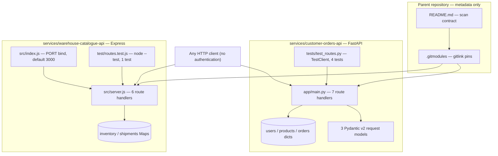

No edge joins `app/main.py` to `src/server.js`: the two applications never call, import, or share state with each other, and the diagram's two subgraphs are connected only through the parent's pins and through external callers.

**Core technical approach.**

- **Two single-module services with no shared code.** All HTTP behaviour of each service lives in one file, and `services/` holds no shared package, dependency, or configuration. The checkout totals 13 tracked files and 225 lines, of which 129 are product code.
- **Import-time construction with process-lifetime state.** `app/main.py` builds `FastAPI(title="Customer Orders API")` and its three dictionaries at import time (lines 5–6); `src/server.js` builds one `express()` instance and its two Maps at import time (lines 2–6). Because the Python test client shares those module globals, the suite must clear them between tests (`tests/test_routes.py` lines 6–9).
- **Two validation styles.** The Python side declares three Pydantic models and relies on type coercion, with no custom validators (`app/main.py` lines 8–19). The Node side hand-checks payloads with guard clauses that return early (`src/server.js` lines 12–15, 27–30).
- **Two error envelopes.** FastAPI raises `HTTPException`, whose default body is a `detail` field; Express handlers return a uniform `error` string field. A client integrating with both must handle two response shapes.
- **Split versus combined entry points.** `uvicorn app.main:app` targets the module-level app object directly, so the Python service needs no separate bootstrap file. On the Node side `server.js` only exports the app and `index.js` owns the bind, which is why the `start` script and the listening file diverge (see 1.2.1).
- **Two testing philosophies.** Python exercises the ASGI app in-process with `TestClient`, opening no socket. Node binds the app to port `0`, calls `/health` over real TCP with the global `fetch`, and closes the server in a `finally` block (`test/routes.test.js` lines 8–16).
- **Pinning without a lockfile.** All five direct dependencies are pinned exactly, but the Node tree has no lockfile, no hashes and no engine constraint, and runtime and test dependencies share one Python file.

### 1.2.3 Success Criteria

**Measurable objectives.**

| Objective | Measure | Verification method | Status implied by the repository |
| --- | --- | --- | --- |
| Both suites pass | 4 pytest tests and 1 `node --test` test green | `pytest -q` in `services/customer-orders-api`; `npm test` in `services/warehouse-catalogue-api` (child READMEs lines 10–11) | Achievable from the code; no pipeline records a result |
| Every declared route answers at its documented happy-path status | 13 routes, 13 success status codes | Handlers in `app/main.py` lines 21–73 and `src/server.js` lines 8–51 | 4 of 13 routes are asserted by a test |
| Every declared rejection is enforced | 13 rejection paths: 6 Python, 7 Node | Guard clauses enumerated in 1.2.2 | 1 of 13 is asserted (`POST /orders` with an unknown product) |
| Liveness is uniform across services | Both `GET /health` return exactly `{"status": "ok"}` | `app/main.py` lines 21–23; `src/server.js` line 8; asserted in both suites | Asserted in both suites |
| Documented start commands serve traffic | `uvicorn app.main:app --host 127.0.0.1 --port 8000` and `npm start` | Manual start per each child README lines 6–7 | The Python command matches its entry point; the Node `start` script never reaches the bind in `src/index.js`, so the documented command does not serve traffic |
| Tests start from clean state | Stores empty before each test | `setup_function` in `tests/test_routes.py` lines 6–9 | Achieved on the Python side; the Node suite has a single test and needs no reset |

**Critical success factors.**

- **Pin discipline.** Each child must be analysed at the commit the parent records (`README.md` line 9), `04259f8` and `f9f72d1`, because neither child's interface is versioned by any other means: there are no tags, and each history holds a single commit.
- **Reproducible installs.** All five direct dependencies are pinned exactly, so a fresh `pip install -r requirements.txt` and `npm install` resolve the same frameworks; transitive npm versions are not fixed.
- **Service independence.** No shared import or configuration means a change in one service cannot break the other, at the cost of having no place where a cross-service invariant could be enforced.
- **Reset-based isolation on the Python side.** Because the app, the models and the stores are module-level singletons, test validity depends on `setup_function` clearing `users`, `products` and `orders` before every test.
- **Explicit rejection semantics.** Each guard returns a specific status and message, which is what makes the rejection paths assertable rather than merely implicit.
- **Visible, honest gap tracking.** The two `## Deliberate analysis gaps` sections are the mechanism by which unverified behaviour stays visible to reviewers.

**Key performance indicators.** The repository records no KPI targets, service-level objectives, or business metrics. The following structural measures are derived directly from the code and are the only quantities the checkout can substantiate:

| Indicator | Baseline in this checkout | Basis |
| --- | --- | --- |
| HTTP routes exposed | 13 (7 customer + 6 warehouse) | `app/main.py` lines 21–73; `src/server.js` lines 8–51 |
| Declared rejection paths | 13 (6 + 7) | Guard clauses in the same two files |
| Automated tests | 5 (4 + 1) | `tests/test_routes.py`; `test/routes.test.js` |
| Routes asserted by tests | 4 of 13 | Test bodies in both suites |
| Declared coverage gaps | 12 (4 named in the Python README, 8 in the Node README) | Child `README.md` lines 12–13 |
| Direct dependencies pinned | 5 (4 with `==`, 1 npm exact) | `requirements.txt`; `package.json` line 6 |
| Cross-service calls | 0 | No outbound HTTP client in either service |
| Persistence backends | 0 | Only in-process dictionaries and Maps |
| Authentication checks | 0 | A token value is issued at `app/main.py` line 38 but never read |

One documentation discrepancy should be read alongside these counts: the comment at `test/routes.test.js` lines 5–6 states that the tests "focus on the health route and a single validation contract", yet the file contains exactly one test, the health probe. The child README's statement that "Only the health route is currently tested" (line 13) matches the code; the test file's own comment overstates coverage.


## 1.3 Scope

### 1.3.1 In-Scope

The in-scope system is exactly the behaviour implemented by the two pinned child services. Nothing the parent owns executes, and nothing outside those two source trees participates at runtime.

**Core features and must-have capabilities.**

| Capability | Service | Implemented by | Declared limit |
| --- | --- | --- | --- |
| Liveness reporting | Both | `GET /health` (`app/main.py` lines 21–23; `src/server.js` line 8) | Constant body; no dependency or readiness check |
| Account registration | Customer Orders | `POST /users` (`app/main.py` lines 25–31) | Uniqueness on the e-mail string only; no format or password policy |
| Credential verification | Customer Orders | `POST /login` (`app/main.py` lines 33–38) | Plain string comparison; the returned token is never validated |
| Catalogue authoring and browsing | Customer Orders | `POST /products`, `GET /products` (`app/main.py` lines 40–48) | Create and list only; no update or delete |
| Order placement with stock reservation and totals | Customer Orders | `POST /orders` (`app/main.py` lines 50–67) | One product per order; total rounded to two decimals |
| Order retrieval | Customer Orders | `GET /orders/{order_id}` (`app/main.py` lines 69–73) | No order listing route |
| Inventory intake by SKU | Warehouse | `POST /inventory` (`src/server.js` lines 10–19) | Create only; `reorderLevel` is accepted without validation |
| Inventory listing | Warehouse | `GET /inventory` (`src/server.js` line 21) | No filter, search, or pagination |
| Shipment creation with stock reservation | Warehouse | `POST /shipments` (`src/server.js` lines 23–36) | One SKU per shipment |
| Shipment retrieval | Warehouse | `GET /shipments/:id` (`src/server.js` lines 38–42) | No shipment listing route |
| Dispatch transition | Warehouse | `POST /shipments/:id/dispatch` (`src/server.js` lines 44–51) | One-way; no cancellation or return |

**Primary user workflows.** Five workflows exist, and they are the complete set the routes can support.

| Workflow | Route sequence | State effect | Service |
| --- | --- | --- | --- |
| Register and authenticate | `POST /users` then `POST /login` | A `users` entry keyed by e-mail holding a UUID and the password; a token string is returned | Customer Orders API |
| Publish and browse the catalogue | `POST /products` then `GET /products` | A `products` entry keyed by a generated UUID | Customer Orders API |
| Place and inspect an order | `POST /orders` then `GET /orders/{order_id}` | `stock` on the product is decremented; the order is stored with its computed total | Customer Orders API |
| Receive stock and create a shipment | `POST /inventory` then `POST /shipments` | An `inventory` entry is created, then its `quantity` is decremented and a shipment is stored as `created` | Warehouse Catalogue API |
| Retrieve and dispatch a shipment | `GET /shipments/:id` then `POST /shipments/:id/dispatch` | The status moves from `created` to `dispatched` and the carrier is recorded | Warehouse Catalogue API |

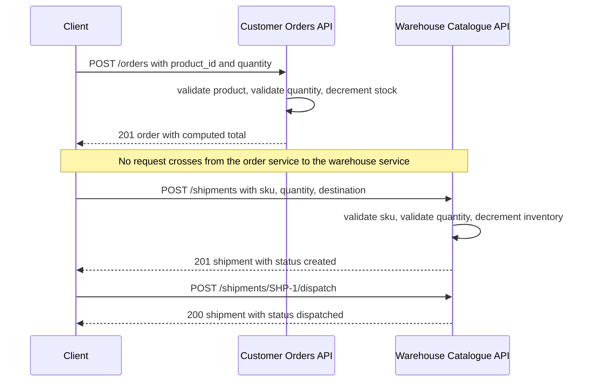

No workflow spans both services: the same conceptual stock reduction happens twice, once against the order service's `stock` field (`app/main.py` line 59) and once against the warehouse service's `quantity` field (`src/server.js` line 31), and the client is the only party that ever sees both.

**Essential integrations.**

| Integration | Mechanism | Evidence |
| --- | --- | --- |
| HTTP and JSON contract per service | JSON request and response bodies over TCP, with documented bind commands | Child READMEs lines 6–7; `src/index.js` lines 2–3 |
| Uniform liveness contract | `GET /health` returning `{"status": "ok"}` on both services | `app/main.py` lines 21–23; `src/server.js` line 8 |
| Framework-generated API documentation | FastAPI's default `/docs` and `/openapi.json`, left enabled at construction | `app/main.py` line 5 |
| Test-harness integration | In-process ASGI `TestClient` for Python; `node --test` with a real ephemeral listener and global `fetch` for Node | `tests/test_routes.py` lines 1–4; `test/routes.test.js` lines 1–11 |
| Source-control composition | Two gitlinks resolved by `git submodule update --init` or `git clone --recurse-submodules` at the pinned commits | `.gitmodules` lines 1–6; parent tree gitlink entries; `README.md` line 9 |

**Key technical requirements.**

| Requirement | Value used | Evidence |
| --- | --- | --- |
| Python web framework | FastAPI 0.115.6 with the Pydantic 2 API (`model_dump` is called on a request model) | `requirements.txt` line 1; `app/main.py` line 43 |
| ASGI server | uvicorn 0.34.0 serving `app.main:app` | `requirements.txt` line 2; child README line 7 |
| Python test stack | pytest 8.3.4 plus httpx 0.28.1, the client behind `TestClient` | `requirements.txt` lines 3–4 |
| Node.js runtime | Must supply the built-in test runner used by the `test` script and a global `fetch` used by the suite; no `engines` constraint is declared | `package.json` lines 1–8; `test/routes.test.js` line 11 |
| Node HTTP framework | Express 4.21.2, loaded as CommonJS because no `type` field is declared | `package.json` lines 1–8 |
| Bind configuration | Warehouse: `process.env.PORT` defaulting to 3000. Customer Orders: uvicorn `--host 127.0.0.1 --port 8000` | `src/index.js` line 2; child README line 7 |
| Repository composition | Each child resolved at the commit the parent pins: `04259f8` and `f9f72d1` | Parent gitlink entries; `README.md` line 9 |

**Implementation boundaries.**

| Boundary | Extent | Evidence |
| --- | --- | --- |
| System boundary | One operating-system process per service; all state lives inside that process | `app/main.py` line 6; `src/server.js` lines 5–6; `src/index.js` line 3 |
| Data boundary | Five in-memory collections: `users`, `products`, `orders`, `inventory`, `shipments` | `app/main.py` line 6; `src/server.js` lines 5–6 |
| User groups covered | Any unauthenticated HTTP caller; no roles, tenants, or per-user ownership checks exist | No authentication code in either service |
| Geographic and market coverage | None declared; no locale, currency, or tax concept, and prices are bare floats | `app/main.py` lines 14 and 65 |
| Data domains included | Credentials, product catalogue with price and stock, orders with quantity and total, inventory keyed by SKU with a reorder level, shipments with destination, status, and carrier | `app/main.py` lines 8–19, 30, 61–66; `src/server.js` lines 11–16, 33 |
| Protocol boundary | JSON over HTTP only; no queue, batch import, file transfer, or streaming interface | `express.json()` at `src/server.js` line 3; Pydantic body models |

### 1.3.2 Out-of-Scope

**Explicitly excluded features and capabilities.**

| Excluded capability | Consequence for a consumer | Evidence of absence |
| --- | --- | --- |
| Authentication and authorization enforcement | Any caller can create products, place orders against stock, receive inventory, and dispatch shipments | The issued token is never read (`app/main.py` line 38); no auth middleware in either service |
| Password hashing or credential protection | Passwords are stored and compared verbatim | `app/main.py` lines 30 and 36; no hashing library pinned |
| Persistent storage of any kind | All records disappear on restart | Only module-level dictionaries and Maps exist (`app/main.py` line 6; `src/server.js` lines 5–6) |
| Pagination, filtering, searching, sorting | Every read returns the full collection in insertion order | `app/main.py` lines 46–48; `src/server.js` line 21 |
| Currency, tax, or money representation | Totals are floats rounded to two decimals with no currency field | `app/main.py` lines 14 and 65 |
| Payments, billing, invoicing | No payment route, field, or dependency exists | All 13 routes listed in 1.2.2 |
| Order-to-shipment linkage or reconciliation | The two ledgers can disagree with no detection | Orders key on UUID product ids, inventory on SKUs, and no service calls the other |
| Amendment or deletion of any record | Products, inventory items, and orders are append-only | No `PUT`, `PATCH`, or `DELETE` handler in either service |
| Cancellation, returns, refunds | Shipment dispatch is a one-way transition, and orders have no state field at all | `src/server.js` lines 47–48; order object at `app/main.py` lines 61–66 |
| Notifications, email, or events | No outbound call, queue, or webhook exists | Only `console.log` at `src/index.js` line 3 |
| Audit trail, request logging, metrics | No record of who changed what, and no telemetry export | No logger or metrics library pinned |
| Rate limiting, CORS, TLS | No cross-origin access is enabled, and no transport security is configured | No CORS middleware, certificate, or proxy configuration in the checkout |
| Build, container, and pipeline automation | Deployment and dependency auditing are manual | No Dockerfile, pipeline definition, lockfile, or environment file anywhere |

**Future phase considerations.** The repository contains no roadmap, and no tracked file describes planned features. The only forward-looking statements it makes are the two `## Deliberate analysis gaps` sections, and they concern verification rather than new capability:

| Gap named by the repository | Source | Kind of gap |
| --- | --- | --- |
| A real HTTP purchase journey against a separately running service | Customer Orders `README.md` line 13 | End-to-end journey |
| A browser or storefront journey | Customer Orders `README.md` line 13 | Client-facing journey |
| Invalid login, duplicate registration, stock decrement, computed order totals | Customer Orders `README.md` line 13 | Behavioural coverage |
| Receiving inventory, creating a shipment, verifying the decrement, retrieving the shipment, dispatching it | Warehouse `README.md` line 13 | End-to-end journey |
| Duplicate SKU, insufficient inventory, repeated dispatch | Warehouse `README.md` line 13 | Boundary and conflict coverage |

Anything beyond these tests — persistence, authentication, cross-service reconciliation — is an architectural extension that the checkout neither plans nor accommodates.

**Integration points not covered.**

| Integration not covered | Consumer-visible effect | Evidence |
| --- | --- | --- |
| Service-to-service order and shipment coordination | An order never reserves warehouse stock, and a shipment never references an order | No outbound HTTP client in either service; only `fetch` is the warehouse test's own health probe |
| Shared identity or enterprise single sign-on | No party can verify a token issued by this system | `app/main.py` line 38 returns a token that no code validates |
| Shared product identity | A product sold by the order service cannot be named to the warehouse service | UUID product ids (`app/main.py` lines 42–44) versus caller-supplied SKUs (`src/server.js` line 11) |
| Database, cache, or message broker | No state survives the process, and no event leaves it | Four pinned Python packages and one pinned npm package, none of them a data client |
| Carrier or logistics provider | The carrier is a free-text string defaulting to `standard`, with no lookup or validation | `src/server.js` line 49 |
| Payment gateway or billing system | Orders record a total but never collect it | All 13 routes |
| API gateway, service mesh, CORS, and TLS termination | Browser cross-origin calls are not enabled and traffic is plain HTTP | No CORS middleware, certificate, or proxy configuration |
| Observability backends | No logs, traces, or metrics reach any collector | Only `console.log` at `src/index.js` line 3 |

**Unsupported use cases.**

| Use case | Why it is unsupported | Evidence |
| --- | --- | --- |
| Running more than one instance of a service | In-process stores are not shared, so replicas diverge and shipment ids repeat | `app/main.py` line 6; `src/server.js` lines 5–6 and 32 |
| Surviving a restart | State exists only in memory | Same stores; no persistence dependency |
| Concurrent order or shipment commits | The availability check and the decrement are separate statements with no lock or transaction | `app/main.py` lines 57–59; `src/server.js` lines 30–31 |
| Ordering warehouse stock by SKU | The order service only recognizes product ids it generated itself | `app/main.py` lines 52–54 |
| Ordering more than one product per order | The request model carries a single `product_id` and `quantity` | `app/main.py` lines 17–19 |
| Zero or negative pricing | `price` is an unconstrained float, so such values are accepted and totalled | `app/main.py` line 14 |
| Multi-currency or tax-inclusive totals | No currency or tax field exists | `app/main.py` line 65 |
| Access control by role or owner | No credential is checked on any route | No authentication code in either service |
| Re-dispatching or reversing a shipment | The status transition is one-way | `src/server.js` lines 47–48 |

The exclusions above bound the system to single-instance, single-currency, in-memory, unauthenticated execution of its five workflows. Any use beyond that requires components the checkout does not contain.


## 1.4 References

- `README.md` — parent repository declaration: the metadata-only statement, the two-submodule inventory with technology labels, and the expected behaviour of analysing each child at its pinned commit.
- `.gitmodules` — the two `[submodule]` stanzas, each giving a mount path under `services/` and an external HTTPS clone remote; establishes that no global submodule options, branches, or shallow settings are declared.
- `.gitignore` — its single `.DS_Store` entry, which confirms no build output, dependency directory, or generated configuration is intentionally ignored in this checkout.
- `services/` — folder holding exactly the two child repositories and nothing shared: no common manifest, configuration, lockfile, container asset, pipeline definition, or test harness.
- `services/customer-orders-api/README.md` — the service's self-description, the documented install and run commands (`uvicorn app.main:app --host 127.0.0.1 --port 8000`), the test command, and the `## Deliberate analysis gaps` section naming the four untested behaviours.
- `services/customer-orders-api/requirements.txt` — the four exact `==` pins that fix FastAPI, uvicorn, pytest, and httpx, with runtime and test dependencies combined.
- `services/customer-orders-api/app/` — the application package; `__init__.py` is empty and `main.py` (73 lines) holds the entire HTTP surface.
- `services/customer-orders-api/app/main.py` — app construction at line 5, the three in-memory stores at line 6, the three request models at lines 8–19, and all seven route handlers at lines 21–73, including every guard clause and the order-total computation.
- `services/customer-orders-api/tests/test_routes.py` — the four tests, the module-level `TestClient`, and the `setup_function` that clears the shared stores; source for the covered-versus-uncovered comparison in 1.2.3.
- `services/warehouse-catalogue-api/README.md` — the service's self-description, the `npm install` and `npm start` commands, the test command, and the `## Deliberate analysis gaps` section naming the untested journey and boundary cases.
- `services/warehouse-catalogue-api/package.json` — identity and version, the `"private": true` flag, the `start` and `test` scripts, the single Express 4.21.2 pin, and the absent `type` and `engines` fields.
- `services/warehouse-catalogue-api/src/` — the two-file implementation; `server.js` exports the app and `index.js` performs the port bind.
- `services/warehouse-catalogue-api/src/server.js` — the Express app, the two Maps at lines 5–6, and all six route handlers at lines 8–51, including guard clauses, the `SHP-` identifier derivation, and the one-way dispatch transition.
- `services/warehouse-catalogue-api/src/index.js` — the `PORT` override defaulting to 3000 and the single startup log line.
- `services/warehouse-catalogue-api/test/routes.test.js` — the one automated test, its ephemeral-port listener, global `fetch` call, and `finally`-block server close; also the source of the coverage comment that conflicts with the file's actual content.
- Parent and child Git metadata (`git submodule status`, `git ls-tree`, `git log`, `git rev-parse`) — the pinned commits `04259f82d5a8f87ff9d81d5fdd1dfdefaee4e564` and `f9f72d1c37091f8845e3e3727515fa713ebe20b1`, the `160000` gitlink entries, the single commit in each child history, and the parent's one commit `395c1ce`.

No external web sources were consulted; every claim in this section derives from the files and Git metadata above.


# 2. Product Requirements

## 2.1 Feature Catalog

### 2.1.1 Catalog Overview and Conventions

The product is the union of the two pinned child services plus the verification and documentation surfaces they ship. The catalog below enumerates every capability the checkout actually implements: twelve features correspond one-to-one with the 13 HTTP route handlers (the liveness contract is served by both services and is therefore catalogued once), and two further features cover the automated route verification delivered in the child test suites and the interactive documentation surface that FastAPI mounts for the order service. The parent repository owns no feature of its own — `README.md` line 3 states it "contains no application source and no tests of its own" — so every feature below is attributed to the child service that implements it.

| Feature ID | Feature Name | Category | Priority |
| --- | --- | --- | --- |
| F-001 | Service Liveness Probe | Platform / Operability | High |
| F-002 | Account Registration | Identity | High |
| F-003 | Credential Verification | Identity | High |
| F-004 | Product Catalogue Authoring | Catalogue | Critical |
| F-005 | Product Catalogue Browsing | Catalogue | High |
| F-006 | Order Placement with Stock Decrement | Order Fulfilment | Critical |
| F-007 | Order Retrieval | Order Fulfilment | High |
| F-008 | Inventory Intake by SKU | Warehouse Inventory | Critical |
| F-009 | Inventory Listing | Warehouse Inventory | Medium |
| F-010 | Shipment Creation with Inventory Reservation | Shipments | Critical |
| F-011 | Shipment Retrieval | Shipments | Medium |
| F-012 | Shipment Dispatch | Shipments | High |
| F-013 | Automated Route Verification | Quality Assurance | Medium |
| F-014 | Interactive API Documentation | Developer Experience | Low |

| Feature ID | Status | Implementing Service | HTTP Surface |
| --- | --- | --- | --- |
| F-001 | Completed | Both services | `GET /health` (×2) |
| F-002 | Completed | Customer Orders API | `POST /users` |
| F-003 | Completed | Customer Orders API | `POST /login` |
| F-004 | Completed | Customer Orders API | `POST /products` |
| F-005 | Completed | Customer Orders API | `GET /products` |
| F-006 | Completed | Customer Orders API | `POST /orders` |
| F-007 | Completed | Customer Orders API | `GET /orders/{order_id}` |
| F-008 | Completed | Warehouse Catalogue API | `POST /inventory` |
| F-009 | Completed | Warehouse Catalogue API | `GET /inventory` |
| F-010 | Completed | Warehouse Catalogue API | `POST /shipments` |
| F-011 | Completed | Warehouse Catalogue API | `GET /shipments/:id` |
| F-012 | Completed | Warehouse Catalogue API | `POST /shipments/:id/dispatch` |
| F-013 | In Development | Both services | `pytest -q`; `npm test` |
| F-014 | Completed | Customer Orders API | `GET /docs`, `GET /openapi.json` |

**Priority scale.** Priority expresses how much of the product's purpose fails without the feature, judged from the call graph in the two source files rather than from any business document, because no tracked file states a business priority.

| Priority | Meaning applied in this catalog | Features at this level |
| --- | --- | --- |
| Critical | Removing the feature breaks a workflow the other features cannot route around | F-004, F-006, F-008, F-010 |
| High | The feature is part of a primary workflow and its workflows are only partly usable without it | F-001, F-002, F-003, F-005, F-007, F-012 |
| Medium | The feature is a read or verification convenience over state produced elsewhere | F-009, F-011, F-013 |
| Low | The feature is a developer-facing surface that no runtime workflow depends on | F-014 |

**Status scale.** Status records whether the behaviour is present in the pinned commits, not whether it is production-ready. No feature in this catalog is production-ready: section 1.3.2 records the absent persistence, access control, money handling and observability that would be prerequisites, and section 1.2.1 tabulates the resulting limitations.

| Status | Applied when | Features at this status |
| --- | --- | --- |
| Completed | The handler or artifact exists at the pinned commit and is reachable exactly as documented below | F-001 to F-012, F-014 |
| In Development | The artifact exists and runs, but its own README declares unverified behaviours it does not yet prove | F-013 |
| Approved / Proposed | Not used: no tracked file records an approved-but-unbuilt or proposed capability, and neither child README contains a roadmap | None |

**Identifier conventions.** Feature identifiers are `F-XXX`; requirement identifiers are `F-XXX-RQ-YYY`, scoped to their feature so that `F-006-RQ-004` is the fourth requirement of Order Placement. Implementation consideration identifiers are `TC-` (technical constraint), `PR-` (performance), `SC-` (scalability), `SI-` (security) and `MR-` (maintenance), defined and mapped to features in section 2.4. Every claim is anchored to the child commit the parent pins — `04259f82d5a8f87ff9d81d5fdd1dfdefaee4e564` for `services/customer-orders-api` and `f9f72d1c37091f8845e3e3727515fa713ebe20b1` for `services/warehouse-catalogue-api` — per the scan contract in `README.md` line 9.

### 2.1.2 F-001 Service Liveness Probe

| Field | Value |
| --- | --- |
| Feature ID | F-001 |
| Feature Name | Service Liveness Probe |
| Category | Platform / Operability |
| Priority | High |
| Status | Completed |
| Implementing service | Both services |
| Implementation | `services/customer-orders-api/app/main.py` lines 21–23; `services/warehouse-catalogue-api/src/server.js` line 8 |

**Overview.** Each service exposes a single constant-success route, `GET /health`, that returns HTTP 200 with exactly the body `{"status": "ok"}`. The Python handler returns a dict that FastAPI serializes; the Node handler is a one-line arrow function calling `res.json`. Neither handler reads or writes the in-memory stores, and neither reports a version, uptime, dependency status or readiness distinction.

**Business value.** The probe gives an operator or orchestrator one uniform, side-effect-free way to confirm that a process is serving traffic, and because both services return byte-identical bodies, a single probe definition serves both deployments.

**User benefits.** A caller can distinguish "process answering" from "process absent" without constructing domain state, so a health check never allocates a user, product, inventory item or shipment.

**Technical context.** The contract is duplicated rather than shared: the two implementations sit in unrelated languages with no common module, so the identical body is a convention held by two files, not an enforced interface. The probe is the only surface both suites assert (see F-013).

| Dependency | Detail |
| --- | --- |
| Prerequisite features | None |
| System dependencies | FastAPI 0.115.6 served by uvicorn 0.34.0 for the order service; Express 4.21.2 for the warehouse service |
| External dependencies | None; the handler imports nothing beyond the framework |
| Integration requirements | Probe consumer must accept HTTP 200 with a JSON body; the order service is bound to `127.0.0.1:8000` by its documented command (`services/customer-orders-api/README.md` line 7) and the warehouse service to `process.env.PORT` defaulting to 3000 (`src/index.js` line 2) |

### 2.1.3 F-002 Account Registration

| Field | Value |
| --- | --- |
| Feature ID | F-002 |
| Feature Name | Account Registration |
| Category | Identity |
| Priority | High |
| Status | Completed |
| Implementing service | Customer Orders API |
| Implementation | `services/customer-orders-api/app/main.py` lines 25–31 |
| HTTP surface | `POST /users`, declared `status_code=201` |

**Overview.** A caller submits an e-mail and password, and the service mints a `uuid4` identifier and stores the pair in the `users` dictionary under the e-mail string as key. The response is `{"id", "email"}`; the password is stored but never returned. A repeated e-mail is rejected with 409 `email already registered` (lines 27–28).

**Business value.** Registration is the only path by which an account enters the order service, and therefore the prerequisite for the login feature that follows it.

**User benefits.** One call returns the assigned identifier in the same response that creates the account, so a client never has to read the account back to learn its id.

**Technical context.** Uniqueness is plain dictionary-key equality on the raw submitted string: there is no case folding, whitespace trimming or format validation, and `EmailStr` is imported at line 2 but never used, so a malformed address is accepted. No password policy, length bound or hashing exists — the credential is stored verbatim at line 30, and no hashing library appears in `requirements.txt`.

| Dependency | Detail |
| --- | --- |
| Prerequisite features | None |
| System dependencies | Pydantic `RegisterRequest` model (lines 8–10) for body parsing; `uuid.uuid4` for identifier generation; the module-level `users` store (line 6) |
| External dependencies | None |
| Integration requirements | JSON body carrying both `email` and `password`; a body missing either field is rejected by model validation before the handler runs |

### 2.1.4 F-003 Credential Verification

| Field | Value |
| --- | --- |
| Feature ID | F-003 |
| Feature Name | Credential Verification |
| Category | Identity |
| Priority | High |
| Status | Completed |
| Implementing service | Customer Orders API |
| Implementation | `services/customer-orders-api/app/main.py` lines 33–38 |
| HTTP surface | `POST /login` |

**Overview.** The caller resubmits an e-mail and password; the service looks the account up by e-mail, compares the stored password string against the submitted one, and on success returns `{"user_id", "token"}` where the token is the formatted string `token-<user_id>`. Any mismatch — unknown e-mail or wrong password — produces the same 401 `invalid credentials` (lines 36–37).

**Business value.** Login is the only place the service mints a token, and the only place it confirms that a submitted secret matches a registered one. It is the whole of the authentication capability the checkout contains.

**User benefits.** The single, identical failure message means a caller cannot tell a registered address from an unregistered one by the response, and the successful body carries the account identifier alongside the token in one round trip.

**Technical context.** The handler reuses `RegisterRequest` as its body model, so the login contract and the registration contract are the same Pydantic type. The token is a constructed string with no signature, expiry, scope or storage, and no route or middleware in either service ever reads it — the only repository-wide hit for token handling is line 38 that issues it, which is why section 1.3.2 lists enforced authentication as out of scope.

| Dependency | Detail |
| --- | --- |
| Prerequisite features | F-002 — a matching `users` entry must already exist |
| System dependencies | Pydantic `RegisterRequest` model; the `users` store |
| External dependencies | None declared |
| Integration requirements | JSON body carrying both `email` and `password`; a client that persists the returned token must treat it as opaque and non-authoritative, because no other endpoint validates it |

### 2.1.5 F-004 Product Catalogue Authoring

| Field | Value |
| --- | --- |
| Feature ID | F-004 |
| Feature Name | Product Catalogue Authoring |
| Category | Catalogue |
| Priority | Critical |
| Status | Completed |
| Implementing service | Customer Orders API |
| Implementation | `services/customer-orders-api/app/main.py` lines 40–44 |
| HTTP surface | `POST /products`, declared `status_code=201` |

**Overview.** A caller supplies `name`, `price` and `stock`; the service mints a `uuid4` product identifier and stores `payload.model_dump()` under it, then echoes the stored record merged with its new `id`. This and the browsing feature are the only ways catalogue state is created or read — no update or delete handler exists in either service.

**Business value.** Nothing can be ordered until a product exists, so this feature gates the order workflow that the order service exists to serve.

**User benefits.** The created record comes back with the identifier a client needs to reference the product in a later order, so no follow-up read is required.

**Technical context.** Validation is Pydantic type coercion and nothing more. The `ProductRequest` model declares `price: float` and `stock: int` with no bounds, so zero and negative values for either field are stored verbatim; `name` carries no length or content constraint; and there is no uniqueness rule, so identical products can be created repeatedly. The record is stored by reference in the `products` dict, which is why the later stock decrement in F-006 is visible through F-005.

| Dependency | Detail |
| --- | --- |
| Prerequisite features | None |
| System dependencies | Pydantic `ProductRequest` model (lines 12–15); `uuid.uuid4`; the `products` store (line 6) |
| External dependencies | None |
| Integration requirements | JSON body with `name`, `price` and `stock`; `price` must be a JSON number convertible to float and `stock` an integer-convertible value, or model validation rejects the request before the handler runs |

### 2.1.6 F-005 Product Catalogue Browsing

| Field | Value |
| --- | --- |
| Feature ID | F-005 |
| Feature Name | Product Catalogue Browsing |
| Category | Catalogue |
| Priority | High |
| Status | Completed |
| Implementing service | Customer Orders API |
| Implementation | `services/customer-orders-api/app/main.py` lines 46–48 |
| HTTP surface | `GET /products` |

**Overview.** The handler returns every catalogue entry as a JSON array, each element the stored record merged with its `id`, in dictionary insertion order. An empty catalogue returns an empty array; the route takes no path parameter, query parameter or body.

**Business value.** This is the only read path over the catalogue and therefore the only way a client can discover the product identifiers that F-006 requires.

**User benefits.** A single call yields the whole catalogue with live `stock` values, so a client can tell which products are orderable without probing each one.

**Technical context.** The list is built by a comprehension over `products.items()`, so ordering is the insertion order of a Python dict and the price and stock shown are the current values, including any decrement already applied by an order. There is no pagination, filtering, searching or sorting: every call serializes the entire collection however large it has grown.

| Dependency | Detail |
| --- | --- |
| Prerequisite features | F-004 — supplies every element; an empty store still serves a valid empty array |
| System dependencies | The `products` store; FastAPI JSON serialization of a list of dicts |
| External dependencies | None |
| Integration requirements | Returns `application/json` array; a client must tolerate an unbounded and unpaginated payload |

### 2.1.7 F-006 Order Placement with Stock Decrement

| Field | Value |
| --- | --- |
| Feature ID | F-006 |
| Feature Name | Order Placement with Stock Decrement |
| Category | Order Fulfilment |
| Priority | Critical |
| Status | Completed |
| Implementing service | Customer Orders API |
| Implementation | `services/customer-orders-api/app/main.py` lines 50–67 |
| HTTP surface | `POST /orders`, declared `status_code=201` |

**Overview.** A caller supplies one `product_id` and one `quantity`. The handler resolves the product, rejects an unknown identifier with 404 `product not found`, rejects a non-positive quantity with 400 `quantity must be positive`, rejects a quantity above available stock with 409 `insufficient stock`, then decrements the stored product's `stock` and persists an order of `{id, product_id, quantity, total}` where `total` is `round(price * quantity, 2)`.

**Business value.** This is the transaction the order service exists for: it converts catalogue stock into a priced, retrievable order and is the only place the service computes money.

**User benefits.** One call both reserves stock and returns the final total, and the three failure paths are distinguishable by status code, so a client can tell "wrong product" (404) from "bad quantity" (400) from "not enough stock" (409).

**Technical context.** The guards are ordered, so the product lookup at lines 53–54 runs before the quantity check at lines 55–56: an unknown product submitted with quantity zero returns 404, not 400. The decrement at line 59 mutates the object held in the `products` store, so the reduced stock is immediately visible through F-005. The total is computed from the price held at order time, and Python's `round` is round-half-to-even, so binary-representation ties can round down rather than up. The order record carries no status, no user or account reference, no timestamp and no currency. The check-then-decrement sequence is not atomic: there is no lock and no transaction, so concurrent requests can both pass the stock check.

| Dependency | Detail |
| --- | --- |
| Prerequisite features | F-004 supplies the product and its price; F-005 is the documented way a client discovers a valid `product_id` |
| System dependencies | Pydantic `OrderRequest` model (lines 17–19); the `products` and `orders` stores; `uuid.uuid4`; Python `round` |
| External dependencies | None |
| Integration requirements | JSON body with `product_id` and integer `quantity`; the identifier must be one previously returned by F-004 or listed by F-005 — identifiers minted by the warehouse service are meaningless here |

### 2.1.8 F-007 Order Retrieval

| Field | Value |
| --- | --- |
| Feature ID | F-007 |
| Feature Name | Order Retrieval |
| Category | Order Fulfilment |
| Priority | High |
| Status | Completed |
| Implementing service | Customer Orders API |
| Implementation | `services/customer-orders-api/app/main.py` lines 69–73 |
| HTTP surface | `GET /orders/{order_id}` |

**Overview.** The handler returns the stored order for a supplied identifier, or 404 `order not found` when the identifier is absent from the `orders` store. The response is the record returned by F-006, unchanged.

**Business value.** An order is only useful to a client that can read it back, so this feature is the confirmation and reconciliation surface of the order workflow.

**User benefits.** The read is repeatable and has no side effects, so a client can poll it without changing stock or creating records.

**Technical context.** The path parameter is an unvalidated string used directly as a dictionary key. Only `POST` is registered on the `/orders` collection path, so no order listing exists — an order can be retrieved only by an identifier the caller already holds. The record returned is the stored dict itself, so it reflects no later change, because no handler mutates orders after creation.

| Dependency | Detail |
| --- | --- |
| Prerequisite features | F-006 — produces the only records this feature can return |
| System dependencies | FastAPI path-parameter binding; the `orders` store |
| External dependencies | None |
| Integration requirements | Caller must retain the `id` from the 201 response of F-006; no discovery route exists to recover a lost identifier |

### 2.1.9 F-008 Inventory Intake by SKU

| Field | Value |
| --- | --- |
| Feature ID | F-008 |
| Feature Name | Inventory Intake by SKU |
| Category | Warehouse Inventory |
| Priority | Critical |
| Status | Completed |
| Implementing service | Warehouse Catalogue API |
| Implementation | `services/warehouse-catalogue-api/src/server.js` lines 10–19 |
| HTTP surface | `POST /inventory` |

**Overview.** A caller supplies `sku`, `name`, a non-negative integer `quantity` and an optional `reorderLevel`. The handler validates the payload, rejects a duplicated SKU with 409 `duplicate sku`, and stores the item in the `inventory` Map keyed by SKU, returning 201 with the stored item. `reorderLevel` defaults to `5`.

**Business value.** Stock enters the warehouse ledger only through this route, and the caller-chosen SKU becomes the identifier that every later shipment references, so this feature defines the warehouse's identity space.

**User benefits.** The caller controls the key, so an integrating system can use its own SKU vocabulary rather than a generated identifier; and the response echoes the complete stored item, including the defaulted reorder level.

**Technical context.** Validation is a single guard clause at line 12 combining a truthiness test on `sku` and `name` with `Number.isInteger(quantity)` and `quantity < 0`. The consequences are precise: `quantity` of `0` is accepted, a numeric string such as `"5"` is rejected, and `sku`/`name` pass on truthiness alone, so whitespace-only strings and non-string truthy values are stored. The default at line 11 applies only when the property is absent or `undefined`, so an explicit `null` is stored as `null`. `reorderLevel` is never validated or type-checked. The duplicate check at line 15 precedes storage, so the Map's `SKU` key is the sole uniqueness constraint. There is no update or delete handler, so an item's `name` and `reorderLevel` are fixed at intake.

| Dependency | Detail |
| --- | --- |
| Prerequisite features | None |
| System dependencies | `express.json()` body parsing mounted at `src/server.js` line 3; the `inventory` Map (line 5) |
| External dependencies | Node.js runtime; Express 4.21.2 pinned in `package.json` line 6 |
| Integration requirements | JSON request body — the body parser populates `req.body` only for JSON content types, so a request sent with any other content type reaches line 12 with all fields absent and is rejected with 400 |

### 2.1.10 F-009 Inventory Listing

| Field | Value |
| --- | --- |
| Feature ID | F-009 |
| Feature Name | Inventory Listing |
| Category | Warehouse Inventory |
| Priority | Medium |
| Status | Completed |
| Implementing service | Warehouse Catalogue API |
| Implementation | `services/warehouse-catalogue-api/src/server.js` line 21 |
| HTTP surface | `GET /inventory` |

**Overview.** The handler returns `[...inventory.values()]` — every stored inventory item as a JSON array in Map insertion order. An empty inventory returns an empty array, and the route accepts no parameters.

**Business value.** It is the only read path over warehouse stock, and therefore the only way an operator can confirm that an intake, a reservation or a dispatch-adjacent decrement produced the expected quantity.

**User benefits.** One call reports current quantities for all SKUs, so reconciling a shipment against stock needs no per-SKU probe.

**Technical context.** Map iteration is insertion-ordered, so the array order reflects intake order. Because the Map stores the item object by reference and F-010 mutates `item.quantity` in place at line 31, this listing always shows post-reservation quantities. No filtering, pagination or sorting exists; the full collection is serialized on every call.

| Dependency | Detail |
| --- | --- |
| Prerequisite features | F-008 supplies every element; the listing also reflects quantities reduced by F-010 |
| System dependencies | The `inventory` Map; Express `res.json` array serialization |
| External dependencies | None |
| Integration requirements | Returns an unpaginated JSON array whose length grows with the SKU count |

### 2.1.11 F-010 Shipment Creation with Inventory Reservation

| Field | Value |
| --- | --- |
| Feature ID | F-010 |
| Feature Name | Shipment Creation with Inventory Reservation |
| Category | Shipments |
| Priority | Critical |
| Status | Completed |
| Implementing service | Warehouse Catalogue API |
| Implementation | `services/warehouse-catalogue-api/src/server.js` lines 23–36 |
| HTTP surface | `POST /shipments` |

**Overview.** A caller supplies `sku`, `quantity` and `destination`. The handler resolves the inventory item, rejects an unknown SKU with 404 `sku not found`, rejects a non-integer or non-positive quantity with 400 `quantity must be positive`, rejects a quantity above available stock with 409 `insufficient inventory`, then decrements the item's `quantity`, derives an identifier `SHP-<n>`, and stores a shipment with `status: 'created'`. The 201 response returns the shipment.

**Business value.** This is the warehouse service's reservation transaction: it is the only place stock is committed to an outbound movement and the only producer of shipment records.

**User benefits.** Reservation and shipment creation happen in one call, so a caller cannot reserve stock without also receiving a shipment identifier to track and dispatch, and the three rejection paths are distinguishable by status code.

**Technical context.** Guards are ordered, so the SKU lookup at line 26 precedes the quantity check at lines 27–28 and an unknown SKU always yields 404 regardless of quantity. The decrement at line 31 mutates the stored item, making the reservation visible through F-009. The identifier is derived from `shipments.size + 1` rather than generated, so it is unique only within one process lifetime and repeats after a restart or in a parallel process. `destination` is destructured with no default and never validated, so a request that omits it stores `undefined`, which JSON serialization then omits from the response body. The check-then-write sequence is not atomic.

| Dependency | Detail |
| --- | --- |
| Prerequisite features | F-008 — a matching SKU must already exist in the inventory Map |
| System dependencies | `express.json()` body parsing; the `inventory` and `shipments` Maps (lines 5–6) |
| External dependencies | None |
| Integration requirements | JSON body with `sku` and integer `quantity` (plus optional `destination`); the SKU is the warehouse service's own vocabulary, so no `product_id` minted by the order service is accepted here |

### 2.1.12 F-011 Shipment Retrieval

| Field | Value |
| --- | --- |
| Feature ID | F-011 |
| Feature Name | Shipment Retrieval |
| Category | Shipments |
| Priority | Medium |
| Status | Completed |
| Implementing service | Warehouse Catalogue API |
| Implementation | `services/warehouse-catalogue-api/src/server.js` lines 38–42 |
| HTTP surface | `GET /shipments/:id` |

**Overview.** The handler returns the stored shipment for the supplied identifier, or 404 `shipment not found` when the Map holds no such key. The response is the shipment record as last written.

**Business value.** It is the only way to confirm a shipment's existence and status, and therefore the read side of the dispatch workflow in F-012.

**User benefits.** The read is side-effect-free and shows the current status, so a client can verify a dispatch by re-reading rather than inferring it.

**Technical context.** `req.params.id` is used directly as a Map key with no format check. A shipment read before dispatch contains exactly `id`, `sku`, `quantity`, `destination` and `status`; the `carrier` property exists only after F-012 writes it. Only `POST` is registered on the `/shipments` collection path, so no shipment listing exists.

| Dependency | Detail |
| --- | --- |
| Prerequisite features | F-010 — produces the only records this feature can return |
| System dependencies | Express route-parameter binding; the `shipments` Map |
| External dependencies | None |
| Integration requirements | Caller must hold the `SHP-` identifier returned by F-010; no discovery route exists |

### 2.1.13 F-012 Shipment Dispatch

| Field | Value |
| --- | --- |
| Feature ID | F-012 |
| Feature Name | Shipment Dispatch |
| Category | Shipments |
| Priority | High |
| Status | Completed |
| Implementing service | Warehouse Catalogue API |
| Implementation | `services/warehouse-catalogue-api/src/server.js` lines 44–51 |
| HTTP surface | `POST /shipments/:id/dispatch` |

**Overview.** The handler loads the shipment, rejects an unknown identifier with 404 `shipment not found`, rejects any status other than `created` with 409 `shipment cannot be dispatched`, then sets `status` to `dispatched`, records `carrier` from the request body defaulting to `standard`, and returns 200 with the updated shipment.

**Business value.** Dispatch is the only state transition in the whole checkout and the terminus of the warehouse workflow: it is what marks reserved stock as having left the building.

**User benefits.** A single call advances the shipment and returns the updated record, so the caller learns both the new status and the recorded carrier without a follow-up read.

**Technical context.** The transition is one-way — the guard at line 47 admits only `created`, so a second dispatch returns 409 and the stored status is unchanged, and no cancellation or reversal exists. `carrier` is assigned as `req.body.carrier || 'standard'`, so any falsy value (empty string, `null`, `0`, `false`) falls back to `standard` and no carrier vocabulary is validated. No dispatch timestamp is recorded, and `destination` and `quantity` are not re-validated at dispatch.

| Dependency | Detail |
| --- | --- |
| Prerequisite features | F-010 creates the shipment in the `created` state this feature consumes; F-011 is the documented way to observe the resulting status |
| System dependencies | `express.json()` body parsing for the optional carrier; the `shipments` Map |
| External dependencies | None; the carrier is free text with no provider lookup |
| Integration requirements | Path identifier from F-010 plus an optional JSON body of `{"carrier": "<name>"}`; no credential is required or checked |

### 2.1.14 F-013 Automated Route Verification

| Field | Value |
| --- | --- |
| Feature ID | F-013 |
| Feature Name | Automated Route Verification |
| Category | Quality Assurance |
| Priority | Medium |
| Status | In Development |
| Implementing service | Both services |
| Implementation | `services/customer-orders-api/tests/test_routes.py` (26 lines, 4 tests); `services/warehouse-catalogue-api/test/routes.test.js` (17 lines, 1 test) |

**Overview.** Two independent suites supply the only executable evidence that the contracts hold. The Python suite drives the ASGI app in process through `TestClient` with no socket opened, and covers the health route, user registration, product creation and the unknown-product order rejection. The Node suite binds the app to an ephemeral port (`app.listen(0)`), calls `/health` over real TCP with the global `fetch`, and closes the server in a `finally` block.

**Business value.** The suites are what makes the 13 route contracts regression-checkable at all; both pin the one contract the two services share, and the Python suite pins the three routes whose behaviour is easiest to break by accident.

**User benefits.** A maintainer can run `pytest -q` in `services/customer-orders-api` and `npm test` in `services/warehouse-catalogue-api` with no external service, database or network dependency, and the documented commands are `README.md` lines 9–10 in each child.

**Technical context.** Coverage is deliberately partial: 6 of the 51 requirements catalogued in 2.2 carry an assertion, and F-003, F-005, F-007, F-008, F-009, F-010, F-011, F-012 and F-014 are entirely unasserted. The Python suite must clear the shared module-level stores before each test (`setup_function`, lines 6–9) because the app, its models and its three dictionaries are import-time singletons. The Node suite has a single test and therefore needs no reset. One traceability note is recorded in section 1.2.3 and repeated here because it affects how coverage should be read: the comment at `test/routes.test.js` lines 5–6 claims the tests focus on "the health route and a single validation contract", but the file contains one test, the health probe. Both child READMEs declare their gaps explicitly in a `## Deliberate analysis gaps` section (line 13 in each).

| Dependency | Detail |
| --- | --- |
| Prerequisite features | F-001 is asserted by both suites; F-002, F-004 and F-006 are asserted by the Python suite and must keep their documented contract for those tests to hold |
| System dependencies | pytest 8.3.4 with httpx 0.28.1 (the client behind `TestClient`); a Node.js runtime providing the built-in test runner used by `npm test` and a global `fetch` — neither an `engines` constraint nor a lockfile constrains the Node version |
| External dependencies | None beyond loopback: the Node test opens a local ephemeral port, and no suite calls a third-party service |
| Integration requirements | `pytest -q` must be run with `services/customer-orders-api` on the import path so `app.main` resolves, since `app/__init__.py` exists only to make the package importable; there is no `conftest.py`, `pytest.ini` or `pyproject.toml` in the checkout |

### 2.1.15 F-014 Interactive API Documentation

| Field | Value |
| --- | --- |
| Feature ID | F-014 |
| Feature Name | Interactive API Documentation |
| Category | Developer Experience |
| Priority | Low |
| Status | Completed |
| Implementing service | Customer Orders API |
| Implementation | `services/customer-orders-api/app/main.py` line 5 — `FastAPI(title="Customer Orders API")` constructed with no `docs_url`, `redoc_url` or `openapi_url` override |
| HTTP surface | `GET /docs`, `GET /openapi.json` |

**Overview.** Because the app is constructed at line 5 without disabling them, FastAPI's default documentation routes are served: `GET /openapi.json` returns the generated schema titled `Customer Orders API` describing the seven registered routes and their Pydantic request models, and `GET /docs` serves the framework's interactive Swagger UI over that schema. The warehouse service exposes no equivalent, because Express provides none by default and the checkout mounts no documentation middleware.

**Business value.** An integrating developer can discover the order service's requests, responses and models from the running process instead of reading the source, which lowers the cost of the first integration attempt.

**User benefits.** The schema is machine-readable and self-describing, so a client can be generated or a request shaped directly from `/openapi.json` without prior knowledge of the handlers.

**Technical context.** This surface is entirely a framework default rather than repository code: no file in the checkout constructs a schema, annotates a response model, or configures a documentation theme. The consequence is that the schema describes request models accurately but response shapes only loosely, because no handler declares a `response_model` — the documented contract is therefore narrower than the actual payloads.

| Dependency | Detail |
| --- | --- |
| Prerequisite features | F-001 to F-007 — they populate the schema; the surface itself exists as soon as the app is constructed |
| System dependencies | FastAPI 0.115.6 and its bundled Starlette routing, which serve both routes from the same app instance |
| External dependencies | None declared in the repository; the documentation surface adds no dependency beyond FastAPI |
| Integration requirements | Plain HTTP GET on the same host and port as the API — `127.0.0.1:8000` under the documented uvicorn command; the warehouse service on its own port has no corresponding routes |


## 2.2 Functional Requirements

### 2.2.1 Conventions and Coverage Summary

Every requirement below is expressed as an observable HTTP exchange or, for F-013, an observable command result, so each acceptance criterion can be asserted without inspecting internals. Requirement identifiers are scoped to their feature: `F-006-RQ-004` is the fourth requirement of Order Placement. Requirement priority uses MoSCoW, applied against the feature's own contract rather than an external business document: `Must-Have` is a behaviour the feature cannot satisfy its purpose without, `Should-Have` is a behaviour the code deliberately implements but that a caller could work around, and `Could-Have` is a documented property that no workflow depends on. Complexity rates the difficulty of verifying the requirement as specified — `Low` for a single request and status assertion, `Medium` where state must be primed across two or more calls or where floating-point, ordering or identifier behaviour must be pinned, `High` where verification needs concurrency or process-lifecycle control that the delivered suites do not provide.

The catalog holds 51 requirements: 39 Must-Have, 10 Should-Have and 2 Could-Have. Six carry a passing assertion in the delivered suites; the remaining 45 are unasserted and are traceable to the declared gaps in `services/customer-orders-api/README.md` line 13 and `services/warehouse-catalogue-api/README.md` line 13. Section 2.5 records the requirement-by-requirement traceability.

| Feature | Requirements | Asserted by a test | Unasserted |
| --- | --- | --- | --- |
| F-001 Service Liveness Probe | 3 | 3 | 0 |
| F-002 Account Registration | 4 | 1 | 3 |
| F-003 Credential Verification | 3 | 0 | 3 |
| F-004 Product Catalogue Authoring | 3 | 1 | 2 |
| F-005 Product Catalogue Browsing | 3 | 0 | 3 |
| F-006 Order Placement with Stock Decrement | 6 | 1 | 5 |
| F-007 Order Retrieval | 3 | 0 | 3 |
| F-008 Inventory Intake by SKU | 5 | 0 | 5 |
| F-009 Inventory Listing | 3 | 0 | 3 |
| F-010 Shipment Creation with Inventory Reservation | 6 | 0 | 6 |
| F-011 Shipment Retrieval | 3 | 0 | 3 |
| F-012 Shipment Dispatch | 3 | 0 | 3 |
| F-013 Automated Route Verification | 4 | 0 | 0 |
| F-014 Interactive API Documentation | 2 | 0 | 2 |

F-013's four requirements describe the harness itself, so they are verified by running the harness rather than asserted by a test; its `Unasserted` figure of 0 is recorded for that reason and should not be read as coverage of the other features.

### 2.2.2 F-001 Service Liveness Probe — Requirements

| Req ID | Description | Acceptance Criteria | Priority |
| --- | --- | --- | --- |
| F-001-RQ-001 | The order service answers a liveness probe with a fixed success body. | `GET /health` on the Customer Orders API returns 200 whose body parses to exactly `{"status": "ok"}`, with no other keys. | Must-Have |
| F-001-RQ-002 | The warehouse service answers the same probe with the same body. | `GET /health` on the Warehouse Catalogue API returns 200 whose body deep-equals `{"status": "ok"}`. | Must-Have |
| F-001-RQ-003 | Both services present one identical liveness contract, despite independent implementations. | The bodies returned by the two endpoints are byte-identical once serialized, and neither endpoint requires a request body, credential or query parameter. | Must-Have |

| Req ID | Input Parameters | Output / Response | Complexity |
| --- | --- | --- | --- |
| F-001-RQ-001 | None — no path parameter, query, header or body | 200 `application/json`, body `{"status": "ok"}` | Low |
| F-001-RQ-002 | None | 200 `application/json`, body `{"status": "ok"}` | Low |
| F-001-RQ-003 | None | Two independently produced 200 responses compared for identity | Low |

| Req ID | Business Rule | Data Validation | Security & Compliance |
| --- | --- | --- | --- |
| F-001-RQ-001 | The probe must not read or write any store, so it stays truthful when domain state is empty | None — the handler takes no input | Unauthenticated by design (SI-01 applies to domain routes); no version or dependency disclosure, so the response leaks no platform detail |
| F-001-RQ-003 | A probe consumer may treat either service identically | None | No CORS, TLS or rate limiting on the endpoint (SI-04) |

**Performance criteria.** No latency or throughput target is declared anywhere in the checkout (PR-01). The handler performs no lookup and no serialization beyond a two-key object, so it is the cheapest route either service exposes; no requirement sets a response-size or availability threshold.

**Data requirements.** None. The handler reads no store, so its response is identical whether the process holds zero records or thousands, and it survives a completely empty catalogue, inventory, order and shipment set.

### 2.2.3 F-002 Account Registration — Requirements

| Req ID | Description | Acceptance Criteria | Priority |
| --- | --- | --- | --- |
| F-002-RQ-001 | A new account is created from an e-mail and password and assigned a generated identifier. | `POST /users` with `{"email": "a@example.com", "password": "pw"}` returns 201 whose body contains exactly `id` and `email`, where `email` echoes the submitted address and `id` is a syntactically valid UUID that differs on every subsequent call. | Must-Have |
| F-002-RQ-002 | A duplicate e-mail is rejected. | A second `POST /users` with the same `email` returns 409 with `detail` equal to `email already registered`, and the previously stored account is unchanged. | Must-Have |
| F-002-RQ-003 | Account identity is the exact submitted e-mail string, with no normalisation. | Registering `A@Example.com` after `a@example.com` returns 201 and yields two independent accounts, and registering ` a@example.com` (leading space) likewise returns 201. | Should-Have |
| F-002-RQ-004 | The submitted password is never echoed or retrievable. | No response body from `POST /users` or any other route contains the submitted password value or a `password` key. | Must-Have |

| Req ID | Input Parameters | Output / Response | Complexity |
| --- | --- | --- | --- |
| F-002-RQ-001 | JSON body `{email: string, password: string}` | 201 with `{"id": "<uuid4>", "email": "<echoed>"}` | Low |
| F-002-RQ-002 | Same body as RQ-001, replayed | 409 with `{"detail": "email already registered"}` | Low |
| F-002-RQ-003 | Bodies differing only in case or surrounding whitespace | Two 201 responses with two distinct `id` values | Medium — requires priming state and comparing identifiers across calls |
| F-002-RQ-004 | Any registration body | 201 body carrying only `id` and `email` | Low |

| Req ID | Business Rule | Data Validation | Security & Compliance |
| --- | --- | --- | --- |
| F-002-RQ-002 | The e-mail string is the uniqueness key and the store key simultaneously | Equality on the raw string; no format, length or domain check is applied, and `EmailStr` is imported but unused (`app/main.py` line 2) | Rejection reveals that an address is registered, so the route permits account enumeration while `POST /login` does not |
| F-002-RQ-004 | The credential is write-only from the client's perspective | A body missing `email` or `password` is rejected by Pydantic model validation before the handler runs | The password is persisted verbatim in process memory with no hashing (SI-02); no password-length, complexity or reuse rule exists, and no compliance control for credential storage is implemented |

**Performance criteria.** No target declared (PR-01). Each request performs one dictionary membership test and one insert, both O(1) in the `users` dictionary, plus one `uuid4` generation; cost is independent of the number of registered accounts.

**Data requirements.** One record per account in the module-level `users` dictionary, keyed by e-mail and holding `{"id", "password"}`. The record stores no e-mail inside its value, no creation timestamp, no status and no role, so an account's address is recoverable only as its dictionary key and cannot be enumerated.

### 2.2.4 F-003 Credential Verification — Requirements

| Req ID | Description | Acceptance Criteria | Priority |
| --- | --- | --- | --- |
| F-003-RQ-001 | A registered e-mail and correct password return the account identifier and a token. | After a successful `POST /users`, `POST /login` with the same credentials returns 200 whose body contains `user_id` equal to the registered `id` and `token` equal to the string `token-<user_id>`. | Must-Have |
| F-003-RQ-002 | Every credential failure yields one indistinguishable rejection. | An unknown e-mail and a known e-mail with a wrong password each return 401 with `detail` equal to `invalid credentials`, and the two responses are byte-identical. | Must-Have |
| F-003-RQ-003 | Login requires the same body contract as registration. | `POST /login` with only `email`, or only `password`, is rejected before the handler runs rather than returning 401. | Should-Have |

| Req ID | Input Parameters | Output / Response | Complexity |
| --- | --- | --- | --- |
| F-003-RQ-001 | JSON body `{email, password}` matching a registered account | 200 with `{"user_id": "<uuid4>", "token": "token-<uuid4>"}` | Low |
| F-003-RQ-002 | JSON body with an unknown e-mail, or a known e-mail and wrong password | 401 with `{"detail": "invalid credentials"}` | Low |
| F-003-RQ-003 | JSON body missing one of the two fields | Non-2xx validation rejection produced before the handler body executes | Low |

| Req ID | Business Rule | Data Validation | Security & Compliance |
| --- | --- | --- | --- |
| F-003-RQ-001 | The token is a deterministic function of the account id, not a secret | String equality against the stored password; the comparison is not constant-time | The token carries no signature, expiry, audience or scope, and no route reads it (SI-03), so possession of a token grants nothing |
| F-003-RQ-002 | A single message serves both failure modes | Braced lookup on the `users` dictionary, so a missing account and a wrong password converge on one branch | The uniform response prevents address enumeration on this route, in contrast with F-002-RQ-002, where 409 discloses registration |
| F-003-RQ-003 | The login body is the registration body, typed as `RegisterRequest` | Pydantic field requirements of the shared model apply unchanged | No account lockout, attempt counter, rate limit (SI-04) or audit record of failed attempts exists (SI-06) |

**Performance criteria.** No target declared (PR-01). The handler performs one dictionary lookup and one string comparison, so cost is O(1) in the number of registered accounts and constant per request.

**Data requirements.** Reads the `users` record produced by F-002 and writes nothing. Because login has no side effects, no session, login history or attempt counter is stored, and the issued token is not persisted anywhere in either service.

### 2.2.5 F-004 Product Catalogue Authoring — Requirements

| Req ID | Description | Acceptance Criteria | Priority |
| --- | --- | --- | --- |
| F-004-RQ-001 | A product is created from a name, price and stock level under a generated identifier. | `POST /products` with `{"name": "Keyboard", "price": 25, "stock": 8}` returns 201 whose body contains the echoes `name`, `price`, `stock` and a `id` that is a valid UUID differing on each call. | Must-Have |
| F-004-RQ-002 | No numeric bound is enforced on price or stock. | `POST /products` with `price: -1` returns 201 and the negative price is returned verbatim, and `stock: -5` is likewise accepted and echoed. | Should-Have |
| F-004-RQ-003 | All three attributes are mandatory. | `POST /products` omitting `name`, `price` or `stock` is rejected before the handler runs and stores nothing, so a following `GET /products` shows no new entry. | Must-Have |

| Req ID | Input Parameters | Output / Response | Complexity |
| --- | --- | --- | --- |
| F-004-RQ-001 | JSON body `{name: string, price: number, stock: integer}` | 201 with `{"id": "<uuid4>", "name": ..., "price": ..., "stock": ...}` | Low |
| F-004-RQ-002 | Same body with a zero or negative `price` or `stock` | 201 with the negative values echoed unchanged | Low |
| F-004-RQ-003 | Body with one attribute omitted | Non-2xx validation rejection, and the catalogue remains unchanged | Medium — requires a before-and-after catalogue read |

| Req ID | Business Rule | Data Validation | Security & Compliance |
| --- | --- | --- | --- |
| F-004-RQ-001 | Stored state is exactly the parsed model dump, so no server-side field is added beyond `id` | `name` is any string; no length, trimming or uniqueness rule applies, so identical products may be created repeatedly | Any caller may author the catalogue: no credential is required or checked (SI-01) |
| F-004-RQ-002 | Price and stock are accepted as given and become the basis of every later order total | Pydantic type coercion only — `price: float`, `stock: int`, no `Field` bounds and no custom validator anywhere in the module | A negative price becomes a negative order total in F-006 with no check on either route, and the catalogue carries no currency, so no money-handling control (rounding policy, minor units, tax) is implemented |

**Performance criteria.** No target declared (PR-01). One `uuid4` generation, one dictionary insert and one JSON serialization of a three-field object; cost is independent of catalogue size.

**Data requirements.** Writes one record to the module-level `products` dictionary keyed by the generated UUID, holding `name`, `price` and `stock`. No description, SKU, category, currency, tax class or creation timestamp is stored, and no uniqueness constraint exists on any field.

### 2.2.6 F-005 Product Catalogue Browsing — Requirements

| Req ID | Description | Acceptance Criteria | Priority |
| --- | --- | --- | --- |
| F-005-RQ-001 | The full catalogue is returned, each entry carrying its identifier. | `GET /products` after three creations returns a JSON array of three objects in creation order, each containing `id` plus the three authored attributes. | Must-Have |
| F-005-RQ-002 | An empty catalogue is a valid, non-error response. | `GET /products` against a process with no products returns 200 with body `[]`. | Must-Have |
| F-005-RQ-003 | The route exposes no paging, filtering or sorting controls. | `GET /products` with any query string (`?limit=1`, `?sort=name`) returns the same complete array as without it. | Should-Have |

| Req ID | Input Parameters | Output / Response | Complexity |
| --- | --- | --- | --- |
| F-005-RQ-001 | None | 200 with a JSON array of product objects, in insertion order | Low |
| F-005-RQ-002 | None | 200 with body `[]` | Low |
| F-005-RQ-003 | Arbitrary query string, ignored by the handler | 200 with the identical full array | Low |

| Req ID | Business Rule | Data Validation | Security & Compliance |
| --- | --- | --- | --- |
| F-005-RQ-001 | Reads reflect current stock, including decrements already applied by F-006 | The listing is built from the live stored objects, so no snapshot or caching step exists to become stale | Any caller may read the catalogue without authentication (SI-01); the response discloses every product and its stock level to any requester |

**Performance criteria.** No target declared (PR-01). Serialization is O(n) in the number of products and the response body grows without bound because no page size exists (PR-02, SC-03); there is no caching layer, so every call rebuilds the array.

**Data requirements.** Reads the entire `products` dictionary; writes nothing. Each element is the stored record merged with its key, so the response adds no derived field such as availability or low-stock status.

### 2.2.7 F-006 Order Placement with Stock Decrement — Requirements

| Req ID | Description | Acceptance Criteria | Priority |
| --- | --- | --- | --- |
| F-006-RQ-001 | An order is committed with a server-computed total. | After creating a product with `price: 25.5` and `stock: 8`, `POST /orders` with `quantity: 2` returns 201 whose body contains `id`, `product_id`, `quantity: 2` and `total: 51.0`. | Must-Have |
| F-006-RQ-002 | An unknown product identifier is rejected. | `POST /orders` with `product_id: "missing"` returns 404 with `detail` equal to `product not found`. | Must-Have |
| F-006-RQ-003 | A non-positive quantity is rejected. | `POST /orders` with `quantity: 0` and with `quantity: -1` each return 400 with `detail` equal to `quantity must be positive`, and stock is unchanged. | Must-Have |
| F-006-RQ-004 | An order exceeding available stock is rejected without changing stock. | For a product with `stock: 8`, `POST /orders` with `quantity: 9` returns 409 with `detail` equal to `insufficient stock`, and a following `GET /products` still reports `stock: 8`. | Must-Have |
| F-006-RQ-005 | A committed order reserves stock, and the reservation is observable. | A successful order for `quantity: 3` against `stock: 8` leaves that product reporting `stock: 5` through `GET /products`. | Must-Have |
| F-006-RQ-006 | Validation order is fixed: product existence is checked before quantity. | `POST /orders` with `product_id: "missing"` and `quantity: 0` returns 404, not 400. | Should-Have |

| Req ID | Input Parameters | Output / Response | Complexity |
| --- | --- | --- | --- |
| F-006-RQ-001 | JSON body `{product_id: "<uuid>", quantity: 2}` referring to an existing product | 201 with `{"id", "product_id", "quantity", "total"}` where `total = round(price × quantity, 2)` | Medium — the total must be pinned against binary floating-point and round-half-to-even behaviour |
| F-006-RQ-002 | Unknown `product_id` as a string | 404 with `{"detail": "product not found"}` | Low |
| F-006-RQ-003 | `quantity` of 0 or a negative integer | 400 with `{"detail": "quantity must be positive"}` | Low |
| F-006-RQ-004 | `quantity` greater than the stored `stock` | 409 with `{"detail": "insufficient stock"}`, stock unchanged | Medium — requires an after-the-fact catalogue read to prove no partial write |
| F-006-RQ-005 | `quantity` within `stock` | 201, and the product's `stock` reduced by exactly that quantity | Medium — requires state priming and a cross-route assertion |
| F-006-RQ-006 | Unknown `product_id` combined with `quantity: 0` | 404 with `{"detail": "product not found"}` | Low |

| Req ID | Business Rule | Data Validation | Security & Compliance |
| --- | --- | --- | --- |
| F-006-RQ-001 | The total is computed server-side from the price held at order time; the client cannot submit a price | `product_id` is an unvalidated string used as a dictionary key; `quantity` is Pydantic-typed as `int` with no upper bound | The order records no buyer, so any caller may place orders against shared stock with no credential, role or ownership check (SI-01, SI-06) |
| F-006-RQ-004 | Stock is the only availability constraint; there is no reservation ledger and no backorder concept | Availability is a comparison against the mutable `stock` integer, so a negative `stock` authored through F-004-RQ-002 makes every order fail | Check-then-decrement is not atomic — no lock, transaction or optimistic version exists (SC-04), so two concurrent requests can both pass the check at line 57 and oversell |
| F-006-RQ-005 | The decrement mutates the stored product in place, making it immediately visible to F-005 | No validation of the resulting stock, which cannot go negative because the guard precedes the write | No stock-movement audit trail: the decrement leaves no record of the prior value or of which request caused it (SI-06) |
| F-006-RQ-006 | Guard sequence is part of the contract: 404, then 400, then 409 | The product lookup precedes the quantity test, so an unknown product always yields 404 | Response bodies distinguish the three failure causes, which is intentional and reveals catalogue identifiers only if the caller already holds one |

**Performance criteria.** No target declared (PR-01). One dictionary lookup, one integer comparison sequence, one multiply-and-round and one dictionary insert, all O(1) in catalogue and order count (PR-04); the response is a four-field object regardless of history.

**Data requirements.** Reads one `products` record, mutates its `stock`, and writes one `orders` record holding `id`, `product_id`, `quantity` and `total`. The order stores no status, buyer, timestamp, currency, unit price or line items, and no cross-reference to any warehouse entity exists, because the two services share no identifier space (TC-05).

### 2.2.8 F-007 Order Retrieval — Requirements

| Req ID | Description | Acceptance Criteria | Priority |
| --- | --- | --- | --- |
| F-007-RQ-001 | A committed order can be read back by identifier. | `GET /orders/{id}` using the `id` returned by a successful `POST /orders` returns 200 whose body is byte-identical to that creation response. | Must-Have |
| F-007-RQ-002 | An unknown order identifier is rejected. | `GET /orders/does-not-exist` returns 404 with `detail` equal to `order not found`. | Must-Have |
| F-007-RQ-003 | No order listing or search route exists. | Only `POST` is registered on `/orders`, so no request returns more than one order and no route accepts a filter, page or sort parameter. | Could-Have |

| Req ID | Input Parameters | Output / Response | Complexity |
| --- | --- | --- | --- |
| F-007-RQ-001 | Path parameter `order_id` holding a known identifier | 200 with the stored order `{id, product_id, quantity, total}` | Low |
| F-007-RQ-002 | Path parameter holding an unknown identifier | 404 with `{"detail": "order not found"}` | Low |
| F-007-RQ-003 | Any request to the `/orders` collection path other than `POST` | No handler is registered for the collection read, so no list of orders is served | Low |

| Req ID | Business Rule | Data Validation | Security & Compliance |
| --- | --- | --- | --- |
| F-007-RQ-001 | The read is side-effect free and repeatable, returning the stored record rather than recomputing the total | `order_id` is used as a dictionary key with no format or type check beyond string coercion by the path binder | Any caller holding an identifier may read the order; there is no ownership check, so an identifier is the only thing standing between a caller and the record (SI-01) |
| F-007-RQ-002 | Absence of an order is a client error, not an empty result | Membership test precedes access, so a missing key cannot raise an unhandled error | The response reveals order-existence by status code, which permits enumeration only through identifier guessing against UUID4 space |

**Performance criteria.** No target declared (PR-01). One dictionary membership test and one serialization of a four-field record, O(1) in the number of stored orders (PR-03).

**Data requirements.** Reads one `orders` record and writes nothing. Because orders are never mutated after creation, a retrieval result always equals the original creation response.

### 2.2.9 F-008 Inventory Intake by SKU — Requirements

| Req ID | Description | Acceptance Criteria | Priority |
| --- | --- | --- | --- |
| F-008-RQ-001 | An inventory item is created under a caller-supplied SKU. | `POST /inventory` with `{"sku": "SKU-1", "name": "Widget", "quantity": 10}` returns 201 whose body contains `sku`, `name`, `quantity: 10` and `reorderLevel: 5`. | Must-Have |
| F-008-RQ-002 | The reorder level defaults to 5 when not supplied. | Omitting `reorderLevel` returns 201 with `reorderLevel: 5`; supplying `reorderLevel: 12` returns 201 with `reorderLevel: 12`. | Must-Have |
| F-008-RQ-003 | Malformed payloads are rejected with one uniform message. | A body missing `sku` or `name`, or carrying a non-integer `quantity` such as `"5"` or `2.5`, or a negative `quantity`, returns 400 with `error` equal to `invalid inventory payload`. | Must-Have |
| F-008-RQ-004 | A duplicate SKU is rejected. | A second `POST /inventory` with an existing `sku` returns 409 with `error` equal to `duplicate sku`, and the stored item is unchanged. | Must-Have |
| F-008-RQ-005 | Zero stock is a valid intake. | `POST /inventory` with `quantity: 0` returns 201 and stores the item with `quantity: 0`. | Should-Have |

| Req ID | Input Parameters | Output / Response | Complexity |
| --- | --- | --- | --- |
| F-008-RQ-001 | JSON body `{sku: string, name: string, quantity: integer, reorderLevel?: integer}` | 201 with `{sku, name, quantity, reorderLevel}` | Low |
| F-008-RQ-002 | Same body with `reorderLevel` omitted or supplied | 201 with `reorderLevel` equal to `5` or the supplied value | Low |
| F-008-RQ-003 | Bodies with a missing, non-string, non-integer or negative field | 400 with `{"error": "invalid inventory payload"}` | Low |
| F-008-RQ-004 | Body whose `sku` already exists | 409 with `{"error": "duplicate sku"}` | Low |
| F-008-RQ-005 | Body with `quantity: 0` | 201 with `quantity: 0` | Low |

| Req ID | Business Rule | Data Validation | Security & Compliance |
| --- | --- | --- | --- |
| F-008-RQ-001 | The SKU is the sole identity and storage key of an inventory item | `sku` and `name` pass on truthiness alone, so whitespace-only strings and non-string truthy values such as numbers are accepted and stored | Any caller may create stock records; no credential, warehouse scope or tenant restriction applies (SI-01) |
| F-008-RQ-002 | The default applies only when the property is absent or `undefined` | `reorderLevel` is destructured with a default and then never validated or type-checked, so `null` is stored as `null` and a string is stored as a string | No low-stock enforcement or replenishment action is attached to the stored level; it is recorded data only |
| F-008-RQ-003 | One message covers every malformed-payload cause, so a client cannot distinguish them | `Number.isInteger` rejects numeric strings and fractional values, and `quantity < 0` rejects negatives, but `0` passes | Caller-supplied strings are stored unescaped and unsanitised, relying entirely on JSON encoding for output safety (SI-05) |
| F-008-RQ-004 | A SKU is created once and never amended; no update or delete handler exists | Duplicate detection is a Map key test performed before storage | The immutable-after-intake design means a mis-typed `name` or `reorderLevel` cannot be corrected through the API at all |

**Performance criteria.** No target declared (PR-01). One Map membership test and one Map insert, both O(1) in the number of SKUs.

**Data requirements.** Writes one record to the `inventory` Map keyed by SKU and holding `sku`, `name`, `quantity` and `reorderLevel`. No unit of measure, location, batch, lot, expiry or valuation field exists, and no warehouse or site identifier is stored, so a SKU is globally unique within the single process.

### 2.2.10 F-009 Inventory Listing — Requirements

| Req ID | Description | Acceptance Criteria | Priority |
| --- | --- | --- | --- |
| F-009-RQ-001 | All inventory items are returned in intake order. | After three intakes, `GET /inventory` returns a JSON array of three items ordered as they were created, each with `sku`, `name`, `quantity` and `reorderLevel`. | Must-Have |
| F-009-RQ-002 | Empty inventory is a valid, non-error response. | `GET /inventory` against a process with no items returns 200 with body `[]`. | Must-Have |
| F-009-RQ-003 | Quantities reported reflect reservations already made. | After a shipment reserves 3 units from an item with `quantity: 10`, `GET /inventory` reports that item with `quantity: 7`. | Must-Have |

| Req ID | Input Parameters | Output / Response | Complexity |
| --- | --- | --- | --- |
| F-009-RQ-001 | None | 200 with a JSON array of inventory items in insertion order | Low |
| F-009-RQ-002 | None | 200 with body `[]` | Low |
| F-009-RQ-003 | None, but state primed by a prior `POST /shipments` | 200 with the reduced `quantity` for the reserved SKU | Medium — requires priming across two routes and one feature boundary |

| Req ID | Business Rule | Data Validation | Security & Compliance |
| --- | --- | --- | --- |
| F-009-RQ-001 | The listing is a live view of stored objects, not a snapshot | No validation applies; the handler takes no input | Any caller may read all stock levels without authentication (SI-01), and the response exposes the full SKU vocabulary the warehouse service recognises |

**Performance criteria.** No target declared (PR-01). Serialization is O(n) in item count with no page size, so the payload grows with the SKU set (PR-02, SC-03).

**Data requirements.** Reads the entire `inventory` Map; writes nothing. Each element is the stored item, so quantities are current values including any decrement applied by F-010 at `src/server.js` line 31.

### 2.2.11 F-010 Shipment Creation with Inventory Reservation — Requirements

| Req ID | Description | Acceptance Criteria | Priority |
| --- | --- | --- | --- |
| F-010-RQ-001 | A shipment is created in the `created` state with a derived identifier. | With inventory `SKU-1` at `quantity: 10`, `POST /shipments` with `{"sku": "SKU-1", "quantity": 4, "destination": "Berlin"}` returns 201 whose body contains `id` matching `SHP-<n>`, `status: "created"`, and the submitted `sku`, `quantity` and `destination`. | Must-Have |
| F-010-RQ-002 | An unknown SKU is rejected. | `POST /shipments` with `sku: "nope"` returns 404 with `error` equal to `sku not found`. | Must-Have |
| F-010-RQ-003 | A non-positive or non-integer quantity is rejected. | `quantity` of `0`, `-1`, `"4"` or `1.5` each returns 400 with `error` equal to `quantity must be positive`. | Must-Have |
| F-010-RQ-004 | A shipment exceeding available stock is rejected without changing stock. | For `quantity: 10`, `POST /shipments` with `quantity: 11` returns 409 with `error` equal to `insufficient inventory`, and `GET /inventory` still reports `quantity: 10`. | Must-Have |
| F-010-RQ-005 | A committed shipment reserves inventory, and the reservation is observable. | A successful shipment for `quantity: 4` against `quantity: 10` leaves the SKU reporting `quantity: 6` through `GET /inventory`. | Must-Have |
| F-010-RQ-006 | The destination is optional and unvalidated. | `POST /shipments` omitting `destination` returns 201, and the response body simply contains no `destination` property. | Should-Have |

| Req ID | Input Parameters | Output / Response | Complexity |
| --- | --- | --- | --- |
| F-010-RQ-001 | JSON body `{sku: string, quantity: integer, destination?: string}` for an existing SKU | 201 with `{id: "SHP-<n>", sku, quantity, destination, status: "created"}` | Medium — the identifier sequence must be pinned relative to Map size and process lifetime |
| F-010-RQ-002 | Unknown `sku` | 404 with `{"error": "sku not found"}` | Low |
| F-010-RQ-003 | `quantity` of 0, negative, a numeric string, or a fraction | 400 with `{"error": "quantity must be positive"}` | Low |
| F-010-RQ-004 | `quantity` greater than the item's `quantity` | 409 with `{"error": "insufficient inventory"}`, inventory unchanged | Medium — requires a post-request inventory read to prove no partial write |
| F-010-RQ-005 | `quantity` within available stock | 201, and the SKU's `quantity` reduced by exactly that amount | Medium — requires priming and a cross-route assertion |
| F-010-RQ-006 | Body without a `destination` property | 201 whose serialized body omits `destination` | Low |

| Req ID | Business Rule | Data Validation | Security & Compliance |
| --- | --- | --- | --- |
| F-010-RQ-001 | The identifier is derived from `shipments.size + 1`, not generated, so it is unique only within one process lifetime | `sku` is not validated for type or format beyond destructuring; `destination` is not validated at all and may be `undefined` | Any caller may reserve stock and create shipments with no credential (SI-01), and free-text `destination` is stored unsanitised, relying on JSON encoding for output safety (SI-05) |
| F-010-RQ-004 | Stock is the only availability constraint; no reservation ledger or backorder exists | Comparison against the mutable `quantity` integer, which F-008-RQ-005 permits to start at zero so that every shipment against that SKU fails | Check-then-decrement is not atomic, so concurrent requests can both pass the check at line 30 and drive `quantity` negative (SC-04) |
| F-010-RQ-005 | The decrement mutates the stored item in place, so the reservation is immediately visible to F-009 | No post-decrement validation, because the guard guarantees the result cannot be negative under serial execution | No reservation audit record: the shipment records the quantity but not the inventory level before or after, so reconciliation depends on arithmetic alone (SI-06) |
| F-010-RQ-006 | A shipment may exist without a destination | Absence is tolerated by destructuring with no default | No delivery-address schema, validation or privacy control exists, so any personal data a caller sends is stored verbatim in memory with no retention rule |

**Performance criteria.** No target declared (PR-01). One Map lookup, one comparison sequence, one Map insert and a constant-time identifier derivation; O(1) in the number of shipments and SKUs.

**Data requirements.** Reads and mutates one `inventory` record and writes one `shipments` record holding `id`, `sku`, `quantity`, `destination` and `status`. The shipment carries no order reference, customer, carrier, timestamp or tracking number, and its SKU cannot be resolved to an order-service `product_id` because the identifier spaces are disjoint (TC-05).

### 2.2.12 F-011 Shipment Retrieval — Requirements

| Req ID | Description | Acceptance Criteria | Priority |
| --- | --- | --- | --- |
| F-011-RQ-001 | A stored shipment can be read back by identifier. | `GET /shipments/{id}` using an identifier from F-010 returns 200 whose body equals the record as last written. | Must-Have |
| F-011-RQ-002 | An unknown shipment identifier is rejected. | `GET /shipments/SHP-999` returns 404 with `error` equal to `shipment not found`. | Must-Have |
| F-011-RQ-003 | The carrier property exists only after dispatch. | A shipment read between creation and dispatch contains `id`, `sku`, `quantity`, `status` (and `destination` if supplied) but no `carrier` key. | Should-Have |

| Req ID | Input Parameters | Output / Response | Complexity |
| --- | --- | --- | --- |
| F-011-RQ-001 | Path parameter `id` holding a known `SHP-` identifier | 200 with the stored shipment object | Low |
| F-011-RQ-002 | Path parameter holding an unknown identifier | 404 with `{"error": "shipment not found"}` | Low |
| F-011-RQ-003 | Path parameter for a `created` shipment | 200 whose body has no `carrier` property | Low |

| Req ID | Business Rule | Data Validation | Security & Compliance |
| --- | --- | --- | --- |
| F-011-RQ-001 | The read is side-effect free and reflects the latest status written by F-012 | `req.params.id` is used directly as a Map key with no format check | Any caller holding an identifier may read the shipment; there is no ownership or tenant check (SI-01), and the shipment exposes its destination to any requester |
| F-011-RQ-002 | Absence is a client error rather than an empty result | Map membership test precedes access | Status codes reveal existence, so the `SHP-<n>` sequence is trivially enumerable because it is sequential rather than random (SI-05) |

**Performance criteria.** No target declared (PR-01). One Map lookup and one serialization of a small object, O(1) in shipment count (PR-03).

**Data requirements.** Reads one `shipments` record and writes nothing.

### 2.2.13 F-012 Shipment Dispatch — Requirements

| Req ID | Description | Acceptance Criteria | Priority |
| --- | --- | --- | --- |
| F-012-RQ-001 | A created shipment is dispatched and the carrier recorded. | `POST /shipments/{id}/dispatch` on a `created` shipment returns 200 with `status: "dispatched"`, and `carrier` equal to the submitted value, or `standard` when no body is supplied. | Must-Have |
| F-012-RQ-002 | An unknown shipment identifier is rejected. | `POST /shipments/SHP-999/dispatch` returns 404 with `error` equal to `shipment not found`. | Must-Have |
| F-012-RQ-003 | Dispatch is a one-way transition and cannot be repeated. | A second dispatch of the same shipment returns 409 with `error` equal to `shipment cannot be dispatched`, and `GET /shipments/{id}` still reports `dispatched` with the carrier written by the first call. | Must-Have |

| Req ID | Input Parameters | Output / Response | Complexity |
| --- | --- | --- | --- |
| F-012-RQ-001 | Path parameter `id` plus optional JSON body `{carrier: string}` | 200 with the shipment, `status: "dispatched"`, `carrier` populated | Low |
| F-012-RQ-002 | Path parameter holding an unknown identifier | 404 with `{"error": "shipment not found"}` | Low |
| F-012-RQ-003 | Path parameter for an already-`dispatched` shipment | 409 with `{"error": "shipment cannot be dispatched"}`, stored record unchanged | Medium — requires a follow-up read to prove the record was not partially rewritten |

| Req ID | Business Rule | Data Validation | Security & Compliance |
| --- | --- | --- | --- |
| F-012-RQ-001 | Only `created` shipments may be dispatched; no cancellation, reversal or return transition exists | `carrier` is taken as `req.body.carrier \|\| 'standard'`, so every falsy value — empty string, `null`, `0`, `false` — falls back to `standard`, and no carrier vocabulary is validated | Any caller may dispatch with no credential (SI-01), and the carrier is free text with no provider lookup, so no shipping partner is actually integrated |
| F-012-RQ-002 | Identifier lookup precedes the status test, so an unknown shipment is always 404 | Map membership test on the raw path parameter | Sequential identifiers make shipment existence enumerable (SI-05) |
| F-012-RQ-003 | The status guard is the only concurrency protection on the transition | String equality against the literal `created` | No dispatch timestamp, actor or reason is recorded, so no audit trail evidences who dispatched what, or when (SI-06); two concurrent dispatches can both pass the guard |

**Performance criteria.** No target declared (PR-01). One Map lookup, one string comparison and one in-place mutation, O(1) per request.

**Data requirements.** Reads and mutates one `shipments` record: `status` becomes the literal `dispatched` and a `carrier` string is added. No dispatch time, dispatch user, tracking number, proof of delivery or shipped-quantity reconciliation is stored.

### 2.2.14 F-013 Automated Route Verification — Requirements

| Req ID | Description | Acceptance Criteria | Priority |
| --- | --- | --- | --- |
| F-013-RQ-001 | The order service's suite runs and passes on demand. | `pytest -q` executed in `services/customer-orders-api` reports four passing tests and no failures after `pip install -r requirements.txt`. | Must-Have |
| F-013-RQ-002 | The warehouse service's suite runs against a real listener and cleans up. | `npm test` executed in `services/warehouse-catalogue-api` reports one passing test, having bound `app.listen(0)`, asserted `/health` over HTTP and closed the server in a `finally` block. | Must-Have |
| F-013-RQ-003 | Python tests start from empty stores. | Each test in `tests/test_routes.py` runs after `setup_function` clears `users`, `products` and `orders`, so no test depends on another's state. | Must-Have |
| F-013-RQ-004 | Unverified behaviour is documented rather than implied to be covered. | Each child README retains a `## Deliberate analysis gaps` section naming the behaviours its suite does not prove. | Should-Have |

| Req ID | Input Parameters | Output / Response | Complexity |
| --- | --- | --- | --- |
| F-013-RQ-001 | `pytest -q` in the order-service directory with its dependencies installed | Exit status 0 and a report of 4 passed tests | Low |
| F-013-RQ-002 | `npm test` in the warehouse-service directory with `node_modules` installed | Exit status 0 and a report of 1 passing test | Medium — the test owns a real socket's lifecycle, so port binding and teardown must both succeed |
| F-013-RQ-003 | Test execution order, including repeated runs in one session | Identical results on every run with no cross-test contamination | Low |
| F-013-RQ-004 | Inspection of both child READMEs | A `## Deliberate analysis gaps` heading in each, enumerating named gaps | Low |

**Performance criteria.** No target declared. Both suites are small enough to run in a single process each: the Python suite opens no socket, and the Node suite binds one ephemeral port and closes it within the test. Neither suite contacts an external host, so runtime does not depend on network availability.

**Data requirements.** The Python suite mutates the shared module-level stores and must reset them per test; the Node suite relies on a Map that starts empty in the fresh process started by `node --test`. Requirement coverage currently stands at 6 of 51 requirements, with 4 of 13 routes asserted.

### 2.2.15 F-014 Interactive API Documentation — Requirements

| Req ID | Description | Acceptance Criteria | Priority |
| --- | --- | --- | --- |
| F-014-RQ-001 | The order service serves a machine-readable schema. | `GET /openapi.json` returns 200 with a JSON document whose `info.title` is `Customer Orders API` and whose `paths` enumerate the seven registered order-service routes. | Should-Have |
| F-014-RQ-002 | The order service serves an interactive documentation page. | `GET /docs` returns 200 with an HTML document that references the schema endpoint; the warehouse service returns no equivalent on its own port. | Could-Have |

| Req ID | Input Parameters | Output / Response | Complexity |
| --- | --- | --- | --- |
| F-014-RQ-001 | None | 200 `application/json` OpenAPI document | Low |
| F-014-RQ-002 | None | 200 `text/html` documentation page | Low |

| Req ID | Business Rule | Data Validation | Security & Compliance |
| --- | --- | --- | --- |
| F-014-RQ-001 | The schema is generated from the registered routes and Pydantic models, so it is always consistent with the routers it describes | No `response_model` is declared on any handler, so the documented response contract is looser than the actual payloads | The schema is publicly readable and discloses every route, parameter name and request model (SI-01); it discloses no credential, because no route has one |
| F-014-RQ-002 | Documentation availability is a framework default, not a repository decision — no `docs_url` override is passed at construction | None | No authentication fronts `/docs`, and enabling it in a production deployment would widen the exposed surface without any compensating control |

**Performance criteria.** No target declared (PR-01). The schema is generated from in-memory route metadata at request time; its cost scales with the seven registered routes and does not depend on domain state.

**Data requirements.** Reads no store. The schema describes the three Pydantic request models but no response models, and the warehouse service contributes nothing because Express registers no documentation route.


## 2.3 Feature Relationships

### 2.3.1 Feature Dependency Map

Dependencies below are read from the two source files, not inferred. An edge `A --> B` in the diagram means *A depends on B*: A cannot satisfy its contract unless B has already produced state, an identifier or a contract that A consumes. Every prerequisite is a same-service relationship — no feature in one service depends on any feature in the other.

| Feature | Depends on (prerequisite) | Consumed by | Coupling mechanism |
| --- | --- | --- | --- |
| F-001 Service Liveness Probe | None | F-013, F-014, external probe consumers | Contract only — the handler touches no store |
| F-002 Account Registration | None | F-003, F-013 | Shared `users` dictionary (`app/main.py` line 6) |
| F-003 Credential Verification | F-002 | None | Reads the `users` record; shares the `RegisterRequest` model |
| F-004 Product Catalogue Authoring | None | F-005, F-006, F-013, F-014 | Shared `products` dictionary and the UUID identifier space |
| F-005 Product Catalogue Browsing | F-004 (data); optional for an empty read | F-006, F-014 | Reads the `products` dictionary; supplies identifiers to F-006 |
| F-006 Order Placement with Stock Decrement | F-004, and F-005 as the discovery route for `product_id` | F-007, F-013, F-014 | Mutates the stored product's `stock`; writes the `orders` dictionary |
| F-007 Order Retrieval | F-006 | F-014 | Reads the `orders` dictionary |
| F-008 Inventory Intake by SKU | None | F-009, F-010 | Shared `inventory` Map and the caller-supplied SKU space |
| F-009 Inventory Listing | F-008 (data); reflects F-010 decrements | None | Reads the `inventory` Map, whose item objects F-010 mutates in place |
| F-010 Shipment Creation with Inventory Reservation | F-008 | F-011, F-012 | Mutates the `inventory` item; writes the `shipments` Map |
| F-011 Shipment Retrieval | F-010 | F-012 | Reads the `shipments` Map |
| F-012 Shipment Dispatch | F-010, and F-011 as the observation route for status | None | Mutates the `shipments` record in place |
| F-013 Automated Route Verification | F-001 (both services), F-002, F-004, F-006 | None | Asserts the documented contracts of the four covered routes |
| F-014 Interactive API Documentation | F-001 to F-007 | None | Reads route and model metadata at request time; stores nothing |

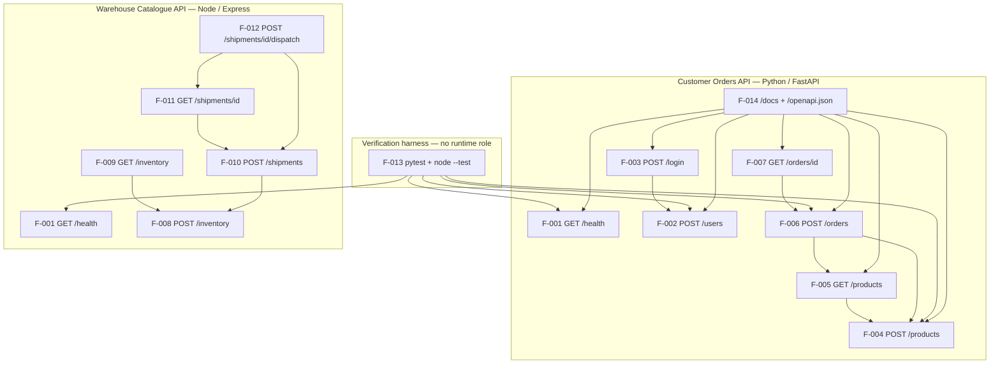

The image of that graph is the section's central structural finding: the Orders subgraph and the Warehouse subgraph share no edge. F-013 and F-014 are the only nodes that touch features from more than one side of the system, and both are non-runtime. Each service's chains are strictly linear — register-then-login, author-then-browse-then-order-then-retrieve, intake-then-list, and intake-then-ship-then-retrieve-then-dispatch — so a breakdown at any Critical feature severs the remainder of its own service's chain and leaves the other service untouched.

### 2.3.2 Integration Points

| Integration point | Parties | Mechanism and contract | Evidence |
| --- | --- | --- | --- |
| Client-to-order-service API | Any HTTP client, F-001 to F-007 and F-014 | JSON over HTTP on the address the documented uvicorn command binds, `127.0.0.1:8000`; responses carry FastAPI's `detail` field on error and no authentication header is required or accepted | `services/customer-orders-api/README.md` line 7; `app/main.py` lines 21–73 |
| Client-to-warehouse-service API | Any HTTP client, F-001 and F-008 to F-012 | JSON over HTTP on `process.env.PORT` defaulting to 3000; responses carry an `error` string field on rejection | `src/index.js` line 2; `src/server.js` lines 8–51 |
| Uniform liveness contract | External probe, both services | One `GET /health` definition usable against either base URL, returning exactly `{"status": "ok"}` | `app/main.py` lines 21–23; `src/server.js` line 8 |
| Framework documentation surface | Developer tools, F-014 | OpenAPI 3 schema at `/openapi.json` and Swagger UI at `/docs`, generated by FastAPI with no repository configuration | `app/main.py` line 5 |
| JSON body parsing | Client and the warehouse service | `express.json()` mounted before every route, so `req.body` is populated only for JSON content types; a non-JSON request reaches the guards with all fields absent and is rejected with 400 | `src/server.js` line 3 |
| Test-harness-to-application | F-013 and the two apps | In-process ASGI invocation through `TestClient` for Python, so no socket is opened; a real ephemeral listener plus global `fetch` for Node | `tests/test_routes.py` line 4; `test/routes.test.js` lines 8–16 |
| Source-control composition | Parent repository and both child services | Two gitlinks resolved at the commits `04259f82d5a8f87ff9d81d5fdd1dfdefaee4e564` and `f9f72d1c37091f8845e3e3727515fa713ebe20b1` by `git submodule update --init` or `git clone --recurse-submodules` | `.gitmodules` lines 1–6; `README.md` line 9 |

**The absent integration.** No integration point joins the two services to each other. A repository-wide search finds no outbound HTTP client, message queue, shared cache, database, file exchange or scheduler in either service; the only `fetch` in the checkout is the warehouse suite's health probe against its own listener (`test/routes.test.js` line 11). Consequently the client is the sole integrator of the two ledgers: it must call `POST /orders` on the order service to reserve order-service stock and, separately, `POST /shipments` on the warehouse service to reserve warehouse inventory. Nothing compares the two results, and neither service can detect that the other has diverged.

### 2.3.3 Shared Components

Sharing is entirely intra-service. The two services share no file, module, package, configuration value or data structure — `services/` contains no common manifest, lockfile or configuration — so every component below belongs to exactly one service and is shared only among that service's features.

| Shared component | Definition site | Features sharing it | What the sharing means |
| --- | --- | --- | --- |
| `users` dictionary | `app/main.py` line 6 | F-002, F-003 | One store is both the write target of registration and the read source of login, so an account created by F-002 is immediately visible to F-003 and to nothing else |
| `products` dictionary | `app/main.py` line 6 | F-004, F-005, F-006 | Order placement mutates the same object the catalogue listing serializes, which is why a decrement is visible through F-005 without any explicit update step |
| `orders` dictionary | `app/main.py` line 6 | F-006, F-007 | The creation response and the retrieval response are the same stored object, so they cannot disagree |
| `RegisterRequest` model | `app/main.py` lines 8–10 | F-002, F-003 | Registration and login are bound to one Pydantic type, so any field change alters both contracts at once |
| `ProductRequest` and `OrderRequest` models | `app/main.py` lines 12–19 | F-004, F-006 | Each is the sole body contract of its route; neither is reused outside its own feature |
| `FastAPI` app instance | `app/main.py` line 5 | F-001 to F-007, F-014, F-013 | One app object carries every order-service route and mounts the documentation surface; the Python suite imports it directly as a module-level singleton |
| `inventory` Map | `src/server.js` line 5 | F-008, F-009, F-010 | The intake write target is the same object F-010 decrements in place and F-009 serializes, so reservation visibility requires no update route |
| `shipments` Map | `src/server.js` line 6 | F-010, F-011, F-012 | Its `size` also derives the `SHP-` identifier, coupling identifier generation to the collection itself |
| `express()` app instance | `src/server.js` line 2 | F-001, F-008 to F-012, F-013 | One app object carries every warehouse route and is exported at line 53 for both `src/index.js` and the test suite |
| `express.json()` body parser | `src/server.js` line 3 | F-008, F-010, F-012 | The three body-consuming routes depend on this single mount for `req.body`; the read routes do not use it |

### 2.3.4 Common Services

Four behaviours are used identically by several features rather than by one, and each is a convention the two independent codebases happen to agree on rather than a shared module.

| Common service | Where implemented | Features relying on it | Consequence |
| --- | --- | --- | --- |
| Liveness contract | `app/main.py` lines 21–23; `src/server.js` line 8 | F-001 on both services, F-013, F-014 | Two independent implementations of one body shape; a change to either alone breaks the uniformity that F-001-RQ-003 asserts |
| Success-status convention | `status_code=201` decorators at `app/main.py` lines 25, 40, 50; explicit `res.status(201)` at `src/server.js` lines 18, 35 | F-002, F-004, F-006, F-008, F-010 | Every creation returns 201 on both services; every read returns 200 implicitly or explicitly |
| Error envelope | FastAPI `HTTPException`, producing a `detail` field; Express handlers returning `{error: "<message>"}` | F-002, F-003, F-004, F-006, F-007 on the Python side; F-008, F-010, F-011, F-012 on the Node side | A client that integrates both services must parse two rejection shapes for the same class of failure, which is the most visible cost of the absent shared component |
| Server-side identifier generation | `uuid.uuid4` at `app/main.py` lines 29, 42, 60; `SHP-${shipments.size + 1}` at `src/server.js` line 32 | F-002, F-004, F-006; F-010 | Both services take identity generation away from the caller, but by incompatible schemes: random UUIDs on one side, a sequential counter derived from collection size on the other |

### 2.3.5 Absent Relationships

Three relationships a reader would reasonably expect are absent from the code, and each is recorded here because it constrains how the catalog may be composed into a larger system.

| Expected relationship | Status in the checkout | Evidence |
| --- | --- | --- |
| Order to shipment linkage | Absent. An order never produces or references a shipment, and a shipment never references an order | No cross-service call exists; the order record at `app/main.py` lines 61–66 carries no SKU or shipment field, and the shipment record at `src/server.js` line 33 carries no order field |
| Shared product identity | Absent. Orders key on a UUID the order service mints and never exposes to the warehouse service; inventory keys on a caller-supplied SKU the order service never sees | `app/main.py` lines 42–44 versus `src/server.js` line 11 |
| Shared authentication | Absent. The only credential artifact the system mints is F-003's token, which no route, middleware or second service reads | `app/main.py` line 38 is the sole token reference in the repository |

The practical effect on the feature catalog is that F-001 through F-007 and F-008 through F-012 compose only at the client, and no requirement in 2.2 can be satisfied by a single request that spans both services.


## 2.4 Implementation Considerations

### 2.4.1 Register Conventions

Implementation considerations are recorded as five registers: `TC` for technical constraints, `PR` for performance, `SC` for scalability, `SI` for security and `MR` for maintenance. Each entry names the features it governs, so a reader can reach the constraint from either direction — from a feature in section 2.1 or from a consideration here. Every entry is a property of the two pinned child commits; none is a recommendation, and no register claims a target the repository does not declare. Where the honest finding is that a control is absent, the entry says so and cites the absence rather than inventing a requirement.

### 2.4.2 Technical Constraints

| ID | Constraint | Applies to | Evidence |
| --- | --- | --- | --- |
| TC-01 | All state lives in process memory. Nothing persists, nothing is shared between processes, and every record is lost on restart. | F-002 to F-012 | `users, products, orders = {}, {}, {}` at `app/main.py` line 6; `new Map()` at `src/server.js` lines 5–6; no database, ORM, cache or file dependency in either manifest |
| TC-02 | Each service builds its app and its stores at import time as module-level singletons, so there is no factory, no dependency injection and no per-request lifecycle. | F-001 to F-012 | `app/main.py` lines 5–6; `src/server.js` lines 2–6 |
| TC-03 | The two services emit incompatible error envelopes for the same classes of failure — a FastAPI `detail` field on one side, an `error` string on the other. | F-002, F-003, F-004, F-006, F-007, F-008, F-010, F-011, F-012 | `HTTPException` at `app/main.py` lines 28, 37, 54, 56, 58, 72; `res.status(...).json({ error: ... })` at `src/server.js` lines 13, 15, 26, 28, 30, 40, 46, 47 |
| TC-04 | Validation is asymmetric. The Python side depends entirely on Pydantic type coercion with no custom validators; the Node side hand-checks payloads with early-return guard clauses. | F-002 to F-012 | Three unvalidated models at `app/main.py` lines 8–19 with `EmailStr` imported and unused at line 2; guards at `src/server.js` lines 12 and 27 |
| TC-05 | No identifier space is shared between the services: the order service mints UUID product identifiers, the warehouse service keys on caller-supplied SKUs, and no mapping exists. | F-004, F-006, F-008, F-010 | `str(uuid4())` at `app/main.py` line 42 versus `const { sku, ... } = req.body` at `src/server.js` line 11 |
| TC-06 | The documented warehouse start command does not serve traffic: `npm start` runs `node src/server.js`, which only exports the app at line 53, while the only `listen` call is in `src/index.js` line 3, which no script references. | F-001, F-008 to F-013 | `package.json` line 5; `src/server.js` line 53; `src/index.js` line 3 |
| TC-07 | The order service's bind address and port exist only in its README; no configuration, environment variable or settings file expresses them. | F-001 to F-007 | `services/customer-orders-api/README.md` line 7; `PORT` is the only environment variable read anywhere in the checkout, at `src/index.js` line 2 |
| TC-08 | Five direct dependencies are pinned exactly — four with `==` in one runtime-and-test file, one exact npm version — with no npm lockfile, no hashes and no `engines` field, so transitive versions are unconstrained. | All features | `requirements.txt` lines 1–4; `package.json` lines 6–7 |
| TC-09 | No CORS policy, TLS termination, reverse proxy or rate limiter is configured, so both services are plain-HTTP, same-origin-only endpoints. | All features | No CORS middleware, certificate or proxy configuration in either source tree |
| TC-10 | The documentation surface is a framework default: the app is constructed without `docs_url`/`openapi_url` overrides, so the routes exist whether or not they are wanted. | F-014 | `app/main.py` line 5 |

### 2.4.3 Performance Requirements

The repository declares no latency, throughput, concurrency or response-size target in any tracked file, and no benchmark, load test or timing assertion exists in either suite. The entries below are therefore the measurable performance properties the code actually fixes, not targets.

| ID | Performance property | Applies to | Evidence |
| --- | --- | --- | --- |
| PR-01 | No service-level objective of any kind is declared, so no requirement in 2.2 can be validated against a stated latency or throughput bound. | All features | No SLO, KPI, benchmark or timing assertion in `README.md`, either child `README.md`, either manifest or either suite |
| PR-02 | Read cost and response size grow linearly with collection size, with no page bound: every call serializes the whole collection. | F-005, F-009 | `app/main.py` lines 46–48; `src/server.js` line 21 |
| PR-03 | Keyed single-record reads are constant-time dictionary or Map lookups, independent of collection size. | F-007, F-011 | `order_id not in orders` at `app/main.py` line 71; `shipments.get(...)` at `src/server.js` lines 39, 45 |
| PR-04 | Order totals require one multiply and one `round`, so pricing adds no material cost — but `round` is round-half-to-even, which fixes the numeric result rather than merely bounding it. | F-006 | `round(product["price"] * payload.quantity, 2)` at `app/main.py` line 65 |
| PR-05 | The liveness probe performs no lookup, no store access and no unbounded serialization, making it the cheapest route either service exposes. | F-001 | `app/main.py` lines 21–23; `src/server.js` line 8 |

### 2.4.4 Scalability Considerations

| ID | Scalability consideration | Applies to | Evidence |
| --- | --- | --- | --- |
| SC-01 | Horizontal scaling is not available: in-process stores are not shared, so two replicas of either service hold disjoint state and answer differently for the same request. | F-002 to F-012 | `app/main.py` line 6; `src/server.js` lines 5–6; no shared data dependency in either manifest |
| SC-02 | Shipment identifiers are derived from collection size, so they repeat after a restart and collide across replicas, silently overwriting or masking stored shipments. | F-010, F-011, F-012 | `SHP-${shipments.size + 1}` at `src/server.js` line 32 |
| SC-03 | Read endpoints are unpaginated and unfiltered, so payload size and serialization cost rise with the catalogue and the SKU set, with no cap and no cursor. | F-005, F-009 | `app/main.py` lines 46–48; `src/server.js` line 21 |
| SC-04 | Availability checks and stock writes are separate statements with no lock, transaction or optimistic version, so concurrent requests can both pass the guard and oversell; the dispatch status guard has the same shape. | F-006, F-010, F-012 | `app/main.py` lines 57–59; `src/server.js` lines 30–31, 47–48 |
| SC-05 | There is no cache, message broker, queue or database to absorb load growth; each request's entire cost falls on the single process that serves it. | All features | Only five dependencies across both manifests, none a data client; no infrastructure file in the checkout |

### 2.4.5 Security Implications

| ID | Security implication | Applies to | Evidence |
| --- | --- | --- | --- |
| SI-01 | No route enforces a credential. Any caller may register, log in, author products, place orders against shared stock, receive inventory, create shipments and dispatch them. | F-002 to F-012 | No authentication middleware, dependency or header check in either source tree; no credential parameter on any of the 13 routes |
| SI-02 | Passwords are stored and compared in plaintext, with no hashing, salting, length rule or complexity rule, and no hashing library in either manifest. | F-002, F-003 | `users[payload.email] = {"password": payload.password}` at `app/main.py` line 30; direct string comparison at line 36 |
| SI-03 | The issued token is a formatted string derived from the user identifier; it is unsigned, has no expiry or scope, is never stored and is never validated, so it confers no authority. | F-003, and every other feature by consequence | `app/main.py` line 38 is the only token reference in the repository |
| SI-04 | No security headers, CORS policy, TLS termination or rate limiting is configured, so transport is plain HTTP and no protection exists against credential stuffing or enumeration. | All features | No middleware, certificate or proxy configuration in either service |
| SI-05 | Caller-supplied strings (`sku`, `name`, `destination`, `carrier`, path identifiers) are accepted on truthiness or with no check at all, and the sequential `SHP-` identifier makes shipment records trivially enumerable. | F-008, F-010, F-011, F-012 | `src/server.js` lines 11–12, 24, 32, 49; `req.params.id` used unvalidated at lines 39, 45 |
| SI-06 | No audit trail exists. Nothing records who created or changed a record, what a value was before a decrement, or when any transition occurred, because no logger, request log or history field exists. | F-002 to F-012 | Only `console.log` at `src/index.js` line 3, which reports the port at startup; no priority ordering in either store |

### 2.4.6 Maintenance Requirements

| ID | Maintenance requirement | Applies to | Evidence |
| --- | --- | --- | --- |
| MR-01 | All behaviour of each service lives in one module (`app/main.py` at 73 lines, `src/server.js` at 53 lines), so every handler change touches the same file that constructs the app and declares the stores. | All features | File inventory: `app/__init__.py` is 0 bytes and `src/index.js` is 3 lines, leaving one substantive module per service |
| MR-02 | Test validity depends on resetting import-time singletons: the Python suite must clear all three stores before each test, and any new stateful test must do the same. | F-013, and any future test of F-002 to F-007 | `setup_function` at `tests/test_routes.py` lines 6–9 |
| MR-03 | Coverage is a maintained commitment, not a guarantee: 6 of 51 requirements are asserted, and the 12 declared gaps are the mechanism by which the rest stay visible to reviewers. | F-013, and all unasserted requirements | Child `README.md` line 13 in each service; section 2.5.3 |
| MR-04 | Diagnosis is manual: no logging framework, request log, metric or trace exists, so the only runtime signal is the single startup line on the Node side. | All features | `console.log` at `src/index.js` line 3; no logger dependency in either manifest |
| MR-05 | Delivery is manual: no CI workflow, container asset, migration, environment file or npm lockfile exists, so dependency auditing and deployment repeat by hand. | All features | Full tracked file inventory: 12 files across the parent and both children |
| MR-06 | A documented command is wrong, which is a standing maintenance trap: the warehouse `start` script never reaches the bind, so `npm start` must be replaced by `node src/index.js` before the service serves traffic. | F-001, F-008 to F-013 | `package.json` line 5 versus `src/index.js` line 3; `services/warehouse-catalogue-api/README.md` line 7 |

### 2.4.7 Assumptions Register

| ID | Assumption | Basis | Effect if it does not hold |
| --- | --- | --- | --- |
| A-01 | Behaviour is documented at the commits the parent pins, not at a branch head. | `README.md` line 9 states the expected scan behaviour; gitlinks record `04259f8` and `f9f72d1` | Any statement in 2.1 and 2.2 may not match a later commit |
| A-02 | The parent repository owns no testable application behaviour of its own. | `README.md` line 3 | Features would be missing from the catalog for the parent |
| A-03 | The order service runs on a Pydantic 2 runtime, since `model_dump` is called on a request model. | `app/main.py` line 43; `requirements.txt` line 1 pins FastAPI 0.115.6 without pinning Pydantic | Under Pydantic 1 the product-creation handler would fail at line 43 |
| A-04 | The Node runtime supplies the built-in test runner used by `npm test` and a global `fetch`. | `package.json` line 5; `test/routes.test.js` lines 1, 11; no `engines` field constrains the version | On an older runtime `npm test` cannot start and no suite exists on that side |
| A-05 | Callers send `Content-Type: application/json` for body-bearing warehouse routes. | `express.json()` at `src/server.js` line 3 populates `req.body` only for JSON content types | A non-JSON request is rejected as `invalid inventory payload` rather than a content-type error |
| A-06 | Callers retain the identifiers returned by creation calls, because no listing route exists for orders or shipments. | `app/main.py` line 69 is the only order read; `src/server.js` line 38 the only shipment read | A lost identifier makes the record unreachable through the API |
| A-07 | No latency, throughput or availability target exists to test against, so PR-01 stands in place of a performance objective. | No target in any tracked file | Any performance claim in this specification would need a source that does not exist |
| A-08 | Request bodies that violate a Pydantic model contract are rejected by FastAPI's standard validation response, not by repository code. | No exception handler or validator is registered at `app/main.py` lines 1–19 | The exact status and body of those rejections would differ, changing the acceptance criteria in 2.2 for F-002-RQ-003, F-004-RQ-003 and F-003-RQ-003 |
| A-09 | Feature priority is derived from the dependency structure of the two source files, because no tracked file states a business priority. | Section 2.3.1 dependency map | Priority ordering may not reflect an unstated commercial view |


## 2.5 Traceability Matrix

### 2.5.1 Feature-to-Implementation Traceability

Every requirement in section 2.2 resolves to exactly one implementation site. The `Asserted` column counts requirements carrying a passing assertion; the 45 remaining requirements are accounted for individually in 2.5.3.

| Feature | Requirements | Implementation site | Asserted |
| --- | --- | --- | --- |
| F-001 Service Liveness Probe | F-001-RQ-001 to RQ-003 | `app/main.py` lines 21–23; `src/server.js` line 8 | 3 of 3 |
| F-002 Account Registration | F-002-RQ-001 to RQ-004 | `app/main.py` lines 25–31 | 1 of 4 |
| F-003 Credential Verification | F-003-RQ-001 to RQ-003 | `app/main.py` lines 33–38 | 0 of 3 |
| F-004 Product Catalogue Authoring | F-004-RQ-001 to RQ-003 | `app/main.py` lines 40–44 | 1 of 3 |
| F-005 Product Catalogue Browsing | F-005-RQ-001 to RQ-003 | `app/main.py` lines 46–48 | 0 of 3 |
| F-006 Order Placement with Stock Decrement | F-006-RQ-001 to RQ-006 | `app/main.py` lines 50–67 | 1 of 6 |
| F-007 Order Retrieval | F-007-RQ-001 to RQ-003 | `app/main.py` lines 69–73 | 0 of 3 |
| F-008 Inventory Intake by SKU | F-008-RQ-001 to RQ-005 | `src/server.js` lines 10–19 | 0 of 5 |
| F-009 Inventory Listing | F-009-RQ-001 to RQ-003 | `src/server.js` line 21 | 0 of 3 |
| F-010 Shipment Creation with Inventory Reservation | F-010-RQ-001 to RQ-006 | `src/server.js` lines 23–36 | 0 of 6 |
| F-011 Shipment Retrieval | F-011-RQ-001 to RQ-003 | `src/server.js` lines 38–42 | 0 of 3 |
| F-012 Shipment Dispatch | F-012-RQ-001 to RQ-003 | `src/server.js` lines 44–51 | 0 of 3 |
| F-013 Automated Route Verification | F-013-RQ-001 to RQ-004 | `tests/test_routes.py`; `test/routes.test.js` | Self-verifying |
| F-014 Interactive API Documentation | F-014-RQ-001 to RQ-002 | `app/main.py` line 5 | 0 of 2 |

### 2.5.2 Asserted Requirements

| Requirement | Verifying test | Location | What the assertion proves |
| --- | --- | --- | --- |
| F-001-RQ-001 | `test_health_probe` | `services/customer-orders-api/tests/test_routes.py` lines 11–12 | The order-service body parses to exactly `{"status": "ok"}` |
| F-001-RQ-002 | `health route responds` | `services/warehouse-catalogue-api/test/routes.test.js` lines 7–17 | Status 200 and a body deep-equal to `{status: 'ok'}` over a real TCP connection |
| F-001-RQ-003 | The two tests above, jointly | Same two files | Both services produce the identical liveness body |
| F-002-RQ-001 | `test_register_route_creates_user` | `tests/test_routes.py` lines 14–17 | Status 201 and the echoed `email`; the presence or format of `id` is not asserted |
| F-004-RQ-001 | `test_product_route_creates_product` | `tests/test_routes.py` lines 19–22 | Status 201 and the echoed `name`; `price` and `stock` are not asserted |
| F-006-RQ-002 | `test_order_rejects_unknown_product` | `tests/test_routes.py` lines 24–26 | Status 404 for `product_id: "missing"`; the `detail` message is not asserted |

### 2.5.3 Unasserted Requirements and Gap Disposition

Both child READMEs declare their gaps rather than leaving them implied. The table maps each unasserted requirement to the declared gap that names it, or records that no declaration covers it.

| Feature | Unasserted requirements | Declared gap that names them | Residual, named by no gap |
| --- | --- | --- | --- |
| F-002 | RQ-002, RQ-003, RQ-004 | "duplicate registration" covers RQ-002 | RQ-003 (identifier normalisation), RQ-004 (password never echoed) |
| F-003 | RQ-001, RQ-002, RQ-003 | "invalid login" covers RQ-002 | RQ-001 (token shape), RQ-003 (mandatory login body) |
| F-004 | RQ-002, RQ-003 | None | RQ-002 (unbounded price and stock), RQ-003 (mandatory attributes) |
| F-005 | RQ-001, RQ-002, RQ-003 | None | All three — no catalogue-listing journey is named on either side |
| F-006 | RQ-001, RQ-003, RQ-004, RQ-005, RQ-006 | "stock decrement and computed order totals" covers RQ-001 and RQ-005 | RQ-003 (non-positive quantity), RQ-004 (insufficient stock), RQ-006 (guard ordering) |
| F-007 | RQ-001, RQ-002, RQ-003 | None | All three — order retrieval is not named as a gap |
| F-008 | RQ-001, RQ-002, RQ-003, RQ-004, RQ-005 | "receiving inventory" covers RQ-001 and RQ-002; "duplicate SKU" covers RQ-004 | RQ-003 (malformed payload rejection), RQ-005 (zero-quantity intake) |
| F-009 | RQ-001, RQ-002, RQ-003 | "verifying inventory decrement" covers RQ-003 | RQ-001 (ordering), RQ-002 (empty listing) |
| F-010 | RQ-001, RQ-002, RQ-003, RQ-004, RQ-005, RQ-006 | "creating a shipment" covers RQ-001; "insufficient inventory" covers RQ-004; "verifying inventory decrement" covers RQ-005 | RQ-002 (unknown SKU), RQ-003 (invalid quantity), RQ-006 (optional destination) |
| F-011 | RQ-001, RQ-002, RQ-003 | "retrieving the shipment" covers RQ-001 | RQ-002 (unknown identifier), RQ-003 (carrier absent before dispatch) |
| F-012 | RQ-001, RQ-002, RQ-003 | "dispatching it" covers RQ-001; "repeated dispatch" covers RQ-003 | RQ-002 (unknown shipment identifier) |
| F-014 | RQ-001, RQ-002 | None | Both — the documentation surface is not named as a gap |

Fifteen requirements carry no declared gap and no assertion. They are the residual verification debt of the checkout, and F-013-RQ-004 requires only that the declared gaps stay documented — it does not require the residual ones to be added.

### 2.5.4 Process Flow and Diagram References

| Diagram | What it renders | Features covered | Location |
| --- | --- | --- | --- |
| Component flowchart | The parent's metadata files, both service applications, their stores, entry points and test harnesses, with no edge between the two applications | All 14, at component granularity | Section 1.2.2 |
| Two-service sequence diagram | An order placed on the order service, a shipment created and dispatched on the warehouse service, and the absent cross-service call between them | F-006, F-010, F-012 | Section 1.3.1 |
| Feature dependency map | Prerequisite edges between F-001 and F-014, grouped by service, with the harness and documentation surface as the only cross-service nodes | All 14, at feature granularity | Section 2.3.1 |

No per-handler process flowchart exists in the repository or in this specification beyond the sequence diagram above. Each handler's control flow is fully described by the ordered guard clauses in its requirements table in section 2.2, whose row order matches the evaluation order in the code — most consequentially for F-006, where the 404 guard precedes the 400 guard, and for F-010, where the SKU lookup precedes the quantity check.

### 2.5.5 Requirement Version Tracking

All requirements are at version 1.0 against the two pinned child commits. Neither child carries a tag or a second commit, and the parent holds a single commit, so no earlier version of any requirement exists to supersede.

| Requirement scope | Version | Baseline of record | Supersedes |
| --- | --- | --- | --- |
| F-001 to F-007, F-014 (order service) | 1.0 | `services/customer-orders-api` at `04259f82d5a8f87ff9d81d5fdd1dfdefaee4e564` | None — first recording |
| F-001, F-008 to F-012 (warehouse service) | 1.0 | `services/warehouse-catalogue-api` at `f9f72d1c37091f8845e3e3727515fa713ebe20b1` | None — first recording |
| F-013 (verification harness) | 1.0 | `tests/test_routes.py` and `test/routes.test.js` at the commits above | None — first recording |

**Re-baseline trigger.** The parent records both pins in its own tree, and a child history contains exactly one commit each, so changing either gitlink is the sole event that can invalidate this matrix. If a child advances, the affected requirement rows in 2.1, 2.2 and 2.5 must be re-derived from the new commit before any acceptance criterion is relied on; the priority and status figures in 2.1.1 carry the same dependency.


## 2.6 Coverage Reconciliation

### 2.6.1 Consolidated Coverage Arithmetic

Three counts appear across sections 2.2, 2.4 and 2.5 — 51 requirements, 6 asserted, 45 carrying no assertion. This sub-section consolidates them into one reconciliation so that no reader has to re-derive a total. The four categories below are mutually exclusive and exhaustive.

| Category | Count | Requirements |
| --- | --- | --- |
| Asserted by a passing test | 6 | F-001-RQ-001, F-001-RQ-002, F-001-RQ-003, F-002-RQ-001, F-004-RQ-001, F-006-RQ-002 |
| Self-verifying by running the delivered harness | 4 | F-013-RQ-001 to F-013-RQ-004 |
| No test, but named by a `## Deliberate analysis gaps` declaration | 14 | F-002-RQ-002; F-003-RQ-002; F-006-RQ-001, F-006-RQ-005; F-008-RQ-001, F-008-RQ-002, F-008-RQ-004; F-009-RQ-003; F-010-RQ-001, F-010-RQ-004, F-010-RQ-005; F-011-RQ-001; F-012-RQ-001, F-012-RQ-003 |
| No test and named by no declaration | 27 | F-002-RQ-003, F-002-RQ-004; F-003-RQ-001, F-003-RQ-003; F-004-RQ-002, F-004-RQ-003; F-005-RQ-001 to RQ-003; F-006-RQ-003, F-006-RQ-004, F-006-RQ-006; F-007-RQ-001 to RQ-003; F-008-RQ-003, F-008-RQ-005; F-009-RQ-001, F-009-RQ-002; F-010-RQ-002, F-010-RQ-003, F-010-RQ-006; F-011-RQ-002, F-011-RQ-003; F-012-RQ-002; F-014-RQ-001, F-014-RQ-002 |

### 2.6.2 Reconciliation of the Reported Figures

| Figure as stated | Where it appears | Status and reconciliation |
| --- | --- | --- |
| "Six carry a passing assertion … the remaining 45 are unasserted" | Section 2.2.1 | Correct as a statement that 45 of 51 requirements are not asserted by a test, since F-013's four are verified by running the harness rather than by an assertion. The per-feature table in 2.2.1 records F-013 as `0` unasserted for the same reason, so its `Unasserted` column totals 41 rather than 45. |
| "Fifteen requirements carry no declared gap and no assertion" | Section 2.5.3, closing sentence | Superseded. The residual category totals 27, as tabulated above; the per-feature breakdown in 2.5.3 remains correct, and this figure is the sum of its residual column. |
| "12 declared coverage gaps" | Sections 1.2.3, 2.4.6 (MR-03) | Consistent: four gaps are named in `services/customer-orders-api/README.md` line 13 and eight in `services/warehouse-catalogue-api/README.md` line 13, and those twelve declarations account for the 14 requirements listed in the third category above. |
| "6 of 51 requirements" | Sections 2.2.14, 2.5.1 | Consistent with the first category above. |

The distribution matters for interpreting the catalog: 39 requirements are Must-Have, yet only five Must-Have requirements — F-001's three, F-002-RQ-001 and F-004-RQ-001 — are asserted. The twelve declared gaps name 14 requirements and leave 27 unaddressed, of which F-005, F-007 and F-014 account for eight and no workflow read-back path is covered at all.


## 2.7 References

**Parent repository.** Three tracked files and one folder, cited for the submodule composition and the scan contract.

- `README.md` — the metadata-only declaration (line 3), the two-submodule inventory with technology labels (lines 5–7), and the pinned-commit scan expectation (line 9) that fixes every requirement in this section to a specific child commit.
- `.gitmodules` — the two `[submodule]` stanzas and their mount paths and clone remotes (lines 1–6), establishing that no branch, shallow or global submodule option is declared.
- `.gitignore` — its single `.DS_Store` entry, confirming no build output or dependency directory is intentionally ignored.
- `services/` — the folder holding exactly the two child repositories with no shared manifest, configuration, lockfile, container asset or test harness, which is the basis for the statement that no component is shared between features of different services.

**Customer Orders API.** The service that implements F-002 through F-007 and F-014.

- `services/customer-orders-api/README.md` — the self-description naming registration, login, catalogue and order fulfilment (line 3), the install and run commands including the loopback bind `127.0.0.1:8000` (lines 6–7), the test command (lines 9–10), and the four declared gaps (lines 12–13).
- `services/customer-orders-api/requirements.txt` — the four exact `==` pins for FastAPI 0.115.6, uvicorn 0.34.0, pytest 8.3.4 and httpx 0.28.1 (lines 1–4), with runtime and test dependencies in one file and no lockfile.
- `services/customer-orders-api/app/` — the package whose empty `__init__.py` exists only so `app.main` imports through the package path.
- `services/customer-orders-api/app/main.py` — the app construction with documentation routes left enabled (line 5), the three in-memory stores (line 6), the three unvalidated Pydantic models and the unused `EmailStr` import (lines 2, 8–19), and all seven route handlers including every guard clause, the stock decrement and the rounded order total (lines 21–73).
- `services/customer-orders-api/tests/test_routes.py` — the module-level `TestClient` (line 4), the store-clearing `setup_function` (lines 6–9), and the four tests (lines 11–26) that supply the only assertion on F-001, F-002, F-004 and F-006.

**Warehouse Catalogue API.** The service that implements F-008 through F-012 and the warehouse half of F-001.

- `services/warehouse-catalogue-api/README.md` — the self-description naming inventory intake, shipment creation, lookup and dispatch (line 3), the `npm install` and `npm start` commands (lines 5–7), the test command (lines 9–10), and the eight declared gaps (lines 12–13), including the statement that only the health route is tested.
- `services/warehouse-catalogue-api/package.json` — name, version and the `"private": true` flag (lines 2–4), the `start` and `test` scripts (line 5) that expose the entry-point mismatch, the single Express 4.21.2 pin (line 6), and the absent `type` and `engines` fields.
- `services/warehouse-catalogue-api/src/` — the two-file implementation, where `server.js` exports the app and `index.js` performs the only port bind.
- `services/warehouse-catalogue-api/src/server.js` — the app and `express.json()` mount (lines 2–3), the two Maps (lines 5–6), all six route handlers with their guard clauses (lines 8–51), the `SHP-` identifier derivation (line 32), the one-way dispatch transition and carrier default (lines 44–51), and the export that no start script reaches (line 53).
- `services/warehouse-catalogue-api/src/index.js` — the `process.env.PORT` override defaulting to 3000 (line 2) and the single `listen` call with its startup log (line 3).
- `services/warehouse-catalogue-api/test/routes.test.js` — the one automated test with its ephemeral listener, global `fetch` and `finally` teardown (lines 7–17), and the coverage comment (lines 5–6) that overstates it relative to the file's actual content.

**Git metadata.** Read through `git ls-tree`, `git log`, `git status` and line counts, not through a file in the checkout.

- Parent and child Git metadata — the `160000` gitlink entries pinning `04259f82d5a8f87ff9d81d5fdd1dfdefaee4e564` and `f9f72d1c37091f8845e3e3727515fa713ebe20b1`; one commit in each child history and one in the parent (`395c1ce`); and the clean working trees apart from the untracked `__pycache__` the specification run produced, which was removed.

**Related specification sections.** Internal cross-references only; no external web source was consulted for any claim in this section.

- Section 1.2.1 — the current-system limitations that motivate the constraint, scalability and maintenance registers in 2.4.
- Section 1.2.2 — the component inventory and the component flowchart referenced in 2.5.4.
- Section 1.2.3 — the success criteria, the 13-route and 5-test counts, and the `test/routes.test.js` comment discrepancy restated in F-013.
- Section 1.3.1 — the five supported workflows and the two-service sequence diagram referenced in 2.5.4.
- Section 1.3.2 — the out-of-scope inventory that bounds which features could be catalogued at all.

No external web sources were used. Every figure in 2.1, 2.2 and 2.5 derives from the files and Git metadata listed above, read at the pinned commits.


# 3. Technology Stack

## 3.1 Programming Languages

The checkout uses exactly two programming languages, one per child service, and nothing else. The parent repository owns no executable code: its three tracked files are `README.md` (prose), `.gitmodules` (Git config) and `.gitignore` (one line, `.DS_Store`). All executable behaviour lives in the two submodules pinned at `04259f8` (Customer Orders API) and `f9f72d1` (Warehouse Catalogue API).

**Language inventory by component.**

| Language | Component | Source files and sizes | Declared runtime requirement |
| --- | --- | --- | --- |
| Python 3 | `services/customer-orders-api` | `app/main.py` (73 lines), `app/__init__.py` (0 bytes), `tests/test_routes.py` (26 lines) — 99 lines | None declared; effectively ≥ 3.9, the highest floor among the pinned packages |
| JavaScript (CommonJS) | `services/warehouse-catalogue-api` | `src/server.js` (53 lines), `src/index.js` (3 lines), `test/routes.test.js` (17 lines) — 73 lines | None declared; effectively ≥ 20 for a stable `node:test` runner |
| Declarative only | Both services and the parent | `requirements.txt` (4 lines), `package.json` (8 lines), `.gitmodules` (6 lines), three `README.md` files (9, 13 and 13 lines) | Not applicable — no executable content |

Both languages appear only at the application layer. There is no SQL, no shell script, no YAML manifest, no template language and no styling language anywhere in the checkout.

**Selection rationale.**

- **Python 3 for the Customer Orders API.** The service is a declarative HTTP surface: three request shapes and seven handlers. Python with FastAPI lets the request schema be expressed as type-annotated `BaseModel` classes (`app/main.py` lines 8–19) that FastAPI validates and documents without a hand-written parser, and it lets Python's standard library supply identity (`from uuid import uuid4`, line 3) with no extra dependency. The qualification path is equally short: `from fastapi.testclient import TestClient` (`tests/test_routes.py` line 1) exercises the ASGI app in-process, so the four tests need no port and no server process.
- **JavaScript on Node.js for the Warehouse Catalogue API.** One runtime dependency (`express`, `package.json` line 6) plus Node built-ins covers the service completely: `node:test` and `node:assert/strict` form the whole test harness (`test/routes.test.js` lines 1–2), the global `fetch` performs the HTTP call (line 11), and `Map` provides the two keyed stores (`src/server.js` lines 5–6). `devDependencies` is therefore empty (`package.json` line 7), and the service runs directly from source with no transpile or bundle step.
- **No shared language between services.** The two services share no module, package, schema or identifier; the language split simply follows the two independent manifest files (`requirements.txt`, `package.json`). Section 1.2.2 records the same split as two single-module services.

**Constraints and dependencies.**

| Constraint | Effect | Evidence |
| --- | --- | --- |
| Neither interpreter version is pinned | A deployment can install any Python 3 or Node.js version the package managers resolve; the only floors come from upstream metadata | No `pyproject.toml`, `setup.py`, `runtime.txt`, `.python-version`, `.nvmrc` or `engines` field exists in the checkout; `package.json` has no `engines` key |
| Python floor is transitive | `uvicorn==0.34.0` requires Python ≥ 3.9 (it dropped 3.8); FastAPI 0.115.6, pytest 8.3.4 and httpx 0.28.1 require ≥ 3.8, and FastAPI 0.115.6's classifiers stop at 3.12 — so 3.9–3.12 is the defensible band | `requirements.txt` lines 1–4; upstream package metadata |
| Node floor is transitive and undocumented | The suite needs `node:test` (stable from Node.js 20) and a global `fetch` (enabled by default from Node.js 18); Express 4.21.2 declares only the historical `"node": ">= 0.10.0"` | `package.json` lines 1–8; `test/routes.test.js` lines 1–11 |
| Two runtimes mean two install paths | Any build or deployment step must satisfy pip and npm separately; there is no workspace, monorepo manifest or shared tool version | The only two manifests in the checkout are `requirements.txt` and `package.json` |
| No compilation stage | "Build" reduces to dependency installation in both services; source is executed as written | `uvicorn app.main:app` targets source directly (`services/customer-orders-api/README.md` line 7); `npm start` and `npm test` invoke `node` on `.js` files (`package.json` line 5) |

**Language semantics that fix observable behaviour.** These are properties of the chosen languages rather than of any library, and they determine behaviour the specification states elsewhere:

- Python `round()` is round-half-to-even, so `round(product["price"] * payload.quantity, 2)` (`app/main.py` line 65) is banker's rounding, not commercial rounding — the numeric result recorded by F-006 and PR-04.
- Python `dict` preserves insertion order, which is what makes `GET /products` return the catalogue in creation order (`app/main.py` lines 46–48); `Map` does the same for `GET /inventory` (`src/server.js` line 21).
- Python accepts any `float` for `price` and any `int` for `stock`, and Pydantic applies no bounds (`app/main.py` lines 12–15), so negative values are valid.
- JavaScript `Number.isInteger` rejects numeric strings, so `"5"` is a 400 rather than a coerced `5` (`src/server.js` lines 12 and 27); the `||` operator supplies defaults for `reorderLevel` (line 11) and `carrier` (line 49), so any falsy value is replaced.
- Neither language brings cryptography into the runtime: no hashing, signing or token library exists in either ecosystem here, which is why the password is stored verbatim (`app/main.py` line 30) and the issued token is a formatted string rather than a signed artefact (`app/main.py` line 38) — SI-02 and SI-03.

**Languages specified in the default stack that are not present.** Each was searched for across every tracked file and found absent:

| Language or platform target | Finding | Evidence |
| --- | --- | --- |
| TypeScript | No `.ts`, `.tsx`, `.jsx` file; `package.json` declares no build script, no `typescript` dependency and no `type` field | `package.json` lines 1–8 |
| Swift (iOS), Kotlin (Android), Objective-C (macOS) | No file of any of these extensions; no `Package.swift`, `Podfile`, `build.gradle`, `*.xcodeproj` or `*.pbxproj` | Full tracked-file inventory: 13 files, extensions `.py`, `.js`, `.md`, `.txt`, `.json` |
| Client-side JavaScript for web, mobile or desktop (React, React Native, Electron) | No component, no UI entry point, no bundler configuration, no `react`/`react-dom`/`electron` dependency | `package.json` declares `express` only; no HTML, CSS or JSX file exists |
| Shell scripting | The only commands in the repository are two-line run blocks inside `README.md`; there is no `.sh` file, `Makefile` or `Procfile` | Both child `README.md` files; no such file in the inventory |


## 3.2 Frameworks &amp; Libraries

Each service uses one HTTP framework and one test harness, and nothing else. The Customer Orders API builds on FastAPI with Starlette and Pydantic arriving transitively; the Warehouse Catalogue API builds on Express with Node.js built-ins standing in for every supporting library. The specification's `Default Technology Stack` names Flask and LangChain for the backend; the repository contains neither, and FastAPI occupies the role Flask would have filled (see 3.4 for the full reconciliation).

**Core frameworks and libraries with versions.**

| Component | Version | Role in this system | Evidence |
| --- | --- | --- | --- |
| FastAPI | `0.115.6` (exact pin, PyPI) | The whole HTTP layer of the Customer Orders API: routing, request-model binding, `HTTPException` error responses, and default `/docs` + `/openapi.json` | `requirements.txt` line 1; `app/main.py` lines 1, 5, 21–73 |
| Starlette | Transitive, constrained `>=0.40.0,<0.42.0` by FastAPI 0.115.6; not pinned | Underlying ASGI toolkit; supplies `TestClient`, the in-process transport the Python suite uses | `tests/test_routes.py` line 1; upstream FastAPI 0.115.6 metadata |
| Pydantic | Transitive, not pinned; FastAPI 0.115.6 admits `>=1.7.4,!=1.8,!=1.8.1,!=2.0.0,!=2.0.1,!=2.1.0,<3.0.0` | Request validation and serialization; the code requires the v2 API because it calls `model_dump()` | `app/main.py` lines 2, 8–19, 43 |
| uvicorn | `0.34.0` (exact pin, PyPI) | ASGI server for the Customer Orders API; invoked only from the documented command, never from code | `requirements.txt` line 2; `services/customer-orders-api/README.md` line 7 |
| pytest | `8.3.4` (exact pin, PyPI) | Test runner for `pytest -q`; supplies the `setup_function` hook that clears the three stores | `requirements.txt` line 3; `tests/test_routes.py` lines 6–9 |
| httpx | `0.28.1` (exact pin, PyPI) | HTTP client that backs `TestClient`; no direct `httpx` import exists in the code | `requirements.txt` line 4; `tests/test_routes.py` line 1 |
| Express | `4.21.2` (exact pin, npm) | The whole HTTP layer of the Warehouse Catalogue API: routing, `express.json()` body parsing, `res.status().json()` responses | `package.json` line 6; `src/server.js` lines 1–3, 8–51 |
| Node.js built-ins | Shipped with the runtime | `node:test` and `node:assert/strict` (test harness), global `fetch` (test HTTP call), `Map` (both stores), `process` (port) | `test/routes.test.js` lines 1–2, 11; `src/server.js` lines 5–6; `src/index.js` line 2 |
| Python standard library | Shipped with the runtime | `uuid.uuid4` for every generated identifier | `app/main.py` line 3, used at lines 29, 42, 60 |

**Compatibility requirements.** The pins are exact at the top level but the graph below them is resolved at install time, so the following constraints are the ones that actually decide whether the system runs:

| Compatibility constraint | Consequence if violated | Evidence |
| --- | --- | --- |
| FastAPI 0.115.6 admits Pydantic 1.x, but `app/main.py` line 43 calls `model_dump()`, which exists only in Pydantic 2 | A resolver that installs Pydantic 1.x satisfies `requirements.txt` and then fails every `POST /products` call at runtime | `requirements.txt` line 1; `app/main.py` line 43; recorded as assumption A-03 in 2.4.7 |
| FastAPI 0.115.6 pins Starlette to `>=0.40.0,<0.42.0` | Installing a Starlette outside that range breaks FastAPI import; nothing in the repository guards it | Upstream FastAPI 0.115.6 metadata; `requirements.txt` does not list Starlette |
| `httpx==0.28.1` removed the deprecated `app=` argument; `TestClient` needs Starlette ≥ 0.37.2 | The exact httpx pin is only safe because FastAPI's Starlette floor is 0.40.0; downgrading Starlette independently would break the suite | `requirements.txt` line 4; upstream httpx 0.28 changelog and Starlette 0.37.2 release notes |
| Every pinned Python package supports 3.8; `uvicorn==0.34.0` requires ≥ 3.9 | On Python 3.8 the install fails outright, and no file in the repository states the real floor | `requirements.txt` lines 1–4; upstream uvicorn 0.34.0 metadata |
| Express 4.21.2 is a CommonJS package and the repository declares no `"type"` field, so `require()` is the only module style in use | Adding `"type": "module"` would break all three `.js` files at once | `package.json` lines 1–8; `require(...)` at `src/server.js` line 1, `src/index.js` line 1, `test/routes.test.js` lines 1–3 |
| `express.json()` populates `req.body` only for `Content-Type: application/json` | A non-JSON body reaches the handlers with an empty body and is reported as `invalid inventory payload`, not as a media-type error | `src/server.js` line 3; recorded as assumption A-05 in 2.4.7 |
| FastAPI validates request bodies itself and answers violations with its own error schema | Body-contract rejections never appear in repository code and do not use the `{ error: string }` envelope the Node service returns | No exception handler or validator is registered in `app/main.py` lines 1–19; assumption A-08 in 2.4.7; TC-03 in 2.4.2 |

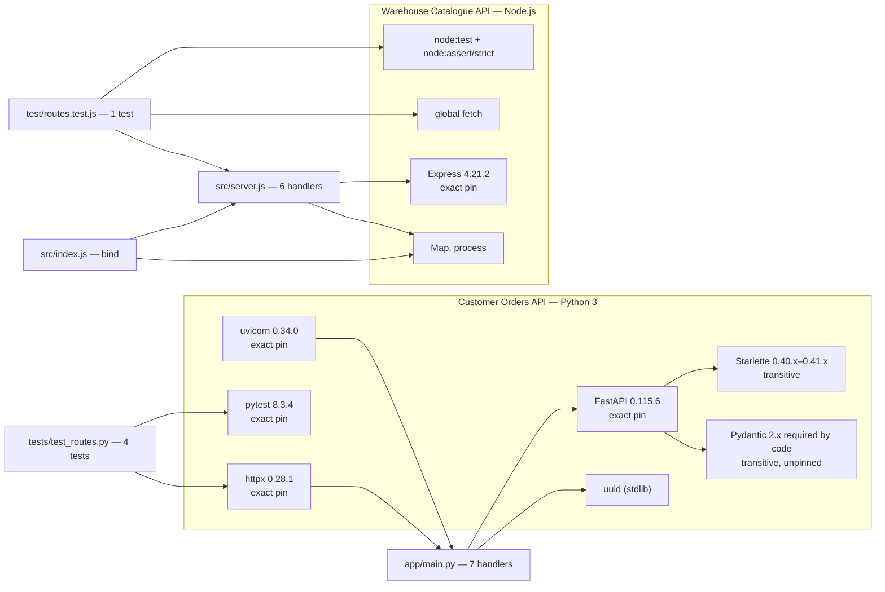

The two subgraphs share no node: no library, module or identifier is common to both services.

**Justification for each major choice.**

- **FastAPI over a minimal WSGI framework.** The service needs three validated request bodies, seven routes and an integration-test harness. FastAPI delivers all three from one dependency: the `BaseModel` classes are the contract (`app/main.py` lines 8–19), the decorators are the router (lines 21–73), `TestClient` needs no live socket (`tests/test_routes.py` line 4), and `/docs` plus `/openapi.json` appear without a line of code (`app/main.py` line 5, feature F-014). The cost is visible in the transitive graph: Starlette and Pydantic are unpinned indirect dependencies that decide runtime behaviour (see A-03).
- **uvicorn as the server, not an embedded runner.** `app/main.py` has no `__main__` block and calls no server API; the app object is addressed by import path (`app.main:app`), which is why `app/__init__.py` exists as an empty file and why the bind address lives only in `services/customer-orders-api/README.md` line 7 (TC-07).
- **pytest for the Python suite.** The suite needs one reset hook and plain assertions; pytest supplies `setup_function` (`tests/test_routes.py` lines 6–9), which is the mechanism the whole Python suite depends on, because the app and its stores are import-time singletons (TC-02, MR-02).
- **httpx even though no test imports it.** `TestClient` is a thin layer over httpx, so the exact httpx pin is what makes the suite's transport reproducible; pinning it is the reason the Starlette floor matters.
- **Express for the warehouse service.** Express supplies the two things the service needs — a router and a JSON body parser — in one dependency (`src/server.js` lines 1–3), keeping `devDependencies` empty. The trade-off is that everything Express does not include is also absent: there is no validation library, no logger and no security middleware, so payload checks are hand-written guard clauses (`src/server.js` lines 12, 27) and no security headers or CORS policy exist (TC-09, SI-04).
- **Node built-ins instead of a test framework and HTTP client.** `node:test` plus `node:assert/strict` replaces Jest/Mocha, and the global `fetch` replaces supertest/axios; the suite consequently asserts against a real TCP listener on an ephemeral port (`app.listen(0)` at `test/routes.test.js` line 8). This keeps the dependency surface at exactly one package but ties the toolchain to a Node.js version new enough for a stable runner.

**Security implications carried by these frameworks.**

| Implication | Detail | Evidence |
| --- | --- | --- |
| Interactive docs and the full OpenAPI schema are exposed unauthenticated | `FastAPI(title="Customer Orders API")` sets no `docs_url`/`openapi_url` override, so `/docs` and `/openapi.json` are mounted by default and no route requires a credential | `app/main.py` line 5; F-014; TC-10 |
| Neither framework contributes authentication, authorization or transport security | No middleware, dependency, decorator or header check exists in either service; the token minted at `app/main.py` line 38 is never consumed | `app/main.py` line 38; `src/server.js` has no auth surface; SI-01, SI-03 |
| Two error envelopes are produced for the same failure classes | FastAPI's `detail` field versus Express's `{ error: string }` | `app/main.py` lines 28, 37, 54, 56, 58, 72; `src/server.js` lines 13, 15, 26, 28, 30, 40, 46, 47; TC-03 |
| Framework defaults set limits the code never states | `express.json()` applies body-parser's default 100 kb request-body limit; FastAPI's own body-validation failures return its standard 422 schema rather than a repository-defined body | `src/server.js` line 3; A-05 and A-08 in 2.4.7 |
| No observability library is present | Neither framework is extended with logging, metrics or tracing middleware; the only runtime signal is `console.log` at `src/index.js` line 3 | MR-04 |


## 3.3 Open Source Dependencies

The checkout declares five direct open-source dependencies in total — four PyPI packages in one `requirements.txt` and one npm package in one `package.json`. Everything else the code touches is a language standard library or a Node.js built-in, so it is not a dependency at all.

**Direct dependencies as declared.**

| Package | Registry | Declared version | Declared scope and where it is used |
| --- | --- | --- | --- |
| `fastapi` | PyPI | `0.115.6` (exact `==` pin) | Runtime. The entire HTTP layer of the Customer Orders API (`app/main.py` lines 1, 5, 21–73) |
| `uvicorn` | PyPI | `0.34.0` (exact `==` pin) | Runtime server, invoked only by the documented command (`services/customer-orders-api/README.md` line 7); no code imports it |
| `pytest` | PyPI | `8.3.4` (exact `==` pin) | Test-only in practice, but declared in the same runtime file; the runner behind `pytest -q` (`README.md` line 10) |
| `httpx` | PyPI | `0.28.1` (exact `==` pin) | Test-only in practice, declared in the runtime file; imported indirectly by `TestClient`, never by repository code (`tests/test_routes.py` line 1) |
| `express` | npm | `4.21.2` (exact version, no range operator) | Runtime. The entire HTTP layer of the Warehouse Catalogue API (`package.json` line 6; `src/server.js` lines 1–3, 8–51) |

Both manifests are exhaustive for their service: `devDependencies` is explicitly empty (`package.json` line 7), and `requirements.txt` has exactly four lines with no `-r` include, extras, environment markers, URL installs or comments.

**Dependency-graph shape: declared versus resolved.**

| Layer | Python service | Node service |
| --- | --- | --- |
| Declared and pinned | `fastapi`, `uvicorn`, `pytest`, `httpx` | `express` |
| Resolved transitively at install, unpinned and unlisted | Starlette (`>=0.40.0,<0.42.0` via FastAPI), Pydantic (broad range via FastAPI), AnyIO, Click, h11, typing-extensions, httpcore, certifi, idna, sniffio | Express's own dependency tree, including the JSON parser that `express.json()` exposes |
| Language-provided, not dependencies | `uuid`, plus the `unittest`-free assertions pytest supplies | `node:test`, `node:assert/strict`, global `fetch`, `Map`, `process` |
| Lock artefact | None: no lockfile, no hashes, no `--require-hashes`, no `pip freeze` output | None: no `package-lock.json`, `npm-shrinkwrap.json`, `yarn.lock` or `pnpm-lock.yaml` |

The practical consequence is that the five exact pins fix the direct surface but not the behaviour beneath it. Two transitive resolutions actually decide runtime correctness: Starlette's version band must stay inside FastAPI 0.115.6's `>=0.40.0,<0.42.0` window, and Pydantic must resolve to 2.2 or newer because `app/main.py` line 43 calls `model_dump()`, which FastAPI's own constraint does not guarantee (assumption A-03 in 2.4.7). Constraint TC-08 in 2.4.2 records the same gap: exact direct pins, no npm lockfile, no hashes, no `engines` field.

**Scope and hygiene findings.**

| Finding | Effect | Evidence |
| --- | --- | --- |
| Test tooling shares the runtime manifest | `pip install -r requirements.txt` in a production image installs `pytest` and `httpx` alongside the service | `requirements.txt` lines 1–4; there is no `requirements-dev.txt` |
| Exact pins throughout, in two different notations | `==` in pip, a bare version in npm; both are reproducible for the direct set, and neither forbids a transitive upgrade | `requirements.txt` lines 1–4; `package.json` line 6 |
| No automated dependency maintenance | No Dependabot, Renovate or equivalent configuration exists, because no CI configuration exists at all | No `*.yml`/`*.yaml` file anywhere; `.github/` does not exist; MR-05 |
| No vulnerability-scanning surface beyond the two manifests | Only the five direct pins can be audited statically; the transitive Python tree and Express's own tree cannot be audited from the checkout | Same two manifests |
| No licence, notice or attribution file | Neither service states the licence of its dependencies or its own | No `LICENSE`, `NOTICE` or `COPYING` file in either child or the parent |

**Security implications of the dependency posture.** The direct surface is small and exactly pinned, which limits version-confusion and drift risk. It does not provide the controls the system lacks:

- No credential, hashing, signing or token library is declared in either ecosystem — there is no `bcrypt`, `passlib`, `pyjwt`, `cryptography`, `jsonwebtoken` or equivalent — which is consistent with, and partly explains, plaintext password storage (`app/main.py` line 30) and the unsigned token at `app/main.py` line 38 (SI-02, SI-03).
- No validation, security-header, CORS or rate-limiting library is declared on the Node side, so those controls are absent rather than configured (TC-09, SI-04).
- No logging, metrics or tracing library is declared on either side, so nothing reaches a collector (MR-04).
- The absence of a lockfile means a rebuild of the same commit can install a different transitive tree, so a supply-chain regression in Starlette, Pydantic or Express's own dependencies would arrive without any change to this repository.


## 3.4 Third-Party Services

The system integrates with no third-party runtime service. Neither service holds an API key, endpoint URL, SDK, credentials file or outbound HTTP client; the only network traffic either service originates is the warehouse test's call to its own `/health` (`test/routes.test.js` line 11). The `Default Technology Stack` names AWS, Auth0 and LangChain; none of the three is present in any tracked file.

**Runtime integrations: the complete inventory.**

| Candidate integration class | Finding | Evidence |
| --- | --- | --- |
| External APIs and webhooks | None. No outbound request exists in either service, and no client library is declared | Only `fetch` in the checkout is `test/routes.test.js` line 11, targeting `127.0.0.1:<ephemeral port>/health`; no `axios`, `requests`, `httpx` import in service code |
| Authentication / identity provider (Auth0, OIDC, SAML) | None. Identity is a local dictionary keyed by e-mail; the token is the formatted string `token-<uuid>` and no code path reads it | `app/main.py` lines 25–38; SI-01, SI-03; zero hits for `auth0`, `oauth`, `jwt`, `bearer` in tracked files |
| Monitoring, logging and error reporting (APM, Sentry, Prometheus) | None. No logging framework, metrics client or tracer is declared; the only runtime output is one startup line | `console.log` at `src/index.js` line 3; MR-04 |
| Cloud services (AWS or any other provider) | None. No cloud SDK, no service endpoint, no credential handling, no IaC that would provision one | Zero hits for `boto3`, `aws`, `terraform`, `*.tf` across all tracked files |
| Message brokers, queues, schedulers | None. No producer, consumer or timer exists; every state change is the direct effect of one HTTP request | No broker or scheduler dependency in either manifest; all 13 routes are synchronous request handlers |
| Payments, tax, shipping or carrier providers | None. `carrier` is a free-text string defaulting to `standard` | `src/server.js` line 49 |
| AI or LLM services (LangChain and providers) | None. No `langchain`, `openai` or any inference client is declared, and no service code makes an outbound generation call | Zero hits for `langchain` and `openai` in tracked files |
| Telemetry or analytics beacons | None. No client-side or server-side instrumentation exists | No tracker dependency; no UI component exists |

**The one external system dependency.** Source distribution is the only external dependency, and it is a build-time one: both children are fetched from GitHub over HTTPS at the commits the parent pins.

| External dependency | Mechanism | Version pinned | Evidence |
| --- | --- | --- | --- |
| GitHub-hosted child repositories | Git submodules cloned from `https://github.com/lakshya-blitzy/child_one_repo_of_submodule_ABK_7598.git` and `.../child_two_repo_of_submodule_ABK_7598.git` | Yes — `04259f82d5a8f87ff9d81d5fdd1dfdefaee4e564` and `f9f72d1c37091f8845e3e3727515fa713ebe20b1` in the parent tree | `.gitmodules` lines 1–6; `git submodule status`; parent `README.md` line 9 |

`.gitmodules` sets only `path` and `url` for each stanza — no `branch`, `update`, `shallow` or `clone-depth` option — so the checkout command is `git submodule update --init` (or `git clone --recurse-submodules`) and the commit is whatever the parent tree records. A build therefore needs outbound HTTPS access to GitHub, and nothing else.

**Integration points the services expose to an outside system.** Although nothing is integrated today, three surfaces are the only places an external system could attach without code change:

| Surface | Contract | Where it is defined |
| --- | --- | --- |
| Liveness probe | `GET /health` returning 200 with `{"status": "ok"}` on both services, with no dependency or readiness check behind it | `app/main.py` lines 21–23; `src/server.js` line 8; F-001 |
| Warehouse bind configuration | `process.env.PORT`, defaulting to `3000` — the only environment variable read anywhere in the checkout | `src/index.js` line 2 |
| Customer Orders bind configuration | Documented only: `uvicorn app.main:app --host 127.0.0.1 --port 8000`, loopback-bound, with no environment variable or config file behind it | `services/customer-orders-api/README.md` line 7; TC-07 |

**Integration requirements implied by these absences.** Stated as facts about what the code does and does not provide, not as recommendations:

- **Identity cannot be federated today.** No token this system issues is signed, stored or validated (`app/main.py` line 38), so no external identity provider could be trusted or verified by either service without new code — SI-03.
- **No secret management boundary exists.** No file reads a secret, and the only configuration input is `PORT`; there is nothing for a secrets manager, environment file or vault to feed.
- **No egress path is configured.** Neither process has proxy, TLS or allow-list configuration; the Python service's documented bind is loopback (`127.0.0.1`), and the Node service binds every interface by default through `app.listen(port)`.
- **Health reporting is the only signal an external monitor can consume.** Because no logs, metrics or traces leave the process, an external monitor's sole input is the constant `/health` body, which never inspects the in-memory stores (F-001, PR-05).

**Security implications.**

| Implication | Detail | Evidence |
| --- | --- | --- |
| No third-party trust boundary is authenticated | Every route is open to any caller that can reach the port, and no external system's assertion is checked | No auth middleware, dependency or header check in either service; SI-01 |
| No transport security or shared edge service | No TLS termination, reverse proxy, API gateway or CORS policy is configured or referenced | TC-09 |
| No external audit sink | Nothing records who changed state, so no third-party log store could be fed even if one existed | `console.log` at `src/index.js` line 3 only; SI-06 |
| Supply chain depends on a public host | Both children come from a public GitHub organisation at pinned commits; anyone who can rewrite those commits in the remote would change what a re-clone yields, and the local `.git` metadata cannot detect that on its own | `.gitmodules` lines 1–6; parent `README.md` line 9 |


## 3.5 Databases &amp; Storage

The system has no database, no cache, no object store and no file storage. Persistence is five collections held in process memory, created at import time and destroyed when the process exits. The `Default Technology Stack` names MongoDB; no MongoDB driver, ODM, connection string or container exists in the checkout.

**The complete storage inventory.**

| Store | Type and key | Record shape | Created at |
| --- | --- | --- | --- |
| `users` | Python `dict`, keyed by the e-mail string exactly as submitted | `{id: uuid str, password: <verbatim string>}` (`app/main.py` line 30) | `app/main.py` line 6 |
| `products` | Python `dict`, keyed by a generated UUID | `{name: str, price: float, stock: int}` — the `ProductRequest.model_dump()` result (`app/main.py` line 43) | `app/main.py` line 6 |
| `orders` | Python `dict`, keyed by a generated UUID | `{id, product_id, quantity, total}`; `total` is `round(price * quantity, 2)` with no currency field (`app/main.py` lines 61–66) | `app/main.py` line 6 |
| `inventory` | JavaScript `Map`, keyed by caller-supplied SKU; insertion-ordered | `{sku, name, quantity, reorderLevel}`; `reorderLevel` defaults to `5` and is never validated (`src/server.js` lines 11–17) | `src/server.js` line 5 |
| `shipments` | JavaScript `Map`, keyed by `SHP-<shipments.size + 1>`; insertion-ordered | `{id, sku, quantity, destination, status}` plus `carrier` added only on dispatch (`src/server.js` lines 32–33, 48–49) | `src/server.js` line 6 |

There are no other stores: no session store, no cache tier, no queue-backed buffer, no search index, no object bucket and no on-disk file. No file in the checkout performs file I/O — there is no `open()`, `readFile`, `writeFile`, `json.dump` or `fs` call anywhere.

**Persistence strategy.** The strategy is process-local mutable state, and the specification depends on four of its properties:

- **Import-time construction (TC-02).** The three Python dictionaries and the two Node Maps are module-level singletons (`app/main.py` line 6; `src/server.js` lines 5–6). Handlers mutate those objects directly — `product["stock"] -= payload.quantity` (`app/main.py` line 59), `item.quantity -= quantity` (`src/server.js` line 31), `shipment.status = 'dispatched'` (line 48) — so a read after a write sees the mutation within the same process, which is what makes the stock-decrement behaviour in F-006 and F-010 observable through `GET /products` and `GET /inventory`.
- **No durability (TC-01).** Nothing is written outside the heap. A restart loses every user, product, order, inventory item and shipment, and a second process holds a disjoint copy of the same five collections, so replicas answer differently for identical requests (SC-01).
- **Keyed reads are O(1), list reads are O(n)** (`app/main.py` lines 35, 52, 71; `src/server.js` lines 15, 25, 39, 45): `GET /products` and `GET /inventory` serialize the whole collection in insertion order with no filter, page or cursor (PR-02, SC-03).
- **No transaction, lock or optimistic version (SC-04).** The availability check and the subsequent decrement are separate statements in both services (`app/main.py` lines 57–59; `src/server.js` lines 30–31), and the dispatch status check and status write have the same shape (lines 47–48).

**Identity generation and its storage consequences.**

| Identifier | Strategy | Consequence in storage |
| --- | --- | --- |
| User id, product id, order id | `str(uuid4())` (`app/main.py` lines 29, 42, 60) | Collision-safe and stable across restarts; ids are never reused |
| Inventory key | Caller-supplied `sku` (`src/server.js` line 11) | Uniqueness is trusted from the caller; a duplicate is rejected with 409 (`line 15`), and no normalisation is applied, so `"AB-1"` and `"ab-1"` are distinct items |
| Shipment key | `SHP-${shipments.size + 1}` (`src/server.js` line 32) | Derived from collection size, so ids repeat after a restart and collide across replicas, silently overwriting a stored shipment (SC-02) |

No identifier space is shared between the two services: products are keyed by generated UUIDs, inventory by caller SKUs, and no mapping exists between them (TC-05).

**Data typing and precision.** Money is a binary float with no currency code (`price: float` at `app/main.py` line 14; `total` at line 65), rounded with Python's round-half-to-even at two decimals (PR-04). Quantities are plain integers with no bounds check on `price` or `stock` (negative values accepted, F-004-RQ-002) and no upper bound on inventory `reorderLevel`.

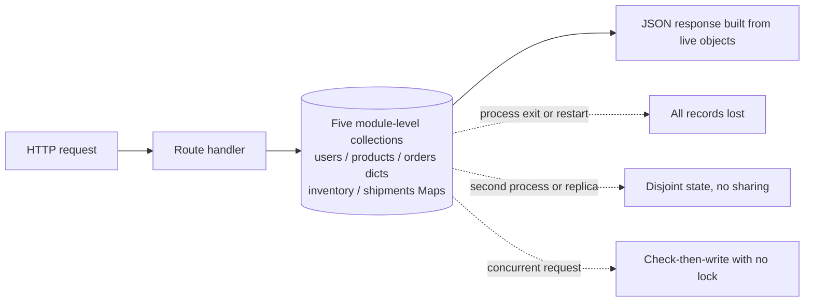

**Caching.** There is none. No cache client, cache layer, in-memory cache decorator or HTTP cache header exists; every read recomputes its response from the live store.

**Storage-related capabilities that are absent.**

| Absent capability | Effect | Evidence |
| --- | --- | --- |
| Schema, DDL and migrations | No schema is declared anywhere; record shape is whatever the handler writes, so a field added by one handler is invisible to another | `app/main.py` lines 8–19, 61–66; `src/server.js` lines 16, 33 |
| Secondary indexes, unique constraints and referential integrity | Uniqueness exists only as a dictionary key check; nothing prevents an order referencing a deleted or nonexistent product beyond the one lookup at `app/main.py` line 52 | Same store definitions |
| Backup, export, snapshot or replay | No serialization of a store to any durable medium exists | No file I/O and no data-client dependency in either manifest |
| Durability across deployment | A rolling restart resets the catalogue, the stock levels and the shipment history with no warning | `app/main.py` line 6; `src/server.js` lines 5–6 |
| Persistence-tier scaling | There is no database, cache or broker to scale on, so each request's full cost lands on the single process that serves it | Five dependencies across both manifests, none a data client; SC-05 |

**Security implications of in-memory storage.**

| Implication | Detail | Evidence |
| --- | --- | --- |
| Credentials are held in cleartext in the heap | Each `users` value stores the submitted password verbatim next to the user id | `app/main.py` line 30; SI-02 |
| No encryption at rest or in transit is applied to stored records | There is no at-rest layer and no TLS; the only protection is the process boundary | TC-09 |
| No audit history | Stores are overwritten in place, so no prior value of `stock`, `quantity` or `status` survives a write | `app/main.py` line 59; `src/server.js` lines 31, 48–49; SI-06 |
| Record enumeration is trivial on the warehouse side | Sequential `SHP-` keys and a full unpaginated `GET /inventory` make the whole inventory readable by any caller | `src/server.js` lines 21, 32; SI-05 |
| A memory dump or debugger exposes all customer and stock data | Nothing separates sensitive fields from operational ones inside a store | Same five collections |


## 3.6 Development &amp; Deployment

Development and delivery are deliberately minimal: each service is run directly from source by its own package manager, with no build, container, pipeline or infrastructure definition anywhere in the checkout. Any component of the `Default Technology Stack` concerned with delivery — Docker, Terraform, GitHub Actions, AWS — is absent.

**Toolchain as it exists.**

| Tool | Version | Role | Evidence |
| --- | --- | --- | --- |
| pip + `requirements.txt` | pip version not declared; four exact pins | The only Python dependency mechanism: `pip install -r requirements.txt` | `services/customer-orders-api/README.md` lines 6–7; `requirements.txt` lines 1–4 |
| uvicorn (CLI) | `0.34.0` | Runs the ASGI app: `uvicorn app.main:app --host 127.0.0.1 --port 8000` | `requirements.txt` line 2; `README.md` line 7 |
| pytest (CLI) | `8.3.4` | Runs the Python suite: `pytest -q` | `requirements.txt` line 3; `README.md` line 10 |
| npm | version not declared; no `engines` field, no `packageManager` field | Installs `express` and runs both scripts: `npm install`, `npm start`, `npm test` | `package.json` lines 1–8; `services/warehouse-catalogue-api/README.md` lines 6–10 |
| Node.js | version not declared | Executes `.js` sources directly; supplies `node --test`, `node:assert/strict`, global `fetch` | `package.json` line 5; `test/routes.test.js` lines 1–2, 11 |
| git + submodules | Git config only (`.gitmodules`, 6 lines) | Resolves both children at the commits the parent pins | `.gitmodules` lines 1–6; parent `README.md` line 9 |

**Build system.** There is none in the conventional sense: neither language has a compile or bundle step, and no manifest declares a build target.

| Build concern | Status | Evidence |
| --- | --- | --- |
| Compilation, transpilation, bundling | Absent. Both services execute their source files as written | `README.md` line 7 targets `app.main:app`; `package.json` line 5 runs `node` on a `.js` file |
| Packaging and distribution | Absent. The Python service has no `pyproject.toml`/`setup.py`, so it cannot be built into a wheel or published; the Node package sets `"private": true`, so npm refuses to publish it | `package.json` lines 3–4; no packaging manifest in `services/customer-orders-api` |
| Python import packaging | The single packaging artefact is a 0-byte `app/__init__.py`, present so `app.main` is importable as a package path | `services/customer-orders-api/app/__init__.py`; `README.md` line 7 |
| Dependency installation | This *is* the build step for both services | `requirements.txt`; `npm install` per `README.md` line 6 |
| Lockfile generation | npm writes a `package-lock.json` into the working tree on install, but none is committed, so every install re-resolves Express's transitive tree | No lockfile in the child; `.gitignore` contains only `.DS_Store`, so a generated lockfile would appear as untracked |

**Documented commands and their actual effect.**

| Command | Effect | Evidence |
| --- | --- | --- |
| `pip install -r requirements.txt` | Installs FastAPI, uvicorn, pytest and httpx plus their transitive tree — test tooling included in the runtime install | `requirements.txt`; `README.md` lines 6–7 |
| `uvicorn app.main:app --host 127.0.0.1 --port 8000` | Serves the Customer Orders API on loopback only; the host and port exist nowhere else in the repository | `README.md` line 7; TC-07 |
| `pytest -q` | Runs 4 tests against an in-process `TestClient`, clearing `users`, `products` and `orders` before each | `README.md` line 10; `tests/test_routes.py` lines 6–26 |
| `npm install` | Installs Express 4.21.2 and its unpinned transitive tree | `package.json` line 6; `README.md` line 6 |
| `npm start` | Runs `node src/server.js`, which only assigns `module.exports = app` and never calls `listen`, so the process exits without serving traffic | `package.json` line 5; `src/server.js` line 53; TC-06, MR-06 |
| `node src/index.js` (the working alternative, not documented) | Binds `process.env.PORT || 3000` and logs `warehouse API listening on <port>` | `src/index.js` lines 2–3 |
| `npm test` | Runs `node --test`, which discovers `test/` and executes the single health test against a real ephemeral port | `package.json` line 5; `test/routes.test.js` lines 7–17 |

**Delivery automation and infrastructure.**

| Concern | Status | Evidence |
| --- | --- | --- |
| CI/CD pipeline | None. No workflow file exists, so no run is gated on either suite and no artefact is produced | No `*.yml`/`*.yaml` file anywhere in the checkout; no `.github/` directory |
| Containerization | None. No `Dockerfile`, `.dockerignore`, `docker-compose.yml` or registry reference | Full tracked-file inventory: 13 files |
| Infrastructure as code | None. No Terraform, CloudFormation, Pulumi or Ansible file exists | Zero `*.tf`/`*.tfvars` files |
| Cloud deployment target | None declared. No provider configuration, no region, no service name | No cloud SDK and no IaC file in the checkout |
| Environment configuration | One variable: `process.env.PORT` on the Node side. No `.env`, `.env.example` or settings module exists | `src/index.js` line 2 |
| Quality tooling | No linter, formatter, type checker or pre-commit hook: no ESLint/Prettier config, no Ruff/Black/flake8 config, no `pyproject.toml`, no `Makefile` | No configuration file of any kind beyond the two manifests |
| Repository hygiene | `.gitignore` contains one line, `.DS_Store`; there is no `.editorconfig`, `.gitattributes`, `.nvmrc` or `.python-version` | `.gitignore` line 1 |

**Runtime prerequisites, derived rather than declared.**

| Prerequisite | Value | Basis |
| --- | --- | --- |
| Python interpreter | 3.9–3.12 | `uvicorn==0.34.0` requires ≥ 3.9; FastAPI 0.115.6, pytest 8.3.4 and httpx 0.28.1 require ≥ 3.8; FastAPI 0.115.6 classifiers end at 3.12 |
| Node.js runtime | ≥ 20 for a stable `node:test` runner; ≥ 18 for a global `fetch` | `node:test` became stable in Node.js 20; global `fetch` is enabled by default from Node.js 18; nothing in `package.json` enforces either |
| Outbound network access | GitHub over HTTPS, plus the configured PyPI and npm registries | `.gitmodules` lines 1–6; the two manifests |
| Inbound network access | One port per service; the Python service binds `127.0.0.1:8000` by documented command, the Node service binds `process.env.PORT || 3000` | `README.md` line 7; `src/index.js` line 2 |

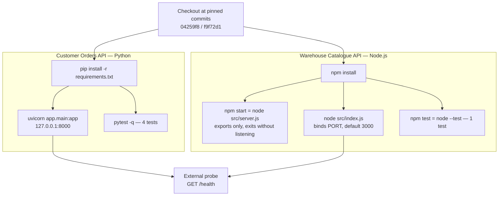

No node in the diagram represents a build, image, pipeline or provisioned resource, because the checkout defines none: the deployable artefact of each service is its source tree plus an installed dependency set.

**Security implications of the delivery posture.**

| Implication | Detail | Evidence |
| --- | --- | --- |
| Dependencies are fetched from public registries at deploy time, without hashes or a lockfile | A rebuild of the same commit can resolve a different transitive tree, so a compromise upstream would be deployed without any repository change | `requirements.txt` lines 1–4; no lockfile in either service |
| No artefact scanning or signing stage exists | Nothing inspects an image or package set because no image or package is produced | No CI configuration and no container file |
| Transport security is not configured | Plain HTTP on both services; no TLS, proxy or certificate asset | TC-09 |
| The Python service is loopback-bound by its documented command | Requests reach it only from the same host, which limits exposure but also blocks any deployment that expects a routable bind | `services/customer-orders-api/README.md` line 7 |
| The Node service binds all interfaces by default | `app.listen(port)` passes no host argument, so it accepts connections on every interface with no authentication in front of it | `src/index.js` line 3; SI-01 |
| A documented command is wrong, which is a standing operational trap | `npm start` must be replaced by `node src/index.js` before the warehouse service serves traffic at all | `package.json` line 5; `src/index.js` line 3; MR-06 |
| No pipeline means no verification gate | The 5 automated tests are advisory; nothing prevents a change from landing with them failing | Child `README.md` files lines 9–13; MR-05 |


## 3.7 References

Every claim in this section is traceable to the files below or to the cited upstream package metadata. No attachment or external reference material accompanied this project.

**Repository files and folders examined.**

- `README.md` — declares the parent metadata-only scan contract, names the two submodules and their technology labels (Python/FastAPI, JavaScript/Express), and states that each child must be analysed at the commit the parent pins.
- `.gitmodules` — the only external dependency declaration: two submodule stanzas with HTTPS GitHub URLs, `path` and `url` keys only, no branch, tag or revision option.
- `.gitignore` — one line, `.DS_Store`; establishes that a locally generated npm lockfile would show as untracked.
- `services/` — contains exactly the two independent service folders and no shared manifest, configuration or code.
- `services/customer-orders-api/` — the Python service's four children: `requirements.txt`, `README.md`, `app/`, `tests/`; confirms there is no Dockerfile, CI config, settings module, migration or `pyproject.toml`.
- `services/customer-orders-api/requirements.txt` — the four exact PyPI pins (`fastapi==0.115.6`, `uvicorn==0.34.0`, `pytest==8.3.4`, `httpx==0.28.1`) with runtime and test dependencies undivided.
- `services/customer-orders-api/README.md` — the documented run command (`uvicorn app.main:app --host 127.0.0.1 --port 8000`), the test command (`pytest -q`), and the declared analysis gaps.
- `services/customer-orders-api/app/main.py` — the entire service: FastAPI app construction at line 5, the three in-memory dictionaries at line 6, three Pydantic models at lines 8–19, seven handlers at lines 21–73, `model_dump()` at line 43, `round(...)` at line 65, and the unsigned token at line 38.
- `services/customer-orders-api/app/__init__.py` — a 0-byte file that exists only so `app.main` is importable as a package path.
- `services/customer-orders-api/tests/test_routes.py` — `TestClient` usage, the `setup_function` store reset, and the four tests that fix the Python suite's scope.
- `services/warehouse-catalogue-api/` — the Node service's four children: `package.json`, `README.md`, `src/`, `test/`; confirms the absence of a lockfile, container file, config and linter setup.
- `services/warehouse-catalogue-api/package.json` — identity, `private: true`, the two scripts (`start` → `node src/server.js`, `test` → `node --test`), the single exact `express` pin, and the empty `devDependencies`; no `type`, `engines` or `main` field.
- `services/warehouse-catalogue-api/README.md` — the documented `npm install` / `npm start` / `npm test` sequence and the declared analysis gaps.
- `services/warehouse-catalogue-api/src/server.js` — the Express app, `express.json()`, the two `Map` stores, six handlers with guard clauses, the `SHP-${shipments.size + 1}` identifier, and `module.exports = app` at line 53.
- `services/warehouse-catalogue-api/src/index.js` — the only `app.listen` call and the only `process.env` read in the checkout (`PORT`, default 3000).
- `services/warehouse-catalogue-api/test/routes.test.js` — `node:test` and `node:assert/strict` usage, the ephemeral-port listener, the global `fetch` call, and the single health test.

**Upstream package metadata consulted.**

- [web] FastAPI 0.115.6 project metadata (`pyproject.toml` at tag 0.115.6; PyPI JSON) — `requires-python = ">=3.8"`, the Pydantic constraint `>=1.7.4,!=1.8,!=1.8.1,!=2.0.0,!=2.0.1,!=2.1.0,<3.0.0`, and the Starlette pin `>=0.40.0,<0.42.0`.
- [web] FastAPI release notes — confirms 0.115.6 as the 2024-12-03 release and its Pydantic ≥ 2.10 internal updates.
- [web] uvicorn 0.34.0 metadata and release notes — `requires-python = ">=3.9"` and the "drop support for Python 3.8" entry.
- [web] pytest 8.3.4 metadata — `requires-python = ">=3.8"`.
- [web] httpx 0.28.1 metadata and changelog — `requires-python = ">=3.8"` and the removal of the deprecated `app=` argument in 0.28.0.
- [web] Starlette release notes — `TestClient` stopped passing `app=` as of Starlette 0.37.2, which is why the `httpx==0.28.1` pin is compatible with FastAPI 0.115.6's Starlette floor.
- [web] Express 4.21.2 registry document and `package.json` — the declared `"engines": {"node": ">= 0.10.0"}` and the CommonJS form of the 4.x line.
- [web] Node.js test runner documentation and the Node.js 20 release announcement — `node:test` was added in Node.js 18 and became stable in Node.js 20, which sets the effective runtime floor for the warehouse suite.

**Related sections of this specification.**

- 1.2 System Overview (1.2.1–1.2.3) — the component inventory, the 13-route surface and the limitations table this section's version facts support.
- 1.3 Scope (1.3.1–1.3.2) — the key technical requirements and the out-of-scope register that the absent-technology findings here corroborate.
- 2.4 Implementation Considerations (2.4.2–2.4.7) — constraints TC-01, TC-02, TC-03, TC-05, TC-06, TC-07, TC-08, TC-09, TC-10; properties PR-02 to PR-05; scalability SC-01 to SC-05; security SI-01 to SI-06; maintenance MR-02 to MR-06; assumptions A-03, A-04, A-05 and A-08, all of which are cross-referenced above.


# 4. Process Flowchart

## 4.1 System Workflows

The checkout defines 13 synchronous HTTP operations — seven in `services/customer-orders-api/app/main.py` (lines 21–73) and six in `services/warehouse-catalogue-api/src/server.js` (lines 8–51) — and nothing else that executes: no scheduler, queue consumer, webhook receiver, outbound HTTP client, timer or background thread exists in any of the 13 tracked files. Every workflow in this section is therefore a client-initiated request/response exchange that begins at a network boundary and ends when a JSON body is written; no work continues after a response is sent. Each workflow carries the feature identifier F-001 to F-014 defined in section 2.2, so every flow here traces to the requirements and acceptance criteria recorded there, and the diagrams that render these flows are in 4.4.

| Workflow | Feature | Route(s) | Service | Rejecting decisions | Terminal outcome |
| --- | --- | --- | --- | --- | --- |
| Service liveness probe | F-001 | `GET /health` | Both | 0 | 200 `{"status": "ok"}` |
| Account registration | F-002 | `POST /users` | Customer Orders | 1 (DP-01) | 201 `{id, email}` |
| Credential verification | F-003 | `POST /login` | Customer Orders | 1 (DP-02) | 200 `{user_id, token}` |
| Product catalogue authoring | F-004 | `POST /products` | Customer Orders | 0 | 201 product |
| Product catalogue browsing | F-005 | `GET /products` | Customer Orders | 0 | 200 array |
| Order placement with stock decrement | F-006 | `POST /orders` | Customer Orders | 3 (DP-03, DP-04, DP-05) | 201 order with computed `total` |
| Order retrieval | F-007 | `GET /orders/{order_id}` | Customer Orders | 1 (DP-06) | 200 order |
| Inventory intake by SKU | F-008 | `POST /inventory` | Warehouse Catalogue | 2 (DP-07, DP-08) | 201 item |
| Inventory listing | F-009 | `GET /inventory` | Warehouse Catalogue | 0 | 200 array |
| Shipment creation with inventory reservation | F-010 | `POST /shipments` | Warehouse Catalogue | 3 (DP-09, DP-10, DP-11) | 201 shipment, `status: created` |
| Shipment retrieval | F-011 | `GET /shipments/:id` | Warehouse Catalogue | 1 (DP-12) | 200 shipment |
| Shipment dispatch | F-012 | `POST /shipments/:id/dispatch` | Warehouse Catalogue | 2 (DP-13, DP-14) | 200 shipment, `status: dispatched` |
| Automated route verification | F-013 | `pytest -q`, `npm test` | Both | 0 | Exit status 0 |
| Interactive API documentation | F-014 | `GET /docs`, `GET /openapi.json`, `GET /redoc` | Customer Orders | 0 | 200 HTML or JSON |

The fourteen workflows form two disjoint sets. No route in either service calls, imports or shares state with the other, so a workflow never spans both stacks; 4.1.2.1 records the absence of any data flow between them.

### 4.1.1 Core Business Processes

#### 4.1.1.1 End-to-End User Journeys

Two journeys exist, one per service, and each is a linear sequence of independent requests: no request depends on a session, cookie or credential issued by an earlier one. The only values carried forward are identifiers returned in response bodies.

**Order journey — F-002 through F-007.** The journey a customer-facing client would follow to buy one catalogue item.

| # | Request | Purpose in the journey | Handler | State written | Failure exits |
| --- | --- | --- | --- | --- | --- |
| 1 | `POST /users` | Establish a customer identity | `main.py` lines 25–31 | `users[email] = {id, password}` at line 30 | 409 (DP-01), 422 |
| 2 | `POST /login` | Obtain a token | `main.py` lines 33–38 | None — read-only | 401 (DP-02), 422 |
| 3 | `POST /products` | Author the item to be sold | `main.py` lines 40–44 | `products[uuid] = {name, price, stock}` at line 43 | 422 |
| 4 | `GET /products` | Discover the `id` needed to order | `main.py` lines 46–48 | None | None |
| 5 | `POST /orders` | Commit the purchase | `main.py` lines 50–67 | Stock reduced at line 59; `orders[uuid] = {...}` at line 61 | 404, 400, 409, 422 |
| 6 | `GET /orders/{id}` | Confirm the committed order | `main.py` lines 69–72 | None | 404 (DP-06) |

The token returned by step 2 plays no part in steps 3 to 6: no handler reads an `Authorization` header or any other request header, and no route declares a security dependency, so a client that omits step 2 reaches the same end state as one that performs it. The identity established in step 1 is likewise never consulted at step 5 — the order record stores no buyer (`main.py` lines 61–66).

**Warehouse journey — F-008 through F-012.** The journey a back-office client would follow to move stock out of the warehouse.

| # | Request | Purpose in the journey | Handler | State written | Failure exits |
| --- | --- | --- | --- | --- | --- |
| 1 | `POST /inventory` | Register stock under a caller-supplied SKU | `server.js` lines 10–19 | `inventory.set(sku, item)` at line 17 | 400 (DP-07), 409 (DP-08) |
| 2 | `GET /inventory` | Confirm the SKU is on hand | `server.js` line 21 | None | None |
| 3 | `POST /shipments` | Reserve stock and create the shipment | `server.js` lines 23–36 | `item.quantity -= quantity` at line 31; `shipments.set('SHP-n', …)` at line 34 | 404 (DP-09), 400 (DP-10), 409 (DP-11) |
| 4 | `GET /shipments/:id` | Inspect the shipment before release | `server.js` lines 38–42 | None | 404 (DP-12) |
| 5 | `POST /shipments/:id/dispatch` | Release the shipment | `server.js` lines 44–51 | `status = 'dispatched'` at line 48; `carrier` at line 49 | 404 (DP-13), 409 (DP-14) |

Step 5 is terminal. The checkout defines no cancel, reverse, return or re-dispatch transition, and no route other than dispatch ever writes `status`.

**Journey properties that shape every downstream flow.**

| Property | Consequence for the flow | Evidence |
| --- | --- | --- |
| Steps are not transactional across requests | Abandoning at step 1, 3, 4 or 5 leaves in-memory residue that no route can remove, because neither service registers a `PUT`, `PATCH` or `DELETE` handler | Route registrations at `main.py` lines 21–73 and `server.js` lines 8–51 |
| The final step is irreversible | A dispatched shipment permanently holds the stock reserved at creation; there is no release path | `server.js` lines 44–51 |
| A lost order response is unrecoverable | `POST /orders` writes the stock decrement and the order together, but no route lists orders, so an identifier lost with the response cannot be rediscovered; the only visible trace is the reduced stock through `GET /products` | `main.py` lines 46–48, 69–72 |
| A lost shipment response is recoverable | `SHP-<n>` identifiers are sequential from 1 within a process, so a client can rediscover its shipment by probing `GET /shipments/SHP-1` upward | `server.js` line 32 |
| Restart is a global abort | Both stores are module-level and process-scoped; a restart discards every in-flight journey's state and a second process sees none of it | `main.py` line 6; `server.js` lines 5–6 |
| The journeys never join | No field relates a `product_id` (UUID) to a SKU (caller string), and no shipment references an order | No shared identifier in either record shape |

Neither journey is proven end to end by the delivered suites. The Python suite asserts step 1's success, step 3's success and step 5's unknown-product exit only (`tests/test_routes.py` lines 14–26); the warehouse suite asserts none of steps 1 to 5, exercising only `GET /health` (`test/routes.test.js` lines 7–16). Both child READMEs record the omission as deliberate (line 13 of each).

#### 4.1.1.2 System Interactions

| Interaction | Initiator | Target | Transport and binding | Evidence |
| --- | --- | --- | --- | --- |
| Domain request | Any HTTP client | Customer Orders API | HTTP over ASGI served by uvicorn 0.34.0, loopback `127.0.0.1:8000` by documented command | `services/customer-orders-api/README.md` line 7 |
| Domain request | Any HTTP client | Warehouse Catalogue API | HTTP over Node `http.Server`, every interface, `process.env.PORT` or 3000 | `src/index.js` lines 2–3 |
| In-process test call | pytest suite | FastAPI app object | Direct ASGI invocation through `TestClient`; no socket is opened | `tests/test_routes.py` lines 1, 4 |
| Socket test call | `node --test` | Warehouse app | Real TCP on an ephemeral port from `app.listen(0)`, called with the global `fetch` | `test/routes.test.js` lines 8–13 |
| Service to service | — | — | None: neither manifest nor source contains an HTTP client | `requirements.txt`; `package.json` line 6 |
| Operator to runtime | Shell | pip, npm | Dependency resolution and process start | Child READMEs lines 5–10 |

**Customer Orders request chain.** Each domain request passes through the same six stages.

1. uvicorn accepts the connection and passes the ASGI scope to the application object built at import (`main.py` line 5).
2. Starlette's router matches method and path against the seven registered route decorators.
3. On the four `POST` routes, Pydantic v2 parses the body into `RegisterRequest`, `ProductRequest` or `OrderRequest` (`main.py` lines 8–19). A missing, wrongly typed or unparsable field terminates the request here with 422, and the handler never runs.
4. The handler evaluates its guard clauses in source order.
5. A guard that fires raises `HTTPException`, which FastAPI serialises as `{"detail": "<message>"}` under the status code passed to it.
6. A handler that returns is serialised as JSON with 201 where the decorator declares it and 200 elsewhere.

An order request illustrates the whole chain in five lines:

```python
product = products.get(payload.product_id)          # step 4: existence guard
if product is None: raise HTTPException(404, ...)   # step 5: rejection
if payload.quantity <= 0: raise HTTPException(400, ...)
```

**Warehouse Catalogue request chain.** Each domain request passes through the same five stages.

1. `app.listen(port)` (`index.js` line 3) binds the port and Node's HTTP server dispatches to Express 4.21.2.
2. The single router matches method and path against the six registered handlers.
3. `express.json()` (`server.js` line 3) parses a JSON body. A syntax error ends the request in the error path, before any handler runs.
4. The inline arrow handler destructures the body and evaluates guard clauses in source order, returning early with `res.status(...).json({ error })`.
5. A handler that falls through writes its result with `res.status(...).json(...)`.

**Observed framework responses.** Executing both applications with their pinned dependency versions produces the following behaviour at the framework layer, which no code in the repository customises.

| Situation | Customer Orders API | Warehouse Catalogue API |
| --- | --- | --- |
| Unknown path | 404 JSON `{"detail": "Not Found"}` | 404 HTML page `Cannot GET /` |
| Known path, wrong method | 405 JSON `{"detail": "Method Not Allowed"}` | 404 HTML page `Cannot PUT /inventory` — Express 4.21.2 has no 405 path |
| Body fails type or presence checks | 422 JSON `{"detail": [{type, loc, msg, input}]}` | 400 JSON `{"error": "invalid inventory payload"}`, produced by the handler's own guard rather than the framework |
| Body is not valid JSON | 422 JSON `{"detail": [{"type": "json_invalid", …}]}` | 400 HTML page carrying the `SyntaxError` text and, with `NODE_ENV` unset, the stack trace |
| Body is absent entirely | 422 JSON `{"detail": [{"type": "missing", "loc": ["body"], …}]}` | 400 JSON `{"error": "invalid inventory payload"}`, because `req.body` remains `{}` |
| Success | JSON, 201 on the four creates, 200 elsewhere | JSON, 201 on the two creates, 200 elsewhere |
| Handler raises unexpectedly | 500 `text/plain` body `Internal Server Error` | 500 HTML page with the error message and stack |

**System boundaries.**

| Boundary | Inside | Outside | Crossing mechanism |
| --- | --- | --- | --- |
| Parent repository | Two gitlink pins and a README | GitHub-hosted child repositories | `git clone --recurse-submodules`, `git submodule update --init` (`.gitmodules` lines 1–6) |
| Customer Orders process | One FastAPI app object, three request models, three dictionaries | Every other process | HTTP on `127.0.0.1:8000` by documented command; loopback only |
| Warehouse process | One Express app object, two `Map`s | Every other process | HTTP on every interface, `PORT` default 3000 |
| Persistence, messaging, cache | Nothing — no boundary of these kinds exists | — | No database driver, broker client or cache client is installed |

#### 4.1.1.3 Decision Points

Fourteen decision points reject a request, and one coalesces a value without rejecting. Every one is a guard clause or expression inside a handler; none is middleware, a dependency, a decorator or a policy layer.

| ID | Location | Guard expression | Outcome when the guard fires |
| --- | --- | --- | --- |
| DP-01 | `main.py` line 27 | `payload.email in users` | 409 `email already registered` |
| DP-02 | `main.py` line 36 | `not user or user["password"] != payload.password` | 401 `invalid credentials` |
| DP-03 | `main.py` line 53 | `product is None` | 404 `product not found` |
| DP-04 | `main.py` line 55 | `payload.quantity <= 0` | 400 `quantity must be positive` |
| DP-05 | `main.py` line 57 | `product["stock"] < payload.quantity` | 409 `insufficient stock` |
| DP-06 | `main.py` line 71 | `order_id not in orders` | 404 `order not found` |
| DP-07 | `server.js` line 12 | `!sku or !name or not Number.isInteger(quantity) or quantity < 0` | 400 `invalid inventory payload` |
| DP-08 | `server.js` line 15 | `inventory.has(sku)` | 409 `duplicate sku` |
| DP-09 | `server.js` line 26 | `!item` | 404 `sku not found` |
| DP-10 | `server.js` line 27 | `not Number.isInteger(quantity) or quantity <= 0` | 400 `quantity must be positive` |
| DP-11 | `server.js` line 30 | `item.quantity < quantity` | 409 `insufficient inventory` |
| DP-12 | `server.js` line 40 | `!shipment` | 404 `shipment not found` |
| DP-13 | `server.js` line 46 | `!shipment` | 404 `shipment not found` |
| DP-14 | `server.js` line 47 | `shipment.status !== 'created'` | 409 `shipment cannot be dispatched` |
| DP-15 | `server.js` line 49 | `req.body.carrier or 'standard'` | Non-rejecting: every falsy carrier becomes the literal `standard` |

Two framework-level decisions sit ahead of all of them and are documented as classes E2 and E3 in 4.1.1.4: Pydantic model validation on the four Python `POST` routes, and `express.json()` parsing on the six Node routes.

**Guard order is part of each contract.** The sequence in which guards are evaluated determines which failure a caller sees when a request violates several rules at once, and the order was confirmed by execution.

| Route | Evaluation order | Confirmed consequence |
| --- | --- | --- |
| `POST /orders` | existence (DP-03) → quantity (DP-04) → stock (DP-05) | An unknown `product_id` with `quantity: 0` returns 404, not 400 |
| `POST /shipments` | existence (DP-09) → quantity (DP-10) → stock (DP-11) | An unknown SKU with `quantity: 0` returns 404, not 400 |
| `POST /shipments/:id/dispatch` | existence (DP-13) → status (DP-14) | An unknown identifier returns 404 whether or not the caller also intends an illegal transition |
| `POST /inventory` | payload validity (DP-07) → uniqueness (DP-08) | By source order, a duplicate SKU submitted with a malformed payload returns 400 rather than 409 |
| `POST /users` | uniqueness (DP-01) only | Duplicate and fresh registrations are distinguished; the absence of any other guard is what makes them distinguishable |

**Decisions a flow designer would look for and not find.** Each absence is a deliberate property of the flow, not an oversight in this description.

| Expected decision | Actual behaviour | Evidence |
| --- | --- | --- |
| Authentication or authorization on any route | No route reads a credential, so every decision above is reachable by an unauthenticated caller | No header access and no security dependency anywhere in either service |
| Sign or range check on `price` and `stock` | `POST /products` returns 201 with `price: -1.0` and `stock: -5`, and a negative stock makes every later order against that product fail at DP-05 | `main.py` lines 40–44; observed response |
| Case or whitespace normalisation of an e-mail | `A@Example.com` and `a@example.com` become two independent accounts | DP-01 compares raw strings |
| Uniqueness of product name | Every `POST /products` mints a new UUID, so identical products accumulate | `main.py` line 42 |
| Rejection of a shipment with no destination | `POST /shipments` returns 201 and the response simply omits the key | `server.js` lines 24, 33 |
| Reversal, cancellation or re-dispatch | No such route and no such status value exists | Route registration set |

#### 4.1.1.4 Error Handling Paths

Six error classes reach a caller. Only the first is designed; the remaining five are framework defaults that the repository neither configures nor overrides — the checkout registers no `exception_handler`, no Express error-handling middleware and no `try`/`catch` block anywhere in product code.

| Class | Trigger | Status | Body shape | Produced by | Reaches the handler? |
| --- | --- | --- | --- | --- | --- |
| E1 Declared domain rejection | One of DP-01 to DP-14 | 400, 401, 404 or 409 | `{"detail": "<string>"}` or `{"error": "<string>"}` | The handler that fired the guard | Yes |
| E2 Request-model validation | Missing, wrong-typed or unparsable body on a Python `POST` | 422 | `{"detail": [{"type", "loc", "msg", "input"}]}` — an array, unlike E1 | FastAPI and Pydantic, before dispatch | No |
| E3 Body-parse failure | Malformed JSON on a Node route | 400 | HTML page with the `SyntaxError` and, with `NODE_ENV` unset, a stack trace | `express.json()` and Express's final handler | No |
| E4 Routing mismatch, Python | Unknown path, or known path with an unregistered method | 404 or 405 | `{"detail": "Not Found"}` or `{"detail": "Method Not Allowed"}` | Starlette router | No |
| E5 Routing mismatch, Node | Unknown path, or known path with an unregistered method | 404 | HTML page `Cannot GET /x` or `Cannot PUT /inventory` | Express and `finalhandler` | No |
| E6 Unhandled exception | Any unexpected raise inside a handler | 500 | Python: `text/plain` `Internal Server Error`. Node: HTML page with message and stack | Outermost framework middleware | Partially — the raise originates inside it |

**Every declared rejection leaves the stores unchanged.** In all thirteen rejecting handlers the guards precede every write, so E1 never leaves a partial mutation.

| Handler | Guards | First write | Rejection safe |
| --- | --- | --- | --- |
| `register` | DP-01, line 27 | Line 30 | Yes |
| `login` | DP-02, line 36 | No write at all | Yes |
| `create_product` | None | Line 43 | Not applicable — the route cannot reject |
| `create_order` | DP-03, DP-04, DP-05, lines 53–58 | Line 59 | Yes |
| `get_order` | DP-06, line 71 | No write | Yes |
| `POST /inventory` | DP-07, DP-08, lines 12–15 | Line 17 | Yes |
| `POST /shipments` | DP-09, DP-10, DP-11, lines 26–30 | Line 31 | Yes |
| `GET /shipments/:id` | DP-12, line 40 | No write | Yes |
| `POST /shipments/:id/dispatch` | DP-13, DP-14, lines 46–47 | Line 48 | Yes |

A single exception to the "no partial write" property exists one level lower: `create_order` mutates `product["stock"]` at line 59 and only then constructs the order at line 61, and `POST /shipments` mutates `item.quantity` at line 31 and only then stores the shipment at line 34. Both pairs are adjacent statements with no intervening failure point in the delivered code, but under concurrency a second request can observe the decremented store between the two writes (see 4.3.1.4).

**Recovery is entirely a client responsibility.** The services expose no retry endpoint, no idempotency key, no compensating action and no dead-letter store.

| Error class | Client recovery | Residual effect | Risk in that recovery |
| --- | --- | --- | --- |
| E1 | Correct the payload and repeat the request | None — the rejection did not mutate | A repeated `POST` that had actually succeeded before the response was lost creates a second record, because no route accepts an idempotency key |
| E2 | Supply the missing or re-typed field | None | None beyond the repeat risk above |
| E3 | Serialise a valid JSON body | None | None |
| E4, E5 | Use a registered method and path | None | The Node service returns 404, not 405, for a wrong method, so a client cannot tell a wrong method from a wrong path |
| E6 | None available at the API level; an operator must inspect and restart | Unknown — a raise between line 59 and line 61 of `main.py` would leave stock decremented with no order | Both stores are lost on restart, so a restart also destroys every other client's state |

### 4.1.2 Integration Workflows

#### 4.1.2.1 Data Flow Between Systems

No data flows between the two services. Neither manifest declares an HTTP client, neither source file imports one, and the only `fetch` in the checkout targets the warehouse service's own `/health` from its test file (`test/routes.test.js` line 11). Integration is therefore client-mediated by construction: an external system that wanted to sell a warehouse SKU as a catalogue product would have to read one service and write the other itself, and the checkout contains no adapter that does so.

| Data domain | Owner | Storage key | Record shape | Exported over HTTP |
| --- | --- | --- | --- | --- |
| Users | Customer Orders | E-mail string | `{id, password}` | `id` and `email` only; the password is never returned |
| Products | Customer Orders | UUID4 string | `{name, price, stock}` | Entire record plus `id` |
| Orders | Customer Orders | UUID4 string | `{id, product_id, quantity, total}` | Entire record |
| Inventory | Warehouse | Caller-supplied SKU | `{sku, name, quantity, reorderLevel}` | Entire record |
| Shipments | Warehouse | `SHP-<size+1>` | `{id, sku, quantity, destination?, status, carrier?}` | Entire record |

**Identifier spaces are disjoint and carry no foreign key.**

| Identifier | Format | Produced by | Referenced by |
| --- | --- | --- | --- |
| User id | UUID4 | `main.py` line 29 | Nothing |
| E-mail | Raw caller string | Caller | The `users` key only |
| Product id | UUID4 | `main.py` line 42 | `orders.product_id` |
| Order id | UUID4 | `main.py` line 60 | The `orders` key only |
| SKU | Raw caller string | Caller | The `inventory` key and `shipments.sku` |
| Shipment id | `SHP-1`, `SHP-2`, … | `server.js` line 32 | Nothing |

The product record holds no SKU field, the shipment record holds no product or order reference, and neither service reads any identifier belonging to the other. A cross-service workflow would require an out-of-band mapping that no file in the checkout defines.

| Data movement | Source | Destination | Asynchronous | Notes |
| --- | --- | --- | --- | --- |
| Request body to stored record | HTTP body | Process memory | No | Via the Pydantic model (`main.py` line 43) or the destructured body (`server.js` line 16) |
| Stored record to response body | Process memory | HTTP response | No | Built per request; nothing is cached or snapshotted |
| Process memory to disk | — | — | — | No filesystem write, no `fs` call and no serialisation to any file exists |
| Process memory to log | — | stdout | No | The only log statement prints the listening port (`index.js` line 3); no payload, identifier or error is logged |
| Process memory to another process | — | — | — | No replication, shared cache or broker exists |

#### 4.1.2.2 API Interactions

The 13 operations below are the complete API surface. No request header is read by any route, no query parameter is declared on any route (a `GET /products?limit=1` returns the identical full array), and no route accepts a batch or array body.

| # | Method and path | Request contract | Success | Declared failures | Side effect | Repeatable without new effect |
| --- | --- | --- | --- | --- | --- | --- |
| 1 | `GET /health` (orders) | None | 200 `{"status": "ok"}` | None | None | Yes |
| 2 | `POST /users` | `{email, password}` | 201 `{id, email}` | 409, 422 | Inserts a user | No — a second identical call returns 409 |
| 3 | `POST /login` | `{email, password}` | 200 `{user_id, token}` | 401, 422 | None | Yes — read-only in effect |
| 4 | `POST /products` | `{name, price, stock}` | 201 `{id, name, price, stock}` | 422 | Inserts a product | No — each call mints a new UUID |
| 5 | `GET /products` | None | 200 array of products | None | None | Yes |
| 6 | `POST /orders` | `{product_id, quantity}` | 201 `{id, product_id, quantity, total}` | 404, 400, 409, 422 | Decrements stock and inserts an order | No — a repeat decrements again |
| 7 | `GET /orders/{order_id}` | Path parameter | 200 order | 404 | None | Yes |
| 8 | `GET /health` (warehouse) | None | 200 `{"status": "ok"}` | None | None | Yes |
| 9 | `POST /inventory` | `{sku, name, quantity, reorderLevel?}` | 201 item | 400, 409 | Inserts an inventory item | No — a repeat returns 409 |
| 10 | `GET /inventory` | None | 200 array of items | None | None | Yes |
| 11 | `POST /shipments` | `{sku, quantity, destination?}` | 201 shipment, `created` | 404, 400, 409 | Decrements inventory and inserts a shipment | No — a repeat reserves again |
| 12 | `GET /shipments/:id` | Path parameter | 200 shipment | 404 | None | Yes |
| 13 | `POST /shipments/:id/dispatch` | Path parameter, optional `{carrier}` | 200 shipment, `dispatched` | 404, 409 | Flips status and sets carrier | Only in the failure sense — a repeat returns 409 |

Both services answer the liveness probe with a byte-identical body, which is the only contract the two stacks share. FastAPI additionally serves `GET /docs`, `GET /redoc` and `GET /openapi.json`, mounted by default when the app is constructed at `main.py` line 5; the observed schema declares six distinct paths carrying the seven operations of the order service. Express registers no documentation route.

Two asymmetries matter to an integrating client. First, the failure envelope differs: `{"detail": …}` on the Python side and `{"error": …}` on the Node side, with a 422 array body appearing only on the Python side. Second, the identity of a rejected request differs: `POST /orders` returns 400 for a non-positive quantity, whereas `POST /shipments` returns 400 for the same mistake under a different message, and the Node service rejects a fractional quantity at DP-10 rather than at the model layer.

#### 4.1.2.3 Event Processing Flows

None exist. The checkout contains no publish or subscribe call, no message broker client, no webhook route, no polling loop, no `setInterval` or `setTimeout`, and no event emitter beyond Express's internal one. Neither service announces a state change: a created order, a decremented stock level, a created shipment and a dispatched shipment all produce no outbound notification, so any party interested in those changes must poll `GET /products`, `GET /inventory` or `GET /shipments/:id`.

The only asynchronous callback in the repository is the listen handler that prints a startup line (`src/index.js` line 3), and the only event-like artefact a client can observe is that line appearing on stdout. Status values such as `created` and `dispatched` are data fields read back through `GET /shipments/:id`; they are not events, because no transition is recorded with a timestamp, actor or sequence, and nothing is emitted when one occurs.

#### 4.1.2.4 Batch Processing Sequences

No batch or bulk processing exists in product code: no scheduler, cron entry, worker pool, queue drain, bulk endpoint or array-accepting body is present. Two sequenced multi-step executions do exist, and both are the automated verification workflows of F-013.

| Sequence | Steps | Isolation mechanism | Evidence |
| --- | --- | --- | --- |
| pytest run | Collect four test functions, then for each: `setup_function` clears `users`, `products` and `orders`; the test issues one in-process request; the test asserts on the response | Store clearing before every test, because the app and stores are module-level singletons | `tests/test_routes.py` lines 6–26 |
| `node --test` run | Discover `test/*.test.js`; run the single test, which binds an ephemeral port with `app.listen(0)`, issues one `fetch` to `/health`, asserts the status and body, and closes the server in a `finally` block | A fresh process per run plus socket teardown in `finally` | `test/routes.test.js` lines 7–17 |

Two further sequences are structural rather than scheduled. Startup is a fixed three-stage sequence per service: import the manifest's dependencies, construct the app object and its stores at import time (`main.py` lines 5–6; `server.js` lines 2–6), then bind a port (`index.js` line 3 for the warehouse; the documented uvicorn invocation for the order service). And restart is the only bulk state operation the system offers: it wipes the entire dataset, which is the practical equivalent of a truncate for both stores, with no export step beforehand.


## 4.2 Flowchart Requirements

This sub-section fixes what every diagram in 4.4 must show and which rules each diagram must encode. Because the checkout has no business-rule layer beyond the guard clauses catalogued in 4.1.1.3 and the framework behaviour observed in 4.1.1.2, every requirement below is traceable to a line of code or to an observed response rather than to an external policy document.

### 4.2.1 Structural Elements of Every Workflow Diagram

| Element | Required in | Notation used in 4.4 | Source of truth |
| --- | --- | --- | --- |
| Start point | Every diagram | Rounded terminator holding the method, path and initiating actor | Route registration in `main.py` or `server.js` |
| Success end point | Every diagram | Terminator holding the status code and the exact response shape | Handler return statement |
| Rejection end point | Every diagram with a decision | Terminator holding status code and exact message string | DP-01 to DP-14 |
| Process step | Every diagram | Rectangle naming one statement or one narrow group of statements with the same effect | Handler body line numbers |
| Decision | Every diagram with a guard | Diamond labelled with its DP identifier and the condition | 4.1.1.3 |
| System boundary | Every diagram | Swim lane per actor or component, with the in-memory store isolated in its own lane | `main.py` lines 5–6; `server.js` lines 2–6 |
| User touchpoint | Every diagram | Actor node outside all service lanes, labelled `Any HTTP client (no credential)` | Absence of any credential read |
| Error state and recovery | Every diagram with a rejection | Rejection terminator plus a dashed edge back to the request labelled with the corrective action | 4.2.1.5 |
| Timing constraint | Diagrams with a time-ordered dependency | Edge label stating the ordering requirement | 4.2.1.6 |

#### 4.2.1.1 Start and End Points

Every flow starts at exactly one client-side terminator and reaches exactly one terminal node per execution. Six of the fourteen workflows have a single success end and no rejection end, because their handler contains no guard; the rest terminate on one success node and between one and four rejection nodes.

| Workflow | Start node | Success end | Rejection ends (count) |
| --- | --- | --- | --- |
| F-001 Liveness | Probe issued against either service | 200 `{"status": "ok"}` | 0 |
| F-002 Registration | `POST /users` with `{email, password}` | 201 `{id, email}` | 2 — 409, 422 |
| F-003 Login | `POST /login` with `{email, password}` | 200 `{user_id, token}` | 2 — 401, 422 |
| F-004 Product authoring | `POST /products` with `{name, price, stock}` | 201 product | 1 — 422 |
| F-005 Catalogue browsing | `GET /products` | 200 array | 0 |
| F-006 Order placement | `POST /orders` with `{product_id, quantity}` | 201 order | 4 — 404, 400, 409, 422 |
| F-007 Order retrieval | `GET /orders/{order_id}` | 200 order | 1 — 404 |
| F-008 Inventory intake | `POST /inventory` with `{sku, name, quantity}` | 201 item | 2 — 400, 409 |
| F-009 Inventory listing | `GET /inventory` | 200 array | 0 |
| F-010 Shipment creation | `POST /shipments` with `{sku, quantity}` | 201 shipment, `created` | 3 — 404, 400, 409 |
| F-011 Shipment retrieval | `GET /shipments/:id` | 200 shipment | 1 — 404 |
| F-012 Shipment dispatch | `POST /shipments/:id/dispatch` | 200 shipment, `dispatched` | 2 — 404, 409 |
| F-013 Automated verification | Operator runs `pytest -q` or `npm test` | Exit status 0 with the expected test count | 1 — a non-zero exit |
| F-014 Documentation | `GET /docs`, `/openapi.json` or `/redoc` | 200 HTML or JSON | 0 in the delivered configuration |

No diagram may draw an edge that returns a successful response into an earlier process step: no handler loops, retries or re-enters another route. The only legitimate backward edge is the dashed client-recovery edge from a rejection terminator to the start node.

#### 4.2.1.2 Process Steps

A process rectangle exists for each statement with an observable effect — a store read, a store write, an identifier generation, a computation, or a response write. Pure syntactic steps are merged. Six workflows collapse to a single-step line, and their diagrams exist only to show the boundary and the absence of decisions.

| Workflow | Process steps in order | Steps with an observable effect |
| --- | --- | --- |
| F-001 | Return the constant body | 0 |
| F-002 | Test e-mail membership → mint UUID4 → insert user → return `{id, email}` | 2 (mint, insert) |
| F-003 | Look up user → compare password → return `{user_id, token}` | 1 (token string construction) |
| F-004 | Mint UUID4 → dump the model → insert product → return the merged record | 2 |
| F-005 | Iterate the dictionary → merge keys into each record → return the array | 1 (serialisation, O(n)) |
| F-006 | Look up product → test quantity → test stock → decrement stock → mint UUID4 → compute `round(price × quantity, 2)` → insert order → return it | 4 (decrement, mint, compute, insert) |
| F-007 | Test order membership → return the stored record | 0 |
| F-008 | Destructure the body with the reorder default → test payload → test duplicate → build the item → insert → return it | 1 |
| F-009 | Spread the Map values → return the array | 1 (serialisation, O(n)) |
| F-010 | Look up the SKU → test quantity → test stock → decrement quantity → derive `SHP-<size+1>` → build the shipment → insert → return it | 4 (decrement, derive, build, insert) |
| F-011 | Look up shipment → return it | 0 |
| F-012 | Look up shipment → test status → set `dispatched` → set carrier → return it | 2 |
| F-013 | Run the suite → report results | 1 |
| F-014 | Generate the schema from route metadata → render | 1 |

#### 4.2.1.3 Decision Diamonds

Every rejecting guard is drawn as a diamond carrying its DP identifier from 4.1.1.3, with two labelled edges: the rejection edge annotated with the exact status and message, and the continuation edge. Three rules follow from observed behaviour.

| Rule | Basis |
| --- | --- |
| A diamond must state the condition as the code evaluates it, not as the business intends it. DP-07 tests truthiness and integer-ness, so it rejects `""` and `"5"` but accepts `0` | `server.js` line 12; observed 201 for `quantity: 0` and 400 for `quantity: "5"` |
| Diamonds on one route must be drawn in source order, because the order decides which rejection a caller sees | 4.1.1.3 guard-order table |
| Framework diamonds precede every handler diamond | E2 and E3 in 4.1.1.4 terminate the request before dispatch |

DP-15 is drawn as a diamond but has no rejection edge: both branches continue, and the false branch writes the literal `standard`. Of the fourteen rejecting diamonds, six belong to the order service (DP-01 to DP-06), and eight to the warehouse service (DP-07 to DP-14); no diamond is shared between services.

#### 4.2.1.4 System Boundaries and User Touchpoints

Each diagram uses swim lanes for the components a request actually crosses, and the in-memory store gets its own lane so that the point of no return is visible.

| Diagram family | Lanes, in order |
| --- | --- |
| Order-service flows (F-002 to F-007, F-014) | `Any HTTP client` → `uvicorn + Starlette router` → `Pydantic model binding` → `handler in app/main.py` → `process memory: users, products, orders` |
| Warehouse flows (F-008 to F-012) | `Any HTTP client` → `Node http.Server + Express router` → `express.json()` → `handler in src/server.js` → `process memory: inventory, shipments` |
| Verification flow (F-013) | `Operator shell` → `pytest or node --test` → `app object` → `process memory` |

The store lane must be labelled with its lifetime, because the boundary that matters operationally is temporal rather than spatial: everything inside `process memory` disappears when the process exits and is invisible to a second process (`main.py` line 6; `server.js` lines 5–6).

User touchpoints are HTTP-only. There is no user interface, no CLI beyond the two test runners, and no generated client anywhere in the checkout.

| Touchpoint | Actor | Credential expected | Credential verified |
| --- | --- | --- | --- |
| Any domain route | Any HTTP client | None declared | None |
| `POST /login` | Any HTTP client | E-mail and password in the body | Compared with the stored value at DP-02 |
| `GET /docs`, `/redoc`, `/openapi.json` | Any HTTP client or browser | None | None |
| Cross-origin browser call | Browser page | Preflight would be required | Not possible: neither service mounts CORS middleware and no `Access-Control-*` header is returned |

#### 4.2.1.5 Error States and Recovery Paths

Each rejection terminator must carry the exact status code, the exact message string the service emits, the effect on the stores, and whether the client can recover by acting alone.

| ID | Status | Exact message | Store effect | Client-recoverable |
| --- | --- | --- | --- | --- |
| DP-01 | 409 | `email already registered` | None | Yes — use another address or log in |
| DP-02 | 401 | `invalid credentials` | None | Yes — resubmit valid credentials |
| DP-03 | 404 | `product not found` | None | Yes — read `GET /products` for a valid id |
| DP-04 | 400 | `quantity must be positive` | None | Yes — submit a positive integer |
| DP-05 | 409 | `insufficient stock` | None | Partly — reduce the quantity; there is no restock route |
| DP-06 | 404 | `order not found` | None | No — order identifiers cannot be rediscovered |
| DP-07 | 400 | `invalid inventory payload` | None | Yes — supply a truthy `sku` and `name` and an integer `quantity` of at least zero |
| DP-08 | 409 | `duplicate sku` | None | No — a SKU cannot be amended or deleted through the API |
| DP-09 | 404 | `sku not found` | None | Yes — receive the SKU first |
| DP-10 | 400 | `quantity must be positive` | None | Yes — submit a positive integer |
| DP-11 | 409 | `insufficient inventory` | None | Partly — reduce the quantity; there is no restock route |
| DP-12 | 404 | `shipment not found` | None | Partly — probe the sequential identifier range |
| DP-13 | 404 | `shipment not found` | None | Partly — same range probe |
| DP-14 | 409 | `shipment cannot be dispatched` | None | No — dispatch is one-way and there is no reversal |
| E2 | 422 | `detail` array naming each offending field | None | Yes — fix the named field |
| E3 | 400 | HTML page carrying the parse error | None | Yes — send syntactically valid JSON |
| E5 | 404 | HTML `Cannot <METHOD> <path>` | None | Yes — use a registered route |
| E6 | 500 | `Internal Server Error` (Python) or an HTML error page (Node) | Unknown | No — requires an operator restart, which erases all state |

Four rejections are unrecoverable by the client alone, and each is a direct consequence of a missing route: no order listing (DP-06), no SKU amendment or deletion (DP-08), no dispatch reversal (DP-14), and no compensating action for an unhandled failure (E6). Diagrams must therefore never draw a retry edge from those terminators.

#### 4.2.1.6 Timing and SLA Considerations

No service-level objective, latency target, availability target, timeout, retry budget or rate limit is declared anywhere in the checkout — not in a README, a manifest, a comment or a configuration file. Each of those absences is a documented property of the fixture rather than an omission in this section, and a diagram may show a timing constraint only where the code enforces an ordering.

| Timing property | Value in this checkout | Basis |
| --- | --- | --- |
| Declared SLA, SLO or latency target | None | No such statement in any of the 13 tracked files |
| Per-route complexity | O(1) for 11 of 13 operations; O(n) with no page bound for `GET /products` and `GET /inventory` | Single dictionary or `Map` lookup versus full-collection serialisation |
| Concurrency, order service | One process by the documented command, which passes no `--workers` flag; plain `def` handlers are dispatched to a thread pool whose size the repository does not configure | `services/customer-orders-api/README.md` line 7; handler signatures in `main.py` |
| Concurrency, warehouse service | One event-loop thread; every handler is synchronous and performs no I/O, so each request completes within a single turn | `src/index.js` line 3; handler bodies in `server.js` lines 8–51 |
| Request timeout | Not configured; the runtime default applies to each service | No timeout option is passed in either source file |
| Retry, backoff, circuit breaking | None on either the server or the client side | No client exists in the checkout |
| Rate limiting | None | No middleware is mounted beyond `express.json()` |
| Recovery point objective | Total — a restart loses every record, because nothing is persisted or backed up | `main.py` line 6; `server.js` lines 5–6 |
| Recovery time objective | The time to restart the process, after which the service is available but empty | Import-time construction with no state restore |
| Ordering constraints the code enforces | Body validation before guard evaluation; guard before write on all 13 routes; inventory decrement before shipment insertion (`server.js` lines 31, 34); stock decrement before order insertion (`main.py` lines 59, 61); existence check before status check on dispatch | Handler bodies |

Two timing constraints are absent in a way that changes a flow's meaning. First, no record carries a timestamp: no `Date`, `now()` or clock call appears anywhere in product code, so elapsed-time ordering between two records cannot be reconstructed from the data. Second, no reservation expires: a shipment created and never dispatched holds its inventory indefinitely, so the flow has no time-based release path.

### 4.2.2 Validation Rules

#### 4.2.2.1 Business Rules at Each Step

| ID | Business rule | Enforced | Where |
| --- | --- | --- | --- |
| BR-01 | An account is identified by the exact e-mail string submitted | Yes | DP-01, `main.py` line 27 |
| BR-02 | A password must equal the stored value for the account | Yes | DP-02, `main.py` line 36 |
| BR-03 | An order total is computed on the server as `round(price × quantity, 2)` | Yes | `main.py` line 65; observed `0.1 × 3 = 0.3` and `25.0 × 3 = 75.0` |
| BR-04 | Stock must cover the requested quantity | Yes | DP-05, `main.py` line 57 |
| BR-05 | An ordered quantity must be a positive integer | Yes | DP-04 for the sign, model validation for integer-ness; `quantity: 1.5` returns 422 |
| BR-06 | A shipment quantity must be a positive integer | Yes | DP-10, `server.js` line 27 |
| BR-07 | A SKU is created at most once and never amended | Yes | DP-08, `server.js` line 15 |
| BR-08 | Intake quantity must be an integer of at least zero | Yes | DP-07, `server.js` line 12; zero is accepted |
| BR-09 | `reorderLevel` defaults to 5 when absent | Yes | `server.js` line 11; any supplied value is stored unvalidated |
| BR-10 | A shipment reserves inventory before the shipment record exists | Yes, by statement order | `server.js` lines 31 then 34 |
| BR-11 | Only a `created` shipment may be dispatched | Yes | DP-14, `server.js` line 47 |
| BR-12 | Any falsy carrier becomes `standard` | Yes | DP-15, `server.js` line 49; observed for `""` |
| BR-13 | A product price may be negative or unbounded, and its stock may be negative | Deliberately not enforced | `main.py` lines 12–15; observed 201 with `price: -1.0`, `stock: -5` and `price: 1e+308` |
| BR-14 | An inventory reservation never expires and cannot be released | Not enforced — no such rule exists | No expiry field, no delete or cancel route |
| BR-15 | An order belongs to the account that placed it | Not expressible — the order stores no buyer | `main.py` lines 61–66 |
| BR-16 | Money is denominated in a stated currency | Not expressible — no currency field anywhere | `main.py` lines 12–15; `main.py` line 65 |

#### 4.2.2.2 Data Validation Requirements

The two services validate in structurally different ways, and the difference is visible in every flow that carries a body. Python relies on Pydantic type coercion and performs no semantic checks; Node relies on hand-written truthiness and `Number.isInteger` checks, which reject empty strings that Python accepts.

| Field | Service | Declared type | Check actually performed | Accepted unexpectedly | Rejected example |
| --- | --- | --- | --- | --- | --- |
| `email` | Orders | `str` | String type only; no format, length or normalisation check | `""` returns 201 and creates an account keyed by the empty string | A non-string value fails type validation with 422 |
| `password` | Orders | `str` | String type only | `""` returns 201 | A non-string value fails with 422 |
| `name` | Orders | `str` | String type only | `""` returns 201 | A non-string value fails with 422 |
| `price` | Orders | `float` | Numeric coercion | `"25"` becomes `25.0`; `-1` and `1e308` are stored as given | `null` returns 422 |
| `stock` | Orders | `int` | Integer coercion | `"8"` becomes `8`; `-5` is stored as given | `1.5` returns 422 |
| `product_id` | Orders | `str` | Used as a dictionary key with no format check | Any string is accepted as a candidate key | Nothing is rejected at the type layer |
| `quantity` | Orders | `int` | Integer coercion, then DP-04 | `"2"` becomes `2` and `true` becomes `1`; both return 201 | `1.5` returns 422; `0` returns 400 |
| `sku` | Warehouse | Ungoverned | Truthiness | A whitespace-only string passes truthiness and is stored | `""`, `0`, `null` return 400 |
| `name` | Warehouse | Ungoverned | Truthiness | Any truthy value, including a number, is stored as given | `""` returns 400 |
| `quantity` (intake) | Warehouse | Ungoverned | `Number.isInteger` and `>= 0` | `0` returns 201 | `"5"`, `2.5`, `-1` return 400 |
| `quantity` (shipment) | Warehouse | Ungoverned | `Number.isInteger` and `> 0` | Nothing beyond the declared rule | `0`, `1.5`, `"4"` return 400 |
| `destination` | Warehouse | Ungoverned | None | Any value of any type is stored; absence omits the key | Nothing |
| `reorderLevel` | Warehouse | Ungoverned | None | `null` is stored as `null`; a string is stored as a string | Nothing |
| `carrier` | Warehouse | Ungoverned | Falsy coalescing | Any truthy value is stored as free text | Nothing rejected; falsy values become `standard` |

#### 4.2.2.3 Authorization Checkpoints

No authorization checkpoint exists anywhere in either service. The single credential comparison in the checkout — DP-02 at `main.py` line 36 — authenticates a caller against a password, and it is not a checkpoint because nothing downstream consults its result.

| Expected checkpoint | Implemented | Evidence |
| --- | --- | --- |
| Authenticate a request before serving a domain route | No | No route reads a header or declares a security dependency; no request header is read anywhere in product code |
| Verify the token issued by `POST /login` | No | The token is constructed at `main.py` line 38 and never read; the checkout contains no validation of any token |
| Authorize catalogue authoring | No | Any unauthenticated caller may create products (`main.py` lines 40–44) |
| Authorize order placement on another account's behalf | No | Orders record no buyer, so ownership cannot be evaluated (`main.py` lines 61–66) |
| Restrict a caller to its own orders and shipments | No | Any caller holding an identifier reads the record (`main.py` lines 69–72; `server.js` lines 38–42) |
| Authorize shipment dispatch | No | Any unauthenticated caller may dispatch (`server.js` lines 44–51) |
| Isolate tenants, warehouses or sites | No | No tenant, site or warehouse field exists on any record |
| Protect the documentation and schema routes | No | `/docs`, `/redoc` and `/openapi.json` are mounted without authentication (`main.py` line 5) |

Two properties of the issued token make any future checkpoint unsafe without a redesign: it is derived deterministically from the user identifier (`token-<user_id>`), so anyone who learns a user id can construct it, and it carries no signature, expiry, audience or scope. A diagram must therefore show DP-02 as an authentication comparison with no downstream effect, never as a gate.

#### 4.2.2.4 Regulatory Compliance Checks

No regulatory control is implemented. The statements below record what the code does, not a conformance judgement, because the fixture makes no compliance claim of any kind.

| Control area | Implemented control | What the code actually does |
| --- | --- | --- |
| Personal-data inventory and minimisation | None | An e-mail address (an identifier under most privacy regimes) and a free-text `destination` are stored verbatim in process memory with no classification, consent record or minimisation rule (`main.py` line 30; `server.js` line 33) |
| Right of access, rectification or erasure | None | No `DELETE` or `PUT` route exists, so no record can be read by owner, amended or erased through the API |
| Retention and disposal | None | Records live until the process exits; no retention period or purge task exists, and no timestamp is stored that a retention rule could use |
| Credential protection | None | Passwords are stored verbatim and compared with a non-constant-time string comparison (`main.py` lines 30, 36); no hashing library is pinned |
| Payment-card or financial-data handling | Not applicable | No card, PAN, account-number or currency field exists on any record |
| Audit trail of state change | None | No actor, timestamp or reason is recorded for any write; the only log line reports the listening port (`src/index.js` line 3) |
| Monetary representativeness | None | Totals are IEEE-754 doubles rounded with `round()`, with no currency, minor-unit or tax treatment (`main.py` line 65) and no reconciliation record of the pre-decrement stock level |
| Data-in-transit protection | None | Both services speak plain HTTP; no TLS, proxy or certificate asset exists in the checkout |
| Transport-level access control | None for the warehouse | `app.listen(port)` binds every interface with no authentication in front of it (`src/index.js` line 3); the order service is loopback-bound only because its documented command says so (`services/customer-orders-api/README.md` line 7) |
| Input sanitisation for stored free text | Partial | Values are stored raw and rendered through JSON encoding, which is what keeps the JSON responses well formed; no validation or encoding of `name`, `destination` or `carrier` is performed |


## 4.3 Technical Implementation

The mechanisms supporting the flows of 4.1 are minimal by construction: three module-level dictionaries, two module-level `Map`s, no persistence layer, no cache and no transaction. This sub-section records those mechanisms precisely, because each one determines what a flow can and cannot survive.

### 4.3.1 State Management

#### 4.3.1.1 State Transitions

Six state machines exist. Only one has more than a single forward transition, and it is the only record whose field is rewritten after creation.

| Record | States | Transitions | Trigger | Guard | Code |
| --- | --- | --- | --- | --- | --- |
| Shipment | Absent → `created` → `dispatched` | 2 | `POST /shipments`; `POST /shipments/:id/dispatch` | DP-09 to DP-11; DP-13, DP-14 | `server.js` lines 33, 48 |
| Inventory item | Absent → present at a quantity | 1 creation, then quantity decrements only | `POST /inventory`; `POST /shipments` | DP-07, DP-08; DP-11 | `server.js` lines 16–17, 31 |
| Product | Absent → present with a stock level | 1 creation, then stock decrements only | `POST /products`; `POST /orders` | Model validation; DP-05 | `main.py` lines 42–43, 59 |
| Order | Absent → present, immutable | 1 | `POST /orders` | DP-03 to DP-05 | `main.py` line 61 |
| User | Absent → present, immutable | 1 | `POST /users` | DP-01 | `main.py` line 30 |
| Process | Constructed empty at import → accumulated → destroyed at exit | 3 | Import, requests, exit | None | `main.py` line 6; `server.js` lines 5–6 |

**Shipment lifecycle.** This is the only record with a meaningful lifecycle, and the transition graph is a two-edge chain.

| From | Event | Guard | To | Fields written |
| --- | --- | --- | --- | --- |
| Absent | `POST /shipments` | SKU exists, quantity is a positive integer, stock covers it | `created` | `id`, `sku`, `quantity`, `destination` when supplied, `status: 'created'` |
| `created` | `POST /shipments/:id/dispatch` | Identifier exists and status is `created` | `dispatched` | `status: 'dispatched'`, `carrier` |
| `dispatched` | `POST /shipments/:id/dispatch` | Status is not `created` | Rejected 409 | None |

No other transition exists: there is no cancellation, return, re-open, hold, partial-dispatch or deletion edge, and no field other than `status` and `carrier` is ever rewritten. Because no timestamp is stored, a diagram can show the states but never the time spent in one.

**Monotonic quantities.** Inventory `quantity` and product `stock` only ever decrease within a process lifetime. Neither has a restock, adjustment or correction route, so an incorrect low value is permanent for the process, and a product created with negative stock (`main.py` lines 40–44 accepts it) can never be ordered — every attempt fails at DP-05, observed as 409 `insufficient stock`. The same dead end exists for an inventory item received at quantity 0: every shipment against it fails at DP-11 and no route can raise the quantity.

**Invariants that hold, and the one that does not.**

| Invariant | Holds | Basis |
| --- | --- | --- |
| A rejected request changes no store | Yes, on all 13 routes | Every guard precedes every write (4.1.1.4) |
| Inventory quantity never becomes negative under serial execution | Yes | DP-11 precedes the decrement at `server.js` line 31 |
| Product stock never becomes negative under serial execution | Yes | DP-05 precedes the decrement at `main.py` line 59 |
| An order total equals `round(price × quantity, 2)` for the price held at order time | Yes | `main.py` line 65; observed for `0.1 × 3` and `25.0 × 3` |
| A shipment identifier is unique | Yes within one process; no across processes | `SHP-${shipments.size + 1}` at `server.js` line 32 restarts at 1 in every new process |
| Two concurrent orders cannot oversell the same stock | Yes for the warehouse service, no for the order service | The Node handler is fully synchronous, so it cannot interleave within the event loop; the FastAPI handlers are plain `def` functions dispatched to a thread pool, so two threads can both pass the check at `main.py` line 57 before either writes at line 59 |

The last row is the one place where the delivered code is weaker than the requirement text in section 2.2 records. Requirement F-010-RQ-004's compliance note describes concurrent requests passing the check at `server.js` line 30 and driving the quantity negative; because that handler contains no `await` and Node runs it to completion on one thread, interleaving cannot occur inside one process. The real multiplicity hazard is different and more serious: a deployment with more than one process gives each process its own `Map`, so each maintains an independent stock level, and total shipments can exceed the inventory that any single process believes exists — with no race involved, merely no shared state.

#### 4.3.1.2 Data Persistence Points

Nine write sites exist, all of them assignments into process memory. Nothing is written to a filesystem, a database, a queue or a log beyond one startup line.

| # | Write | Store | Key | Route | Code |
| --- | --- | --- | --- | --- | --- |
| 1 | Insert user | `users` dict | E-mail string | `POST /users` | `main.py` line 30 |
| 2 | Insert product | `products` dict | UUID4 | `POST /products` | `main.py` line 43 |
| 3 | Decrement product stock | `products` dict | UUID4 | `POST /orders` | `main.py` line 59 |
| 4 | Insert order | `orders` dict | UUID4 | `POST /orders` | `main.py` line 61 |
| 5 | Insert inventory item | `inventory` Map | SKU | `POST /inventory` | `server.js` line 17 |
| 6 | Decrement inventory quantity | `inventory` Map | SKU | `POST /shipments` | `server.js` line 31 |
| 7 | Insert shipment | `shipments` Map | `SHP-<n>` | `POST /shipments` | `server.js` line 34 |
| 8 | Set shipment status | `shipments` Map | `SHP-<n>` | `POST /shipments/:id/dispatch` | `server.js` line 48 |
| 9 | Set shipment carrier | `shipments` Map | `SHP-<n>` | `POST /shipments/:id/dispatch` | `server.js` line 49 |

**Durability properties of the persistence layer.**

| Property | Status | Consequence for a flow |
| --- | --- | --- |
| Storage medium | Process heap only | Nothing survives the process |
| Snapshot, journal or write-ahead log | None | No point-in-time recovery is possible |
| Backup or export route | None | State cannot be captured through the API |
| Cross-process sharing | None | Two processes diverge; each answers from its own copy |
| Store initialisation | Empty at import, before any route is registered | The first request of every process sees an empty system |
| Reset mechanism | Process exit, or the test harness clearing the stores (`tests/test_routes.py` lines 7–9) | The only supported reset is destructive |
| Schema or migration | None | Record shape is whatever the handler wrote |

#### 4.3.1.3 Caching Requirements

No caching exists at any layer, and none is required by any flow: every read reconstructs its response from the live store, which is precisely why a stock decrement is visible to the very next `GET /products` call. Three consequences follow.

| Caching concern | Status | Consequence |
| --- | --- | --- |
| Application-level cache or memoisation | None | Every `GET` is O(n) in collection size, with no stored result to invalidate |
| Response cache directives | None emitted — no `Cache-Control`, `ETag`, `Last-Modified` or `Expires` header on any route | Freshness is left to intermediaries; a proxy could serve a stale catalogue or inventory list, and no validator exists for it to revalidate against |
| Conditional requests | Not supported | `If-None-Match` and `If-Modified-Since` are ignored, so a client cannot cheaply test for change |
| Idempotency cache | None | A retried `POST` cannot be recognised as a repeat (see 4.3.2.1) |
| Query-result caching | None | A repeated `GET` recomputes the full array |

Because no record carries a modification time, a cache cannot even be reasoned about from the data: there is no field a client could compare to decide whether its copy is stale.

#### 4.3.1.4 Transaction Boundaries

No transaction, lock, mutex, version field or isolation level exists in either service. The unit of atomicity is a single JavaScript expression or a single Python statement, and handlers that need two writes perform them without any envelope.

| Operation | Writes involved | Atomic unit | Failure between the writes would leave |
| --- | --- | --- | --- |
| Register | 1 | Single assignment | Not applicable |
| Create product | 1 | Single assignment | Not applicable |
| Create order | 2 — stock decrement, order insert (`main.py` lines 59, 61) | None spanning both | Stock reduced with no order record, and no route able to restore it |
| Create shipment | 2 — quantity decrement, shipment insert (`server.js` lines 31, 34) | None spanning both | Inventory reserved with no shipment record, and no route able to release it |
| Dispatch | 2 — status, carrier (`server.js` lines 48, 49) | None spanning both | A shipment marked `dispatched` with no carrier |

In the delivered code the two statements in each pair are adjacent and cannot fail independently under normal input, so the middle columns describe exposure rather than an observed defect. The exposure becomes real in three situations: a process kill between the statements; a concurrency interleaving in the order service, where another thread can read the decremented store before the order record exists, so `GET /products` briefly reports stock committed to an order that `GET /orders/{id}` cannot yet return; and any future change that inserts work between the pair.

The absence of a version or sequence field on any record means no optimistic concurrency control is possible: a client cannot say "decrement only if the stock is still what I read", and the API offers no such parameter.

### 4.3.2 Error Handling

#### 4.3.2.1 Retry Mechanisms

No retry mechanism exists in either service. There is no retry loop, no exponential backoff, no circuit breaker, no request queue, no dead-letter path, no idempotency key and no request-replay facility; the checkout also contains no HTTP client that could retry a downstream call.

| Retry concern | Status | Consequence |
| --- | --- | --- |
| Server-side retry of a failed operation | None | A rejection is final; the service does not attempt the write again |
| Client-supplied idempotency key | Not accepted on any route | A safe retry of a create operation is impossible |
| Duplicate suppression | Only where a natural key exists: e-mail (DP-01) and SKU (DP-08) | `POST /products`, `POST /orders` and `POST /shipments` have no natural key, so a retried request creates a second record or reserves stock twice |
| Retry-safe operations | 5 of 13 — `GET /health` twice, `GET /products`, `GET /inventory`, `GET /orders/{id}` and `GET /shipments/:id` are all pure reads; `POST /login` is also read-only in effect | These may be repeated freely |
| Unsafe operations | 6 — `POST /users`, `/products`, `/orders`, `/inventory`, `/shipments` and `/shipments/:id/dispatch` | Each must be treated as non-repeatable by the caller |
| Automatic retry inside the test suites | None | The warehouse test binds an ephemeral port and closes it in a `finally` block rather than retrying (`test/routes.test.js` lines 8–16) |

The practical rule a flow must encode is therefore: retry only a rejection the client can fix, and never retry a create whose response was lost without first probing for its effect — via `GET /products` or `GET /inventory`, which is the only evidence the services offer.

#### 4.3.2.2 Fallback Processes

Three fallbacks exist, all of them silent defaults applied inside a write path rather than recovery processes.

| Fallback | Behaviour | Risk it introduces | Code |
| --- | --- | --- | --- |
| Carrier default | Any falsy `carrier` value becomes the literal `standard` | An empty string supplied deliberately is indistinguishable from an omitted field in the stored record | `server.js` line 49 |
| Reorder-level default | An absent `reorderLevel` becomes 5; a supplied `null` is stored as `null` | A record with a `null` reorder level looks defaulted but is not | `server.js` line 11 |
| Type coercion | Pydantic's lax mode converts `"25"` to `25.0`, `"2"` to `2` and `true` to `1` | A client bug producing the wrong type is accepted silently rather than rejected | `main.py` lines 8–19; observed |

No failover, replica, warm standby, degraded mode, read-only mode or secondary store exists. When a process dies, the flow it was serving simply ends; there is nothing to fail over to, and no state to fail over with. The liveness route cannot express degraded operation either, because it reads no store and returns a constant body (`main.py` lines 21–23; `server.js` line 8).

#### 4.3.2.3 Error Notification Flows

A rejection reaches the caller through the response only. No error is reported anywhere else, and no notification channel exists.

| Error class | Caller notification | Operator notification | Reflected in the health route |
| --- | --- | --- | --- |
| E1 Declared rejection | Status code plus `{\"detail\"}` or `{\"error\"}` string | None | No |
| E2 Model validation | 422 with a `detail` array naming each field | None | No |
| E3 Body-parse failure | 400 HTML page carrying the parse error, and with `NODE_ENV` unset the stack trace | The stack is printed to stderr by the body parser, which is the only unplanned operator signal in the checkout | No |
| E4, E5 Routing mismatch | 404 or 405 with a framework body | None beyond the runtime's own access logging | No |
| E6 Unhandled exception | 500 `Internal Server Error` or an HTML error page | None from the application | No |

Three properties of this notification flow shape what an operator can observe. First, no error is logged with its context: the only application-level log statement prints the listening port at startup (`src/index.js` line 3), and neither service records an error counter, a metric or a trace. Second, no response carries a correlation identifier, so a caller's report cannot be tied to a log entry — there being none to tie it to. Third, `GET /health` is decoupled from every domain store, so it keeps returning 200 with `{\"status\": \"ok\"}` while the catalogue is empty, stock is negative or a shipment is unrecoverable. A liveness probe over this route detects process death and nothing else.

#### 4.3.2.4 Recovery Procedures

No automated recovery exists. The available procedures are manual and destructive, and their cost is the entire dataset.

| Failure scenario | Recovery procedure | Data loss | Side effects |
| --- | --- | --- | --- |
| A domain rejection (DP-01 to DP-14) | None needed — the store was not changed; the caller corrects the payload and repeats the request | None | None, unless the original request had in fact succeeded before the response was lost |
| A product left with negative or zero stock making every order fail | None through the API; restart the process to clear the catalogue | Every product, order and user in the process | All clients lose their state |
| An inventory item left at quantity 0 making every shipment fail | None through the API; restart the process | Every inventory item and shipment | Sequential shipment identifiers restart at `SHP-1` |
| A shipment created and never dispatched | None — there is no cancel or release route, so the reservation is permanent for the process lifetime | None | Stock remains reserved indefinitely |
| An unhandled exception (E6) | Operator inspection, then restart | Everything | As above |
| Process exit or host restart | Restart; the application reconstructs itself empty at import | Everything | A client holding `SHP-1` from before the restart now reads a different shipment, because the identifier sequence restarts at 1 in each process (`server.js` line 32) |
| A lost `POST /orders` response | No exact recovery: the order identifier is unrecoverable because no route lists orders; the reduced stock through `GET /products` is the only evidence the order exists | The ability to identify the order | A retry creates a second order and decrements stock again |

The identifier restart in row six is the most damaging recovery property, because it converts a restart into a silent data-corruption event for any client that stored a shipment identifier: the identifier remains valid and now resolves to a different shipment. Any recovery procedure for the warehouse service must therefore invalidate all previously issued `SHP-` identifiers on the client side.

At the test level only, recovery is cheap and deterministic: `setup_function` clears `users`, `products` and `orders` before each Python test (`tests/test_routes.py` lines 6–9), and the single Node test needs no reset because `node --test` starts a fresh process (`test/routes.test.js` lines 7–17). That is the only automated state-recovery mechanism in the repository, and it exists to serve verification rather than production recovery.


## 4.4 Required Diagrams

Every diagram below renders a flow documented in 4.1 using the elements and rules fixed in 4.2. Swim lanes mean the same thing throughout: a lane is either an actor outside the service (the HTTP client, the operator shell) or a component the request physically crosses inside a service, and the in-memory store always gets its own lane so that the point at which data becomes volatile is visible. Rejection terminators carry the exact status and message from 4.1.1.3, and no diagram draws a loop back into a process step, because no handler retries or re-enters another route.

A name in square brackets is a process, a diamond is a decision labelled with its DP identifier, a stadium is a start or end point, and a dashed edge is a client-side recovery action rather than a step the service performs.

### 4.4.1 High-Level System Workflow

Figure 4-1 shows the whole delivered system in one view: two independent service lanes hanging off a single client lane, each with its own router, validation stage, guard set and volatile store. The absence of any edge between the two service lanes is the most important property of the diagram — no route in either service calls the other, so no request can traverse both.

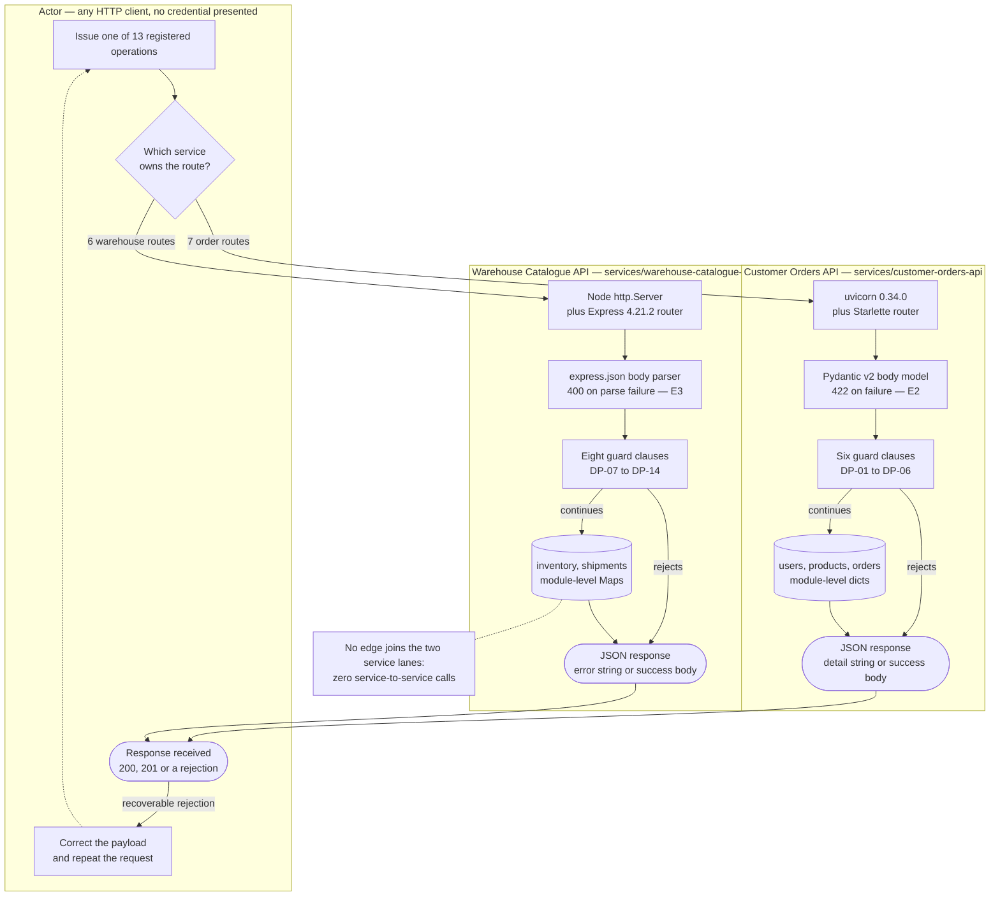

Three properties of the diagram carry operational weight. Both store lanes are terminated by process exit, so every arrow into them is an arrow into memory that a restart erases. The only response lane that ever leaves a service is the JSON response lane, so no error, audit record or metric escapes by any other channel. And the client lane is the only place where a retry can originate, because the services contain no retry mechanism at all.

### 4.4.2 Detailed Process Flows for Core Features

#### 4.4.2.1 Flows Without Decision Points (F-001, F-014)

Two workflows contain no decision at all, and a diagram would add nothing to a table. Both are framework-level routes that the application code never touches.

| Workflow | Request | Handler or origin | Steps | Terminal states | Timing constraint |
| --- | --- | --- | --- | --- | --- |
| F-001 Liveness | `GET /health` | `main.py` lines 21–23; `server.js` line 8 | Return one constant object | 200 `{"status": "ok"}` only | None; the handler reads no store, so it answers identically before and after any request |
| F-014 Documentation | `GET /docs`, `GET /redoc`, `GET /openapi.json` | Mounted by default when `FastAPI(...)` is constructed at `main.py` line 5 | Generate the schema from route metadata, then serialise or render it | 200 HTML or 200 JSON | None; the schema reflects the seven registered order-service operations and never the warehouse service |

Neither flow can reject, because neither consults a store or a caller-supplied value. The liveness route is also the only flow that is identical across the two services, down to the body bytes.

#### 4.4.2.2 Account Registration and Credential Verification (F-002, F-003)

Figure 4-2 shows the pair of flows that establish and check an identity. Both bind the same Pydantic model, `RegisterRequest` (`main.py` lines 8–10), which is why a login body missing `password` is rejected at the model layer with 422 rather than at DP-02 with 401.

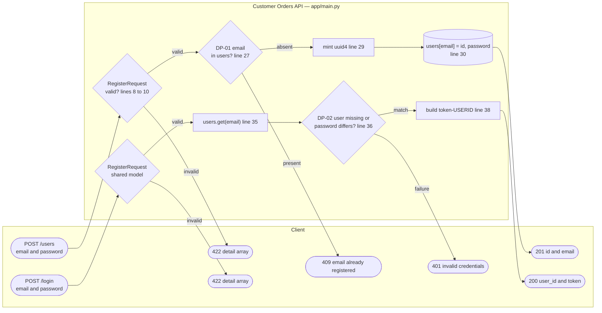

Two decision points, one per flow, and both are drawn where the code evaluates them: registration tests e-mail membership before minting an identifier, and login tests the password before constructing a token. The diagram deliberately shows no edge from `LG_TOKEN` to any other flow, because the token it builds is never read again: the flow ends at the response, and the four later order-service flows neither present nor require it. Recovery edges are omitted here only for legibility; they are drawn once, for the whole system, in Figure 4-11.

#### 4.4.2.3 Product Catalogue Authoring and Browsing (F-004, F-005)

Figure 4-3 covers the two catalogue flows. It is the only figure pair in which the writing flow has no rejection diamond inside the handler: the sole way to fail is a request-model rejection, so anything that parses is stored.

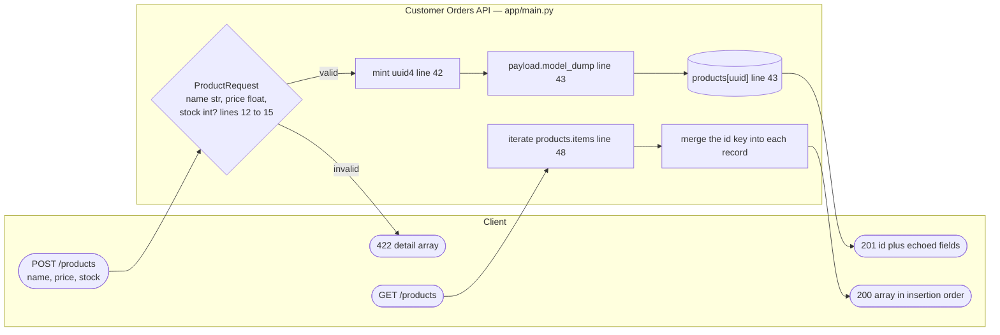

The absence of a diamond after the model step is a documented property, not an omission: a negative price, a negative stock level and an empty name all reach `PR_STORE` and return 201 (BR-13, and the validation table in 4.2.2.2). The browsing flow reads the live store, so a stock level decremented by Figure 4-4 is visible on the very next call, and the flow is O(n) in catalogue size with no page bound.

#### 4.4.2.4 Order Placement with Stock Decrement (F-006)

Figure 4-4 is the richest flow in the system: three ordered decisions, two writes, and a server-computed value.

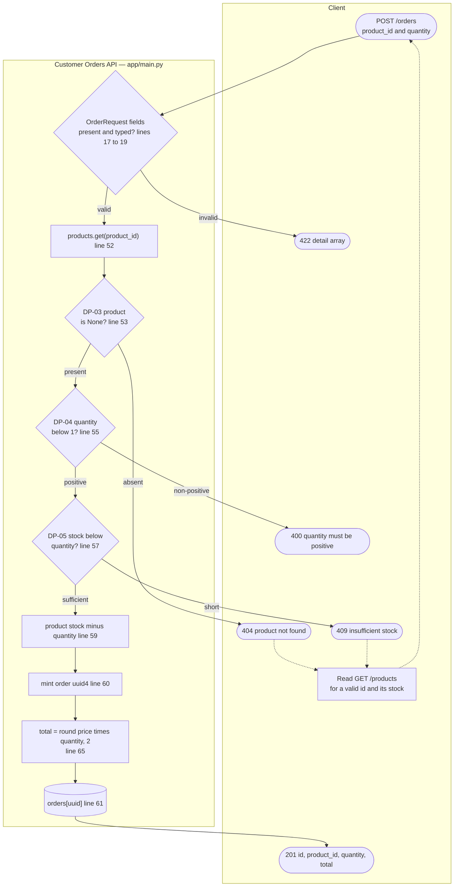

The evaluation order is the contract: DP-03 precedes DP-04, so a request naming an absent product with a quantity of zero returns 404 rather than 400 (F-006-RQ-006, confirmed by execution). Every rejection edge leaves from a diamond that sits above `OR_DEC`, which is what guarantees no stock is consumed by a rejected order. The two writes at lines 59 and 61 are separate statements with no transaction around them, as 4.3.1.4 records, and `OR_TOT` is computed from the price held in the store at that instant, never from anything the client sent.

#### 4.4.2.5 Order Retrieval (F-007)

Figure 4-5 is the smallest flow with a decision: one membership test, one read, no write.

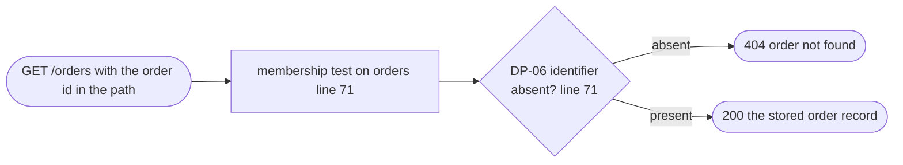

The flow is pure and repeatable, and it is the only way to read an order back: the checkout registers no route that lists orders, which is why a lost order identifier cannot be recovered (4.3.2.4). Because orders are never mutated after creation, a successful read always returns the same body as the original creation response.

#### 4.4.2.6 Inventory Intake and Listing (F-008, F-009)

Figure 4-6 shows the warehouse's opening flow, where the caller supplies the identity of the record rather than receiving a generated one.

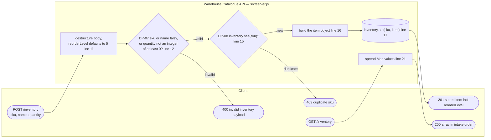

DP-07 precedes DP-08 in source order, so an existing SKU resubmitted with a malformed payload returns 400 rather than 409. The intake flow is the only write flow whose identity comes from the caller, which makes the SKU the single shared vocabulary between the intake, the reservation in Figure 4-7 and the listing shown here. The listing is a live view: after a shipment reserves stock, the same call returns the reduced quantity.

#### 4.4.2.7 Shipment Creation with Inventory Reservation (F-010)

Figure 4-7 shows the warehouse's commitment flow, the counterpart of Figure 4-4 and the only flow in the system that reserves physical stock.

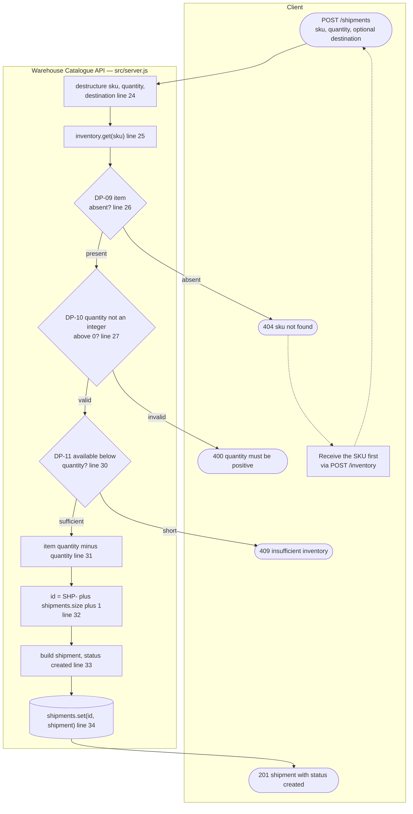

Two facts about this diagram drive the error analysis in 4.3. DP-09 to DP-11 all sit above `SH_DEC`, so no rejected shipment reserves anything. And `SH_DEC` precedes `SH_SET`, so a failure between the two statements would leave stock reserved with no shipment record — a window closed only by the synchrony of the handler, not by any transaction. The identifier `SH_ID` is derived from the current `Map` size rather than generated, which is why it restarts at `SHP-1` in every new process.

#### 4.4.2.8 Shipment Retrieval and Dispatch (F-011, F-012)

Figure 4-8 closes the warehouse journey. Retrieval is a pure read; dispatch is the only flow in the entire checkout that rewrites an existing record.

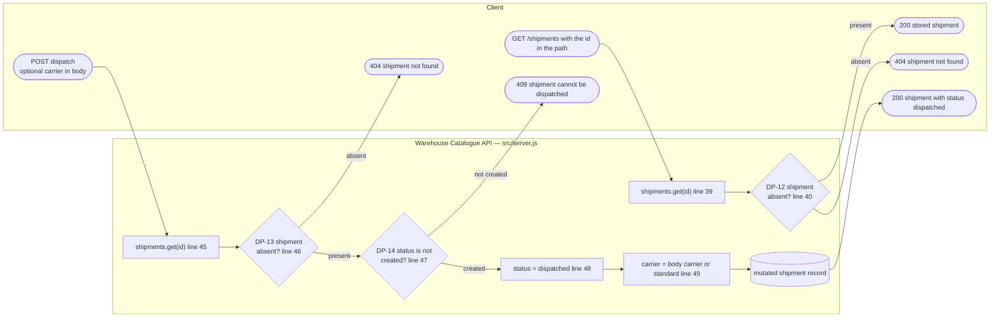

Dispatch has no recovery edge because nothing can undo it: the coarsest rejection, DP-409, is reached by every second attempt, and no route returns a shipment to `created`. The carrier step is drawn as a process rather than a diamond because it never rejects — every falsy value, including the empty string, resolves to the literal `standard` (DP-15).

### 4.4.3 Error Handling Flowcharts

#### 4.4.3.1 Request-Entry Error Funnel

Figure 4-9 shows the five framework-level exits that sit ahead of every handler, drawn per service because the two stacks diverge at each stage. A request can be refused at the routing stage, at the body stage or at the model stage without any code in the repository running, and each of those refusals reaches the caller in a different shape.

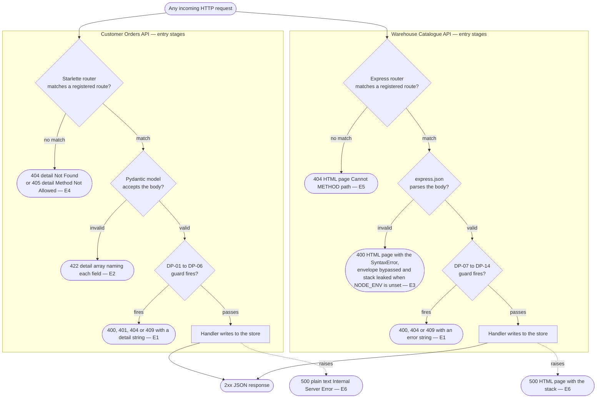

The two lanes are asymmetric in three ways that a client must handle: the Python lane produces a 405 where the Node lane produces a 404, the Python lane answers a malformed body with a JSON 422 while the Node lane answers with an HTML 400, and only the Node lane emits a non-JSON body for a failure the application did not construct. No lane has a retry, a fallback or an error-handler stage: every exit is terminal for that request.

#### 4.4.3.2 Declared Rejection Path and Store Integrity

Figure 4-10 shows the shape every one of the fourteen declared guards follows, and the property that makes a rejection safe: the guard sits above every write to the store, so a rejected request is a complete no-op.

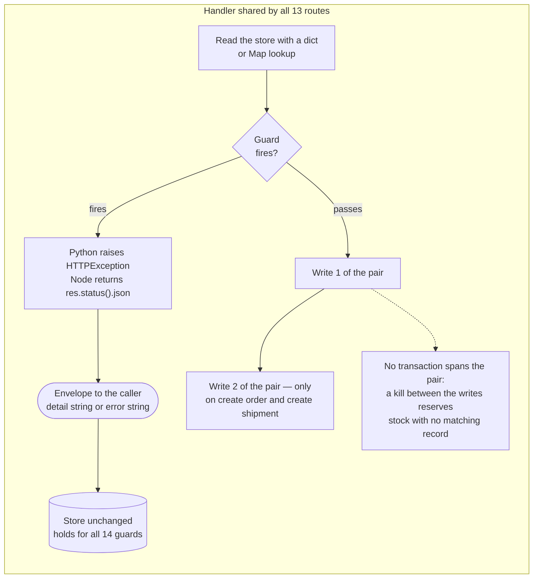

The dashed edge is the only exposure in the flow, and it is drawn as a dashed risk rather than a step because the delivered code cannot reach it through client input: the two statements are adjacent, and the pair is enclosed by a handler that either completes or is killed. 4.3.1.4 records the three situations in which the window becomes real.

#### 4.4.3.3 Client Recovery Decision Flow

Figure 4-11 reduces the recovery rules of 4.2.1.5 to the decision a caller must make on receiving any rejection. It belongs to the client lane: no service in the checkout offers a recovery action, an idempotency key or a compensating endpoint, so every path that continues does so because the caller changed something.

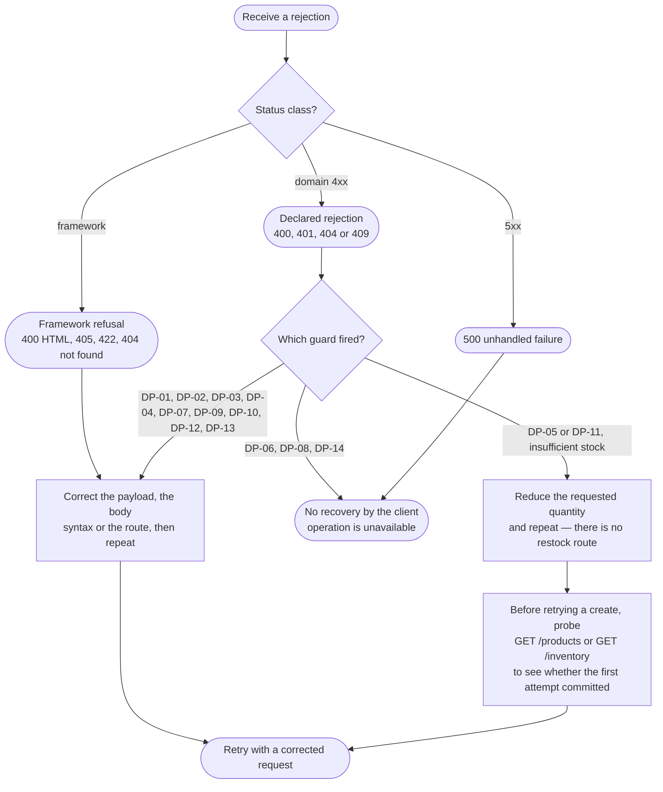

The three terminal leaves are the four client-unrecoverable cases of 4.2.1.5, grouped because they share one cause: a missing route. DP-06 has no order listing to consult, DP-08 has no SKU amendment or deletion, DP-14 has no reversal, and a 500 has no compensating action because the only state reset available is a restart that discards everything.

### 4.4.4 Integration Sequence Diagrams

#### 4.4.4.1 Order Journey End to End

Figure 4-12 places the six requests of 4.1.1.1 in time against the components that handle each one. It is the authoritative view of what actually crosses the wire, and it shows why the journey is a sequence of independent exchanges rather than a session.

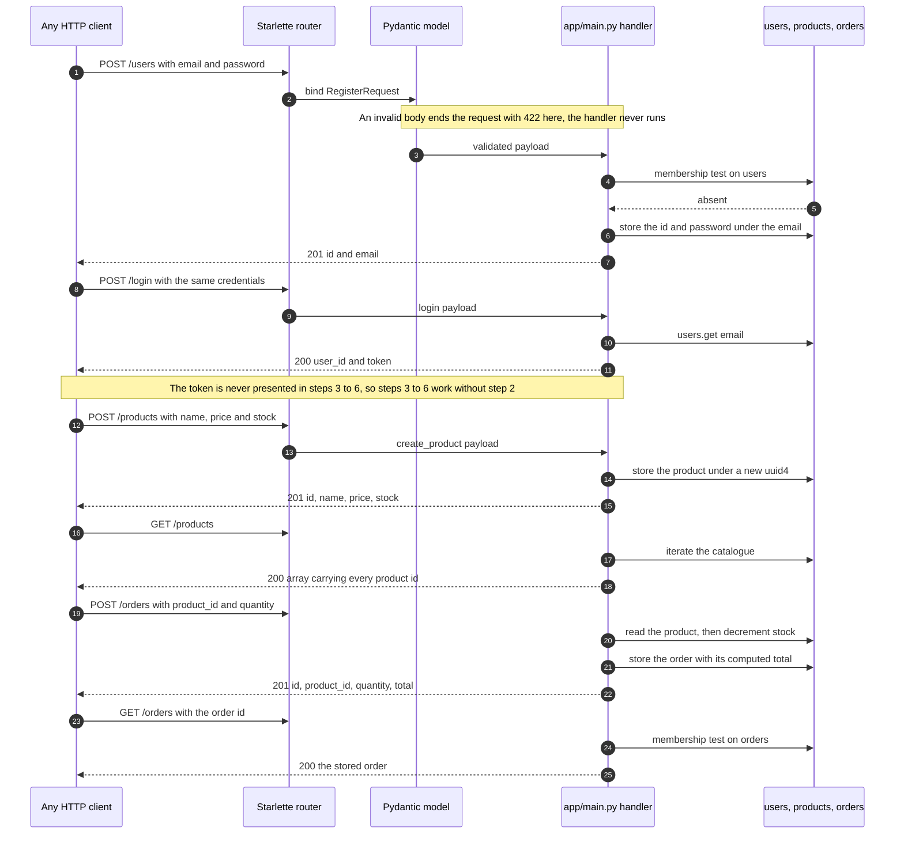

Two timing facts the figure makes visible: each exchange completes before the next begins, because no request depends on an in-flight one, and the only identifiers that survive between exchanges are the ones returned in a body — the product UUID at step 3 and the order UUID at step 5. A failure at any step after the first leaves earlier records in place, since no exchange compensates for another.

#### 4.4.4.2 Warehouse Journey End to End

Figure 4-13 is the warehouse counterpart, and it is the only place in the documentation where the reservation of stock and the creation of the shipment can be seen as two separate writes in one handler.

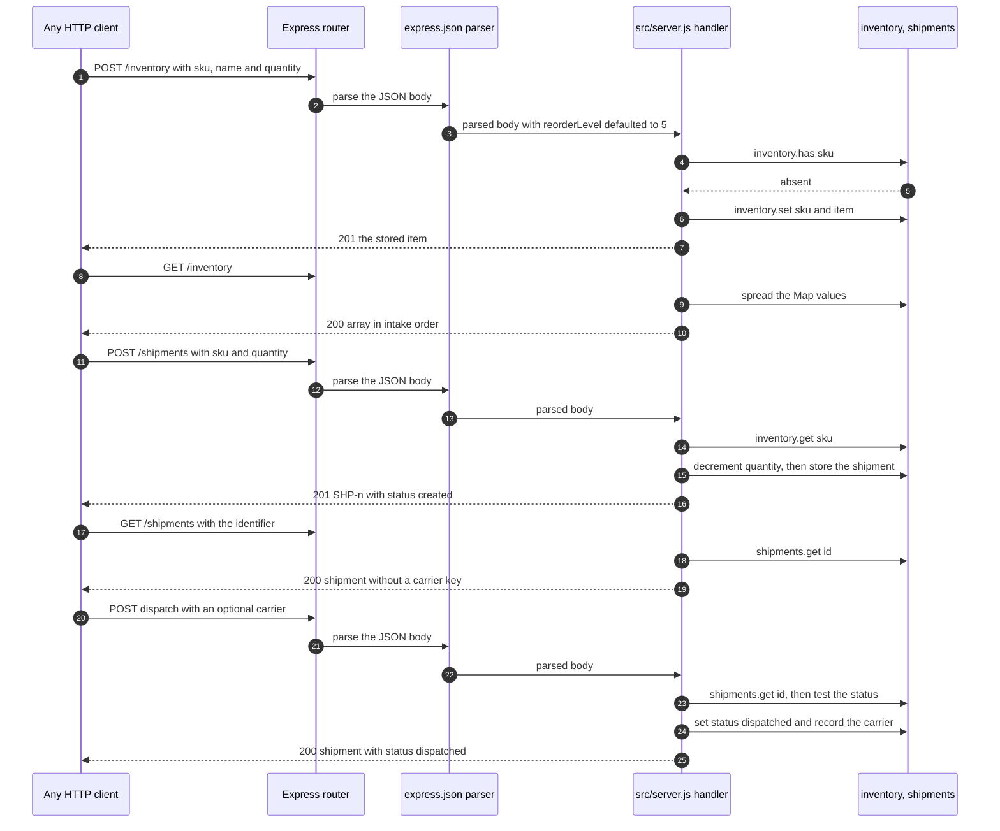

The two writes inside step 3 are shown as consecutive store calls with no boundary around them, which is exactly how the handler behaves: the decrement at `server.js` line 31 commits to the `Map` before the shipment is inserted at line 34, so the store holds a reservation before it holds a reason for it. Step 5 is the only exchange in either journey that rewrites an existing record, and after it the shipment can never change again.

#### 4.4.4.3 Verification Harness Interaction

Figure 4-14 shows the two verification sequences of F-013 side by side, because their interaction models differ in a way that matters to anyone running the tests: the Python suite never opens a socket, while the Node suite binds a real port and must tear it down.

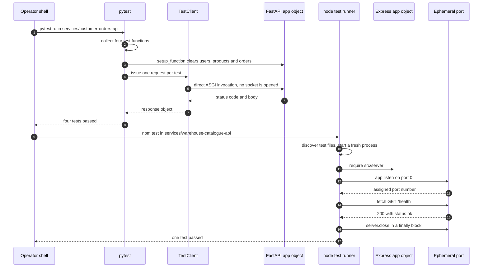

The Python lane depends on `setup_function` for isolation because the app, its models and its three dictionaries are module-level singletons created at import; without the reset, a test would inherit the previous test's users and products. The Node lane needs no reset because `node --test` starts a fresh process per run and the single test never writes to a store, which is also why the warehouse suite cannot detect any of the state defects documented in 4.3.

### 4.4.5 State Transition Diagrams

#### 4.4.5.1 Shipment Lifecycle

Figure 4-15 is the only genuine state machine in the system. Every other record has exactly one creation transition and no further edge.

```mermaid
stateDiagram-v2
    [*] --> Absent
    Absent --> Created: POST /shipments 201 after DP-09 to DP-11 pass
    Created --> Dispatched: POST dispatch 200, carrier recorded
    Created --> Created: repeat dispatch 409, record unchanged
    Dispatched --> Dispatched: dispatch attempt 409, record unchanged
    Absent --> [*]: process exit
    Dispatched --> [*]: process exit
    note right of Created
        Inventory is decremented before this state exists
        No cancel, release or re-open edge exists
    end note
    note right of Dispatched
        Terminal within the process lifetime
        A restart erases the record and reuses its identifier
    end note
```

Two self-transitions are drawn deliberately: they are the observed effect of a repeated dispatch attempt, which returns 409 and leaves the record exactly as it was. The diagram contains no transition out of `Dispatched` other than process exit, which is the visual form of the finding in 4.3.2.4 that a dispatched shipment can never be reversed.

#### 4.4.5.2 Record Lifecycles and Quantity Monotonicity

Figure 4-16 groups the other five records by the transitions they permit: two are immutable after creation, two only ever decrease a numeric field, and one moves forward once.

```mermaid
flowchart TB
  subgraph LN_LIFECYCLE["Record lifecycle across both services"]
    LC_USER["User — created at main.py line 30<br/>never updated, never deleted"]
    LC_ORDER["Order — created at main.py line 61<br/>never updated, never deleted"]
    LC_PROD["Product stock — created at line 43<br/>reduced by POST /orders at line 59"]
    LC_INV["Inventory quantity — created at server.js line 17<br/>reduced by POST /shipments at line 31"]
    LC_SHIP["Shipment — created at line 34<br/>dispatched at line 48"]
    LC_END(["Process exit destroys every record<br/>no export, backup or restore route"])
  end
  LC_USER --> LC_END
  LC_ORDER --> LC_END
  LC_PROD --> LC_END
  LC_INV --> LC_END
  LC_SHIP --> LC_END
  LC_DEADEND["An amount that reaches its floor is a dead end:<br/>product stock at or below 0 fails DP-05,<br/>inventory at 0 fails DP-11, and neither<br/>can be raised because no restock route exists"]
  LC_PROD -.-> LC_DEADEND
  LC_INV -.-> LC_DEADEND
```

Three properties of these lifecycles determine what a flow may assume. Quantities are monotonic, so a client that needs more stock must open a new product or a new SKU under a different key rather than adjust an existing one. No record carries a timestamp, so neither the age of a reservation nor the order of two writes can be reconstructed from the data. And every lifecycle terminates only at process exit, so there is no archival, expiry or cleanup edge anywhere in the model.


## 4.5 References

- `README.md` — the parent scan contract: metadata-only repository, the two-submodule inventory, and the expectation that each child is analysed at the commit the parent pins.
- `.gitmodules` — the six-line gitlink declaration naming `services/customer-orders-api` and `services/warehouse-catalogue-api`, their mount paths and their clone URLs; established the only structural link between the two services.
- `services/` — held exactly the two independent service folders and no shared package, manifest, configuration, lockfile, container file or pipeline definition.
- `services/customer-orders-api/README.md` — the documented run and test commands, the loopback `127.0.0.1:8000` binding, and the `## Deliberate analysis gaps` section naming the untested journeys that 4.1.1.1 and 4.1.2.2 rely on.
- `services/customer-orders-api/requirements.txt` — the four exact pins (`fastapi==0.115.6`, `uvicorn==0.34.0`, `pytest==8.3.4`, `httpx==0.28.1`) that identify the framework versions behind the error classes in 4.1.1.4.
- `services/customer-orders-api/app/__init__.py` — the empty package marker that makes `app.main` importable.
- `services/customer-orders-api/app/main.py` — the entire order service in 73 lines: the app object and three module-level dictionaries at lines 5–6, the three request models at lines 8–19, and the seven routes with every guard at lines 21–73. The single source for DP-01 to DP-06, all nine order-service write sites and the computed order total.
- `services/customer-orders-api/tests/test_routes.py` — the four tests and the store-clearing `setup_function` that establish the Python verification sequence in 4.4.4.3 and the coverage claim in 4.1.1.1.
- `services/warehouse-catalogue-api/README.md` — the documented `npm install`, `npm start` and `npm test` commands and the `## Deliberate analysis gaps` section naming the untested warehouse journeys.
- `services/warehouse-catalogue-api/package.json` — the single runtime dependency (`express` 4.21.2), the `start` script that runs `src/server.js`, the `test` script that runs `node --test`, and the absence of an `engines` field that leaves the timeout and concurrency defaults unconfigured.
- `services/warehouse-catalogue-api/src/index.js` — the only port bind and the only application log statement, establishing the `PORT`-or-3000 binding and the startup sequence in 4.1.2.4.
- `services/warehouse-catalogue-api/src/server.js` — the entire warehouse service in 53 lines: one Express app and two `Map`s at lines 2–6, the six routes and every guard at lines 8–51, the sequential `SHP-` identifier at line 32, and the status and carrier writes at lines 48–49. The single source for DP-07 to DP-15.
- `services/warehouse-catalogue-api/test/routes.test.js` — the single health test that binds an ephemeral port, asserts over real TCP and closes in a `finally` block; established the Node verification sequence in 4.4.4.3.

No web source informed this section. Behaviour described as observed — the framework response matrix in 4.1.1.2, the guard-order confirmations in 4.1.1.3, the coercion and empty-string results in 4.2.2.2, and the 500 bodies in 4.1.1.4 — was produced by executing both applications, as committed, against their pinned dependency versions (`fastapi` 0.115.6 with Pydantic v2, and `express` 4.21.2), including a scratch application per stack to provoke the unhandled-exception path that no committed handler can reach through valid input.

Cross-referenced specification sections: 1.2 for the system overview and design limitations, 2.2 for the F-001 to F-014 feature and requirement identifiers used throughout, and 3.6 for the development and deployment facts behind the timing and runtime-prerequisite statements in 4.2.1.6.


# 5. System Architecture

## 5.1 High-Level Architecture

The checkout holds two deployable HTTP services that share no code, no data and no runtime edge, aggregated by a third, non-executing parent repository. Every architectural statement in this section rests on the 13 tracked files of that checkout — 3 in the parent, 5 in `services/customer-orders-api`, 5 in `services/warehouse-catalogue-api` — and the two commit pins the parent records: `04259f8` for the customer service and `f9f72d1` for the warehouse service (`git ls-tree HEAD services/`, mode `160000`).

### 5.1.1 System Overview

**Architecture style.** Each service is a single-module, synchronous request/response HTTP application constructed at import time over process memory. Three style statements describe it precisely:

- **Per service, a transaction script.** Every route handler is one procedure that parses its input, evaluates guard clauses, applies a single state change to a module-level collection, and returns JSON. No domain model, service layer, repository abstraction, unit of work or dependency-injection container sits between handler and store: all seven Python handlers and all six Node handlers are defined directly on the app object (`services/customer-orders-api/app/main.py` lines 21–73; `services/warehouse-catalogue-api/src/server.js` lines 8–51).
- **At system level, two independent single-process services with no integration fabric.** There is no message broker, no outbound HTTP client, no shared package, no shared configuration and no shared identifier space. The two import graphs are closed: `main.py` imports only `fastapi`, `pydantic` and `uuid` (lines 1–3), and `server.js` requires only `express` (line 1).
- **For the parent, a gitlink aggregate.** `.gitmodules` (lines 1–6) supplies mount paths and clone URLs only; the exact child commits live in the parent tree as `160000` gitlink entries, which is why `README.md` line 9 makes "analysing each child repository at the exact commit pinned by the parent" part of the expected behaviour.

**Rationale, as far as the repository records it.** No ADR file, design note or source comment records a considered alternative. What the tracked text does record is that the arrangement is deliberate and minimal: the parent README states the repository "is intentionally metadata-only" (line 1), and both child READMEs close with a `## Deliberate analysis gaps` heading (line 12 of each) that names the journeys left unproven. The architecture is therefore a minimum-surface fixture: its properties follow from omitting every optional tier — persistence, messaging, identity, caching, observability — rather than from an explicit selection among them. Any downstream reader should treat the omissions as the design, not as unfinished work in flight.

**Key architectural principles and patterns.**

| Principle | How it appears in the code | Evidence |
| --- | --- | --- |
| One file owns the whole HTTP surface | Routes, request models and stores of each service declare in a single module | `app/main.py` (73 lines); `src/server.js` (53 lines) |
| Import-time wiring, no factories or lifecycle hooks | App object and stores are created when the module loads; no `lifespan`, `on_event`, `create_app()` or composition root exists | `app/main.py` lines 5–6; `src/server.js` lines 2–6 |
| Process memory is the system of record | Handlers mutate module-level dictionaries and `Map`s in place; nothing is written outside the heap | `app/main.py` line 6, line 59; `src/server.js` lines 5–6, 31, 48 |
| Validation at the edge, by guard clause | Presence, uniqueness, existence, quantity and stock checks are `if` statements inside handlers, ordered before any write | `app/main.py` lines 27, 36, 53–58, 71; `src/server.js` lines 12–15, 26–30, 40, 46–47 |
| Framework defaults are left in place | No exception handler, no CORS middleware, no custom 404/405, no schema overrides; FastAPI's documentation routes stay mounted | No `exception_handler`/`add_middleware` in `main.py`; only `express.json()` in `server.js` line 3 |
| Exact pins for direct dependencies, no lockfile | Every Python line is `==`; the single npm dependency is an exact version; no `package-lock.json`, hashes or `engines` field | `requirements.txt` lines 1–4; `package.json` lines 6–7 |
| Service independence enforced by omission | Neither manifest declares an HTTP client and neither source imports the other stack | `requirements.txt`; `package.json` line 6; import lists above |

| Pattern | Status | Where |
| --- | --- | --- |
| Transaction script | Present | All 13 handlers |
| Guard clause / early return | Present | `main.py` guards raise; `server.js` guards `return res.status(...)` |
| Middleware pipeline | Present, minimal — one body parser only | `server.js` line 3 |
| Layered or hexagonal architecture | Absent | No controller/service/repository separation anywhere |
| Repository or unit-of-work | Absent | Handlers touch the store directly |
| Dependency injection | Absent | No `Depends`, no constructor wiring |
| Publish/subscribe or eventing | Absent | No broker client, no emitter, no webhook route |
| Circuit breaker, retry, bulkhead | Absent | No such construct and no outbound call to protect |
| Saga or compensating transaction | Absent | No reversal route exists; dispatch is terminal (`server.js` lines 44–51) |

**System boundaries and major interfaces.**

| Boundary | Inside | Outside | Crossing mechanism |
| --- | --- | --- | --- |
| Parent aggregate | Two gitlink pins and a scan contract | GitHub-hosted child repositories | `git clone --recurse-submodules`, `git submodule update --init` (`.gitmodules` lines 1–6) |
| Customer Orders process | One FastAPI app, three request models, three dictionaries | Every other process | HTTP over ASGI; documented bind `127.0.0.1:8000` (child `README.md` line 7) |
| Warehouse process | One Express app, two `Map`s, two entry files | Every other process | HTTP over Node `http.Server`; every interface; `PORT` or `3000` (`src/index.js` line 2) |
| Persistence | Nothing — no store boundary of any kind exists | — | No data-client dependency in either manifest |
| Observability | One startup line on stdout | Log aggregator, metrics backend, tracer | `console.log` (`src/index.js` line 3) and uvicorn's own output |

The major interfaces that cross those boundaries are: 13 HTTP operations (7 in the customer service, 6 in the warehouse service); two byte-identical liveness probes returning `{"status": "ok"}`; three FastAPI-generated documentation endpoints (`/docs`, `/redoc`, `/openapi.json`, mounted by default because `FastAPI(title=...)` leaves `docs_url`, `redoc_url` and `openapi_url` unset at `main.py` line 5); two test entry points (`pytest -q`, `node --test`); two dependency manifests consumed by pip and npm at install time; and the git submodule interface itself.

```mermaid
flowchart TB
  subgraph Outside["Outside the system"]
    CLIENT_C["Customer / storefront client"]
    CLIENT_W["Back-office warehouse client"]
    OPERATOR["Operator shell<br/>pip, npm, git, uvicorn"]
    GITHUB["GitHub child repositories"]
  end
  subgraph ParentRepo["Parent repository 395c1ce — metadata only"]
    GITMODULES[".gitmodules — two gitlink pins"]
    PARENTREADME["README.md — scan contract"]
  end
  subgraph OrdersSvc["customer-orders-api 04259f8 — one process"]
    ORDERSAPP["app/main.py<br/>7 handlers, 3 request models"]
    ORDERSMEM[("users / products / orders")]
  end
  subgraph WhSvc["warehouse-catalogue-api f9f72d1 — one process"]
    WHBOOT["src/index.js — binds PORT or 3000"]
    WHAPP["src/server.js<br/>6 handlers, 2 Maps"]
    WHMEM[("inventory / shipments")]
  end
  CLIENT_C -->|"HTTP JSON, loopback 8000"| ORDERSAPP
  CLIENT_W -->|"HTTP JSON, PORT or 3000"| WHAPP
  OPERATOR -->|"git submodule update --init"| GITHUB
  GITHUB --> GITMODULES
  PARENTREADME --> GITMODULES
  ORDERSAPP --> ORDERSMEM
  WHBOOT --> WHAPP
  WHAPP --> WHMEM
  ORDERSAPP -.->|"no calls, no shared code or data"| WHAPP
```

### 5.1.2 Core Components Table

Ten components carry the system. Because each row needs more than four facts, the inventory is presented as three aligned tables that share the same component names.

| Component | Location | Primary responsibility |
| --- | --- | --- |
| C1 Parent gitlink aggregate | `.gitmodules`; root `README.md` | Name, mount and pin the two child services; declare the metadata-only scan contract |
| C2 Customer Orders HTTP application | `services/customer-orders-api/app/main.py` | Build the FastAPI app; own 7 handlers and their guard clauses |
| C3 Customer Orders request-model layer | `app/main.py` lines 8–19 | Declare the three Pydantic v2 request bodies accepted by the four `POST` routes |
| C4 Customer Orders in-process store | `app/main.py` line 6 | Hold and mutate `users`, `products` and `orders` for the process lifetime |
| C5 Uvicorn ASGI runtime | External: `uvicorn==0.34.0` | Accept sockets, run the ASGI app, emit server logs |
| C6 Warehouse Express application | `services/warehouse-catalogue-api/src/server.js` | Build the Express app; own 6 handlers, the JSON body parser and 2 `Map`s |
| C7 Warehouse process bootstrap | `src/index.js` | Resolve `PORT` and bind the listener for the exported app |
| C8 Warehouse in-process store | `src/server.js` lines 5–6 | Hold and mutate `inventory` and `shipments` for the process lifetime |
| C9 Customer Orders route suite | `services/customer-orders-api/tests/test_routes.py` | Assert 4 route contracts through an in-process ASGI client |
| C10 Warehouse route suite | `services/warehouse-catalogue-api/test/routes.test.js` | Assert 1 route contract over a real ephemeral socket |

| Component | Key dependencies | Integration points |
| --- | --- | --- |
| C1 | Git client only | Consumed by `git clone --recurse-submodules` / `git submodule update --init`; produces the two mounted folders |
| C2 | `fastapi==0.115.6` (Starlette, Pydantic v2, AnyIO, Click, h11 resolved transitively), `uuid` stdlib | ASGI to C5; in-process to C9; reads and writes C4; uses C3 for body parsing |
| C3 | Pydantic v2 via FastAPI | Invoked on the four `POST` routes; produces 422 responses before any handler runs |
| C4 | Python built-in `dict` | Mutated by C2 handlers; cleared by C9's `setup_function` |
| C5 | `uvicorn==0.34.0` | Imports `app.main:app`; fronts C2 on the documented `127.0.0.1:8000` |
| C6 | `express==4.21.2` (body-parser 1.20.3 etc. via npm) | HTTP to Node's `http.Server` via C7 or the suite; exports `app` at line 53; reads and writes C8 |
| C7 | Node core; `process.env.PORT` | Requires `./server`; the only `listen(` call site in the package |
| C8 | JavaScript built-in `Map` | Mutated by five of six C6 handlers; no reset hook exists |
| C9 | `pytest==8.3.4`, `httpx==0.28.1`, `fastapi.testclient` | Imports `app`, `products`, `orders`, `users` from C2/C4; opens no socket |
| C10 | `node:test`, `node:assert/strict`, global `fetch` | Requires `../src/server`; binds port `0` and calls `/health` over TCP |

| Component | Critical considerations |
| --- | --- |
| C1 | Child commits are pinned by gitlink, not by `.gitmodules`; neither child has a tag and each history holds a single commit, so the pin is the only version identity |
| C2 | App and stores are module-level singletons; passwords are stored verbatim (line 30); the stock decrement at line 59 and order insert at line 61 are separate statements; no route reads a credential |
| C3 | Type coercion only: no validators, `EmailStr` imported but unused (line 2), so negative `price`/`stock` are accepted and malformed addresses are stored |
| C4 | No durability, no lock, no secondary index; keyed reads are O(1), `GET /products` is an O(n) serialisation of live objects (lines 46–48) |
| C5 | Default single worker (`--workers` 1, `WEB_CONCURRENCY` unset), keep-alive 5 s, no concurrency limit configured; loopback binding is the only network restriction |
| C6 | No `try`/`catch` anywhere; list route is unpaginated (line 21); shipment ids derive from `shipments.size` (line 32); decrement at line 31 precedes the insert at line 34 |
| C7 | The only file that calls `listen`; `package.json` line 5 points `start` at `src/server.js`, so the documented start command builds the app and exits without serving |
| C8 | No durability and no reset hook; `SHP-<n>` keys repeat after restart and collide across processes, silently overwriting a stored shipment |
| C9 | 4 tests, 3 of them happy path; state isolation depends entirely on `setup_function` clearing the three module-level stores (lines 6–9) |
| C10 | 1 test, health only; it leaves no store reset because it writes nothing, and the file's own comment overstates coverage relative to its single test |

### 5.1.3 Data Flow Description

**Primary data flows.** Every flow in the system is a client-initiated, synchronous request/response exchange that begins at a socket and ends when a JSON body is written; nothing continues after the response is sent. The two stacks implement the same logical pipeline, differing only in where parsing and error serialisation happen.

*Customer Orders path (six stages).* Uvicorn accepts the connection and hands the ASGI scope to the app object built at import (`main.py` line 5) → Starlette's router matches method and path against the seven decorators → on a `POST`, Pydantic parses the body into `RegisterRequest`, `ProductRequest` or `OrderRequest`, terminating with 422 before dispatch on any failure → the handler evaluates its guard clauses in source order → a firing guard raises `HTTPException`, serialised by FastAPI as `{"detail": …}` → a returning handler is serialised as JSON, 201 on the four creates and 200 elsewhere.

*Warehouse Catalogue path (five stages).* `app.listen(port)` (`index.js` line 3) binds the port and Node's HTTP server dispatches to Express 4.21.2 → the single router matches against the six handlers → `express.json()` (`server.js` line 3) parses the body, rejecting bodies over its 100 kb default limit with 413 before any handler runs → the inline arrow handler destructures the body and evaluates guard clauses, returning early with `res.status(...).json({ error })` → a handler that falls through writes its result with `res.status(...).json(...)`.

**Data transformation points.** Nine transformations sit between an inbound body and a stored record.

| Transformation | Location | Input → output |
| --- | --- | --- |
| Body to typed model | `main.py` lines 8–19; framework-level | JSON object → `RegisterRequest` / `ProductRequest` / `OrderRequest`, or 422 |
| Model back to plain record | `main.py` line 43 (`payload.model_dump()`) | Pydantic instance → plain `dict` stored in `products` |
| Store record plus generated key | `main.py` lines 44, 48 | `{name, price, stock}` + UUID → `{id, name, price, stock}` |
| Price arithmetic | `main.py` line 65 | `price × quantity` → `round(…, 2)` in an unqualified currency |
| In-place stock decrement | `main.py` line 59; `server.js` line 31 | Stored `stock`/`quantity` → reduced value, no version or timestamp |
| Destructure with default | `server.js` line 11 | Body → `{sku, name, quantity, reorderLevel = 5}` |
| Identifier derivation | `server.js` line 32 | `shipments.size` → `SHP-<n>` string key |
| One-way status mutation | `server.js` lines 48–49 | `status: 'created'` → `'dispatched'`, and `carrier` added (default `standard`) |
| Error normalisation | `main.py` guards; `server.js` guards | Exception or guard → `{"detail": "…"}` on Python, `{"error": "…"}` on Node |

**Key data stores and caches.** The five collections are the only stores and the only read source. There is no cache tier, no session store, no queue buffer, no search index and no file on disk: no `open()`, `readFile`, `writeFile`, `json.dump` or `fs` call exists in the checkout. Reads generally return live references rather than copies — `GET /shipments/:id` returns the stored object (`server.js` line 41) and `GET /orders/{order_id}` returns the stored `dict` (`main.py` line 73) — so any later mutation of that object changes what a subsequent read observes. `GET /inventory` and `GET /products` materialise a fresh array on every call by spreading the collection (`server.js` line 21) or re-merging each entry with its key (`main.py` line 48), with no filter, page or cursor parameter anywhere.

**Cross-service flow.** None exists. No record crosses the two processes, and the identifier spaces do not meet: products are keyed by generated UUIDs, inventory by caller-supplied SKUs, and a shipment stores a SKU with no product or order reference. Section 4.1.2.1 records the same absence from the workflow perspective.

```mermaid
flowchart LR
  subgraph OrdersFlow["Customer Orders API — data path"]
    C_HTTP["HTTP request<br/>uvicorn 0.34.0, 127.0.0.1:8000"]
    C_ROUTE["Starlette router<br/>7 routes"]
    C_MODEL["Pydantic parse<br/>422 on failure"]
    C_GUARD["Guard clauses<br/>400 / 401 / 404 / 409"]
    C_STORE[("users / products / orders")]
    C_RESP["JSON response<br/>detail envelope on error"]
  end
  subgraph WarehouseFlow["Warehouse Catalogue API — data path"]
    W_HTTP["HTTP request<br/>Node http.Server, PORT or 3000"]
    W_PARSE["express.json()<br/>100 kb default limit"]
    W_HANDLER["Inline guard clauses<br/>400 / 404 / 409"]
    W_STORE[("inventory / shipments")]
    W_RESP["res.json response<br/>error envelope on rejection"]
  end
  C_HTTP --> C_ROUTE --> C_MODEL --> C_GUARD
  C_GUARD -->|"valid write"| C_STORE
  C_GUARD --> C_RESP
  C_STORE --> C_RESP
  W_HTTP --> W_PARSE --> W_HANDLER
  W_HANDLER -->|"valid write"| W_STORE
  W_HANDLER --> W_RESP
  W_STORE --> W_RESP
  C_STORE -.->|"no record ever crosses"| W_STORE
```

### 5.1.4 External Integration Points

Two tables again split the required facts so that neither exceeds four columns. The first group is runtime and build-time integrations the checkout actually configures; the second records the exchange pattern and the service-level position for the same party.

| System name | Integration type | Protocol / format |
| --- | --- | --- |
| Any HTTP client of the customer service | Inbound synchronous REST, caller-initiated | HTTP/1.1 + JSON over ASGI; documented bind `127.0.0.1:8000` (child `README.md` line 7) |
| Any HTTP client of the warehouse service | Inbound synchronous REST, caller-initiated | HTTP/1.1 + JSON over Node `http.Server`; all interfaces, `PORT` or `3000` (`src/index.js` line 2) |
| Documentation consumer (Swagger UI, ReDoc, schema tooling) | Inbound documentation interface | `GET /docs`, `GET /redoc`, `GET /openapi.json` on the customer service only (FastAPI 0.115.6 defaults) |
| PyPI | Install-time dependency resolution | `pip install -r requirements.txt`, HTTPS, four exact pins |
| npm registry | Install-time dependency resolution | `npm install`, HTTPS, one exact pin, no lockfile |
| GitHub child repositories | Source-control checkout of both children | Git over HTTPS; URLs recorded in `.gitmodules` lines 3 and 6 |
| Operator shell | Manual run, test and inspection | `uvicorn` CLI, `pytest -q`, `npm start`, `node --test` |

| System name | Data exchange pattern | SLA requirements recorded in the repository |
| --- | --- | --- |
| HTTP client, customer service | Request/response only; no callback, webhook, batch endpoint or event stream; no idempotency key accepted | None defined. `GET /health` returning 200 `{"status": "ok"}` is the only liveness affordance; there is no readiness probe, timeout, retry or rate-limit contract |
| HTTP client, warehouse service | Request/response only; same absences, plus a 404 (not 405) answer for a wrong method | None defined. `GET /health` is the only liveness affordance (`server.js` line 8) |
| Documentation consumer | Pull of generated HTML and schema; no authentication; schema lists six paths carrying the seven operations | None defined |
| PyPI / npm registry | Pull at install time; direct versions fixed, transitive versions resolved at install | None defined; no lockfile means the Node tree is not byte-reproducible |
| GitHub child repositories | Read-only clone at the pinned commits `04259f8` and `f9f72d1` | None defined; no tag or release exists in either child |

**Integrations that do not exist.** No database, cache, message broker, identity provider, object store, CDN, SMTP relay, payment gateway or third-party SaaS client appears in either manifest or any source file, and no tracked file performs an outbound call — the only `fetch` in the checkout targets the warehouse service's own `/health` from its test (`test/routes.test.js` line 11). Both services are therefore leaf processes: they expose HTTP and consume nothing. The only environment variable read anywhere is `PORT` (`src/index.js` line 2); the customer service's bind address exists solely in its documented `uvicorn` invocation. No CORS middleware is mounted in either service, so browser-originated cross-origin calls are not enabled by the code as delivered.


## 5.2 Component Details

Ten components make up the system. Each is described against the same five aspects — purpose and responsibilities, technologies and frameworks, key interfaces and APIs, data persistence requirements, and scaling considerations — so that the components can be compared on a like-for-like basis. Component identifiers C1 to C10 match the tables in 5.1.2.

### 5.2.1 C1 — Parent Gitlink Aggregate

| Aspect | Detail |
| --- | --- |
| Purpose and responsibilities | Declare, mount and pin the two child services, and state the analysis contract for the checkout. Executes nothing: it has no runtime, no build step and no test suite. |
| Technologies | Git configuration in `.gitmodules` (INI-style, 6 lines); Markdown in `README.md` (9 lines); `.gitignore` listing only `.DS_Store`. No manifest, lockfile, pipeline definition or container asset exists at the root. |
| Key interfaces | `git clone --recurse-submodules` and `git submodule update --init` consume `.gitmodules` lines 1–6. `git ls-tree HEAD services/` reports the two `160000` gitlink entries at `04259f82d5a8f87ff9d81d5fdd1dfdefaee4e564` (customer) and `f9f72d1c37091f8845e3e3727515fa713ebe20b1` (warehouse). |
| Data persistence | No runtime state. The pins are the only durable facts the aggregate holds, and they live in the single parent commit `395c1ce` ("Add two child repositories as Git submodules"). |
| Scaling considerations | No runtime footprint to scale; each child scales or fails independently. The aggregate provides no place where a cross-service invariant, shared configuration or integration adapter could be expressed, so a future composed system needs a new component rather than a change here. |

### 5.2.2 C2 — Customer Orders HTTP Application

| Aspect | Detail |
| --- | --- |
| Purpose and responsibilities | Build the FastAPI application at import (`main.py` line 5), own the seven route handlers and the guard logic that admits or rejects each request, and read or write the three in-process stores. |
| Technologies | Python with FastAPI 0.115.6 and Pydantic v2 (`model_dump()` at line 43 dates the model API to v2); Starlette routing, AnyIO and h11 arrive transitively and are unlisted; `uuid.uuid4` for identifiers. The bytecode cache left in the working tree names `cpython-312`, the interpreter used to run the suite. |
| Key interfaces | Seven operations, bound to handler functions in one module. Request contracts, status codes and rejection messages are catalogued in 4.1.2.2; this table records the code-level surface. |
| Data persistence | All state is the module-level `users`, `products` and `orders` dictionaries at line 6 (detailed as C4). The module itself holds no configuration and reads no environment variable. |
| Scaling considerations | The app is a module-level singleton, so horizontal scaling multiplies divergent copies of state rather than sharing it. Concurrency safety rests on nothing: the stock check at line 57 and the decrement at line 59 are separate statements with no lock. `GET /products` serialises the whole catalogue on every call with no pagination. |

| Operation | Handler (lines) | Store effect | Response shape |
| --- | --- | --- | --- |
| `GET /health` | `health` (21–23) | None | `{"status": "ok"}`, constant |
| `POST /users` | `register` (25–31) | Inserts `users[email] = {id, password}` | 201 `{id, email}`; 409 on duplicate |
| `POST /login` | `login` (33–38) | None | `{user_id, token}`; 401 on mismatch |
| `POST /products` | `create_product` (40–44) | Inserts `products[uuid] = {name, price, stock}` | 201 record plus `id` |
| `GET /products` | `list_products` (46–48) | None | Array, id merged per entry |
| `POST /orders` | `create_order` (50–67) | Decrements `stock`, inserts an order | 201 `{id, product_id, quantity, total}` |
| `GET /orders/{order_id}` | `get_order` (69–73) | None | Stored order, or 404 `order not found` |

The token returned by `login` at line 38 is a formatted string, `token-<user_id>`; no handler or dependency reads it, and no route declares a security requirement, so authentication is issued but never enforced.

### 5.2.3 C3 — Customer Orders Request-Model Layer

| Aspect | Detail |
| --- | --- |
| Purpose and responsibilities | Declare the three request bodies the four `POST` routes accept, and let the framework reject structurally invalid payloads before a handler runs. |
| Technologies | Pydantic v2 as exposed by FastAPI; three classes, `RegisterRequest` (`email`, `password`), `ProductRequest` (`name`, `price: float`, `stock: int`) and `OrderRequest` (`product_id`, `quantity: int`) at `main.py` lines 8–19. |
| Key interfaces | Consumed implicitly by FastAPI's dependency resolution on `POST /users`, `/login`, `/products` and `/orders`. A failure produces 422 with a `detail` array — a different body shape from every handler-produced error. |
| Data persistence | None; models are stateless and are discarded after the handler returns, except where `model_dump()` result is stored (line 43). |
| Scaling considerations | Negligible cost. The architectural consequence is coverage: with no custom validators, e-mail format, password strength, and non-negative `price`/`stock` are all unenforced. `EmailStr` is imported at line 2 and never applied, so the intent exists in the imports but not in the schema. |

### 5.2.4 C4 — Customer Orders In-Process Store

| Aspect | Detail |
| --- | --- |
| Purpose and responsibilities | Hold the service's entire dataset for the process lifetime and expose it by mutation to the handlers and to the test suite. |
| Technologies | Python built-in dictionaries created by a single destructuring assignment, `users, products, orders = {}, {}, {}` (`main.py` line 6). No driver, ORM, serialiser or file I/O is involved. |
| Key interfaces | `users` is keyed by the e-mail string exactly as submitted; `products` and `orders` are keyed by generated UUID4 strings (lines 42, 60). The test suite imports the three objects by name and clears them (`tests/test_routes.py` lines 2, 6–9), so the store is a public interface of the module, not an internal detail. |
| Data persistence | None beyond the heap. A restart loses every record, and a second process holds a disjoint copy. Passwords are stored verbatim beside the user id (line 30), and no record carries a timestamp, version or audit field. |
| Scaling considerations | Keyed reads are O(1); listings are O(n) with no index, filter or page. There is no lock, transaction or optimistic version, and Python's per-process memory means a second worker starts empty. Section 3.5 records the full storage inventory. |

### 5.2.5 C5 — Uvicorn ASGI Runtime

| Aspect | Detail |
| --- | --- |
| Purpose and responsibilities | Accept TCP connections, drive the ASGI application object, and emit the server's own log output. It is the only component that binds a socket for the customer service, and it is named solely in the documented run command. |
| Technologies | Uvicorn 0.34.0 (pinned at `requirements.txt` line 2), invoking `app.main:app`. Framework defaults apply because no CLI options beyond host and port are given: one worker (`--workers` defaults to 1 unless `WEB_CONCURRENCY` is set), 5-second keep-alive, and no concurrency limit. |
| Key interfaces | Command line only: `uvicorn app.main:app --host 127.0.0.1 --port 8000` (child `README.md` line 7). The repository contains no `uvicorn` configuration file, no `gunicorn` wrapper and no process supervisor definition. |
| Data persistence | None; the runtime holds no state of its own, and because the app's stores are module-level, anything the runtime keeps alive is the dataset. |
| Scaling considerations | Every scaling decision is deferred to invocation time, outside the repository: worker count, keep-alive, concurrency limit, TLS termination and proxy behaviour are all unset. The documented command binds loopback only, which constrains the service to the same host unless the operator changes the flag. |

### 5.2.6 C6 — Warehouse Express Application

| Aspect | Detail |
| --- | --- |
| Purpose and responsibilities | Build one Express application at import (`server.js` lines 1–3), own the six route handlers with their guard clauses, and read or write the two `Map` stores. It exports the app object at line 53 and never binds a port itself. |
| Technologies | Node.js with Express 4.21.2 as the sole runtime dependency (`package.json` line 6), CommonJS modules (no `"type"` field), built-in `Map`, and `express.json()` as the only middleware. No logger, validator, router module, ORM or test harness beyond `node:test`. |
| Key interfaces | Six operations and one export. Handler bodies are inline arrow functions with guard-clause early returns, and rejections use a uniform `{ error: <string> }` envelope. Contracts are catalogued in 4.1.2.2. |
| Data persistence | The two `Map`s at lines 5–6 (detailed as C8); nothing else. |
| Scaling considerations | The process is single-threaded, so handlers run to completion without interleaving, but every mutation is in place and the reservation is non-transactional across statements (line 31 decrement, line 34 insert). `SHP-<size+1>` identifiers collide across restarts and replicas. `GET /inventory` returns the full collection, and `express.json()` caps bodies at its 100 kb default, answering 413 before any handler runs. |

| Operation | Handler (lines) | Map effect | Envelope |
| --- | --- | --- | --- |
| `GET /health` | Line 8 | None | `{status: 'ok'}` |
| `POST /inventory` | 10–19 | `inventory.set(sku, item)` at 17 | 201 item; `invalid inventory payload`; `duplicate sku` |
| `GET /inventory` | Line 21 | None | Spread of `inventory.values()` |
| `POST /shipments` | 23–36 | `item.quantity -= quantity` at 31; `shipments.set(id, shipment)` at 34 | 201 shipment; `sku not found`; `quantity must be positive`; `insufficient inventory` |
| `GET /shipments/:id` | 38–42 | None (returns the live object) | Shipment; `shipment not found` |
| `POST /shipments/:id/dispatch` | 44–51 | `status = 'dispatched'` at 48; `carrier` at 49 | 200 shipment; `shipment not found`; `shipment cannot be dispatched` |

### 5.2.7 C7 — Warehouse Process Bootstrap

| Aspect | Detail |
| --- | --- |
| Purpose and responsibilities | Turn the exported app into a listening server: resolve the port, call `app.listen(port)`, and print one startup line. |
| Technologies | Three lines of CommonJS (`src/index.js`), relying on Express's inheritance of Node's `http.Server`; `process.env.PORT` is the only environment variable read anywhere in the checkout. |
| Key interfaces | `require('./server')` (line 1) is the only inbound edge. The outbound effect is a listener on `PORT` or `3000` (line 2) plus `console.log('warehouse API listening on <port>')` (line 3). |
| Data persistence | None. |
| Scaling considerations | One process binds one port, and the repository defines no cluster, `PM2`, container or supervisor configuration. A documentation-to-code discrepancy follows from the split: `package.json` line 5 sets `start` to `node src/server.js`, a module that only exports the app, so `npm start` — the command the child README documents — builds the app and exits without serving traffic. Only `node src/index.js` listens. The split itself is useful: it lets the test suite import the app without binding a port. |

### 5.2.8 C8 — Warehouse In-Process Store

| Aspect | Detail |
| --- | --- |
| Purpose and responsibilities | Hold inventory and shipment records for the process lifetime as two insertion-ordered `Map`s (`server.js` lines 5–6) and expose them by in-place mutation. |
| Technologies | JavaScript `Map` keyed by caller-supplied SKU for inventory and by a derived `SHP-<n>` string for shipments. No driver, serialiser or file I/O. |
| Key interfaces | Read and written by five of the six handlers (lines 15, 17, 21, 25, 31, 34, 39, 45, 48–49). No reset or export hook is exported, so tests and operators cannot clear it, unlike the Python store. |
| Data persistence | None beyond the heap; restart discards everything. Records carry no timestamp, actor or version, and a dispatched shipment keeps the stock it reserved with no release path. |
| Scaling considerations | `Map` lookups are average O(1) and iteration preserves insertion order, so listings are stable but unbounded. Because identifiers derive from `shipments.size`, a restart re-issues `SHP-1` and silently overwrites an existing key; there is no fallback store to reconcile against. |

### 5.2.9 C9 — Customer Orders Route Suite

| Aspect | Detail |
| --- | --- |
| Purpose and responsibilities | Assert four route contracts in-process: the liveness body, user creation, product creation and rejection of an order naming an unknown product. |
| Technologies | pytest 8.3.4 as runner, `fastapi.testclient.TestClient` as transport (backed by httpx 0.28.1), plain functions with no fixtures, classes, parametrisation, markers or `conftest.py`. |
| Key interfaces | Imports `app`, `products`, `orders` and `users` from `app.main` (line 2); builds one module-level `client` (line 4); clears the three stores in `setup_function` (lines 6–9). No socket is opened. |
| Data persistence | Deleting: isolation exists only because the suite empties the shared singletons before each test — the compensating control for import-time state. |
| Scaling considerations | Not applicable at four tests; the architectural point is that coverage cannot grow without also growing the reset logic, because every test shares the same process-wide stores. |

### 5.2.10 C10 — Warehouse Route Suite

| Aspect | Detail |
| --- | --- |
| Purpose and responsibilities | Assert one contract — that `GET /health` answers 200 with `{status: 'ok'}` — against a real listening server. |
| Technologies | `node:test` runner with `node:assert/strict`, the global `fetch` client, and no test dependency at all (`devDependencies` is empty). |
| Key interfaces | `require('../src/server')` (line 3); `app.listen(0)` for an ephemeral port (line 8); `fetch('http://127.0.0.1:<port>/health')` (line 11); `server.close()` in `finally` (line 15). |
| Data persistence | None written or cleared; the single test touches no store, so no reset mechanism was needed. |
| Scaling considerations | Not applicable at one test. The suite demonstrates the socket-level verification path the Python suite does not use, and the comment at lines 5–6 promises "a single validation contract" that the file does not actually contain. |

### 5.2.11 Component Interaction Diagram

The diagram below shows every compile-time and runtime edge that exists in the checkout. The only link between the two service clusters is a dotted annotation marking the absence of an edge.

```mermaid
flowchart TB
  subgraph Aggregate["C1 parent gitlink aggregate"]
    C1MOD[".gitmodules — two pins"]
    C1README["README.md — scan contract"]
  end
  subgraph OrdersCluster["Customer Orders cluster — one process"]
    C5["C5 uvicorn 0.34.0<br/>127.0.0.1:8000"]
    C2["C2 app/main.py<br/>7 handlers"]
    C3["C3 three Pydantic models"]
    C4[("C4 users / products / orders")]
    C9["C9 pytest suite<br/>TestClient, 4 tests"]
  end
  subgraph WarehouseCluster["Warehouse cluster — one process"]
    C7["C7 src/index.js<br/>PORT or 3000"]
    C6["C6 src/server.js<br/>6 handlers"]
    C8[("C8 inventory / shipments")]
    C10["C10 node --test suite<br/>1 test, port 0"]
  end
  C1MOD -->|"mounts"| C2
  C1MOD -->|"mounts"| C6
  C5 -->|"ASGI call"| C2
  C2 -->|"parse body"| C3
  C2 -->|"read/write"| C4
  C9 -->|"import app + stores"| C2
  C9 -->|"clear per test"| C4
  C7 -->|"require ./server"| C6
  C6 -->|"read/write"| C8
  C10 -->|"import app, listen(0)"| C6
  C4 -.->|"no edge: no shared code, store or call"| C8
```

Two edges are worth stating explicitly because their absence is architectural: C6 is never reached from C5 or C2, and C4 is never read by C8. Dependency injection is likewise absent — C2 receives C3 through a framework mechanism and C4 through a module global, while C6 instantiates C8 in its own module scope.

### 5.2.12 State Transition Diagrams

The warehouse service is the only place where a record carries an explicit lifecycle status. Shipments move through exactly two states, and the transition is one-way.

```mermaid
stateDiagram-v2
  [*] --> Created: POST /shipments 201
  Created --> Created: POST /shipments/:id/dispatch 409
  Created --> Dispatched: POST /shipments/:id/dispatch 200
  Dispatched --> Dispatched: POST /shipments/:id/dispatch 409
  Dispatched --> [*]: process exit, no reversal route
```

The self-loops record the guard at `server.js` line 47: a dispatch attempted from any status other than `created` returns 409 and leaves the record unchanged. There is no `cancelled`, `returned` or `delivered` state, no transition back to `created`, and no route other than dispatch writes `status` (line 48). Inventory has no state field at all: `item.quantity` at line 31 is a value mutation, not a transition, so the reserved stock of a dispatched shipment is never returned.

The customer service defines no status field, so its records have only the lifecycle every collection shares — creation on write and destruction with the process.

```mermaid
flowchart LR
  LOAD["Module import<br/>app/main.py line 6<br/>server.js lines 5-6"] --> EMPTY["Collections empty"]
  EMPTY -->|"first successful POST"| POPULATED["Collections populated"]
  POPULATED -->|"further POSTs mutate in place"| POPULATED
  POPULATED -->|"process exit or restart"| GONE["All records destroyed<br/>no snapshot, no export"]
  POPULATED -.->|"test setup_function<br/>Python only"| EMPTY
```

The dashed reset edge exists only for `users`, `products` and `orders` (`tests/test_routes.py` lines 6–9); the warehouse `Map`s are never reset, because no code in the package can reach them once the process ends.

### 5.2.13 Sequence Diagrams for Key Flows

**Order placement with stock decrement.** The deepest customer-side flow: three sequential guards, one in-place mutation, one created record.

```mermaid
sequenceDiagram
  participant Client
  participant Runtime as uvicorn 0.34.0
  participant App as FastAPI app
  participant Model as Pydantic model
  participant Handler as create_order
  participant Store as products / orders dicts
  Client->>Runtime: POST /orders {product_id, quantity}
  Runtime->>App: ASGI scope and body
  App->>Model: parse body
  alt body invalid
    Model-->>Client: 422 detail array
  else body valid
    Model->>Handler: OrderRequest
    Handler->>Store: products.get(product_id)
    alt product absent
      Handler-->>Client: 404 product not found
    else quantity <= 0
      Handler-->>Client: 400 quantity must be positive
    else stock < quantity
      Handler-->>Client: 409 insufficient stock
    else stock sufficient
      Handler->>Store: stock -= quantity, then store order
      Handler-->>Client: 201 {id, product_id, quantity, total}
    end
  end
```

The decrement at line 59 and the insert at line 61 are adjacent statements with no intervening failure path in the delivered code, but no lock or transaction separates them, so a second request can read the reduced stock before the order record exists. `POST /inventory` and `POST /shipments` on the Node side have the same shape. No confirmation, event or outbound call follows the response.

**Warehouse journey: intake, reservation, dispatch.**

```mermaid
sequenceDiagram
  participant Client
  participant HTTP as Node http.Server
  participant Parser as express.json()
  participant Server as src/server.js
  participant Inv as inventory Map
  participant Shp as shipments Map
  Client->>HTTP: POST /inventory {sku, name, quantity}
  HTTP->>Parser: raw body
  Parser->>Server: parsed body, or 413 over 100 kb
  Server->>Inv: has(sku) then set(sku, item)
  Server-->>Client: 201 item, or 400 / 409
  Client->>HTTP: POST /shipments {sku, quantity}
  HTTP->>Server: parsed body
  Server->>Inv: get(sku), check quantity, decrement in place
  Server->>Shp: set(SHP-n, {status: created})
  Server-->>Client: 201 shipment, or 404 / 400 / 409
  Client->>HTTP: POST /shipments/SHP-n/dispatch {carrier}
  Server->>Shp: get(id), check status created
  Server->>Shp: status = dispatched, carrier = standard default
  Server-->>Client: 200 shipment, or 404 / 409
```

The three requests are independent: nothing is carried between them except the `SHP-n` identifier, which the client learns from the second response.

**Verification sequences.** The two suites exercise the same flows by different transports, which is the architectural reason their coverage profiles differ.

| Sequence | Transport | Steps | Isolation mechanism |
| --- | --- | --- | --- |
| `pytest -q` | In-process ASGI call; no socket | `setup_function` clears three stores, one request, assertions on status and one field | Store clearing before each of the 4 tests |
| `node --test` | Real TCP on port `0` | Discover `test/*.test.js`, bind, `fetch` `/health`, assert status and body, close in `finally` | Fresh process per run, socket teardown; no store reset needed |


## 5.3 Technical Decisions

The repository contains no decision log, design note or architecture document. Every decision below is reconstructed from the code it produced, and each is stated with the tradeoff the code actually carries rather than the tradeoff a design document might have claimed. Where the code is silent — no caching tier, no identity provider, no persistence engine — the decision recorded is the absence itself, because the absence is enforced by the manifests and import graphs and would take a new component to reverse.

### 5.3.1 Architecture Style Decisions and Tradeoffs

The system adopts two independent single-module services under a gitlink aggregate, and inside each service adopts a transaction script over process memory. The table records the alternatives that are visibly not present, so that the tradeoff being carried is explicit.

| Decision | Alternative visibly absent | Tradeoff accepted | Evidence |
| --- | --- | --- | --- |
| Two deployable services, no shared module or configuration | A shared library, a monorepo source tree, or one combined service | Independence and separate dependency trees, at the cost of having nowhere to enforce a cross-service invariant; a mapping between products (UUID) and inventory (SKU) cannot exist without a new component | Separate manifests; closed import graphs in `main.py` lines 1–3 and `server.js` line 1 |
| One module per service owns routes, stores and guards | Layered or hexagonal structure with controllers, services and repositories | Smallest possible surface — 73 and 53 lines — at the cost of testability and of any seam for substitution; the stores are imported directly by the suite | `app/main.py`; `src/server.js` |
| Import-time construction of app and stores | An application factory, a composition root, or DI wiring | A module import is enough to obtain a runnable app, which is what makes `TestClient(app)` and `require('../src/server')` trivial; the cost is process-wide singletons that tests must clear by hand | `main.py` lines 5–6; `server.js` lines 2–6 |
| Process memory as the system of record | A database, an embedded store, or any serialisation to disk | Zero infrastructure and zero data-client dependencies; the cost is total data loss on restart, per-replica divergence, and no transaction boundary | `main.py` line 6; `server.js` lines 5–6 |
| Framework-native validation and error output | A custom exception handler, a shared error middleware, or a response envelope contract | Two lines fewer per handler and consistent framework behaviour; the cost is two incompatible error bodies (a `detail` string or array on Python, an `error` string on Node) and framework 404/405 semantics leaking to clients | No `exception_handler` or error middleware anywhere; guards raise `HTTPException` or return `{error}` |
| Exact pins for direct dependencies, no lockfile | A lockfile, hash-pinned installs, or a dev/prod requirements split | Reproducible direct versions with a four-line and one-line manifest; the cost is that transitive npm versions float, and test tooling ships in the runtime dependency list | `requirements.txt` lines 1–4; `package.json` lines 6–7 |
| Submodule aggregation of two child repositories | Vendoring the children into one tree, or a package registry | Independent histories and clean provenance of two unrelated services; the cost is that a checkout must recurse or the services are absent, and the parent carries no build | `.gitmodules` lines 1–6; `README.md` line 9 |

An integration-side consequence deserves its own line: because neither service mounts CORS middleware and the customer service binds loopback only, no browser client can reach either API cross-origin from the code as delivered. Any storefront or back-office UI requires either a proxy or a code change.

### 5.3.2 Communication Pattern Choices

| Choice | What the code does | Consequence |
| --- | --- | --- |
| Synchronous request/response over HTTP with JSON bodies | All 13 operations return their result in the same exchange; nothing is queued | Simple client contract and immediate error reporting; no way to accept work asynchronously, and a slow handler holds the connection — the Node side has no `try`/`catch` and no timeout |
| Client-generated identity for inventory, server-generated for everything else | SKUs are caller strings; user, product and order ids are UUID4 (`main.py` lines 29, 42, 60); shipment ids derive from collection size (`server.js` line 32) | Two identifier philosophies in one system: UUIDs are collision-safe, `SHP-<n>` is not, and nothing normalises or validates SKU case or format |
| Two distinct error conventions | `{"detail": …}` from FastAPI, `{"error": …}` from every Node guard | A client integrating with both must branch on envelope; a 422 array body exists on one side only |
| No service-to-service channel | No HTTP client in either manifest, no broker, no webhook | Each service is a leaf; composition is the client's responsibility, and no retry, circuit breaker or timeout policy is needed or possible |
| Transport asymmetry between the runtimes | Python is documented on `127.0.0.1:8000`; Node binds every interface on `PORT` or `3000` | The same system exposes one loopback-only and one network-wide surface, with no TLS on either |
| Transport asymmetry between the test suites | Python drives the ASGI app in-process; Node calls a real socket with `fetch` | The Python suite proves routing and response bodies but never exercises uvicorn, HTTP parsing or the bind; the Node suite proves only the path it calls |

### 5.3.3 Data Storage Solution Rationale

| Aspect | Decision as implemented | Rationale the code supports | Cost carried |
| --- | --- | --- | --- |
| Engine | In-memory `dict` (Python) and `Map` (Node) created at module import | Nothing to install, connect, migrate or operate; the five collections are the smallest thing that lets a stock decrement be observable through a later read | No durability, no sharing between processes, no query surface beyond key lookup |
| Key selection | E-mail for users, UUID for products and orders, caller SKU for inventory, `SHP-<size+1>` for shipments | Keys are what each route needs to look a record up; e-mail enforces registration uniqueness, SKUs let the caller own identity | Case-sensitive e-mail and SKU keys mean `A@Example.com` and `ab-1` are distinct records; size-derived shipment ids repeat after restart |
| Schema | None declared; record shape is whatever the handler writes | Removes migration work entirely for a fixture of this size | No validation at the store boundary, no field-level constraints, and no way to evolve a record shape without changing handlers |
| Transaction model | None: check-then-write across separate statements (`main.py` lines 57–59; `server.js` lines 30–31) | Enough for a single-threaded, single-process demonstration | Concurrent requests can interleave between availability check and decrement; a raise between decrement and insert strands stock |
| Durability | No write outside the heap; no file I/O anywhere | Makes each run start from a known empty state, which the Python suite relies on | A restart is a total data loss; backups, exports and replay are impossible; replicas diverge |

Money is a binary float with no currency code (`price: float` at `main.py` line 14; `total` computed and rounded to two decimals at line 65), and quantities are unbounded integers with no sign check on `price` or `stock`. Those two facts are storage decisions as much as validation ones: nothing downstream can recover precision or a currency interpretation that the store never held.

### 5.3.4 Caching Strategy Justification

The system has no cache of any kind: no cache client, no in-process cache decorator, no HTTP cache header, no `ETag`, `Last-Modified` or `Cache-Control`, and no reverse proxy configuration. The justification follows from the storage decision rather than standing alone.

| Consideration | Finding | Consequence |
| --- | --- | --- |
| What a cache would protect | Keyed reads are already O(1) against a `dict`/`Map` in the same process as the handler (`main.py` lines 35, 52, 71; `server.js` lines 15, 25, 39, 45) | Adding a cache tier would add a second copy of already-local data and a staleness window, with no latency saved |
| What actually costs work | The two listing routes rebuild their whole payload per call — `GET /products` merges a key into every entry (`main.py` line 48); `GET /inventory` spreads the entire `Map` (`server.js` line 21) | The scaling limit is response size and absence of pagination, not read latency; caching the listing would not bound the payload it returns |
| Correctness risk of caching mutations | Writes are in-place mutations of the same objects reads return (`main.py` line 59; `server.js` lines 31, 48) | A cached snapshot would be incoherent the moment any handler runs; invalidation would have to touch every mutation site |
| Client-side caching | No cache-related response header is set by either service | Clients may cache at their own discretion; nothing in the code prevents or encourages it, so a `GET /products` after an order may return a stale catalogue if a browser decides to cache it |
| Shared-cache feasibility | State is per-process and unshared | A shared cache in front of replicas would expose the divergence between replicas rather than hide it |

The direct consequence for capacity planning: every read is served by the single process that owns the data, and there is no read-scaling mechanism short of replicating state that cannot currently be replicated correctly.

### 5.3.5 Security Mechanism Selection

| Mechanism | Implemented | Evidence | Effect |
| --- | --- | --- | --- |
| Authentication | Credential comparison only, at one route | `POST /login` compares the stored string with the submitted one and returns 401 on mismatch (`main.py` lines 33–38) | A caller can prove a password matches a record; no route requires that proof |
| Session or token enforcement | Token issued, never read | `token-<user_id>` at `main.py` line 38; no header access, no security dependency, no middleware | Steps 3–6 of the order journey are reachable without step 2; the token is decorative |
| Credential storage | Plaintext in process memory | Password stored verbatim beside the id at `main.py` line 30; no hashing library in `requirements.txt` | Any memory dump, debugger or store read exposes passwords |
| Authorization | None | No role, scope, owner or tenant field in any record; orders store no buyer (`main.py` lines 61–66) | Any caller may create products, place orders against stock, receive inventory and dispatch shipments |
| Transport security | None in the code | No TLS option in either run command; no `https` module, certificate or proxy configuration in the checkout | Confidentiality depends entirely on deployment placement; the Python service is documented on loopback, the Node service on every interface |
| Browser origin control | None | No CORS middleware in either service | Cross-origin browser calls are not enabled by the code; a UI needs a proxy or a middleware addition |
| Input hardening | Type and presence checks only | Three Pydantic models without validators (`main.py` lines 8–19); Node guard clauses (`server.js` lines 12–15, 27–30); `express.json()` 100 kb body cap | Malformed e-mail addresses, negative `price`/`stock` and unvalidated `reorderLevel` are accepted; oversized bodies are rejected before the handler |
| Network exposure control | Loopback documented for Python; all interfaces for Node | Child `README.md` line 7; `src/index.js` line 2 | The only exposure control in the system is a documented bind address, which an operator can override with a flag |

The selection is therefore "no security framework": the mechanism set is one equality check, one formatted string, and two binds. Reversing it requires an identity component, a credential-storage decision and an enforcement seam, none of which has a home in the current single-module structure.

### 5.3.6 Decision Trees

The first tree records where a new behaviour can be placed, given the shape the code actually has. It is derived from the import graphs and manifests, so each terminal node names a component that would have to be created rather than an existing extension point.

```mermaid
flowchart TD
  START{"New behaviour requested"}
  DOMAIN{"Customer or warehouse domain?"}
  EDIT_C["Extend app/main.py<br/>add handler plus guard clauses"]
  EDIT_W["Extend src/server.js<br/>add inline handler"]
  SHARED{"Needs state shared across processes?"}
  NEW_STORE["No store component exists<br/>add a persistence tier and a driver dependency"]
  CRED{"Needs an enforced caller identity?"}
  NEW_AUTH["No auth layer exists<br/>add enforcement, not another token string"]
  ASYNC{"Needs a schedule, event or batch run?"}
  NEW_WORKER["No scheduler, broker or worker exists<br/>add one as a new component"]
  REPLY["Reply in the handler's existing envelope"]
  START --> DOMAIN
  DOMAIN -->|"customer"| EDIT_C
  DOMAIN -->|"warehouse"| EDIT_W
  EDIT_C --> SHARED
  EDIT_W --> SHARED
  SHARED -->|"yes"| NEW_STORE
  SHARED -->|"no"| CRED
  CRED -->|"yes"| NEW_AUTH
  CRED -->|"no"| ASYNC
  ASYNC -->|"yes"| NEW_WORKER
  ASYNC -->|"no"| REPLY
```

The second tree records the storage and caching decision the existing read paths imply, and why a cache tier was not introduced.

```mermaid
flowchart TD
  RSTART{"Read path to design"}
  LIFETIME{"Data must outlive the process?"}
  ADD_STORE["Requires a new persistence component<br/>and a client dependency in the manifest"]
  KEYED{"Read is by a known key?"}
  O1["dict / Map lookup<br/>O(1), no cache needed"]
  LISTING{"Read returns a collection?"}
  PAGINATE["Serialise per call<br/>bounded only if pagination is added"]
  CACHE{"Would a cache avoid repeated work?"}
  NO_CACHE["No: the work is payload construction,<br/>and mutations are in-place, so invalidation<br/>would touch every write site"]
  RSTART --> LIFETIME
  LIFETIME -->|"yes"| ADD_STORE
  LIFETIME -->|"no"| KEYED
  KEYED -->|"yes"| O1
  KEYED -->|"no"| LISTING
  LISTING -->|"yes"| PAGINATE
  LISTING -->|"no"| CACHE
  CACHE --> NO_CACHE
```

### 5.3.7 Architecture Decision Records

| ID | Decision | Status and evidence | Consequence if revisited |
| --- | --- | --- | --- |
| ADR-01 | Two independent services, no shared code or configuration | Implemented: separate manifests, closed import graphs, no cross-service reference in any tracked file | A shared module would introduce a coupling and a version matrix that do not exist today |
| ADR-02 | Transaction-script handlers with no layered architecture | Implemented: all handlers defined directly on the app in `main.py` and `server.js` | Extracting a domain layer would require a substitution seam, which the direct store imports currently preclude |
| ADR-03 | Import-time construction of app and stores; no factory, DI or lifecycle hook | Implemented: `main.py` lines 5–6; `server.js` lines 2–6 | An app factory would let tests isolate state without `setup_function` and would let workers initialise independently |
| ADR-04 | Process memory as the system of record | Implemented: `main.py` line 6; `server.js` lines 5–6; no data-client dependency | Adding durability changes every handler's write path and introduces migrations the code has never had |
| ADR-05 | Framework-native validation and error output; no central handler | Implemented: no `exception_handler`, no error middleware; guards raise or return `{error}` | A unified envelope would be a client-visible contract change across all 13 operations |
| ADR-06 | Exact pins for direct dependencies; no lockfile; runtime and test dependencies undivided | Implemented: `requirements.txt` lines 1–4; `package.json` lines 6–7 with empty `devDependencies` | A lockfile would make the Node tree reproducible; a dev split would shrink the runtime surface |
| ADR-07 | No authentication enforcement; credential check only, token unverified, passwords plaintext | Implemented: `main.py` line 30, lines 33–38 | Enforcement would invalidate the current order journey, which needs no credential at any step |
| ADR-08 | Node app construction split from binding, with `start` pointing at the constructing module | Implemented: `server.js` line 53 exports; `index.js` line 3 binds; `package.json` line 5 sets `start` to `server.js`. Documented behaviour diverges: the child README documents `npm start`, which never listens | Pointing `start` at `src/index.js` would make the documented command serve traffic, and leave tests importing `src/server` as they do now |
| ADR-09 | Aggregate the two children as git submodules rather than vendoring them | Implemented: `.gitmodules` lines 1–6; two `160000` entries in the parent tree | Vendoring would remove the recursion requirement and the pinned-commit semantics documented in `README.md` line 9 |
| ADR-10 | Divergent test transports with deliberately thin coverage | Implemented: in-process `TestClient` (4 tests) versus real socket `fetch` (1 test); gaps named in child `README.md` line 13 of each | Converging on one transport would let both suites assert the same contracts, and closing the named gaps is the precondition for any claim of end-to-end coverage |

Two records merit emphasis because they are the ones a reader is most likely to mistake for defects rather than decisions. ADR-04 explains why every restart wipes the dataset: with no persistence tier, the empty-on-import state is also the only clean state the Python suite can rely on. ADR-08 explains why the documented warehouse start command does not serve traffic: the export/bind split is what lets `node --test` import the app without opening a port, and the `start` script was pointed at the wrong side of that split.


## 5.4 Cross-Cutting Concerns

Every cross-cutting capability in this system is either absent or supplied by a framework default. The tables below record which is which, because the difference matters operationally: a framework default can be changed at invocation time, whereas an absent capability needs a component that does not exist.

### 5.4.1 Monitoring and Observability

| Concern | State | Evidence |
| --- | --- | --- |
| Liveness signal | Present on both services, byte-identical | 200 `{"status": "ok"}` at `main.py` lines 21–23 and `server.js` line 8; asserted by both suites |
| Readiness signal | Absent | No distinct readiness route and no dependency check exists — there is no dependency to check |
| Metrics | Absent | No client library, exporter, histogram, counter or timer in either manifest or source |
| Health-check configuration | Absent | No probe interval, timeout, threshold or restart policy is defined; no orchestrator manifest exists |
| Distributed tracing | Absent | No tracer, span, propagation header or correlation id |
| API introspection | Present on the customer service only | FastAPI mounts `/docs`, `/redoc`, `/openapi.json` by default because `FastAPI(title=…)` sets no `docs_url`, `redoc_url` or `openapi_url` (`main.py` line 5); the schema exposes six paths carrying seven operations |
| Dashboards, alerts, SLO reporting | Absent | Nothing in the checkout emits a signal a dashboard could aggregate |

The practical consequence is that the only question the system can answer about its own health is "is this process able to respond to `GET /health`". Liveness is also weakly coupled to correctness: the route returns a constant and reads no store, so a process whose stores have been corrupted or emptied by a restart still reports healthy.

### 5.4.2 Logging and Tracing Strategy

| Aspect | Implementation | Consequence |
| --- | --- | --- |
| Application logging | One statement in the whole checkout: `console.log('warehouse API listening on <port>')` (`src/index.js` line 3) | No request, payload, identifier, rejection or error is ever logged by product code |
| Server logging | Whatever uvicorn emits by default for the Python service; the repository configures no level, format or access-log option | Access logging exists for the customer service only, in the framework's format, because of the documented run command rather than a decision in code |
| Log levels and structure | None defined | Output is unstructured text on stdout; there is no JSON logging, no field convention and no way to filter by severity |
| Sensitive data handling | No redaction logic exists | Nothing is logged, so nothing leaks today; the first added log statement would be unguarded, and passwords sit in the same records a naive log might print |
| Correlation and trace ids | Absent | No incoming header is read and no id is generated per request, so two concurrent requests cannot be related to their responses in any log |
| Error recording | Absent | A 500 reaches the framework's default handler and prints to stdout/stderr; nothing captures it with request context |
| Tracing instrumentation | Absent | No OpenTelemetry, no agent, no span |

The tracing gap follows from the communication decision in 5.3.2: with no service-to-service calls there is nothing to trace across, so a trace would consist of a single span per request. Adding one would still be the cheapest observability improvement available, because the identifier for it already exists in most responses.

### 5.4.3 Error Handling Patterns

The pattern is guard-clause rejection at the edge plus framework defaults for everything else: no `exception_handler` registration in the Python service, no Express error-handling middleware, and no `try`/`catch` anywhere in product code. Section 4.1.1.4 catalogues the six error classes E1 to E6 as flows; this sub-section records the architectural properties that follow.

| Property | Finding | Evidence |
| --- | --- | --- |
| Rejection is centralised only by convention | Fourteen guard clauses (DP-01 to DP-14), each a plain `if` inside its own handler; no shared predicate or policy function | `main.py` lines 27, 36, 53–58, 71; `server.js` lines 12–15, 26–30, 40, 46–47 |
| Rejections never leave partial writes | Every guard precedes the handler's first write, so E1 responses are side-effect free | Guard and first-write line pairs in 4.1.1.4 |
| Two envelopes, one meaning | 400/401/404/409 carry `{"detail": "…"}` on Python and `{"error": "…"}` on Node; the Python 422 adds a third shape, an array | `HTTPException` usage; `res.status().json({error})` usage |
| Unexpected errors are unhandled by design | A raise produces a 500 from the outermost framework handler; on Node the response is an HTML page carrying the message and, when `NODE_ENV` is unset, a stack trace | No `try`/`catch` in `server.js`; no exception handler in `main.py` |
| Recovery is the client's responsibility | No retry endpoint, no idempotency key, no compensating action, no dead-letter store | Route set and manifests |
| Failure between two statements is unrecoverable | `main.py` line 59 decrements stock before the order is built at line 61; `server.js` line 31 decrements before the shipment is stored at line 34 | Same files |

```mermaid
flowchart TD
  REQ["Inbound HTTP request"] --> MATCH{"Route and method registered?"}
  MATCH -->|"no, Python"| E4["E4 404 or 405 JSON detail"]
  MATCH -->|"no, Node"| E5["E5 404 HTML Cannot GET"]
  MATCH -->|"yes"| PARSE{"Body parsed and model valid?"}
  PARSE -->|"fail, Python"| E2["E2 422 detail array"]
  PARSE -->|"over 100 kb, Node"| E3B["E3 413 before handler"]
  PARSE -->|"malformed JSON, Node"| E3["E3 400 HTML with SyntaxError"]
  PARSE -->|"yes"| GUARD{"Handler guard DP-01 to DP-14"}
  GUARD -->|"fires"| E1["E1 400 401 404 409 detail or error"]
  GUARD -->|"passes"| WRITE["Mutate store and build response"]
  WRITE -->|"returns"| OK["2xx JSON body"]
  WRITE -->|"raises"| E6["E6 500 framework default"]
```

Only the E1 branch passes through code this repository owns. The other five are framework behaviour that would change if a version changed, which is the strongest argument in the checkout for exact pinning (ADR-06).

### 5.4.4 Authentication and Authorization Framework

There is no authentication or authorization framework. The complete mechanism inventory is: one plaintext password comparison, one formatted token string that no code reads, and two bind addresses.

| Layer | State | Evidence | Risk |
| --- | --- | --- | --- |
| Identity provisioning | `POST /users` stores e-mail and password verbatim under a UUID4 id | `main.py` lines 25–31 | Passwords are readable in memory; no hashing library is pinned |
| Credential verification | `POST /login` compares strings and answers 401 on mismatch | `main.py` lines 33–38 | The only enforced check in the system, and it protects nothing |
| Token issuance and validation | `token-<user_id>` returned; never verified, never expiring | `main.py` line 38; no header access anywhere | Steps 3–6 of the order journey succeed without it |
| Authorization model | None: no role, scope, owner or tenant field in any record | `main.py` lines 61–66 build an order with no buyer; `server.js` line 33 builds a shipment with no actor | Any caller can create products, place orders, receive inventory and dispatch shipments |
| Transport and origin controls | No TLS in either service; no CORS middleware | Run commands; no middleware registration | Confidentiality and browser-origin policy depend entirely on deployment |
| Audit trail | None | No record carries a timestamp, actor or version | No answer to "who changed this stock level" is recoverable |

The security posture is coherent with the fixture framing — `POST /login` exists to demonstrate a credential flow, not to protect the routes around it — but it means every downstream assumption about a protected surface must be re-derived rather than inherited.

### 5.4.5 Performance Requirements and SLAs

No performance target, service-level objective, throughput figure, latency budget or availability commitment is recorded anywhere in the checkout. The following are the structural performance facts the code does establish, with framework defaults marked as such because they are the only tunables that exist.

| Aspect | Finding | Basis |
| --- | --- | --- |
| Per-request work | Keyed reads are O(1); listings serialise the whole collection per call | `main.py` lines 35, 48, 52, 71; `server.js` lines 15, 21, 25, 39, 45 |
| Payload bounds | No pagination, filter or cursor on either listing route; shipment and order responses are single records | Same lines; no query parameter is declared on any route |
| Body size bound | `express.json()` rejects bodies above its 100 kb default with 413 before the handler runs (framework default of body-parser 1.20.3, pulled in by Express 4.21.2) | `server.js` line 3; framework default |
| Python concurrency | The documented command starts one uvicorn worker; synchronous `def` handlers are executed off the event loop in a worker thread, so two order requests can interleave between the stock check at line 57 and the decrement at line 59 | Child `README.md` line 7; uvicorn default `--workers` 1, `--timeout-keep-alive` 5 s, no `--limit-concurrency`; FastAPI handler semantics |
| Node concurrency | Single-threaded event loop: each handler runs to completion, so no interleaving inside one handler, but no protection across processes | `server.js`; Node runtime model |
| Timeouts | None configured in either service: no handler timeout, no request deadline, no client timeout | No such option or code exists |
| Memory growth | Both stores are append-only with no eviction, expiry or delete route, so resident memory grows with every successful create until the process exits | No `DELETE`, `PUT` or `PATCH` handler in either service |
| Failure amplification | A single unhandled raise answers 500 with no retry guidance; a lost response after a successful write cannot be recovered for orders, because no route lists them | `main.py` lines 50–67, 69–73 |

Two SLAs are therefore meaningful to state explicitly, because they are the negative of what a reader might assume: **effective durability RPO equals the whole dataset** (see 5.4.6), and **capacity is bounded by one process's memory** because the dataset lives in the heap and is never evicted. Anything else — latency, availability, throughput — has no basis in the repository.

### 5.4.6 Disaster Recovery Procedures

| Scenario | Data impact | Recovery path available today | Evidence |
| --- | --- | --- | --- |
| Process restart or redeploy | Total loss of all five collections, including every user, product, order, inventory item and shipment | Redeploy, then re-create data through `POST /users`, `POST /products` and `POST /inventory`; orders and shipments cannot be restored in any form | `main.py` line 6; `server.js` lines 5–6 |
| Host loss | Same loss; no replica holds a copy | Provision a new host, install from the manifests, start both services | Manifests; no replication or backup asset exists |
| Second replica added | Divergence: each process answers from its own stores, so stock and shipments disagree | None — the services must be run as a single replica to preserve consistency | No shared store, no session affinity mechanism |
| Corrupted or stranded write | Stock decremented with no matching order or shipment | No compensating route exists; the only remedy is a restart, which destroys everything | `main.py` lines 59–61; `server.js` lines 31–34 |
| Accidental deletion of a record | Not applicable — no delete route exists | Data can only be lost wholesale, never selectively | Route registration set |
| Lost source code or wrong child commit | Cannot rebuild the exact system | `git submodule update --init` restores each child at the pinned commit (`04259f8`, `f9f72d1`) | `.gitmodules`; parent tree gitlinks; `README.md` line 9 |

Recovery capability is therefore confined to the code: the pinned submodule commits are the only recoverable artefact, and they reproduce the service, not its data. No backup, export, snapshot, replay log or warm standby exists, and no RPO or RTO target is defined, so the effective recovery point objective is unbounded data loss and the recovery time objective is the time to reinstall dependencies and restart a process. Any operator deploying this system must supply durability outside the repository — and must accept that the services offer no export path to seed it from.


## 5.5 References

- `README.md` (root) — establishes the metadata-only parent, the two-service inventory, and the pinned-commit analysis contract (line 9) that fixes the commits analysed in this section
- `.gitmodules` — establishes the two submodule stanzas, their mount paths and their HTTPS clone URLs (lines 1–6); no branch, tag or revision is pinned here
- `.gitignore` — establishes that the only ignored pattern in the parent is `.DS_Store`
- `services/` — establishes that the folder holds exactly two sibling service folders and no shared code, manifest, configuration or build asset
- `services/customer-orders-api/` — establishes the customer service as a four-item deployable unit (`requirements.txt`, `README.md`, `app/`, `tests/`)
- `services/customer-orders-api/README.md` — establishes the service scope ("registration, authentication, catalogue management and order fulfilment", line 3), the documented bind `127.0.0.1:8000` (line 7), and the named coverage gaps (line 13)
- `services/customer-orders-api/requirements.txt` — establishes the four exact pins (`fastapi==0.115.6`, `uvicorn==0.34.0`, `pytest==8.3.4`, `httpx==0.28.1`), runtime and test dependencies undivided, no lockfile
- `services/customer-orders-api/app/main.py` — establishes import-time app and store construction (lines 5–6), the three Pydantic v2 models (lines 8–19), all seven handlers and their guard clauses (lines 21–73), the plaintext credential store (line 30), the unverified token (line 38), the non-transactional stock decrement (lines 57–59) and the rounded total (line 65)
- `services/customer-orders-api/app/__init__.py` — establishes the zero-byte package marker that lets `app.main` import through the package path
- `services/customer-orders-api/app/__pycache__/` — establishes that the suite has been executed with CPython 3.12, the interpreter named by the bytecode cache files
- `services/customer-orders-api/tests/test_routes.py` — establishes the in-process `TestClient` transport, the store-clearing `setup_function` (lines 6–9) and the four asserted contracts
- `services/warehouse-catalogue-api/` — establishes the warehouse service as a four-item deployable unit (`package.json`, `README.md`, `src/`, `test/`) with no lockfile and no node_modules committed
- `services/warehouse-catalogue-api/package.json` — establishes identity and privacy (`"private": true`), the `start` and `test` scripts (line 5), the single exact dependency `express: 4.21.2`, and the empty `devDependencies`
- `services/warehouse-catalogue-api/README.md` — establishes the service scope (line 3), the documented `npm install` / `npm start` commands, and the statement that only the health route is tested (line 13)
- `services/warehouse-catalogue-api/src/server.js` — establishes the single Express app, `express.json()` as the only middleware (line 3), the two `Map` stores (lines 5–6), all six handlers with their guards and `{error}` envelope (lines 8–51), the size-derived shipment id (line 32) and the app export (line 53)
- `services/warehouse-catalogue-api/src/index.js` — establishes the only `listen(` call site, the `PORT`/`3000` default, and the sole application log statement
- `services/warehouse-catalogue-api/test/routes.test.js` — establishes the real-socket test transport (`app.listen(0)`, global `fetch`, `finally` teardown) and the single health assertion
- Terminal verification of both repositories (`git ls-tree HEAD services/`, `git submodule status`, `git log`, recursive `grep` across all tracked `.py`, `.js`, `.json`, `.md`, `.txt` files) — established the pins `04259f8` / `f9f72d1` under parent commit `395c1ce`, and the absence of any authentication header handling, hashing, TLS, CORS, idempotency, retry, timeout, rate limit, metrics, tracing, timestamp/audit field, Dockerfile, CI definition, lockfile or environment file anywhere in the checkout
- [web] Express 4.21.2 `lib/express.js` and body-parser 1.20.3 `lib/types/json.js` + README (https://raw.githubusercontent.com/expressjs/express/4.21.2/lib/express.js; https://raw.githubusercontent.com/expressjs/body-parser/1.20.3/lib/types/json.js) — confirmed that `express.json()` enforces a default request-body limit of `'100kb'`, so oversized bodies are rejected before any handler runs
- [web] Uvicorn 0.34.0 `uvicorn/config.py` and `uvicorn/main.py` (https://raw.githubusercontent.com/encode/uvicorn/0.34.0/uvicorn/config.py) — confirmed the defaults that apply to the documented run command: `--workers` 1 (unless `WEB_CONCURRENCY` is set), `--timeout-keep-alive` 5 s, no `--limit-concurrency` cap
- [web] FastAPI 0.115.6 `fastapi/applications.py` (https://raw.githubusercontent.com/fastapi/fastapi/0.115.6/fastapi/applications.py) — confirmed that constructing `FastAPI()` without overriding `docs_url`, `redoc_url` or `openapi_url` mounts `/docs`, `/redoc` and `/openapi.json`, which is the customer service's only introspection surface


# 6. SYSTEM COMPONENTS DESIGN

## 6.1 Core Services Architecture

### 6.1.1 Applicability Determination

This section applies, in a strictly limited form. The checkout holds **two distinct, independently deployable service components** — `services/customer-orders-api` (Python/FastAPI) and `services/warehouse-catalogue-api` (Node.js/Express) — each a complete deployable unit with its own dependency manifest, its own runtime, its own HTTP surface and its own in-process data store. That is enough for a core services architecture to be described, and this section describes it.

It is **not** a distributed system. No service calls another, no registry exists, no orchestrator or load balancer is configured, and no resilience construct protects a call that is never made. The patterns this section is asked to document are therefore reported in two ways: the structure that exists is specified precisely, and each absent mechanism is named explicitly with the evidence of its absence, so that no reader infers a capability from silence. Section 5.1 establishes the same conclusion from the architecture view and §5.2 from the component view; the material below adds the operational axis — deployable units, scaling envelope, failure behaviour.

| Criterion | Position in this repository | Evidence |
| --- | --- | --- |
| Distinct service components | Present — exactly two deployable units, mounted as gitlinks | `git ls-tree HEAD services/` (`160000` entries); `.gitmodules` lines 1–6 |
| Independent version identity | Present — each child pinned at one commit (`04259f8`, `f9f72d1`) | Parent tree gitlinks; single-commit history in each child |
| Inter-service communication | Absent — neither import graph leaves its own stack, no HTTP client in either manifest is used at runtime | `app/main.py` lines 1–3; `src/server.js` line 1; §6.1.2.2 |
| Service discovery | Absent — no registry, no peer address, no service name; the only environment variable read anywhere is `PORT` | `src/index.js` line 2; zero references to any discovery mechanism in the checkout |
| Load balancing | Absent in code — one listener per process, no proxy, upstream or sticky-session mechanism | `src/index.js` line 3; child `README.md` line 7 |
| Circuit breaking, retry, fallback | Absent — no such construct in either source tree, and no outbound call to protect | Text search of every file in the checkout returns no match for any of these terms |
| Auto-scaling and orchestration | Absent — no container, manifest, pipeline or scaled-object definition | Tracked-file inventory; §3.6 |
| Replication, backup, failover | Absent — one copy of state per process, in memory only | `app/main.py` line 6; `src/server.js` lines 5–6; §5.4.6 |

**Service inventory at a glance.**

| Service | Runtime and stack | HTTP operations | State held in process |
| --- | --- | --- | --- |
| Customer Orders API | Python + FastAPI 0.115.6 on uvicorn 0.34.0, documented at `127.0.0.1:8000` | 7 (4 `POST`, 3 `GET`) incl. `/health` | `users`, `products`, `orders` dictionaries (`main.py` line 6) |
| Warehouse Catalogue API | Node.js + Express 4.21.2 on Node `http.Server`, `PORT` or `3000` | 6 (4 `POST`, 2 `GET`) incl. `/health` | `inventory`, `shipments` `Map`s (`server.js` lines 5–6) |

A third component, the parent repository, executes nothing: it holds `.gitmodules` (lines 1–6), a scan-contract `README.md`, and the two commit pins. It supplies no runtime, no configuration and no integration fabric, so it is never a hop in a request path (see §5.2.1).

Two properties of this inventory drive every finding that follows. First, the deployable unit is the submodule: the gitlink is the only version boundary the system enforces, and it is the only artefact from which the system can be rebuilt. Second, the two services share no identifier space — orders reference product UUIDs generated at `main.py` line 42, shipments reference caller-supplied SKUs stored at `server.js` line 17, and no record in either service names a record in the other — so a future integration would need a mapping that does not exist today. Figure 6.1-1 (§6.1.5) shows the complete set of runtime edges, including the absent one.


### 6.1.2 Service Components

The two services are documented here by boundary, by the channels that reach them, and by each inter-service mechanism in turn. Component-level detail — handler-by-handler tables, request models, store shapes — lives in §5.2; this sub-section records only what defines the service architecture.

#### 6.1.2.1 Service Boundaries and Responsibilities

Three boundaries coincide in this checkout: the **git boundary** (a submodule pin), the **process boundary** (one listener per service), and the **dependency boundary** (two manifests with no shared package). They are the only boundaries that exist — there is no network boundary between services because no traffic crosses one, and no data boundary beyond the heap of each process.

| Boundary dimension | Customer Orders API | Warehouse Catalogue API |
| --- | --- | --- |
| Deployable unit | Gitlink `04259f8`, mounted at `services/customer-orders-api` | Gitlink `f9f72d1`, mounted at `services/warehouse-catalogue-api` |
| Dependency manifest | `requirements.txt` — 4 exact pins, no dev split | `package.json` — `express` 4.21.2 only, empty `devDependencies` |
| Process and address | One uvicorn process, documented at `127.0.0.1:8000` (`README.md` line 7) | One Node process, `process.env.PORT` or `3000` (`src/index.js` lines 2–3) |
| Failure domain | Total: process exit discards `users`, `products`, `orders` | Total: process exit discards `inventory`, `shipments` |

| Responsibility | Customer Orders API | Warehouse Catalogue API |
| --- | --- | --- |
| Identity | Registration with duplicate e-mail rejection (409) and a string-compare login (401) — `main.py` lines 25–38 | None |
| Catalogue | Sellable product records keyed by generated UUID4 — `main.py` lines 40–48 | Inventory records keyed by caller-supplied SKU with a `reorderLevel` default of 5 — `server.js` lines 10–21 |
| Reservation of stock | Decrements `product["stock"]` at order placement — `main.py` line 59 | Decrements `item.quantity` at shipment creation — `server.js` line 31 |
| Fulfilment record | Order with computed `total` — `main.py` lines 60–66 | Shipment with a two-state lifecycle (`created` → `dispatched`) and a carrier — `server.js` lines 33, 48–49 |
| Liveness | Constant `{"status": "ok"}` — `main.py` lines 21–23 | Constant `{status: 'ok'}` — `server.js` line 8 |

The responsibilities are cleanly disjoint at the code level and **overlapping at the domain level**: both services reserve stock, in separate stores, for the same conceptual resource, and nothing reconciles them. A sale recorded by the customer service does not reduce warehouse inventory, and a shipment created by the warehouse service does not reduce the product catalogue's `stock`. Neither store is authoritative, and because the identifier spaces never meet (product UUIDs versus SKUs), no reconciliation is even expressible against the current records.

#### 6.1.2.2 Inter-Service Communication Patterns

No inter-service communication exists. This is not an inference from missing configuration; it follows from three inspected facts:

- **Both import graphs are closed.** `app/main.py` imports only `fastapi`, `pydantic` and `uuid` (lines 1–3); `src/server.js` requires only `express` (line 1). Neither names the other's host, path or record.
- **No HTTP client is used at runtime.** `httpx==0.28.1` appears in `requirements.txt` line 4, but is imported nowhere in any `.py` file — it is the transport beneath `fastapi.testclient` used at `tests/test_routes.py` line 1. The Node package declares no HTTP client at all; its only outbound call in the whole checkout is its own health probe in `test/routes.test.js` line 11.
- **No asynchronous transport exists.** No broker client, queue, topic, webhook route, callback or event emitter appears in either manifest or source tree.

| Channel | Direction | Mechanism | Evidence |
| --- | --- | --- | --- |
| External client to customer service | Inbound, caller-initiated | HTTP/1.1 + JSON over ASGI, request/response only | `main.py` lines 21–73; `README.md` line 7 |
| External client to warehouse service | Inbound, caller-initiated | HTTP/1.1 + JSON over Node `http.Server`, request/response only | `server.js` lines 8–51; `src/index.js` line 3 |
| Test to customer app | In-process, no socket | ASGI call through `TestClient` | `tests/test_routes.py` line 4 |
| Test to warehouse app | Loopback TCP on an ephemeral port | `app.listen(0)` plus global `fetch` | `test/routes.test.js` lines 8–15 |
| Parent to child | Source checkout, not runtime | Git over HTTPS at the pinned commits | `.gitmodules` lines 3, 6 |
| Customer service to warehouse service | **None** | — | Closed import graphs; no client dependency in either manifest |

Because no call is made, several burdens a distributed system would carry are absent: no service-to-service contract to version, no shared schema, no wire-level backward-compatibility obligation, no distributed transaction, and no correlation identifier. The corresponding capability is also absent — an order cannot reserve warehouse inventory, and a shipment cannot reference the order that motivated it.

#### 6.1.2.3 Service Discovery Mechanisms

There is no discovery mechanism of any kind: no registry, no service name, no DNS-based resolution, no sidecar and no health-driven registration. The only environment variable read anywhere in the checkout is `PORT` (`src/index.js` line 2), and it carries the service's own bind port, never a peer's address.

| Discovery aspect | Finding | Evidence |
| --- | --- | --- |
| Registry or catalogue | None — no Consul, Eureka, etcd, or cloud service-discovery client in either manifest | `requirements.txt` lines 1–4; `package.json` line 6 |
| Peer addressing | None — no code reads a URL, host or port belonging to the other service | Text search across every `.py`, `.js`, `.json`, `.txt` and `.md` file |
| Address publication | None — neither service prints or serves its own reachable address beyond the Node startup log line | `src/index.js` line 3; no address endpoint among the 13 operations |
| Health-based registration | None — both services expose `/health`, but nothing consumes it inside the system | `main.py` lines 21–23; `server.js` line 8; §5.4.1 |

The two services also resolve their own address differently, which matters to any future discovery layer. The customer service's address is a **documented constant**, `127.0.0.1:8000` (`README.md` line 7), fixed in prose rather than code and bound to loopback, so it is unreachable from another host without changing the invocation. The warehouse service's address is **resolved at boot** from `PORT` with a `3000` default (`src/index.js` line 2) and announced only in a stdout line. Neither address is discoverable by a client; both must be supplied out of band.

#### 6.1.2.4 Load Balancing Strategy

No load balancing exists in the repository. There is no reverse proxy, upstream block, ingress, service definition or virtual address; each service is a single listener awaiting direct client connections. Anything in front of them would have to be supplied entirely by the operator, outside the checkout.

| Load-balancing concern | State in this repository | Evidence |
| --- | --- | --- |
| Listener count per service | Exactly one; no cluster module, no `--workers`, no process manager | `src/index.js` line 3; `README.md` line 7 (host and port only) |
| Reachability of a fronting balancer | Warehouse binds all interfaces (no host argument), so any host-level balancer could reach it; customer is documented on loopback only | `src/index.js` line 3; `README.md` line 7 |
| Session affinity | Not implemented, and would be insufficient — state is per process, not per session | `main.py` line 6; `server.js` lines 5–6 |
| Graceful drain, health gating | No signal handlers, startup or shutdown hooks, or readiness endpoint to gate traffic | No `lifespan`, `on_event`, `process.on` or `SIGTERM` handler exists |
| Tuning knobs exposed | None: no keep-alive, connection-limit, or timeout option is set by the repository | Absent from both manifests and both entry files |

The architectural consequence is decisive: **balancing across replicas splits the data.** A second replica of either service starts empty and diverges on the first write, so a balancer distributing requests would alternate between contradictory answers about stock, orders and shipments (§6.1.3.1, §6.1.4.4). Any load-balancing design for this system must therefore be understood as fan-out over a stateless-at-rest but stateful-in-memory pair of services, and requires a shared store that does not exist.

#### 6.1.2.5 Circuit Breaker Patterns

No circuit breaker exists, and none is needed by the delivered code, because the services make no outbound calls: there is no dependency whose failures could trip a breaker. Neither manifest declares a resilience library — the four Python pins are FastAPI, uvicorn, pytest and httpx, and the single Node dependency is Express.

| Circuit-breaker element | State | Evidence |
| --- | --- | --- |
| Closed/open state tracking, failure threshold | Absent | No such code, dependency or configuration in the checkout |
| Half-open probe, recovery trial | Absent | Same |
| Timeout budget per call | Absent — no handler timeout, request deadline or client timeout is configured in either service | No timeout option in either entry path |
| Bulkhead or concurrency limit | Absent — uvicorn runs its default single worker with no concurrency limit; the Node event loop is the only limit | `README.md` line 7; `src/index.js` line 3 |
| Fallback path when a dependency fails | Absent — there is no dependency to fall back from | Closed import graphs |

The only bounding behaviour that exists is supplied by framework defaults rather than by design: `express.json()` rejects bodies above its 100 kb default with 413 before a handler runs (`server.js` line 3), and uvicorn applies its default keep-alive with no concurrency ceiling (§5.4.5). Both services do expose a liveness route, which is the one element a breaker or a probe could consume — but nothing inside the system does.

#### 6.1.2.6 Retry and Fallback Mechanisms

No server-side retry, backoff, idempotency or fallback mechanism exists. There is no retry loop, no scheduled re-attempt, no dead-letter store, no queue to retry from, and no fallback response path. Recovery from a failed exchange is entirely the client's responsibility, and the code offers no help: no idempotency key is read on any route, and no operation is documented as retry-safe.

Because the client will retry regardless, the practical question is which operations survive a duplicate delivery. The answer differs by route and follows directly from whether the handler guards a duplicate:

| Operation | Effect of a duplicate delivery | Retry-safe |
| --- | --- | --- |
| `POST /users` (`main.py` 25–31) | Second attempt answers 409 `email already registered`; one user stored | Yes — guarded by the e-mail key |
| `POST /products` (`main.py` 40–44) | Second attempt creates a second product under a new UUID; no natural key exists | No |
| `POST /orders` (`main.py` 50–67) | Second attempt decrements `stock` again and stores a second order with a second `total`; nothing deduplicates | No |
| `POST /inventory` (`server.js` 10–19) | Second attempt answers 409 `duplicate sku`; one item stored | Yes — guarded by SKU |
| `POST /shipments` (`server.js` 23–36) | Second attempt decrements inventory again and stores a second shipment under a new `SHP-<n>` | No |
| `POST /shipments/:id/dispatch` (`server.js` 44–51) | Second attempt answers 409 `shipment cannot be dispatched`; the transition applies once | Effect safe, response not repeatable |

The fallback position is equally thin: a request that fails produces a framework-default error rather than a degraded success — `{"detail": …}` from FastAPI's handler, an HTML page carrying the message from Express when no error middleware is registered (§5.4.3). Derived guidance for an operator follows from the table: retry only the `GET` routes and the two duplicate-guarded creates, and treat the three unguarded writes as at-most-once operations that require an out-of-band reconciliation step the repository does not provide.


### 6.1.3 Scalability Design

Scaling in this system is constrained less by configuration than by design: the services hold their entire dataset in process memory and are wired at import, so adding capacity by adding processes divides the data rather than sharing the load. The sub-sections below record the scaling envelope the code permits, and distinguish what an operator can change at invocation time from what would require a new component.

#### 6.1.3.1 Horizontal and Vertical Scaling Approach

| Aspect | Horizontal (add replicas) | Vertical (enlarge the process) |
| --- | --- | --- |
| Mechanism available | None configured; both services can be started repeatedly, and each start creates an empty, disjoint store | Raise memory and CPU of the single process; the heap is the system of record |
| Correctness effect | Divergence on first write: replicas answer differently for stock, orders, inventory and shipments | No divergence; the single copy simply has more room |
| Identity effect | `SHP-<n>` identifiers derive from `shipments.size` (`server.js` line 32), so replicas re-issue the same ids for different shipments | Ids stay unique within the process, and repeat after restart |
| Effective value | Negative for correctness; useful only for read-only fan-out with affinity, which no field in any record supports | The only scaling axis that preserves behaviour |
| Evidence | `main.py` line 6; `server.js` lines 5–6, 32 | Same |

The horizontal path is blocked in both stacks, including by the invocation flag that looks like a remedy. Gunicorn is not used, and uvicorn's documented command sets no `--workers` (`README.md` line 7), so the customer service runs one process; but passing `--workers 4` would fork four processes, each importing `app/main.py` and therefore each constructing its own `users`, `products` and `orders` at line 6. The result is the same divergence as four separately started replicas. The Node service cannot be clustered at all from the repository: `src/index.js` line 3 is the only `listen` call and it binds one process.

Vertical scaling therefore carries the whole load, and its useful axis is **memory, not CPU**: every request is served from framed JSON in the heap with no I/O, so CPU demand per request is small while resident memory grows with every created record and is never released (§5.4.5). Concurrency is bounded by the runtime rather than by tuning — one Node event loop, and in the Python service synchronous `def` handlers dispatched off the event loop into AnyIO's framework-supplied thread pool. Neither bound is adjustable from the repository.

#### 6.1.3.2 Auto-Scaling Triggers and Rules

No auto-scaling exists: there is no orchestrator, no scaled-object definition, no pipeline and no metrics surface for a controller to read. Neither service emits a counter, gauge, histogram or timer, and neither manifest declares a metrics or telemetry client (`requirements.txt` lines 1–4; `package.json` line 6).

| Candidate trigger | Available signal | Assessment |
| --- | --- | --- |
| CPU or memory utilisation | None emitted by the services | Only a host- or platform-level metric could supply it, outside the checkout |
| Request rate or error rate | None — no access-log configuration, no counter, no exporter | uvicorn's default output is unstructured text (`§5.4.2`); the Node service logs once at boot (`src/index.js` line 3) |
| Queue depth or backlog | None | No queue, broker or work backlog exists |
| Latency against an objective | None | No latency target, SLO or benchmark is recorded anywhere |
| Health probe failure | Present but uninformative | `GET /health` returns a constant on both services (`main.py` lines 21–23; `server.js` line 8) and reads no store, so it stays healthy after state has diverged or been lost |

Two conclusions follow. First, **no in-repository signal exists to scale on**; any trigger an operator defines would be external and would be measuring the host, not the service's state. Second, **scaling out is architecturally precluded, not merely unconfigured**: because each replica carries a private copy of the data, an autoscaler responding to load would multiply contradiction. Until a shared store exists, the correct autoscaling rule for both services is to pin the replica count at one and scale vertically.

#### 6.1.3.3 Resource Allocation Strategy

| Resource | Bound declared in the repository | Basis for allocating it |
| --- | --- | --- |
| CPU | None — no worker count, concurrency limit or thread-pool size is set | One core per service process suffices; the Python service uses a framework-supplied thread pool for synchronous handlers, the Node service one event loop |
| Memory | None — no limit, reservation or heap flag | Must hold the entire dataset plus per-request JSON; grows monotonically because no route deletes or replaces a record |
| Request body | `express.json()` default 100 kb, answering 413 before the handler (`server.js` line 3) | The only hard resource ceiling the code enforces |
| Response size | Unbounded — `GET /products` (`main.py` 46–48) and `GET /inventory` (`server.js` line 21) serialise the whole collection | Sizing must assume a full-catalogue response is buffered in memory per concurrent request |
| Disk | Zero | No file I/O exists in either service; no `open`, `fs`, or serialiser call |
| Network | One port per service: `127.0.0.1:8000` documented, `PORT` or `3000` resolved at boot | One listener per process; no TLS, proxy or upstream configuration |
| Configuration surface | A single environment variable, `PORT` (`src/index.js` line 2) | No `.env`, settings module or feature flag exists to allocate anything else |

The allocation strategy is therefore *derived*, not declared. The only inputs an operator has are the shape of the store (fully resident), the shape of the largest response (whole collection), and the absence of any eviction — which together make resident memory the sizing decision and everything else incidental.

#### 6.1.3.4 Performance Optimization Techniques

What the code does well follows from what it omits. Because there is no persistence tier and no outbound call, every request is served entirely in memory and completes in framework time: the work per request is a dict or `Map` lookup, a guard evaluation and a JSON serialisation.

| Technique | Present | Where |
| --- | --- | --- |
| Keyed access at constant average cost | Yes — `dict` and `Map` lookups for every single-record route | `main.py` lines 35, 52, 71; `server.js` lines 15, 25, 39, 45 |
| Build-once application object, import-time wiring | Yes — no per-request construction, no dependency graph resolution | `main.py` line 5; `server.js` lines 2–3 |
| No network hop in the request path | Yes — no database, cache or service call per request | No client dependency in either manifest |
| Preserved insertion order for listings | Yes — `Map` iteration and `dict` ordering give stable output without sorting | `server.js` line 21; `main.py` line 48 |
| Pagination, filtering or projection | No — both list routes return the full collection with no query parameter | `main.py` lines 46–48; `server.js` line 21 |
| Response caching, conditional requests, compression | No — no `ETag`, `Cache-Control`, `gzip` or middleware of any kind beyond the JSON parser | Only `express.json()` is mounted (`server.js` line 3) |
| Secondary indexes or query planning | No — every lookup is by primary key; no field is indexed | Store shapes at `main.py` line 6; `server.js` lines 5–6 |
| Bulk or streaming endpoints | No — one record per request on every write route | Route registration set (13 operations) |

The optimisation ceiling is low and the reason is structural: the hot path is already minimal, so the remaining gains are all about *volume* — pagination, projection and eviction — none of which exists. The absence of persistence is simultaneously the system's best performance property (no I/O wait) and its worst scaling property (no shared capacity, no durability).

#### 6.1.3.5 Capacity Planning Guidelines

No capacity target, throughput figure or benchmark exists in the repository, so the following guidelines are derived from the code's constraints and are marked as such. They are the conditions any capacity plan must satisfy, not measurements.

| Dimension | Binding constraint | Derived guidance |
| --- | --- | --- |
| Replica count | Private in-memory state per process (`main.py` line 6; `server.js` lines 5–6) | Pin at exactly one replica per service; treat this as a correctness invariant, not a tuning choice |
| Resident memory | Append-only stores with no delete, replace or eviction route | Size for the peak record count over the process lifetime, times record size, plus headroom for whole-collection listing responses |
| Concurrency | One Node event loop; one uvicorn process with a framework-supplied thread pool | Assume single-core throughput per service and plan request budgets accordingly |
| Request body | 100 kb cap on the Node service (`server.js` line 3) | Larger payloads fail with 413 and must be chunked by the client; the Python service imposes no equivalent bound |
| Response body | Whole-collection listings with no pagination | Assume every listing call transfers the full dataset; at scale this is the first resource to exhaust |
| Durability | No persistence, so no recovery capacity to plan | Capacity planning cannot include recovery of data; hash the fact that any restart resets capacity to zero records |

Planning therefore proceeds in the opposite order from a typical system: the dataset's live size sets memory, memory sets the practical record ceiling, the record ceiling sets how long the process can run before a restart becomes attractive, and the restart discards everything — which is the recovery position documented in §5.4.6 and revisited in §6.1.4.2.


### 6.1.4 Resilience Patterns

Resilience in this system is a property of omission: there is no retry, no replica, no backup and no failover, so the services are robust against *invalid requests* and fragile against *any interruption*. The pattern that is implemented deliberately is guard-clause validation at the edge; every other pattern below is reported as absent, with the de-facto behaviour that stands in its place.

#### 6.1.4.1 Fault Tolerance Mechanisms

The one deliberate fault-tolerance mechanism is **reject-before-write**. Every guard in both services evaluates before the handler's first mutation, so a refused request leaves the store untouched — 409 on a duplicate e-mail (`main.py` lines 27–28), 401 on bad credentials (lines 36–37), 404 on an unknown product (lines 53–54), 400 on a non-positive quantity (lines 55–56), 409 on insufficient stock (lines 57–58), and the equivalent Node guards at `server.js` lines 12–15, 26–30, 40 and 46–47. Section 4.1.1.4 catalogues these as DP-01 to DP-14 and the resulting error classes E1 to E6.

| Failure mode | Behaviour in the delivered code | Impact |
| --- | --- | --- |
| Invalid or duplicate input | 4xx JSON envelope from a guard, no mutation | Contained; the only fully handled failure class |
| Unhandled exception in a handler | No `try`/`catch` and no error middleware, so the framework default answers 500 — a `detail` body from FastAPI, an HTML page from Express carrying the message and, with `NODE_ENV` unset, a stack trace | Request fails; on Node the response discloses internals (§5.4.3) |
| Interruption between the two statements of a write | `main.py` decrements stock at line 59 before building the order at line 61; `server.js` decrements at line 31 before storing the shipment at line 34 | A partial mutation can persist with no matching record and no compensating route |
| Concurrent requests on the Python service | Synchronous `def` handlers run in a thread pool, so the stock check (line 57) and decrement (line 59) are not atomic and two orders can both pass the check | Oversell possible under concurrency; there is no lock, version field or transaction |
| Concurrent requests on the Node service | One event loop, so each handler runs to completion without interleaving inside the process | Safe in-process; nothing protects across processes |
| Process or host failure | No supervisor, health policy or restart mechanism exists | Total loss of state; recovery is manual |

Absent outright: timeouts of any kind, retries, circuit breakers, bulkheads, rate limiting, graceful shutdown (no `SIGTERM` handler, no `lifespan` hook, no `process.on`), connection draining, and any supervisor or restart policy. Both services also expose a liveness route that reads no state, so a fault-tolerance controller could not distinguish a healthy process from an empty one.

#### 6.1.4.2 Disaster Recovery Procedures

The recovery position is set out scenario by scenario in §5.4.6; this sub-section records it as a service-architecture procedure. The only durable asset the system has is **source code at pinned commits** — `04259f8` for the customer service and `f9f72d1` for the warehouse service, as recorded by the parent's gitlinks. No data asset exists to recover.

| Asset | Recoverable | Mechanism |
| --- | --- | --- |
| Service source | Yes, exactly | `git submodule update --init` restores each child at its pinned commit (`.gitmodules` lines 1–6) |
| Dependencies | Re-resolved, not restored | `pip install -r requirements.txt` from four exact pins; `npm install` resolves Express 4.21.2 plus an unpinned transitive tree, since no lockfile is committed (§3.6) |
| Application data | No | `users`, `products`, `orders`, `inventory`, `shipments` exist only in the heap (`main.py` line 6; `server.js` lines 5–6); no backup, snapshot, export, replay log or replication exists |

| Recovery step | Action | Resulting state |
| --- | --- | --- |
| 1. Restore code | `git submodule update --init`, or clone with `--recurse-submodules` | Both children present at the pinned commits |
| 2. Restore dependencies | `pip install -r requirements.txt`; `npm install` | Runtime available; the Node tree is not byte-reproducible |
| 3. Start the services | `uvicorn app.main:app --host 127.0.0.1 --port 8000`; `node src/index.js` — **not** `npm start`, which runs the non-listening `src/server.js` (§5.2.7) | One listener per service, all stores empty |
| 4. Re-seed what is re-seedable | `POST /users`, `POST /products`, `POST /inventory` | Identity, catalogue and inventory rebuilt from external records, if any exist |
| 5. Accept the unrecoverable loss | No route can recreate an order or a shipment into its original identifier, and no route lists them | Orders and shipments are gone: the recovery point objective is the whole dataset |

No RPO or RTO target is defined anywhere in the checkout. In practice the recovery point is unbounded loss and the recovery time is the time to reinstall dependencies and start a process. Any durability guarantee must be supplied outside the repository, and the services offer no export path from which to seed that external store.

#### 6.1.4.3 Data Redundancy Approach

There is no data redundancy. Each record has exactly one copy, held by one process, for the life of that process.

| Redundancy mechanism | State | Evidence |
| --- | --- | --- |
| Replication (primary/replica, multi-zone) | Absent | No store, driver, replica configuration or replication client in either manifest |
| Backup or snapshot | Absent | No export route, dump, file write or object-store client exists |
| Write-ahead or redo log | Absent | Mutations are in-place assignments to heap objects (`main.py` line 59; `server.js` lines 31, 48–49) |
| Read cache or secondary copy | Absent | Every read is served from the single in-process store |

Adding a second instance produces redundancy of *code* and divergence of *data* — the inverse of what redundancy is for: the two copies disagree from the first write, and `SHP-<n>` identifiers are issued independently by each (`server.js` line 32). The only duplicated thing in the checkout is behaviour assertion: the two route suites re-check `/health`, in different transports (`tests/test_routes.py` lines 11–12; `test/routes.test.js` lines 7–17).

#### 6.1.4.4 Failover Configurations

No failover configuration exists in any form: no standby instance, no leader election, no health-driven restart, no load balancer with health gating, and no peer that could take over.

| Failover element | State | Consequence |
| --- | --- | --- |
| Standby or secondary instance | Absent | Nothing to promote |
| Health check driving failover | Route exists, consumer does not | `/health` answers a constant on both services and is read by no component inside the system |
| Automatic restart on exit | Absent — no supervisor, process manager, container policy or orchestrator manifest | A dead process stays dead until an operator acts |
| Graceful shutdown or connection drain | Absent — no signal handler or shutdown hook in either service | In-flight requests are dropped when the process ends |
| Client-side failover | Absent — no peer address, no retry, no fallback host is configured anywhere | Clients must be reconfigured by hand |

The de-facto behaviour on process loss is therefore: the port stops accepting, callers receive connection errors, and recovery is a manual restart that begins with zero records. Because state is process-local, promoting a second instance is not a failover but a **fork** — the new instance serves a different, empty reality. The single-writer invariant in §6.1.3.5 is the pre-condition for any correct operation, and it also means availability cannot be improved without adding a shared store first.

#### 6.1.4.5 Service Degradation Policies

No degradation policy is declared, and the code affords no lever with which to declare one: there is no read-only mode, no feature flag, no circuit-based shedding, no 503 path, no rate limiter and no queue to spill into. What the system does under stress is therefore emergent, and worth stating explicitly so it is not mistaken for policy.

| Condition | De-facto behaviour | Policy |
| --- | --- | --- |
| Request volume beyond capacity | Requests are served until the runtime is saturated; nothing throttles, queues or sheds, and no route returns 429 or 503 | None |
| Oversized Node request body | 413 before the handler, from `express.json()`'s 100 kb default (`server.js` line 3) | Framework default only |
| Store lost, emptied or diverged | `/health` still returns 200, because it reads no store | None — the probe cannot detect degradation |
| Partial write (stock decremented, record absent) | Silent; no compensating route exists, and the warehouse dispatch transition is one-way with no stock release (`server.js` lines 44–51) | None |
| Unexpected exception | 500 from the framework default; on Node the body may carry a stack trace because `NODE_ENV` is unset and no environment configuration exists | None |

The one degradation lever that exists is external: stop routing traffic to the process. Applying it discards whatever state that process held, so it is a restart in disguise rather than a graceful degradation. Near-term hardening that the delivered code would accept without new components is limited to the edges — an explicit `NODE_ENV` to suppress stack traces in 500 responses, and an operator-side rate limit in front of both listeners.


### 6.1.5 Architecture Diagrams

The three diagrams below carry the section's structural claims. Each is labelled with a figure number, and each encodes absences as explicitly as presences: a dotted edge marked *no call* and a subgraph titled *absent* are the primary content, not annotation.

**Figure 6.1-1 — Service interaction diagram.** Every runtime edge in the system, the two inbound HTTP paths, and the absence of any edge between the services. The parent aggregate supplies source, never traffic.

```mermaid
flowchart TB
  subgraph Consumers["Consumers and operators"]
    STOREFRONT["Storefront or customer client"]
    BACKOFFICE["Back-office warehouse client"]
    OPERATOR["Operator shell<br/>git, pip, npm, uvicorn, node"]
  end
  subgraph Aggregate["Parent aggregate — no runtime"]
    GITLINKS[".gitmodules and two gitlinks<br/>04259f8 / f9f72d1"]
  end
  subgraph OrdersService["customer-orders-api — one process"]
    ORDERS_HTTP["uvicorn 0.34.0<br/>127.0.0.1:8000"]
    ORDERS_APP["FastAPI app<br/>7 operations"]
    ORDERS_STORE[("users / products / orders")]
  end
  subgraph WarehouseService["warehouse-catalogue-api — one process"]
    WH_HTTP["Node http.Server<br/>PORT or 3000"]
    WH_APP["Express app<br/>6 operations"]
    WH_STORE[("inventory / shipments")]
  end
  STOREFRONT -->|"HTTP JSON, request/response"| ORDERS_HTTP
  BACKOFFICE -->|"HTTP JSON, request/response"| WH_HTTP
  OPERATOR -->|"restores pinned source"| GITLINKS
  GITLINKS -->|"mounts source only"| ORDERS_APP
  GITLINKS -->|"mounts source only"| WH_APP
  ORDERS_HTTP -->|"ASGI dispatch"| ORDERS_APP
  ORDERS_APP -->|"read / write"| ORDERS_STORE
  WH_HTTP -->|"router dispatch"| WH_APP
  WH_APP -->|"read / write"| WH_STORE
  ORDERS_APP -.->|"no call, no discovery, no shared store"| WH_APP
```

**Figure 6.1-2 — Scalability architecture.** The single-replica configuration that preserves behaviour, the vertical axis that is the only valid way to add capacity, and the divergence that follows from adding a replica.

```mermaid
flowchart TB
  SVC_C["customer-orders-api<br/>one process, one listener<br/>127.0.0.1:8000"]
  MEM_C[("users / products / orders<br/>whole dataset in heap")]
  SVC_W["warehouse-catalogue-api<br/>one process, one listener<br/>PORT or 3000"]
  MEM_W[("inventory / shipments<br/>whole dataset in heap")]
  SVC_C -->|"read / write"| MEM_C
  SVC_W -->|"read / write"| MEM_W
  subgraph Vertical["Vertical axis — preserves correctness"]
    V_MEM["Size memory for peak record count<br/>plus whole-collection responses"]
    V_CPU["One core per process<br/>thread pool fixed by framework"]
    V_IO["No disk, no connection pool, one port<br/>only PORT is configurable"]
  end
  subgraph Horizontal["Horizontal axis — precluded by design"]
    H_EMPTY["Second replica starts empty"]
    H_DIVERGE["Divergence on first write"]
    H_IDS["SHP-n re-issued by each replica"]
    H_NOSTORE["No shared store to reconcile against"]
  end
  MEM_C --> V_MEM
  MEM_W --> V_MEM
  SVC_C --> V_CPU
  SVC_W --> V_CPU
  SVC_C -.->|"second replica attempted"| H_EMPTY
  SVC_W -.->|"second replica attempted"| H_EMPTY
  H_EMPTY --> H_DIVERGE
  H_DIVERGE --> H_IDS
  H_IDS --> H_NOSTORE
```

**Figure 6.1-3 — Resilience pattern implementation.** The only implemented pattern is reject-before-write; the recovery layers that would normally surround it are absent, so the failure window between the two mutations is unguarded.

```mermaid
flowchart TD
  REQ["Inbound HTTP request"] --> GUARD{"Guard clauses DP-01 to DP-14<br/>evaluate before any write"}
  GUARD -->|"fires"| REJECT["4xx envelope<br/>store untouched"]
  GUARD -->|"passes"| STEP1["Mutation 1 — stock decrement<br/>main.py 59, server.js 31"]
  STEP1 --> WINDOW["Unprotected window<br/>no lock, no transaction"]
  WINDOW --> STEP2["Mutation 2 — record insert<br/>main.py 61, server.js 34"]
  STEP2 --> OK["2xx JSON response"]
  STEP1 -.->|"interrupted"| PARTIAL["Partial mutation<br/>stock lost, record absent"]
  subgraph Absent["Recovery layers — absent from the checkout"]
    A1["No timeout, deadline or concurrency limit"]
    A2["No retry, backoff or idempotency key"]
    A3["No replica, backup, snapshot or standby"]
    A4["No compensating or reconciliation route"]
  end
  REQ -.->|"failure surfaces to the client"| A2
  WINDOW -.->|"nothing bounds this window"| A1
  PARTIAL -->|"no recovery path"| A4
  OK -->|"single copy of the data"| A3
```

Read together, the three figures state the section's conclusion: two independently deployable services with well-guarded edges, no integration fabric, one valid replica each, and recovery resting entirely on the pinned commits. The absence of a balancer, registry, breaker, replica and backup is not a gap in configuration that an operator can close — each would require a component the repository does not contain, and the first of them (a shared store) is a pre-condition for the other four.


### 6.1.6 References

- `README.md` (repository root) — established that the checkout is an intentionally metadata-only aggregate of two child services and that each child is analysed at the commit pinned by the parent.
- `.gitmodules` — established the two submodule paths and clone URLs (lines 1–6) and that no branch, revision or update policy is declared.
- `services/` — contained the complete deployable-unit inventory: two sibling services with no shared manifest, configuration, container asset or pipeline.
- `services/customer-orders-api/` — established the Python service's full surface: manifest, README, one application module, one route suite.
- `services/customer-orders-api/app/main.py` — established the FastAPI app built at import (line 5), the three module-level dictionaries as the only persistence (line 6), the seven operations (lines 21–73), the non-transactional stock decrement (line 59), and the absence of exception handlers, middleware and dependencies.
- `services/customer-orders-api/app/__init__.py` — established the 0-byte package marker that makes `app.main` importable; carries no behaviour.
- `services/customer-orders-api/requirements.txt` — established the four exact `==` pins (FastAPI 0.115.6, uvicorn 0.34.0, pytest 8.3.4, httpx 0.28.1), the absence of any resilience or telemetry library, and that `httpx` exists solely as the test client's transport.
- `services/customer-orders-api/README.md` — established the documented run command and loopback bind `127.0.0.1:8000` (line 7), the `pytest -q` entry point, and the recorded analysis gaps.
- `services/customer-orders-api/tests/test_routes.py` — established the in-process `TestClient` transport, the reliance on `setup_function` to clear the shared stores, and the single `httpx` usage path.
- `services/warehouse-catalogue-api/` — established the Node service's full surface: manifest, README, two source files, one test module.
- `services/warehouse-catalogue-api/src/server.js` — established the Express app and `express.json()` only middleware (lines 1–3), the two `Map` stores (lines 5–6), the six operations (lines 8–51), the non-transactional decrement-then-insert write (lines 31–34), the `SHP-<n>` identifier derivation (line 32), the one-way dispatch transition (lines 44–51), the `{error}` envelope, and the absence of `try`/`catch` and error middleware.
- `services/warehouse-catalogue-api/src/index.js` — established the only `listen` call, the `process.env.PORT || 3000` resolution (line 2) as the sole environment read in the checkout, the all-interface bind, and the single startup log line.
- `services/warehouse-catalogue-api/package.json` — established the identity and version, the `start` script pointing at the non-listening `src/server.js` (line 5), the single runtime dependency Express 4.21.2 (line 6), the empty `devDependencies`, and the absence of lockfile, `engines`, `type`, `main` and any resilience library.
- `services/warehouse-catalogue-api/test/routes.test.js` — established the ephemeral-port `fetch` probe of `/health` (lines 7–17) as the only outbound call in the checkout and the single-test coverage position.
- `services/warehouse-catalogue-api/README.md` — established the documented `npm install` / `npm start` / `npm test` commands and the recorded analysis gaps.
- `services/warehouse-catalogue-api/src/` — contained the whole Express application and its bootstrap, confirming a single app object with two entry points.
- Parent tree gitlinks (`git ls-tree HEAD services/`) — established the pinned commits `04259f82d5a8f87ff9d81d5fdd1dfdefaee4e564` and `f9f72d1c37091f8845e3e3727515fa713ebe20b1` as the system's only version identity and recovery artefact.
- Full-checkout text search for `docker|kubernetes|helm|compose|nginx|terraform|CI|gunicorn|workers|replicas|autoscal|circuit|retry|backoff|timeout|liveness|readiness|redis|postgres|kafka|queue|load balanc|discovery|consul|eureka|envoy|istio` — returned no match in any file, establishing the absence of orchestration, discovery, load-balancing, resilience, messaging and persistence infrastructure.


## 6.2 Database Design

### 6.2.1 Applicability Determination

**Database Design is not applicable to this system.** No component of the checkout opens a connection to a relational database, a document store, a key-value store, a search index, a message broker or the filesystem. The repository contains no DDL, no schema file, no migration, no object-relational mapping, no datastore client and no connection configuration. The only environment variable read anywhere is `PORT`, and it is a bind port, not a data-source address (`services/warehouse-catalogue-api/src/index.js` line 2).

Both services hold their entire dataset in module-level collections created when the module is imported: `users, products, orders = {}, {}, {}` (`services/customer-orders-api/app/main.py` line 6) and `const inventory = new Map(); const shipments = new Map();` (`services/warehouse-catalogue-api/src/server.js` lines 5–6). Those five collections are the system's whole data tier. Section 3.5 inventories them as a storage surface and §6.1.4.3 records that they have no redundancy; this section documents them as a schema, because every key, constraint and access path a database design would state is expressed here by dictionary keys and handler code.

**Table 6.2-1 — Evidence that no database tier exists**

| Perspective | Finding | Evidence |
| --- | --- | --- |
| Dependency manifests | Four Python pins (`fastapi`, `uvicorn`, `pytest`, `httpx`) and one Node dependency (`express`); no driver, ORM, migration tool, cache client or pool library in either | `services/customer-orders-api/requirements.txt` lines 1–4; `services/warehouse-catalogue-api/package.json` line 6 |
| Datastore vocabulary | Text search of all 13 tracked files matches none of: `sqlite`, `sqlalchemy`, `postgres`, `psycopg`, `mysql`, `mongo`, `mongoose`, `redis`, `dynamodb`, `knex`, `sequelize`, `prisma`, `pool`, `replica`, `backup`, `snapshot`, `WAL`, `migration`, `schema`, `partition`, `retention`, `audit`, `timestamp`, `DATABASE_URL` | Full-checkout search; the only matches for any data-related term were `commit` in prose (`README.md` line 9) and `process.env.PORT` (`src/index.js` line 2) |
| Declarative artifacts | No `*.sql` file, ORM model, schema file, seed script, migration directory, `Dockerfile`, compose file, IaC module, CI pipeline or lockfile anywhere in the checkout | `find` sweep over the whole tree returned no match for any of these artifact kinds |
| History | Neither child repository ever held a datastore: each has one commit (`04259f8`, `f9f72d1`) on branches `2511_01` and `main`, and `git log --all --name-only` contains no path matching `sql`, `db`, `migrat`, `schema`, `cache` or `backup` | `git -C services/customer-orders-api log --all --name-only`; same for `services/warehouse-catalogue-api` |
| File I/O | Neither service reads or writes a file; there is no `open(`, `fs`, `readFile`, `writeFile`, `json.dump` or `pickle` call in any source file | Text search of both source trees |
| Data-tier access control | Not applicable — there is no database role, grant, schema privilege or connection user to define | Same absence as above |

Because no persistence tier exists, the five stores are treated below as if they were tables. `users`, `products` and `orders` are Python dictionaries; `inventory` and `shipments` are JavaScript `Map` instances. Their ordering is insertion order, and they are authoritative rather than a cache in front of something else, so a read returns exactly what the process currently holds.

**Table 6.2-2 — The five stores under design review**

| Store | Declared at | Key | Lifetime |
| --- | --- | --- | --- |
| `users` | `app/main.py` line 6 | E-mail string exactly as submitted | Process lifetime |
| `products` | `app/main.py` line 6 | Generated `uuid4` string | Process lifetime |
| `orders` | `app/main.py` line 6 | Generated `uuid4` string | Process lifetime |
| `inventory` | `src/server.js` line 5 | Caller-supplied SKU | Process lifetime |
| `shipments` | `src/server.js` line 6 | `SHP-<shipments.size + 1>` | Process lifetime |

Two consequences follow directly from this table and recur through §6.2.2 to §6.2.5. First, every entity's durability boundary is a process boundary: a restart constructs the collections empty, so the effective recovery point is the entire dataset. Second, the two services share no data tier and no identifier space — product records are keyed by generated UUIDs, inventory records by caller SKUs — so no record in either service names a record in the other, and no join between them is expressible.


### 6.2.2 Schema Design

The schema is not declared anywhere; it is whatever the handlers write. This sub-section reconstructs it field by field from both source files, records the relationships that exist only as duplicated scalar keys, and states plainly that indexing, partitioning, replication and backup — the mechanisms a database design would configure — are absent and why.

#### 6.2.2.1 Entity Relationships

Five entities exist in two disconnected graphs, one per service. Nothing links the graphs: the customer service's product identifiers and the warehouse service's SKUs are drawn from different namespaces, no record carries a field naming a record in the other service, and neither import graph reaches the other (`app/main.py` lines 1–3; `src/server.js` line 1). Section 6.1.2.2 establishes the same conclusion from the service side.

**Table 6.2-3 — Entity relationships and their enforcement**

| Relationship | How the link is carried | Verified when | Enforced afterwards |
| --- | --- | --- | --- |
| Product (1) → Order (N) | `order.product_id` holds a `products` dictionary key (`app/main.py` line 63) | `products.get(...)` at `app/main.py` line 52; miss answers 404 `product not found` | No — no constraint, no cascade, no referential check on read |
| Inventory item (1) → Shipment (N) | `shipment.sku` holds an `inventory` `Map` key (`src/server.js` line 33) | `inventory.get(...)` at `src/server.js` line 25; miss answers 404 `sku not found` | No — same position |
| User (1) → Order (N) | **Does not exist**: the order record (`app/main.py` lines 61–66) carries no `user_id` and no e-mail | Never | Not expressible — orders cannot be attributed to, or filtered by, a user |
| Product ↔ Inventory item | **Does not exist**: no mapping record, no shared identifier, no cross-service call | Never | Not expressible — both services reserve stock for the same conceptual resource in separate stores (§6.1.2.1) |

Referential integrity is therefore creation-time only, and that turns out to be sufficient to prevent orphans, for a reason that is a property of the API rather than of the schema: all 13 operations are `GET` or `POST` (route decorators at `app/main.py` lines 21, 25, 33, 40, 46, 50, 69; `src/server.js` lines 8, 10, 21, 23, 38, 44), so no referenced record can be deleted or re-keyed after it is written. The failure mode the schema does not cover is drift rather than orphaning: `products.stock` (`app/main.py` line 59) and `inventory.quantity` (`src/server.js` line 31) are decremented independently, so the two services' counts for the same physical stock diverge with no reconciliation path.

Two structural omissions matter to consumers. An order stores `quantity` and the computed `total` but no unit price (`app/main.py` lines 61–66), so the amount charged cannot be re-derived from the record itself; today no price-update route exists, so the value cannot drift, but the record is not self-describing. A shipment stores the SKU and quantity but no reference to the order that motivated it, so the two graphs can never be joined by a query.

#### 6.2.2.2 Data Models and Structures

**Table 6.2-4 — `users`** (Python `dict`, key = e-mail)

| Field | Type | Written at | Notes |
| --- | --- | --- | --- |
| `email` (key) | `str`, unvalidated | Lines 27, 30 | Exact-string, case-sensitive key; `EmailStr` is imported (line 2) but never used, so no format check exists; not stored inside the record |
| `id` | `str`, `uuid4` | Lines 29–30 | Minted on registration and returned (line 31); never reused |
| `password` | `str`, plaintext | Line 30 | Compared verbatim at line 36; no hash, salt or work factor; never echoed back |

**Table 6.2-5 — `products`** (Python `dict`, key = product id)

| Field | Type | Written at | Notes |
| --- | --- | --- | --- |
| `product_id` (key) | `str`, `uuid4` | Lines 42–43 | Injected into the response at lines 44 and 48; not present inside the stored value |
| `name` | `str` | Line 43 (`ProductRequest`, line 13) | No length, character or uniqueness constraint |
| `price` | `float` | Line 43 (line 14) | Binary float; no currency code; no lower or upper bound, so negative prices are accepted |
| `stock` | `int` | Line 43 (line 15) | No bound at creation; decremented in place at line 59 |

**Table 6.2-6 — `orders`** (Python `dict`, key = order id)

| Field | Type | Written at | Notes |
| --- | --- | --- | --- |
| `order_id` (key) | `str`, `uuid4` | Lines 60–61 | Also stored inside the record as `id` (line 62) |
| `product_id` | `str` | Line 63 | Foreign-key-like reference, checked only at line 52 |
| `quantity` | `int` | Line 64 | Positive-integer rule applied at lines 55–56 before the write |
| `total` | `float` | Line 65 | `round(price * quantity, 2)`; no unit price, no currency, no tax, no status, no timestamps |

**Table 6.2-7 — `inventory`** (JavaScript `Map`, key = SKU)

| Field | Type | Written at | Notes |
| --- | --- | --- | --- |
| `sku` (key) | `str`, caller-supplied | Lines 11, 17 | Stored both as the key and inside the record (line 16); no normalisation, so `AB-1` and `ab-1` are distinct items |
| `name` | `str` | Line 16 | Truthiness check only (line 12); whitespace and non-string truthy values pass |
| `quantity` | `int` | Line 16 | Integer ≥ 0 at intake (line 12); decremented in place at line 31 |
| `reorderLevel` | `int` | Lines 11, 16 | Defaults to `5` when the property is absent; never validated, no bound |

**Table 6.2-8 — `shipments`** (JavaScript `Map`, key = shipment id)

| Field | Type | Written at | Notes |
| --- | --- | --- | --- |
| `id` (key) | `str`, `SHP-<n>` | Lines 32, 34 | Derived from `shipments.size + 1`; not a UUID, so the same identifier is issued again by a fresh process |
| `sku` | `str` | Line 33 | Foreign-key-like reference, checked only at line 25 |
| `quantity` | `int` | Line 33 | Integer > 0 at creation (lines 27–28) |
| `destination` | `str`, optional | Lines 24, 33 | Never validated and never required; omitted from JSON when the caller omits it |
| `status` | `str`, `created` or `dispatched` | Lines 33, 48 | One-way transition enforced at line 47; no history of the transition is retained |
| `carrier` | `str` | Line 49 | Added only on dispatch; `req.body.carrier \|\| 'standard'` maps an empty string to `standard` |

Two different mechanisms enforce these shapes, and neither is a schema registry. In the Python service, Pydantic v2 models (`app/main.py` lines 8–19) coerce types and reject missing fields with 422, and the stored product is the model dump (`payload.model_dump()`, line 43). In the Node service, hand-written guard clauses (`src/server.js` lines 12 and 27) answer 400. The asymmetry is visible in what each accepts: Pydantic coerces the string `"25"` to `25.0`, while `Number.isInteger("5")` is false and the same value is refused. Section 4.1.1.4 catalogues the resulting guard clauses as DP-01 to DP-14.

**Fields absent from every entity.** No `created_at` or `updated_at`; no revision or version column; no soft-delete flag; no owner, tenant or actor identity; no currency; no structured address; no change-history table; no correlation identifier. `shipments.status` is the only state field in the system, and it carries no record of when or by whom it changed.

#### 6.2.2.3 Keys, Indexes and Constraints

The index structure is the hash table that backs a Python `dict` and a JavaScript `Map`. Every entity has exactly one access path — its key — and no entity has a secondary index.

**Table 6.2-9 — Keys and index structure**

| Store | Primary access path | Cost of keyed access | Secondary index |
| --- | --- | --- | --- |
| `users` | `dict` key lookup (`app/main.py` line 35) | O(1) average | None |
| `products` | `dict` key lookup (lines 44, 48, 52) | O(1) average; O(n) for the full scan at line 48 | None |
| `orders` | `dict` key membership and lookup (line 71) | O(1) average | None |
| `inventory` | `Map` `has`/`get`/`set` (`src/server.js` lines 15, 17, 25) | O(1) average; O(n) for the spread at line 21 | None |
| `shipments` | `Map` `get`/`set` (lines 34, 39, 45) | O(1) average | None |

**Table 6.2-10 — Constraints and where they are enforced**

| Constraint | Category | Enforced at | Failure response |
| --- | --- | --- | --- |
| E-mail uniqueness | Unique / primary key | `app/main.py` lines 27–28 (membership in the `users` dict) | 409 `email already registered` |
| Product id uniqueness | Primary key | `app/main.py` line 42 (`uuid4`, no collision check) | Not detected |
| Order id uniqueness | Primary key | `app/main.py` line 60 (`uuid4`, no collision check) | Not detected |
| SKU uniqueness | Unique / primary key | `src/server.js` line 15 (`Map.has` before `set`) | 409 `duplicate sku` |
| Shipment id uniqueness | Primary key | `src/server.js` line 32 (derived from `shipments.size`) | Not detected; unique only within one process because the `Map` never shrinks |
| `order.product_id` must exist | Foreign key | `app/main.py` lines 52–54 | 404 `product not found` |
| `shipment.sku` must exist | Foreign key | `src/server.js` lines 25–26 | 404 `sku not found` |
| Order `quantity` > 0 | Check | `app/main.py` lines 55–56 | 400 `quantity must be positive` |
| Order `quantity` ≤ `stock` | Check | `app/main.py` lines 57–58 | 409 `insufficient stock` |
| Shipment `quantity` integer > 0 | Check | `src/server.js` lines 27–28 | 400 `quantity must be positive` |
| Shipment `quantity` ≤ `quantity` on hand | Check | `src/server.js` line 30 | 409 `insufficient inventory` |
| Inventory `quantity` integer ≥ 0 | Check | `src/server.js` line 12 | 400 `invalid inventory payload` |
| Required fields present (`email`, `password`, `name`, `price`, `stock`, `product_id`, `quantity`) | Not null | Pydantic required fields, `app/main.py` lines 8–19 | 422 with a `detail` list |
| `sku` and `name` present and truthy | Not null | `src/server.js` line 12 | 400 `invalid inventory payload` |
| `destination` present | None | Never enforced (lines 24, 33) | Absent key in the JSON response |
| `price` and `stock` ≥ 0 | None | Never enforced (lines 14–15) | Negative values stored and returned |

Three properties of this constraint set follow from the code rather than from any declaration. The `check` constraints are non-atomic: each is evaluated in a statement separate from the write it guards (`app/main.py` lines 57–59; `src/server.js` lines 30–31), with no transaction, row lock or version field, so on the Python service two concurrent orders can both pass the stock test because synchronous handlers run in a thread pool. The `not null` constraints differ by service, Pydantic rejecting a missing field with 422 while Node's guard answers 400 with a different envelope. And no constraint in either service tests caller identity, so none of them is an authorization rule.

#### 6.2.2.4 Partitioning, Replication and Backup Architecture

**Partitioning — absent.** Each store is one flat collection held by one process. There is no shard key, no range, list or hash partitioning, no time-based partition and no tenant dimension; both listing routes assume a single in-process collection (`app/main.py` line 48; `src/server.js` line 21). The schema also forecloses it: shipment identity is derived from the local collection size (`SHP-${shipments.size + 1}`, `src/server.js` line 32), so two partitions would issue the same identifiers for different shipments.

**Replication — absent.** There is one copy of every record, in the heap of one process. Both documented invocations start exactly one process: the Python service by `uvicorn app.main:app --host 127.0.0.1 --port 8000` with no `--workers` (`services/customer-orders-api/README.md` line 7), the Node service by the single `app.listen(port)` call in `src/index.js` line 3. No replication client, log shipping, change stream, peer address or shared store exists in either manifest or source tree. A second instance is therefore not a replica but an independent empty store: it answers 404 for records the first holds, and both accept writes for the same SKU with different quantities (§6.1.3.1).

**Table 6.2-11 — Durability and recovery surface per entity**

| Entity | Bulk extraction available | Restore possible from that extraction |
| --- | --- | --- |
| `users` | No — `users` is read only at `app/main.py` lines 27, 30, 35; no route lists or returns users | No — `POST /users` mints a new id (line 29) and rejects an existing e-mail (lines 27–28) |
| `products` | Yes — `GET /products` returns every record with its id (`app/main.py` lines 46–48) | No — `POST /products` mints a new id (line 42), so the original id cannot be recreated |
| `orders` | No — point read only, `GET /orders/{order_id}` (lines 69–73) | No — the only create path mints its own id (line 60) |
| `inventory` | Yes — `GET /inventory` returns every record (`src/server.js` line 21) | Yes — `POST /inventory` accepts the caller's `sku`, `quantity` and `reorderLevel` (lines 10–18), so a dump can be replayed verbatim |
| `shipments` | No — point read only, `GET /shipments/:id` (lines 38–42) | No — id, status and carrier are generated (lines 32–33, 48–49) |

`inventory` is consequently the only entity in the system with a working save-and-restore path, and even that path is manual: there is no dump command, scheduled export or import route, and no file is written anywhere. Backup architecture is absent in every sense — no snapshot, no write-ahead or journal, no point-in-time recovery, no object-store client, no retention of prior record versions. Because record updates are in-place assignments to heap objects (`app/main.py` line 59; `src/server.js` lines 31, 48, 49), the previous value of a stock level or a shipment status does not survive the write that replaces it.


### 6.2.3 Data Management

Data management in this system is the management of process memory. Records are created through HTTP handlers, read through the same objects, and destroyed when the process ends. There is no migration tool, no schema version, no archive tier and no cache; this sub-section records each of those positions with evidence, and the one retrieval mechanism that does exist in full.

#### 6.2.3.1 Migration Procedures

No migration procedure exists in any form. The checkout has no migration directory, no Alembic, Flyway, Knex, Sequelize or Prisma artifact, no seed or fixture script, no schema-version table and no startup hook that could run one; the complete artifact sweep in §6.2.1 found none of these file kinds, and neither dependency manifest names a migration library.

**Table 6.2-12 — Migration capability**

| Concern | State in this repository | Evidence |
| --- | --- | --- |
| Schema declaration | None — record shape is whatever each handler writes | `app/main.py` lines 30, 43, 61–66; `src/server.js` lines 16, 33 |
| Forward migration | None — a shape change is a source edit plus a restart | Store constructors run at import: `app/main.py` line 6; `src/server.js` lines 5–6 |
| Backward migration or rollback | None — no down-path, no version ledger, no backup to roll back to | §6.2.2.4 |
| Data backfill | Not expressible — there is no route that rewrites an existing record's shape | 13 operations, all `GET`/`POST`; no `PUT`, `PATCH` or `DELETE` |
| Seed data | None — no fixture, no bootstrap insert, no `__main__` block | Full-checkout search for seed and fixture artifacts |

The effect of a shape change is therefore truncate-and-redeclare rather than migrate. Restarting either service re-executes the store constructors at `app/main.py` line 6 and `src/server.js` lines 5–6, so the process begins in the new shape with zero records: there is no data to carry forward and no code that could carry it. The only programmatic clearing of a store anywhere in the checkout is the test fixture at `services/customer-orders-api/tests/test_routes.py` lines 7–9, which calls `users.clear()`, `products.clear()` and `orders.clear()` before each test. Section 4.1 records the deployment-time corollary: because the tests import the same module-level singletons the API mutates, the clearing call is what keeps one test's writes out of the next.

#### 6.2.3.2 Versioning Strategy

No record carries a version, and no service exposes the shape it expects. There is no `schema_version` constant, no `version` field in any of the five entities (§6.2.2.2), no `/v1` path segment among the 13 operations, and no migration ledger from which a deployed shape could be inferred.

**Table 6.2-13 — Version-adjacent facts**

| Artifact | What it actually identifies | Evidence |
| --- | --- | --- |
| `"version": "1.0.0"` | The warehouse npm package's metadata; never read at runtime and never returned by any route | `services/warehouse-catalogue-api/package.json` line 3 |
| Submodule gitlink (`04259f8`, `f9f72d1`) | The only version identity the system enforces — a commit pin per service | `.gitmodules` lines 1–6; `git ls-tree HEAD services/` |
| `GET /health` response | A constant that names no version, build or record shape | `app/main.py` lines 21–23; `src/server.js` line 8 |
| OpenAPI document | Describes the current request and response shapes of the running instance; it is generated at request time and carries no compatibility statement | FastAPI default mount at `app/main.py` line 5 (no `openapi_url` override) |

A client therefore cannot discover which record shape a running instance expects. Two instances pinned at different commits would accept different payloads with no negotiation and no version signal, and because no payload is versioned, a consumer has no field it could branch on.

#### 6.2.3.3 Archival Policies

No archival policy exists, and the API surface makes one impossible to implement without new routes. Records persist in memory from creation to process exit; there is no TTL, no sweeper, no timer of any kind (no `setInterval`, `setTimeout` or scheduler in either source tree), no archive table, no cold-storage client, and no `DELETE` route among the 13 operations. Once written, a record can leave a store only when the process terminates.

Two consequences follow. Resident memory grows monotonically with the number of created records for the life of the process, because nothing evicts them (§5.4.5). And the single lifecycle transition the system models does not archive: dispatching a shipment flips `status` in place (`src/server.js` line 48) and retains the record, so dispatched shipments accumulate alongside created ones and remain enumerable only through `GET /inventory`'s sibling read path for shipments, which is point-read only (`GET /shipments/:id`, lines 38–42).

#### 6.2.3.4 Data Storage and Retrieval Mechanisms

All storage is assignment to a dictionary entry or a `Map` entry; all retrieval is a keyed lookup or a full iteration. The tables below record every access path in both services, so that the cost of each operation is explicit.

**Table 6.2-14 — Customer Orders API access paths** (`services/customer-orders-api/app/main.py`)

| Operation | Store access | Lines | Cost |
| --- | --- | --- | --- |
| Insert user | `users[payload.email] = {"id", "password"}` | 29–30 | O(1) |
| Point-read user | `users.get(payload.email)` for login | 35 | O(1) |
| Insert product | `products[str(uuid4())] = payload.model_dump()` | 42–43 | O(1) |
| Scan products | List comprehension over `products.items()`, one new dict per record | 48 | O(n), whole collection materialised |
| Point-read product | `products.get(payload.product_id)` | 52 | O(1) |
| Update product | `product["stock"] -= payload.quantity`, in place | 59 | O(1) |
| Insert order | `orders[order_id] = {...}` | 60–61 | O(1) |
| Point-read order | Key membership test, then `orders[order_id]` | 71, 73 | O(1) |

**Table 6.2-15 — Warehouse Catalogue API access paths** (`services/warehouse-catalogue-api/src/server.js`)

| Operation | Store access | Lines | Cost |
| --- | --- | --- | --- |
| Duplicate probe | `inventory.has(sku)` | 15 | O(1) |
| Insert inventory item | `inventory.set(sku, item)` | 16–17 | O(1) |
| Scan inventory | `[...inventory.values()]`, one array of every value | 21 | O(n), whole collection materialised |
| Point-read inventory item | `inventory.get(sku)` | 25 | O(1) |
| Update inventory item | `item.quantity -= quantity`, in place | 31 | O(1) |
| Insert shipment | `shipments.set(id, shipment)` | 32–34 | O(1) |
| Point-read shipment | `shipments.get(req.params.id)` | 39, 45 | O(1) |
| Update shipment | `shipment.status = 'dispatched'`; `shipment.carrier = ...` | 48–49 | O(1) |
| Delete (any entity) | — | — | Not implemented |

Retrieval is uniformly unfiltered. No handler reads a query parameter, request header or body field to narrow a read — the source trees contain no `req.query`, `req.headers`, `Query()`, `Header()` or `request.headers` reference — so the two list routes return the whole collection in insertion order with no filter, projection, sort, page size, cursor or total count (`app/main.py` lines 46–48; `src/server.js` line 21). Serialization is framework default in both directions: FastAPI converts the returned dictionary to JSON, and Express's `res.json` does the same for the stored object. Because the stored object is returned directly on create (`app/main.py` line 67; `src/server.js` lines 35, 50), the response is a snapshot emitted at serialisation time, and an optional key holding `undefined`, such as an omitted `destination`, disappears from the JSON entirely.

#### 6.2.3.5 Caching Policies

There is no caching layer, and none is needed to protect anything, because the in-memory stores are authoritative rather than a cache in front of a datastore: there is no second copy that could go stale. What does not exist is recorded here explicitly.

| Caching mechanism | State | Evidence |
| --- | --- | --- |
| External cache client (`redis`, `memcached`) | Absent — no such dependency in either manifest | `requirements.txt` lines 1–4; `package.json` line 6 |
| In-process cache, memoisation or lazy-loaded snapshot | Absent — handlers read the live collection on every request | `app/main.py` lines 35, 48, 52, 71; `src/server.js` lines 21, 25, 39, 45 |
| HTTP cache headers or validators (`Cache-Control`, `ETag`, `Last-Modified`, `Expires`) | Absent — no such header is set anywhere, so no client or intermediary can revalidate a response | Text search of both source trees returns no match |
| Conditional request handling (`If-None-Match`, `If-Modified-Since`) | Absent — no request header is read at all | No header access in either service |
| Invalidation or eviction policy | Not applicable — there is no cached copy, and no route deletes or replaces a record | §6.2.3.3 |

The practical consequence is the inverse of a normal caching trade-off. Every read pays the full cost of traversal and serialisation of the live collection, and no read is ever served from a stale copy; a cache would add nothing but a duplicate of objects that are already in memory. Adding one would first require a change signal, and none exists: there is no timestamp, version or revision field on any record (§6.2.2.2) that a cache could key invalidation on.


### 6.2.4 Compliance Considerations

Compliance controls in a data system are properties of the store — retention rules, encryption, audit history, grants. This system has a store with none of those properties, and no policy statement in either README, manifest or source file that would compensate. Each control below is therefore reported as absent, together with the concrete data-handling facts an assessor would need to record.

#### 6.2.4.1 Data Retention Rules

No retention rule is declared anywhere: no retention period, no time-to-live, no expiry sweep, no legal-hold flag, no minimization schedule and no purge route. No README, manifest or configuration value states a retention policy, and no `DELETE` operation exists among the 13 routes.

The de facto rule is "for as long as the process runs". Registration data, catalogue records, orders, inventory and shipments all survive to process exit and are then discarded without notice or record. This cuts both ways for compliance: the system cannot deliberately retain data (there is no export or archive path — §6.2.2.4), and it cannot deliberately expire it (there is no delete path). A retention requirement of either kind would need new routes and a persistence tier before it could be satisfied.

#### 6.2.4.2 Backup and Fault Tolerance Policies

No backup policy, recovery-point objective or recovery-time objective is defined in the checkout. The recovery position is fixed by the schema: every record has one copy, in one process's heap, so the achievable recovery point is the entire dataset and the achievable recovery time is the time to reinstall dependencies and restart a process (§6.1.4.2, §5.4.6).

**Table 6.2-16 — Fault effects on stored data**

| Failure | Effect on stored data | Available recovery |
| --- | --- | --- |
| Process exit, crash or host loss | Every record in all five stores is lost; restart constructs them empty (`app/main.py` line 6; `src/server.js` lines 5–6) | Manual restart; no data recovered |
| Interruption between the two statements of a write | Stock already decremented (`app/main.py` line 59) with no order stored (line 61), or inventory decremented (`src/server.js` line 31) with no shipment stored (line 34) | None — no compensating route, no journal to replay |
| Second instance or replica started | An independent empty store that diverges on first write; identical requests then return contradictory stock and shipment answers | None — no shared store, no reconciliation |
| Concurrent orders on the Python service | Synchronous handlers run in a thread pool, so the check at `app/main.py` line 57 and the decrement at line 59 are not atomic; stock can be oversold | None — no lock, transaction or version field |
| Health probe after data loss | `GET /health` returns a constant without reading any store (`app/main.py` lines 21–23; `src/server.js` line 8), so an empty process reports healthy | None — the probe cannot detect the loss |

There is no supervisor, restart policy, graceful-shutdown handler or drain in either service, so a dead process stays dead until an operator intervenes, and in-flight requests are dropped when one ends.

#### 6.2.4.3 Privacy Controls

The system stores personal data and applies no privacy control beyond omitting one field from one response.

**Table 6.2-17 — Personal data held and how it is protected**

| Data element | Where it lives | Protection applied |
| --- | --- | --- |
| E-mail address | `users` dictionary key, exactly as submitted (`app/main.py` lines 27, 30) | None — stored verbatim as the key; no at-rest encryption, no masking |
| Password | `users[email]["password"]`, plaintext (`app/main.py` line 30) | None — no hash or salt; compared with `!=` at line 36; the only conformance step is that it is omitted from the registration response (line 31) |
| Shipment destination | `shipment.destination`, free text (`src/server.js` lines 24, 33) | None — never validated, never bounded, and may therefore carry arbitrary personal data |
| Derived credential | `token-<user id>` returned by login (`app/main.py` line 38) | None — predictable from the user id and never verified by any route |

Erasure is not available: there is no `DELETE` route, no field-level purge and no way to remove a single user, order or shipment short of restarting the process and losing everything. Encryption is not available in either direction: no TLS termination, certificate, ORM-level or field-level encryption is configured, and the only network restriction in the checkout is the documented loopback bind for the Python service (`services/customer-orders-api/README.md` line 7), while the Node service binds every interface because `app.listen(port)` receives no host argument (`src/index.js` line 3).

Two disclosure paths compound this. Enumeration is easy — `GET /products` and `GET /inventory` return whole collections unpaginated, and shipment identifiers are sequential (`SHP-<n>`, `src/server.js` line 32), so they can be guessed. Diagnostics leak internals — neither service registers an exception handler or error middleware, so errors are rendered by framework defaults, and Express's default handler echoes the stack trace when `NODE_ENV` is not `production`; the code never sets `NODE_ENV` (the only environment read in the checkout is `PORT`, `src/index.js` line 2). The FastAPI document endpoints are also mounted by default (no `docs_url`, `redoc_url` or `openapi_url` override at `app/main.py` line 5), so the full request and response schema of the customer service is published to any caller.

#### 6.2.4.4 Audit Mechanisms

No audit mechanism exists. There is no audit table, no append-only log, no change-history record, no event emission and no correlation identifier. The evidence is structural rather than a missing configuration line:

- **No actor identity is stored.** The order record carries no `user_id` (`app/main.py` lines 61–66), the shipment record carries no dispatcher and no dispatch time (`src/server.js` lines 48–49), and product and inventory records carry no creator (`app/main.py` line 43; `src/server.js` line 16).
- **No timestamps exist on any entity.** There is no `created_at`, `updated_at` or `Date.now`/`datetime` call in either source tree, so neither the creation nor the modification time of any record is knowable.
- **Mutations overwrite prior values.** `product["stock"] -= quantity` (`app/main.py` line 59), `item.quantity -= quantity` (`src/server.js` line 31), `shipment.status = 'dispatched'` (line 48) and the carrier assignment (line 49) all replace heap values in place, so the previous value is unrecoverable.
- **No logging of requests or writes exists.** The single log statement in the checkout is the Node startup line (`src/index.js` line 3); nothing records a request, a response, a status code or a mutation.

For any record the system can therefore show current state only. It cannot show who created it, when, who changed it, or what the value was before the change — which also removes the evidential basis a breach investigation would need.

#### 6.2.4.5 Access Controls

There is no data-tier access control to configure, because there is no database user, role, schema privilege or grant. At the application tier, no route enforces a caller's identity: of the 13 operations, none reads an `Authorization` header, cookie, API key or query credential (no `req.headers`, `Header()` or `Depends` reference exists in either source tree), and the login route issues a token that nothing ever verifies.

**Table 6.2-18 — Access boundaries that do exist**

| Boundary | Scope of protection | Evidence |
| --- | --- | --- |
| Network reachability | The Python service is documented on loopback `127.0.0.1:8000`; the Node service binds all interfaces on `PORT` or `3000` | `README.md` line 7; `src/index.js` lines 2–3 |
| Payload-shape guards | Reject malformed or duplicate input; test data, never identity | `app/main.py` lines 27–28, 53–58; `src/server.js` lines 12–15, 26–30, 40, 46–47 |
| Identifier secrecy | None — shipment ids are sequential and product ids are returned on creation | `src/server.js` line 32; `app/main.py` line 44 |

The data-handling consequence is that every store is both readable and writable by any caller that can reach the port. Specifically: `GET /products` and `GET /inventory` expose every record of their entity to an unauthenticated caller; `GET /orders/{order_id}` returns an order with no ownership check (`app/main.py` lines 69–73), so any caller holding an identifier can read any order — and the only reason that is not full order enumeration is that no listing route for orders exists; and every write route, including stock decrement (`app/main.py` line 59) and shipment dispatch (`src/server.js` lines 44–51), can be invoked anonymously. Section 5.4.4 reaches the same conclusion from the cross-cutting view.


### 6.2.5 Performance Optimization

The performance profile of this data layer is fixed by one fact: every request is served from heap memory with no I/O, no query planner and no network hop. That makes the hot path fast and the ceiling structural — the things that usually make a database slow (index scans, joins, round trips, buffer pools) do not exist here, and the things that usually make it scale (indexes, pagination, caching, pooling, batching) do not exist either.

#### 6.2.5.1 Query Optimization Patterns

No query language, planner or optimizer is involved. Every access is either a hash lookup on the entity's key or a full iteration of the collection, so "optimization" reduces to choosing a keyed path where one exists.

**Table 6.2-19 — Access cost by operation class**

| Operation class | Endpoints | Store path | Cost |
| --- | --- | --- | --- |
| Create with generated key | `POST /users`, `POST /products`, `POST /orders` | `dict` insert | O(1) |
| Create with caller key | `POST /inventory`, `POST /shipments` | `Map.has` then `Map.set` | O(1) |
| Point read by key | `POST /login`, `POST /orders` (product lookup), `GET /orders/{id}`, `POST /shipments` (item lookup), `GET /shipments/{id}`, `POST /shipments/{id}/dispatch` | `dict`/`Map` lookup | O(1) |
| Full scan and serialise | `GET /products`, `GET /inventory` | Iterate every entry, build a new object per record | O(n) in records held |

The O(1) paths are genuinely cheap: no secondary structure to maintain, no lock to acquire, no cache to consult. The O(n) paths are where the cost concentrates, and they are unbounded in two respects. Both materialise the entire collection per request — the Python route builds a fresh dictionary per record (`app/main.py` line 48) and the Node route copies every value into an array (`src/server.js` line 21) — so the response body and the transient allocation both grow linearly with the number of records ever created. And neither accepts a narrowing parameter: no handler reads a query string, so there is no filter, sort, limit, offset or projection to reduce the work.

Several access paths a consumer would need are absent rather than slow: there is no index or route for orders by product, orders by user, shipments by SKU, shipments by status or shipments by carrier. `GET /orders` does not exist at all, so orders cannot be enumerated even by scanning, which makes any per-product order report impossible to produce from the API.

#### 6.2.5.2 Caching Strategy

There is no caching strategy, and the schema offers nothing a cache could key on. No cache client appears in either manifest, no in-process cache or memoisation exists, and no `Cache-Control`, `ETag`, `Last-Modified` or `Expires` header is emitted anywhere (§6.2.3.5). Every read traverses the live collection and serialises the result.

Because the stores are authoritative rather than a copy of something slower, a cache would introduce a duplicate of data that is already resident, buying nothing while adding an invalidation problem that no field could solve: no entity carries a timestamp, version or revision (§6.2.2.2), so there is no change signal to invalidate on. The performance decision embedded in the code is therefore not "cache it" but "keep it in memory and recompute", which is coherent for the current data volumes and becomes the system's principal scaling limit as those volumes grow.

#### 6.2.5.3 Connection Pooling

Connection pooling is not applicable: there is no external data source, so there is no connection string, pool size, acquire timeout, idle timeout or connection-health check to configure. The stores are reached through ordinary object references inside the process, and a lookup costs a hash probe rather than a socket.

The pooling-adjacent facts that do exist are all framework defaults or single-listener facts, not tuning decisions made by this repository.

| Resource | Bound in effect | Where it comes from |
| --- | --- | --- |
| Listeners per service | Exactly one process per service; no cluster module, no `--workers`, no process manager | `src/index.js` line 3; `services/customer-orders-api/README.md` line 7 |
| Request body size | 100 kb JSON default on the Node service, answered with 413 before any handler runs; the Python service imposes no equivalent bound | `app.use(express.json())` with no options, `src/server.js` line 3 |
| Concurrency | One Node event loop; on the Python service, synchronous `def` handlers dispatched into a framework-supplied thread pool, whose size is a runtime default rather than a repository setting | `src/server.js` lines 8–51; `app/main.py` lines 21–73 |
| Keep-alive, request timeout, concurrency ceiling | None set — no such option is passed on either side | `src/index.js` line 3; documented uvicorn invocation, `README.md` line 7 |

#### 6.2.5.4 Read/Write Splitting

Read/write splitting is not applicable, and unlike pooling it is actively precluded rather than merely unnecessary. There is one store per process, and read and write handlers operate on the same objects: `GET /products` (line 48) serialises the very dictionaries that `POST /orders` mutates at line 59, and `GET /inventory` (line 21) reads the same `Map` whose values `POST /shipments` decrements at line 31.

A read replica would require two mechanisms the repository does not contain: a replication channel to populate the replica, and a routing layer to send reads to it. Adding a second instance does not help — it produces an empty, diverging store rather than a follower (§6.2.2.4). The only read/write separation that exists is conceptual, between the four write routes and the read routes that follow them; both resolve to the same in-process objects, which is why a stock decrement is visible through `GET /products` in the same process immediately.

#### 6.2.5.5 Batch Processing Approach

No batch processing exists. Every one of the 13 routes accepts or returns a single record per request; there is no bulk create, no bulk update, no streaming endpoint, no cursor or chunked export, and no background worker, queue, timer or scheduled job anywhere in either source tree.

| Batch concern | State | Evidence |
| --- | --- | --- |
| Bulk insert | Absent — records are created one per request on all five create paths | `app/main.py` lines 25, 40, 50; `src/server.js` lines 10, 23 |
| Bulk read or export | Absent as a batch operation; the two list routes happen to return whole collections but accept no paging or cursor | `app/main.py` lines 46–48; `src/server.js` line 21 |
| Asynchronous or background work | Absent — no queue, broker, worker, scheduler, `setInterval` or `setTimeout` | Text search of both source trees returns no match |
| Transaction batching | Absent — each request performs at most one insert plus one in-place update, with no batching across requests | `app/main.py` lines 59–61; `src/server.js` lines 31–34 |

The operational consequence is that volume costs round trips one for one: rebuilding a catalogue of *n* products after a restart takes *n* `POST /products` calls, and re-seeding inventory after a loss takes *n* `POST /inventory` calls — the one re-seed path that can restore original identifiers (§6.2.2.4). The only multi-record work the system performs is the serialisation of an entire collection on the two list endpoints, which is a read-side side effect rather than a batch facility.


### 6.2.6 Required Diagrams

The three diagrams below carry the section's structural claims. They are drawn from the source, not from a data-model tool, and two of them encode absence as their primary content: a dotted edge to a node labelled *no persistence tier* states what the system does not have as precisely as a solid edge would state what it does.

**Table 6.2-20 — Required diagrams**

| Required diagram | Figure | What it establishes |
| --- | --- | --- |
| Database schema diagram (ERD) | Figure 6.2-1 | The five entities, their keys, and the two reference edges that exist — plus the two that do not |
| Data flow diagram | Figure 6.2-2 | How a record travels from request to JSON response without ever leaving the process |
| Replication architecture | Figure 6.2-3 | One authoritative copy per process, and the absence of replication, journal, snapshot and restore |

**Figure 6.2-1 — Entity-relationship diagram of the five in-memory stores.** Keys are marked `PK`; the two reference fields are marked `FK` and are validated only at creation. `USER` is drawn without a relationship because none exists: the order record carries no `user_id` (`app/main.py` lines 61–66). The two graphs are independent — nothing joins a product to an inventory item.

```mermaid
erDiagram
    USER {
        string email PK "dict key, exact match, case sensitive"
        string id "uuid4, generated at registration"
        string password "stored verbatim, never hashed"
    }
    PRODUCT {
        string product_id PK "uuid4 dict key"
        string name
        float price
        int stock "decremented in place on order"
    }
    ORDER {
        string order_id PK "uuid4 dict key"
        string product_id FK "products key, checked only at creation"
        int quantity
        float total "round(price x quantity, 2)"
    }
    INVENTORY_ITEM {
        string sku PK "Map key, caller supplied"
        string name
        int quantity "decremented in place on shipment"
        int reorderLevel "default 5"
    }
    SHIPMENT {
        string id PK "SHP-(shipments.size + 1)"
        string sku FK "inventory key, checked only at creation"
        int quantity
        string destination "optional, unvalidated"
        string status "created or dispatched"
        string carrier "added on dispatch, default standard"
    }
    PRODUCT ||--o{ ORDER : "referenced by product_id"
    INVENTORY_ITEM ||--o{ SHIPMENT : "referenced by sku"
```

**Figure 6.2-2 — Data flow through the two data tiers.** Each service validates at the edge and writes straight into module-level collections; the only durable-looking artefact in the picture is the module import that constructs them. The dotted edges show that no database, cache, file store or queue sits behind either handler.

```mermaid
flowchart TD
    REQ["Client request"] --> CH["FastAPI handler<br/>app/main.py routes"]
    REQ --> WH["Express handler<br/>src/server.js routes"]
    subgraph CO["customer-orders-api — one OS process"]
        CH --> CV["Pydantic model validation<br/>type coercion only, main.py:8-19"]
        CV --> CS[("users / products / orders<br/>module-level dicts, main.py:6")]
        CS --> CR["JSON response serialisation"]
        CL["module import executes main.py:6"] --> CS
    end
    subgraph WHS["warehouse-catalogue-api — one OS process"]
        WH --> WG["hand-written guard clauses<br/>server.js:12, server.js:27"]
        WG --> WS[("inventory / shipments<br/>module-level Maps, server.js:5-6")]
        WS --> WR["JSON response via res.json"]
        WL["module load executes server.js:5-6"] --> WS
    end
    CR --> CLIENT["Client"]
    WR --> CLIENT
    EXT["Process exit / restart"] -.->|"discards every record"| CS
    EXT -.->|"discards every record"| WS
    CS -.->|"no database, cache, file store or queue"| NOTIER{{"No persistence tier"}}
    WS -.-> NOTIER
```

**Figure 6.2-3 — Replication and durability architecture.** No replication topology can be drawn because none exists. What the diagram records is the single-copy position: the in-memory store is both authoritative and sole, and the mechanisms that would make a second copy — replication, write-ahead log, snapshots, a backup job, a restore path — are absent from the repository.

```mermaid
flowchart LR
    CL["Any client"] --> API["HTTP API in one OS process"]
    API <--> MEM[("in-memory stores<br/>authoritative and only copy")]
    MEM -.->|"process exit"| GONE["All records lost<br/>effective RPO = whole dataset"]
    MEM -.->|"second instance started"| SPLIT["Independent empty stores<br/>silent divergence, no sync"]
    NOIMPL{{"Replication, WAL, snapshots,<br/>backup job, restore path"}} -.->|"not present in the repository"| MEM
```

A partitioning diagram is deliberately omitted: the stores are single flat collections with no shard key, range, list or hash partition and no tenant dimension (§6.2.2.4), so any such drawing would depict a mechanism the system does not have. Read together, the three figures state the section's conclusion — a data model that is complete enough to serve the API and entirely resident in memory, with no index beyond each entity's key, no second copy, no history of any change, and no path from a running process back to the state it lost.


### 6.2.7 References

- `README.md` (repository root) — established that the checkout is an intentionally metadata-only aggregate of two child services with no application source or tests of its own, so the data tier belongs entirely to the children.
- `.gitmodules` — established the two submodule mount paths and clone URLs (lines 1–6) and that no branch or revision is declared there; the commit pins are the only version identity the data-bearing services have.
- `services/` — contained the complete data-owning inventory: two sibling services, each with its own process, manifest and in-memory store, and no shared manifest, configuration, lockfile, container asset or pipeline between them.
- `services/customer-orders-api/` — established the Python service's full surface: one application package, one route suite, one manifest and a README, with no configuration, migration or schema directory of any kind.
- `services/customer-orders-api/app/main.py` — the primary evidence for the schema: the three module-level dictionaries as the only persistence (line 6), the three Pydantic models (lines 8–19), the `users` record shape and plaintext password (line 30), the generated product and order keys (lines 42, 60), the order record fields and computed total (lines 61–66), the creation-time reference check (lines 52–54), the in-place stock decrement (line 59), the keyed reads (lines 35, 52, 71), the full scan (line 48), the unverified login token (line 38), and the absence of exception handlers, dependencies and middleware.
- `services/customer-orders-api/app/__init__.py` — established that the application package carries no other module, which is why the whole data model fits in one file.
- `services/customer-orders-api/requirements.txt` — established the four exact pins (lines 1–4) and, by their absence, that no database driver, ORM, migration tool, cache client or hashing library is available to the service.
- `services/customer-orders-api/README.md` — established the documented run command and loopback bind `127.0.0.1:8000` with no `--workers` (line 7), which fixes the single-process, single-copy data position.
- `services/customer-orders-api/tests/test_routes.py` — established the only programmatic deletion of stored records anywhere in the checkout (`users.clear()`, `products.clear()`, `orders.clear()`, lines 7–9) and the reliance on the shared module-level singletons that makes it necessary.
- `services/warehouse-catalogue-api/` — established the Node service's full surface: one application directory, one test module, one manifest and a README, with no configuration, migration or schema directory.
- `services/warehouse-catalogue-api/src/server.js` — the primary evidence for the warehouse schema: the two module-level `Map`s (lines 5–6), the inventory record with its `reorderLevel` default (lines 11–17), the duplicate-SKU guard (line 15), the unpaginated inventory read (line 21), the creation-time SKU lookup (lines 25–26), the in-place quantity decrement (line 31), the size-derived `SHP-<n>` identifier (line 32), the shipment record fields (line 33), the one-way dispatch transition and carrier default (lines 47–49), and the absence of any delete or update route.
- `services/warehouse-catalogue-api/src/index.js` — established the single `app.listen` call (line 3), the all-interface bind, and that `process.env.PORT` (line 2) is the only environment value the system reads, so no data-source address or `NODE_ENV` is configured.
- `services/warehouse-catalogue-api/package.json` — established the single runtime dependency Express 4.21.2 (line 6), the empty `devDependencies`, the package `version` that is never read at runtime (line 3), and the absence of a lockfile, `engines` field and any data, cache or pooling library.
- Parent tree metadata (`git ls-tree HEAD services/`, `git submodule status`, `git log --all --name-only` in each child) — established the commit pins `04259f82d5a8f87ff9d81d5fdd1dfdefaee4e564` and `f9f72d1c37091f8845e3e3727515fa713ebe20b1`, the single-commit history of each child, and that no path matching `sql`, `db`, `migrat`, `schema`, `cache` or `backup` has ever existed on any branch.
- Full-checkout artifact sweep and text search over all 13 tracked files — established that no `*.sql` file, ORM mapping, schema file, migration directory, seed script, `Dockerfile`, compose file, IaC module, CI pipeline or lockfile exists, and that no datastore, ORM, cache, pool, backup, replica, retention or audit term occurs in any file; the only matches for any data-adjacent term were `commit` in prose (`README.md` line 9) and `process.env.PORT` (`src/index.js` line 2).
- Related sections of this specification — §3.5 states the same storage inventory from the technology-stack view, §6.1 establishes the single-replica invariant and the whole-dataset recovery point, and §5.4.6 records the disaster-recovery scenarios this section's durability tables elaborate.

No web or third-party source was consulted for this section; every statement about framework behaviour (Pydantic validation responses, Express's default error handler, `express.json` body limits, FastAPI's default document mounts) follows from the pinned versions in the two manifests and the code paths reviewed above.


## 6.3 Integration Architecture

### 6.3.1 Scope and Integration Posture

**Determination.** Integration Architecture applies to this system, but in one direction only. The checkout defines two independently deployable HTTP services — `services/customer-orders-api` (Python/FastAPI) and `services/warehouse-catalogue-api` (Node.js/Express) — that together publish **13 network-reachable operations** which external clients must integrate against. Everything that integrates *outward* is absent: neither service holds an HTTP client in production code, speaks to a message broker, calls a third-party API, or sits behind a gateway. The integration surface is therefore the two inbound HTTP contracts plus the build-time supply chain that produces them, and this section specifies those completely and records each absent mechanism with the evidence of its absence.

The determination is not academic. A client that integrates with this system must satisfy contracts that the repository does not state in one neutral place, and those contracts differ between the two services in protocol handling, error serialisation, schema enforcement and version identity. Sections 6.3.2 through 6.3.4 fix those differences; §6.3.5 draws them.

#### 6.3.1.1 Why an Integration Architecture Is Specified

| Question | Answer recorded by the repository | Evidence |
| --- | --- | --- |
| Does the system expose a contract to external parties? | Yes — 13 operations over HTTP/JSON across two listeners | `app/main.py` lines 21–73; `src/server.js` lines 8–51 |
| Does it consume external systems at runtime? | No — the only outbound call in the checkout is a test probing its own `/health` | `test/routes.test.js` line 11; closed import graphs at `main.py` lines 1–3 and `server.js` line 1 |
| Do the two services integrate with each other? | No — no edge, no shared identifier space, no shared store | §5.1.4, §6.1.2.2; product UUIDs at `main.py` line 42 versus caller-supplied SKUs at `server.js` line 17 |
| Is there an integration fabric (bus, gateway, queue)? | No — absent from both manifests and every source file | `requirements.txt` lines 1–4; `package.json` line 6; §6.3.3, §6.3.4.3 |

Because the system is a **leaf producer** — it accepts requests and returns JSON, and starts nothing of its own — the integration architecture is the API design itself. There is no separate messaging tier, no adapter layer and no anti-corruption boundary between the wire and the stores: a request body is parsed and applied to a module-level collection in the same function that answers it.

#### 6.3.1.2 Integration Surface Inventory

| Consumer | Service and transport | Operations reaching it | Direction |
| --- | --- | --- | --- |
| Any HTTP client (storefront, back office, script, test) | Customer Orders API — HTTP/1.1 JSON over ASGI, uvicorn 0.34.0, documented at `127.0.0.1:8000` | 7 (4 `POST`, 3 `GET`) | Inbound, caller-initiated, synchronous |
| Any HTTP client (warehouse operations, script, test) | Warehouse Catalogue API — HTTP/1.1 JSON over Node `http.Server`, Express 4.21.2, `PORT` or `3000` | 6 (3 `POST`, 3 `GET`) | Inbound, caller-initiated, synchronous |
| Swagger UI / ReDoc / schema tooling | Customer Orders API — framework-mounted documentation routes | 3 (`/docs`, `/redoc`, `/openapi.json`) | Inbound, unauthenticated, read-only |
| Operator, CI host, or any developer machine | PyPI, npm registry, GitHub child repositories | Install and checkout, not runtime | Build-time pull |

Three properties of that inventory govern every later sub-section. **First**, both services are single-process and stateless-at-rest: a client's integration is with one process's heap, so the identity of a deployment is the identity of its state (§6.1.3.5). **Second**, the two listeners are addressed inconsistently — the customer service's address is a documented constant bound to loopback (`services/customer-orders-api/README.md` line 7), while the warehouse service resolves `process.env.PORT || 3000` at boot and binds every interface (`src/index.js` lines 2–3); only the latter is reachable from another host without changing its invocation. **Third**, the parent repository contributes no runtime component: it holds two gitlink pins (`04259f8` and `f9f72d1`) and a scan contract, so it is a delivery mechanism, never a hop.

#### 6.3.1.3 Integration Concerns at a Glance

The table below maps each area this section must address onto the position the code actually takes. It is the navigation aid for the sub-sections that follow; each row's detail appears under the cited heading.

| Concern | Position in this system | Where specified |
| --- | --- | --- |
| Protocol | HTTP/1.1 + JSON on both services; no TLS, no HTTP/2, no compression, no content negotiation | §6.3.2.1 |
| Authentication | Credential check and bearer-shaped token issuance on one route; no token is ever validated | §6.3.2.2 |
| Authorization | Absent — no roles, scopes, ownership checks or policy layer | §6.3.2.3 |
| Rate limiting | Absent — no counter, no 429, no `Retry-After`; only a 100 kb body cap from `express.json()` | §6.3.2.4 |
| Versioning | Absent on the wire; the git commit pin is the only version identity | §6.3.2.5 |
| Documentation | Generated OpenAPI on the customer service only; none on the warehouse service | §6.3.2.6 |
| Events, queues, streams, batches | All absent; the only exchange is a synchronous request/response pair | §6.3.3 |
| Error handling | Two different strategies and two different error envelopes, one per stack | §6.3.3.5 |
| Third-party and legacy systems | None at runtime; supply chain only | §6.3.4.1, §6.3.4.2 |
| API gateway | None in the repository; anything fronting these listeners is operator-supplied | §6.3.4.3 |
| External contracts | Two inbound contracts, asymmetric in enforcement strength | §6.3.4.4 |
| External dependencies | Four PyPI pins, one npm pin, unpinned transitive trees, two Git remotes | §6.3.4.5 |

#### 6.3.1.4 Boundaries the Integration Layer Must Respect

Two hard constraints follow from the code and apply to any client, adapter or gateway built around it. They are properties of the stores, not of the HTTP layer, so no amount of fronting infrastructure removes them.

- **One writer per service.** Each process owns its entire dataset in memory (`main.py` line 6; `server.js` lines 5–6). A second replica of either service starts empty, so any fronting component that distributes requests across replicas returns contradictory answers about stock, orders, inventory and shipments (§6.1.3.1).
- **No reconciliation path between the services.** Both reserve stock for the same conceptual goods in different stores under different keys — product UUIDs in the customer service, SKUs in the warehouse service — and no record in either service names a record in the other (`main.py` line 42; `server.js` lines 17, 33). An integration that needs the two views to agree must introduce the mapping itself; the repository provides none.


### 6.3.2 API Design

The API design is the integration architecture of this system, so the six sub-sections below treat each wire-level decision as a contract term. Two stacks implement the same shape of contract with different enforcement strength: FastAPI derives parsing, validation and error serialisation from Pydantic models, while Express parses JSON and leaves every check to hand-written guard clauses.

#### 6.3.2.1 Protocol Specifications

Both services speak **HTTP/1.1 with JSON bodies over plaintext TCP**, request/response only. Neither terminates TLS, negotiates content, compresses responses, or exposes HTTP/2: uvicorn is invoked with no `--ssl-*` option (`services/customer-orders-api/README.md` line 7), the Node service calls `app.listen(port)` with no `https` module or certificate (`src/index.js` line 3), and no compression or protocol-upgrade middleware is mounted anywhere.

| Protocol property | Customer Orders API | Warehouse Catalogue API |
| --- | --- | --- |
| Server and dispatch | uvicorn 0.34.0 running the ASGI app built at import (`app/main.py` line 5) | Express 4.21.2 on Node `http.Server` via `app.listen` (`src/index.js` line 3) |
| Body parsing | Pydantic v2 model binding per route, framework-supplied | `express.json()` — the only middleware (`src/server.js` line 3) |
| Request body limit | None declared by the repository | 100 kb framework default, then a 413 before any handler runs |
| Content-Type requirement | `application/json`; a non-JSON body fails model validation with 422 | Only `application/json` is parsed; other types leave `req.body` unset and the handler's destructuring throws |
| Bind and reachability | Documented constant `127.0.0.1:8000`, loopback only (`README.md` line 7) | All interfaces, `process.env.PORT` or `3000` (`src/index.js` lines 2–3) |
| TLS, compression, caching headers | Absent — no certificate, no `GZipMiddleware`, no `ETag` or `Cache-Control` | Absent — no HTTPS module, no compression, no cache middleware |
| Query parameters | None on any of the 7 operations | None on any of the 6 operations |

**Path and parameter conventions.** Both services use path parameters for single-record reads — `/orders/{order_id}` (`app/main.py` lines 69–73) and `/shipments/:id` (`src/server.js` lines 38–42) — and neither constrains the value's format, so any string reaches the handler and an unknown one yields 404. Collections are addressed without a trailing segment (`/products`, `/inventory`) and are returned whole. Resource naming is plural-noun in both services, and the two vocabularies do not overlap: the customer service models `users`, `products` and `orders`; the warehouse service models `inventory` items and `shipments`.

**Status codes and operations — customer service.**

| Operation | Success | Documented failures | Evidence |
| --- | --- | --- | --- |
| `GET /health` | 200 `{"status":"ok"}` | — | `app/main.py` lines 21–23 |
| `POST /users` | 201 `{id, email}` | 409 `email already registered`; 422 malformed body | lines 25–31 |
| `POST /login` | 200 `{user_id, token}` | 401 `invalid credentials`; 422 malformed body | lines 33–38 |
| `POST /products` | 201 `{id, name, price, stock}` | 422 malformed body | lines 40–44 |
| `GET /products` | 200 array of `{id, name, price, stock}` | — | lines 46–48 |
| `POST /orders` | 201 `{id, product_id, quantity, total}` | 404 `product not found`; 400 `quantity must be positive`; 409 `insufficient stock`; 422 malformed body | lines 50–67 |
| `GET /orders/{order_id}` | 200 stored order | 404 `order not found` | lines 69–73 |

**Status codes and operations — warehouse service.**

| Operation | Success | Documented failures | Evidence |
| --- | --- | --- | --- |
| `GET /health` | 200 `{status:'ok'}` | — | `src/server.js` line 8 |
| `POST /inventory` | 201 stored item | 400 `invalid inventory payload`; 409 `duplicate sku` | lines 10–19 |
| `GET /inventory` | 200 array of every item | — | line 21 |
| `POST /shipments` | 201 `{id, sku, quantity, destination, status:'created'}` | 404 `sku not found`; 400 `quantity must be positive`; 409 `insufficient inventory` | lines 23–36 |
| `GET /shipments/:id` | 200 live shipment object | 404 `shipment not found` | lines 38–42 |
| `POST /shipments/:id/dispatch` | 200 shipment with `status:'dispatched'` and `carrier` | 404 `shipment not found`; 409 `shipment cannot be dispatched` | lines 44–51 |

**Guard order is part of the contract.** Because guards evaluate in source order, a request carrying two faults receives the first guard's status, not a combined report. `POST /orders` answers 404 for an unknown product before it considers quantity, so a bad quantity against a missing product yields 404 (`app/main.py` lines 52–56). `POST /shipments` likewise answers 404 for an unknown SKU before validating quantity (`src/server.js` lines 25–29). A client that retries on 404 after fixing quantity will therefore observe a different status for the same payload shape.

**Error body shapes differ per stack and per origin.** This is the single most consequential protocol asymmetry for an integrator, because a client cannot parse both services' failures with one decoder.

| Failure origin | Customer service body | Warehouse service body |
| --- | --- | --- |
| Application guard | `{"detail": "<message>"}` from `HTTPException` | `{"error": "<message>"}` from `res.status(...).json(...)` |
| Request schema rejection | `{"detail": [ … ]}` — FastAPI's 422 validation array | None; a missing or non-integer field is caught only by an inline guard, answered in the `error` envelope |
| Malformed or oversized JSON | Framework 422 | Express error-handler HTML page, 400 or 413 |
| Unmatched path or wrong method | JSON `{"detail": …}` with 404 or 405 | HTML default 404 for both, since no 405 route exists |
| Unhandled exception | Framework fallback response, not the `detail` envelope | Express error-handler HTML page, 500, carrying the stack when `NODE_ENV` is unset |

**Idempotency is a property of the method, not of the API.** No route reads an idempotency key, and no response echoes a request identifier. Two operations are duplicate-guarded by a natural key — `POST /users` by e-mail (`app/main.py` line 27) and `POST /inventory` by SKU (`src/server.js` line 15) — while `POST /products`, `POST /orders` and `POST /shipments` create a new record on every delivery. §6.3.3.5 records the retry consequence of that split.

#### 6.3.2.2 Authentication Methods

Customer identity exists in one route only. `POST /users` stores `{"id": <uuid4>, "password": <verbatim>}` keyed by the submitted e-mail (`app/main.py` line 30), and `POST /login` compares the submitted password to that stored string for equality, answering 200 with `{"user_id": …, "token": "token-<uuid4>"}` or 401 `invalid credentials` (lines 33–38).

That token is **a receipt, not a credential**. No route reads an `Authorization` header, no FastAPI dependency or security scheme is declared, and a full-checkout search returns no occurrence of `Depends`, `Security`, `HTTPBearer`, `APIKey` or `securitySchemes` in either service. The generated schema therefore declares no security requirement, and presenting or omitting the token changes no response.

| Authentication mechanism | Status in the code | Evidence |
| --- | --- | --- |
| Password verification | Present — plain string equality against the value stored at registration | `app/main.py` lines 30, 36 |
| Token issuance | Present — `token-<user_id>`, an opaque derived string with no signature, claim, expiry or audience | line 38 |
| Token validation on any request | Absent — no header is read by any handler in either service | text search of both source trees |
| Session, cookie or server-side identity store | Absent — no session object, no cookie set, no store beyond `users` | `app/main.py` line 6 |
| Refresh, revocation, or logout | Absent — no route exists | 7-operation surface, lines 21–73 |
| API key, mutual TLS, OAuth2/OIDC client, service identity | Absent — none in either manifest or source file | `requirements.txt`; `package.json` line 6 |
| Any authentication on the warehouse service | Absent — no route accepts or checks a credential | `src/server.js` lines 8–51 |

**What actually restricts access is the network position.** The customer service is documented on loopback (`127.0.0.1:8000`, `README.md` line 7), so by default only the local host can reach it. The warehouse service binds every interface on `PORT` or `3000` (`src/index.js` lines 2–3) and performs no identity check at all, so on a shared host any peer that can reach the port can create inventory, create shipments, and dispatch them. Neither behaviour is configurable from the repository: no `HOST` variable, allow-list or middleware slot exists for it.

**Credential handling as an integration risk.** Passwords are persisted verbatim in memory (`app/main.py` line 30), the login response exposes the internal user UUID as the token body (line 38), and the same `RegisterRequest` model serves both registration and login (lines 8–10, 34), so the two operations cannot diverge in later contract changes without splitting the model. A client integrating today cannot build an authenticated session against this system; it can only assert that a credential pair was valid at the moment it called `/login`.

#### 6.3.2.3 Authorization Framework

There is no authorization framework: no roles, scopes, claims, ownership rules, tenant isolation or per-route policy appears in either service, and no middleware chain exists in which one could be hosted. The customer service mounts no middleware at all; the warehouse service mounts exactly one (`express.json()`, `src/server.js` line 3).

| Resource | Access rule the code enforces | Evidence |
| --- | --- | --- |
| `POST /users`, `POST /login` | Anonymous; the only checks are duplicate e-mail and credential equality | `app/main.py` lines 25–38 |
| `POST /products`, `GET /products` | Anonymous read and write of the whole catalogue | lines 40–48 |
| `POST /orders`, `GET /orders/{order_id}` | Anonymous; any caller may read any order by identifier | lines 50–73 |
| `POST /inventory`, `GET /inventory` | Anonymous; whole-store read plus write | `src/server.js` lines 10–21 |
| `POST /shipments`, `GET /shipments/:id`, `POST /shipments/:id/dispatch` | Anonymous; any caller may dispatch any shipment | lines 23–51 |

**Ownership-based authorization is not expressible against the current records.** The order object written at `app/main.py` lines 61–66 holds `id`, `product_id`, `quantity` and `total` — no customer reference — and the shipment object at `src/server.js` line 33 holds `id`, `sku`, `quantity`, `destination` and `status` — no requester reference. Even if a caller presented the login token, the code has no field to compare it against, so a per-user view of orders or shipments would require a schema change, not a middleware addition.

**Derived consequence for integrators.** Every operation is effectively public to anyone who can reach the socket. Isolation must be supplied outside the checkout — network policy, a private network, or a fronting component that authenticates callers before they reach the port — and such a component inherits the single-writer constraint of §6.3.1.4.

#### 6.3.2.4 Rate Limiting Strategy

No rate limiting exists. Neither manifest declares a limiter package, no handler counts requests, no route returns 429, and no `Retry-After` header is ever set. A full-checkout search for throttling terms returns no match in either source tree, and no proxy, ingress or upstream configuration exists that could impose a limit in front of the listeners (§6.3.4.3).

| Control | Present | Effect on inbound volume |
| --- | --- | --- |
| Request-rate limit or token bucket | No | Unlimited requests per client per unit time |
| Concurrency limit or queue depth | No — uvicorn runs its default single worker with no `--limit-concurrency`; the Node event loop is the only bound | Saturation degrades latency, never refuses work |
| Request body cap | Node only — `express.json()` 100 kb default, 413 before the handler | Caps single-message size, not message count |
| Request or response timeout | No — no timeout option in either entry path | A slow client holds a connection until the runtime closes it |
| Response caching or conditional GET | No `ETag`, `Last-Modified`, `Cache-Control` or 304 path | Every poll transfers a full body |
| Backpressure signal to clients | No 429, no 503, no queue | Clients receive no instruction to slow down |

**Amplification risk is structural.** Both listing routes serialise their entire store on every call — `GET /products` rebuilds a list from the dictionary (`app/main.py` lines 46–48) and `GET /inventory` spreads the `Map` (`src/server.js` line 21) — with no pagination, filtering or cursor parameter. Because the stores are append-only and never evicted, the cost of each poll grows with the dataset, so the absence of a limiter compounds with the absence of pagination: the cheapest way for a client to stay current is also the most expensive operation the system offers.

**Derived guidance.** Any limiter must be applied outside the process, because the repository exposes no hook for one, and it must be applied per process rather than across replicas, because replicas hold divergent state (§6.3.1.4). Within the code as delivered, the only available levers are client discipline and the Node body-size cap.

#### 6.3.2.5 Versioning Approach

The API is unversioned on the wire. No path carries a version segment (`/products`, `/orders`, `/inventory`, `/shipments` are unqualified), no `Accept` or custom header selects a version, no response declares one, and no deprecation or sunset header is emitted anywhere. A client cannot ask which contract it is talking to, and the server cannot tell it.

| Versioning dimension | Mechanism present | Evidence |
| --- | --- | --- |
| URI versioning (`/v1/...`) | Absent | all 13 route paths in `app/main.py` and `src/server.js` |
| Header or media-type negotiation | Absent — no `Accept` parsing, no vendor media types | no header read in either source tree |
| Declared service version | Warehouse only — `"version": "1.0.0"` in a `private` package that is never published | `package.json` lines 3–4 |
| Declared API version in documentation | Customer only — generated schema carries FastAPI's default version because `main.py` line 5 sets `title` alone | `app/main.py` line 5 |
| Enforced release identity | The parent's gitlink pin per service: `04259f8…` and `f9f72d1…` | `git ls-tree HEAD services/` |
| Deprecation or compatibility signalling | Absent | no such header or route |

**The commit pin is the version.** Because the parent records each child at an exact commit (§5.1), a deployment of this system is identified by a git object hash, not by a string a client can negotiate. That has three integration consequences. First, a breaking change cannot be offered alongside the previous contract: there is no way to serve two shapes of `/orders` from one process, and no version switch to route between them. Second, a client cannot detect a breaking change at runtime — extra request fields are silently ignored (Pydantic's default, and the Node destructuring at `src/server.js` lines 11 and 24) and removed response fields simply disappear from the JSON. Third, because the customer service declares no version artefact of its own (no `pyproject.toml`, no `__version__`, no version argument to `FastAPI`), the schema's version field reports a framework default rather than the code's identity.

**Derived guidance for clients.** Pin the contract by recording the child commit alongside the client build, treat any change of pin as a potentially breaking change to every consumed field, and add fields defensively on the request side since the servers ignore unknown keys.

#### 6.3.2.6 Documentation Standards

Documentation is generated automatically on one service and absent on the other, so the documented contract and the actual contract coincide only for the customer service — and even there only partially.

| Documentation artefact | Customer Orders API | Warehouse Catalogue API |
| --- | --- | --- |
| Machine-readable schema | OpenAPI generated at import from the 7 decorators and 3 Pydantic models | None — no schema file, no generator, no `swagger` dependency |
| Human-readable reference | `/docs` (Swagger UI) and `/redoc`, mounted by framework default because `main.py` line 5 overrides no documentation URL | `README.md` line 3 — one sentence naming the four capabilities |
| Request contract coverage | Complete for the 4 `POST` bodies, derived from `RegisterRequest`, `ProductRequest`, `OrderRequest` (lines 8–19) | None machine-readable; fields are knowable only by reading the destructuring at lines 11, 24 and 49 |
| Response contract coverage | Success bodies undocumented — no `response_model` on any route, so responses appear untyped | None; response shapes exist only in the handler bodies |
| Error contract coverage | 422 is documented automatically; 401, 404 and 409 are declared nowhere | None; the `{error}` envelope is not described |
| Operation metadata | Title only (`"Customer Orders API"`); no `summary`, `description`, `tags`, `examples` or custom `operationId` | None; the only comments in the package are two lines in `test/routes.test.js` |
| Security documentation | No scheme to document, since no security dependency is declared | Not applicable |

**What the generated schema does and does not capture.** The schema is derived purely from route decorators and models, so it is accurate about paths, methods, request field names and types, and the automatic 422 response — and silent about everything the handlers assert. A consumer reading `/openapi.json` learns that `POST /orders` accepts `{product_id, quantity}` but not that 404, 400 or 409 are possible outcomes, nor that `total` is returned rounded to two decimals with no currency. That gap makes the schema a reliable description of the *request* surface and an incomplete description of the *response* surface.

**Documented intent lives in the READMEs, not in the schema.** Each child README records its run and test commands and closes with a `## Deliberate analysis gaps` section (line 12 in each) that is the only written statement of what the system does not guarantee: for the customer service, invalid login, duplicate registration, stock decrement and computed totals across the complete workflow; for the warehouse service, every journey except the health probe. For an integrator these two sections are the most informative documents in the repository, because they name the behaviours no test asserts.

**Convention for new endpoints.** No lint, formatter, docstring or JSDoc convention is configured in either package, so the only enforceable standard is the pattern already in place: a decorator plus a Pydantic model and `HTTPException` on the Python side, an inline arrow handler with guard clauses returning `res.status(...).json({ error })` on the Node side, and a `/health` route left untouched by both.


### 6.3.3 Message Processing

There is no message-processing tier. The only message exchange in the system is a single HTTP request matched to a single HTTP response inside one process, with no intermediary, no persistence of the message, and no continuation after the response is written. The sub-sections below specify the synchronous handling pipeline that does exist, then record each asynchronous mechanism the prompt asks about as absent, with the behaviour that stands in its place.

The implemented pipeline differs between the stacks in exactly one stage — schema validation.

| Pipeline stage | Customer Orders API | Warehouse Catalogue API |
| --- | --- | --- |
| Framing | ASGI scope handed to the app built at import (`app/main.py` line 5) | Node `http.Server` handed to the Express router |
| Body decode | Pydantic model binding, terminating with 422 on failure | `express.json()`, 100 kb default, terminating with 413 on oversize (`src/server.js` line 3) |
| Validation | Model types, then handler guard clauses | Handler guard clauses only, no schema layer |
| State change | In-place mutation of a module-level `dict` (`main.py` lines 30, 43, 59, 61) | In-place mutation of a module-level `Map` (`server.js` lines 17, 31–34, 48–49) |
| Response | JSON with `status_code` from the decorator or 200 | `res.status(...).json(...)` written by the handler |

#### 6.3.3.1 Event Processing Patterns

No event is produced, published, consumed or stored anywhere. Neither manifest declares an event library, neither source tree contains an emitter, listener, subscriber, webhook route or outbox table, and a full-checkout search for eventing terms returns no match. Every state change is a silent in-place mutation whose only trace is the response body returned to the caller that caused it.

| Event pattern | Status | De-facto substitute |
| --- | --- | --- |
| Domain event publication on state change | Absent — mutation and response are the whole handler | The 201/200 body echoes the created or changed record |
| Webhook or callback registration | Absent — no route, no stored subscriber, no retry dispatcher | None; consumers must poll |
| Outbox or change log | Absent — stores are plain dictionaries and `Map`s with no history (`main.py` line 6; `server.js` lines 5–6) | None; prior values are overwritten and unrecoverable |
| Event-driven fulfilment handoff | Absent — no edge between the services (§6.1.2.2) | An operator or external client must translate an order into a warehouse action |
| Change notification to a waiting client | Absent — long polling, SSE and WebSocket all absent | Repeated `GET` of the whole collection |

**Polling is the only integration pattern available, and it cannot detect deltas cheaply.** Consumers observe the effects of these mutations through five read operations: `GET /products` for catalogue and stock (`main.py` lines 46–48), `GET /orders/{order_id}` for a single order (`lines 69–73`), `GET /inventory` for stock levels (`server.js` line 21), `GET /shipments/:id` for shipment state (`lines 38–42`), and nothing at all for order or shipment discovery — **neither service offers a way to list orders or shipments**, so a consumer that did not record an identifier at creation time cannot learn it later.

| Changed fact | Read path a consumer has | Change signal available |
| --- | --- | --- |
| Product stock after an order | `GET /products` then locate by id | None — no timestamp, version or `ETag`; diff two snapshots |
| New order | `GET /orders/{order_id}` if the id was retained | None; orders cannot be enumerated |
| Inventory level after a shipment | `GET /inventory` then locate by SKU | Same as products: no marker, full snapshot required |
| Shipment created | `GET /shipments/:id` if the id was retained | None; shipments cannot be enumerated |
| Shipment dispatched | `GET /shipments/:id` shows `status: 'dispatched'` and `carrier` | The stored `status` field is the only state marker in the system |

The one durable state signal is the shipment's `status` field, mutated once from `created` to `dispatched` at `src/server.js` lines 47–49. Even that signal is readable only by identifier, and the transition emits nothing.

#### 6.3.3.2 Message Queue Architecture

No queue architecture exists in any form: no broker client, no queue dependency, no topic, no consumer, no dead-letter store, no retry queue and no scheduled re-attempt appears in either manifest or either source tree. The word itself does not occur in the checkout.

| Queue element | Status | Consequence for an integrator |
| --- | --- | --- |
| Broker or queue client | Absent — no dependency, no connection string, no URI | No asynchronous hand-off is possible |
| Asynchronous acceptance (202) | Absent — every write answers 201 synchronously with the created record | The caller learns the outcome in the same exchange, or not at all |
| Buffer or backlog between client and store | Absent — the handler mutates the store before responding | No burst absorption; load becomes latency, then saturation |
| Dead-letter or poison-message handling | Absent — a rejected request leaves no trace | A failed write is lost with its request |
| Retry or re-delivery mechanism | Absent — no server-side loop, schedule or queue to retry from | Delivery guarantees are the client's responsibility |
| Idempotency key on the message | Absent — no route reads one | A client-driven retry can duplicate a write (§6.3.3.5) |

**The failure domain collapses queue, worker and store into one process.** Because there is no intermediary, there is no separate point at which a message can be held while a consumer is unavailable: if the process cannot serve, the request fails; if the process dies mid-handler, the mutation may already have been applied with no record of the intent (see the partial-write windows in §6.3.3.5). Any queue-based design would therefore have to be introduced outside the repository, and it would inherit a contract problem the code cannot solve — there is no message key, version or deduplication field to put in an envelope.

#### 6.3.3.3 Stream Processing Design

No stream exists. Neither service returns a streaming response, opens a WebSocket, emits server-sent events, or supports long polling; neither manifest declares a streaming client; and no route accepts a cursor, offset, sequence number or consumer-group identifier.

| Streaming capability | Status | Evidence |
| --- | --- | --- |
| Incremental response body | Absent — every response is a complete JSON document built in memory | `main.py` lines 46–48; `server.js` line 21 |
| Server-sent events or long polling | Absent — no such route or header handling | 13-operation surface |
| WebSocket or bidirectional channel | Absent — no upgrade handling, no `ws` dependency | `requirements.txt`; `package.json` line 6 |
| Cursor, offset or sequence parameter | Absent — no query parameter on any route | route declarations, both services |
| Consumer groups, windows, aggregation | Absent — no such construct anywhere | text search of both source trees |
| Outbound stream subscription | Absent — no outbound call at runtime | closed import graphs |

**The volume problem is that reads are snapshots of growing collections.** `GET /inventory` spreads the whole `Map` into an array on every call (`server.js` line 21), and `GET /products` rebuilds a list from the dictionary on every call (`main.py` lines 46–48). With no pagination, no windowing and no change feed, a consumer tracking many entities must transfer the entire collection per poll, and the transfer grows monotonically because nothing is ever deleted.

#### 6.3.3.4 Batch Processing Flows

No batch capability exists: no bulk endpoint, no import or export route, no scheduled job, no cron expression, no worker process and no file transfer. Every write route accepts exactly one record per request, and the repository contains no scheduler or job-runner dependency to change that.

| Batch concern | State in this repository | Consequence |
| --- | --- | --- |
| Bulk create or update | Absent — one record per `POST` on every write route | Seeding requires N sequential requests |
| Bulk read | Present only as whole-collection `GET /products` and `GET /inventory` | The only bulk operation in the system, with no filter or page |
| Scheduled or recurring job | Absent — no cron, no timer, no job table | Nothing runs without a client request |
| Transaction over a set of writes | Absent — each request is its own mutation, and the two-statement writes are not atomic | A partial load leaves partial, unreconcilable state |
| Import/export or file ingestion | Absent — no file I/O anywhere in the checkout | No path to seed from an external dataset |
| Rollback or compensating route | Absent — no delete, no reversal, no void | An erroneous batch cannot be undone through the API |

**Ordering is imposed on any batch load, and the code enforces it with 404.** A shipment cannot be created before the SKU exists (`src/server.js` lines 25–26), and the shipment decrements the inventory item it references (`line 31`), so a bulk load must create inventory first, then shipments, and must not interleave them. The customer service imposes a different ordering: an order cannot be placed before a product exists (`main.py` lines 52–54), and each order consumes stock, so replaying a bulk order load against insufficient stock yields 409 partway through the sequence with the earlier orders already applied.

**Derived batch guidance.** A bulk load must be client-driven, ordered as inventory-then-shipments or products-then-orders, sequential rather than concurrent where stock is consumed (the check-then-decrement pair at `main.py` lines 57–59 is not atomic across threads), and guarded only where a natural key exists — `POST /users` by e-mail and `POST /inventory` by SKU will reject a replayed item with 409, whereas replayed products, orders and shipments will silently duplicate.

#### 6.3.3.5 Error Handling Strategy

Two different strategies are implemented, and the difference is visible to a client. The customer service rejects a malformed body before the handler runs and serialises every application failure through one framework envelope; the warehouse service validates nothing at parse time and answers each guard with its own hand-written envelope, leaving everything outside a guard to Express's default error handler.

**Customer service sequence.** Pydantic binds the body to `RegisterRequest`, `ProductRequest` or `OrderRequest` and terminates with a 422 carrying FastAPI's validation array before any handler code executes (`main.py` lines 8–19). A bound handler then evaluates guard clauses in source order and raises `HTTPException`, which FastAPI serialises as `{"detail": "<message>"}` — 409 duplicate e-mail (`line 28`), 401 invalid credentials (`line 37`), 404 unknown product (`line 54`), 400 non-positive quantity (`line 56`), 409 insufficient stock (`line 58`), 404 unknown order (`line 72`). No exception handler is registered, so an exception raised outside those guards reaches the framework fallback rather than the `detail` envelope.

**Warehouse service sequence.** `express.json()` parses the body; the handler destructures it and returns early with `res.status(n).json({ error })` on each guard (`server.js` lines 12–15, 26–30, 40, 46–47). No schema layer exists, so a field of the wrong type is accepted until a guard happens to inspect it — `reorderLevel` is never inspected (`line 11`), and `destination` is stored unvalidated (`line 33`). Nothing in the package registers an error middleware, and the only `try` in the checkout is the test's `finally` guard (`test/routes.test.js` line 10), so a thrown error — including the destructuring of an unparsed `req.body` at lines 11, 24 and 49 — falls through to Express's default handler.

| Status | Origin and body | Trigger examples | Evidence |
| --- | --- | --- | --- |
| 400 | Python guard `{"detail"}`; Node guard `{"error"}`; Node body-parser HTML | non-positive quantity; invalid inventory payload; malformed JSON | `main.py` 56; `server.js` 13, 28 |
| 401 | Python guard `{"detail": "invalid credentials"}` | wrong password or unknown e-mail | `main.py` 36–37 |
| 404 | Both services, JSON envelope per stack; Node also HTML for an unmatched path | unknown product, order, SKU or shipment id; unknown route | `main.py` 54, 72; `server.js` 26, 40, 46 |
| 405 | Python only, framework-generated JSON | wrong method on an existing path | Starlette routing default |
| 409 | Both services, JSON envelope per stack | duplicate e-mail, insufficient stock, duplicate SKU, insufficient inventory, re-dispatch | `main.py` 28, 58; `server.js` 15, 30, 47 |
| 413 | Node only, Express error-handler HTML | request body above 100 kb | `server.js` line 3 (framework default) |
| 422 | Python only, FastAPI validation array | missing or mistyped field in a `POST` body | `main.py` 8–19 (framework default) |
| 500 | Both, framework fallback — neither stack has a handler | any exception not covered by a guard | no `try`/`catch` in either service |

**Two unprotected multi-statement writes.** Both services decrement stock and then create a record as separate statements, with no transaction, lock or compensating route between them: `main.py` decrements at line 59 and writes the order at line 61; `server.js` decrements at line 31 and stores the shipment at line 34. An interruption, an exception, or a concurrent request in the Python service's thread pool can therefore leave stock consumed with no order or shipment to account for it.

| Failure window | Observable result | Recovery path in the API |
| --- | --- | --- |
| Interrupted between `main.py` 59 and 61 | Product stock reduced, order absent, client receives an error | None — no route restores stock |
| Concurrent `POST /orders` on one product | Two orders can both pass the stock check at line 57 | None — no lock, version field or conditional write |
| Interrupted between `server.js` 31 and 34 | Inventory quantity reduced, shipment absent | None — no route restores quantity, and dispatch cannot release it |
| Failed dispatch after status mutation | Not reachable as a window — the mutation at lines 48–49 is the last statement | Not applicable |

**Retry safety follows from the duplicate guards, not from any delivery guarantee.** Because no route reads an idempotency key and no response echoes a request identifier, a client retry is indistinguishable from a new intent on three of the five write operations.

| Operation | Effect of a duplicate delivery | Retry-safe |
| --- | --- | --- |
| `POST /users` | Second attempt answers 409 `email already registered`; one user stored | Yes — e-mail is a natural key (`main.py` line 27) |
| `POST /inventory` | Second attempt answers 409 `duplicate sku`; one item stored | Yes — SKU is a natural key (`server.js` line 15) |
| `POST /products` | Second attempt creates a second product under a new UUID | No (`main.py` lines 40–44) |
| `POST /orders` | Second attempt decrements stock again and stores a second order with a second `total` | No (`main.py` lines 50–67) |
| `POST /shipments` | Second attempt decrements inventory again and stores a second `SHP-<n>` | No (`server.js` lines 23–36) |
| `POST /shipments/:id/dispatch` | Second attempt answers 409 but the transition applied once | Effect safe, response not repeatable (`server.js` line 47) |

**Client guidance derived from the above.** Parse errors by `Content-Type` before decoding, because application failures arrive as JSON while Node's 400, 413 and 404 can arrive as HTML. Treat 4xx as terminal except for the two duplicate-guarded creates, retry only 5xx and connection failures, and never blind-retry `POST /orders` or `POST /shipments`. For a multi-request workflow, retain every identifier the service returns — orders and shipments cannot be rediscovered by listing — and reconcile stock out of band if any write in the sequence fails. The system emits no correlation identifier, so a failed exchange can be tied to a record only by the values the client sent.


### 6.3.4 External Systems

No third-party system, legacy system or gateway participates in a request at runtime. Everything external to the two processes is reached at **build and install time only**: a package registry that supplies dependencies and a Git remote that supplies source. The four sub-sections below specify each of those relationships, then inventory every external dependency the checkout declares or transitively pulls.

#### 6.3.4.1 Third-Party Integration Patterns

Neither service makes an outbound network call in production code. The only outbound call in the checkout is the warehouse test probing its own health route over an ephemeral port (`test/routes.test.js` line 11), and `httpx` — the one HTTP client in either manifest — is imported nowhere in application source; it is the transport beneath `fastapi.testclient` at `tests/test_routes.py` line 1.

| Integration pattern | Status | Evidence |
| --- | --- | --- |
| Outbound REST call to a third party | Absent — no client in either source tree, no base URL, no API key | `app/main.py` lines 1–3; `src/server.js` line 1 |
| Vendor SDK of any kind | Absent — no database driver, payment, mail, SMS, search, tax, maps or analytics package | `requirements.txt` lines 1–4; `package.json` line 6 |
| Webhook receiver for a third party | Absent — no route accepts an event envelope or verifies a signature | 13-operation surface |
| Callback or asynchronous result hand-off | Absent — no callback URL is accepted or stored | same |
| Credential custody for a third party | Absent — no secret read from environment, file or vault; the only variable read anywhere is `PORT` | `src/index.js` line 2 |
| Retry, circuit breaker or bulkhead around an external call | Absent, and unnecessary — there is no call to protect | §6.1.2.5, §6.1.2.6 |

**The pattern that does exist is install-time exact pinning.** The Python manifest fixes all four direct versions with `==` (`requirements.txt` lines 1–4) and the Node manifest fixes its single direct dependency (`package.json` line 6), so an install is reproducible in its direct set — but not in its whole set, because neither a lockfile nor hashes are committed and both resolve transitive trees at install time (§6.3.4.5). For an integrator, the practical consequence is that the external supply chain is the only third-party change vector in the system: no vendor outage, rate limit or API deprecation can affect a running instance, while a registry-level compromise of a transitive package affects every install.

#### 6.3.4.2 Legacy System Interfaces

There is no legacy interface of any kind. Neither service reads or writes a file, opens a socket other than its own listener, or speaks a protocol other than HTTP/1.1 with JSON; a full-checkout search for SOAP, XML, gRPC, EDI, FTP, fixed-width or mainframe adapters returns no match, and no file I/O function appears anywhere in the source.

| Legacy integration style | Status | Consequence |
| --- | --- | --- |
| SOAP or XML endpoint | Absent — no XML parser, no WSDL, no envelope handling | A legacy XML peer cannot call these services |
| File or batch transfer (SFTP, shared directory) | Absent — no `fs`, no `open`, no serialiser to disk | No file-based exchange is possible in either direction |
| Shared database or linked table | Absent — no driver and no connection string | No out-of-band data coupling |
| Message channel to a legacy system | Absent — no broker, no queue (§6.3.3.2) | No asynchronous bridging |
| Fixed-width or CSV ingestion | Absent — the only accepted request encoding is JSON | Nothing to map onto a positional record |

**The interoperability ceiling is deliberately low and therefore widely satisfiable.** HTTP/1.1 with JSON bodies is callable from any runtime that has an HTTP client, so a legacy peer can integrate if it can issue a JSON `POST` and parse the response. Anything below that ceiling — a system that can only exchange files, emit XML, or write to a shared database — requires an adapter that the repository does not contain, and that adapter must live outside the checkout. Two properties of the delivered code shape that adapter: reads can only be served as full-collection snapshots (`main.py` lines 46–48; `server.js` line 21), and writes must be issued one record per request in the order described in §6.3.3.4.

#### 6.3.4.3 API Gateway Configuration

No gateway, ingress, reverse proxy, upstream block, route table, virtual host or TLS terminator exists in the repository. There is no Dockerfile, Compose file, Kubernetes manifest, Helm chart, Terraform module or pipeline definition — a full-checkout search for those artefacts returns nothing — so the only thing in front of each service is the framework's own HTTP server.

| Gateway function | Provided in the repository | What the client actually gets |
| --- | --- | --- |
| Routing between the two services | Absent — two unrelated listeners with no shared address | Two distinct base URLs that a client must be configured with separately |
| TLS termination | Absent — no certificate, no HTTPS listener | Plaintext HTTP; encryption must be added in front |
| Authentication offload | Absent — and not achievable without a token the services could verify (§6.3.2.2) | Anonymous access to every operation |
| Rate limiting or quota | Absent — no limiter in code and no proxy layer | Unbounded request rate (§6.3.2.4) |
| Request-size policy | Node only, from `express.json()`'s 100 kb default | Oversized bodies rejected by the service, not the edge; Python has no cap |
| Health-gated routing | Route exists, consumer does not — `/health` on both services is read by nothing inside the system | A gateway would be the first consumer of the only liveness signal available |
| Error translation | Absent — the two envelope formats pass through untouched | A gateway that unifies errors must map `detail` and `error` itself |
| Retry and timeout policy | Absent | No bounded call anywhere |

**Addressing is asymmetric, and a gateway must absorb that.** The customer service is documented on loopback at `127.0.0.1:8000` (`services/customer-orders-api/README.md` line 7), so as documented it is unreachable from another host; the warehouse service resolves `process.env.PORT || 3000` at boot and listens on all interfaces (`src/index.js` lines 2–3). A fronting component therefore has to supply a host binding for the first service and a port mapping for the second, and no configuration in the repository describes either.

**A gateway must not load-balance across replicas.** Because each process owns its entire dataset in memory, distributing requests across two instances of either service produces contradictory answers about stock, orders, inventory and shipments (§6.1.3.1). The only safe gateway configuration for the delivered code is one upstream instance per service, pinned.

#### 6.3.4.4 External Service Contracts

Two contracts are published, both inbound, and they are not symmetric. The Python contract is schema-mediated: field names and types are enforced and documented. The Node contract is guard-mediated: fields are accepted as sent and checked only where a handler happens to inspect them. A client integrating with both must therefore apply the stricter discipline of the two to every call.

**Customer Orders contract — request fields.**

| Operation and field | Declared type | Enforcement applied | Stored or returned as |
| --- | --- | --- | --- |
| `POST /users` → `email` | `str` | None — `EmailStr` is imported but unused (`main.py` line 2); any string is a valid key | Dictionary key, echoed in the 201 body |
| `POST /users` → `password` | `str` | None — no length, strength or hashing check | Verbatim in memory (line 30) |
| `POST /products` → `name`, `price`, `stock` | `str`, `float`, `int` | Type coercion only — no sign or range check, so negative prices and stock are accepted | `payload.model_dump()` in `products` (line 43) |
| `POST /orders` → `product_id`, `quantity` | `str`, `int` | Existence checked by 404, quantity by 400, availability by 409 (lines 52–58) | Order record with `total = round(price × quantity, 2)` (line 65) |
| `POST /login` → `email`, `password` | Same `RegisterRequest` model | Equality against stored values | Token recomputed from the stored id (line 38) |

**Warehouse Catalogue contract — request fields.**

| Operation and field | Acceptance check | Behaviour when omitted | Stored or returned as |
| --- | --- | --- | --- |
| `POST /inventory` → `sku`, `name` | Falsy check (line 12) | 400 `invalid inventory payload` | `Map` key and item field |
| `POST /inventory` → `quantity` | `Number.isInteger` and `>= 0` (line 12) | 400 | Item field |
| `POST /inventory` → `reorderLevel` | None — defaults to `5`, never validated (line 11) | Stored as `5` | Item field, any value accepted |
| `POST /shipments` → `sku` | Must exist in `inventory` (lines 25–26) | 404 `sku not found` | Shipment field |
| `POST /shipments` → `quantity` | Integer and `> 0` (line 27), then `<= item.quantity` (line 30) | 400 `quantity must be positive` | Decrements inventory, then stored |
| `POST /shipments` → `destination` | None (line 24) | Stored as `undefined` and omitted from the JSON response | Shipment field |
| `POST /shipments/:id/dispatch` → `carrier` | None — defaults to `'standard'` (line 49) | `'standard'` | Shipment field added at dispatch |

**Contract-level properties a consumer must plan for.**

| Property | Customer Orders API | Warehouse Catalogue API |
| --- | --- | --- |
| Unknown request fields | Ignored silently (Pydantic default) | Ignored silently (destructuring selects named keys) |
| Type mismatch | 422 with a validation array | Accepted unless a guard inspects it; non-integer `quantity` yields 400 |
| Numeric coercion | Lax — numeric strings coerce to `price` and `stock` | Strict — `Number.isInteger` rejects `"5"` |
| Error envelope | `{"detail": …}` | `{"error": …}` |
| Identifier format | Server-generated UUID4 strings | Caller-supplied SKU; server-derived `SHP-<n>` |
| Discovery of created records | Products listable; orders not listable | Inventory listable; shipments not listable |
| Response completeness | Documents the created record | Live object; keys with `undefined` values disappear from JSON |

**Three incompatibilities a client cannot abstract away.** First, the error key differs (`detail` versus `error`), so one decoder cannot serve both. Second, a schema violation is a 422 on the Python service and either a 400 or a silent success on the Node service — for example, a shipment created without `destination` succeeds and returns a body with no `destination` key. Third, method mismatch on an existing path is a 405 on the Python service and a 404 on the Node service, because Express registers no per-method route table. Any shared client library must branch per service on all three.

**Identifier contracts do not meet.** The customer service keys products by generated UUID (`main.py` line 42) and orders by generated UUID (line 60); the warehouse service keys inventory by caller-supplied SKU (`server.js` line 17) and shipments by `SHP-${shipments.size + 1}` (line 32), which restarts from `SHP-1` after a process restart and can silently overwrite a stored shipment. No field in either service references the other's identifiers, so a cross-service join is not expressible against the current records (§6.3.1.4).

#### 6.3.4.5 External Dependency Inventory

Every external dependency the checkout declares is listed below, followed by the transitive set it pulls in, the external services it reaches and the toolchain it assumes. Nothing in this inventory is called at request time.

**Declared direct dependencies.**

| Dependency | Version constraint | Role in the system | Evidence |
| --- | --- | --- | --- |
| `fastapi` | `0.115.6` (exact) | ASGI framework: routing, body binding, validation, OpenAPI generation | `services/customer-orders-api/requirements.txt` line 1 |
| `uvicorn` | `0.34.0` (exact) | ASGI server invoked as `uvicorn app.main:app --host 127.0.0.1 --port 8000` | `requirements.txt` line 2; child `README.md` line 7 |
| `pytest` | `8.3.4` (exact) | Test runner behind `pytest -q` | `requirements.txt` line 3 |
| `httpx` | `0.28.1` (exact) | Transport inside `fastapi.testclient`; no direct import in application source | `requirements.txt` line 4; `tests/test_routes.py` line 1 |
| `express` | `4.21.2` (exact) | Sole runtime dependency: routing, JSON body parsing, HTTP response helpers | `services/warehouse-catalogue-api/package.json` line 6 |

**Transitive dependencies resolved at install time.** Neither service commits a lockfile, a hash list or a vendored tree, so the following are pinned only by whatever the registry resolves on the install date.

| Dependency set | Resolved by | Why it matters to an integrator |
| --- | --- | --- |
| Starlette, Pydantic v2, AnyIO, Click, h11 and the rest of FastAPI's and uvicorn's trees | pip, at `pip install -r requirements.txt` | Request validation and error serialisation behaviour follows Pydantic and Starlette defaults, which the manifest cannot fully pin |
| Express's own tree (body-parser, finalhandler, router and the remainder) | npm, at `npm install`, since no `package-lock.json` is committed | The 100 kb body cap and HTML error pages come from these packages, so their behaviour is inherited rather than declared |
| `devDependencies` | — | Declared as an empty object; no test harness or linter is installed |

**External services and remotes.**

| External system | Type and locator | Consumed when |
| --- | --- | --- |
| GitHub — customer child repository | Git remote `https://github.com/lakshya-blitzy/child_one_repo_of_submodule_ABK_7598.git` (`.gitmodules` line 3) | `git clone --recurse-submodules` or `git submodule update --init` |
| GitHub — warehouse child repository | Git remote `https://github.com/lakshya-blitzy/child_two_repo_of_submodule_ABK_7598.git` (`.gitmodules` line 6) | Same checkout step |
| PyPI | Package index for the four `==` pins and their transitives | Build or deploy install |
| npm registry | Package index for `express` and its transitives | Build or deploy install |
| Operator toolchain | `python3` and `pip`, `uvicorn` CLI, `pytest`, `node` (no `engines` field pins a version; the scanned environment ran v22.23.5), `npm`, `git` | Run, test, checkout |

**Dependencies deliberately absent.** No database or ORM driver, caching client, message broker, identity provider, object store, CDN, mail or SMS relay, payment gateway, telemetry or APM agent appears in either manifest or either source tree. Each absence is the reason for a corresponding absence earlier in this section rather than an omission to be corrected: with no persistence client there is no shared store, with no broker there is no message processing, and with no identity client there is no federation of the login route.


### 6.3.5 Integration Diagrams

Three structural diagrams and three sequence diagrams carry this section's claims. Each is drawn from the delivered code only, and each encodes absence explicitly — a dotted edge marked *no call* and a subgraph titled *absent* are content, not annotation.

#### 6.3.5.1 Integration Flow Diagram

Every party that integrates with the system, and the only direction in which integration occurs. Build-time supply appears above the services; the dotted edge between them is the integration that does not exist.

```mermaid
flowchart TB
  subgraph Consumers["Integrating parties"]
    CLIENT_A["Customer or storefront client"]
    CLIENT_B["Back-office warehouse client"]
    SCHEMA_TOOL["Swagger UI or schema tooling"]
  end
  subgraph SupplyChain["Build-time supply chain"]
    GITHUB_REMOTES["GitHub child repositories<br/>two remotes in .gitmodules"]
    PYPI_REG["PyPI registry<br/>four exact pins"]
    NPM_REG["npm registry<br/>express 4.21.2"]
  end
  subgraph OrdersService["customer-orders-api — one process"]
    O_LISTEN["uvicorn 0.34.0<br/>127.0.0.1:8000 documented"]
    O_SURFACE["7 operations<br/>4 POST, 3 GET"]
    O_DOCS["/docs, /redoc, /openapi.json"]
    O_STORE[("users / products / orders")]
  end
  subgraph WarehouseService["warehouse-catalogue-api — one process"]
    W_LISTEN["Node http.Server<br/>PORT or 3000, all interfaces"]
    W_SURFACE["6 operations<br/>3 POST, 3 GET"]
    W_STORE[("inventory / shipments")]
  end
  CLIENT_A -->|"HTTP/1.1 JSON, request and response only"| O_LISTEN
  CLIENT_B -->|"HTTP/1.1 JSON, request and response only"| W_LISTEN
  SCHEMA_TOOL -->|"GET schema, unauthenticated"| O_DOCS
  O_LISTEN --> O_SURFACE
  O_SURFACE --> O_STORE
  O_STORE --> O_SURFACE
  O_DOCS --> O_SURFACE
  W_LISTEN --> W_SURFACE
  W_SURFACE --> W_STORE
  W_STORE --> W_SURFACE
  GITHUB_REMOTES -->|"git submodule update --init"| O_SURFACE
  GITHUB_REMOTES -->|"git submodule update --init"| W_SURFACE
  PYPI_REG -->|"pip install at build time"| O_LISTEN
  NPM_REG -->|"npm install at build time"| W_LISTEN
  O_SURFACE -.->|"no call, no broker, no shared identifier"| W_SURFACE
  CLIENT_A -.->|"no runtime third party, no gateway in the repository"| W_LISTEN
```

#### 6.3.5.2 API Architecture Diagram

The internal contract path of each service, from listener to store. The two stacks converge on the same shape — parse, guard, mutate, serialise — and diverge at the parsing and error-serialisation stages, which is where every client-visible asymmetry originates.

```mermaid
flowchart TB
  subgraph CustomerService["customer-orders-api — app/main.py"]
    O_LISTEN["uvicorn ASGI listener<br/>loopback 8000 as documented"]
    O_ROUTER["Starlette router<br/>7 route decorators"]
    O_MODEL["Pydantic models<br/>RegisterRequest, ProductRequest, OrderRequest"]
    O_GUARD["Guard clauses<br/>HTTPException in source order"]
    O_ERR["detail envelope<br/>401, 404, 409, 400"]
    O_VALID["422 validation array<br/>before the handler"]
    O_OK["201 or 200 JSON body"]
    O_STORE[("dicts: users, products, orders")]
    O_DOCS["OpenAPI schema and docs routes<br/>no security scheme, no response_model"]
  end
  subgraph WarehouseService["warehouse-catalogue-api — src/server.js"]
    W_LISTEN["Node http.Server<br/>PORT or 3000, all interfaces"]
    W_BODY["express.json, the only middleware<br/>100 kb cap answers 413"]
    W_ROUTER["Express router<br/>6 inline arrow handlers"]
    W_GUARD["Guard clauses<br/>res.status with error envelope"]
    W_ERR["error envelope<br/>400, 404, 409"]
    W_DEFAULT["Default Express handlers<br/>HTML 404, HTML 500"]
    W_OK["201 or 200 res.json body"]
    W_STORE[("Maps: inventory, shipments")]
  end
  O_LISTEN --> O_ROUTER
  O_ROUTER --> O_MODEL
  O_MODEL -->|"body rejected"| O_VALID
  O_MODEL -->|"body bound"| O_GUARD
  O_GUARD -->|"guard fires"| O_ERR
  O_GUARD -->|"guards pass"| O_OK
  O_OK --> O_STORE
  O_STORE --> O_OK
  O_ROUTER -.->|"schema generated from decorators and models"| O_DOCS
  W_LISTEN --> W_BODY
  W_BODY -->|"parser rejects"| W_DEFAULT
  W_BODY -->|"body parsed or unset"| W_ROUTER
  W_ROUTER --> W_GUARD
  W_GUARD -->|"guard fires"| W_ERR
  W_GUARD -->|"guards pass"| W_OK
  W_GUARD -.->|"uncaught throw"| W_DEFAULT
  W_OK --> W_STORE
  W_STORE --> W_OK
```

#### 6.3.5.3 Message Flow Diagram

One message, one process, no intermediary. The diagram shows where a message can be rejected and the two points at which the exchange terminates without leaving a record — the windows that a queue would normally absorb.

```mermaid
flowchart LR
  MSG["Inbound message<br/>HTTP/1.1 request with JSON body"] --> FRAME["Framing<br/>ASGI scope or Node http.Server"]
  FRAME --> DECODE{"Body decoded"}
  DECODE -->|"Python, model mismatch"| E422["422 validation array<br/>handler never runs"]
  DECODE -->|"Node, malformed or over 100 kb"| E413["400 or 413 HTML<br/>from the body parser"]
  DECODE -->|"decoded"| SCHEMA{"Schema layer"}
  SCHEMA -->|"Python, model types"| GUARD{"Guard clauses<br/>evaluated in source order"}
  SCHEMA -->|"Node, none beyond guards"| GUARD
  GUARD -->|"guard fires"| REJECT["4xx envelope<br/>detail on Python, error on Node"]
  GUARD -->|"guards pass"| MUTATE["In-place mutation<br/>dict entry or Map entry"]
  MUTATE --> REPLY["JSON response<br/>201 or 200 carrying the record"]
  MUTATE -.->|"interrupted between two statements"| PARTIAL["Stock decremented<br/>record absent"]
  REPLY --> DONE["Exchange complete<br/>nothing retained, nothing forwarded"]
  subgraph AbsentLayers["Messaging layers absent from the checkout"]
    A1["No broker, topic or queue"]
    A2["No dead-letter store or retry channel"]
    A3["No consumer, worker or scheduler"]
    A4["No stream, cursor or consumer group"]
  end
  REPLY -.->|"no event emitted to any subscriber"| A1
  PARTIAL -.->|"no recovery channel exists"| A2
  DONE -.->|"polling only"| A4
```

#### 6.3.5.4 Sequence Diagrams

**Order placement — `POST /orders` on the customer service.** Body validation precedes every handler statement, so a malformed body never reaches the guards; the guard order then decides which single status a multiply-faulted request receives.

```mermaid
sequenceDiagram
  participant C as Client
  participant R as Starlette router
  participant P as Pydantic model
  participant H as create_order handler
  participant S as products and orders dicts
  C->>R: POST /orders with product_id and quantity
  R->>P: bind body to OrderRequest
  alt body invalid
    P-->>C: 422 validation array, handler never runs
  else body bound
    P->>H: OrderRequest instance
    H->>S: lookup products by product_id
    alt product missing
      H-->>C: 404 product not found
    else product present
      alt quantity not positive
        H-->>C: 400 quantity must be positive
      else stock below quantity
        H-->>C: 409 insufficient stock
      else stock sufficient
        H->>S: decrement product stock
        H->>S: insert order with rounded total
        H-->>C: 201 id, product_id, quantity, total
      end
    end
  end
  Note over H,S: decrement and insert are separate statements with no transaction
```

**Shipment creation then dispatch — two `POST` operations on the warehouse service.** No schema layer exists, so the guards are the only validation; the dispatch transition is one-way and no operation releases the reserved quantity.

```mermaid
sequenceDiagram
  participant C as Client
  participant J as express.json middleware
  participant H as shipment handlers
  participant I as inventory Map
  participant S as shipments Map
  C->>J: POST /shipments with sku, quantity, destination
  J->>H: parsed body
  H->>I: get item by sku
  alt sku unknown
    H-->>C: 404 sku not found
  else sku found
    alt quantity not a positive integer
      H-->>C: 400 quantity must be positive
    else quantity above available
      H-->>C: 409 insufficient inventory
    else quantity available
      H->>I: decrement item quantity
      H->>S: store SHP-n with status created
      H-->>C: 201 shipment record
    end
  end
  C->>H: POST /shipments/SHP-n/dispatch with carrier
  H->>S: get shipment by id
  alt shipment unknown
    H-->>C: 404 shipment not found
  else status is not created
    H-->>C: 409 shipment cannot be dispatched
  else status is created
    H->>S: set status dispatched and carrier default standard
    H-->>C: 200 updated shipment
  end
  Note over I,H: inventory is not released when a shipment is dispatched
```

**Identity — registration, login, and the absent use of the issued token.** The diagram ends at the point that matters for an integrator: the token has no consumer anywhere in the system.

```mermaid
sequenceDiagram
  participant C as Client
  participant H as register and login handlers
  participant U as users dict
  participant X as any protected operation
  C->>H: POST /users with email and password
  alt email already stored
    H-->>C: 409 email already registered
  else new email
    H->>U: store generated id and verbatim password
    H-->>C: 201 id and email
  end
  C->>H: POST /login with the same credentials
  alt credentials match
    H->>U: read stored password and id
    H-->>C: 200 user_id and token-<id>
  else unknown email or wrong password
    H-->>C: 401 invalid credentials
  end
  C->>X: call with Authorization header carrying the token
  Note over X: no route reads the header and no security scheme is declared
  X-->>C: response identical to an anonymous request
```

Read together, the six diagrams state the section's conclusion: two leaf services with complete inbound contracts, one valid instance each, no intermediary of any kind between a client and a store, and an issued token that nothing consumes. The absent layers are not configuration an operator can enable — each would require a component the repository does not contain, and the first of them, a shared store, is a precondition for the rest (§6.3.1.4).


### 6.3.6 References

- `README.md` (repository root) — established that the checkout is an intentionally metadata-only aggregate, that the application code lives in two independent submodules, and that each child is analysed at the commit the parent pins.
- `.gitmodules` — established the two submodule mount paths and their GitHub clone URLs (lines 1–6), and that no branch, revision, update policy or shallow setting is declared.
- `services/` — established the two-sibling-service inventory with no shared manifest, configuration, container asset or pipeline between them, which is the basis for the statement that no integration fabric exists at the parent level.
- `services/customer-orders-api/` — established the Python service's full surface: one manifest, one README, one application package and one route suite.
- `services/customer-orders-api/app/main.py` — established the app built at import with a title only (line 5), the three module-level dictionaries as the only store (line 6), the three Pydantic request models and the unused `EmailStr` import (lines 1–19), all seven operations and their status codes (lines 21–73), the plaintext password store (line 30), the token derivation `token-<user_id>` (line 38), the order record's lack of a customer reference (lines 61–66), the rounded total (line 65), the guard order at lines 52–58, and the non-transactional decrement-then-insert write (lines 59–61).
- `services/customer-orders-api/requirements.txt` — established the four exact `==` pins (fastapi 0.115.6, uvicorn 0.34.0, pytest 8.3.4, httpx 0.28.1), the absence of any HTTP client, rate limiter, telemetry, queue or database dependency in application use, and the absence of a lockfile or hash list.
- `services/customer-orders-api/README.md` — established the documented run command and the loopback bind `127.0.0.1:8000` (line 7), the `pytest -q` entry point, and the `## Deliberate analysis gaps` statement of untested behaviour (line 12).
- `services/customer-orders-api/tests/test_routes.py` — established that `httpx` is used only through `fastapi.testclient` (line 1), that the suite opens no socket, and that state isolation depends entirely on `setup_function` clearing the shared stores (lines 6–9).
- `services/warehouse-catalogue-api/` — established the Node service's full surface: one manifest, one README, two source files and one test module.
- `services/warehouse-catalogue-api/src/server.js` — established `express.json()` as the only middleware (line 3), the two `Map` stores (lines 5–6), all six operations and their status codes (lines 8–51), the unvalidated `reorderLevel` and `destination` fields (lines 11, 33), the hand-written `{error}` envelope, the non-transactional decrement-then-insert write (lines 31–34), the `SHP-<n>` identifier derivation (line 32), the one-way dispatch transition and carrier default (lines 44–51), the `module.exports` at line 53, and the absence of any `try`/`catch` or error middleware.
- `services/warehouse-catalogue-api/src/index.js` — established the only `app.listen` call, the `process.env.PORT || 3000` resolution (line 2) as the sole environment read in the checkout, the all-interface bind, and the single startup log line (line 3).
- `services/warehouse-catalogue-api/package.json` — established the private package identity and version 1.0.0 (lines 3–4), the `start` script pointing at the non-listening `src/server.js` (line 5), `express` 4.21.2 as the sole runtime dependency (line 6), the empty `devDependencies` (line 7), and the absence of a lockfile, `engines`, `type`, `main` or any integration library.
- `services/warehouse-catalogue-api/test/routes.test.js` — established the ephemeral-port `fetch` probe of the service's own `/health` (lines 7–17) as the only outbound HTTP call in the checkout, and the two comment lines that are the package's only in-code documentation.
- `services/warehouse-catalogue-api/README.md` — established the documented `npm install` / `npm start` / `npm test` commands, the one-sentence functional description (line 3), and the `## Deliberate analysis gaps` statement (line 12).
- Parent tree gitlinks (`git ls-tree HEAD services/`, `git submodule status`) — established the pinned child commits `04259f82d5a8f87ff9d81d5fdd1dfdefaee4e564` and `f9f72d1c37091f8845e3e3727515fa713ebe20b1` as the only version identity either service enforces, and parent HEAD `395c1ce`.
- Full-checkout text searches over `services/` for messaging, streaming, scheduling, gateway, legacy-protocol, identity-provider and third-party SaaS terms — returned no match in any source, manifest or document, establishing the absences recorded in §6.3.3 and §6.3.4 as properties of the whole checkout rather than of inspected files only.
- Cross-referenced specification sections — §5.1 High-Level Architecture for boundary and integration-point statements, §6.1 Core Services Architecture for inter-service communication, scaling and resilience positions; both were used as consistency checks, and no fact in this section rests on them where the source files were available.
- Web sources — none consulted. Every statement in this section derives from files in the checkout or from documented framework defaults of the pinned versions (FastAPI 0.115.6, Express 4.21.2), and the framework behaviours are labelled as defaults where the code does not itself assert them.


## 6.4 Security Architecture

### 6.4.1 Applicability Determination

**Determination.** A detailed security architecture applies to this system, and it is documented in full below. The escape clause — declaring the topic not applicable and deferring to standard practice — is not available here, because the checkout processes credential material and personal data. `POST /users` accepts an e-mail address and a password and retains both (`services/customer-orders-api/app/main.py` lines 25–31), `POST /login` verifies that pair (lines 33–38), and every shipment retains a free-text `destination` supplied by the caller (`services/warehouse-catalogue-api/src/server.js` lines 24, 33). Data of those classes carries security obligations whether or not a control is implemented.

What the evidence shows, and therefore what this section reports, is an **architecture of absence**. Two services publish 13 HTTP operations between them and not one of them inspects a caller's identity. There is no authentication on the request path, no authorization model at any layer, no transport protection, no key material, and no audit trail. The security posture that does exist rests on exactly two things: the network position of each listener, and the defaults of the two pinned frameworks — FastAPI 0.115.6 on uvicorn 0.34.0, and Express 4.21.2 on Node's `http.Server`.

| Service | Credential surface | Personal data retained | Documented reachability |
| --- | --- | --- | --- |
| Customer Orders API (`04259f8`) | `POST /users` stores a password; `POST /login` compares it and returns a token | E-mail address as the `users` key; plaintext password (`main.py` line 30) | `127.0.0.1:8000`, loopback only (`services/customer-orders-api/README.md` line 7) |
| Warehouse Catalogue API (`f9f72d1`) | None — no route accepts a credential | Shipment `destination`, unvalidated free text (`server.js` line 33) | Every interface, `process.env.PORT` or `3000` (`src/index.js` lines 2–3) |

**Trust boundaries, and what guards each.** Five boundaries separate code from something less trusted. Four of them are crossed with no control at all.

| Boundary | What crosses it | Control in the code | Evidence |
| --- | --- | --- | --- |
| Client to customer listener | HTTP JSON requests, including passwords | None — anonymous access to all 7 operations | `app/main.py` lines 21–73; no `Depends`, `Security` or middleware anywhere in the file |
| Client to warehouse listener | HTTP JSON requests that mutate stock and shipment state | None — anonymous access to all 6 operations | `src/server.js` lines 8–51; the only middleware is `express.json()` at line 3 |
| Each process to its own store | Reads and writes of all five collections | None — same trust domain; handlers address the collections directly | `app/main.py` line 6; `src/server.js` lines 5–6 |
| Repository to package supply chain | Four PyPI pins and one npm pin, resolved at install | Exact pins for direct dependencies only; no lockfile, no hash list, no scanning gate | `requirements.txt` lines 1–4; `package.json` line 6 |
| Parent to child source | Two submodule checkouts | Commit pin only (`04259f8`, `f9f72d1`); HTTPS clone URLs | `.gitmodules` lines 1–6; `git submodule status` |

**The controls that do exist are correctness controls, not security controls.** Fourteen guard clauses — catalogued as DP-01 to DP-14 in §5.4.3 — reject malformed payloads, duplicate keys, unknown references and insufficient stock (`app/main.py` lines 27, 36, 53–58, 71; `src/server.js` lines 12–15, 26–30, 40, 46–47). Every one of them inspects *the payload*. None inspects *the caller*. They bound what a request may contain, never who may send it, and an unauthenticated caller passes all fourteen.

**A conflict between documented intent and delivered behaviour.** `services/customer-orders-api/README.md` line 3 describes the service as one "for registration, authentication, catalogue management and order fulfilment". The code implements registration and a single credential comparison that returns a token nothing consumes (§6.4.2.4). Both readings are recorded here: the README states the service's intended scope, and `app/main.py` states what it does. Any claim that a request to this system is authenticated would rest on the README and contradict the source.

**Scope of this section.** The wire-level shape of the credential exchange and the per-route access rules are specified in §6.3.2.2 and §6.3.2.3, the cross-cutting security inventory is stated in §5.4.4, and the data-tier reachability position in §6.2.4.5. This section owns the security design itself: identity lifecycle, second factors, sessions, token internals, password policy, the authorization model and its enforcement points, audit logging, cryptographic protection and key custody, security zoning, and the control matrix that dispositions each control.


### 6.4.2 Authentication Framework

The authentication framework consists of two route handlers, one dictionary and one formatted string. This sub-section documents each element of that mechanism — identity, second factors, sessions, tokens and password rules — and records the elements that are absent with the evidence of their absence.

#### 6.4.2.1 Identity Management

An identity is created by `POST /users` and consists of a generated UUID4 plus the submitted password, stored in the module-level `users` dictionary under the submitted e-mail address (`app/main.py` lines 27–31). The e-mail is the primary key, used verbatim: no lower-casing, no trimming and no format check, because `pydantic.EmailStr` is imported at line 2 but never applied to `RegisterRequest.email` (line 9), which is declared as plain `str`. Duplicate detection is exact string membership (line 27), so `Ann@Example.com` and `ann@example.com` are two distinct identities with separate credentials.

| Lifecycle stage | Implementation | Evidence |
| --- | --- | --- |
| Provisioning | `POST /users` mints `uuid4`, stores `{id, password}`, answers 201 with `{id, email}` | `app/main.py` lines 25–31 |
| Uniqueness | Exact-match membership test on the e-mail key; a collision answers 409 | line 27–28 |
| Ownership verification | None — no confirmation mail, token or callback exists; any claimed address is accepted | no mail or SMTP client in either manifest |
| Attribute update, credential reset, rotation | None — no `PUT`, `PATCH` or reset route exists among the 13 operations | route table, `app/main.py` lines 21–73 |
| Deprovisioning | None — no delete route; an identity ends only when the process exits | `app/main.py` line 6 |
| Enumeration and inspection | None — no route lists or returns users; `users` is read only for duplicate detection and login | lines 27, 30, 35 |

There is no directory, identity provider, federation protocol or service identity anywhere in the checkout: no OAuth2/OIDC/SAML/LDAP client appears in either manifest, and the warehouse service has no concept of a user at all. The internal UUID is the only durable identity token the system holds, and it is disclosed to the registrant at creation (line 31) and again at login (line 38).

#### 6.4.2.2 Multi-Factor Authentication

Multi-factor authentication is absent in every form. The login route evaluates exactly one factor — a password compared as a string (`main.py` line 36) — and no route evaluates a second. No OTP, TOTP, push, WebAuthn, hardware-key, device-binding or out-of-band challenge mechanism exists, and no dependency capable of one is declared: `requirements.txt` holds four packages (fastapi, uvicorn, pytest, httpx) and `package.json` holds only `express`.

| Factor class | Supported | Evidence |
| --- | --- | --- |
| Something known (password) | Yes — the only factor, verified at `main.py` line 36 | `app/main.py` lines 33–38 |
| Something held (OTP device, hardware key) | No | no such route, field, dependency or configuration |
| Something inherent (biometric, device attestation) | No | same |
| Possession of the issued token | No — the token is never presented to or checked by any route | `grep -rIn "token"` returns only the issuance line, `main.py` line 38 |

The token returned by login is not a second factor: it is derived from the first factor's success (`token-<user id>`, line 38) and adds no independent proof. Because no request is authenticated at all (§6.4.3), a second factor would currently protect a boundary that does not exist — the credential check is the only enforced control in the system and it guards nothing behind it.

#### 6.4.2.3 Session Management

There are no sessions. No handler sets or reads a cookie, no session identifier is minted, no server-side session store exists, and no idle or absolute timeout is enforced. The state a conventional session would hold — who the caller is — is never established for a request, so each of the 13 operations is evaluated in complete isolation from every other.

| Session element | State | Evidence |
| --- | --- | --- |
| Session creation on login | Absent — the response body carries `{user_id, token}` and no `Set-Cookie` | `app/main.py` line 38 |
| Session store (memory, cache or table) | Absent — the only stores are the five entity collections | `main.py` line 6; `server.js` lines 5–6 |
| Idle or absolute timeout | Absent | no timer, TTL or expiry field anywhere |
| Logout and server-side invalidation | Absent — no logout route exists | 13-operation surface |
| Cookie attributes (`HttpOnly`, `Secure`, `SameSite`) | Not applicable — no cookie is ever written | no `Set-Cookie` header in either source tree |
| CSRF defence | Not applicable, and absent — no token, no `Origin`/`Referer` check | no header is read by any handler |

The practical consequence is that "logged in" is not a state this system can have. `POST /login` returns a value describing a past verification; it does not begin a session, and no later request can be attributed to the identity that logged in.

#### 6.4.2.4 Token Handling

One token format exists, produced at `app/main.py` line 38: `f"token-{user['id']}"`. A full-repository search for the string `token` returns that single line and nothing else — no route, test or helper reads, parses, stores or verifies it. The token is therefore issued and never consumed.

| Token property | Implementation | Consequence |
| --- | --- | --- |
| Format and structure | Literal prefix plus the stored user UUID; not a JWT, not a signed blob | No claims, scopes or metadata can be carried |
| Integrity protection | None — no HMAC, signature or encryption is applied; no cryptographic library is imported (`main.py` lines 1–3) | Value is a deterministic function of the user id, not a secret |
| Lifetime and expiry | None — no `exp`, `iat` or stored issue time exists | A captured token would remain valid for the process lifetime, were it ever checked |
| Revocation | None — no blocklist, version counter or logout route | Cannot be withdrawn |
| Audience, issuer, subject binding | None | Cannot be scoped to a service or a route |
| Transmission requirement | None — no route reads an `Authorization`, `Cookie` or custom header | Presenting or omitting it changes no response |
| Storage and logging | Never persisted server-side; never logged (the only log line is the Node startup banner) | No token leakage path exists today, and no audit of use is possible |

Because issuance is the whole lifecycle, the token is best described as a **receipt**: evidence that a credential pair matched at a moment in time, carrying no authority. §6.3.2.2 records the same conclusion from the integration contract's point of view, and §5.4.4 from the cross-cutting view.

#### 6.4.2.5 Password Policies

No password policy is declared or enforced. The only rules applied to a password are that it is present (Pydantic requires the field, `main.py` lines 8–10) and that it is a string.

| Policy dimension | Enforced | Evidence |
| --- | --- | --- |
| Minimum length or complexity | No — the two-character value `"pw"` is accepted by the suite's own registration test | `tests/test_routes.py` line 15 |
| Maximum length, character set, blocklist | No — no validator, no `Field` constraint, no custom `validator` on `RegisterRequest` | `main.py` lines 8–10 |
| Storage protection (hash, salt, work factor) | No — the value is stored verbatim in the `users` record | line 30 |
| Verification method | Plain string inequality (`!=`), which short-circuits and is not a constant-time comparison | line 36 |
| Rotation, expiry, reuse history | No — no change-password route and no history field | route table; record shape at line 30 |
| Brute-force resistance (lockout, backoff, delay) | No — no attempt counter, no delay, no rate limit on `/login` or anywhere else | lines 33–38; no limiter in either manifest |
| Hashing capability available to fix this | None pinned — no `passlib`, `bcrypt`, `argon2` or `cryptography` dependency; `hashlib` is not imported | `requirements.txt` lines 1–4; `main.py` lines 1–3 |

Two compensating behaviours are worth recording precisely. The login path does **not** disclose which element failed: an unknown e-mail and a wrong password both return 401 `invalid credentials` (lines 35–37), so login is not a user-enumeration oracle. The registration path does disclose identity existence, because a duplicate e-mail returns 409 `email already registered` (lines 27–28); that is the system's one existence oracle and it is required by the route's own contract.

**Derived hardening requirements** (not implemented; stated because a password policy is an expected part of this section). Remediating password handling needs, in this order: a hashing dependency added to `requirements.txt` (Argon2id or bcrypt) and applied at line 30; verification replaced with a hash comparison at line 36; the plaintext field renamed so no code path can read it as a password; and a minimum-length rule expressed as a `Field(min_length=…)` constraint on `RegisterRequest` or a validator. None of these is blocked by the data model — `users` values are free-form dictionaries — but each changes stored state, so existing in-memory records would be unreadable after a restart anyway, which for this system is not a migration problem because a restart already discards them (§6.2.3.1).


### 6.4.3 Authorization System

No authorization system exists in either service: no role, permission, scope, ownership, tenant or policy construct appears in any file, and the request pipeline contains no point at which a caller's authority could be evaluated. The four sub-sections below record that position element by element; the fifth records the audit trail that would evidence it, which is also absent.

#### 6.4.3.1 Role-Based Access Control

Role-based access control is not implemented, and nothing in the code is a precursor to it. A repository-wide search for `role`, `permission`, `scope`, `acl`, `tenant`, `owner`, `admin`, `grant` and `privilege` returns no match in any file — not in source, not in manifests, not in documentation. There is no role definition, no assignment of a role to an identity, no role hierarchy and no mapping from a route to a set of roles.

| RBAC element | Present | Evidence |
| --- | --- | --- |
| Role catalogue (named roles and their meaning) | No | search across all files returns no role term |
| Role assignment to an identity | No — the `users` record holds only `id` and `password` | `app/main.py` line 30 |
| Role carried in a credential | No — the token holds a user id and no claims | line 38 |
| Route-to-role authorization table | No — all 13 operations are unconditionally registered | `main.py` lines 21–73; `server.js` lines 8–51 |
| Enforcement of a role at request time | No — no handler reads any identity | 14 guard clauses inspect payloads only (§5.4.3) |

The consequence is that every operation belongs to an implicit single role — *any caller who can reach the socket* — and that role cannot be narrowed without introducing identity into the request path first. §6.3.2.3 reaches the same conclusion for the published contract.

#### 6.4.3.2 Permission Management

There is no permission model to manage. No permission catalogue, no grant or revoke operation, no administrative route and no user-management surface exists: the 13 operations include no `GET /users`, no `PUT`, `PATCH` or `DELETE` of any resource, and no route that alters another identity.

| Management capability | Present | Evidence |
| --- | --- | --- |
| Enumerate permissions or roles | No | no such route or record |
| Grant or revoke access | No — no route mutates an identity after creation | `main.py` lines 25–31 is the only identity write |
| Administrative interface or privileged account | No — there is no privileged identity class at all | `users` record shape, line 30 |
| Separation of duties | Not expressible — there is one undifferentiated class of caller | route table |
| Per-tenant or per-organisation partitioning | No — no tenant field on any record | `main.py` lines 61–66; `server.js` line 33 |

Because no operation in the system is privileged, permission management has nothing to protect and nothing to delegate. The nearest thing to a permission decision in the entire checkout is the duplicate-e-mail check at `app/main.py` line 27, which decides whether a key is free, not whether a caller may use it.

#### 6.4.3.3 Resource Authorization

Resource-level authorization — the decision that a specific caller may act on a specific record — is absent, and for one class of record it is not even expressible. An order is written with `id`, `product_id`, `quantity` and `total` and no customer reference (`app/main.py` lines 61–66); a shipment is written with `id`, `sku`, `quantity`, `destination` and `status` and no requester reference (`server.js` line 33). With no actor recorded on the resource and no identity on the request, there is no pair of values a comparison could evaluate.

| Resource | Operations exposed | Rule the code enforces | Evidence |
| --- | --- | --- | --- |
| Products | `POST /products`, `GET /products` | None — any caller may author or read the whole catalogue | `main.py` lines 40–48 |
| Orders | `POST /orders`, `GET /orders/{order_id}` | Existence only: an unknown id answers 404, a known id is returned to anyone | lines 50–73 |
| Users | `POST /users`, `POST /login` | Key uniqueness and credential equality only | lines 25–38 |
| Inventory | `POST /inventory`, `GET /inventory` | Payload validity and SKU uniqueness only | `server.js` lines 10–21 |
| Shipments | `POST /shipments`, `GET /shipments/:id`, `POST /shipments/:id/dispatch` | Existence and state-transition only | lines 23–51 |

Two access properties make the exposure larger than "anonymous read" alone. **Identifiers are guessable**: shipment keys are derived from a counter, `SHP-${shipments.size + 1}` (`server.js` line 32), so enumerating `SHP-1`, `SHP-2`, … discloses every shipment including its destination. **Every write is anonymous**: creating a product, decrementing stock (`main.py` line 59), receiving inventory, creating a shipment and dispatching it (`server.js` lines 31, 48–49) all succeed with no credential presented at all. Both horizontal escalation (acting on another party's record) and vertical escalation (acting with elevated authority) are therefore moot — there is no boundary to cross, only a socket to reach.

Ownership checks cannot be added at the handler level without a schema change, which is the durable design fact of this sub-section: authorization for orders and shipments requires new fields (`customer_id`, `dispatched_by`) plus a way to authenticate the caller that supplies them (§6.4.2).

#### 6.4.3.4 Policy Enforcement Points

A policy enforcement point is a place in the request pipeline where a decision is made before the handler's effect. This system has exactly one class of such point — the in-handler guard clause — and it decides payload validity, never authority. Every other candidate location is empty.

| Candidate enforcement point | State | Evidence |
| --- | --- | --- |
| FastAPI dependency injection (`dependencies=`, `Depends`, `Security`) | Empty — no dependency is declared on any route | `grep` for `Depends\|Security\|HTTPBearer\|APIKey\|dependencies=` over `*.py` returns no match |
| ASGI/Starlette middleware (`add_middleware`) | Empty — the app is constructed and never extended | `main.py` line 5; no `add_middleware` call in the file |
| Express app-level middleware (mounted before routes) | **Structurally available and empty** — `app.use(express.json())` at line 3 runs before every route, which is exactly the slot a guard would occupy | `server.js` lines 3, 8–51 |
| Express router-level or route-level middleware | Empty — all handlers are registered inline with no middleware argument | `server.js` lines 8–51 |
| In-handler guard clauses | Occupied — 14 payload guards, DP-01 to DP-14 | `main.py` 27, 36, 53–58, 71; `server.js` 12–15, 26–30, 40, 46–47 |
| Fronting proxy, gateway or ingress | Absent from the repository; no proxy, container or IaC artefact exists | full-tree artefact sweep (§6.3.4.3) |

Two facts follow for anyone extending this system. On the warehouse service an authorization check is a one-line insertion at `server.js` line 3 and would cover all six routes uniformly. On the customer service there is no equivalent slot in use, so a control must be introduced either as a global dependency on `FastAPI(...)` at line 5 or as middleware mounted after construction — both change the file's import-time wiring, and both would apply to `/health` as well unless explicitly excluded. Neither approach is impeded by the framework version; the pins support both.

#### 6.4.3.5 Audit Logging

No audit logging exists. Across the entire checkout a search for logging constructs (`console.`, `print(`, `logging`, `logger`, `audit`, `winston`, `pino`, `morgan`, `syslog`) returns a single line — the warehouse startup banner `console.log('warehouse API listening on <port>')` at `src/index.js` line 3. No security-relevant event is recorded anywhere, on either service.

| Audit event class | Recorded | Evidence |
| --- | --- | --- |
| Authentication success and failure | No — `login` returns a status code and writes nothing | `main.py` lines 33–38 |
| Identity creation and duplicate rejection | No | lines 25–31 |
| Authorization denials | Not applicable — no authorization decision is ever made | §6.4.3.1 to §6.4.3.4 |
| Catalogue and inventory mutation (who, what, before, after) | No — mutations are in-place assignments with no record written | `main.py` line 59; `server.js` lines 17, 31, 48–49 |
| Order and shipment lifecycle events | No — the shipment `status` field is current state, not a log of the transition | `server.js` lines 33, 48 |
| Request-level access records | Python only, and only as uvicorn's default output because the documented run command does not disable it; the Node service logs no request at all | `services/customer-orders-api/README.md` line 7; `src/index.js` line 3 |
| Administrative or configuration change | No — no configuration surface exists to change | only `process.env.PORT` is read (`index.js` line 2) |

The gap is structural rather than a missing log statement, and three properties of the data model fix it: no record carries an actor (`main.py` lines 61–66; `server.js` line 33), no record carries a timestamp (neither service imports a date or time module), and every mutation overwrites the prior value in place, so the previous state is unrecoverable (`main.py` line 59; `server.js` lines 31, 48–49). §6.2.4.4 states the same finding from the data-tier view.

**Derived requirement ordering.** An audit trail capable of answering "who changed this stock level" cannot be produced by adding a log call: there is no caller identity to attribute and no timestamp to order. The sequence is therefore (1) establish request identity (§6.4.2), (2) record an actor and timestamp on each record or emit an append-only event per mutation, (3) only then emit structured security events with outcome and source. Until step 1 exists, any logged line would record an anonymous peer address and a payload.


### 6.4.4 Data Protection

Data protection in this system is limited to one field-omission rule. No encryption is applied in transit or at rest, no key material exists to manage, and no compliance control is declared or implemented. Each of those positions is recorded below with the evidence that establishes it.

#### 6.4.4.1 Encryption Standards

No encryption standard is adopted anywhere in the checkout. Neither service imports a cryptographic primitive: `app/main.py` imports only `fastapi`, `pydantic` and `uuid` (lines 1–3), and `src/server.js` requires only `express` (line 1). No TLS version, cipher suite, key-derivation function, salt scheme, hash algorithm or key length is declared in any source file, manifest or document.

| Data class | Protection in transit | Protection at rest | Evidence |
| --- | --- | --- | --- |
| User password | None — plaintext HTTP; also sent in a JSON body that the app never hashes | None — stored verbatim in a heap dictionary | `main.py` lines 30, 36 |
| E-mail address (identifier) | None | None — dictionary key, unencrypted | lines 27, 30 |
| Order and stock data | None | None — module-level `dict` | lines 6, 59, 61–66 |
| Inventory and shipment data, including `destination` | None | None — module-level `Map` | `server.js` lines 5–6, 33 |

**In transit.** Both listeners serve plain HTTP. The customer service is started by the documented command `uvicorn app.main:app --host 127.0.0.1 --port 8000` (`services/customer-orders-api/README.md` line 7), which supplies no certificate options; uvicorn 0.34.0 defaults `--ssl-keyfile` and `--ssl-certfile` to `None` and builds an SSL context only when one is given, so the server is plaintext. The warehouse service calls `app.listen(process.env.PORT || 3000)` with no host and no `https` module (`src/index.js` lines 2–3), so it is plaintext as well. There is no TLS terminator, ingress or proxy in the repository to compensate (§6.3.4.3).

**At rest.** There is no at-rest encryption because there is no at-rest storage: all five collections live in process memory and nothing is written to disk (§6.2.2.4). The property this creates is not confidentiality but its absence in a different direction — any process that can read the heap reads every password in clear, and a core dump or debugger session discloses the full credential set.

**Password storage is below every recognised standard.** Verbatim storage without a hash, salt or work factor (line 30) means the one data class that most needs one-way protection has none. **Derived minimum standard** (not implemented): TLS 1.2 or 1.3 at a terminator in front of both listeners, and password storage with a memory-hard KDF (Argon2id) or bcrypt at an industry-standard cost, requiring one new pinned dependency in `requirements.txt` (§6.4.2.5).

#### 6.4.4.2 Key Management

No key management function exists because no key material exists. The system holds no TLS certificate or private key, no token-signing key, no HMAC secret, no password pepper, no field-encryption key and no data-store credential. Consequently there is nothing to generate, rotate, revoke or destroy, and no key-management service is integrated: no KMS, HSM, secrets manager or vault client appears in either manifest, and no connection string or credential is read from the environment.

| Key lifecycle stage | State | Evidence |
| --- | --- | --- |
| Generation | Absent — no cryptographic random source is used; the only entropy call is `uuid.uuid4()` for identifiers | `main.py` lines 29, 42, 60 |
| Custody and storage | Absent — no secret is read from a file, environment variable or service | only `process.env.PORT` is read (`index.js` line 2) |
| Distribution to services | Absent — nothing to distribute | — |
| Rotation, revocation, destruction | Absent — no key exists to rotate | — |
| Access audit | Absent — no logging of secret access, and no secrets to log | `index.js` line 3 is the only log statement |

**Repository hygiene for future secrets is unprepared.** The root `.gitignore` holds exactly one entry, `.DS_Store`; it does not exclude `.env`, `*.pem`, `*.key`, `*.p12`, `id_rsa` or registry credential files. No credential is present in the tree today, so nothing is currently leaked — but the first secret introduced by an operator would be committed by default, which makes this the cheapest control to add and the one most likely to be needed first.

#### 6.4.4.3 Data Masking Rules

One masking rule is implemented, and it is the correct one: the password is never returned. `POST /users` responds with `{id, email}` only (`app/main.py` line 31) and `POST /login` with `{user_id, token}` only (line 38), so the stored credential is absent from every response body. No other field is masked, projected or redacted anywhere.

| Data element | Masking rule | Where it is nevertheless disclosed | Evidence |
| --- | --- | --- | --- |
| Password | Omitted from all responses | Not disclosed by any response; readable in process memory | `main.py` lines 30–31, 38 |
| E-mail address | None | Disclosed as an existence oracle: a duplicate registration answers 409 | lines 27–28 |
| Shipment destination (personal data) | None | Returned in full by the create, read and dispatch responses | `server.js` lines 35, 41, 50 |
| Order total and quantity | None | Returned in full to any caller holding the order id | `main.py` lines 67, 73 |
| Catalogue and inventory records | None | Whole collections returned unpaginated | lines 46–48; `server.js` line 21 |

Two framework-default disclosure paths sit outside the handlers' control and are worth recording because they carry payload data rather than constant messages. FastAPI's request-validation response includes the offending field and its submitted value in its `detail` array, so a malformed login body can echo the password value back in a 422 response. Express's default error handler renders an HTML page carrying the error message and, when `NODE_ENV` is unset, a stack trace; `NODE_ENV` is never set anywhere in the checkout, since `PORT` is the only environment variable read (`index.js` line 2). Suppressing both requires an explicit configuration change — a FastAPI exception/validation handler and `NODE_ENV=production` — not a code rewrite.

#### 6.4.4.4 Secure Communication

Beyond the absence of transport encryption (§6.4.4.1), no communication-hardening control is configured on either service.

| Control | State | Evidence |
| --- | --- | --- |
| Response security headers (HSTS, CSP, `X-Content-Type-Options`, `X-Frame-Options`) | Absent — no middleware sets any header; `helmet` is not a dependency | `server.js` line 3 mounts only `express.json()`; no `add_middleware` in `main.py` |
| CORS policy | Absent — no `CORSMiddleware` on FastAPI and no `cors` package on Express, so no `Access-Control-Allow-*` header is ever emitted | dependency manifests; middleware registration |
| Request body limit | Warehouse only — `express.json()`'s 100 kb default rejects larger bodies with 413 before the handler; the customer service imposes none | `server.js` line 3; confirmed for Express 4.21.2 / body-parser 1.20.3 |
| Rate limiting, brute-force throttling | Absent on all 13 operations, including `POST /login` | no limiter dependency or counter anywhere |
| Timeouts and concurrency ceilings | Absent — no request timeout, deadline or concurrency limit is configured | `index.js` line 3; documented uvicorn invocation |
| Content-type enforcement | Warehouse only, implicitly — a non-JSON body leaves `req.body` unset and the handler's destructuring throws | `server.js` lines 3, 11 |
| API surface disclosure | `/docs`, `/redoc` and `/openapi.json` are served unauthenticated on the customer service, because `FastAPI(title=…)` at `main.py` line 5 overrides no documentation URL | FastAPI 0.115.6 defaults |

**Reachability is the only exposure control, and it differs between the two services.** The customer service is documented on loopback (`127.0.0.1:8000`, `README.md` line 7), so as documented only the local host can reach it — a real restriction, though one that lives in a README rather than in code and disappears the moment an operator adds `--host 0.0.0.0`. The warehouse service has no such restriction: `app.listen(port)` with no host argument binds the unspecified IPv6 address `::` and, being dual-stack by default, all interfaces — verified in this environment, where a host-less `http.listen` reported `{"address":"::","family":"IPv6"}`. On a shared host, any peer that can reach that port can create inventory, decrement stock, create shipments and dispatch them.

#### 6.4.4.5 Compliance Controls

No compliance control is declared in code, manifest or documentation, and the data model forecloses several. The evidence is structural rather than a missing configuration value, and §6.2.4 records the same position from the data-tier view.

| Control objective | State | Evidence |
| --- | --- | --- |
| Data classification and inventory | Absent — no field, comment or document classifies any element as personal or sensitive | record shapes at `main.py` line 30, `server.js` line 33 |
| Retention and expiry | Absent — no TTL, retention period, legal-hold flag or purge route; records persist to process exit | no timer or `DELETE` route; §6.2.4.1 |
| Erasure and data-subject access | Absent — no delete route and no way to export a single user's data; `users` cannot be listed at all | route table, `main.py` lines 21–73 |
| Consent and privacy notice | Absent — no text, flag, field or document records consent | no such artefact in the tree |
| Access control and audit of access | Absent — no identity on requests and no access log beyond uvicorn's default output | §6.4.3; `index.js` line 3 |
| Encryption in transit and at rest | Absent | §6.4.4.1 |
| Breach detection and notification capability | Absent — no monitoring, alerting, anomaly signal or event log exists to detect one | no metrics, tracing or security event output |

**Applicability of named regimes.** Paying-card controls are out of scope on the evidence: no card number, CVV, expiry or payment-instrument field exists on any record, and no payment gateway appears in either manifest — the only monetary value is a computed `total` (`main.py` line 65) with no currency code. Personal-data regimes apply in principle, because e-mail addresses, passwords and free-text destinations are personal data; they cannot currently be satisfied, since the system can neither selectively delete nor selectively export data and holds no record of who accessed what. The disposition for each regime, and the control matrix that supports it, is stated in §6.4.6.


### 6.4.5 Security Diagrams

Three diagrams carry this section's structural claims. Each is drawn from the delivered source, and each encodes absence as deliberately as presence: a dotted edge to a node labelled *absent* is the finding, not an annotation.

#### 6.4.5.1 Authentication Flow

**Figure 6.4-1 — Credential verification and token issuance, with no consumer of the token.** The flow terminates at the point that defines the architecture: an issued token changes nothing about a later request.

```mermaid
sequenceDiagram
  participant C as Client
  participant R as POST /users handler
  participant L as POST /login handler
  participant U as users dict in memory
  participant X as Any other operation
  C->>R: email and password
  R->>U: membership test on the email key
  alt email already stored
    R-->>C: 409 email already registered
  else key free
    R->>U: store uuid4 and password verbatim
    R-->>C: 201 id and email, password omitted
  end
  C->>L: email and password
  L->>U: lookup by email
  alt unknown email or mismatched password
    L-->>C: 401 invalid credentials
  else exact string match
    L-->>C: 200 user_id and token with user_id appended
  end
  C->>X: request carrying the token in a header
  Note over X: no route reads any header, so this request is indistinguishable from an anonymous one
  X-->>C: identical response with or without the token
```

Two properties of this flow are the security architecture in miniature. There is no second factor, no session, no cookie and no attempt throttle on either branch. And the final exchange has the same outcome as omitting the token entirely, because the token's only consumer would be code that does not exist.

#### 6.4.5.2 Authorization Flow

**Figure 6.4-2 — The request pipeline, with every authorization decision point shown as absent.** The implemented path evaluates payload guards only; the three checks that would establish authority have no location in the pipeline at all.

```mermaid
flowchart TD
  REQ["Inbound HTTP request<br/>no credential required"] --> RT{"Route and method registered?"}
  RT -->|"no"| NF["404 detail on Python<br/>404 Cannot GET on Node"]
  RT -->|"yes"| GUARD{"Payload guards DP-01 to DP-14<br/>inspect data, never identity"}
  GUARD -->|"fires"| REJ["400 401 404 409 envelope<br/>store untouched"]
  GUARD -->|"passes"| MUT["Mutate in-memory record<br/>no actor recorded, no timestamp"]
  MUT --> RES["2xx JSON response"]
  subgraph AbsentAuthority["Authorization decision points — all absent"]
    IDENT["No caller identification step"]
    ROLE["No role, scope or permission lookup"]
    OWN["No ownership comparison possible<br/>order and shipment records hold no actor"]
    EVT["No authorization event recorded"]
  end
  GUARD -.->|"nothing to evaluate"| IDENT
  IDENT -.-> ROLE
  ROLE -.-> OWN
  MUT -.->|"nothing emitted"| EVT
```

Read with §6.4.3, the diagram states the finding precisely: the only populated decision point in the system tests the payload, and it sits after the point where authority would have been established if any existed. Insertion slots differ by service — the Express app has an empty app-level middleware position at `server.js` line 3, while the FastAPI app must gain its first dependency or middleware (§6.4.3.4).

#### 6.4.5.3 Security Zones

**Figure 6.4-3 — Security zones as delivered.** There is no DMZ, no bastion, no gateway and no inner trust boundary: the only separation between a caller and the data is the reachability of a socket, and the two listeners differ in that respect.

```mermaid
flowchart TB
  subgraph Z0["Zone 0 — Unauthenticated callers"]
    BROWSER["Storefront or browser client"]
    SCRIPT["Script, curl or scanner"]
  end
  subgraph Z1A["Zone 1a — Customer listener, loopback as documented"]
    LISTEN_C["uvicorn 0.34.0 on 127.0.0.1:8000<br/>7 operations, plain HTTP"]
    APP_C["FastAPI app<br/>no middleware, no security dependency"]
    MEM_C[("users / products / orders<br/>plaintext passwords in heap")]
  end
  subgraph Z1B["Zone 1b — Warehouse listener, every interface"]
    LISTEN_W["Node http.Server on :: and PORT or 3000<br/>6 operations, plain HTTP"]
    APP_W["Express app<br/>express.json only"]
    MEM_W[("inventory / shipments<br/>destination held as free text")]
  end
  subgraph Z2["Zone 2 — Build-time supply chain"]
    PYPI["PyPI registry<br/>4 exact pins, no hashes"]
    NPM["npm registry<br/>express 4.21.2, no lockfile"]
    GITHUB["GitHub child repositories<br/>pins 04259f8 and f9f72d1"]
  end
  BROWSER -->|"plain HTTP, no credential"| LISTEN_C
  SCRIPT -->|"plain HTTP, no credential, any interface"| LISTEN_W
  LISTEN_C --> APP_C
  APP_C --> MEM_C
  LISTEN_W --> APP_W
  APP_W --> MEM_W
  PYPI -->|"pip install at build time"| APP_C
  NPM -->|"npm install at build time"| APP_W
  GITHUB -->|"submodule checkout"| APP_C
  GITHUB -->|"submodule checkout"| APP_W
  APP_C -.->|"no shared store, no call, no trust relationship"| APP_W
```

| Zone | Trust level | Boundary control | Evidence |
| --- | --- | --- | --- |
| Zone 0 callers | Untrusted | None — no credential is required by any operation | 13 routes, `main.py` 21–73; `server.js` 8–51 |
| Zone 1a customer process | Trusted, reached only from the local host as documented | Loopback bind stated in the run command; no authentication behind it | `README.md` line 7 |
| Zone 1b warehouse process | Trusted, reached from every interface | None — `listen` receives no host argument | `index.js` lines 2–3 |
| Zone 2 supply chain | Trusted at install time | Exact pins for direct dependencies only; no lockfile, hash list or scanning gate | `requirements.txt`; `package.json` line 6 |

Two qualifications keep the zone reading accurate. First, Zone 1a's isolation is a property of the documented invocation, not of the code: the same app is reachable on any interface if an operator supplies `--host 0.0.0.0`, because nothing in `main.py` constrains it. Second, browser-origin access to Zone 1b is restricted by browsers rather than by this system — with no CORS middleware on either service, a browser blocks cross-origin reads and the preflight for a JSON write, while any non-browser client on the network is unaffected. The distinction matters for threat assessment: the warehouse listener's all-interface bind is exploitable by any peer that can route to the port, not only by a browser.


### 6.4.6 Security Control Matrix and Compliance Requirements

This sub-section consolidates the findings of §6.4.2 to §6.4.5 into a policy statement, a numbered control matrix with a status for every control, and a disposition for each compliance regime the data would otherwise attract.

#### 6.4.6.1 Security Policies

No security policy is documented in the repository — neither README states one, and no policy, checklist or standard is referenced in any file. What follows is therefore the *de facto* policy the code enforces, which is the operative statement for an assessor.

| Policy area | Position the code enforces | Evidence |
| --- | --- | --- |
| Identity provisioning | Anyone may create an identity for any unclaimed e-mail; no verification of address ownership | `main.py` lines 25–31 |
| Credential strength | No rule — any non-empty string, including `"pw"`, is accepted | `tests/test_routes.py` line 15 |
| Credential storage | Verbatim plaintext; no hash, salt or work factor | `main.py` line 30 |
| Second factor and session | None; login returns a value, not a session | `main.py` line 38 |
| Access control | Every operation is public to any caller who can reach the socket | 13 routes, `main.py` 21–73; `server.js` 8–51 |
| Transport | Plaintext HTTP on both listeners; no certificate, HSTS or security header | `README.md` line 7; `index.js` line 3 |
| Secret custody | No secret exists; `.gitignore` does not exclude credential files | `.gitignore` (one entry, `.DS_Store`) |
| Logging and audit | No security event is recorded; one startup banner is the only log statement | `index.js` line 3 |
| Retention and erasure | Retention equals process lifetime; no delete or export path exists | no `DELETE` route; §6.2.4.1 |
| Dependency trust | Exact pins for direct dependencies; no lockfile, hash list or vulnerability scan | `requirements.txt` 1–4; `package.json` line 6 |

#### 6.4.6.2 Security Control Matrix

Twenty-two controls are dispositioned below. *Status* is a three-valued judgement: **Present** (implemented as stated), **Partial** (implemented for part of the surface or with a material gap), **Absent** (no implementation). The result is **0 Present, 5 Partial, 17 Absent**.

| ID | Control objective | Status | Evidence |
| --- | --- | --- | --- |
| SEC-01 | Identify and authenticate the caller on every request | Absent | no route reads a credential; token never consumed (`main.py` line 38) |
| SEC-02 | Store passwords with a memory-hard hash and per-user salt | Absent | verbatim storage (`main.py` line 30); no hashing dependency pinned |
| SEC-03 | Enforce a password strength policy | Absent | `"pw"` accepted (`tests/test_routes.py` line 15); no validator |
| SEC-04 | Require a second authentication factor | Absent | single password comparison only (`main.py` line 36) |
| SEC-05 | Manage a session with expiry, logout and invalidation | Absent | no cookie, session store, timeout or logout route |
| SEC-06 | Issue tokens with integrity protection and expiry | Absent | `token-<user id>`, unsigned, no expiry (`main.py` line 38) |
| SEC-07 | Authorize by role or scope | Absent | no role, scope or permission construct in any file |
| SEC-08 | Authorize per object by ownership | Absent | order and shipment records carry no actor (`main.py` 61–66; `server.js` 33) |
| SEC-09 | Enforce policy at a central point before the handler | Partial | only in-handler payload guards; empty app-level slot at `server.js` line 3 |
| SEC-10 | Record security-relevant events with actor and time | Absent | one startup log line; no timestamp or actor on any record |
| SEC-11 | Encrypt traffic in transit | Absent | plaintext HTTP on both listeners (§6.4.4.1) |
| SEC-12 | Protect data at rest | Absent | in-memory only; plaintext heap (§6.4.4.1) |
| SEC-13 | Manage key material through a lifecycle | Absent | no key exists; no KMS, vault or secret read |
| SEC-14 | Keep credentials out of version control | Absent | `.gitignore` excludes no credential pattern |
| SEC-15 | Minimize data in responses | Partial | password omitted (`main.py` 31, 38); all other fields returned verbatim |
| SEC-16 | Return non-disclosing error responses | Partial | constant application messages; framework defaults echo input and stack |
| SEC-17 | Apply browser security headers and an explicit CORS policy | Absent | no `helmet`, no `CORSMiddleware`, no `cors` dependency |
| SEC-18 | Throttle request rate and resist credential brute force | Absent | no limiter, counter or lockout on any route |
| SEC-19 | Validate and bound all input | Partial | 14 guards before writes, but no e-mail format check and negative price/stock accepted |
| SEC-20 | Guarantee supply-chain integrity | Partial | exact direct pins; no lockfile, hashes, SCA or CI gate |
| SEC-21 | Support retention, erasure and data-subject access | Absent | no `DELETE`, no export, no retention rule |
| SEC-22 | Reduce exposed attack surface | Absent | `/docs`, `/redoc`, `/openapi.json` served unauthenticated (`main.py` line 5) |

**Derived remediation sequence.** The order below follows the dependencies established above — identity before authorization, authorization before audit, transport first because it protects the credentials those layers carry. Each step is bounded to the two files the checkout contains.

| Priority | Control | Change required | Bound |
| --- | --- | --- | --- |
| P0 | SEC-11, SEC-12 | Terminate TLS in front of both listeners; bind the warehouse service to a private interface | Deployment only; no code change, because no terminator exists in the repository |
| P1 | SEC-01, SEC-06 | Introduce caller identification (one FastAPI dependency on `main.py` line 5 or middleware; one `app.use` at `server.js` line 3) and a verifiable, expiring token | Two insertion points; both slots already exist |
| P2 | SEC-02, SEC-03, SEC-18 | Add a hashing dependency and apply it at `main.py` line 30; add a length constraint to `RegisterRequest`; add a login attempt limiter | One manifest line, two handler lines, one middleware |
| P3 | SEC-07, SEC-08 | Add a role field to the `users` record and `customer_id`/`dispatched_by` to order and shipment records, then compare them in the handlers | Requires the schema change identified in §6.4.3.3 |
| P4 | SEC-10, SEC-16, SEC-17, SEC-22 | Emit structured security events; set `NODE_ENV=production`; mount header middleware; disable or protect the documentation routes | Configuration plus two middleware registrations |

#### 6.4.6.3 Compliance Requirements

No compliance regime is satisfied, and none is claimed: the checkout contains no control statement, no certification artefact and no audit evidence, and the data model cannot support erasure or access reporting. The table records, per regime, whether its subject matter applies to this data at all, and what the delivered position is.

| Regime or standard | Applicability | Position in the delivered code | Evidence |
| --- | --- | --- | --- |
| Payment-card data security (PCI DSS) | Not applicable — no cardholder data field exists and no payment gateway is integrated | Out of scope on the evidence; the only monetary value is a computed `total` with no currency | `main.py` line 65; manifests |
| Personal-data protection (GDPR-style) | Applicable — e-mail addresses, passwords and free-text destinations are personal data | Unsatisfiable: no erasure route, no per-subject export, no retention rule, no consent, no access audit | §6.2.4.3; route table |
| Access-control and logging standards (SOC 2, ISO 27001 style) | Applicable in principle to any service handling accounts | Unmet: authentication absent (SEC-01), authorization absent (SEC-07), audit absent (SEC-10) | §6.4.2, §6.4.3 |
| Application-security baseline (OWASP ASVS authentication, session, access-control categories) | Applicable to the customer service, which holds credentials | Unmet across authentication, session and access-control categories | SEC-02 to SEC-08 |
| Secure-development and supply-chain standards (SSDF-style) | Applicable — five external packages are consumed | Partial: direct versions pinned exactly, but no lockfile, hash verification, SCA scan, CI gate or code review artefact | `requirements.txt`; `package.json`; no CI file |
| Data-residency or localisation obligations | Indeterminable, and currently moot | No durable store exists, so no jurisdiction holds a copy beyond process memory | §6.2.2.4 |
| Health or special-category data regimes | Not applicable — no such field is defined or accepted | Out of scope on the evidence | record shapes, `main.py` 8–19; `server.js` 11, 24 |

**Overall compliance disposition.** No attestation, certification or contractual security commitment can be supported by this code as delivered. Two properties are worth stating fairly alongside that conclusion: no data is persisted, so a restart leaves no residual copy to breach or to retain beyond policy; and the password is omitted from every response. Both are incidental strengths, not controls, and neither survives the introduction of a persistence tier or the first added log statement. The omissions are coherent with the repository's stated framing — `README.md` line 3 declares the parent "intentionally metadata-only", and both child READMEs close with a `## Deliberate analysis gaps` section — so they are best read as the fixture's design scope rather than as defects. Any deployment that handles real credentials or real personal data must treat SEC-01 to SEC-22 as unmet requirements, in the order given in §6.4.6.2.


### 6.4.7 References

- `README.md` (repository root) — established that the checkout is "intentionally metadata-only" (line 3), that the application code lives in two independent submodules (lines 5–7), and that each child is analysed at the commit pinned by the parent (line 9).
- `.gitmodules` — established the two submodule mount paths and HTTPS clone URLs (lines 1–6) and that no revision, branch or update policy is declared there, so the security boundary to child source is the gitlink alone.
- `.gitignore` — established that the only exclusion is `.DS_Store`, i.e. no credential, certificate or environment-file pattern is ignored.
- `services/` — established the two-service inventory with no shared code, manifest, configuration or pipeline, which is the basis for stating that no shared security control exists between the services.
- `services/customer-orders-api/` — established the complete Python service surface: one manifest, one README, one application package, one route suite, and no configuration, policy or security artefact.
- `services/customer-orders-api/app/main.py` — the primary authentication and authorization evidence: imports limited to `fastapi`, `pydantic` and `uuid` with no cryptographic primitive (lines 1–3), the app built with a title only so documentation routes stay mounted (line 5), the three module-level dictionaries as the only stores (line 6), request models with no validators and an unused `EmailStr` import (lines 2, 8–19), registration storing a verbatim password (lines 25–31), the string-equality credential check and 401 on both failure cases (lines 33–37), the derived `token-<user id>` that nothing consumes (line 38), anonymous catalogue and order routes (lines 40–73), the in-place stock decrement (line 59), the order record with no customer reference (lines 61–66), and the absence of any dependency, middleware or exception handler.
- `services/customer-orders-api/requirements.txt` — established the four exact pins (lines 1–4) and, by their absence, that no hashing, token, TLS, rate-limiting or secrets library is available to the service.
- `services/customer-orders-api/README.md` — established the "authentication" scope claim (line 3), the documented loopback invocation `127.0.0.1:8000` with no TLS options (line 7), and the declared analysis gaps that leave invalid login and duplicate registration unasserted (line 12).
- `services/customer-orders-api/tests/test_routes.py` — established that a two-character password `"pw"` satisfies the service (line 15) and that no test asserts a security behaviour beyond the 201 registration response.
- `services/warehouse-catalogue-api/` — established the complete Node service surface: one manifest, one README, two source files and one test module, with no configuration or security artefact.
- `services/warehouse-catalogue-api/src/server.js` — established `express.json()` as the only middleware and therefore the only candidate enforcement slot (line 3), the two module-level `Map` stores (lines 5–6), six anonymously reachable routes (lines 8–51), the unvalidated `destination` field retained on every shipment (lines 24, 33), the in-place inventory decrement (line 31), the sequential `SHP-<n>` identifier that makes shipments enumerable (line 32), and the one-way dispatch mutation with no actor recorded (lines 44–51).
- `services/warehouse-catalogue-api/src/index.js` — established the single `app.listen(process.env.PORT || 3000)` call with no host argument (lines 2–3), the all-interface bind that contrasts with the customer service's loopback, that `PORT` is the only environment variable read anywhere in the checkout, and the single startup log line (line 3).
- `services/warehouse-catalogue-api/package.json` — established `express` 4.21.2 as the sole runtime dependency (line 6) and, with an empty `devDependencies` and no lockfile, that no security middleware, limiter, hashing or scanning tool is present.
- `git submodule status` — established the analysed commits `04259f82d5a8f87ff9d81d5fdd1dfdefaee4e564` (customer service) and `f9f72d1c37091f8845e3e3727515fa713ebe20b1` (warehouse service), which bound every claim in this section to a specific revision.
- Full-tree text searches over every file, including JSON, TXT and Markdown, for authentication, authorization, cryptography, session, cookie, header, rate-limit, TLS, secret, vault, role, permission, audit and logging terms — returned a single hit (`authentication` in `services/customer-orders-api/README.md` line 3, plus `process.env.PORT`), establishing that the absences recorded here are properties of the whole checkout rather than of the inspected files only.
- Full-tree artefact sweep for lockfiles, CI configuration, container assets, proxy configuration, `.env` files and IaC modules — returned no match, establishing that no external control layer surrounds either listener.
- [web] FastAPI 0.115.6 `fastapi/applications.py` (https://raw.githubusercontent.com/fastapi/fastapi/0.115.6/fastapi/applications.py) — confirmed that `docs_url="/docs"`, `redoc_url="/redoc"` and `openapi_url="/openapi.json"` are registered by default when the constructor does not override them, supporting SEC-22.
- [web] Express 4.21.2 `lib/express.js` and body-parser 1.20.3 `lib/types/json.js` plus README (https://raw.githubusercontent.com/expressjs/express/4.21.2/lib/express.js, https://raw.githubusercontent.com/expressjs/body-parser/1.20.3/lib/types/json.js) — confirmed that `express.json()` enforces a 100 kb (102,400 byte) default body limit and answers 413, supporting the request-size row in §6.4.4.4.
- [web] Express 4.21.2 `lib/application.js` and Node.js `net` documentation (https://expressjs.com/en/4x/api/application.html, https://nodejs.org/docs/latest-v22.x/api/net.html) — confirmed that a host-less `app.listen(port)` binds the unspecified IPv6 address `::` and, being dual-stack, all interfaces, supporting the Zone 1b characterisation.
- [web] uvicorn 0.34.0 `uvicorn/main.py`, `config.py` and `server.py` plus the HTTPS deployment guide (https://uvicorn.dev/deployment) — confirmed that `--ssl-keyfile` and `--ssl-certfile` default to `None` and that TLS is enabled only when a certificate pair is supplied, supporting the plaintext-transport finding for the customer service.
- Cross-referenced specification sections — §5.4.3 for the DP-01 to DP-14 guard catalogue and error classes E1–E6; §5.4.4 for the cross-cutting authentication and authorization inventory; §6.2.4.3–§6.2.4.5 for privacy, audit and data-tier access positions; §6.2.2.4 and §6.2.3.1 for the no-persistence and no-migration facts; §6.3.2.2 and §6.3.2.3 for the wire-level credential and access contracts; §6.3.4.3 for the absent gateway; §2.5.3 for the unasserted requirement disposition. These were used as consistency checks; no fact in this section rests on them where the source files were available.


## 6.5 Monitoring and Observability

### 6.5.1 Applicability Determination

**Determination.** Detailed Monitoring Architecture is not applicable for this system. The judgment rests on two independent facts, and either would be sufficient.

First, no monitoring artefact exists. A text search of every file in the checkout for `prometheus`, `metric`, `opentelemetry`, `otel`, `sentry`, `datadog`, `jaeger`, `zipkin`, `span`, `trace`, `alert`, `grafana`, `dashboard`, `apm`, `readiness`, `liveness`, `slo`, `sla` and `monitor` returns one hit, and it is a test function name: `test_health_probe` at `services/customer-orders-api/tests/test_routes.py` line 11. No metric, span, alert rule, dashboard definition or log pipeline exists anywhere in the tree.

Second, and more decisively, no artefact in the checkout is *capable* of carrying one. Neither manifest declares a telemetry dependency — `services/customer-orders-api/requirements.txt` holds four exact pins (fastapi, uvicorn, pytest, httpx) and `services/warehouse-catalogue-api/package.json` line 6 holds `express` alone with an empty `devDependencies` — and the checkout contains no deployment descriptor, orchestrator manifest, service definition or CI configuration in which a probe interval, scrape target, retention rule or notification route could be declared. There is no platform layer to configure because there is no platform layer.

What the system delivers instead is a capability inventory of exactly three items:

| Capability | Delivered form | Evidence |
| --- | --- | --- |
| Liveness signal | `GET /health` returning the constant `{"status": "ok"}` on both services | `services/customer-orders-api/app/main.py` lines 21–23; `services/warehouse-catalogue-api/src/server.js` line 8 |
| Startup record | One unstructured line printed at listen time | `services/warehouse-catalogue-api/src/index.js` line 3 |
| Request record | uvicorn's default access and error output on stdout/stderr for the Python service only | Verified against uvicorn 0.34.0 as pinned in `requirements.txt` line 2; the Node service emits nothing per request |

**Basic monitoring practices that are followed instead.** Five practices apply, each resting on an artefact that exists in the delivered system rather than on a component that would have to be added.

| Practice | Mechanism as delivered | What it detects | What it cannot detect |
| --- | --- | --- | --- |
| Liveness polling | HTTP GET on `/health` at a fixed interval per service; non-200, timeout or connection refusal means down | Process stopped, listener unbound, event loop or thread pool wedged | Any internal corruption — the handler is a constant and reads no store |
| Process supervision with restart on exit | Run `uvicorn app.main:app --host 127.0.0.1 --port 8000` and `npm start` under a supervisor; the repository declares no restart policy, so supervision is entirely external | Process termination | A hung-but-listening process, and the data loss each restart causes |
| Console capture | Retain each process's combined stdout/stderr to a durable target; on Python this yields uvicorn's per-request line, on Node the banner and any Express error stack | Request mix and status codes on the Python service; crash traces on Node | Anything on the Node request path — it is silent |
| Startup verification | Confirm `Application startup complete.` / `Uvicorn running on http://127.0.0.1:8000` on Python and `warehouse API listening on <port>` on Node within a fixed window after launch | A failed deployment, a missing dependency, a port already in use | Degraded-but-running states |
| Health assertion as a pre-deployment gate | `test_health_probe` (`tests/test_routes.py` lines 11–12) and the `node:test` health case (`test/routes.test.js` lines 7–16), which starts a real listener on an ephemeral port | A regression that removes or breaks the health route | Everything else; the Node suite asserts only this route |

**Why the escape clause is used, and where it stops applying.** The statement above reports what the repository supports; it is not a claim that these services are safe to run unobserved. Three structural properties make the delivered signals weak, and they are worth stating precisely because a reader may otherwise treat `GET /health` as an adequate indicator:

- **The liveness signal reads no state.** `main.py` lines 21–23 and `server.js` line 8 return literals. A process whose stores have been emptied by a restart, or whose stock figures have drifted below their reorder levels, answers 200 exactly as a healthy one does.
- **Nothing carries a timestamp.** Neither service imports a date or time module, no record holds an issue or update time, and no counter is incremented anywhere. There is no series to trend and no interval to average, so no historical question — "when did this start", "how fast is it growing" — can be answered from existing output.
- **The most valuable alert in this system guards data that is already gone.** Both datasets live in module-level containers (`main.py` line 6; `server.js` lines 5–6) and are lost on restart, with no export route for orders or shipments. A restart is simultaneously the most consequential operational event and the least observable, because it leaves no record behind.

Detailed monitoring becomes applicable — and this determination lapses — the moment any of four conditions is met: a persistence tier is added, a second replica is deployed, an external consumer depends on either contract, or any availability or latency commitment is made. Each of those creates a state worth alerting on that the current signals cannot express.

**Scope of this section.** The remaining sub-sections document all three required areas — monitoring infrastructure, observability patterns and incident response — in one consistent shape: what is delivered (in most cases nothing), the minimum practice that substitutes for it, and the instrumentation that would be required to leave the fixture boundary. Every row labelled *derived* is a requirement this section states, not a capability the repository contains; the distinction is marked in the text and repeated in the tables. The cross-cutting inventory of the same facts is stated in §5.4.1 and §5.4.2; this section owns the operational design, the metric and threshold definitions, and the response procedures.


### 6.5.2 Monitoring Infrastructure

No monitoring infrastructure is deployed, and none can be configured from this repository. This sub-section records that position for each of the five infrastructure areas the specification requires, and states the minimum design that would replace it. The five areas share a single root cause: neither service emits a machine-readable signal, so there is nothing for a collector, aggregator, tracer, rule evaluator or dashboard to consume.

The absence is total at every layer. There is no agent, sidecar, exporter or scrape endpoint; no log shipper or collector configuration; no tracer or propagation library; no rule file, notification channel or on-call integration; and no dashboard definition. The dependency manifests confirm the absence at the library level, and the tree confirms it at the configuration level: the only files outside `.git` are two manifests, three READMEs, two application modules, one bootstrap module, two test modules and one package initializer.

#### 6.5.2.1 Metrics Collection

No metrics instrumentation exists in either service. No counter, gauge, histogram or timer is created anywhere; no instrumentation decorator, middleware or hook is applied; and no library capable of producing or exporting a metric is declared — `requirements.txt` lines 1–4 pin only FastAPI, uvicorn, pytest and httpx, and `package.json` line 6 pins `express` 4.21.2 with nothing else. Consequently no `/metrics` route exists among the seven Python operations (`app/main.py` lines 21, 25, 33, 40, 46, 50, 69) or the six Node operations (`src/server.js` lines 8, 10, 21, 23, 38, 44), and no process exposes a scrape target, a push gateway client or an OTLP exporter.

What can be measured today is limited to what can be parsed out of a text stream or recomputed from memory:

| Signal class | Available today | Source and limits |
| --- | --- | --- |
| Request count by status, Python service | Yes, indirectly | One line per request on stdout in uvicorn's fixed format, `INFO: <client> - "<METHOD> <path> HTTP/1.1" <status> <reason>`; count only, no duration, no body |
| Request count by status, Node service | No | The service logs nothing per request; verified by issuing four requests and observing only the startup banner |
| Request latency | No | No timer is taken; uvicorn's access line carries no duration field, and no `Date`/`time` call exists in product code |
| Resource use (CPU, memory, event-loop lag) | No | No `process.memoryUsage`, `os.getpid`, `process.pid` or equivalent call exists in either service |
| Store size | Indirectly | `GET /products` returns the whole catalogue (`main.py` lines 46–48) and `GET /inventory` the whole inventory (`server.js` line 21), so a client can count records; orders and shipments have no listing route, so their counts are unobservable |
| Threshold state | No | `reorderLevel` is stored per inventory item (`server.js` lines 11, 16) but never compared to `quantity` by any code path |

The null measurement mechanism is the finding that matters most for capacity planning: the repository has made no choice between pull scraping and push export, so introducing either requires one new dependency per service plus a route and a registry. The derived minimum below is stated as requirements, not as delivered behaviour.

| Metric (derived) | Type | Required labels | Instrumentation needed |
| --- | --- | --- | --- |
| `http_requests_total` | Counter | `service`, `method`, `route`, `status` | One ASGI middleware in `app/main.py`; one `app.use` in `src/server.js` |
| `http_request_duration_seconds` | Histogram | `service`, `route`, `status` | Same two insertion points, wrapping the handler and observing elapsed time |
| `app_info` | Gauge `1` | `service`, `version`, `commit` | A constant series from the module that owns app construction |
| `process_resident_memory_bytes` | Gauge | `service` | Runtime introspection absent from both services |
| `catalogue_items` | Gauge | `service`, `collection` | A collector reading the `products` dict and the `inventory` Map |
| `inventory_below_reorder` | Gauge | `service`, `sku` | A comparison of the stored `reorderLevel` with the live `quantity` |
| `app_up` | Gauge | `service` | Probe result; the only metric derivable without touching product code |

Route labelling carries one caveat the derived design must respect: FastAPI and Express both support templated route patterns, so `/orders/{order_id}` and `/shipments/:id` must be reported as templates rather than as the requested identifiers, or cardinality grows with traffic. No such label policy exists today because no metric exists.

#### 6.5.2.2 Log Aggregation

There is no log aggregation. No shipper, forwarder, sidecar, collector configuration or retention rule exists in the checkout, and no logging framework is installed. Both processes write to the stdout/stderr their supervisor gives them, and the checkout defines neither the format nor the destination.

| Source | Content observed | Destination | Structure |
| --- | --- | --- | --- |
| Warehouse service, `src/index.js` line 3 | Startup banner only; verified as the sole line after four HTTP requests | stdout | Unstructured text, no timestamp field of its own |
| Express default error handler | Stack trace on an unhandled error, suppressed when `NODE_ENV=test` | stderr | Multi-line text |
| Customer service application code | Nothing — no `logging` import, no `print`, no logger instance | — | — |
| uvicorn 0.34.0 server | Four startup lines plus one line per request | stdout (access), stderr (error) | Unstructured text, `<LEVEL>: <client> - "<request line>" <status> <reason>`; no duration, no request id, no timestamp field |

Two verified samples fix the format the reader must plan around, both produced by the pinned versions in this checkout:

```text
INFO:     127.0.0.1:46288 - "POST /login HTTP/1.1" 401 Unauthorized
INFO:     Uvicorn running on http://127.0.0.1:8000 (Press CTRL+C to quit)
```

The consequences are concrete. Aggregation would have to parse free text per service rather than read a field schema; the two services' formats are unrelated, so one query cannot span them; there is no severity taxonomy beyond uvicorn's five level names; and the Node service's request path produces no record at all, so a warehouse incident leaves no evidence beyond what the caller happened to observe. Rotation, retention and access control are undefined because there is no destination to define them on.

The derived minimum is one structured line per request from each service, written to stdout for a collector to pick up: a name, a timestamp in RFC 3339, the service, the templated route, the status, the duration in milliseconds, and a request identifier that later lines repeat. A second line class records state transitions — order created, stock decremented, shipment dispatched (`main.py` lines 59–66; `server.js` lines 31–34, 48–49) — which is the audit trail the security section finds absent (§6.4.3.5). Retention, indexing and access policy are operator decisions with no basis in the repository.

One caution belongs with the design rather than with a defect in it: nothing is logged today, so nothing leaks today. The `users` record holds the submitted password verbatim (`main.py` line 30), and FastAPI's default 422 response echoes the offending submitted value back to the caller. A first added log statement that prints a request or response body would move that plaintext into the log pipeline, which makes a redaction rule a prerequisite of the first structured log line rather than a later refinement.

#### 6.5.2.3 Distributed Tracing

Distributed tracing is absent in every sense: no tracer library, no agent, no span, no propagation header, no correlation identifier generated or accepted, and no sampling policy. A text search for `trace`, `span`, `opentelemetry` and `jaeger` across the tree returns nothing.

| Tracing element | State | Evidence |
| --- | --- | --- |
| Tracer or agent | Absent | No such dependency in `requirements.txt` lines 1–4 or `package.json` line 6 |
| Span creation around handlers | Absent | No middleware, decorator or hook in either service |
| Inbound correlation id | Absent | No handler reads any header; the only header interaction is Express's default parsing of `Content-Type` |
| Outbound propagation | Not applicable today | The two services never call each other — no HTTP client appears in either manifest |
| Trace export | Absent | No exporter endpoint, no collector address, no sampling decision |

The absence has a structural dimension worth recording: because there is no service-to-service communication at all, a trace spanning this system would consist of a single span per request. Distributed tracing therefore has nothing to distribute until an integration is added; the immediate value of the same instrumentation would be request-scoped duration and correlation, not topology. The second point follows from the first — the identifier needed to correlate a request with its log lines is not available, so a single request that fails can only be located in the uvicorn stream by timestamp adjacency, and on the Node service not at all.

The derived minimum is one middleware per service that accepts an inbound `X-Request-ID` or generates a UUID4, stores it in a request-scoped context, emits it in every log line and returns it in the response header, plus a single span around the handler. On the Python service the insertion point is an ASGI middleware mounted after construction at `main.py` line 5; on the Node service it is a second `app.use` beside `express.json()` at `server.js` line 3. Both are one-file changes; neither is impeded by the pinned versions.

#### 6.5.2.4 Alert Management

No alert management exists. No rule definition, threshold, evaluation interval, deduplication key, silence window, notification channel, escalation policy or paging integration is present anywhere in the checkout — there is no file in which such a rule could be expressed, and no signal precise enough to express one over. The only mechanism that could raise an alert today is a human reading a console.

The signals an alert could be built on, in order of reliability, are: the liveness probe result on either `/health`; the process exit status as reported by the supervisor; the status codes in uvicorn's access lines for the Python service; and stderr stack traces from Express. Every rule in the matrix below is derived. None is implemented, and each names the signal it would evaluate.

| ID | Signal and condition | Derived threshold | Response |
| --- | --- | --- | --- |
| MON-01 | Liveness probe fails on either service | 3 consecutive failures at 30 s interval | Page; restart the process, accept total data loss |
| MON-02 | Process exit, whether clean or not | Immediate, any exit | Page; the dataset is gone on restart, so recovery is re-entry of data |
| MON-03 | Server-side errors, `status >= 500` | More than 0 in 5 min on either service | Investigate the framework default handler's stack trace; no handler-level context exists |
| MON-04 | Authentication failures on `POST /login` | More than 20 per minute for 5 min | Suspected credential guessing; no limiter exists to slow it (§6.4.2.5) |
| MON-05 | Rejected writes, `status` 400/409 on write routes | More than 5 % of write requests over 15 min | Client contract fault or duplicate SKUs; inspect payload guard class DP-01 to DP-14 (§5.4.3) |
| MON-06 | Request latency p95 per route | Above 500 ms for 5 min | Event-loop or thread-pool saturation; no timeout is configured to shed load |
| MON-07 | Resident memory per process | Growth above 20 % per hour | Unbounded stores with no eviction; plan the restart that discards data |
| MON-08 | Inventory quantity against `reorderLevel` | Any item with `quantity <= reorderLevel` | Replenishment action; the only domain threshold the code stores (`server.js` lines 11, 16) |
| MON-09 | Absence of probe data | No datapoint for 2 intervals | Treat as down; the monitoring path itself is the suspect |
| MON-10 | Startup banner absent after launch | No `Application startup complete.` or `listening on` within 30 s | Deployment failure: missing dependency, occupied port, import error |

Two properties of these thresholds deserve to be stated plainly, because a reader may otherwise assume they were tuned. They are engineering defaults chosen to be defensible in the absence of any measured baseline — the repository records no traffic figure, no latency target and no incident history, so no threshold can be derived from evidence. And several cannot be implemented as written without the instrumentation in §6.5.2.1: MON-05, MON-06 and MON-07 have no data source today, MON-04 applies only to the Python service because the Node service logs nothing, and MON-09 presupposes a probe that the checkout does not define.

#### 6.5.2.5 Dashboard Design

No dashboard exists. Nothing in the checkout emits a time series, so there is no datasource to bind a panel to, and no dashboard definition — JSON, YAML or otherwise — is present in the tree. The only visualisation available to an operator today is a scrolling console stream, and on the Node service that stream carries one line per process lifetime.

The derived design that follows from what the system can observe is a single dashboard of five rows, ordered by the questions an operator asks during an incident. Figure 6.5-3 in §6.5.5.3 renders the layout.

| Row | Question it answers | Panels required | Data source needed |
| --- | --- | --- | --- |
| 1 — Availability | Is each service answering? | Probe status per service, uptime since last restart, restart count | Probe result plus supervisor state; no in-process metric exists |
| 2 — Traffic | How much work is arriving, and to which routes? | Requests per second by route, split Python and Node | `http_requests_total` from §6.5.2.1, or parsed uvicorn lines for Python only |
| 3 — Errors | What is failing, and how badly? | 4xx and 5xx ratio by status class, top failing routes, latest error traces | Same counter plus the log pipeline in §6.5.2.2 |
| 4 — Saturation | Is the process running out of anything? | Resident memory, event-loop lag or thread-pool queue, store record counts | Runtime introspection absent from both services |
| 5 — Business | Is the domain state plausible? | Registrations and logins by outcome, orders created and their totals, shipments by status, items below reorder level | State-derived collectors; orders and shipments have no listing route, so these need new instrumentation |

Two constraints shape this design and are not negotiable in the pinned versions. Availability must be driven by external probing rather than by an in-process metric, because a wedged process cannot report on itself. And the business row cannot be satisfied by reading state alone: `GET /products` and `GET /inventory` expose their collections, but orders and shipments do not, so an order-volume panel requires either a new metric or a new listing route — a contract change, not a monitoring change.


### 6.5.3 Observability Patterns

The observability patterns this section requires — health checks, performance metrics, business metrics, SLA monitoring and capacity tracking — are documented here against the two artefacts that actually produce evidence: the health routes and the request surface. Four of the five patterns have no implementation; the fifth, health checking, has an implementation whose limits are as important as its presence.

#### 6.5.3.1 Health Checks

Both services expose one unauthenticated liveness route that returns a constant, and neither distinguishes liveness from readiness. On the Python service `GET /health` is a four-line synchronous handler returning `{"status": "ok"}` (`app/main.py` lines 21–23); on the Node service it is a single-expression arrow handler returning the same literal (`src/server.js` line 8). Neither reads a store, checks a dependency, reports a version, reports uptime, or varies its body. Verified against the running services, both answer `HTTP/1.1 200 OK` with body `{"status":"ok"}` and a content length of 15 bytes.

| Health-check property | Customer Orders API | Warehouse Catalogue API |
| --- | --- | --- |
| Route and response | `GET /health` → 200 `{"status": "ok"}`, constant | `GET /health` → 200 `{"status": "ok"}`, constant |
| State inspected | None — no store is read | None — no store is read |
| Version, uptime, build or commit in the body | Absent | Absent |
| Readiness variant or deep check | Absent | Absent |
| Response headers observed | `server: uvicorn`, `date`, `content-type: application/json` | `X-Powered-By: Express`, `ETag`, `Date`, `Keep-Alive: timeout=5` |
| Asserted by a test | Yes — `tests/test_routes.py` lines 11–12, in-process `TestClient` | Yes — `test/routes.test.js` lines 7–16, real listener on an ephemeral port |

Four properties govern how a probe must be configured, and each follows from the code rather than from convention.

**The signal is liveness only, and weakly coupled to correctness.** Because the handler reads no store, a process that has lost every record — which is what a restart does — reports healthy. Store emptiness, stock drift and a corrupted shipment status are all invisible to the probe.

**Probe placement is constrained by bind addresses.** The customer service is documented on loopback, `uvicorn app.main:app --host 127.0.0.1 --port 8000` (`services/customer-orders-api/README.md` line 7), so a probe on another host cannot reach it; the probe must run in the same network namespace or the bind must change. The warehouse service calls `app.listen(port)` with no host argument (`src/index.js` line 3), which binds all interfaces, so its probe is reachable from anywhere — the inverse of the usual production arrangement.

**A blocked probe is informative on both stacks.** The Python health handler is declared with `def`, so FastAPI dispatches it to a worker thread outside the event loop; when that bounded pool is saturated the probe is delayed, which surfaces pool exhaustion as a probe timeout. The Node service answers on its single event loop, so a blocked loop does not fail the probe with an error but starves it into a timeout.

**No probe parameters exist in the repository.** No interval, timeout, failure threshold, success threshold, initial delay or restart policy is defined, because no orchestrator manifest exists. The derived values in §6.5.2.4 (30 s interval, three failures, 30 s startup window) are the minimum an operator must supply, and they belong with the supervisor that launches `npm start` or the uvicorn command.

#### 6.5.3.2 Performance Metrics

No performance metric is collected, and no performance target exists to compare one against. Neither service takes a clock reading: no `Date.now`, `new Date`, `datetime`, `time` or `perf_counter` call appears in product code, so no handler can report its own duration, and uvicorn's access line carries no duration field. The performance evidence available is therefore structural — what each request must do, and which of its costs grow — rather than measured.

| Performance dimension | Structural fact | Measurement available today |
| --- | --- | --- |
| Keyed reads | Constant time per lookup: `users` by e-mail, `products` and `orders` by UUID in `main.py`; `inventory` by SKU and `shipments` by id in `server.js` | None |
| Collection listings | Whole collection serialised per call, no pagination, cursor or filter: `GET /products` (`main.py` lines 46–48) and `GET /inventory` (`server.js` line 21) | None |
| Write work per request | One dictionary or Map assignment, plus a `uuid4` or string interpolation for the identifier | None |
| Concurrency, Python | One worker as documented (uvicorn's `--workers` default), synchronous handlers on a worker thread pool, no `--limit-concurrency` | None |
| Concurrency, Node | Single event loop, each handler runs to completion, no per-request timeout configured in code | None |
| Platform timeouts | Node 22 defaults apply because `app.listen` builds an `http.Server`: `requestTimeout` 300 000 ms, `headersTimeout` the lower of that and 60 000 ms, `keepAliveTimeout` 5 000 ms | Not surfaced as a metric |
| Latency distribution | Never sampled, never recorded | None |

The derived performance metric set is small and follows directly from the two shapes above: request duration as a histogram per templated route, in-flight requests as a gauge, and collection size as a gauge, because the two unbounded listings are the only endpoints whose cost grows with data. A target cannot be stated from the repository; §6.5.3.4 proposes one and marks it as derived.

One measurement trap is worth naming: a p95 latency SLO is meaningful only if the read and write paths are separated, because order creation takes a different path — stock lookup, stock check, decrement, total computation, record write (`main.py` lines 51–67) — from the constant-time keyed reads around it. Averaging the two would hide regression in either.

#### 6.5.3.3 Business Metrics

No business metric is collected, and the state needed to compute most of them is either unexposed or unattributable. What exists is a precise event surface: thirteen operations whose outcomes are recoverable from status codes, plus two collections that can be counted through listing routes. The table below defines the metrics that surface supports.

| Business metric (derived) | Definition | Emission point | Available today |
| --- | --- | --- | --- |
| Registrations | Count of 201 on `POST /users` | `main.py` lines 25–31 | No; derivable from uvicorn status lines |
| Registration conflicts | Count of 409 on `POST /users` | `main.py` line 27 | No; derivable from uvicorn status lines |
| Login attempts by outcome | 200 successes and 401 failures on `POST /login` | `main.py` lines 33–38 | No; derivable from uvicorn status lines |
| Products created | Count of 201 on `POST /products` | `main.py` lines 40–44 | No; catalogue size is readable via `GET /products` |
| Orders created and revenue | Count of 201 on `POST /orders` and the sum of each order's `total` | `main.py` lines 50–67 | No; no route lists orders, so neither count nor sum is reachable |
| Order rejections by reason | 400 quantity, 404 unknown product, 409 insufficient stock | `main.py` lines 53–58 | No; derivable from uvicorn status lines, indistinguishable by reason |
| Inventory receipts | Count of 201 on `POST /inventory`, and 409 duplicates | `server.js` lines 10–19 | No; SKU count readable via `GET /inventory` |
| Stock on hand | Sum of `quantity` across inventory items | `server.js` line 21 | Yes, by client-side summation of the listing |
| Items below reorder level | Count of items with `quantity <= reorderLevel` | `server.js` lines 11, 16 | No; the field is stored and never compared |
| Shipments created and dispatched | Counts of 201 on create and 200 on dispatch | `server.js` lines 23–51 | Partially: shipment ids are sequential from `SHP-1` (`server.js` line 32), so the created count is inferable, and `status` distinguishes created from dispatched items |

Three limits bound what any business dashboard can ever show for this system as it stands.

**Attribution is impossible.** An order record carries `id`, `product_id`, `quantity` and `total` and no customer reference (`main.py` lines 61–66); a shipment carries no requester (`server.js` line 33). No metric can be segmented by customer, and none can be reconciled to the login that preceded it, because the issued token is never presented or verified (§6.4.2.4).

**State is not history.** A shipment's `status` field is its current value, not a log of transitions (`server.js` lines 33, 48), and stock is decremented in place (`main.py` line 59; `server.js` line 31). Yesterday's stock level cannot be reconstructed, so no trend exists for any business metric, only a snapshot of the present.

**The Node service emits no request-level evidence.** Every warehouse business metric above would have to be instrumented inside the handler; nothing on the request path is logged today, as the four-request observation in §6.5.2.2 establishes.

#### 6.5.3.4 SLA Monitoring

No service-level agreement, objective, indicator or error budget is declared anywhere in the checkout — not in either README, not in a manifest, and not in the parent document, whose nine lines define a scan contract rather than an operational one. The position that must be reported is therefore unusual: there is nothing to monitor an SLA against, and three of the dimensions a reader would expect are not merely unmeasured but unsupportable by the code.

| SLA dimension | Declared target | Measurable today | Basis |
| --- | --- | --- | --- |
| Availability | None | Only as "process responds to `GET /health`" | Constant handler; no state inspected |
| Latency | None | No | No clock is read; uvicorn's line has no duration |
| Throughput | None | Partially, Python only | Access-line count; Node emits no request record |
| Error rate | None | Partially, Python only | Status codes in the access line; 5xx visible only as a status |
| Request-context correlation | None | No | No request identifier in any output |
| Durability (RPO) | None | Yes — and the answer is total loss | Both stores are module-level and lost on restart (`main.py` line 6; `server.js` lines 5–6) |
| Recovery (RTO) | None | Yes — reinstall dependencies and restart | Manifests plus documented run commands |

The durability row is the one genuine SLA finding in the repository, and it should be read as a statement of delivered capability rather than as a gap to be measured: the recovery point objective equals the entire dataset, including every registered user, product, order, inventory item and shipment, because nothing is written outside process memory and no export route exists for orders or shipments. The recovery time objective is the time to install four Python packages or one npm package and restart a process. Both are properties of the code, not of an operator's diligence.

Because no target exists, the following SLIs and objectives are **derived requirements** for any deployment that must make a commitment. They are stated as the minimum measurable set, not as delivered guarantees.

| SLI (derived) | Definition | Derived objective | Measurement source |
| --- | --- | --- | --- |
| Availability | Proportion of successful probe responses per 30-day window | 99.5 %, excluding planned restarts | External probe on `/health`, one interval per 30 s |
| Read latency | p95 duration of `GET /products`, `GET /inventory`, `GET /orders/{id}`, `GET /shipments/:id` | 300 ms | Request-duration histogram from §6.5.2.1 |
| Write latency | p95 duration of the seven mutating operations | 500 ms | Same histogram, write routes only |
| Error rate | Proportion of responses with `status >= 500` | Below 0.1 % over 30 days | Counter by status, or parsed access lines for Python only |
| Durability | Records surviving an unplanned process exit | No objective can be met as delivered — RPO is the full dataset | Absence of any durable write |
| Freshness of operational view | Delay between a state change and its visibility in telemetry | 60 s | Not achievable today; no state-change event is emitted |

An error budget follows arithmetically from an availability objective — 0.5 % of 30 days is roughly 3 h 36 min of permitted unavailability — but it is worth stating that this system cannot distinguish availability failure from data loss: a restart restores the health probe to green while destroying every record, so an availability SLO can be satisfied while the system is, from a customer's perspective, entirely broken. Any SLA for this system must therefore include a durability clause that no amount of probe greenness can satisfy, or the availability number will be misleading.

#### 6.5.3.5 Capacity Tracking

No capacity metric, quota, limit or forecast exists. Capacity in this system is not a configured dimension but a structural consequence of two decisions: both datasets live in process memory with no eviction, and each service runs as a single process. The table records the ceiling each dimension imposes and what would be needed to track it.

| Capacity dimension | Structural fact | Ceiling today | Tracking needed |
| --- | --- | --- | --- |
| Record storage | Every successful create appends to a module-level `dict` or `Map`; no `DELETE`, `PUT` or `PATCH` route exists in either service | The process's available memory; the dataset is never pruned | Record counts per collection; resident memory per process |
| Memory growth | One entry per registration, product, order, inventory item and shipment, retained for the process lifetime | Monotonic until the process restarts, which then resets to zero | `process_resident_memory_bytes`; allocation per record |
| Horizontal scaling | Each replica would hold its own stores, so stock and shipments would disagree between them | One replica per service, in practice | A shared store, which does not exist |
| Python concurrency | Synchronous handlers dispatched to a worker thread pool; uvicorn's `--workers` default is one, with no `--limit-concurrency` | Worker-pool depth, then request queuing | In-flight request gauge, pool saturation |
| Node concurrency | Single event loop; each handler runs to completion | One core's worth of handler time | Event-loop lag, in-flight gauge |
| Connections | uvicorn `--timeout-keep-alive` 5 s as documented; Node `keepAliveTimeout` 5 s plus a 1 s buffer (Node 22 default) | Bounded by file descriptors, unbounded by configuration | Open-connection gauge |
| Disk and queue depth | Neither service touches the filesystem, a queue or a cache | Not applicable | Nothing to track |
| Domain threshold | `reorderLevel` defaults to 5 and is stored per inventory item (`server.js` lines 11, 16) | Not enforced by any code path | A comparison of `quantity` to `reorderLevel` |

Two operational consequences follow and belong to capacity planning rather than to monitoring. First, the capacity ceiling is invisible until it is hit: because no memory gauge and no record count exist, the first symptom of exhaustion is a crash, and the crash destroys the data whose growth caused it — the capacity event and the data-loss event are the same event. Second, the only capacity signal the domain itself defines is never evaluated; `reorderLevel` is the one place the code holds a threshold, and turning it into an alert requires a comparison, not new data.


### 6.5.4 Incident Response

No incident-response capability exists in this repository. There is no alert, so nothing initiates a response; no channel, so nothing carries it; no on-call rotation, so nobody is named; no runbook, so no procedure is recorded; and no incident, post-mortem or action-item artefact anywhere in the tree or in the git history, which holds a single commit per repository. What follows documents each of the five required areas as delivered and states the procedure an operator would have to supply, marked as derived wherever no artefact implements it.

One property of the checkout shapes every procedure below: the recovery action and the data-loss action are the same action. Both services hold all state in module-level containers (`app/main.py` line 6; `src/server.js` lines 5–6), so restarting a process — the universal first response to a failed probe — destroys every user, product, order, inventory item and shipment. There is no compensating action and no dump to recover from, which is why the runbooks in §6.5.4.3 order their steps around confirming data impact before restarting.

#### 6.5.4.1 Alert Routing

No alert routing exists: no notification channel, destination, severity mapping, on-call schedule, ownership record or integration credential. Neither manifest contains a notification client, and the tree holds no `CODEOWNERS`, no `.github` directory, no issue template and no incident configuration. A search for `alert`, `pager`, `oncall`, `rotation`, `slack`, `webhook`, `smtp` and `opsgenie` returns no match in any file.

| Destination class | Configured | Evidence |
| --- | --- | --- |
| Paging or on-call service | No | No integration dependency, endpoint or credential in either manifest |
| Chat or e-mail notification | No | No webhook URL, SMTP client or address anywhere in the tree |
| Ticket creation | No | No tracker integration; repository history is one commit per repo |
| Human-visible console | Yes, by default | Each process writes to its own stdout; this is the only channel that exists |

Because the only delivered channel is a console stream, the routing a deployment would need must be stated as a requirement. Each row below maps an alert class from §6.5.2.4 to a destination and an owner; the destination classes are derived and none is implemented.

| Alert class | Alerts | Derived destination | Derived owner |
| --- | --- | --- | --- |
| Availability and process | MON-01, MON-02, MON-09, MON-10 | Paging channel, 24×7 | Whoever operates the supervisor |
| Correctness and client contract | MON-03, MON-05 | Chat channel with a ticket | Service author for the affected service |
| Security-relevant | MON-04 | Paging channel plus security contact | Platform or security owner, not the service author |
| Saturation and capacity | MON-06, MON-07 | Chat channel, business hours | Platform owner |
| Domain threshold | MON-08 | Business channel | Inventory owner, not an engineer |

The security row deserves its own note. `POST /login` has no rate limiter, no attempt counter and no lockout (§6.4.2.5), and the only record of an attempt is uvicorn's access line recording `401`. That line is the sole detection source, and it is text — so MON-04 is the one alert whose routing must not depend on product code, since it may be the only signal of an active attack.

#### 6.5.4.2 Escalation Procedures

No escalation procedure is documented. No severity scale, response-time commitment, escalation ladder, notification timeout or hand-off rule appears in either README, and no ownership record exists to escalate along: neither manifest names a maintainer, no `CODEOWNERS` file exists, and git history provides a single commit per child repository (`04259f8`, `f9f72d1`) with no subsequent review or author trail to infer a rotation from.

| Escalation level | Trigger | Derived response window | Derived authority |
| --- | --- | --- | --- |
| L1 — Operator on duty | Any alert from §6.5.2.4 fires | Acknowledge within 15 min | Restart a process, with the data-loss consequence understood |
| L2 — Service owner | Probe still failing after one restart, or payload-guard rejections sustained | Engage within 60 min | Change code, roll the deployment, accept data loss deliberately |
| L3 — Platform or architecture | Capacity ceiling reached, second replica needed, or a store must be introduced | Engage within one business day | Authorise a schema or persistence change |
| L4 — Security | Confirmed credential guessing or suspected exposure | Immediate, no window | Take the service offline; the absence of throttling makes stopping it the only technical control |

Two boundaries deserve to be stated because they are not discretionary. A restart that clears an availability alert also clears the evidence: with no durable log destination and no timestamps on records, the post-restart state cannot show what failed, so the decision to restart is irreversible in both data and diagnosis. And no level in the ladder can restore lost records for orders or shipments, because no route lists or re-exports them — L2 and L3 authority extends to preventing recurrence, never to recovery.

#### 6.5.4.3 Runbooks

No runbook exists in the checkout. Both child READMEs contain a `## Run`, a `## Existing tests` and a `## Deliberate analysis gaps` section — an install command, a start command, a test command and a statement of what is untested (`services/customer-orders-api/README.md` lines 5–13; `services/warehouse-catalogue-api/README.md` lines 5–13). None of them is a procedure for diagnosing or recovering a failure, and no diagram, decision tree or checklist for an operational scenario appears anywhere.

The table below is the derived minimum runbook index. Every first action is grounded in a command or a code fact in this repository, and each is ordered so that diagnosis precedes the destructive step.

| Scenario | First action | Verification | Data impact |
| --- | --- | --- | --- |
| Probe failing, process absent | Check the supervisor's exit status and the last stderr lines; restart with the documented command (`uvicorn app.main:app --host 127.0.0.1 --port 8000` or `npm start`) | `GET /health` returns `{"status":"ok"}`; startup line observed within 30 s | Total: both stores were in memory only |
| Startup fails immediately | Read stderr: `ModuleNotFoundError` means dependencies are not installed; `EADDRINUSE` means the port is held | Banner or startup lines appear | None — no process ran |
| Node service will not start after a fresh clone | Run `npm install` first; `npm test` fails with `Cannot find module 'express'` because no lockfile or `node_modules` is committed | `npm test` reports one passing test | None |
| Health green but data missing | Confirm store contents through `GET /products` and `GET /inventory`; do not restart — the data is already gone | Listings return `[]` | Nothing further is lost by inspection; a restart loses nothing more, it only resets |
| Suspected credential guessing | Inspect the uvicorn stream for repeated `"POST /login HTTP/1.1" 401` lines | Rate visible in the text; no counter exists | Blocking at the network layer is the only available control |
| Memory growth or degradation | Read the supervisor's memory figure; no in-service gauge exists | Host-level tooling only | Restarting to reclaim memory destroys all records |
| Lost or wrong child source | `git submodule update --init` from the parent, then confirm `git -C services/<child> rev-parse HEAD` returns `04259f8…` or `f9f72d1…` | HEAD matches the gitlink | None; reproduces the code, not the data |

The third row is the only runbook entry this checkout itself induces as a defect rather than an operator gap: `package.json` declares `express` but no lockfile is committed and `.gitignore` does not exclude a build directory, so a fresh clone cannot start until `npm install` runs, and the documented `npm test` command fails until then. The Python equivalent is visible in `requirements.txt` and fails with an explicit `ModuleNotFoundError` traceback.

#### 6.5.4.4 Post-Mortem Processes

No post-mortem process exists: no incident template, no review checklist, no timeline format, no action-item register and no blameless-review statement in any file. There is also no historical incident to learn from — each child repository holds exactly one commit, `Add customer orders API analysis fixture` and `Add warehouse catalogue API analysis fixture`, with no fix-up commits, reverts or hotfix branches.

More consequentially, this system cannot produce the evidence a post-mortem requires. A credible timeline needs timestamps, and no record in either store carries one; needs request correlation, and no request identifier is emitted; needs the state before a change, and every mutation overwrites in place (`main.py` line 59; `server.js` lines 31, 48–49); and needs a durable log, and both processes write to a console the repository does not capture. On the Node service a post-mortem would have no request evidence at all, because the only line ever written is the startup banner.

| Post-mortem input | Required evidence | Available today |
| --- | --- | --- |
| Timeline of events | Timestamped records or logs with retention | No record timestamp; only uvicorn's unstamped console text, uncaptured |
| Affected requests | Request identifiers and route | No identifier; route visible in uvicorn's line only |
| State before and after | Prior values or an append-only event log | None; in-place mutation, no history |
| Detection and response times | Alert timestamps and acknowledgements | No alert exists, so no detection time exists |
| Root cause | Stack trace with request context | Express prints an unhandled stack to stderr; FastAPI's default handler returns 500 with no captured context |
| Contributing factors | Change history | One commit per repository; no change log to correlate |

The derived minimum is a five-field incident record produced manually and stored outside this repository: detection time, first human acknowledgement, timeline of actions with the restart and its data impact, root cause, and one action item with an owner. Until the instrumentation in §6.5.2.2 exists, every field is filled from memory and console scrollback — which is why the review's first action item should be the log pipeline rather than a code fix.

#### 6.5.4.5 Improvement Tracking

No improvement tracking exists. There is no backlog, issue list, action-item register, technical-debt note or roadmap in the tree; a search for `TODO`, `FIXME`, `XXX` and `HACK` across every file returns no match, so even inline intent is unrecorded. The only forward-looking artefact in the checkout is the child READMEs' `## Deliberate analysis gaps` prose, which states which behaviours are untested but assigns no owner and no disposition.

What the repository does provide is a precise, ordered list of work — the nineteen unimplemented observability items this section has derived, and the twenty-two security controls dispositioned in §6.4.6.2. The two lists intersect at exactly one point: no request-scoped, structured log line exists, which is simultaneously the enabling step for MON-03 to MON-07 and for the audit trail SEC-10 requires. The derived sequence below orders observability work by that dependency and by cost, and each row closes one or more of the identifiers stated earlier in this section.

| Priority | Change | Closes | Dependency |
| --- | --- | --- | --- |
| O1 | External probe plus supervisor with restart policy, both services | MON-01, MON-02, MON-09, MON-10 | None; deployment-side only |
| O2 | One structured access log line per request, both services, with request id and duration | MON-03, MON-05, §6.5.2.2, §6.5.2.3 | Redaction rule for credential and destination fields first |
| O3 | Request-duration and request-count metrics at one middleware per service | MON-04, MON-06, §6.5.3.2, §6.5.3.4 | O2 for label policy |
| O4 | Memory and store-size gauges | MON-07, §6.5.3.5 | Runtime introspection absent today |
| O5 | `reorderLevel` comparison as a domain gauge | MON-08 | None; the field already exists (`server.js` lines 11, 16) |
| O6 | Dashboards and alert routing per §6.5.2.5 and §6.5.4.1 | §6.5.2.4, §6.5.4.1 | O1 to O5 must emit first |
| O7 | Incident template and action-item register held outside this repository | §6.5.4.4, §6.5.4.2 | O2 for timeline evidence |

Two facts about this roadmap should be stated so it is not over-read. First, none of it is blocked by the pinned framework versions: FastAPI 0.115.6, uvicorn 0.34.0 and Express 4.21.2 all support every insertion point named above. Second, O1 is the only item that requires no code change and delivers detection capability immediately, which makes it the correct first commitment; everything after it depends on a signal that does not yet exist.


### 6.5.5 Monitoring Diagrams

Three diagrams carry this section's structural claims. Each is drawn from the delivered source, and each encodes absence deliberately: a dotted edge into a node labelled absent is the finding, not an annotation. All three are read together with §6.5.1, which states the applicability determination they illustrate.

#### 6.5.5.1 Monitoring Architecture

**Figure 6.5-1 — The monitoring architecture as delivered: two constant health routes, two console streams, and no telemetry layer.** The upper half of the diagram is what the documented launch commands produce; the operator-side box is supplied outside the repository; the terminal box is the layer the specification's monitoring infrastructure would occupy, and every component in it is absent.

```mermaid
flowchart TB
  subgraph PROCESSES["Processes launched by the documented commands"]
    PYC["customer-orders-api<br/>uvicorn 0.34.0 on 127.0.0.1:8000"]
    NDC["warehouse-catalogue-api<br/>Node http.Server, all interfaces, PORT or 3000"]
  end
  subgraph EMITTED["Signals emitted today"]
    PYH["GET /health<br/>constant body status ok"]
    NDH["GET /health<br/>constant body status ok"]
    PYOUT["stdout access and error lines<br/>unstructured, one per request"]
    NDOUT["stdout startup banner<br/>one line per process lifetime"]
  end
  subgraph OPERATOR["Operator side, supplied outside the repository"]
    PROBE["External HTTP probe"]
    SUP["Process supervisor<br/>restart on exit"]
    CONSOLE["Console capture<br/>no retention rule defined"]
  end
  subgraph ABSENT["Telemetry layer, entirely absent"]
    MEND["Metrics registry and scrape endpoint"]
    LSHIP["Log shipper and collector"]
    TRACER["Tracer and span exporter"]
    RULES["Alert rule evaluation and notifier"]
    DASH["Time series store and dashboards"]
  end
  SUP --> PYC
  SUP --> NDC
  PYC --> PYH
  PYC --> PYOUT
  NDC --> NDH
  NDC --> NDOUT
  PYH --> PROBE
  NDH --> PROBE
  PYOUT -.->|"free text to parse"| LSHIP
  NDOUT -.->|"startup only, no request records"| LSHIP
  LSHIP -.-> CONSOLE
  PYC -.->|"no metrics route"| MEND
  NDC -.->|"no metrics route"| MEND
  PYC -.->|"no span emitted"| TRACER
  NDC -.->|"no span emitted"| TRACER
  PROBE -.->|"no notifier exists"| RULES
  MEND -.-> RULES
  RULES -.-> DASH
```

Read with §6.5.2, the diagram fixes three relationships an operator must not misread. The probe edge is the only one that terminates in an actionable path, and it carries a constant. The log edges are dotted because the content is free text with no field schema and, on the Node side, no per-request content at all. And the metrics edge is dotted on both services because neither registers a registry or exposes an endpoint — the pinned versions would support one, but nothing in either manifest provides it.

#### 6.5.5.2 Alert Flow

**Figure 6.5-2 — The alert flow, with every stage after signal collection marked as derived.** Three signal sources exist; the rule evaluation, classification, routing and escalation stages do not. The left-hand terminal node is the delivered state: signals are produced and nothing consumes them.

```mermaid
flowchart TD
  SIG1["External probe result<br/>only signal that exists independently of code"] --> EVAL
  SIG2["uvicorn access line<br/>Python service only, text, no duration"] --> EVAL
  SIG3["Process exit status<br/>reported by the supervisor"] --> EVAL
  EVAL{"Rule evaluation<br/>MON-01 to MON-10<br/>derived, not implemented"} -->|"no rule fires"| SILENT["Delivered state<br/>no notification of any kind"]
  EVAL -->|"rule fires"| SEV{"Classify severity"}
  SEV -->|"availability or security"| L1["L1 page on-call<br/>acknowledge within 15 minutes"]
  SEV -->|"correctness or saturation"| L1B["L1 notify chat channel<br/>business hours"]
  L1 --> TRIAGE{"Restart required to restore service?"}
  L1B --> TRIAGE
  TRIAGE -->|"no"| DIAG["Diagnose from console text<br/>no timestamps or request ids"]
  TRIAGE -->|"yes"| LOSS["Restart the process<br/>every in-memory record lost"]
  LOSS --> VERIFY["Probe returns green<br/>records re-entered manually"]
  DIAG --> ESC{"Unresolved after 60 minutes?"}
  ESC -->|"no"| VERIFY
  ESC -->|"yes"| L2["L2 service owner<br/>code change authority"]
  L2 --> L3["L3 platform owner<br/>persistence or capacity change"]
  VERIFY --> PM["Manual incident record<br/>no timeline evidence available"]
  L3 --> PM
```

The restart branch is the diagram's most important edge. It is the only recovery action available, it is taken under time pressure on the availability branch, and it destroys the data that a post-mortem would need — which is why the escalation ladder in §6.5.4.2 places the decision above L1 whenever data impact is unconfirmed.

#### 6.5.5.3 Dashboard Layouts

**Figure 6.5-3 — The derived dashboard layout: five rows, ordered by the questions asked during an incident, with the data source each row requires.** No panel can be rendered from the checkout today; the layout states what must be instrumented before one can be.

```mermaid
flowchart TB
  EMPTY["No time series store or exporter exists<br/>panels below are the derived design"]
  subgraph R1["Row 1 Availability - external probe"]
    A1["Probe state per service"]
    A2["Uptime since last restart"]
    A3["Restart count"]
  end
  subgraph R2["Row 2 Traffic - request counter"]
    T1["Requests per second by route"]
    T2["Python against Node split"]
    T3["Read against write mix"]
  end
  subgraph R3["Row 3 Errors - counter and log pipeline"]
    E1["Server error ratio"]
    E2["Client rejection ratio by status"]
    E3["Top failing routes"]
  end
  subgraph R4["Row 4 Saturation - runtime introspection"]
    S1["Resident memory per process"]
    S2["Event loop lag or worker pool queue"]
    S3["Records per collection"]
  end
  subgraph R5["Row 5 Business - state collector"]
    B1["Registrations and logins by outcome"]
    B2["Orders created and totals"]
    B3["Shipments by status"]
    B4["Items below reorder level"]
  end
  EMPTY -.-> A1
  EMPTY -.-> T1
  EMPTY -.-> E1
  EMPTY -.-> S1
  EMPTY -.-> B1
```

| Row | Data source status | Blocking gap |
| --- | --- | --- |
| 1 Availability | Available through external probing | None in code; probe and supervisor are deployment-side |
| 2 Traffic | Available for the Python service only, by parsing uvicorn text | The Node service emits no request record |
| 3 Errors | Partially available for Python; absent for Node | No counter, no structured log, no captured stack context |
| 4 Saturation | Unavailable on both services | No memory, event-loop or queue introspection in product code |
| 5 Business | Partially available from `GET /products` and `GET /inventory` | Orders and shipments have no listing route and no emitted event |


### 6.5.6 References

**Correction to the launch command named in §6.5.1 and §6.5.4.3.** Both sub-sections cite `npm start` as the command a supervisor should run for the warehouse service. It is not: `package.json` line 5 defines `start` as `node src/server.js`, and `src/server.js` only builds and exports the app (`module.exports = app`, line 53) without ever calling `listen`, so the process exits immediately. Verified in this environment — `npm start` printed the npm banner and exited with status 0 and no listener, while `node src/index.js` printed `warehouse API listening on 3998` and stayed resident. The command a supervisor must run, and the command the startup-banner check in §6.5.4.3 depends on, is therefore `node src/index.js` (optionally with `PORT` set, per `src/index.js` lines 2–3), not `npm start`. Everything else in §6.5.1 and §6.5.4 stands: the health probe, the console-only signal path and the restart-equals-data-loss property are unaffected by which of the two commands is used.

**Repository files and folders cited as evidence.**

- `README.md` (repository root) — established that the checkout is "intentionally metadata-only" (line 3), that the application code lives in two independent submodules described as Python/FastAPI and JavaScript/Express (lines 5–7), and that each child is analysed at the commit pinned by the parent (line 9), which bounds every absence claim in this section to a defined revision.
- `.gitmodules` — established the two submodule mount paths and HTTPS clone URLs with no branch or update policy, so the pinned gitlink is the only boundary to child source.
- `.gitignore` — established that the sole exclusion is `.DS_Store`, i.e. no build directory or credential pattern is ignored.
- `services/` — established the two-service inventory with no shared code, manifest, configuration, pipeline or call between the services, which is the basis for stating that a distributed trace would consist of one span per request.
- `services/customer-orders-api/` — established the complete Python service surface: one manifest, one README, one application package, one route suite, and no configuration, probe or telemetry artefact.
- `services/customer-orders-api/app/main.py` — the primary observability evidence: imports limited to `fastapi`, `pydantic` and `uuid` with no logging or metric library (lines 1–3), the app built with a title only (line 5), the three module-level dictionaries that are the only persistence (line 6), the constant `GET /health` handler (lines 21–23), the eight remaining operations whose status codes are the only business signal (lines 25–73), the in-place stock decrement (line 59) and the order record with no customer reference and no timestamp (lines 61–66).
- `services/customer-orders-api/requirements.txt` — established the four exact pins and, by their absence, that no metrics client, tracer, log shipper, alerting client or runtime-introspection library is available to the service.
- `services/customer-orders-api/README.md` — established the documented loopback invocation `127.0.0.1:8000` (line 7), which constrains probe placement, and the declared analysis gaps (line 13) that leave most behaviours unasserted.
- `services/customer-orders-api/tests/test_routes.py` — established the health assertion (lines 11–12) and that a probe test exists at all; the file name is also the single match for the telemetry keyword sweep.
- `services/warehouse-catalogue-api/` — established the complete Node service surface: one manifest, one README, two source files and one test module, with no configuration or telemetry artefact.
- `services/warehouse-catalogue-api/src/server.js` — established `express.json()` as the only middleware and therefore the only insertion slot (line 3), the two module-level `Map` stores (lines 5–6), the constant health handler (line 8), the `reorderLevel = 5` default and its storage on each item (lines 11, 16) as the only domain threshold in the checkout, the sequential `SHP-<n>` identifier (line 32), and the mutating routes whose outcomes define the business metric surface (lines 10–51).
- `services/warehouse-catalogue-api/src/index.js` — established the single `app.listen(process.env.PORT || 3000)` call with no host argument (lines 2–3) and the one startup log statement (line 3), the only product-code log line in the entire checkout.
- `services/warehouse-catalogue-api/package.json` — established `express` 4.21.2 as the sole runtime dependency with an empty `devDependencies` (lines 5–7) and the `start` script that names `src/server.js`, the launch-command defect corrected above.
- `services/warehouse-catalogue-api/test/routes.test.js` — established that the health route is asserted through a real listener on an ephemeral port (lines 7–16), and that no other warehouse behaviour is tested.
- `git ls-tree HEAD services`, `git rev-parse HEAD` (both children) and `git submodule status` — established the analysed commits `04259f82d5a8f87ff9d81d5fdd1dfdefaee4e564` and `f9f72d1c37091f8845e3e3727515fa713ebe20b1`, the single-commit history of each child (`Add customer orders API analysis fixture`, `Add warehouse catalogue API analysis fixture`) and the parent's single commit `395c1ce`, which is the basis for the post-mortem and improvement-tracking findings.
- Full-tree text searches over every file for telemetry, logging, clock, resource-introspection, TODO/FIXME and incident-response terms, plus an artefact sweep for CI, container, IaC, lockfile and configuration files — returned the single `test_health_probe` hit and no artefacts, establishing that the absences recorded here are properties of the whole checkout rather than of the inspected files only.
- Runtime verification in this environment — established the delivered behaviour rather than only the code path: `pytest -q` reports four passing tests and `npm test` one passing test after installing the pinned dependencies; `GET /health` returns `{"status":"ok"}` on both listeners; four HTTP requests to the Node service produce one stdout line; uvicorn 0.34.0 produces the four startup lines plus one access line per request quoted in §6.5.2.2; `npm start` exits without binding while `node src/index.js` binds and prints its banner.

**Web sources.**

- [web] uvicorn 0.34.0 `uvicorn/config.py` and `uvicorn/main.py` (https://raw.githubusercontent.com/encode/uvicorn/0.34.0/uvicorn/config.py, https://raw.githubusercontent.com/encode/uvicorn/0.34.0/uvicorn/main.py) — confirmed `access_log` defaults to `True`, that the access formatter is `%(levelprefix)s %(client_addr)s - "%(request_line)s" %(status_code)s` with no timestamp field in this release, and that the default log level is `info`, supporting the log-aggregation and tracing findings.
- [web] uvicorn 0.34.0 `docs/settings.md` (https://raw.githubusercontent.com/encode/uvicorn/0.34.0/docs/settings.md) — confirmed the documented `--no-access-log` flag and the `--log-level` default of `info`, supporting the statement that the access stream is a framework default rather than a repository decision.
- [web] Express 4.21.2 `lib/express.js` and `lib/application.js` (https://raw.githubusercontent.com/expressjs/express/4.21.2/lib/express.js, https://raw.githubusercontent.com/expressjs/express/4.21.2/lib/application.js) — confirmed that no logger middleware is bundled (the `logger` accessor throws), that only `query` and `init` are installed by default, and that the sole console output from Express itself is an unhandled error's stack trace, supporting the absence-of-request-logging finding for the warehouse service.
- [web] Express 4 migration guide and morgan middleware page (https://expressjs.com/en/guide/migrating-4.html, https://expressjs.com/en/resources/middleware/morgan) — confirmed that request logging requires separate middleware such as `morgan`, which `package.json` does not declare.
- [web] Node.js v22 HTTP API — `server.requestTimeout`, `server.headersTimeout`, `server.keepAliveTimeout`, `server.keepAliveTimeoutBuffer` (https://nodejs.org/docs/latest-v22.x/api/http.html) — confirmed the platform timeout defaults of 300 000 ms, the minimum of `requestTimeout` and 60 000 ms, 5 000 ms and 1 000 ms respectively, supporting the performance and capacity rows that state no timeout is configured in code but a platform default applies.
- Cross-referenced specification sections — §5.4.1 and §5.4.2 for the cross-cutting monitoring and logging inventory; §5.4.3 for guard clauses DP-01 to DP-14 and error classes E1 to E6; §5.4.5 for the absent performance targets and the RPO statement; §5.4.6 for the disaster-recovery scenarios; §5.3.2 and §6.3 for the absence of service-to-service communication; §6.4.2.4, §6.4.2.5, §6.4.3.5 and §6.4.6.2 for token handling, password policy, absent audit logging and the SEC control identifiers referenced in the improvement sequence. These were consistency checks; no fact in this section rests on them where the source files were available.


## 6.6 Testing Strategy

### 6.6.1 Testing Approach

The checkout contains five automated tests in total: four in `services/customer-orders-api/tests/test_routes.py` and one in `services/warehouse-catalogue-api/test/routes.test.js`. They are the entire automated verification surface. Beyond route-level checks there is no test tier, no framework other than each language's default runner, and no pipeline that runs either suite.

**Detailed Testing Strategy is not applicable for this system.** The parent repository is metadata-only by design — its `README.md` states it "contains no application source and no tests of its own", and its only other content is `.gitmodules` plus two submodule gitlinks. Both children are deliberately thin, in-memory demonstration APIs: neither has a database, an outbound service call, a message broker, an authentication mechanism, a container build or a deployment target. The integration, contract, end-to-end, load and environment tiers that a detailed strategy would govern therefore have no component to exercise, and no configuration in the checkout defines them. What does exist, and what the sub-sections below document in full, is the basic route-level unit approach in use, together with the precise gaps an adopter must close before either suite could support a release decision.

| Verification tier | State in this checkout | Evidence |
| --- | --- | --- |
| Route-level unit tests, Python | Present: 4 tests in one flat module | `tests/test_routes.py` lines 11–26 |
| Route-level unit test, Node.js | Present: 1 test in one flat file | `test/routes.test.js` lines 7–17 |
| Multi-process / service integration | Absent: no service calls another, no outbound client in product code | `services/` holds two unrelated siblings; `app/main.py` imports only FastAPI, Pydantic, `uuid`; `src/server.js` requires only Express |
| Database integration | Absent: the only stores are module-level dicts and Maps | `app/main.py` line 6; `src/server.js` lines 5–6 |
| End-to-end / browser | Absent: no UI, no static assets, no browser tooling | Both child `README.md` files, `## Deliberate analysis gaps` |
| Performance / load | Absent: no load tool or threshold in either manifest | `requirements.txt` lines 1–4; `package.json` lines 5–7 |
| Security testing | Absent: no auth to exercise and no scanner configuration | Section 5.4.4; no SAST/DAST/dependency-scan config anywhere |
| Automated execution (CI) | Absent: no workflow file exists | No `*.yml`/`*.yaml`, no `.github/`, no `Jenkinsfile` in the checkout |

#### 6.6.1.1 Unit Testing

**Frameworks and tools.** Each service uses its language's default runner and adds nothing else.

| Service | Runner and version | Declared where | Supporting library |
| --- | --- | --- | --- |
| Customer Orders API | pytest `8.3.4` | `requirements.txt` line 3 | `httpx==0.28.1` (line 4), the transport behind `fastapi.testclient.TestClient` |
| Warehouse Catalogue API | `node --test` (Node.js built-in; runtime version undeclared) | `package.json` line 5 | `node:assert/strict` (`test/routes.test.js` line 2) |

`requirements.txt` is a flat four-line list of exact `==` pins with no `-r` include and no runtime/test split, so `pip install -r requirements.txt` is simultaneously the test install; `pytest-cov`, `pytest-mock`, `pytest-asyncio` and every other plugin are absent. On the Node side `devDependencies` is `{}` (`package.json` line 7), so the runner ships with the runtime and no assertion library, HTTP harness (`supertest`) or mocking library is added.

**Test organization structure.** Both suites are flat and self-contained.

| Path | Contents | Discovery rule |
| --- | --- | --- |
| `services/customer-orders-api/tests/test_routes.py` | 27 lines: one module-level `client = TestClient(app)`, one `setup_function`, four test functions | pytest's default `test_*.py` collection; no `conftest.py`, no classes, no markers, no parametrization |
| `services/warehouse-catalogue-api/test/routes.test.js` | 18 lines: three `require` statements and one `test(...)` call | `node --test` invoked with no path argument (`package.json` line 5), so file discovery relies on Node's built-in test-file patterns under `test/` |

There is no shared top-level test tree, no `unit/`, `integration/` or `e2e/` directory, no shared fixtures package and no test-utils module; the two directory names themselves differ (`tests/` for Python, `test/` for Node). Consequently no single command runs both suites, and no test in either service imports anything from the other.

The suites are also working-directory bound. `python3 -m pytest -q` run inside `services/customer-orders-api` collects and passes the four tests, while the same command from the repository root fails at collection with `ImportError while importing test module … tests/test_routes.py` and `ModuleNotFoundError: No module named 'app'`, because `tests/` carries no `__init__.py` and no `conftest.py` or `pyproject.toml` adds the service directory to `sys.path`. `node --test` likewise only works from `services/warehouse-catalogue-api`: from the repository root npm fails before the runner starts (`ENOENT … Could not read package.json`).

**Mocking strategy.** Neither stack contains a mocking, stubbing or spying mechanism — no `unittest.mock`, no `monkeypatch` fixture, no `pytest-mock`, no `supertest`, `nock` or `sinon`. Both suites exercise the real application object: the Python module imports `app, products, orders, users` from `app.main` (`test_routes.py` line 2) and the Node module requires `../src/server` (`routes.test.js` line 3).

| Seam | How the current tests handle it | Consequence |
| --- | --- | --- |
| In-memory store, Python | Real module-level dicts imported and cleared by `setup_function` via `users.clear()`, `products.clear()`, `orders.clear()` (lines 6–9) | Isolation holds for serial execution only; the dicts are the same singletons the app created at import |
| In-memory store, Node.js | Untouched. The Maps are module-private (`server.js` lines 5–6) and never exported, so the test has no reset path | State persists for the process lifetime; a second test needing inventory would inherit whatever the first left |
| Clock, ids, randomness | Not controlled. `uuid4()` calls (`main.py` lines 29, 42, 60) and `SHP-${shipments.size + 1}` (`server.js` line 32) are never asserted; only echoed request fields are | Exact-id assertions are impossible without a seam that does not exist; identity checks are limited to echoing the input |
| HTTP transport, Python | Substituted by the framework: `TestClient(app)` (line 4) drives the full ASGI stack in-process with no socket and no server process | Fast and deterministic, but proves nothing about network binding, wire serialisation or uvicorn behaviour |
| HTTP transport, Node.js | Real: `app.listen(0)`, then `fetch` to `http://127.0.0.1:<port>` (lines 8–13) | The only socket-level assertion in the checkout; requires the environment to permit loopback binding |
| External services | None exist in product code — no outbound HTTP call, no database driver, no broker client | Nothing to mock, which is why no mocking library is declared |

**Code coverage requirements.** None are declared. There is no `.coveragerc`, no `pyproject.toml`, no `--cov` flag on any documented command, no `c8`/`nyc`/`jest` configuration and no coverage threshold; `pytest-cov` and `coverage` are neither pinned nor installed. The single measured figure available comes from the Node runtime rather than from repository configuration: `node --test --experimental-test-coverage` over the existing test reports `src/server.js` at **45.28% lines**, **100% branches**, **16.67% functions**, with lines 11–18, 24–35, 39–41 and 45–50 uncovered. The 100% branch figure is misleading on its own — the only entered handler (`/health`, line 8) contains no branch point — while 16.67% of functions means one of six handlers ran. No equivalent figure exists for the Python service.

| Service | Operations exposed | Exercised by a test | Never entered |
| --- | --- | --- | --- |
| Customer Orders API | 7 (`main.py` lines 21–73) | `GET /health` 200, `POST /users` 201, `POST /products` 201 | `POST /login`, `GET /products`, `POST /orders` success path (stock decrement line 59, rounded total line 65), `GET /orders/{order_id}` |
| Warehouse Catalogue API | 6 (`server.js` lines 8–51) | `GET /health` 200 | `POST /inventory`, `GET /inventory`, `POST /shipments`, `GET /shipments/:id`, `POST /shipments/:id/dispatch` |

FastAPI also auto-mounts `/docs`, `/redoc` and `/openapi.json` (`main.py` line 5 sets no `docs_url` overrides); no test requests them. Guard coverage is thinner still: of the fourteen guard clauses catalogued in 5.4.3 (six in `main.py` lines 27, 36, 53, 55, 57, 71; eight in `server.js` lines 12, 15, 26, 27, 30, 40, 46, 47), exactly one — `product not found` at `main.py` lines 53–54 — is asserted.

**Test naming conventions.**

| Aspect | Customer Orders API | Warehouse Catalogue API |
| --- | --- | --- |
| File name | `test_routes.py` — named for the route surface, not a unit | `routes.test.js` — same convention, Node's `*.test.js` suffix |
| Test name | `test_<subject>_<expected outcome>` in snake_case: `test_health_probe`, `test_register_route_creates_user`, `test_product_route_creates_product`, `test_order_rejects_unknown_product` | Plain-English sentence passed to `test(...)`: `'health route responds'` (line 7) |
| Grouping and selection | No classes, markers, ids or `skip`; subsets can only be selected with `-k` | No `describe`/suite nesting; intent is recorded in a comment at lines 5–6 instead of a grouping label |

**Test data management.**

| Data concern | Implementation | Evidence |
| --- | --- | --- |
| Payload source | Inline literals inside each test body; no fixtures directory, factory, seed script, golden file or snapshot | `test_routes.py` lines 12, 15, 20, 25 |
| Literal values in use | `a@example.com`/`pw`; `Keyboard`/25/8; product id `"missing"` with quantity 1 | Same lines |
| Reset between tests | Python resets the three dicts before every test; Node requires no reset because its single test writes nothing | `test_routes.py` lines 6–9; `routes.test.js` lines 7–17 |
| Seeding for future Node tests | Must go through the API (`POST /inventory`) because the Maps are unreachable from the test module | `server.js` lines 5–6, 53 |

**Example test patterns.** The two suites express the same intent in their own idiom: call one route, assert the status code, assert one field of the response.

```python
def test_register_route_creates_user():
    response = client.post("/users", json={"email": "a@example.com", "password": "pw"})
    assert response.status_code == 201
```

```javascript
const server = app.listen(0);
const response = await fetch(`http://127.0.0.1:${server.address().port}/health`);
assert.deepEqual(await response.json(), { status: 'ok' });
```

#### 6.6.1.2 Integration Testing

There is no integration tier, and the reasons are structural: no service calls another (`services/` holds two siblings with no shared code or identifier), no product code performs an outbound call, and neither manifest declares a database driver, ORM, broker client or scheduler. The two in-process analogues below are the closest the checkout comes, and the repository itself classifies neither as an integration test.

| Integration concern | State | Evidence |
| --- | --- | --- |
| Service-to-service contract | None — no cross-service call, shared schema or generated client | Two unrelated trees under `services/` |
| HTTP contract over a real socket | Node.js: one route verified end to end inside one process (`listen` + `fetch`) | `test/routes.test.js` lines 8–13 |
| Full framework stack without a socket | Python: routing, model validation and JSON serialisation exercised in-process | `test_routes.py` line 4 |
| Database | None — dicts and Maps are the only stores | `main.py` line 6; `server.js` lines 5–6 |
| External service mocking | Not required — no outbound call exists | Manifests and source imports |

**API testing strategy.** The strategy in force is one request per selected route with a status-code assertion plus one echoed-field assertion.

| Service | Routes exercised | Assertion shape | Guards asserted |
| --- | --- | --- | --- |
| Customer Orders API | `/health`, `POST /users`, `POST /products`, `POST /orders` (rejection only) | Status code plus one JSON field equality | 1 of 6 |
| Warehouse Catalogue API | `/health` | Status equality plus whole-body `deepEqual` | 0 of 8 |

The error contracts themselves are untested. Nothing asserts the `409` duplicate-e-mail (`main.py` line 27), the `401` invalid credentials (line 36), the `400` non-positive quantity (line 55), the `409` insufficient stock (line 57), the `404` unknown order (line 71), or on the Node side the `400` invalid payload, `409` duplicate SKU, `404` SKU not found, `400` non-positive quantity, `409` insufficient inventory, `404` shipment not found and `409` repeated dispatch (`server.js` lines 12, 15, 26, 27, 30, 40, 46, 47). Framework-level responses are untested too: FastAPI's `422` validation array and Express's `400` HTML for malformed JSON, `413` for bodies above the 100 kb default, and both services' framework-default `500` path.

**Database integration testing.** Not applicable, because there is no database to integrate with (see section 6.2). The consequences are worth stating explicitly, since they constrain any future suite: there is no schema, migration or transaction to test; there is no seed dataset or teardown script; and an assertion of durability would fail by design, because a restart discards every record (`main.py` line 6; `server.js` lines 5–6). The write paths that a database would make transactional are instead non-atomic in memory — `main.py` decrements stock at line 59 before building the order at line 61, and `server.js` decrements at line 31 before storing the shipment at line 34 — so no test can currently distinguish a completed write from an interleaved one.

**External service mocking.** No external dependency exists to mock: `app/main.py` imports only FastAPI, Pydantic and `uuid`, and `src/server.js` requires only Express. `httpx==0.28.1` is declared and used solely as the transport underneath `TestClient`, not as a client for an external API. No `nock`, `msw`, `WireMock` or `responses` usage appears anywhere. Should a dependency be introduced later, no injection seam exists to mock against: handlers reference module-level stores directly, with no repository interface, constructor injection or FastAPI `Depends` provider to substitute.

**Test environment management.** The environment is a bare interpreter plus an installed dependency set per service.

| Requirement | Customer Orders API | Warehouse Catalogue API |
| --- | --- | --- |
| Prerequisite install | `pip install -r requirements.txt` — four exact pins | `npm install` — Express `4.21.2` plus an unpinned transitive tree (69 packages resolved here); no lockfile committed |
| Working directory | `services/customer-orders-api`; a run from the repository root fails to import `app` | `services/warehouse-catalogue-api`; npm needs the local `package.json` |
| Environment variables | None | None for the suite: it binds port `0` and never reads `PORT`, which only `src/index.js` line 2 uses |
| Isolation unit | One pytest process whose shared singletons are cleared before each test | One child process per test file; in-file state is not reset |

Version control over the environment is limited to the submodule pins (`04259f8` for the Python child, `f9f72d1` for the Node child, per the parent tree). There is no container image, no virtualenv requirement file, no `.python-version`, no `.nvmrc` and no `engines` field, so neither interpreter version is enforced. Verified state in this checkout: `python3 -m pytest -q` reports `4 passed` in 0.19 s, and `npm test` reports `# pass 1` once `npm install` has run.

#### 6.6.1.3 End-to-End Testing

No end-to-end suite exists, and there is no user interface to automate. The journeys below are the ones the route surfaces and both READMEs identify as the meaningful end-to-end paths; each is recorded here as evidence of the gap, not as an implemented scenario.

| Candidate journey | Steps it would exercise | State |
| --- | --- | --- |
| Customer purchase (Python) | `POST /users` → `POST /login` → `POST /products` → `GET /products` → `POST /orders` → `GET /orders/{order_id}` | Absent; `README.md` line 13 names invalid login, duplicate registration, stock decrement and computed totals as untested |
| Warehouse dispatch (Node.js) | `POST /inventory` → `POST /shipments` → `GET /shipments/:id` → `POST /shipments/:id/dispatch` | Absent; `README.md` line 13 names receiving inventory, creating, verifying the decrement, retrieving and dispatching a shipment |
| Cross-service flow | No identifier or call crosses the two services | Not applicable |

**UI automation approach.** Not applicable: neither service ships a front end, a template directory, a static asset or a JavaScript client, and neither manifest declares Playwright, Cypress, Selenium, Puppeteer or any other browser driver. The only browser-adjacent surface is FastAPI's auto-generated `/docs`, `/redoc` and `/openapi.json` (`main.py` line 5), which no test requests; the closest available UI substitute would be a contract test against `/openapi.json`. Node.js serves HTML on no route except its framework-default 404 page.

**Test data setup and teardown.** An end-to-end run would have to build its own fixtures through the API, because no seed mechanism exists — and it can never clean up after itself through the API.

| Phase | Customer Orders API | Warehouse Catalogue API |
| --- | --- | --- |
| Setup | In-process `POST /users` and `POST /products`; no seed file | `POST /inventory` over HTTP; no seed file |
| Teardown | `users.clear()` and friends work only inside the process; an out-of-process run cannot reset them | No reset path at all: the Maps are private, so only a process restart clears them |
| Hard constraint | Neither service registers a `DELETE`, `PUT` or `PATCH` route, so created records cannot be removed by any caller; an end-to-end harness must therefore own process lifecycle rather than fixture cleanup | Same |

**Performance testing requirements.** None exist: no load generator, benchmark or threshold appears in either manifest, and section 5.4.5 records no latency, throughput or availability objective. Three structural facts would shape any harness added later — the documented Python command starts a single uvicorn worker, neither service configures a request timeout, and both stores grow without eviction. A harness must also expect the Node shipment identifier to derive from collection size (`server.js` line 32), so deterministic assertions require a fresh process per scenario.

**Cross-browser testing strategy.** Not applicable, since there is no browser-facing surface to verify across engines. The only client contract that exists is HTTP plus JSON, and the JSON shapes differ deliberately between the services (`{"detail": …}` on Python versus `{"error": …}` on Node for the same status codes, per section 5.4.3).


### 6.6.2 Test Automation

Nothing in the checkout runs either suite automatically. Automation today consists of two manually typed commands documented in the child READMEs, and both are the sole documented trigger for their tests.

| Automation concern | State | Evidence |
| --- | --- | --- |
| CI/CD pipeline | None: no workflow, job, stage or runner definition exists | No `*.yml`/`*.yaml` file, no `.github/`, no `Jenkinsfile`, no `.gitlab-ci.yml` anywhere in the checkout |
| Automated trigger | None: no push, pull-request, schedule or pre-commit hook invokes a test | Only `README.md` lines 9–10 in each child, plus `package.json` line 5 |
| Artifact publication | None: no report, coverage file, log or badge is produced or uploaded | Runners are invoked without output options |
| Gate on merge or release | None: a red suite blocks nothing | No pipeline configuration in-repo; see 3.6 |

**Invocation commands and observed behaviour.** These results were reproduced in this checkout.

| Command | Working directory | Observed result |
| --- | --- | --- |
| `python3 -m pytest -q` | `services/customer-orders-api` | `4 passed`, 0.19 s, exit 0 |
| `pytest -q` (the documented form, `README.md` line 10) | `services/customer-orders-api` | Same four tests; `app` resolves only from this directory |
| `python3 -m pytest -q` | Repository root | Collection error: `ModuleNotFoundError: No module named 'app'`, exit 1 |
| `npm test` → `node --test` | `services/warehouse-catalogue-api` | Exit 1 with `ERR_TEST_FAILURE` before `npm install`; `# pass 1` after it |

**Parallel test execution.** The two runners differ by default. `node --test` executes each test file in its own child process and may run files concurrently, but with a single file that yields no parallelism. pytest runs serially in one process: xdist is neither installed nor declared, and the suite's reliance on shared module-level dicts (`main.py` line 6) means intra-service parallelism would break isolation as written. The two suites are independent of each other and could run concurrently today, since the Python suite opens no socket and the Node suite binds an ephemeral port.

| Dimension | Customer Orders API | Warehouse Catalogue API |
| --- | --- | --- |
| Runner parallelism | Serial, single process, no xdist | Child process per test file, files may run concurrently |
| State subject to interference | Module-level `users`, `products`, `orders` cleared per test | Module-level `inventory`, `shipments` Maps, never cleared |
| Cross-suite interference | None: no shared port, file or store | None: does not read anything from the Python child |

**Test reporting requirements.** None are defined, and no machine-readable report is produced.

| Suite | Report shape on stdout | Persisted artifact |
| --- | --- | --- |
| pytest | `-q` progress dots, a warnings summary, and a final `4 passed` line | None; the only residue is an untracked `.pytest_cache/` directory in the service tree |
| `node --test` | TAP-like summary: `1..1`, `# tests 1`, `# pass 1`, `# fail 0`, `# duration_ms` | None |

No `--junitxml`, `--html`, `--reporter` or coverage upload appears in any command, so a CI system added later would have to invent its own result collection.

**Failed test handling.** Exit codes are the only signal, and no actor consumes them.

| Failure mode | Detection | Response today |
| --- | --- | --- |
| Python assertion failure | pytest exit 1 plus a `FAILED` summary line | Developer reruns manually |
| Python collection error | Exit 1: `Exit: 1 error during collection` (observed running from the repository root) | None automated |
| Node assertion or `require` failure | `node --test` exit 1 with `failureType: 'testCodeFailure'`, `code: 'ERR_TEST_FAILURE'` (observed while Express was not installed) | None automated |
| Regression merged after a green run | Nothing re-runs either suite | Undetected until a developer runs the command |

No retry, quarantine, bisect, failure notification or automatic issue creation exists in the repository.

**Flaky test management.** There is no retry configuration, no quarantine list and no stability tracking, so flakiness would surface as an intermittent manual failure. The risks present in the current design are:

| Flakiness source | Risk level | Basis |
| --- | --- | --- |
| Shared mutable state | Medium: mitigated for serial Python runs, unmitigated on Node once a second test needs the Maps | `test_routes.py` lines 6–9; `server.js` lines 5–6 |
| Port binding | Low: the Node test binds port `0` and lets the OS choose; Python binds nothing | `routes.test.js` line 8 |
| Order-dependent identifiers | High for future Node tests: shipment ids derive from `shipments.size + 1` | `server.js` line 32 |
| Dependency resolution drift | Medium: no lockfile committed, so every `npm install` re-resolves the transitive tree (69 packages here) | `package.json` line 6; no `package-lock.json` in the tree |
| Working-directory coupling | Medium: the Python suite fails at collection outside its own directory | Verified `ModuleNotFoundError` from the repository root |


### 6.6.3 Quality Metrics

No quantitative quality target exists anywhere in the checkout: not a coverage percentage, not a pass-rate requirement, not a latency budget, not a gate. What follows separates the targets that are missing from the baselines that can actually be measured today.

**Code coverage targets.** None are declared and none can be enforced, because no coverage tool is pinned, installed or configured. There is no `.coveragerc`, no `[tool.coverage]` section, no `--cov` flag on any documented command, and no `c8`, `nyc` or `jest` configuration in the Node service.

| Metric | Target declared | Measured value | Basis |
| --- | --- | --- | --- |
| Line coverage, `src/server.js` | None | 45.28% | `node --test --experimental-test-coverage` over the existing suite (Node v22.23.5) |
| Function coverage, `src/server.js` | None | 16.67% — 1 of 6 handlers | Same run |
| Branch coverage, `src/server.js` | None | 100.00% — the only entered handler has no branch point | Same run |
| Line coverage, `app/main.py` | None | Not measured: no coverage tooling pinned or installed | `requirements.txt` lines 1–4 |

The structural picture is clearer than the percentages: the Node suite enters one of six handlers, leaving `server.js` lines 11–18, 24–35, 39–41 and 45–50 uncovered, and the Python suite never enters four of its seven route handlers (`POST /login`, `GET /products`, the `POST /orders` success path and `GET /orders/{order_id}`). Guard-clause coverage, the code that carries every rejection contract, stands at 1 of 14.

**Test success rate requirements.** None are defined, and a green run carries a qualified meaning that both READMEs state explicitly. `services/customer-orders-api/README.md` line 13 records that the suite "does not yet prove a real HTTP customer purchase journey from a separately running service, nor a browser/storefront journey", and names invalid login, duplicate registration, stock decrement and computed order totals as untested; `services/warehouse-catalogue-api/README.md` line 13 states that "Only the health route is currently tested". Five of five tests pass in this checkout (four Python, one Node), which is fully consistent with every one of those gaps remaining open.

**Performance test thresholds.** None exist. No latency, throughput, concurrency, memory or availability threshold appears in either manifest, and section 5.4.5 records no service-level objective. The properties a threshold would guard are therefore unmeasured: keyed reads are O(1) but listings serialise entire collections (`main.py` line 48; `server.js` line 21), neither store evicts, and neither service configures a timeout.

**Quality gates.** No gate of any kind exists, because nothing executes on a merge, a push or a release.

| Gate | Exists | Evidence |
| --- | --- | --- |
| Lint / static analysis | No | No ESLint, Prettier, Ruff, Black or flake8 config; `package.json` declares no lint script |
| Type checking | No | No `mypy`, `pyright`, `tsconfig.json` or `engines` field |
| Coverage threshold | No | No coverage configuration at `test_routes`, `server` or checker level |
| Dependency audit / reproducibility | No | No lockfile, no hashes in `requirements.txt`, no audit step |
| Secret scanning, SAST, DAST | No | No security tooling, workflow or configuration anywhere |
| Merge blocked on red tests | No | No pipeline at all (see 3.6) |

**Documentation requirements.** The documented testing contract is confined to two sections in each child README: `## Existing tests`, which gives exactly one command per service (`README.md` line 10 in both), and `## Deliberate analysis gaps`, which enumerates the untested behaviour (`README.md` lines 12–13 in both). There is no `CONTRIBUTING` file, no test plan, no testing decision record and no docstring in either test module; the single statement of test intent is the comment at `test/routes.test.js` lines 5–6 — "Full workflow coverage is intentionally absent from this fixture."

**Constraints any future suite must honour.** These follow directly from the code, not from preference:

- Run each suite from its own service directory; the Python module imports `app` by bare package name and npm requires a local `package.json`.
- Reset process state between tests. The Python singletons can be cleared from inside the process; the Node Maps cannot, so isolation there requires a fresh process per test file.
- Bind ephemeral ports (`app.listen(0)`) rather than a fixed one, as the existing Node test does.
- Own process lifecycle for any multi-step journey, because neither service registers a `DELETE`, `PUT` or `PATCH` route and records can never be removed through the API.
- Never assert a generated identifier (`uuid4()` values in `main.py`; `SHP-${shipments.size + 1}` in `server.js` line 32) unless a seam is introduced first.


### 6.6.4 Required Diagrams

The three diagrams below record the testing arrangement as built. They deliberately show the absence of a pipeline and the absence of a database, because those two omissions explain most of the strategy that does not exist.

#### 6.6.4.1 Test Execution Flow

```mermaid
flowchart TD
  DEV["Developer at the pinned checkout<br/>customer-orders-api 04259f8<br/>warehouse-catalogue-api f9f72d1"] --> CHOOSE{"Which service?"}
  CHOOSE -->|"Python"| P1
  CHOOSE -->|"Node.js"| N1
  subgraph PyTier["Customer Orders API — pytest 8.3.4"]
    P1["pip install -r requirements.txt<br/>4 exact pins"] --> P2["cd services/customer-orders-api"]
    P2 --> P3["python -m pytest -q<br/>README documents pytest -q"]
    P3 --> P4["setup_function clears<br/>users, products, orders"]
    P4 --> P5["TestClient dispatches<br/>in-process ASGI request"]
    P5 --> P6["assert status code<br/>and one JSON field"]
    P6 --> P7{"All 4 tests pass?"}
  end
  subgraph NodeTier["Warehouse Catalogue API — node --test"]
    N1["npm install<br/>express 4.21.2, no lockfile"] --> N2["cd services/warehouse-catalogue-api"]
    N2 --> N3["npm test = node --test"]
    N3 --> N4["app.listen(0)<br/>ephemeral port"]
    N4 --> N5["global fetch to<br/>127.0.0.1:port/health"]
    N5 --> N6["assert.equal status 200<br/>assert.deepEqual body"]
    N6 --> N7["server.close() in finally"]
    N7 --> N8{"The single test passes?"}
  end
  P7 -->|"no"| PF["pytest exit 1<br/>FAILED summary on stdout"]
  P7 -->|"yes"| PP["exit 0<br/>4 passed"]
  N8 -->|"no"| NF["node --test exit 1<br/>ERR_TEST_FAILURE"]
  N8 -->|"yes"| NP["exit 0<br/># pass 1"]
  PP --> NOGATE["No pipeline, hook or gate<br/>consumes the exit code"]
  NP --> NOGATE
  PF --> NOGATE
  NF --> NOGATE
```

Every step shown is a manual developer action; the terminal node is the point of the diagram. The exit code is produced and discarded, which is the concrete meaning of "no CI" in section 3.6 — the only feedback loop is a human reading the console.

#### 6.6.4.2 Test Environment Architecture

```mermaid
flowchart LR
  subgraph PyEnv["Python test environment"]
    PYDEP["site-packages<br/>fastapi 0.115.6, pytest 8.3.4<br/>httpx 0.28.1, uvicorn 0.34.0"] --> PYRUN["pytest process<br/>CWD services/customer-orders-api"]
    PYRUN --> PYAPP["app package<br/>app/main.py"]
    PYAPP --> PYSTORE["module-level dicts<br/>users, products, orders"]
    PYRUN --> PYCLIENT["TestClient<br/>in-process ASGI, no socket"]
    PYCLIENT --> PYSTORE
  end
  subgraph NodeEnv["Node.js test environment"]
    NNM["node_modules<br/>express 4.21.2 plus transitive tree<br/>installed, never committed"] --> NTEST["node --test child process<br/>CWD services/warehouse-catalogue-api"]
    NTEST --> NSRV["src/server.js<br/>exports app"]
    NSRV --> NMAPS["module-level Maps<br/>inventory, shipments"]
    NTEST --> NSOCK["ephemeral loopback port<br/>app.listen(0)"]
    NSOCK --> NCLIENT["global fetch client"]
  end
  ABSENT["No database, broker, stub server,<br/>container image, CI agent or shared fixtures"] -.-> PYRUN
  ABSENT -.-> NTEST
```

The two environments share nothing: separate dependency installs, separate working directories, separate processes and separate state. The Python side never opens a socket, while the Node side must be able to bind loopback; that asymmetry is the main environmental difference between the suites, and it is why the two can be run concurrently without interference.

#### 6.6.4.3 Test Data Flow

```mermaid
flowchart TD
  subgraph PyFlow["Customer Orders API — per-test data flow"]
    A1["Inline literal payload<br/>a@example.com, password pw"] --> A2["client.post /users with json body"]
    A2 --> A3["Pydantic model coercion<br/>no custom validators"]
    A3 --> A4["users dict keyed by email"]
    A4 --> A5["201 response body"]
    A5 --> A6["assert status_code 201<br/>assert json email equals literal"]
    A7["Next test begins"] --> A8["setup_function<br/>clear users, products, orders"]
    A8 --> A1
  end
  subgraph NodeFlow["Warehouse Catalogue API — single-test data flow"]
    B1["No request body"] --> B2["fetch GET /health<br/>on ephemeral port"]
    B2 --> B3["server.js line 8<br/>constant response body"]
    B3 --> B4["assert.equal status 200<br/>assert.deepEqual body"]
    B5["inventory and shipments Maps<br/>never touched, never reset"] -.-> B6["state survives for the whole process"]
  end
```

Test data is created, asserted and discarded entirely inside one process, with no file, fixture module or external store anywhere in the path. The Python loop closes because `setup_function` can reach the dicts it imports; the Node loop does not close at all, since the Maps are private to `src/server.js` — the structural detail that makes a second Node test file the first real design decision for anyone extending that suite.


### 6.6.5 References

- `README.md` — establishes that the parent is intentionally metadata-only, owns no application source and no tests, and names the two child services and their stacks.
- `.gitmodules` — establishes the two submodule paths and GitHub remotes; no branch or revision is pinned here, so version control of the test target lives in the parent gitlinks.
- `.gitignore` — one entry (`.DS_Store`), confirming that no lockfile, coverage output or environment file is ignored, and therefore that none is committed.
- `services/` — establishes that the two services are independent siblings with no shared code, configuration, fixtures or test harness.
- `services/customer-orders-api/README.md` — the documented run and test commands (`pip install -r requirements.txt`, `uvicorn app.main:app --host 127.0.0.1 --port 8000`, `pytest -q`) and the `## Deliberate analysis gaps` statement of untested behaviour (lines 9–13).
- `services/customer-orders-api/requirements.txt` — the four exact pins that constitute the Python test toolchain: `fastapi==0.115.6`, `uvicorn==0.34.0`, `pytest==8.3.4`, `httpx==0.28.1`; no coverage or mocking plugin, no runtime/test split.
- `services/customer-orders-api/app/main.py` — the seven route operations, the module-level `users`/`products`/`orders` dicts (line 6), the six guard clauses (lines 27, 36, 53, 55, 57, 71), generated identifiers (lines 29, 42, 60) and the non-atomic stock decrement (line 59).
- `services/customer-orders-api/app/__init__.py` — 0 bytes; the only packaging artefact, present so `app.main` imports through the package path.
- `services/customer-orders-api/tests/test_routes.py` — the four tests, the module-level `TestClient(app)` (line 4), the `setup_function` store reset (lines 6–9), inline literal payloads (lines 12, 15, 20, 25) and the assertion style.
- `services/customer-orders-api/.pytest_cache/` — untracked residue of a prior run; `v/cache/nodeids` lists exactly the four test ids, confirming the collected suite.
- `services/warehouse-catalogue-api/package.json` — `"test": "node --test"` with no path argument, `express` pinned to `4.21.2`, and an empty `devDependencies` (lines 5–7).
- `services/warehouse-catalogue-api/README.md` — the documented `npm install` / `npm start` / `npm test` commands and the `## Deliberate analysis gaps` statement that only the health route is tested (lines 9–13).
- `services/warehouse-catalogue-api/src/server.js` — the six route operations, the private `inventory`/`shipments` Maps (lines 5–6), the eight guard clauses (lines 12, 15, 26, 27, 30, 40, 46, 47), the size-derived shipment id (line 32) and the `module.exports = app` seam (line 53).
- `services/warehouse-catalogue-api/src/index.js` — the only environment variable read in the checkout (`process.env.PORT`, line 2), which the test suite does not depend on.
- `services/warehouse-catalogue-api/test/routes.test.js` — the single health test, its ephemeral-port binding (line 8), the `fetch` round trip (line 11), the `deepEqual` body assertion (line 13), the `server.close()` in `finally` (lines 14–16) and the intentional-scope comment (lines 5–6).

Two documented commands were executed in this checkout to confirm the reported behaviour rather than infer it: `python3 -m pytest -q` in `services/customer-orders-api` (4 passed, 0.19 s, exit 0) and `npm test` in `services/warehouse-catalogue-api` (exit 1 before `npm install`, `# pass 1` afterwards). Coverage figures for `src/server.js` come from the Node runtime's built-in reporter run over that same suite. No web sources were consulted; every claim in this section derives from the files above and from those executions.


# 7. User Interface Design

## 7.1 UI Determination

**No user interface required.**

The repository defines no user interface. It contains two headless JSON/REST services and no browser-facing client, no view layer, no stylesheet, no design asset and no client-side script. Every file in the parent repository and in both submodules is a Python module, a CommonJS module, a Markdown document or a dependency manifest.

The evidence is exhaustive rather than sampled: the complete working tree holds 13 files outside `.git`, `__pycache__` and `.pytest_cache` — 5 tracked files in `services/customer-orders-api`, 5 in `services/warehouse-catalogue-api`, and 3 in the parent. Each submodule has exactly one commit, and `git log --diff-filter=D` shows that no file has ever been deleted from either, so no UI was removed from history either.

| Determination test | Result | Evidence |
| --- | --- | --- |
| Files with a UI extension (`.html`, `.htm`, `.jinja`, `.j2`, `.ejs`, `.hbs`, `.pug`, `.jsx`, `.tsx`, `.vue`, `.svelte`, `.css`, `.scss`, `.svg`, images, fonts) | 0 | Full-tree file listing; every file is `.py`, `.js`, `.md`, `.txt` or `.json` |
| Folders named `templates`, `static`, `public`, `assets`, `views`, `frontend`, `client`, `components`, `pages`, `styles` | 0 | Full-tree directory listing |
| View engine, template renderer or static mount in code | none | `services/customer-orders-api/app/main.py` imports only `FastAPI`, `HTTPException`, `BaseModel`, `EmailStr`, `uuid4` (lines 1–3); `services/warehouse-catalogue-api/src/server.js` mounts only `express.json()` (line 3) |
| UI framework, bundler or CSS toolchain in a manifest | none | `services/customer-orders-api/requirements.txt` (4 runtime/test pins); `services/warehouse-catalogue-api/package.json` — `dependencies: {express: 4.21.2}`, `devDependencies: {}` |
| Route that returns a screen | none | All 13 route handlers answer with `res.json(...)` or a returned dict/list that FastAPI serializes to JSON |
| In-repository consumer that is a browser | none | The only clients are test harnesses: `fastapi.testclient.TestClient` (`services/customer-orders-api/tests/test_routes.py` line 4) and global `fetch` (`services/warehouse-catalogue-api/test/routes.test.js` line 11) |

Two framework-generated HTML surfaces exist, and neither is application UI: FastAPI mounts Swagger UI at `/docs` and ReDoc at `/redoc` because `FastAPI(title="Customer Orders API")` (`app/main.py` line 5) does not override `docs_url`, and Express answers unmatched paths with its built-in `<!DOCTYPE html>` error page. Both were observed at runtime and are documented in 7.2. The repository's own README acknowledges the missing client: `services/customer-orders-api/README.md` line 13 records that the test suite "does not yet prove … a browser/storefront journey."

Consequently, the remainder of this section records the absence of each required UI dimension together with the interface contract a future client would bind to, so that the specification is complete rather than silent on the topic.


## 7.2 Core UI Technologies

No UI technology is used. The stack is server-side HTTP only, and the boundary between what exists and what a UI would need is sharp:

| Technology layer | Present in repository | Evidence |
| --- | --- | --- |
| Component framework (React, Vue, Angular, Svelte) | None | `services/warehouse-catalogue-api/package.json` declares one runtime dependency, `express`; `services/customer-orders-api/requirements.txt` declares four server/test pins and no frontend package |
| Templating / view engine (Jinja2, EJS, Pug, Handlebars, Mustache) | None | No template files and no renderer import in `app/main.py` or `src/server.js`; `Jinja2Templates` and `res.render` appear nowhere |
| Static asset hosting | None | No `StaticFiles` mount in `app/main.py`; no `express.static` in `src/server.js` (the only middleware is `express.json()` at line 3) |
| Stylesheet system (CSS, SCSS, Tailwind, Bootstrap, CSS-in-JS) | None | No `.css`/`.scss` file and no stylesheet dependency anywhere in the tree |
| Client state / data fetching library (Redux, TanStack Query, axios, SWR) | None | No client bundle exists; the only `fetch` call is a test assertion in `test/routes.test.js` line 11 |
| Build tooling (Vite, Webpack, esbuild, Babel, PostCSS) | None | `package.json` scripts are only `start: node src/server.js` and `test: node --test`; there is no bundler config and no lockfile |
| HTTP server frameworks that back the API | FastAPI `0.115.6` on uvicorn `0.34.0` (Python, documented port 8000) and Express `4.21.2` (Node.js, port `process.env.PORT \|\| 3000`) | `requirements.txt` lines 1–2; `app/main.py` line 5; `package.json` line 6; `src/index.js` line 2 |

**The two HTML surfaces that do exist are framework defaults, not application UI.** Both were confirmed by execution rather than by reading:

| Surface | How produced | Observation |
| --- | --- | --- |
| Swagger UI at `/docs`, ReDoc at `/redoc`, and `/docs/oauth2-redirect` | FastAPI's default `docs_url`/`redoc_url`, since `FastAPI(...)` at `app/main.py` line 5 passes only `title` | `GET /docs` → `200`, `content-type: text/html; charset=utf-8`, 943-byte page that pulls `swagger-ui-dist@5` CSS and JS from `cdn.jsdelivr.net` and a favicon from `fastapi.tiangolo.com` |
| Express 404 page for unmatched paths | Express 4 built-in final handler | `GET /` → `404`, `content-type: text/html; charset=utf-8`, body beginning `<!DOCTYPE html><html lang="en">…<title>Error</title>` |

Both surfaces are incidental infrastructure: the Swagger page is generated from the OpenAPI document described in 7.5, and the Express page is a framework fallback. Neither contains a single line authored in this repository, neither is styled by the project, and neither constitutes a product screen. They matter for two practical reasons: the Swagger page depends on third-party CDN availability, so it renders only when the browser has outbound access; and the Express page means the Node service's only non-JSON response is an error page produced for a path that does not exist.


## 7.3 UI Use Cases

The repository defines no UI-initiated use case. What exists is a set of 13 machine-callable API operations, none of which is reached from a screen. The table records each capability, the operation that performs it, and whether any screen in this repository exposes it.

| Capability | Operation | Screen exposing it |
| --- | --- | --- |
| Liveness probe (both services) | `GET /health` → `200 {"status":"ok"}` | None — `app/main.py` lines 21–23; `src/server.js` line 8 |
| Register a customer | `POST /users` → `201`, `409` duplicate e-mail | None — `app/main.py` lines 25–31 |
| Authenticate a customer | `POST /login` → `200 {user_id, token}`, `401` | None — `app/main.py` lines 33–38 |
| Add a catalogue product | `POST /products` → `201` | None — `app/main.py` lines 40–44 |
| Browse the catalogue | `GET /products` → `200` unpaginated array | None — `app/main.py` lines 46–48 |
| Place an order (reserves stock, computes total) | `POST /orders` → `201`, `404`, `400`, `409` | None — `app/main.py` lines 50–67 |
| Retrieve an order by identifier | `GET /orders/{order_id}` → `200`, `404` | None — `app/main.py` lines 69–73 |
| Receive inventory | `POST /inventory` → `201`, `400`, `409` | None — `src/server.js` lines 10–19 |
| Read stock levels | `GET /inventory` → `200` unpaginated array | None — `src/server.js` line 21 |
| Create a shipment (decrements stock) | `POST /shipments` → `201`, `404`, `400`, `409` | None — `src/server.js` lines 23–36 |
| Track a shipment | `GET /shipments/:id` → `200`, `404` | None — `src/server.js` lines 38–42 |
| Dispatch a shipment | `POST /shipments/:id/dispatch` → `200`, `404`, `409` | None — `src/server.js` lines 44–51 |

**Use cases a UI cannot express against the current API.** These are gaps in the interface itself, not merely missing screens, and they bound any future UI work:

- **No per-customer view.** Order records hold only `id`, `product_id`, `quantity` and `total` (`app/main.py` lines 61–66); they carry no customer identity, and there is no "list orders for a user" route. A "my orders" screen cannot be built without adding a route and a customer field.
- **No enforced identity.** `POST /login` returns `f"token-{user['id']}"` (`app/main.py` line 38), but no route reads an `Authorization` header, and `POST /orders` and `GET /orders/{order_id}` accept any caller. A UI could render a login form, yet the session it produced would grant nothing and restrict nothing.
- **No cart or draft state.** `POST /orders` takes a single `product_id` and `quantity` (`app/main.py` lines 17–19), so a multi-item basket has no representation.
- **No pagination, search or filtering.** `GET /products` (`app/main.py` lines 46–48) and `GET /inventory` (`src/server.js` line 21) return the entire in-memory collection in insertion order.
- **No cross-service journey.** Neither service calls the other — the only outbound HTTP request in the tree is `fetch` at `test/routes.test.js` line 11, addressed to its own server. A single screen spanning catalogue and fulfilment would have to orchestrate two independent services itself.

The two services are also unrelated at the API level: the Customer Orders API models products with UUID `product_id` and a `price`, while the Warehouse Catalogue API models stock with a human-chosen `sku` and no price. No identifier, field name or route is shared, so there is no unified domain model for a UI to sit on.


## 7.4 UI / Backend Interaction Boundary

The boundary that exists is a plain HTTP/JSON machine interface. No browser client is part of the system, and several properties a browser would depend on are deliberately absent — most decisively CORS, since no service allows a cross-origin request.

| Boundary concern | Current state | Evidence |
| --- | --- | --- |
| Wire format | JSON request and response for every one of the 13 operations | `res.json(...)` on every handler in `src/server.js`; dict/list returns serialized by FastAPI in `app/main.py` |
| Request parsing contract | FastAPI binds and validates bodies with Pydantic models; Express parses JSON bodies with `express.json()` (body-parser defaults, 100 kb limit) and validates by hand-written guard clauses | `app/main.py` lines 8–19; `src/server.js` line 3, lines 12, 27 |
| Bound address | Customer Orders API documented as `127.0.0.1:8000` — loopback only; Warehouse Catalogue API binds `process.env.PORT \|\| 3000` on all interfaces | `services/customer-orders-api/README.md` line 7; `src/index.js` line 2 |
| Cross-origin access (CORS) | None. No `CORSMiddleware`, no `cors()` middleware, no `Access-Control-*` header, no preflight handling anywhere in the tree | Absence verified by text search across all `.py`/`.js`/`.json`/`.md`/`.txt` files |
| Authentication / session | No `Authorization` header is read, no cookie is set, no session store exists; the login token is generated but never checked | `app/main.py` line 38; no header access in either service |
| CSRF / security headers | None — no `helmet`, no CSRF token, no `X-Frame-Options` or CSP | Absence verified by text search |
| Error envelope | Two different shapes: FastAPI raises `HTTPException` producing `{"detail": …}`, plus its own `422` validation body; Express returns `{"error": "<string>"}` | `app/main.py` lines 28, 37, 54, 56, 58, 72; `src/server.js` lines 13, 15, 26, 28, 30, 40, 46, 47 |
| Error message vocabulary | Free-text ASCII strings the client must not parse: `email already registered`, `invalid credentials`, `product not found`, `quantity must be positive`, `insufficient stock`, `order not found`, `invalid inventory payload`, `duplicate sku`, `sku not found`, `insufficient inventory`, `shipment not found`, `shipment cannot be dispatched` | Same lines as above |
| Durability of state | Per-process in-memory `dict`/`Map`; lost on restart and not shared between workers, so a UI cannot treat an acknowledged write as durable | `app/main.py` line 6; `src/server.js` lines 5–6 |
| Caching / conditional requests | None — no `ETag`, `Last-Modified`, `Cache-Control` or `Vary` header is set; `Accept` is never inspected | No header writes in either service |
| Static hosting for a UI bundle | None — neither service serves a client bundle, so a UI would have to be hosted at a separate origin, which is precisely where the missing CORS policy blocks it | No `StaticFiles`/`express.static`; `src/server.js` line 3 is the only middleware |

```mermaid
flowchart LR
  BROWSER["No browser client in repository<br/>(would need a separate origin)"]
  PYTEST["pytest + TestClient<br/>tests/test_routes.py"]
  NODETEST["node:test + fetch<br/>test/routes.test.js"]
  COA["Customer Orders API<br/>FastAPI 0.115.6 — 127.0.0.1:8000<br/>7 JSON routes"]
  WCA["Warehouse Catalogue API<br/>Express 4.21.2 — port 3000<br/>6 JSON routes"]
  SWAGGER["Swagger UI / ReDoc<br/>/docs, /redoc — framework generated"]
  EXPRESSERR["Express built-in HTML 404<br/>for unmatched paths"]
  STORES["In-memory dicts and Maps<br/>lost on restart"]
  PYTEST -->|"in-process JSON"| COA
  NODETEST -->|"loopback JSON"| WCA
  COA -.->|"renders"| SWAGGER
  WCA -.->|"renders"| EXPRESSERR
  COA --> STORES
  WCA --> STORES
  BROWSER -. "blocked: no CORS, no session, no UI bundle" .-> COA
  BROWSER -. "blocked: no CORS, no session, no UI bundle" .-> WCA
```

The two request paths into the services are the two test harnesses. Everything a browser would add — an origin, a credential-bearing session, a served bundle — is outside the repository, and the missing CORS policy is what currently prevents the browser path from being opened at all.

**Minimum additions a browser client would require at this boundary.** Each is an absent capability rather than a defect, and each is confirmed by the searches recorded above:

1. A CORS policy on both services admitting the client's origin, including preflight answers for `POST` with a JSON content type.
2. A durable, shared identity mechanism, because the token at `app/main.py` line 38 is neither validated nor expiring, and orders carry no customer reference.
3. A stable error contract, since a UI must branch on either `detail` (Python) or `error` (Node) depending on which service answered.
4. Durability guarantees or an explicit "demo data" statement, because a restart empties every store (`app/main.py` line 6; `src/server.js` lines 5–6).


## 7.5 UI Schemas

No UI schema exists: there is no component library, no TypeScript or PropTypes type definition, no form-validation schema, no design-token file and no client-side model of any kind. The only machine-readable interface description in the repository is the OpenAPI document that FastAPI generates for the Python service; the Node service has no schema document at all, and its contract is recoverable only from the guard clauses in `src/server.js`.

**Generated contract — Customer Orders API.** `GET /openapi.json` returns OpenAPI `3.1.0` with `info.title` of `Customer Orders API` and six paths (`/health`, `/users`, `/login`, `/products`, `/orders`, `/orders/{order_id}`). Its component schemas are the three request models plus FastAPI's two validation types:

| Schema | Fields (all required) | Origin |
| --- | --- | --- |
| `RegisterRequest` | `email: string`, `password: string` | `app/main.py` lines 8–10; reused verbatim by `POST /users` and `POST /login` |
| `ProductRequest` | `name: string`, `price: number`, `stock: integer` | `app/main.py` lines 12–15 |
| `OrderRequest` | `product_id: string`, `quantity: integer` | `app/main.py` lines 17–19 |
| `ValidationError`, `HTTPValidationError` | FastAPI-generated `422` body (`detail[].loc/msg/type`) | Framework default; no handler in `app/main.py` |

**Undeclared contract — Warehouse Catalogue API.** No schema document is generated, published or checked in. The shapes are the object literals the handlers construct and store:

```js
// src/server.js lines 16, 33, 48-49 — the three stored shapes
{ sku, name, quantity, reorderLevel }                       // inventory item
{ id, sku, quantity, destination, status: 'created' }        // shipment
{ ...shipment, status: 'dispatched', carrier }               // after dispatch
```

**Response shapes a client would bind to.** Both services serialize the stored object directly, so field names are the storage names.

| Operation | Response body | Notes for a client |
| --- | --- | --- |
| `POST /users` | `{"id": "<uuid4>", "email": "…"}` | Password is stored but never echoed; `201` |
| `POST /login` | `{"user_id": "<uuid4>", "token": "token-<uuid4>"}` | Token is a literal string prefix, unsigned and stored nowhere (`app/main.py` line 38) |
| `POST /products` | `{"id": "<uuid4>", "name", "price", "stock"}` | `id` is injected at response time, not stored (`app/main.py` lines 42–44) |
| `GET /products` | `[{"id", "name", "price", "stock"}, …]` | Unpaginated; array ordered by insertion `app/main.py` lines 46–48 |
| `POST /orders` / `GET /orders/{id}` | `{"id", "product_id", "quantity", "total"}` | `total = round(price × quantity, 2)` (`app/main.py` line 65); no customer field |
| `POST /inventory` / `GET /inventory` | `{"sku", "name", "quantity", "reorderLevel"}` / array of same | `reorderLevel` defaults to `5` and is never validated (`src/server.js` line 11) |
| `POST /shipments`, `GET /shipments/:id`, `POST /shipments/:id/dispatch` | `{"id", "sku", "quantity", "destination", "status", "carrier"?}` | `id` is sequential text `SHP-<n>` (`src/server.js` line 32); `carrier` appears only after dispatch, defaulting to `'standard'` |

**Schema-level facts a UI implementer must account for.**

- **Naming divergence between services.** Python uses snake_case (`product_id`) and UUID identifiers; Node uses lowercase camel/short names (`sku`, `reorderLevel`, `destination`) and `SHP-<n>` identifiers. No shared key exists across the two contracts.
- **No response schema enforcement.** Neither service declares a response model (`app/main.py` handlers return bare dicts) and neither validates what it stores beyond request-model type coercion, so field presence in a response mirrors whatever was written.
- **Error bodies are not in the OpenAPI document.** The `{detail: …}` bodies raised by `HTTPException` at `app/main.py` lines 28, 37, 54, 56, 58 and 72 are not declared as response schemas; only FastAPI's `422` is described.
- **The only "UI" that consumes a schema** is the auto-generated Swagger UI at `/docs`, which renders the OpenAPI document at runtime. It is a developer tool, not a product screen.


## 7.6 Screens Required

**Zero screens are required and zero screens exist.** The prompt asks for actual UI screens in the repository to be referenced; there are none to reference, and the claim rests on complete enumeration rather than on a failed search. The entire working tree outside `.git`, `__pycache__` and `.pytest_cache` is 13 files:

| Path | Type | Role | Renders a screen? |
| --- | --- | --- | --- |
| `README.md` | Markdown | Parent fixture description; states the parent is metadata-only | No |
| `.gitmodules` | Config | Pins the two submodules | No |
| `.gitignore` | Config | One entry, `.DS_Store` | No |
| `services/customer-orders-api/requirements.txt` | pip manifest | Four exact pins | No |
| `services/customer-orders-api/README.md` | Markdown | Run and test instructions | No |
| `services/customer-orders-api/app/__init__.py` | Python | Empty package marker (0 bytes) | No |
| `services/customer-orders-api/app/main.py` | Python | Whole FastAPI app, 7 JSON routes | No |
| `services/customer-orders-api/tests/test_routes.py` | Python | 4 route tests via `TestClient` | No |
| `services/warehouse-catalogue-api/package.json` | npm manifest | Identity, 2 scripts, `express` only | No |
| `services/warehouse-catalogue-api/README.md` | Markdown | Run and test instructions | No |
| `services/warehouse-catalogue-api/src/index.js` | CommonJS | Binds the listener on `PORT \|\| 3000` | No |
| `services/warehouse-catalogue-api/src/server.js` | CommonJS | Whole Express app, 6 JSON routes | No |
| `services/warehouse-catalogue-api/test/routes.test.js` | CommonJS | 1 health-route test via `fetch` | No |

Two HTTP responses do return `text/html`, and neither is a screen:

- `GET /docs`, `GET /redoc`, `GET /docs/oauth2-redirect` on the Customer Orders API — framework-generated API documentation pages, produced by FastAPI's default `docs_url`/`redoc_url` and styled from a CDN. No project code authors their markup.
- Unmatched paths on the Warehouse Catalogue API, e.g. `GET /` — Express 4's built-in `<!DOCTYPE html>` error page carrying only the status phrase. No project code authors it.

**If a UI were later mandated**, the 13 operations imply a derived, currently absent set of screens. This is a reading of the API surface, not a description of anything in the repository:

| Derived screen | Operations it would drive |
| --- | --- |
| Catalogue browse | `GET /products` |
| Product creation | `POST /products` |
| Registration / sign-in | `POST /users`, `POST /login` |
| Order placement | `POST /orders` (on success, `GET /orders/{order_id}`) |
| Order lookup | `GET /orders/{order_id}` |
| Stock report | `GET /inventory` |
| Inventory intake | `POST /inventory` |
| Shipment creation | `POST /shipments` |
| Shipment detail and dispatch | `GET /shipments/:id`, `POST /shipments/:id/dispatch` |

Every one of these would deliver a degraded experience without API changes, for the reasons recorded in 7.3: no per-customer order history, no enforced session, no pagination, and no cross-service identifier.


## 7.7 User Interactions

There are no user interactions in the repository: no markup to click, no DOM, no event listener, no form element, no keyboard or focus handling, and no client-side validation. The interactions the system does define are HTTP exchanges, and their semantics are what a client — human-facing or not — would have to honour.

| Interaction | Request | Success signal | Failure signals |
| --- | --- | --- | --- |
| Register | `POST /users` with `{email, password}` | `201` + `{id, email}` | `409 email already registered` |
| Sign in | `POST /login` with `{email, password}` | `200` + `{user_id, token}` | `401 invalid credentials` (identical for unknown account and wrong password) |
| Add product | `POST /products` with `{name, price, stock}` | `201` + product with `id` | `422` FastAPI validation body |
| Browse catalogue | `GET /products` | `200` + array | — |
| Place order | `POST /orders` with `{product_id, quantity}` | `201` + `{id, product_id, quantity, total}` | `404 product not found`, `400 quantity must be positive`, `409 insufficient stock` |
| Read order | `GET /orders/{order_id}` | `200` + order | `404 order not found` |
| Receive stock | `POST /inventory` with `{sku, name, quantity, reorderLevel?}` | `201` + stored item | `400 invalid inventory payload`, `409 duplicate sku` |
| Read stock | `GET /inventory` | `200` + array | — |
| Create shipment | `POST /shipments` with `{sku, quantity, destination}` | `201` + shipment, stock decremented | `404 sku not found`, `400 quantity must be positive`, `409 insufficient inventory` |
| Track shipment | `GET /shipments/:id` | `200` + live shipment object | `404 shipment not found` |
| Dispatch shipment | `POST /shipments/:id/dispatch` with optional `{carrier}` | `200` + shipment with `status: 'dispatched'` | `404 shipment not found`, `409 shipment cannot be dispatched` |

**Interaction semantics that constrain any future client.** Each follows from the handler code, and each would surface as a user-visible surprise:

- **Retrying `POST /shipments` is not safe.** The handler decrements stock and then inserts (`src/server.js` lines 30–35) with no idempotency key, so a retried or double-submitted request reserves stock twice and creates two shipments. A UI would need to disable re-submission itself.
- **Dispatch is a one-way, non-idempotent transition.** A second dispatch of the same shipment answers `409 shipment cannot be dispatched` rather than returning the same result (`src/server.js` line 47), so a repeated click produces an error, not a confirmation.
- **`POST /orders` mutates on success only.** Stock is decremented after the availability check (`app/main.py` lines 57–59); a rejected order leaves the product untouched, so re-submitting the same request can succeed later without the client changing anything.
- **No optimistic concurrency.** No version, `ETag` or conditional header exists on any route, so two clients editing stock silently overwrite each other's view.
- **No long-running or cancellable operation.** All 13 handlers are synchronous request/response; there is no polling endpoint, job status or event stream for a client to observe.
- **Failure text is the only feedback channel.** There is no error code taxonomy beyond the HTTP status; a client that needs to distinguish causes must map free-text strings, and the vocabulary differs between the two services (`detail` versus `error`, 7.4).


## 7.8 Visual Design Considerations

No visual design is defined. The repository holds no stylesheet, no design token, no brand asset and no typographic or colour decision, so there is nothing to specify beyond the two framework-default pages noted in 7.2.

| Visual design dimension | Status | Evidence |
| --- | --- | --- |
| Stylesheets and design tokens | Absent | No `.css`/`.scss`/`.less` file and no token or theme file anywhere in the tree |
| Colour, typography, spacing, breakpoints | Absent | No stylesheet or style block exists to carry them; no CSS framework in either manifest |
| Brand assets (logo, icon, favicon, imagery, fonts) | Absent | No `.svg`, `.png`, `.ico`, `.woff`/`.ttf` file; the sole favicon reference is FastAPI's CDN link inside the generated `/docs` page |
| Illustration or product imagery | Absent from data as well as assets | `ProductRequest` holds only `name`, `price`, `stock` (`app/main.py` lines 12–15) and the inventory item only `sku`, `name`, `quantity`, `reorderLevel` (`src/server.js` line 16) — no description, image URL, category or unit of measure for a screen to render |
| Responsive or adaptive layout | Absent | No markup or stylesheet to hold a viewport rule |
| Accessibility (landmarks, labels, ARIA, focus order, contrast) | Absent as a design concern | No authored markup; the only accessibility attributes present are those Express emits by default (`<html lang="en">`, `<title>Error</title>`) |
| Loading, empty and error states | Absent | No client exists to define them; the APIs return `200` with `[]` for an empty collection (`app/main.py` lines 46–48, `src/server.js` line 21) and a bare error object otherwise |
| Rendering of the only two HTML surfaces | Unstyled framework output, except Swagger UI, which styles itself from `cdn.jsdelivr.net` | `/docs` page observed at runtime (943 bytes, external `swagger-ui.css`/`swagger-ui-bundle.js`); Express 404 body observed as default `<!DOCTYPE html>` |

Two consequences follow for anyone who later builds a client. First, the visual layer is entirely greenfield: no existing CSS, component markup or token convention constrains it, and nothing in the repository would have to be migrated. Second, the API does not supply presentation data — catalogue records carry only a name, price and stock count — so a catalogue screen's content would be text-only until the request models in `app/main.py` lines 12–15 and `src/server.js` line 16 are extended.


## 7.9 References

- `README.md` — parent repository self-description: metadata-only fixture with no application source, naming both submodules and their stacks.
- `.gitmodules` — pins the two submodules and their clone URLs, establishing that both services are independently owned repositories.
- `.gitignore` — sole entry `.DS_Store`, confirming no build or asset directories are expected at the parent.
- `services/` — top-level folder holding exactly the two submodule checkouts and no shared code.
- `services/customer-orders-api/` — the Python submodule's complete contents: manifest, README, `app/`, `tests/`.
- `services/customer-orders-api/requirements.txt` — four exact pins (`fastapi==0.115.6`, `uvicorn==0.34.0`, `pytest==8.3.4`, `httpx==0.28.1`); no frontend, templating or static-serving dependency.
- `services/customer-orders-api/README.md` — documented run command on loopback `127.0.0.1:8000`; line 13 records that no browser/storefront journey is proven.
- `services/customer-orders-api/app/` — the application package (empty `__init__.py` plus the single API module).
- `services/customer-orders-api/app/__init__.py` — 0 bytes; package marker only, no views or routes.
- `services/customer-orders-api/app/main.py` — the entire HTTP surface: `FastAPI(title="Customer Orders API")` at line 5, request models at lines 8–19, seven JSON handlers at lines 21–73, in-memory stores at line 6, unenforced login token at line 38.
- `services/customer-orders-api/tests/test_routes.py` — the only Python consumer: `TestClient` at line 4 and `.json()` assertions, evidencing a machine client rather than a browser.
- `services/warehouse-catalogue-api/` — the Node.js submodule's complete contents: manifest, README, `src/`, `test/`.
- `services/warehouse-catalogue-api/package.json` — `private: true`, scripts `start`/`test`, single runtime dependency `express` 4.21.2, empty `devDependencies`; no view engine or bundler.
- `services/warehouse-catalogue-api/README.md` — documents `npm start`; line 13 lists the untested journeys including inventory intake and dispatch.
- `services/warehouse-catalogue-api/src/` — the complete source directory (two CommonJS files).
- `services/warehouse-catalogue-api/src/index.js` — the only listener: `PORT || 3000` and `app.listen` at lines 2–3.
- `services/warehouse-catalogue-api/src/server.js` — the whole Express app: `express.json()` as the only middleware (line 3), `Map` stores (lines 5–6), six `res.json` handlers (lines 8–51), stored object shapes (lines 16, 33, 48–49).
- `services/warehouse-catalogue-api/test/routes.test.js` — the only Node consumer: `node:test` plus global `fetch` against a loopback listener (line 11), evidencing a machine client.
- Technical Specification section `3.2 Frameworks & Libraries` — cross-referenced for the framework inventory and for its corroborating findings that no CORS policy, authentication or logging library is present in either service.

Runtime observations made directly against the checked-out services (no external web sources were required): `GET /docs`, `/redoc` and `/docs/oauth2-redirect` returning `text/html`; `/openapi.json` returning an OpenAPI `3.1.0` document with six paths and five component schemas; all 13 API operations returning `application/json`; and an unmatched Express path returning `404 text/html` with Express's default error page.


# 8. Infrastructure

## 8.1 Deployment Environment

**Applicability determination.** Detailed Infrastructure Architecture is not applicable for this system. Everything that term normally covers — a provisioned environment, a declared runtime topology, an image or package that is built and then placed, and a platform that supervises what was placed — is absent from the repository by construction, and the absence is total rather than partial. A case-insensitive sweep of every tracked file for `docker`, `kubernetes`, `helm`, `terraform`, `ansible`, `cloudformation`, `pulumi`, `github actions`, `gitlab-ci`, `jenkins`, `circleci`, `aws`, `azure`, `gcp`, `heroku`, `vercel`, `nginx`, `systemd`, `supervisor`, `prometheus`, `grafana`, `datadog`, `newrelic`, `sentry`, `load balancer`, `replica` and `autoscal` returns no match at all, and a filename sweep for `Dockerfile*`, `docker-compose*`, `.dockerignore`, `*.tf`, `*.tfvars`, `*.yaml`, `*.yml`, `Makefile`, `Procfile`, `Jenkinsfile`, `*.service`, `*.conf`, `*.ini`, `*.toml`, `*.cfg`, `.env*`, `*.sh`, `*.ps1`, `*.bat`, `.nvmrc`, `.python-version` and `CODEOWNERS` returns only `README.md` files.

Three consequences fix what this section can and cannot describe.

- **The deployable unit is a source tree plus an installed dependency set.** No build produces an image, archive, wheel or bundle: the Python service has no `pyproject.toml` or `setup.py`, and `package.json` line 4 sets `"private": true`, so neither service can be packaged or published.
- **Placement is a human action.** The repository contains exactly two launch instructions, both shell commands in the child READMEs: `pip install -r requirements.txt` and `uvicorn app.main:app --host 127.0.0.1 --port 8000` (`services/customer-orders-api/README.md` lines 6–7), and `npm install` and `npm start` (`services/warehouse-catalogue-api/README.md` lines 6–7) — the second pair of which does not serve traffic (§8.5.2).
- **Nothing observes the result.** No probe definition, supervisor unit, log destination, metric, alert or dashboard exists anywhere in the checkout (§6.5).

What the code *does* determine, and what the sub-sections below document, is the environment it implicitly requires: its runtime prerequisites, its measured resource footprint, its single configuration variable, its promotion position and its disaster-recovery position — together with the derived minimum a deployment would have to supply. Derived items are labelled as such throughout; they are requirements this section states, not capabilities the repository contains. Toolchain mechanics — versions, install commands, the absence of packaging — are documented in §3.6 Development & Deployment and are cross-referenced rather than repeated.

### 8.1.1 Target Environment Assessment

**Environment type.** Single-host and self-managed. The system runs as two long-lived operating-system processes on one machine, one per service, with no managed runtime and no provider contract beneath them. Every attribute below follows from the code and manifests; none follows from a declared target.

| Dimension | Delivered position | Evidence |
| --- | --- | --- |
| Environment type | On-premises or a single cloud VM, operator-managed; not cloud-native, hybrid or multi-cloud | No provider configuration, IaC file, container or orchestrator descriptor in the checkout |
| Process model | Two long-lived foreground processes, one per service; no daemon, worker, sidecar or scheduled job | `uvicorn app.main:app --host 127.0.0.1 --port 8000` (customer README line 7); `node src/index.js` (`src/index.js` lines 1–3) |
| Host coupling | None recorded: no OS-specific branch, no shell invocation, no filesystem path constant | Sweep for `process.platform`, `sys.platform`, `os.name`, `child_process`, `subprocess` returns nothing |
| Filesystem use | None at runtime: neither service opens, reads or writes a file or directory | Sweep for `fs`, `open(`, `writeFile`, `readFile`, `json.dump`, `mkdir` returns nothing in product code |
| Privileges | A port and read access to the source tree; no root-owned path, capability, service account or elevation step is declared | No path constant or privileged call in either source file |

**Geographic distribution.** None is specified — no region, zone, replica, DNS record, CDN or residency statement exists. What the code does fix is two *different* network exposures on the same host, and the difference is verified rather than assumed.

| Service | Bind as delivered | Off-host reachability | Consequence |
| --- | --- | --- | --- |
| Customer Orders API | `--host 127.0.0.1 --port 8000` (README line 7); uvicorn 0.34.0's own defaults are identical (`uvicorn --help`) | None — loopback only | A client or probe on another host cannot connect until the bind changes, and no environment variable can change it |
| Warehouse Catalogue API | `app.listen(port)` with no host argument (`src/index.js` line 3) | Every interface attached to the host | Reachable from any network the host is on, with no authentication in front of it (§6.4) |

Distribution across hosts is unsupported for a second, independent reason: each process holds its own copy of the data (§6.5.3.5), so a second instance would answer with different state and would generate shipment identifiers from `SHP-1` again (`src/server.js` line 32), silently overwriting keys held by the first.

**Resource requirements.** Measured in this checkout against the pinned versions, each service serving a `GET /health` after startup:

| Component | Measured footprint | Threads | Measurement |
| --- | --- | --- | --- |
| Customer Orders API | RSS 43,484 KB (≈42.5 MiB); VSZ 52,752 KB | 1 | `uvicorn app.main:app --host 127.0.0.1 --port 8010`, health 200, uvicorn 0.34.0 on Python 3.12.3 |
| Warehouse Catalogue API | RSS 63,816 KB (≈62.3 MiB); VSZ 1,019,092 KB | 7 | `PORT=3011 node src/index.js`, banner logged, health 200, Node.js v22.23.5 |

The derived sizing that follows from those measurements plus the measured dependency footprints:

| Resource | Derived floor | Basis |
| --- | --- | --- |
| Compute | 1 shared vCPU | Both processes are idle between requests; uvicorn runs a single worker (`--workers` defaults to `$WEB_CONCURRENCY` or 1) and Node saturates one event loop |
| Memory | 1 GiB RAM; 512 MiB is the absolute floor | ≈105 MiB combined RSS at idle plus interpreter and page cache; dependency installation peaks above steady-state need |
| Disk | 1 GiB total, of which ≈30 MB is dependencies | Python set installs 22,296 KB across 19 distributions; npm install adds 5 MB across 69 packages; application source is 226 lines |
| Network | One inbound TCP port per service; outbound only during installation | Bind sites above; no outbound call exists at runtime |

Two cautions belong with those numbers. First, they are a floor and not a capacity plan: both stores grow without eviction and nothing measures them, so the first symptom of exhaustion is process death (§6.5.3.5). Second, the Python install is not a runtime-only set — `requirements.txt` mixes the server with the test stack (`pytest==8.3.4` and `httpx==0.28.1` at lines 3–4), so every production install carries test tooling, whereas `package.json` line 7 declares an empty `devDependencies` and installs identically either way.

**Network requirements.**

| Direction | Requirement | Evidence |
| --- | --- | --- |
| Inbound | One TCP port per service; plain HTTP with no TLS, proxy, gateway or CORS layer | Bind sites above; no certificate, proxy configuration or `cors` middleware anywhere |
| Outbound at runtime | None. Neither service holds an HTTP client; the only outbound call in the checkout is the warehouse test probing its own listener | No `requests`, `urllib`, `axios` or `node-fetch`; `fetch` appears once, in `test/routes.test.js` line 11 |
| Outbound at install time | HTTPS to PyPI, the npm registry and the two GitHub submodule URLs | `requirements.txt` lines 1–4; `package.json` line 6; `.gitmodules` lines 3 and 6 |

**Compliance and regulatory requirements.** None is declared, and none could be certified from this checkout.

| Compliance artefact | Status | Consequence |
| --- | --- | --- |
| Licence or distribution terms | Absent: no `LICENSE`, `COPYING` or `NOTICE` among the 13 tracked files | No terms attach to hosting or redistributing the code |
| Data classification, retention or residency policy | Absent | Nothing constrains where the data may live or how long it is kept |
| Audit trail or access record | Absent (§6.4.3.5) | No control can be evidenced to an auditor from the system's own output |
| Transport security | Absent: plain HTTP on both binds | Traffic, including submitted passwords, crosses the network in clear text |

The substantive point for an infrastructure reader is factual rather than advisory. The services store credentials verbatim (`app/main.py` line 30), use an e-mail address as the user identifier (line 28) and record shipment destinations (`src/server.js` line 33) — all in process memory, with no encryption, no retention limit and no access record. A deployment under any regime that governs personal, payment, health or records-retention data must therefore supply classification, protection, logging and retention controls itself. Payment-card data never enters the system, because no payment path exists (§1.3.2).

### 8.1.2 Environment Management

**Infrastructure as Code: none.** No provisioning, configuration or topology declaration exists in any form.

| IaC concern | Status | Evidence |
| --- | --- | --- |
| Provisioning (Terraform, CloudFormation, Pulumi) | Absent | No `*.tf`, `*.tfvars` or template file anywhere |
| Configuration management (Ansible, Chef, Puppet) | Absent | No playbook, role, recipe or node manifest |
| Orchestration descriptors (Helm, Kustomize, compose) | Absent | No chart, kustomization or compose file |
| Declarative artefacts that do exist | Two dependency manifests only | `requirements.txt` (4 lines); `package.json` (8 lines) |
| Transitive version pinning | Incomplete: direct versions are exact, transitive versions float | A fresh install in this environment resolved `starlette 0.41.3`, `pydantic 2.14.4`, `anyio 4.16.0` and `certifi 2026.11.20`, none of them named by the manifest; npm resolved 69 packages with no committed lockfile |

The derived minimum is a provisioned host description — a cloud-init script, a systemd unit pair, or a single container image (§8.3) — plus one lockfile per service, because two installs of the same pinned commit need not today produce the same dependency set.

**Configuration management: one variable, one code path, no validation.**

| Configuration item | Mechanism | Delivered value | Change requires |
| --- | --- | --- | --- |
| Warehouse listen port | `process.env.PORT` (`src/index.js` line 2) | `3000` when unset (verified: banner `warehouse API listening on 3000`, health 200) | Environment variable at launch; no code change |
| Customer service host and port | Command-line flags in the README only (line 7); uvicorn's own defaults are `127.0.0.1:8000` | `127.0.0.1:8000` | Editing the launch command; nothing in source or in an environment file |
| Everything else | Hard-coded | App title, all 13 routes, `reorderLevel` default 5, carrier default `standard` | Code change and restart |

Three properties of that surface matter operationally.

- **There is no configuration file of any kind** — no `.env`, `.env.example`, settings module, `config.json` or profile — and no secret to manage, because neither service authenticates to any dependency.
- **The one variable that exists is unvalidated.** `PORT=not-a-port` does not fail: it binds a Unix domain socket named `not-a-port` in the process working directory (verified — the socket node is created, no TCP listener appears) while the process reports itself listening on that name. A TCP probe therefore sees connection refusal from a process that believes it started successfully.
- **The customer service's bind is documentation, not configuration.** Nothing in source sets host or port; an operator who omits the flags silently receives uvicorn's `127.0.0.1:8000` default, and an operator who needs a routable bind must edit the command because no environment variable reaches uvicorn's host setting.

**Environment promotion strategy: no environment concept exists.**

| Environment facet | Status | Evidence |
| --- | --- | --- |
| Named environments (dev, staging, production) | None | No environment file and no `NODE_ENV` assignment anywhere; the only `process.env` read in the checkout is `PORT` |
| Per-environment configuration | None | One variable, with no per-environment value recorded |
| Promotion mechanism | None | No pipeline, no artefact, no release branch or tag; each child repository holds a single commit (`04259f8`, `f9f72d1`) |
| Environment isolation | None | Two environments on one host would collide on port 3000 unless `PORT` is set |

Promotion as delivered is a manual repeat: clone the parent with `--recurse-submodules`, install dependencies, run the launch commands on the next host. The derived minimum is a three-stage path — developer workstation, shared staging, production — in which the promoted object is a versioned artefact rather than a checkout, and in which staging differs from production only in bind address, host name and, once they exist, credentials. §8.5.2 states the same path as a pipeline and §8.7.3 draws it.

**Backup and disaster recovery: nothing is backed up, because nothing is stored.**

| Objective | Delivered capability | Basis |
| --- | --- | --- |
| Recovery point (RPO) | The entire dataset since process start: every user, product, order, inventory item and shipment | Stores are module-level `dict` and `Map` objects (`app/main.py` line 6; `src/server.js` lines 5–6); no durable write exists |
| Recovery time (RTO) | Time to install dependencies and start the process; dependency installation dominates | Two manifests plus the documented commands (§3.6) |
| Backup mechanism | None: no dump, snapshot, export job or replica | No filesystem or data-client call anywhere |
| Manual partial export | Catalogue and inventory only, through `GET /products` and `GET /inventory` | `app/main.py` lines 46–48; `src/server.js` line 21 |
| Unrecoverable data | Orders and shipments: no listing route exists for either | Only `GET /orders/{order_id}` and `GET /shipments/:id` are exposed |
| Failover | None: one process per service, no second host | No replica, probe or orchestrator configuration |

Because there is no durable tier, a backup plan has nothing to snapshot: after a restart the only recoverable records are those an external caller retained, and for orders and shipments even that is limited to identifiers the client already holds. This is the same finding §6.5.3.4 records as an SLA statement and §6.5.4 as a runbook constraint, stated here as the disaster-recovery position. Any deployment that introduces persistence must add the snapshot schedule, retention rule and — decisively — a tested restore procedure, none of which the checkout contains; it must also decide record lifetime, since nothing in either service ever deletes a record.


## 8.2 Cloud Services

**Determination.** The system uses no cloud service, and the code requires none. This is not a policy recorded in a document; it is what the dependency graph and the sources prove.

| Cloud service class | Status | Evidence |
| --- | --- | --- |
| Managed compute or runtime | Not referenced | No provider SDK, CLI or agent in either manifest; sweep for `aws`, `azure`, `gcp`, `heroku`, `vercel` returns zero matches |
| Managed database, cache or queue | Not referenced | No data-client dependency; the five stores are language built-ins (`app/main.py` line 6; `src/server.js` lines 5–6) |
| Object storage, secrets manager, key service | Not referenced | No filesystem or credential access; no secret is read at startup |
| Identity provider | Not referenced | No OIDC or SAML client; the token minted at `app/main.py` line 38 is never validated |
| CDN, DNS, e-mail, SMS, broker | Not referenced | No outbound call exists anywhere on the runtime path |

**Provider selection and justification.** No selection can be stated, because the repository makes none. The only remote dependencies the checkout touches are build- and install-time third-party services rather than the system's own infrastructure: GitHub over HTTPS for the two submodule clones (`.gitmodules` lines 3 and 6), PyPI for four pinned distributions, and the npm registry for one pinned package. Both services are provider-neutral to the point that the complete placement requirement is "any host with a Python 3.9–3.12 interpreter, a Node.js 20-or-later runtime and one free TCP port per service" (§3.6 derives those bounds from the pins). That neutrality is the operative finding: nothing in the code must change to run on a virtual machine, a platform buildpack or bare metal, and equally nothing in the code helps an operator choose between them.

**Core services required.** The requirement set contains runtimes and package managers only; it contains no cloud service.

| Requirement | Version basis | Why needed |
| --- | --- | --- |
| Python interpreter | 3.9–3.12 | `uvicorn==0.34.0` requires ≥3.9; FastAPI 0.115.6 classifies through 3.12 |
| Node.js runtime | ≥20 recommended, ≥18 minimum | `node --test` is the `test` script; the warehouse suite uses a global `fetch` |
| pip and npm | Not declared | The only dependency installation mechanisms; no lockfile is committed |
| git | Not declared | Resolves the two submodule pins at the analysed commits |
| One TCP listener per service | `src/index.js` line 2; customer README line 7 | The services' only interface is inbound HTTP |

**High-availability design.** None exists, and none is achievable without changing the data model.

| HA element | Status | Why it cannot be supplied as delivered |
| --- | --- | --- |
| Redundancy | Absent | A second replica holds its own stores, so the two answer different state; shipment identifiers restart at `SHP-1` (`src/server.js` line 32) and overwrite |
| Failover | Absent | There is no shared state to fail over onto and no second host configured |
| Health-based routing | Absent | No router, proxy or gateway exists; `GET /health` returns a constant and cannot express readiness |
| Data replication | Absent | Nothing is written outside process memory |
| Multi-zone or multi-region | Absent | No region, zone, DNS or residency concept appears in the checkout |

The strongest availability posture the delivered system supports is an externally supervised process with automatic restart, which is simultaneously the most destructive event in its operation: a restart restores the probe to green and destroys every record (§6.5.4.1). Any availability figure claimed for this system must therefore be paired with a durability statement, or it will be misleading.

**Cost optimisation strategy (derived).** Because the workload is tiny, cost is a function of the smallest orderable host rather than of traffic. Four measured facts drive the strategy: ≈105 MiB combined resident memory at idle, two listening ports, ≈30 MB of installed dependencies (22,296 KB across 19 Python distributions; 5 MB across 69 npm packages) and no storage, egress or managed service of any kind.

| Optimisation | Basis | Caveat |
| --- | --- | --- |
| One small VM hosts both services | Combined footprint is 105 MiB; neither process competes for CPU between requests | Port 3000 collides if two environments share the host and `PORT` is unset |
| Prefer arm64 instance classes | All 19 Python distributions resolve to published arm64 wheels (verified by resolving the aarch64 wheel set, including `pydantic_core`), and Express is pure JavaScript | Nothing in the repository records an architecture decision; this is a derived option, not a constraint |
| Avoid every managed add-on | No database, cache, queue, load balancer, gateway, CDN or observability service can be consumed by the code | Persistence, when added, will introduce the first unavoidable managed cost |
| Never schedule stop/start to save money | A stopped process loses every record; the saving equals the cost of the dataset | Any restart requires data re-entry (§6.5.4.3) |

**Indicative monthly cost.** The table states list prices for Linux hosts that would satisfy §8.1.1, checked when this specification was written. They are external planning figures, not figures the repository declares, and they will drift.

| Option | Capacity | Monthly list price | Included |
| --- | --- | --- | --- |
| Lightsail Linux, smallest | 2 vCPU, 0.5 GB RAM, 20 GB SSD | $5.00 | 1 TB transfer, public IPv4 |
| Lightsail Linux, 1 GB | 2 vCPU, 1 GB RAM, 40 GB SSD | $7.00 | 2 TB transfer, public IPv4 |
| EC2 `t3.micro`, us-east-1 on-demand | 2 burstable vCPU, 1 GiB | ≈$7.59 ($0.0104/h) | Compute only; EBS and egress billed separately |
| EC2 `t4g.small`, us-east-1 on-demand | 2 vCPU arm64, 2 GiB | ≈$12.26 ($0.0168/h) | Compute only; arm64 image required; EBS and egress extra |
| Hetzner CX22-class VPS | 2 vCPU, 4 GB RAM, 40 GB disk | ≈€3.79–5.99 | 20 TB traffic; public IPv4 charged separately |

A complete deployment therefore costs roughly **$5–13 per month**, or nothing where an existing host is reused, and the entire bill is host minimum — there is no line item the workload can scale. The converse matters as much for a reader costing a production version: the excluded items are excluded because nothing can use them. There is no managed database to buy because there is no data tier, no load balancer because there is no second replica to balance, no backup storage because there is nothing to snapshot, no observability spend because no signal is emitted, and no CI minutes because no pipeline runs.

**Security and compliance considerations.** The provider's share of the shared-responsibility model is limited to physical security, hypervisor isolation and network fabric; every application-layer control is unclaimed, because the system consumes no provider service that could enforce one.

| Control | Supplied by provider | Must be supplied by the operator |
| --- | --- | --- |
| Transport security | Nothing usable without a load balancer or proxy the repository does not configure | TLS termination in front of both ports; both services speak plain HTTP |
| Network isolation | Host firewall only | Restricting the warehouse service, which binds every interface (`src/index.js` line 3) |
| Identity and access control | None | Everything: neither service authenticates a caller (§6.4) |
| Patching and image currency | Base OS image only | Interpreter and package updates; no lockfile pins the transitive tree |
| Audit and compliance evidence | Provider API logs are irrelevant — the system calls no provider API | Application-level access records, which do not exist (§6.4.3.5) |

Two compliance consequences follow directly. Data residency is undefined because no region concept exists and records never leave process memory, so residency can only be asserted about the host the operator chooses. And the absence of a licence file among the 13 tracked files means no distribution terms attach to the code; hosting it under any governance regime requires the operator to establish provenance separately.


## 8.3 Containerization

**Determination.** No containerisation exists. Neither service is described, built, published or run as an image, and the absence is complete at every layer a container build would touch.

| Container concern | Status | Evidence |
| --- | --- | --- |
| Image definition | Absent: no `Dockerfile`, `Containerfile`, buildpack descriptor or `build.sh` | Filename sweep over every file returns none |
| Local composition | Absent: no `docker-compose.yml` | Alongside the image definition above |
| Build-context exclusions | Absent: no `.dockerignore` | `.gitignore` holds one line, `.DS_Store` |
| Registry reference | Absent: no image name, tag, digest or registry URL in any file | No literal names a container image |
| Runtime hints | Absent: no `EXPOSE`, `HEALTHCHECK`, `ENTRYPOINT` or `USER` | No image definition to carry them |

The reason is structural rather than accidental. The deployable unit is a source tree (§8.1), neither service has a compile or bundle step, and the checkout contains no delivery automation at all (§3.6). A container build would therefore add isolation and reproducibility, but no artefact step the code is missing.

**Container platform selection (derived).** No platform is chosen in the repository; any OCI-compatible runtime satisfies the code, which needs only a filesystem holding the source, an interpreter, and one exposed port per container. Two images are required rather than one, because the two services run on different runtimes, and neither image needs a shared volume — the application writes nothing.

**Base image strategy (derived).**

| Service | Derived base image | Basis |
| --- | --- | --- |
| Customer Orders API | `python:3.12-slim` | Inside the supported 3.9–3.12 band; every dependency resolves as a published wheel, so no compiler toolchain and no multi-stage builder is needed |
| Warehouse Catalogue API | `node:22-slim` | Node ≥20 is required for `node --test`; the dependency tree is pure JavaScript, so `npm install` needs no build tools |

Single-stage builds suffice in both cases because neither service compiles anything; a builder stage would move files without transforming them. Both images are viable on x86-64 and arm64: the aarch64 wheel set for the Python pins resolves completely, including the one native component (`pydantic_core`).

**Entry commands, and the defect a naive image would inherit.** This is the most consequential containerisation finding in the checkout, because the documented launch commands do not work in a container.

| Service | Documented command | Command the image must use | Why |
| --- | --- | --- | --- |
| Customer Orders API | `uvicorn app.main:app --host 127.0.0.1 --port 8000` (README line 7) | `uvicorn app.main:app --host 0.0.0.0 --port 8000` | Loopback inside a container is reachable only from that container, so the published port would refuse every connection while an in-container probe reported success |
| Warehouse Catalogue API | `npm start` (README line 7) | `node src/index.js` with `PORT` set | `npm start` runs `node src/server.js` (`package.json` line 5), which only exports the app and never calls `listen`; verified to exit 0 without serving |

The loopback case deserves emphasis because it fails silently in the shape most health checks take: the process is up, the interpreter throws no error, and a probe executed inside the container returns 200 from a mapped port that answers nothing. The same trap applies to a non-numeric `PORT` on the warehouse image, which binds a Unix socket rather than a TCP port (§8.1.2).

**Image versioning (derived).** No tag, release or changelog exists in either child repository — each history holds a single commit — so the only version identity the system has is the gitlink pair the parent pins.

| Version element | Available today | Derived practice |
| --- | --- | --- |
| Application version | None: `package.json` line 3 declares `1.0.0` for the warehouse service only; the Python service declares no version | Treat the child commit as the version |
| Immutable reference | Child commits `04259f8` and `f9f72d1`, recorded as `160000` gitlinks in the parent tree | Tag images with the child short SHA, optionally suffixed with the parent commit `395c1ce` |
| Dependency identity | Direct pins only; transitive versions float (a fresh install resolved `starlette 0.41.3`, `pydantic 2.14.4`, `anyio 4.16.0`) | Record the resolved set in the image, or pin it first; an image built twice from one commit need not be identical today |
| Mutable tag | None in use | Never publish `latest` alone; nothing in the repository records which release it denotes |

**Build optimisation techniques (derived).** The techniques that apply are constrained by what the manifests contain.

| Technique | Applicability | Basis |
| --- | --- | --- |
| Copy the manifest and install before copying source | Applies to both images | Only two manifests exist, so layer caching is worth one extra `COPY` |
| `pip install --no-cache-dir --only-binary :all:` | Applies | All 19 distributions resolve as wheels; image stays near the 23 MB dependency footprint instead of pulling build tooling |
| `npm ci` for a reproducible install | Blocked | It requires a committed `package-lock.json`, which does not exist; the image must use `npm install` or generate and commit a lockfile first |
| Exclude the test stack from the runtime image | Blocked without a new manifest | `requirements.txt` lines 3–4 pin `pytest` and `httpx` alongside the server; no `requirements-dev.txt` exists to split them |
| Author a `.dockerignore` | Required before the first build | None exists and `.gitignore` excludes only `.DS_Store`, so a `COPY . .` would carry `node_modules`, `__pycache__` and `.pytest_cache` into the context |
| Multi-stage build | No benefit | Neither service compiles, so there is nothing for a builder stage to produce |

Image size will be dominated by the base images, not by the applications: the two dependency sets measure 22,296 KB and 5 MB, and the source is 226 lines.

**Security scanning requirements (derived).** No scanning exists, because no pipeline and no image exist (§8.5). Introducing images creates four requirements the checkout does not satisfy.

- **Pin before scanning.** Two installs of the same commit can resolve different transitive versions, so a scan result today does not describe tomorrow's build. A lockfile per service is the prerequisite for a scan that means anything.
- **Scan both layers.** Base-image CVEs arrive through the distro packages and the interpreter; dependency CVEs arrive through 19 Python distributions and 69 npm packages. Neither manifest pins a transitive version, so both must be scanned at the resolved version, not the declared one.
- **Run unprivileged with a read-only root filesystem.** No `USER` directive can exist today because no image definition exists, so both images would start as root. The code needs neither privilege nor a writable filesystem — no `fs`, `open(`, `writeFile` or `mkdir` appears in product code — which makes a non-root user with a read-only root filesystem compatible with the application, provided `PORT` is validated so the Unix-socket fallback cannot be attempted.
- **Do not bake configuration or credentials into the image.** There is nothing to bake: the only configuration variable is `PORT` (`src/index.js` line 2) and no secret is read anywhere. Keeping it that way is what allows one image per service to serve every environment.

**What containers do not fix.** An image restart is indistinguishable from a process restart: module-level stores are rebuilt empty (`app/main.py` line 6; `src/server.js` lines 5–6), so containerisation converts a durability problem into a slightly more reproducible instance of the same durability problem. No volume helps, because nothing is ever written. Persistence, not packaging, is the change that would make this system container-native.


## 8.4 Orchestration

**Determination.** The system requires no orchestration and has none. Nothing schedules, restarts, load-balances, scales or health-gates either service, and no orchestrator descriptor of any kind exists.

| Orchestration artefact | Status | Evidence |
| --- | --- | --- |
| Cluster manifests (Deployment, Service, StatefulSet, Ingress) | Absent | No `*.yaml` or `*.yml` file anywhere in the checkout |
| Host-level process management (systemd unit, `supervisord.conf`, `Procfile`, pm2) | Absent | No unit, config or process-manager file |
| Task or service definitions for a managed platform (ECS, Cloud Run, App Runner) | Absent | No provider template or SDK reference |
| Health-gate consumer | Absent | `/health` exists on both services and nothing reads it; no probe interval, threshold or restart policy is defined |
| Daemonisation | Absent | Both entry points are foreground processes (`uvicorn app.main:app …`; `node src/index.js`), and `listen(` appears only at `src/index.js` line 3 and `test/routes.test.js` line 8 |

**Orchestration platform selection (derived).** No platform is selected in the repository. The constraints that would decide one are nevertheless clear: two independent single-process deployments, no service-to-service traffic, no shared volume that could be mounted, and a replica ceiling of one per service. A plain container runtime with a restart policy satisfies every requirement; a cluster scheduler adds no capability while the replica count must remain at one.

**Cluster architecture (derived).** The elements a cluster would supply, and the position of each for this system:

| Element | Status | Reason |
| --- | --- | --- |
| Nodes and control plane | None | Two processes on one host; no placement decision exists to make |
| Configuration and secret objects | None needed | The only configuration variable is `PORT` (`src/index.js` line 2); no secret is read |
| Persistent volumes | None usable | Nothing is written to disk, so a volume would mount an unused directory |
| Service, ingress and proxy objects | None | No TLS, CORS, rate limit or path routing is configured in either service (§6.4) |
| Liveness and readiness probes | Routes exist, consumer absent | `GET /health` returns a constant on both services; a scheduler probe would be its first consumer (§6.5.3.1) |
| Replica count | Must be 1 | Stores are per-process, so replicas diverge; `SHP-1` is regenerated per process (`src/server.js` line 32) |

The defining capability of an orchestrator is scheduling N replicas behind one address. That is precisely the configuration this system cannot survive, so orchestration here could only mean supervision and placement — never scale.

**Service deployment strategy (derived).** No strategy is implemented. Of the four conventional options, only one is honest about the data model.

| Strategy | Fit | Consequence for this system |
| --- | --- | --- |
| Recreate (stop, start) | Recommended | One acknowledged data loss per deployment; no interval in which two divergent stores answer the same address |
| Blue-green | Workable with an explicit decision | The cut-over discards the previous dataset; acceptable only if the loss is deliberate and recorded |
| Rolling update | Unusable | Old and new replicas hold different state and generate overlapping shipment identifiers during the overlap |
| Canary | Unusable | No traffic-splitting layer and no per-version metric to judge the canary by |

**Auto-scaling configuration (derived).** No auto-scaling exists, and none of its forms would produce the effect it is bought for.

| Scaling dimension | Feasibility | Reason |
| --- | --- | --- |
| Horizontal on CPU or memory | Harmful | A second replica answers with its own empty stores; the service degrades rather than expands |
| Horizontal on request rate | Not measurable | No request metric, queue depth or concurrency gauge is exposed (§6.5.2.1) |
| Scale to zero | Destructive | Zero replicas then one replica is a restart, and a restart discards every record |
| Vertical sizing | The only available lever | Bounded by the measured footprint: 1 shared vCPU and 1 GiB RAM absorb both services comfortably (§8.1.1) |

**Resource allocation policies (derived).** The figures below are derived from the measured footprints in §8.1.1; the repository declares no request, limit or quota.

| Service | Derived request | Derived limit | Basis |
| --- | --- | --- | --- |
| Customer Orders API | 64 Mi | 256 Mi | 42.5 MiB measured RSS; headroom for the worker-thread pool that serves the synchronous handlers |
| Warehouse Catalogue API | 80 Mi | 256 Mi | 62.3 MiB measured RSS across 7 threads; Node heap headroom for the two `Map` stores |

Three policy cautions follow from the code and are not optional refinements.

- **A memory limit converts slow growth into abrupt data loss.** Both stores grow without eviction and nothing measures them, so an OOM kill is the first signal of a leak and it destroys the dataset at the same moment (§6.5.3.5).
- **Only liveness is meaningful.** The health handler reads no store, so a readiness probe cannot gate on data and would give a false assurance of a warm, correct instance.
- **Termination behaviour differs by service.** uvicorn shuts down gracefully on `SIGTERM` — verified, logging `Shutting down`, `Application shutdown complete` and `Finished server process` — while the Node service registers no signal handler, so in-flight requests are dropped on termination. Any grace period must be long enough for the Python service's shutdown and will not save the Node service's open requests.

**Restart policy (derived).** A supervisor restart is the only recovery action the system supports, and it is also the most destructive. `restart: always` on either service converts every transient failure into permanent data loss, without raising any signal that the loss occurred — because the probe returns green afterwards. The derived policy is therefore a supervised restart with a pre-restart confirmation of data impact (§6.5.4.3), an out-of-band note of what was lost, and an explicit rejection of orchestration-level crash-loop behaviour: a service that exits immediately (as `npm start` does, `package.json` line 5) would be restarted indefinitely by a fault-tolerant scheduler with no operator ever seeing it.


## 8.5 CI/CD Pipeline

**Determination.** No pipeline exists — not a build pipeline, not a verification gate, not a deployment job. Nothing runs automatically on any event, so every quality and delivery step in this system is a human typing a command.

| Pipeline element | Status | Evidence |
| --- | --- | --- |
| CI service configuration | Absent | No `.github/` directory, no workflow, no `.gitlab-ci.yml`, `Jenkinsfile`, `circleci`, `azure-pipelines` or `.travis.yml` file |
| Local automation hooks | Absent | `.git/hooks` contains only the samples Git ships; no committed hook, `pre-commit` config or `Makefile` |
| Build artefact or registry | Absent | No image, archive or package is produced (§8.5.1) |
| Deployment automation | Absent | No script, no target definition, no credential or environment reference |
| Release artefact | Absent | Neither child repository holds a tag, and each history contains exactly one commit |

The absence is deliberate in the fixture's terms: the parent README describes a metadata-only scan target (line 3), and §3.6 records delivery automation as omitted rather than unfinished. What remains is a five-command manual workflow — `pip install -r requirements.txt`, `uvicorn app.main:app --host 127.0.0.1 --port 8000`, `pytest -q`, `npm install`, `npm test` — plus the warehouse launch command that the README gets wrong.

### 8.5.1 Build Pipeline

**Source control triggers.** None exists in any form.

| Event that would normally trigger a build | Status | Consequence |
| --- | --- | --- |
| Push to a child repository | No trigger | A change to either service is verified only if someone runs the suites by hand |
| Push changing the parent gitlink pin | No trigger | Re-pinning a child commit redefines the whole system and is unverified |
| Pull request or merge | No trigger | No required check can be configured because no check exists |
| Tag or release creation | No trigger | No tag has ever been created (`git tag` returns none in all three repositories) |
| Scheduled or manual CI job | No trigger | There is no job to schedule |

**Build environment requirements.** The build has no declared environment because it has no build step; the requirements below are derived from what a verification run actually needed in this checkout.

| Requirement | Value verified here | Basis |
| --- | --- | --- |
| Python | 3.12.3, with pip | `uvicorn==0.34.0` requires ≥3.9; the pins install and pass here |
| Node.js and npm | Node 22.23.5, npm 11.21.3 | `node --test` is the test runner; global `fetch` is used by the suite |
| Network egress | PyPI, npm registry, GitHub over HTTPS | The only external access needed: dependency resolution and submodule clone |
| Package cache or lockfile | Neither exists | Every run resolves the transitive tree afresh |
| Container or matrix support | None defined | No image is published for the build, and no matrix or caching configuration exists |

**Dependency management.** Two manifests, no lockfile, and a reproducibility gap that a pipeline would inherit.

| Manifest | Declared pins | Resolved in this environment | Reproducible? |
| --- | --- | --- | --- |
| `requirements.txt` | 4 exact pins (`fastapi`, `uvicorn`, `pytest`, `httpx`) | 19 distributions, 22,296 KB; transitive versions floated to `starlette 0.41.3`, `pydantic 2.14.4`, `anyio 4.16.0`, `certifi 2026.11.20` | No — nothing pins the 15 transitive distributions |
| `package.json` | 1 exact pin (`express` 4.21.2), empty `devDependencies` (line 7) | 69 packages, 5 MB | No — no `package-lock.json` is committed, and `.gitignore` does not exclude one |
| `.gitmodules` + gitlinks | Child commits `04259f8`, `f9f72d1` | Exact trees, 5 files each | Yes — the only reproducible layer in the system |

Two operational consequences are already visible. `npm test` on a fresh clone fails with `Cannot find module 'express'` and zero passing tests until `npm install` runs, so any gate must install first. And because `requirements.txt` mixes runtime and test packages (lines 3–4), a build cannot exclude test tooling from a production artefact without a new manifest.

**Artefact generation and storage.** No artefact is produced, so nothing can be stored, promoted or rolled back to.

| Artefact type | Status | Why |
| --- | --- | --- |
| Python wheel or sdist | Impossible as delivered | No `pyproject.toml` or `setup.py` exists in the service |
| npm package | Refused by design | `package.json` line 4 sets `"private": true` |
| Container image | Absent | No image definition exists (§8.3) |
| Source archive or bundle | Not produced | No `Makefile`, script or pipeline step creates one |
| What is actually distributed | The commit itself, plus a resolved dependency set | Clone with `--recurse-submodules` at the pinned commits, then install |

**Quality gates.** The checkout contains five automated tests and no static analysis of any kind.

| Gate | Status | Evidence |
| --- | --- | --- |
| Unit/route tests, Python | Present: 4 tests, all passing in 0.19 s | `python3 -m pytest -q`; `tests/test_routes.py` (26 lines) |
| Unit/route tests, Node | Present: 1 test, passing in 0.18 s | `npm test` → `node --test`; `test/routes.test.js` (17 lines), health only |
| Coverage measurement | Absent | No coverage tool, config or threshold; nothing reports a percentage |
| Lint, format, type check | Absent | No ESLint, Prettier, Ruff, Black, flake8, mypy or `pyproject.toml` configuration |
| Dependency or licence audit | Absent | No `npm audit`, `pip-audit` or licence check in any script or file |
| Security scanning | Absent | No scanner configuration and no artefact to scan |
| Enforcement | Absent | Nothing prevents a failing change from landing; the suites are advisory |

The derived build pipeline is five stages, and the commands are the ones verified here: restore (`pip install -r requirements.txt`; `npm install`), test (`pytest -q`; `npm test`), package (build one image per service per §8.3), scan (base image and resolved dependency set), publish (tag by child commit). The first stage must precede the second for the Node service, and the second must run before anything is allowed to publish — which is the entire gate today.

### 8.5.2 Deployment Pipeline

**Deployment strategy.** None is implemented; deployment is a checkout plus two commands on the target host.

| Strategy | Status | Note |
| --- | --- | --- |
| Manual recreate | Effectively what happens | Stop the old process, install, start the new one; the dataset does not survive |
| Blue-green | Absent | No second environment, no environment configuration, no cut-over mechanism |
| Canary | Absent | No traffic split and no per-version metric |
| Rolling | Absent | No orchestrator, and divergent replicas are incorrect here anyway (§8.4) |

**Environment promotion workflow.** No workflow exists (§8.1.2 §"Environment promotion strategy"). The derived path, with the constraint that binds every stage: the promoted object must be an immutable artefact tagged by child commit, and each promotion costs the entire dataset of the environment being replaced.

```text
build + test at a pinned child commit  ->  publish image drawn from that commit
  -> deploy to staging, verify GET /health = 200 and startup banner
  -> deploy same image to production with the production PORT
```

Because the only configuration is `PORT`, staging and production differ by nothing else — which is the whole benefit and the whole risk: there is no staging divergence to catch, and no staging dataset that resembles production.

**Rollback procedures.** There is nothing to roll back to, and the rollback mechanism destroys state.

| Rollback element | Status | Consequence |
| --- | --- | --- |
| Previous release to revert to | None: each child repository holds exactly one commit (`git rev-list --count HEAD` = 1) and no tag | The prior revision of a service exists only if the operator recorded it before changing the pin |
| Rollback unit | The parent gitlink pin | Reverting means moving the submodule pointer and re-checking-out, not swapping an artefact |
| Execution | Manual only | `git submodule update` at the prior pin, then reinstall and restart |
| Data effect | Total loss, in both directions | The forward deploy and the rollback each start from empty stores |
| Fast path | None | No image to re-pull, no previous process to keep warm |

**Post-deployment validation.** No validation step exists. The derived checklist uses only signals the system emits, and each check maps to a failure mode the code makes possible.

| Check | Pass condition | Failure mode it catches |
| --- | --- | --- |
| Liveness, both services | `GET /health` returns 200 with `{"status":"ok"}` | Process absent, port unbound, wrong `PORT` |
| Startup log, Python | `Application startup complete.` and `Uvicorn running on http://…` | Missing dependency, import error, occupied port |
| Startup log, warehouse | `warehouse API listening on <port>` | `npm start` used instead of `node src/index.js`, which exits 0 without listening |
| Bind address | Listener reachable from the client's network | uvicorn started without `--host 0.0.0.0`, leaving a loopback-only listener |
| Data path smoke | `POST /products` then `GET /products` returns the record | A store that cannot accept writes (it also pollutes state, since nothing deletes) |

The third and fourth checks exist because the documented commands fail in ways that look healthy from inside the process: `npm start` exits without listening, a non-numeric `PORT` binds a Unix socket rather than TCP, and the README's `127.0.0.1` bind is invisible to any client off the host.

**Release management.** No release process exists.

| Release concern | Status | Evidence |
| --- | --- | --- |
| Version identity | Warehouse service only: `package.json` line 3 declares `1.0.0`; the Python service declares no version | No tag, changelog or release note in any repository |
| Approval or change control | None | No `CODEOWNERS`, no review template, no protected-branch artefact |
| Change log | None | Single-commit histories; no `CHANGELOG` file |
| Deprecation or support policy | None | No policy, no supported-version statement |
| Record of what shipped | Absent unless kept outside the repository | Neither image, lockfile nor artefact metadata exists |

The derived minimum is a release record per deployment naming the parent commit, both child commits, the resolved dependency versions and the host that ran it — because none of that is recoverable afterwards from the running process.


## 8.6 Infrastructure Monitoring

**Determination.** No infrastructure monitoring is deployed: no agent, exporter, collector, host-metric series, log destination, cost control, security monitor or audit sink exists anywhere in the checkout. §6.5 owns the application-level determination and the observability design — the constant `/health` routes, the console-only signal path, the derived MON-01 to MON-10 thresholds and the escalation ladder — and is not repeated here. This sub-section covers the five areas the infrastructure viewpoint requires: host and resource monitoring, performance metric collection, cost monitoring, security monitoring and compliance auditing. Everything marked derived is a requirement this section states, not a capability the repository contains.

| Monitoring area | Delivered capability | Owner of the design |
| --- | --- | --- |
| Application observability (metrics, logs, traces, dashboards, incident response) | Constant liveness routes and console output only | §6.5 |
| Host and resource monitoring | None | This sub-section, derived |
| Performance metric collection | Python access lines only, unstructured, no duration | This sub-section, derived; metric design in §6.5.2.1 |
| Cost monitoring | None | This sub-section, derived |
| Security monitoring | None | This sub-section, derived; controls in §6.4 |
| Compliance auditing | None | This sub-section, derived |

**Resource monitoring approach.** The processes cannot report on their own resources, because neither reads a clock, a process identifier or a memory figure — there is no `process.memoryUsage`, `process.pid`, `os.getpid` or equivalent call in either service. Monitoring must therefore be external to the process, and the only independent signal it offers is the liveness route.

| Signal | Source | Granularity | Usable as a metric today |
| --- | --- | --- | --- |
| Process alive | `GET /health` on both services | Per probe | Yes, as a boolean; body is a constant and reads no state |
| Resident memory, CPU, threads, descriptors | Host tooling only | Per process, polled by the operator | Yes, but nothing in the repository polls it |
| Request count by status, Python service | uvicorn's access line on stdout | One line per request | Only by parsing free text |
| Request count, warehouse service | Nothing — the service logs one line per process lifetime | — | No |
| Event-loop lag, worker-pool queue | Nothing | — | No |

Measured baselines to alert against are available for the first time in this specification and should be treated as the reference points: 43,484 KB RSS with 1 thread for the customer service and 63,816 KB RSS with 7 threads for the warehouse service, both at idle after serving a health probe (§8.1.1). Derived alerting that follows: process exit is an immediate page because it is a total data-loss event (§6.5.2.4, MON-02); resident memory growth above 20 % per hour indicates the unbounded stores (MON-07); and absent probe datapoints for two intervals must be treated as down, since the monitoring path itself is then the suspect (MON-09).

**Performance metrics collection.** Nothing is collected, and the collection points that infrastructure would normally host do not exist: no scrape endpoint, no agent socket, no access-log pipeline and no proxy from which upstream timings could be read.

| Performance dimension | Available today | Missing instrumentation | Derived metric |
| --- | --- | --- | --- |
| Throughput per service | Python only, by counting access lines | Any counter in either service | `http_requests_total` by route and status |
| Latency | Nothing: no clock read, no duration field in the access line | A timer around the handler | `http_request_duration_seconds` histogram |
| In-flight work | Nothing | A gauge at middleware | In-flight requests per service |
| Concurrency ceilings | Structural only: uvicorn one worker, Node one event loop | Pool depth and queue length | Worker-pool and event-loop saturation |
| Connection behaviour | Platform defaults: uvicorn keep-alive 5 s (`--timeout-keep-alive`); Node `requestTimeout` 300 s, `keepAliveTimeout` 5 s | No configured timeout in code | Open-connection gauge; timeout counters |

Two facts bound any monitoring investment here. The signals worth having are application-level, so §6.5.2.1 is the enabling design, not this sub-section. And the load such metrics would describe is unmeasurable in advance, because no load test, traffic figure or latency target exists anywhere in the checkout.

**Cost monitoring and optimisation.** No cost monitoring exists: no billing artefact, no budget, no spend alert, no resource labels or tags, and no resource identifier a provider could bill against. Cost is also nearly invariant with traffic — measured consumption is ≈105 MiB of memory, one vCPU between two idle processes and ≈30 MB of dependencies (§8.2) — so the only cost risk is paying for capacity the system cannot use.

| Cost consideration | Position | Basis |
| --- | --- | --- |
| Driver of spend | Host minimum, not workload | ≈105 MiB combined RSS; no storage, egress or managed service |
| Range | ≈$5–13 per month for a single host, or $0 on existing hardware | Indicative list prices in §8.2 |
| Waste risk | Over-sized instance, idle managed add-ons | Nothing can consume a load balancer, database or observability service |
| Spend anomaly meaning | A bill increase implies the architecture changed, not that traffic grew | No usage-based line item exists |
| Derived control | Weekly manual bill review plus a labelling convention keyed to the parent and child commits | Nothing in the repository tags, labels or records deployments |

One cost control must be explicitly ruled out. Idle shut-down or stop/start scheduling looks like free savings and is not available: stopping a process discards every record, so the saving is purchased with the entire dataset (§8.1.2).

**Security monitoring.** No security monitoring exists: no reverse proxy or WAF logs, no rate limiter, no intrusion detection, no authentication event stream, no access audit. The single security-relevant signal in the whole system is uvicorn's access line recording `401` for a failed `POST /login` on the Python service; the warehouse service emits nothing per request at all.

| Security signal | Availability | Derived use |
| --- | --- | --- |
| Authentication failures | Python service only, as free text `"POST /login HTTP/1.1" 401` | Sustained-failure alert; no counter or lockout exists to slow an attempt (§6.4.2.5) |
| Warehouse network exposure | Host firewall and interface state only | The service binds every interface (`src/index.js` line 3), so exposure monitoring is the operator's only control |
| Dependency vulnerability exposure | Requires an external scan; no lockfile pins the tree | Periodic scan of the resolved set; a scan result is not reproducible until versions are pinned |
| Unauthorised writes | None; every write route is unauthenticated | Nothing distinguishes a legitimate write from an abusive one |
| Host-level intrusion | Host tooling only | Outside anything the repository configures |

**Compliance auditing.** No compliance audit capability exists, and the gap is structural rather than operational: no record in either store carries a timestamp, no request identifier is emitted, and neither process writes to a durable destination. The table states which audit questions can be answered today and from what.

| Audit question | Answerable today | From what |
| --- | --- | --- |
| What code was running? | Yes, if the pin was recorded | Child commits `04259f8` and `f9f72d1`; nothing on the running process reports them |
| Which dependencies were installed? | Only if captured at install time | Transitive versions float, so the manifest does not answer it |
| Who accessed or changed a record, and when? | No | No authentication, no timestamp, no audit log (§6.4.3.5) |
| Was data retained or deleted per policy? | No policy exists and nothing is ever deleted | No retention rule, no deletion path |
| Where did the data reside? | Only as "the host the operator chose" | No region, residency or provider concept exists |
| What happened during an incident? | Not from system output | No timeline evidence; post-mortems are reconstructed from memory (§6.5.4.4) |

The derived minimum for any deployment that must evidence compliance is a durable, append-only log destination with a retention rule, a request identifier that ties a change to a caller, and a periodic attestation that records the two child commits, the resolved dependency inventory and the results of the five automated tests. Each of those depends on instrumentation that does not exist; none of them is a configuration change to a monitoring platform, because no platform is deployed.


## 8.7 Required Diagrams

Four diagrams carry this section's structural claims. Each is drawn from the delivered source, and each encodes absence deliberately: a dotted edge into a node labelled absent is the finding, not an annotation. Read together with §8.1, they show an infrastructure that consists of two processes, two ports and one host, with every layer a specification normally draws — image, scheduler, proxy, telemetry collector — missing by construction.

### 8.7.1 Infrastructure Architecture

**Figure 8.7-1 — The infrastructure as delivered: two processes on one host, two runtimes, two ports, and no platform layer.** Measured footprints appear on the store nodes; the dotted edges mark the layers this specification's remaining sub-sections would occupy and that the repository does not contain.

```mermaid
flowchart TB
  subgraph Host["One operator-managed host"]
    subgraph PyRuntime["Python runtime, 3.9 to 3.12"]
      UVI["uvicorn 0.34.0<br/>single worker, 1 thread"]
      PAPP["app/main.py<br/>7 handlers"]
      PMEM[("users / products / orders<br/>43,484 KB RSS")]
    end
    subgraph NodeRuntime["Node.js runtime, 20 or later"]
      BOOT["src/index.js<br/>PORT or 3000"]
      WAPP["src/server.js<br/>6 handlers"]
      WMEM[("inventory / shipments<br/>63,816 KB RSS")]
    end
  end
  subgraph Outside["Outside the repository"]
    CL1["Customer or storefront client"]
    CL2["Back-office warehouse client"]
    OPS["Operator shell<br/>git, pip, npm"]
    REG["Public registries<br/>PyPI, npm, GitHub"]
  end
  subgraph AbsentLayer["Layers absent by construction"]
    IMG["Container image"]
    ORCH["Orchestrator or supervisor unit"]
    PROXY["Proxy, gateway or TLS termination"]
    TELEM["Telemetry collector or backend"]
  end
  CL1 -->|"HTTP JSON, loopback 8000"| UVI
  CL2 -->|"HTTP JSON, all interfaces"| BOOT
  UVI --> PAPP --> PMEM
  BOOT --> WAPP --> WMEM
  OPS -->|"install and launch"| UVI
  OPS -->|"install and launch"| BOOT
  REG -.->|"install time only"| OPS
  PAPP -.->|"no service-to-service call"| WAPP
  OPS -.->|"no image is built"| IMG
  IMG -.->|"nothing schedules it"| ORCH
  PROXY -.->|"no TLS or routing configured"| UVI
  UVI -.->|"no metrics or trace export"| TELEM
  WAPP -.->|"no telemetry emitted"| TELEM
```

**What it encodes.** The upper half is exactly what the two launch commands produce, with the resource figures measured in this checkout. The absent-layer box is the whole of the infrastructure a deployment plan would normally describe, and every arrow into it is dotted because no file in the checkout provisions any of it.

**What it deliberately omits.** No build stage and no artefact store appear, because neither exists; no persistent volume appears, because nothing is written; and no second host appears, because replicas would diverge (§8.4).

### 8.7.2 Deployment Workflow

**Figure 8.7-2 — The deployment workflow as a manual procedure, including the two documented commands that fail.** The left branch is the command the README documents for the warehouse service; the right branch is the only command that serves traffic. The three diagnosis exits are the failure modes the code makes possible.

```mermaid
flowchart TD
  CLONE["git clone --recurse-submodules<br/>pins 04259f8 and f9f72d1"] --> PIP["pip install -r requirements.txt"]
  CLONE --> NPM["npm install"]
  PIP --> START1["uvicorn app.main:app<br/>--host 127.0.0.1 --port 8000"]
  NPM --> ENTRY{"Which entry point"}
  ENTRY -->|"npm start"| EXIT0["node src/server.js<br/>exports only, exits 0"]
  ENTRY -->|"node src/index.js"| LISTEN["binds PORT or 3000<br/>banner logged"]
  EXIT0 --> NOLISTEN["No listener, no error<br/>silent deployment failure"]
  START1 --> PROBE{"GET /health returns 200"}
  LISTEN --> PROBE
  PROBE -->|"yes"| RECORD["Record child commits and<br/>resolved dependency versions"]
  PROBE -->|"no"| DIAG{"Diagnose from stderr and host state"}
  DIAG -->|"ModuleNotFoundError"| PIP
  DIAG -->|"EADDRINUSE"| PORTHELD["Port held by another process"]
  DIAG -->|"refused while process runs"| BIND["Loopback bind, or non-numeric<br/>PORT bound to a Unix socket"]
```

**What it encodes.** The deployment has no gate, so validation is the probe itself; the record step is the only durable evidence of what was deployed, and it is a manual act. The three diagnosis exits match three verified behaviours: the missing `express` failure on a fresh clone, the `npm start` exit without a listener, and the Unix-socket fallback for a malformed `PORT`.

**What it deliberately omits.** No build, publish, approval or rollback node — the workflow has none. Rollback is not drawn because there is no prior artefact to return to (§8.5.2).

### 8.7.3 Environment Promotion Flow

**Figure 8.7-3 — The derived promotion path against the delivered state.** The solid path is a requirement this section states; the dotted node is what exists, and it feeds nothing.

```mermaid
flowchart LR
  SRC["Source at pinned child commits"] --> BUILD["Build once<br/>one image per service"]
  BUILD --> STAGE["Staging host<br/>PORT set, stores empty"]
  STAGE --> GATE{"Health 200 and<br/>startup banner observed"}
  GATE -->|"pass"| PROD["Production host<br/>same artefact, production PORT"]
  GATE -->|"fail"| FIX["New child commit and new pin"]
  FIX --> SRC
  DELIVERED["Delivered state: no staging,<br/>no artefact, no gate,<br/>manual repeat per host"]
  DELIVERED -.-> STAGE
  PROD --> LOSSNOTE["Every promotion begins<br/>with empty stores"]
  STAGE --> LOSSNOTE
```

**What it encodes.** Promotion in the delivered system is the dotted node alone: the same checkout installed and launched again on another host. Because the only configuration is `PORT`, the entire difference between stages would be that variable — and the dataset is recreated empty at every stage transition.

### 8.7.4 Network Architecture

**Figure 8.7-4 — The network surface: two ports with opposite exposure, and no control layer in front of either.** The asymmetry between the two listeners is the operative finding.

```mermaid
flowchart TB
  subgraph ClientSide["Client side"]
    LOCALCLIENT["Client on the same host"]
    REMOTECLIENT["Client on another host"]
  end
  subgraph HostNetwork["Host network interfaces"]
    LOOP["Loopback 127.0.0.1"]
    IFACE["Every attached interface"]
  end
  subgraph Listeners["Listeners as delivered"]
    PY["uvicorn on port 8000<br/>loopback per documented command"]
    WH["Express on PORT or 3000<br/>no host argument, so all interfaces"]
  end
  subgraph Missing["Network controls that do not exist"]
    TLSTERM["TLS termination"]
    GATEWAY["Load balancer or API gateway"]
    LIMIT["Rate limiting or WAF"]
    CORSLAYER["CORS policy"]
    AUTHZ["Authentication or authorisation"]
  end
  LOCALCLIENT --> LOOP --> PY
  REMOTECLIENT -->|"refused unless the bind changes"| PY
  REMOTECLIENT --> IFACE --> WH
  TLSTERM -.->|"not configured, plain HTTP"| PY
  GATEWAY -.->|"not deployed"| WH
  LIMIT -.->|"no middleware exists"| WH
  CORSLAYER -.->|"no middleware exists"| PY
  AUTHZ -.->|"no route verifies a caller"| WH
```

**What it encodes.** The Python service is unreachable off-host until its documented command changes, which also means a container image built from that command answers nothing on a published port (§8.3). The warehouse service is reachable on every interface with no authentication, so a host firewall is the only control protecting it.

**What it deliberately omits.** No DNS record, ingress rule, certificate, NAT path or egress gateway is drawn, because none exists; runtime egress is not needed by either service (§8.1.1).


## 8.8 Maintenance Procedures

**Determination.** No maintenance procedure, schedule, owner or service-level record exists. The two child READMEs carry a `## Run` and a `## Existing tests` section — install, launch and test commands, nothing more — and incident procedures are covered in §6.5.4.3, which owns the runbook design. What follows is the derived maintenance set for the delivered system: each task is stated with the mechanism the repository does provide, and each is bounded by the one property that governs all maintenance here — that every restart discards the entire dataset.

| Routine task | Delivered mechanism | Derived cadence | Risk it carries |
| --- | --- | --- | --- |
| Dependency refresh (Python) | `pip install -r requirements.txt`, four exact pins, no lockfile | On any advisory affecting a pinned or resolved version | Transitive versions change silently — a fresh install resolved `starlette 0.41.3`, `pydantic 2.14.4`, `anyio 4.16.0` |
| Dependency refresh (Node) | `npm install`, one exact pin, no lockfile | Same trigger | 69 packages re-resolve on every install; `npm test` fails until the install runs |
| Interpreter and runtime upgrades | None declared: no `engines`, no `.python-version`, no `.nvmrc` | When the pin band moves, Python 3.9–3.12 or Node ≥ 20 (§3.6) | An upgraded runtime is untested until the five tests are rerun by hand |
| Source update | Move the parent gitlink and re-checkout the child | Whenever a child commit lands | Rollback needs a recorded prior pin, since each child has one commit and no tag |
| Restart under supervision | External supervisor only; nothing in the repository restarts a process | After any incident or deployment | Total data loss; the probe returns green afterwards and records nothing |
| Test execution | `pytest -q` (4 tests), `npm test` (1 test) | Before and after every change | Five route assertions cover neither workflow nor boundary behaviour (child README line 13 in each) |
| Capacity review | Measured baselines only: 42.5 MiB and 62.3 MiB RSS | Periodic manual check against host tooling | No in-process gauge exists, so growth is invisible until an OOM kill destroys the data |
| Configuration audit | One variable, `PORT` | At every deployment | A non-numeric value binds a Unix socket instead of a TCP port |
| Certificate renewal | Not applicable today | — | No TLS endpoint exists; once one is added, renewal becomes a new maintenance obligation |

| Maintenance action | Effect on stored data | Consequence |
| --- | --- | --- |
| Restart or redeploy either service | All records in that service are lost | Users, products, orders, inventory and shipments must be re-entered by the client that held them |
| Apply a dependency change | None directly | Behaviour can change with no source diff, because transitive versions are unpinned |
| Move a gitlink pin | None directly | The deployed behaviour changes with no artefact and no deployment record |
| Patch the host or runtime | Requires a process restart | The patch and the data loss are the same operation |

Three consequences follow for whoever maintains this system. Dependency refresh is the only task with a real defect surface, and it is also the least observable: with no lockfile, a rebuild of one commit can ship a different transitive tree, so the effective change record is the resolved version list captured at install time rather than the manifest. Upgrade testing is entirely manual, because the suites run only when a human runs them (§8.5.1). And every maintenance window must be treated as a data-reset window: the correct procedure is to announce the loss before restarting, not to discover it afterwards — the same ordering §6.5.4.3 requires of incident recovery.


## 8.9 References

**Repository files and folders cited as evidence.**

- `README.md` (repository root) — established that the checkout is "intentionally metadata-only" (line 3), that the application code lives in two independent submodules described as Python/FastAPI and JavaScript/Express (lines 5–7), and that each child is analysed at the exact commit the parent pins (line 9), which bounds every absence claim in this section to a defined revision.
- `.gitmodules` — established the two mount paths and HTTPS clone URLs (lines 1–6) with no branch, tag or update policy, so the pinned gitlink is the only version boundary and the only source of provider-sourced network dependency.
- `.gitignore` — established that the sole exclusion is `.DS_Store` (1 line), so no build directory, bytecode cache or lockfile is excluded, which is what makes a committed lockfile an untracked artefact rather than a repository decision.
- `services/` — established the two-service inventory with no shared code, manifest, configuration, pipeline or runtime call between the services, the basis for the single-host and no-service-to-service-traffic statements.
- `services/customer-orders-api/` — established the complete Python service surface: one manifest, one README, one 0-byte package initializer, one application module and one route suite, and no deployment, container, probe or configuration artefact.
- `services/customer-orders-api/README.md` — established the documented install and launch commands (`pip install -r requirements.txt`, `uvicorn app.main:app --host 127.0.0.1 --port 8000` at lines 6–7) and the test command (line 10), the loopback bind being the only recorded host/port for the service, and the declared analysis gaps (line 13).
- `services/customer-orders-api/requirements.txt` — established the four exact pins (lines 1–4), that test tooling (`pytest`, `httpx`) is installed as runtime dependency, and that no server, data client, cloud SDK, telemetry or process-introspection library is available to the service.
- `services/customer-orders-api/app/main.py` — established the module-level stores that are the only persistence (line 6); the constant `GET /health` handler (lines 21–23); the registration handler that keys users by e-mail and stores the password verbatim (lines 25–31, password at line 30); the token that is never validated (line 38); catalogue create and unpaginated list (lines 40–48); the order path with in-place stock decrement and no customer reference (lines 50–67); and the order retrieval route (lines 69–73) that leaves orders with no listing route.
- `services/customer-orders-api/tests/test_routes.py` — established the four Python assertions, three of them happy path, that form the whole quality gate for the service (26 lines).
- `services/warehouse-catalogue-api/` — established the complete Node service surface: one manifest, one README, one bootstrap module, one application module and one test module, with no configuration or deployment artefact.
- `services/warehouse-catalogue-api/README.md` — established the documented install and start commands (lines 6–7) and the test command (line 10), and that the documented start command is the defective one (§8.5.2).
- `services/warehouse-catalogue-api/package.json` — established `"private": true` (line 4) which blocks publication, the `start` script pointing at `src/server.js` and the `test` script using `node --test` (line 5), the single exact dependency `express` 4.21.2 (line 6), the empty `devDependencies` (line 7) and the absence of any `engines` constraint.
- `services/warehouse-catalogue-api/src/index.js` — established the only `process.env.PORT` read with default 3000 (line 2) and the single `app.listen` call with no host argument (line 3), which is the source of the all-interfaces exposure and the startup banner.
- `services/warehouse-catalogue-api/src/server.js` — established `express.json()` as the only middleware (line 3); the two module-level `Map` stores (lines 5–6); the constant health handler (line 8); the unpaginated inventory listing (line 21); the sequential `SHP-<n>` identifier (line 32); the shipment record including destination and status (line 33); the one-way dispatch transition (lines 44–51); and the export-only module tail (line 53), which explains why `npm start` never listens.
- `services/warehouse-catalogue-api/test/routes.test.js` — established that the only Node assertion is a real-listener health check on an ephemeral port (lines 7–17, `app.listen(0)` at line 8, `fetch` at line 11) and that full workflow coverage is explicitly absent (comment at line 6).

**Repository and runtime verification performed.**

- `git ls-tree -r HEAD`, `git submodule status`, `git ls-tree -r --name-only` in each child, `git rev-list --count HEAD` and `git tag` — established the 13 tracked files (3 + 5 + 5), the gitlink pins `04259f82d5a8f87ff9d81d5fdd1dfdefaee4e564` and `f9f72d1c37091f8845e3e3727515fa713ebe20b1`, the parent commit `395c1ce`, the single-commit history of each repository, the absence of any tag, and the absence of any non-sample git hook.
- Full-tree filename sweep for `Dockerfile*`, `*.dockerfile`, `docker-compose*`, `.dockerignore`, `*.tf`, `*.tfvars`, `*.yaml`, `*.yml`, `Makefile`, `Procfile`, `Jenkinsfile`, `*.service`, `*.conf`, `*.ini`, `*.toml`, `*.cfg`, `.env*`, `*.sh`, `*.ps1`, `*.bat`, `.nvmrc`, `.python-version`, `CODEOWNERS`, `LICENSE*`, `COPYING*`, `*lock*` — returned only `README.md` files and `.pytest_cache/README.md`, establishing that no container, IaC, orchestration, pipeline, configuration, licence or lockfile artefact exists.
- Case-insensitive full-tree text sweep for `docker`, `kubernetes`, `k8s`, `helm`, `terraform`, `ansible`, `cloudformation`, `pulumi`, `github actions`, `gitlab-ci`, `jenkins`, `circleci`, `aws`, `azure`, `gcp`, `heroku`, `vercel`, `nginx`, `systemd`, `supervisor`, `prometheus`, `grafana`, `datadog`, `newrelic`, `sentry`, `load balancer`, `replica`, `autoscal`, plus sweeps for `process.env`, `os.environ`, `NODE_ENV`, `fs`, `open(`, `writeFile`, `readFile`, `json.dump`, `mkdir`, `requests`, `urllib`, `axios`, `node-fetch`, `process.platform`, `sys.platform`, `child_process`, `subprocess`, `lint`, `eslint`, `prettier`, `ruff`, `black`, `flake8`, `mypy`, `coverage`, `audit` — established the total absence of cloud, container, orchestration, monitoring, filesystem, outbound-client, platform-specific and static-analysis references, and that the only environment variable read anywhere is `PORT`.
- `python3 -m pytest -q` — 4 tests passed in 0.19 s on Python 3.12.3 with the pinned versions resolved (fastapi 0.115.6, uvicorn 0.34.0, pydantic 2.14.2, httpx 0.28.1, pytest 8.3.4).
- `npm install` and `npm test` in the warehouse service — 69 packages installed (5 MB), `express` resolving to 4.21.2, and 1 test passing in 182 ms; `npm test` on a fresh clone without `node_modules` fails with `Cannot find module 'express'` and zero passing tests.
- Process measurement with `uvicorn app.main:app --host 127.0.0.1 --port 8010` and `PORT=3011 node src/index.js` (`ps -o pid,rss,vsz,nlwp`) — established 43,484 KB RSS with 1 thread and 63,816 KB RSS with 7 threads, both answering `GET /health` with 200, and the four-line startup banner; `SIGTERM` to uvicorn produced the graceful `Shutting down` / `Application shutdown complete` / `Finished server process` sequence.
- `npm start` and `PORT=not-a-port node src/index.js` — established that `npm start` exits 0 with no listener, that a malformed `PORT` binds a Unix domain socket named after its value in the working directory rather than failing, and that an unset `PORT` binds 3000 with health 200.
- `pip install --target` of the four pins and `pip download --platform manylinux2014_aarch64` of the same set — established a 22,296 KB install across 19 distributions with `starlette 0.41.3`, `pydantic 2.14.4`, `anyio 4.16.0` and `certifi 2026.11.20` resolved despite not being declared, and that every distribution, including the native `pydantic_core`, publishes an arm64 wheel.
- `uvicorn --help` for uvicorn 0.34.0 — established the `--host 127.0.0.1`, `--port 8000`, `--workers` (defaults to `$WEB_CONCURRENCY` or 1) and `--timeout-keep-alive 5` defaults used in the exposure, sizing and performance statements.

**Web sources.**

- [web] Amazon EC2 On-Demand pricing data, US East (N. Virginia) Linux (https://b0.p.awsstatic.com/pricing/2.0/meteredUnitMaps/ec2/USD/current/ec2-ondemand-without-sec-sel/US%20East%20(N.%20Virginia)/Linux/index.json) and Amazon EC2 On-Demand Instance Pricing (https://aws.amazon.com/ec2/pricing/on-demand/) — the `t4g.small` rate of $0.0168/h (≈$12.26 at 730 h) and `t3.micro` rate of $0.0104/h (≈$7.59), and that EBS and data transfer are billed separately.
- [web] Amazon EC2 T3 Instances (https://aws.amazon.com/ec2/instance-types/t3/) — the 2 vCPU / 1 GiB burstable specification with a 10 % per-vCPU baseline and 12 CPU credits per hour, used in the sizing and cost tables.
- [web] Amazon Lightsail Pricing (https://aws.amazon.com/lightsail/pricing/) — the $5.00 and $7.00 Linux bundles with their memory, SSD, transfer and IPv4 inclusions, the basis of the low end of the cost range.
- [web] Hetzner, "Hetzner introduces new shared vCPU cloud servers" (https://www.hetzner.com/pressroom/new-cx-plans) and Hetzner Docs, "Deprecated server plans" (https://docs.hetzner.com/cloud/servers/deprecated-plans) — the CX22 specification and 2025 list price (2 vCPU, 4 GB, 40 GB, 20 TB traffic at €3.79/month excluding VAT, IPv4 charged separately) and its withdrawal from new orders in favour of CX23, which is why the comparison row is stated as a class rather than a single SKU.
- [web] Node.js v22 HTTP API documentation, `server.requestTimeout`, `server.headersTimeout` and `server.keepAliveTimeout` (https://nodejs.org/docs/latest-v22.x/api/http.html) — the platform timeout defaults (300 000 ms request timeout, 5 000 ms keep-alive) cited for the performance-metric and connection rows, which apply because `app.listen` constructs an `http.Server` with no timeout configured in code.
- Cross-referenced specification sections — §3.6 for the toolchain, packaging absence, runtime prerequisite derivation and the `npm start` defect; §6.5 for the monitoring determination, derived MON thresholds, probe limits and incident procedures; §6.4 for the absent authentication, transport security and audit controls; §5.1 for component identities and the absence of service-to-service traffic; §1.3 for scope exclusions including build, container and pipeline automation. These were consistency checks; no fact in this section rests on them where the source files or a verification run were available.


# 9. Appendices

## 9.1 Additional Technical Information

The user-supplied inputs for this specification carried no narrative context and no attachments, so no technical detail originates in the inputs themselves. Everything recorded below is repository-derived material that sections 1 to 8 state in argument form but never consolidate into a lookup form: the artefact inventory with its object identifiers and sizes, the exact pins and the resolution that actually occurs at install, the wire literals a client must match, the stored record shapes with their optional keys, the measurements taken during verification, the command set that reproduces them, and a register of where delivered artefacts disagree with each other. Every value traces to a file or to a verification run already cited earlier; where a subject is developed elsewhere, the owning section is named rather than restated.

### 9.1.1 Determination and Scope

| Register | What it consolidates | Owner section for the discussion | Added value here |
| --- | --- | --- | --- |
| 9.1.2 Artefact manifest | All 13 tracked files with byte and newline counts | §1.2.2, §3.1 | Sizes and scope in one inventory |
| 9.1.3 Pinned coordinates | Commits, branches and clone URLs | §2.5.5, §8.1 | The exact revision each claim is bounded to |
| 9.1.4 Transitive resolution | Concrete versions resolved beneath the five pins | §3.3, §3.2 | §3.3 names families; this names versions |
| 9.1.5 Wire literals | Every rejection body, verbatim | §4.1.1.3, §4.1.1.4 | Copy-exact strings for a client implementer |
| 9.1.6 Record shapes | Stored keys and their optionality | §6.2.1, §4.1.2.1 | Absent-key behaviour stated per record |
| 9.1.7 Measurements | Runtime and install figures from verification runs | §6.5, §8.1 | Quantities no section lists together |
| 9.1.8 Reproduction set | Commands and their observed outcomes | §3.6, §8.5 | A single runnable sequence |
| 9.1.9 Discrepancy register | Where one artefact contradicts another | §1.2.1, §6.5.6 | Consolidated with IDs R-01 to R-09 |
| 9.1.10 Identifier register | The specification's own ID prefixes | §2.4, §4.1, §5.1, §6.4, §6.5 | A key to the numbering used throughout |

Two properties hold for everything in this appendix. No new behaviour is asserted: each value is either read from a tracked file or measured during a verification run of the pinned commits. And no value is normative unless the owning section says so — the registers are reference material, not additional requirements.

### 9.1.2 Repository Artefact Manifest

The parent repository tracks three files and two gitlinks; the two children together track ten files. That is the complete codebase.

| Path | Bytes | Lines | Scope |
| --- | --- | --- | --- |
| `.gitignore` | 10 | 1 | Parent, tracked |
| `.gitmodules` | 332 | 6 | Parent, tracked |
| `README.md` | 629 | 9 | Parent, tracked |
| `services/customer-orders-api` | — | — | Parent gitlink, mode 160000 |
| `services/warehouse-catalogue-api` | — | — | Parent gitlink, mode 160000 |
| `services/customer-orders-api/README.md` | 636 | 13 | Customer child |
| `services/customer-orders-api/requirements.txt` | 61 | 4 | Customer child |
| `services/customer-orders-api/app/__init__.py` | 0 | 0 | Customer child |
| `services/customer-orders-api/app/main.py` | 2 260 | 73 | Customer child, entire service |
| `services/customer-orders-api/tests/test_routes.py` | 898 | 26 | Customer child |
| `services/warehouse-catalogue-api/README.md` | 529 | 13 | Warehouse child |
| `services/warehouse-catalogue-api/package.json` | 216 | 8 | Warehouse child |
| `services/warehouse-catalogue-api/src/index.js` | 147 | 3 | Warehouse child, bootstrap |
| `services/warehouse-catalogue-api/src/server.js` | 2 020 | 53 | Warehouse child, entire service |
| `services/warehouse-catalogue-api/test/routes.test.js` | 614 | 17 | Warehouse child |

Totals: 13 tracked files, 8 352 bytes, 226 newline-terminated lines. Line counts are `wc -l` counts, so a file that ends with a newline shows one further numbered line in an editor — `app/main.py` at 74, `src/server.js` at 54, `tests/test_routes.py` at 27 — which is why both figures appear across the document; the smaller figure is the one to compare against byte-for-byte edits.

`git status` reports exactly one working-tree difference in the checkout: `services/customer-orders-api` is modified solely by an untracked `app/__pycache__/` directory left behind by verification runs. The warehouse child's working tree is clean, no `node_modules` is present, and no build output, log or generated file exists anywhere.

### 9.1.3 Pinned Analysis Coordinates

| Coordinate | Value | Source |
| --- | --- | --- |
| Parent HEAD | `395c1ce` "Add two child repositories as Git submodules", single commit | `git log` |
| Parent branch | `2511_01` | `git rev-parse --abbrev-ref HEAD` |
| Customer child pin | `04259f82d5a8f87ff9d81d5fdd1dfdefaee4e564` | `git ls-tree HEAD services/` |
| Customer child ref | `heads/2511_01`, single commit "Add customer orders API analysis fixture" | `git submodule status` |
| Warehouse child pin | `f9f72d1c37091f8845e3e3727515fa713ebe20b1` | `git ls-tree HEAD services/` |
| Warehouse child ref | `heads/2511_01`, single commit "Add warehouse catalogue API analysis fixture" | `git submodule status` |
| Clone URLs | `https://github.com/lakshya-blitzy/child_one_repo_of_submodule_ABK_7598.git`; `.../child_two_repo_of_submodule_ABK_7598.git` | `.gitmodules` lines 1–6 |
| Pin mechanism | Gitlink only; `.gitmodules` declares `path` and `url` with no `branch`, `update` or `ignore` key | `.gitmodules` lines 1–6 |

Because no branch is pinned in `.gitmodules`, the gitlink is the sole authority for which revision was analysed. Each child's branch head coincides with the pin today only because each history holds one commit; a child that advanced would move its branch while the gitlink stayed, and nothing in the checkout records the difference. Any re-derivation of a requirement in §2.5 must therefore be tied to the SHA, not to the branch name.

### 9.1.4 Transitive Dependency Resolution Observed at Install

§3.3 lists the unresolved dependency families; the table records what those families actually resolve to when the four Python pins are installed. Neither manifest carries a lockfile, so these versions are observations of one install, not constraints the repository enforces.

| Distribution | Resolved version | Admitting constraint | Consequence if it drifts |
| --- | --- | --- | --- |
| `starlette` | 0.41.3 | `starlette>=0.40.0,<0.42.0` under FastAPI 0.115.6 | Outside the window the ASGI layer is unsupported by the pinned FastAPI; `TestClient` needs at least 0.37.2 for httpx 0.28 |
| `pydantic` | 2.14.2 | `pydantic>=1.7.4,<3.0.0` with a list of excluded releases | `app/main.py` line 43 calls `model_dump()`, a Pydantic v2-only method that the constraint does not guarantee |
| `pydantic_core` | 2.50.2 | Pulled by the resolved Pydantic minor | Compiled core; a mismatch with `pydantic` prevents import |
| `anyio` | 4.16.0 | Pulled by Starlette and httpx | Transport behaviour for both the server and the test client |
| `h11` | 0.16.0 | Pulled by uvicorn | HTTP/1.1 protocol implementation for the server |
| `click` | 8.5.1 | Pulled by uvicorn's CLI | The documented `uvicorn` command line |

The drift is not hypothetical. Two separate installs of the same four pins during this specification resolved `pydantic` 2.14.2 with `pydantic_core` 2.50.2 on one occasion and `pydantic` 2.14.4 with `pydantic_core` 2.50.5 on another, the second pulling 19 distributions totalling 22 296 KB. On the Node side the equivalent install added 69 packages in about 5 MB with no `package-lock.json` written back to the repository, so the next install is equally free to differ. This is constraint TC-08 observed rather than restated.

```text
fastapi==0.115.6   uvicorn==0.34.0   pytest==8.3.4   httpx==0.28.1
```

### 9.1.5 Wire Literal Register

A client that matches error text must match these strings exactly. Messages are compared verbatim; note that `quantity must be positive` appears in both services under two different envelopes.

| Endpoint | Condition | Status | Exact response body |
| --- | --- | --- | --- |
| `POST /users` (orders) | E-mail already registered | 409 | `{"detail":"email already registered"}` |
| `POST /login` (orders) | Unknown user or wrong password | 401 | `{"detail":"invalid credentials"}` |
| `POST /orders` | Product id unknown | 404 | `{"detail":"product not found"}` |
| `POST /orders` | Quantity zero or negative | 400 | `{"detail":"quantity must be positive"}` |
| `POST /orders` | Stock below requested quantity | 409 | `{"detail":"insufficient stock"}` |
| `GET /orders/{order_id}` | Order id unknown | 404 | `{"detail":"order not found"}` |
| `POST /inventory` | SKU or name falsy, or quantity not a non-negative integer | 400 | `{"error":"invalid inventory payload"}` |
| `POST /inventory` | SKU already present | 409 | `{"error":"duplicate sku"}` |
| `POST /shipments` | SKU unknown | 404 | `{"error":"sku not found"}` |
| `POST /shipments` | Quantity not a positive integer | 400 | `{"error":"quantity must be positive"}` |
| `POST /shipments` | Inventory below requested quantity | 409 | `{"error":"insufficient inventory"}` |
| `GET /shipments/:id` | Shipment id unknown | 404 | `{"error":"shipment not found"}` |
| `POST /shipments/:id/dispatch` | Shipment id unknown | 404 | `{"error":"shipment not found"}` |
| `POST /shipments/:id/dispatch` | Status is not `created` | 409 | `{"error":"shipment cannot be dispatched"}` |

Framework-generated bodies are not part of either service's design and bypass both envelopes, which matters to any client that parses only JSON.

| Situation | Service | Status and media type | Body |
| --- | --- | --- | --- |
| Missing, wrong-typed or unparsable request body | Orders | 422 `application/json` | `{"detail":[{"type","loc","msg","input"}]}` — an array, unlike every declared rejection |
| Unknown path | Orders | 404 `application/json` | `{"detail":"Not Found"}` |
| Known path, unregistered method | Orders | 405 `application/json` | `{"detail":"Method Not Allowed"}` |
| Malformed JSON body | Warehouse | 400 `text/html` | Express error page carrying the `SyntaxError`, with a stack trace while `NODE_ENV` is unset |
| Unknown path | Warehouse | 404 `text/html` | `Cannot GET /x`; a wrong method yields `Cannot PUT /inventory`, so no 405 case exists |
| Body above 100 KB | Warehouse | 413 `application/json` | Body-parser default limit from `express.json()`; the Python service sets no request size limit |
| Unhandled exception in a handler | Orders | 500 `text/plain` | `Internal Server Error` |
| Unhandled exception in a handler | Warehouse | 500 `text/html` | Error page with message and stack trace |

### 9.1.6 Record Shapes and Field Optionality

All five collections are in-process only. The table records which keys a stored record always has, which can be absent, and what identifies it.

| Record | Keys always present | Keys conditional or absent | Identity |
| --- | --- | --- | --- |
| User | `id`, `password` (stored); `id`, `email` (returned) | Password never returned; e-mail is the map key and is not stored inside the value | E-mail string, exact match, case-sensitive |
| Product | `name`, `price`, `stock`, plus `id` in responses | No bounds on `price` or `stock`; no SKU, currency or timestamp | `uuid4` string generated at creation |
| Order | `id`, `product_id`, `quantity`, `total` | No user, status, timestamp, currency or unit-price snapshot; `total` rounded to two decimals | `uuid4` string generated at creation |
| Inventory item | `sku`, `name`, `quantity`, `reorderLevel` | `reorderLevel` defaults to 5 when the property is undefined and is never validated or compared to `quantity` | Caller-supplied SKU string |
| Shipment, at creation | `id`, `sku`, `quantity`, `status` = `created` | `destination` is never validated and its key is omitted from the JSON when undefined | `SHP-<shipments.size + 1>`, sequential per process |
| Shipment, after dispatch | Above plus `carrier` | `carrier` defaults to `standard` and any falsy value, including the empty string, becomes that default | Unchanged; status becomes `dispatched` and cannot revert |

Two consequences follow for anyone consuming these shapes. A shipment read before dispatch has no `carrier` key at all rather than a null, so a strict schema must treat the key as optional. And an order carries no customer reference, so no record in the system can be attributed to the user who registered or logged in beforehand.

### 9.1.7 Verification Runs and Measurements

| Measurement | Observed result | How it was obtained | Discussed in |
| --- | --- | --- | --- |
| Python suite | 4 passed, 1 warning, 0.19 s | `python3 -m pytest -q` in `services/customer-orders-api` | §6.6, §2.5.2 |
| Node suite, dependencies installed | 1 test, 1 pass, 0 fail | `node --test` after `npm install` added 69 packages | §6.6 |
| Node suite, fresh checkout | Fails with `Cannot find module 'express'` | `node --test` before install, no `node_modules` and no lockfile | §6.5.4.3 |
| Node coverage over the delivered suite | `src/server.js` 45.28 % lines, 100 % branches, 16.67 % functions | Node built-in coverage with `node --test` | §6.6 |
| Python process footprint | 1 thread, RSS ≈ 43 MB (~42.5 MiB), VSZ ≈ 51.5 MB | `uvicorn app.main:app --host 127.0.0.1 --port 8010` under measurement | §8.1 |
| Node process footprint | 7 threads, RSS ≈ 62 MB, VSZ ≈ 973 MB | `PORT=3011 node src/index.js` under measurement | §8.1 |
| Python dependency install | 19 distributions, 22 296 KB | `pip install -r requirements.txt` | §8.1, 9.1.4 |
| uvicorn startup output | 4 INFO lines, then one access line per request | Startup capture | §6.5.2.2 |
| Node startup output | Exactly one line for the process lifetime | `warehouse API listening on <port>` after four HTTP requests | §6.5.2.2 |
| Liveness response | 200 with a 15-byte body on both services | `curl -si` against both listeners | §6.5.3.1 |
| Response headers | Orders: `server: uvicorn`; warehouse: `X-Powered-By: Express`, `ETag`, `Keep-Alive: timeout=5` | Same `curl` runs | §6.5.3.1 |
| Documented Node start command | Exit status 0, no listener, banner only | `timeout 3 npm start` | §6.5.6 |
| Serving Node command | Binds and stays resident | `PORT=3998 node src/index.js` | §6.5.6 |
| Non-numeric `PORT` | Binds a Unix domain socket named for the value instead of a TCP port | `PORT=not-a-port node src/index.js` | §8.1 |

### 9.1.8 Reproduction Command Set

| Goal | Command | Observed outcome |
| --- | --- | --- |
| Obtain the analysed tree | `git clone --recurse-submodules <parent-url>` | Children appear at the pinned commits; `git submodule status` shows no `-` or `+` prefix |
| Re-pin an existing clone | `git submodule update --init` in the parent | `git -C services/<child> rev-parse HEAD` returns the SHA in 9.1.3 |
| Install the Python stack | `pip install -r requirements.txt` in `services/customer-orders-api` | Four pins satisfied; 19 transitive distributions installed |
| Run the order service | `uvicorn app.main:app --host 127.0.0.1 --port 8000` | Loopback listener; four startup lines; `GET /health` returns `{"status":"ok"}` |
| Verify the order service | `pytest -q` in the same folder | 4 passed |
| Install the Node stack | `npm install` in `services/warehouse-catalogue-api` | 69 packages added; no lockfile written back |
| Run the warehouse service | `node src/index.js` (optionally with `PORT`) | Binds all interfaces on `PORT` or 3000 and prints the banner. `npm start` does **not** serve traffic — see R-01 |
| Verify the warehouse service | `npm test` or `node --test` | 1 test passing once `npm install` has run |

```mermaid
flowchart TD
  CLONE["git clone --recurse-submodules"] --> PIN["Gitlinks resolve to 04259f8 and f9f72d1"]
  PIN --> PYINSTALL["pip install -r requirements.txt"]
  PIN --> NPMINSTALL["npm install"]
  PYINSTALL --> PYRUN["uvicorn app.main:app on 127.0.0.1:8000"]
  NPMINSTALL --> NDRUN["node src/index.js on PORT or 3000"]
  PYRUN --> PROBE["GET /health returns status ok"]
  NDRUN --> PROBE
  PYINSTALL --> PYTEST["pytest -q: 4 passed"]
  NPMINSTALL --> NDTEST["node --test: 1 passed"]
```

### 9.1.9 Discrepancy Register

Each entry is a place where one delivered artefact states one thing and another artefact, or the running code, states or does something else. None is inferred from a single source.

| ID | Discrepancy | Evidence | Effect |
| --- | --- | --- | --- |
| R-01 | The documented Node start command serves no traffic | `package.json` line 5 runs `node src/server.js`, which only exports the app at line 53; the bind is `app.listen` in `src/index.js` line 3; both child `README.md` line 7 list `npm start` | A supervisor following the README starts a process that exits immediately |
| R-02 | The order service describes "authentication" but enforces none | `README.md` line 3 names authentication; `main.py` line 38 issues `token-<user_id>` and no route reads it | Any caller reaches every route; the token cannot be verified by anyone |
| R-03 | The Node test file claims more than it tests | `test/routes.test.js` lines 5–6 say the tests focus on "the health route and a single validation contract"; the file holds one health test | Coverage is read as broader than it is; the child README's "Only the health route is currently tested" (line 13) is the accurate statement |
| R-04 | `EmailStr` is imported but never used | `app/main.py` line 2 imports it; no model or validator applies it | The import implies e-mail format validation that does not occur |
| R-05 | `quantity` means different things in the two services | `server.js` line 12 accepts `quantity < 0` as valid, so zero intake passes; lines 27–28 require `quantity > 0` for a shipment; `main.py` line 55 requires `> 0` for an order | A client reusing one rule for both services gets a rejection on one and acceptance on the other |
| R-06 | Malformed JSON bypasses the uniform error envelope | `express.json()` at `server.js` line 3 hands parse failures to Express's default handler | A JSON-only client breaks on a 400 HTML page that also carries a stack trace while `NODE_ENV` is unset |
| R-07 | A wrong method on the Node service reports 404, not 405 | Express 4.21.2 has no 405 path; verified with `PUT /inventory` | A client cannot distinguish a wrong method from a wrong path |
| R-08 | Pin discipline rests on a single-commit history | Each child has one commit and `.gitmodules` pins no branch | A child that advanced would move its branch head silently; the gitlink is the only tie to the analysed code |
| R-09 | Shipment identifiers are derived from collection size | `server.js` line 32 builds `SHP-<shipments.size + 1>` | After a restart the sequence restarts, so ids repeat and previously stored shipments would be overwritten |

### 9.1.10 Specification Identifier Register

The document uses short ID prefixes to trace statements between sections. This register is the key; the defining section is authoritative for each family.

| Prefix | Meaning | Defined in | Example |
| --- | --- | --- | --- |
| `F-` and `F-xxx-RQ-yy` | Feature and its requirement | §2.1, §2.2, §2.5 | `F-006-RQ-004` insufficient stock rejected with 409 |
| `DP-nn` | Decision point: a guard clause that rejects a request | §4.1.1.3, §5.4.3 | `DP-05` stock below quantity |
| `E1`–`E6` | Error classes reaching a caller | §4.1.1.4 | `E3` malformed JSON body |
| `C1`–`C10` | Architectural components | §5.1.2 | `C2` Customer Orders HTTP application |
| `TC-`, `PR-`, `SC-`, `SI-`, `MR-` | Technical constraint, performance, scalability, security and maintenance registers | §2.4.2–§2.4.6 | `TC-08` exact pins, no lockfile |
| `A-` | Assumption | §2.4.7 | `A-03` Pydantic v2 resolves for `model_dump` |
| `MON-nn` | Derived alert rule | §6.5.2.4 | `MON-08` quantity at or below reorder level |
| `SEC-nn` | Security control disposition | §6.4.6.2 | `SEC-10` audit trail requirement |
| `O1`–`O7` | Derived observability improvement sequence | §6.5.4.5 | `O1` external probe plus supervisor |
| `R-nn` | Discrepancy between delivered artefacts | §9.1.9 | `R-01` documented start command does not bind |

`DP-01` to `DP-14` reject a request; `DP-15` is the one non-rejecting decision and coalesces a falsy `carrier` to `standard`, which is why §4.1.1.3 counts fifteen decision points against fourteen rejection paths.

## 9.2 Glossary

Each definition states the meaning the term carries in this document, which is sometimes narrower than its general usage. Where a term names something the checkout lacks, the definition says so and the owning section records the absence.

| Term | Definition in this specification | Anchor |
| --- | --- | --- |
| Absence finding | A statement that a capability, library or configuration does not exist anywhere in the checkout, established by a text search over every file rather than by failing to find it by name | §1.2.1, §6.5.1 |
| Application object | The module-level instance built at import: `FastAPI(title="Customer Orders API")` in `app/main.py` line 5, or `express()` in `src/server.js` line 2. Both carry the routes and the stores, so the object outlives any request | §1.2.2, §5.2 |
| Artefact | Any tracked repository file, manifest or recorded run output treated as evidence. The complete set is listed in 9.1.2 | §9.1.9 |
| Asserted requirement | A requirement with at least one test that would fail if the behaviour changed. Six of the 51 requirements qualify | §2.5.2 |
| Carrier | The shipment field written only at dispatch, defaulting to `standard` and absorbing any falsy submitted value. Absent from a shipment read before dispatch | §9.1.6 |
| Catalogue | The `products` collection of the order service, keyed by generated UUID and returned whole in insertion order by `GET /products` | §4.1.2.1 |
| Child repository | One of the two submodules mounted under `services/`. It owns its manifest, source, README and tests, and shares no code or configuration with its sibling | §1.2.2, 9.1.3 |
| Decision point | A guard clause inside a handler that rejects a request, identified `DP-01` to `DP-14`. `DP-15` is the single non-rejecting decision | §4.1.1.3 |
| Derived item | A requirement, threshold or design element that this specification states because the repository lacks it, marked as derived wherever it appears. None is implemented in the checkout | §6.5.2.4 |
| Dispatch | The one-way status transition of a shipment from `created` to `dispatched`, after which the reserved stock is permanently held and a repeat attempt returns 409 | §4.1.1.1 |
| Divergence | The state in which two processes hold different contents for the same collection because each keeps its own in-memory store. It is silent, since no probe or endpoint exposes it | §1.3.2, §6.5.3.5 |
| Error envelope | The outer shape of a failure body: `{"detail": …}` for FastAPI and `{"error": …}` for Express. Framework-generated failures bypass both | §1.2.2, §9.1.5 |
| Ephemeral port | A port chosen by the operating system when a listener binds port `0`, as the Node suite does, so the test never collides with a running service | §6.6.1.3 |
| Gitlink | The mode-160000 tree entry in the parent that records a child repository's exact commit. It, not `.gitmodules`, is the authority for the analysed revision | 9.1.3 |
| Guard clause | An early-exit condition at the top of a handler. On the Python side it raises `HTTPException`; on the Node side it returns `res.status(...).json({ error })` | §4.1.1.3 |
| Health contract | The single contract both services share: `GET /health` returning 200 with the body `{"status": "ok"}`, reading no state and reporting no version | §6.5.3.1 |
| In-memory store | A module-level `dict` (`users`, `products`, `orders`) or `Map` (`inventory`, `shipments`) that is the only persistence. It is process-scoped, unshared and lost on restart | §6.2.1 |
| Insertion order | The iteration order of Python dictionaries and JavaScript `Map`s, which both listing endpoints rely on because neither sorts | §4.1.2.2 |
| Inventory item | The warehouse record `{sku, name, quantity, reorderLevel}`, keyed by the caller-supplied SKU and created only by `POST /inventory` | §9.1.6 |
| Liveness probe | A periodic HTTP request to `/health` whose failure is taken to mean the process is down. The only signal that exists without new instrumentation | §6.5.3.1 |
| Lockfile | A resolved dependency snapshot. Neither service has one, so the transitive tree is free to change between installs of the same commit | §3.3, 9.1.4 |
| Module-level singleton | A value created once at import and shared by every request in the process. It is why the Python suite must clear the stores between tests | §1.2.2 |
| Order | The record `{id, product_id, quantity, total}` created by `POST /orders`. It holds no customer, status, timestamp or currency | §9.1.6 |
| Order total | `round(price * quantity, 2)`, computed once at creation and never recomputed, so a later price change cannot alter it | §4.1.1.1 |
| Parent repository | The metadata-only root that tracks three files and two gitlinks and executes nothing. It is not a monorepo: it owns no shared manifest or code | §1.2.2 |
| Pin | An exact version string or commit that fixes a dependency or revision. Five dependency pins and two commit pins exist | 9.1.3, §3.3 |
| Plaintext credential | A password stored and compared verbatim, as `app/main.py` lines 30 and 36 do, with no hash, salt or key-derivation function anywhere in the checkout | §6.4.2.5 |
| Product | The order-service record `{name, price, stock}`, identified by a generated UUID with no SKU, currency or bounds on price or stock | §9.1.6 |
| Reorder level | The per-item inventory threshold, defaulting to 5. It is stored and returned but never compared with `quantity` by any code path, so it is a data field rather than a control | §6.5.3.3 |
| Scan fixture | The role the parent declares for itself: a repository whose purpose is to be analysed as having no directly owned testable behaviour while both gitlinks are discovered at their pinned commits | `README.md` line 9 |
| Shipment | The warehouse record `{id, sku, quantity, destination, status}` identified by `SHP-<n>`, with `carrier` added at dispatch and `destination` optional | §9.1.6 |
| SKU | The caller-supplied stock-keeping string that keys the `inventory` Map and is referenced by `shipments.sku`. It has no relationship to any product UUID | §4.1.2.1 |
| Stock and quantity | The two independent counters reduced by the two services: `stock` on a product and `quantity` on an inventory item. No code keeps them consistent with each other | §4.1.1.1 |
| Store clearing | The `setup_function` in `tests/test_routes.py` that empties `users`, `products` and `orders` before each test, required because the stores are module-level singletons | §6.6.1.1 |
| Test client | `fastapi.testclient.TestClient`, which calls the ASGI app in-process without opening a socket, unlike the Node suite's real ephemeral listener | §6.6.1.1 |
| Token | The string `token-<user_id>` returned by `POST /login`. It is derived, unsigned, never stored, never expired and never read by any route | §6.4.2.4 |
| Traceability | The link from a feature to its requirements, implementation site and asserting test, maintained in §2.5 with `F-` and `RQ-` identifiers | §2.5.1 |
| Transactional gap | The property that a stock decrement and the record it belongs to are written by two separate statements with no lock, so a failure or a concurrent request can separate them | §1.2.1 |

## 9.3 Acronyms

Expansions below are the ones the acronym carries in this document. Identifier prefixes (`F-`, `RQ-`, `DP-`, `E`, `C`, `TC-`, `SI-`, `MON-`, `SEC-`, `O`, `R-`) are not acronyms and are expanded in 9.1.10.

| Acronym | Expansion | Where it appears |
| --- | --- | --- |
| API | Application Programming Interface | Throughout; the two services are HTTP APIs |
| APM | Application Performance Monitoring | §6.5.1 telemetry keyword sweep |
| ASGI | Asynchronous Server Gateway Interface | §3.2, §4.1.2.2; the interface uvicorn serves and `TestClient` calls in process |
| CD | Continuous Delivery | §8.5 CI/CD pipeline determination |
| CI | Continuous Integration | §8.5; no pipeline definition exists in the checkout |
| CLI | Command-Line Interface | §3.6, 9.1.8; `uvicorn`, `pytest`, `npm` invocations |
| CORS | Cross-Origin Resource Sharing | §1.2.1, §6.4.4.4; no middleware in either service |
| CSP | Content Security Policy | §6.4.4.4 absent security headers |
| DDL | Data Definition Language | §6.2.1; no schema or DDL exists |
| DP | Decision Point | §4.1.1.3; guard clauses `DP-01` to `DP-15` |
| ETag | Entity Tag | §6.5.3.1; response header observed from Express |
| HTML | HyperText Markup Language | §4.1.1.4; the Node service's framework error pages |
| HSTS | HTTP Strict Transport Security | §6.4.4.4 absent security headers |
| HTTP | HyperText Transfer Protocol | Throughout; the only protocol in use |
| HTTPS | HTTP Secure | §1.2.1; clone URLs only — no transport security in either service |
| IaC | Infrastructure as Code | §8.1.2, §8.2; no Terraform or equivalent in the checkout |
| ID | Identifier | Throughout |
| JSON | JavaScript Object Notation | Throughout; the only body format |
| KDF | Key Derivation Function | §6.4.2.5, §9.2; none exists, which is why passwords are stored verbatim |
| KMS | Key Management Service | §6.4.4.2; no key management of any kind exists |
| KPI | Key Performance Indicator | §1.2.3; the repository records no KPI targets |
| MFA | Multi-Factor Authentication | §6.4.2.2; absent |
| MON | Monitoring rule identifier | §6.5.2.4; `MON-01` to `MON-10` |
| npm | Node Package Manager | §3.6, 9.1.8; runs `npm install` and `npm test` |
| OAS | OpenAPI Specification | §4.1.2.2, §7.9; FastAPI's generated `/openapi.json` is OpenAPI 3.1.0 |
| ORM | Object-Relational Mapping | §6.2.1; none declared |
| OTLP | OpenTelemetry Protocol | §6.5.2.1; no exporter exists |
| p95 | 95th percentile | §6.5.3.2, §6.5.3.4; derived latency objective |
| PII | Personally Identifiable Information | §6.4.4.3; e-mail addresses and passwords are the only candidates, and neither is protected |
| PyPI | Python Package Index | §3.3; registry for the four Python pins |
| RBAC | Role-Based Access Control | §6.4.3.1; no role, permission or ownership model exists |
| REST | Representational State Transfer | Used informally for the two JSON HTTP surfaces |
| RFC 3339 | Internet date and time format | §6.5.2.2; the timestamp format the derived log line requires |
| RPO | Recovery Point Objective | §6.5.3.4; effective value is the entire dataset |
| RQ | Requirement identifier suffix | §2.2, §2.5; `F-xxx-RQ-yy` |
| RTO | Recovery Time Objective | §6.5.3.4; reinstalling dependencies and restarting |
| RSS | Resident Set Size | 9.1.7; measured process memory |
| SAST | Static Application Security Testing | §6.4.6, §8.5; no scanning gate exists |
| SEC | Security control identifier | §6.4.6.2; 22 dispositioned controls |
| SHA | Secure Hash Algorithm | 9.1.3; the 40-character git commit identifiers |
| SI | Security implication identifier | §2.4.5 |
| SKU | Stock Keeping Unit | §4.1.2.1, §9.2; the warehouse's caller-supplied item key |
| SLA | Service Level Agreement | §6.5.3.4; none declared |
| SLI | Service Level Indicator | §6.5.3.4; derived only |
| SLO | Service Level Objective | §6.5.3.4; none declared |
| SQL | Structured Query Language | §6.2.1; no database, driver or query exists |
| TC | Technical constraint identifier | §2.4.2 |
| TCP | Transmission Control Protocol | §4.1.2.2, §6.6.1.3; the Node suite's real socket |
| TLS | Transport Layer Security | §1.3.2, §6.4.4.4; plain HTTP everywhere |
| TTL | Time To Live | §6.2.2; no expiry or archival policy exists |
| URL | Uniform Resource Locator | `.gitmodules`; the two clone URLs are the only ones in the checkout |
| UTF-8 | Unicode Transformation Format, 8-bit | §7.4; charset of every JSON response |
| UUID | Universally Unique Identifier | §4.1.2.1, §9.2; version 4 identifiers for users, products and orders |
| VSZ | Virtual Set Size | 9.1.7; measured process address-space size |
| YAML | YAML Ain't Markup Language | §8.1.2, 9.1.9; the absent pipeline and manifest format |

## 9.4 References

Every register in this appendix rests on the files below, on the git commands named with them, or on a verification run performed against the pinned commits. No source outside this list contributed a fact about the system.

**Repository files and folders.**

- `.gitmodules` — established the two submodule mount paths and HTTPS clone URLs with no `branch`, `update` or `ignore` key, so the gitlink is the only pin (9.1.3).
- `README.md` (repository root) — established the metadata-only declaration (line 3), the description of each child as Python/FastAPI and JavaScript/Express (lines 5–7), and the pinned-commit analysis expectation (line 9) that bounds every absence finding.
- `.gitignore` — established that `.DS_Store` is the sole exclusion, so no build output, credential pattern or lockfile is ignored.
- `services/` — established the two-service inventory with no shared code, manifest, configuration or call between the services.
- `services/customer-orders-api/README.md` — established the documented loopback run command (line 7), the test command (line 10) and the declared analysis gaps (line 13) quoted in R-02 and R-03.
- `services/customer-orders-api/requirements.txt` — established the four exact pins and the absence of a lock, hash or dev/runtime split (9.1.4).
- `services/customer-orders-api/app/__init__.py` — established that the package initialiser is empty, so `app.main` is the entire implementation.
- `services/customer-orders-api/app/main.py` — the primary evidence for the route set, the thirteen rejection strings, the guard order, the plaintext credential store, the unsigned token and the order record shape (9.1.5, 9.1.6).
- `services/customer-orders-api/tests/test_routes.py` — established the four assertions, the store-clearing `setup_function` and the in-process `TestClient` approach (9.1.7).
- `services/warehouse-catalogue-api/README.md` — established the documented `npm install` / `npm start` sequence (lines 6–7) that R-01 contradicts, and the declared gaps (line 13).
- `services/warehouse-catalogue-api/package.json` — established the single Express pin, the empty `devDependencies`, CommonJS with no `type` field, and the `start` script naming `src/server.js` (R-01).
- `services/warehouse-catalogue-api/src/index.js` — established the only environment read in the checkout (`process.env.PORT`) the default port 3000, the single `app.listen` call and the one startup log line.
- `services/warehouse-catalogue-api/src/server.js` — established the six routes, the seven rejection strings, the two `Map` stores, the `reorderLevel` default of 5, the sequential `SHP-<n>` identifier and the dispatch transition (9.1.5, 9.1.6, R-05, R-09).
- `services/warehouse-catalogue-api/test/routes.test.js` — established the single health assertion over a real ephemeral socket and the comment that R-03 records as overstating coverage.

**Git and runtime verification.**

- `git ls-files -s`, `git ls-tree HEAD services/` and `git submodule status` — established the object identifiers, mode-160000 gitlinks and pinned commits in 9.1.2 and 9.1.3.
- `git log`, `git rev-parse --abbrev-ref HEAD` and `git status --porcelain` — established the single-commit history of each repository, the parent branch `2511_01`, and that the only working-tree difference is the untracked `app/__pycache__/` directory.
- `wc -c` and `wc -l` over all 13 tracked files — established the byte and newline counts in 9.1.2 and the counting convention that reconciles the 73/74 and 53/54 line figures.
- `pip install -r requirements.txt` followed by version queries — established the resolved transitive set in 9.1.4 and the drift between two installs of the same pins.
- `npm install` and `node --test` — established the 69-package install, the single passing test and the `Cannot find module 'express'` failure on a fresh checkout (9.1.7).
- `python3 -m pytest -q`, `uvicorn app.main:app --host 127.0.0.1 --port 8000`, `node src/index.js` and `curl -si` — established the suite result, the startup output, the process footprints and the header and body values in 9.1.7.
- `npm start` under a timeout — established R-01 directly: exit status 0, banner only, no listener.
- `PORT=not-a-port node src/index.js` — established the non-numeric port behaviour recorded in 9.1.7.

**Web sources.**

- [web] FastAPI 0.115.6 project metadata and dependency constraints (pydantic `>=1.7.4,<3.0.0` with exclusions; starlette `>=0.40.0,<0.42.0`) — recorded in §3.2 and §3.7; the basis for the admitting-constraint column in 9.1.4.
- [web] uvicorn 0.34.0 `uvicorn/config.py`, `uvicorn/main.py` and `docs/settings.md` — confirmed access-log defaults, the absence of a timestamp field in the access line and the single-worker default, as recorded in §6.5.6.
- [web] Express 4.21.2 `lib/express.js` and `lib/application.js`, with the 4.x migration guide and morgan documentation — confirmed that no logger is bundled and that request logging requires separate middleware, supporting 9.1.5 and §6.5.2.2.
- [web] Node.js v22 HTTP documentation (`server.requestTimeout`, `server.headersTimeout`, `server.keepAliveTimeout`, `server.keepAliveTimeoutBuffer`) — confirmed the platform timeout defaults that apply to `app.listen`, recorded in §6.5.3.2, and that `node:test` is available to the `test` script.
- [web] Express 4.21.2 / body-parser 1.20.3 JSON limit documentation — confirmed the 100 KB default that yields the 413 case in 9.1.5, as recorded in §6.4.4.4.
- [web] httpx 0.28 release notes and Starlette `TestClient` requirements — confirmed that the deprecated `app=` argument was removed in 0.28.0 and that TestClient needs Starlette 0.37.2 or later, which the resolved 0.41.3 satisfies (9.1.4), as recorded in §3.2.

**Specification sections cross-referenced.**

- §1.2.1 and §1.2.2 — the ten design limitations, the route tables and the component inventory that 9.1.1 maps each register to.
- §1.3.2 — the out-of-scope list that bounds several glossary definitions.
- §2.1, §2.2 and §2.5 — the `F-` and `RQ-` identifier families, the assertion counts and the version-1.0 baseline used in 9.1.10.
- §3.3 — the declared dependency table and the declared-versus-resolved graph shape that 9.1.4 extends with concrete versions.
- §4.1.1.3 and §4.1.1.4 — the `DP-01` to `DP-15` decision points and the `E1` to `E6` error classes reproduced verbatim in 9.1.5.
- §5.1.2 — the `C1` to `C10` component identifiers registered in 9.1.10.
- §6.4.6.2 and §6.5.4.5 — the `SEC-` control dispositions and the `O1` to `O7` improvement sequence referenced in 9.1.10.
- §6.5.2.4 and §6.5.6 — the `MON-` alert rules and the `npm start` correction that R-01 consolidates.
- 9.1.9 — the `R-01` to `R-09` discrepancies introduced in this appendix, and the register they belong to.

